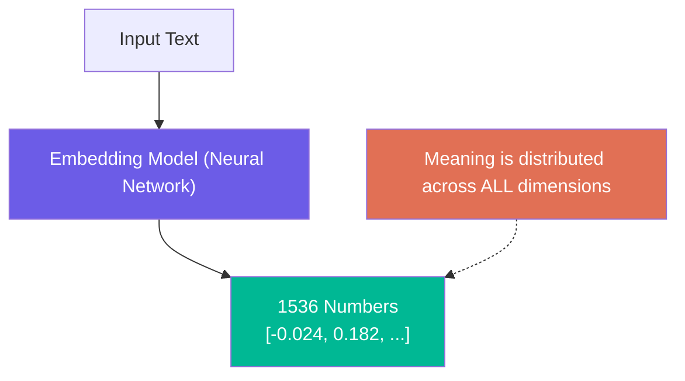
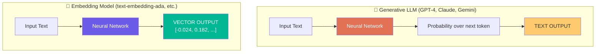

# Chapter 01: Embeddings and The Problem of Meaning

> **Chapter Goal:** Understand *why* computers cannot work directly with language meaning, how embeddings bridge the gap between human language and machine math, and what makes two pieces of text "similar" from a machine's perspective. This chapter sets the conceptual foundation for building the entire movie recommendation system.

---

## 1.1 The Core Problem: Meaning vs. Symbols

Computers are extraordinarily powerful at processing **symbols** — but they do not inherently understand **meaning**.

Consider three movie descriptions:

```
A: "An astronaut is stranded on Mars."
B: "A man must survive alone on another planet."
C: "A detective investigates a murder in London."
```

As a human, you instantly recognize:
- **A ≈ B** (same theme, survival on a planet)
- **A is very different from C** (completely different setting and genre)

But look at what A and B actually share at the character level:

| Word in A     | Word in B       | Match?  |
|---------------|-----------------|---------|
| astronaut     | man             | ❌       |
| stranded      | survive         | ❌       |
| Mars          | planet          | ❌       |

The sentences share **almost zero literal words** — yet their *meaning* is nearly identical.

> **The Central Problem:** How can a machine represent meaning in a form that mathematics can work with?

---

## 1.2 Why Mathematics Requires Numbers

Machine learning models, neural networks, and similarity algorithms all operate on **numbers** — not on words or sentences.

There is no direct way to compute:

```
distance("An astronaut on Mars", "A man surviving on another planet")
```

But once things become numbers, we can perform:

| Mathematical Operation | What It Enables                         |
|------------------------|-----------------------------------------|
| Subtraction / Distance | Measuring how far apart two things are  |
| Dot Product            | Measuring how aligned two vectors are   |
| Cosine Similarity      | Measuring directional similarity        |
| Sorting                | Ranking by similarity                   |

So our core requirement is:

> **Convert meaning into a numerical representation that preserves semantic relationships.**

---

## 1.3 What Is an Embedding?

An **embedding** is a transformation of text (or any data) into a vector of numbers such that **semantically similar inputs produce vectors that are close together in mathematical space**.


### Example

```
"A stranded astronaut tries to survive on Mars."
    ↓  Embedding Model
[0.014, -0.031, 0.087, 0.221, -0.045, ...]
```

This array of numbers is called an **embedding vector**.

The key property:
- `"An astronaut on Mars"` → vector close to `"A man surviving alone on a planet"`
- `"A detective in London"` → vector far from both above

---

## 1.4 Do Individual Dimensions Have a Clear Meaning?

A common misconception is imagining embeddings like this:

```
[space_score, romance_score, action_score]
```

In reality, **real embedding models do NOT work this way**.

In a 1536-dimensional embedding (like OpenAI's):
- No single dimension directly maps to a human concept
- The meaning is **distributed** across the entire vector
- You cannot say "dimension 284 = space" or "dimension 611 = violence"



> **Key Insight:** What matters is NOT what each number means individually, but that **texts with similar meanings produce vectors that are mathematically close to each other**.

---

## 1.5 How Closeness Is Maintained in Vector Space

Think of a simplified 2D example. In real embeddings this is thousands of dimensions, but the same principle applies:

```
                  HIGH SPACE
                      |
        Gravity ●     |    ● The Martian
                      |
        Interstellar ●|
  ──────────────────────────────── HIGH SURVIVAL
                      |
        Batman ●      |
                      |
        Titanic ●     |
                  LOW SPACE
```

Notice:
- The Martian, Interstellar, and Gravity cluster together (space + survival themes)
- Batman and Titanic cluster far away

This is the geometric intuition — **similar meaning = physically close in vector space**.

---

## 1.6 Embedding Model vs. Generative LLM

These are two fundamentally different types of AI models:



| Property           | Generative LLM            | Embedding Model              |
|--------------------|---------------------------|------------------------------|
| **Goal**           | Generate language          | Represent meaning as numbers |
| **Output**         | Text (tokens)              | Vector (fixed-size array)    |
| **Usage**          | Summarize, write, chat     | Search, compare, rank        |
| **Stateless?**     | No — builds token by token | Yes — one forward pass       |

### Can an Embedding Model Answer Questions?

Send `"What is the capital of India?"` to an embedding model and you get:

```
[0.023, -0.193, 0.082, ...]
```

Not "New Delhi". That is **by design** — the embedding model's job is to *represent* the question, not *answer* it.

---

## 1.7 The Transformation We Need


> Think of the embedding model not as a chatbot — but as a **machine that converts meaning into coordinates**.

---

## 1.8 Summary

| Concept                          | Key Takeaway                                                  |
|----------------------------------|---------------------------------------------------------------|
| Computers understand symbols     | But symbols don't carry meaning automatically                 |
| Embeddings convert meaning       | Text → fixed-size numerical vector                            |
| Similar meaning = close vectors  | This property enables semantic search                         |
| Dimensions are not interpretable | Meaning is distributed, not localized to one number           |
| Embedding ≠ Generative           | One represents, the other generates                           |

This foundation leads us to the practical question: **why use embeddings for movie recommendations instead of just using an LLM directly?** That is the subject of Chapter 02.
