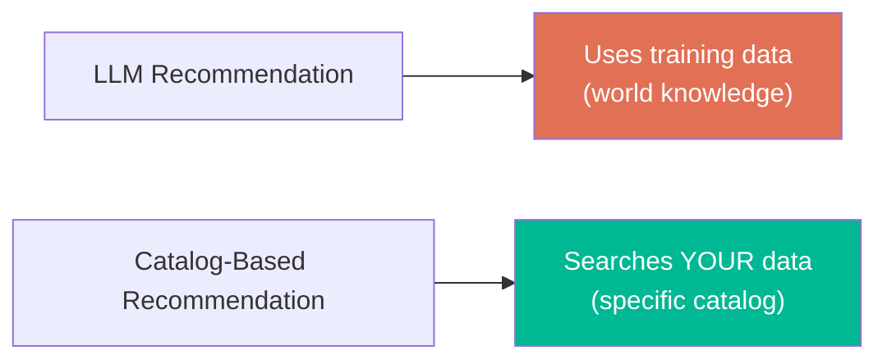
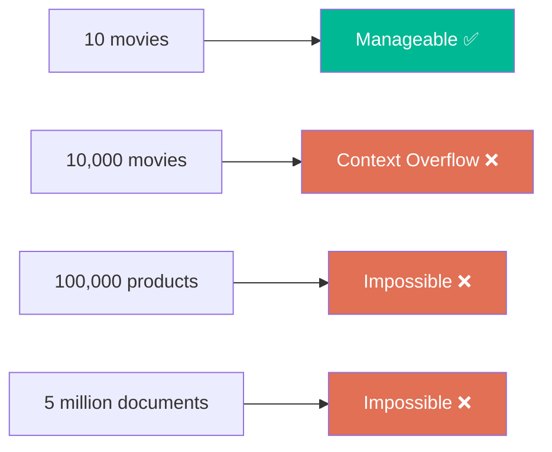
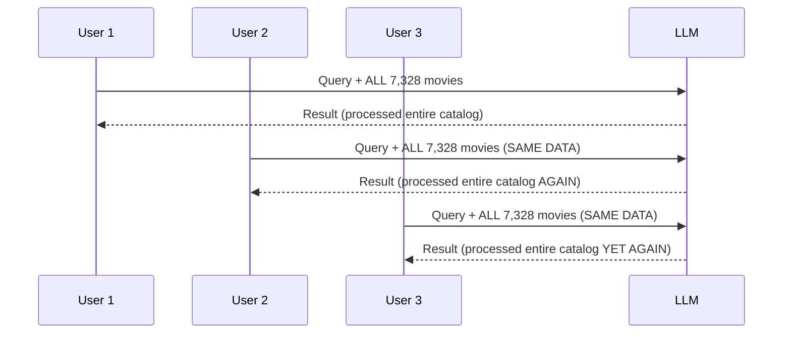
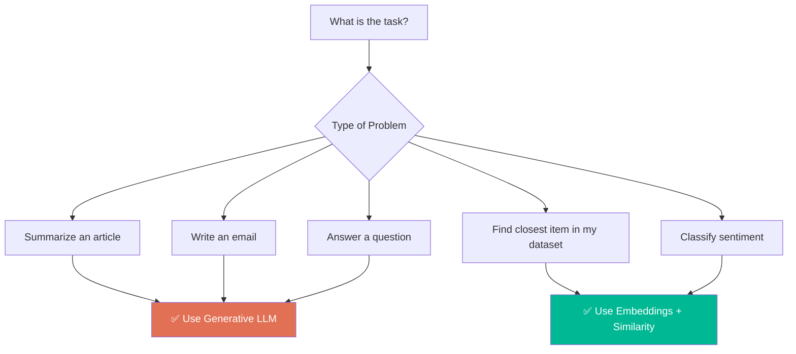
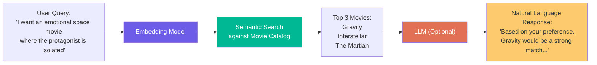

# Chapter 02: Why Not Just Use an LLM for Recommendations?

> **Chapter Goal:** Understand the critical engineering distinction between *knowledge/generation* (what LLMs are best at) and *searching your own data* (what embeddings are best at). This chapter explains why naive LLM-based recommendation fails at scale and motivates the embedding-based approach.

---

## 2.1 LLMs Can Recommend — But That Isn't the Real Problem

At first glance, using an LLM for movie recommendations seems perfectly reasonable:

```
User: "I loved Interstellar. Recommend three similar movies."

LLM: "Based on your love of Interstellar, here are three similar films:
      1. Arrival — a cerebral sci-fi about first contact
      2. The Martian — survival on Mars
      3. Gravity — survival in space"
```

Large language models absolutely *can* recommend movies. They've been trained on enormous amounts of movie reviews, descriptions, and cultural data.

### The Real Question

The important distinction is NOT:
```
"Can an LLM recommend movies?"  ← (Yes, it can)
```

The real question is:
```
"Can an LLM recommend movies *from MY specific catalog*?"
```



---

## 2.2 Scenario 1: Generic Recommendation

```
"Recommend movies similar to Interstellar."
```

Here an LLM works well. It has general knowledge of thousands of movies, directors, themes, and genres from its training.

This is a **knowledge/generation** problem → LLMs are the right tool.

---

## 2.3 Scenario 2: Your Own Catalog

Now imagine you have built a streaming platform:

```
CoderArmyFlix
```

Your catalog contains **7,328 movies**, some of which are:
- **New releases** — added after the LLM's training cutoff
- **Regional films** — not well-known internationally
- **Independent productions** — not in major databases
- **Internal/exclusive content** — your platform only
- **Obscure titles** — the LLM simply doesn't know

The requirement now becomes:

```
"Recommend the three most relevant movies, but ONLY from our catalog."
```

This is a fundamentally different problem. The LLM's training data cannot help here.

---

## 2.4 The Naive LLM Approach (and Why It Fails)

The tempting solution: just send your entire catalog to the LLM with every request.

```
// Pseudo-code for naive approach
const prompt = `
  Here are my 7,328 movies:
  Movie 1: "Interstellar" — "A team of astronauts..."
  Movie 2: "The Martian" — "An astronaut becomes stranded..."
  Movie 3: ...
  ...
  Movie 7328: ...

  The user likes Interstellar. Recommend three movies.
`;

const response = await llm.generate(prompt);
```

This creates **four serious problems**:

---

## 2.5 Problem 1: Context Size Limits

LLMs have a **maximum context window** — a hard limit on how much text they can process in one request.



Real production catalogs are orders of magnitude larger than any context window. Even if context windows grow, sending millions of items is never efficient.

---

## 2.6 Problem 2: Repeated and Wasted Work

The movie catalog barely changes. But with the naive approach, you process the same catalog data with **every single user request**.



With 1 million users per day, you are processing the same 7,328 movies **1 million times**. This is massively wasteful.

> **Engineering Principle:** If something expensive doesn't change often, calculate it once and reuse it.

---

## 2.7 Problem 3: We Don't Actually Need Generation

Ask yourself: what does the recommendation feature actually need?

```
WHAT WE DON'T NEED:
"The Martian would be an excellent choice because its themes of scientific 
ingenuity and survival in an isolated, hostile environment closely mirror 
the existential perseverance depicted in Interstellar..."

WHAT WE ACTUALLY NEED:
Movie A → 0.87
Movie B → 0.81
Movie C → 0.42
```

We need a **ranking** — not a paragraph. Once we have similarity scores, we sort and return the top N movies.

Generating paragraphs:
- Takes more time (token-by-token generation)
- Costs more per API call
- Provides output we don't need

Using embeddings:
- One fast forward pass to get a vector
- Mathematical comparison (instant)
- Exact numerical ranking

---

## 2.8 Problem 4: Cost and Latency

A generative model generates output **sequentially**, one token at a time:

```
token → token → token → token → ...
```

This is slow for high-traffic applications.

An embedding model:
1. Takes input text
2. Does a single forward pass through the neural network
3. Returns a fixed-size vector

Once movie embeddings are **precomputed and stored**, each user query requires only:


The recommendation itself requires **zero additional LLM calls**.

---

## 2.9 Think Like an Engineer: Match Tool to Problem

The right engineering question is not:

```
"Which AI model is the smartest?"
```

It is:

```
"What operation does my problem actually require?"
```



| Problem Type                          | Right Tool            |
|---------------------------------------|-----------------------|
| Generate text or explanations         | Generative LLM        |
| Find closest meaning in a dataset     | Embeddings + Search   |
| Summarize / rewrite                   | Generative LLM        |
| Rank / sort by semantic relevance     | Embeddings + Ranking  |

---

## 2.10 Can We Combine Both?

Yes — and this is one of the most powerful patterns in modern AI systems.



Each system does what it is **best suited for**:
- **Embedding Model → SEARCH** (find relevant items)
- **LLM → GENERATION** (explain, narrate, respond)

This pattern — search first, then generate — forms the foundation of **Retrieval-Augmented Generation (RAG)**, which is studied in a separate lecture.

---

## 2.11 Summary

| Problem with Naive LLM Approach    | Solution via Embeddings          |
|------------------------------------|----------------------------------|
| Context window limits              | Only embed the query (tiny)      |
| Repeated processing of same data   | Precompute vectors once          |
| Generation not needed (just rank)  | Pure mathematical comparison     |
| High cost and latency              | Fast vector math, no generation  |

The decision is architectural: **use the right tool for the right job**. For finding closest meaning in your own dataset, embeddings + similarity are the correct approach.

Chapter 03 explores exactly how to measure similarity between two vectors mathematically.
