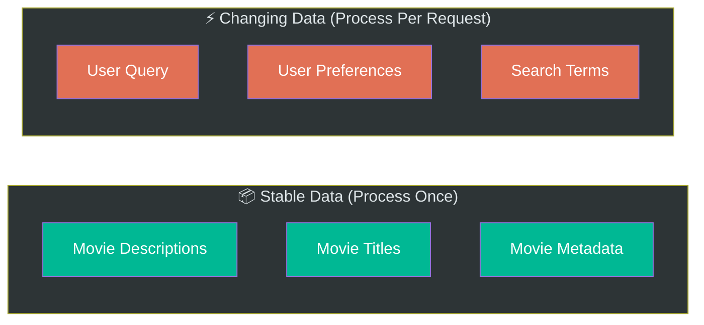
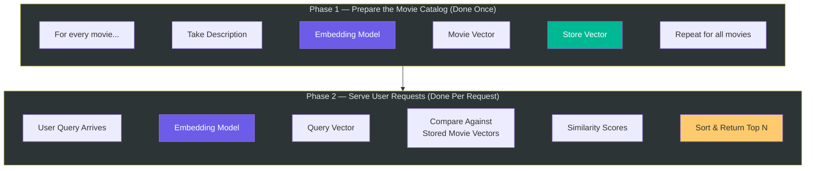
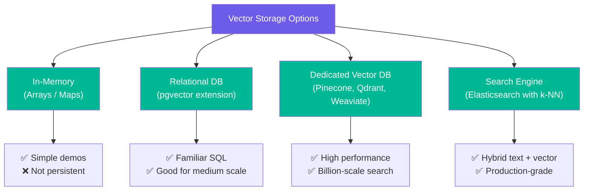
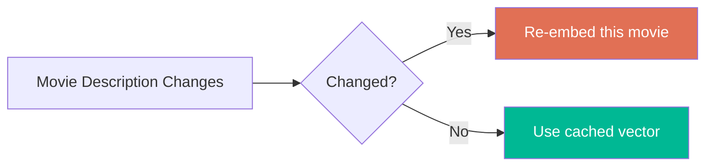
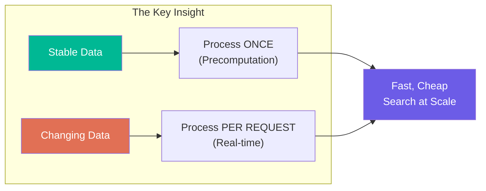

# Chapter 03: Precomputation — The Key Engineering Insight

> **Chapter Goal:** Understand the principle of precomputation — computing expensive operations once and reusing the results — and how this transforms the architecture of an embedding-based recommendation system. This chapter also covers the "first principles" approach to system design that separates stable data from changing data.

---

## 3.1 The First-Principles Question

Before writing any code or calling any API, a good engineer asks:

```
"Which part of the system changes frequently?"
```

Apply this to our movie recommendation system:

| Data                     | Changes?                        |
|--------------------------|---------------------------------|
| Movie descriptions       | Rarely — stable                 |
| User search queries      | Constantly — different per user |
| Movie metadata (title)   | Rarely — stable                 |
| User preferences         | Often — per session             |

This gives us a clean division:



> **Core Engineering Principle:** If something expensive does not change often, calculate it once and reuse it.

---

## 3.2 Applying Precomputation to Embeddings

### Stable Data → Precompute

Movie descriptions almost never change. So we can:

```
Interstellar Description
    ↓
Embedding API (called ONCE)
    ↓
[0.12, -0.43, 0.08, ...]
    ↓
Save It
```

Tomorrow, if the description hasn't changed — use the **same vector**. No new API call needed.

### Changing Data → Process on Demand

User queries change with every search:

```
User Query (real-time)
    ↓
Embedding API (called per request)
    ↓
Query Vector
    ↓
Compare Against Pre-saved Movie Vectors
```

---

## 3.3 The Two-Phase Architecture

This gives us a clean two-phase system:



---

## 3.4 What Precomputation Actually Buys Us

Let's calculate the difference concretely.

### Without Precomputation (Naive Approach)

Every user request processes all movies:

```
Per Request Cost:
  - 7,328 movie descriptions → LLM context
  - 1 user query → LLM
  - Wait for sequential generation

With 1,000,000 users/day:
  - 1,000,000 × (7,328 movies processed) = 7,328,000,000 operations
```

### With Precomputation (Smart Approach)

```
Offline (done once):
  - 7,328 movies × 1 embedding each = 7,328 embedding calls (total, ever)

Per Request (real-time):
  - 1 embedding call (query only)
  - 7,328 vector comparisons (fast math, no AI)

With 1,000,000 users/day:
  - 1,000,000 × 1 embedding call = 1,000,000 (vs 7,328,000,000)
```

```mermaid
bar
    title API Calls Per Day (1M users, 7328 movies)
    "Without Precomputation" : 7328000000
    "With Precomputation" : 1000000
```

The savings are **thousands of times** fewer API calls.

---

## 3.5 Pseudo-Code: Building the Precomputed Catalog

Here's the offline precomputation step in pseudo-code (JS/TS style):

```js
// Phase 1: Build the Movie Vector Catalog (run once, or when catalog updates)

interface Movie {
  id: string;
  title: string;
  description: string;
  vector?: number[];  // populated during precomputation
}

const movieCatalog: Movie[] = [
  { id: "1", title: "Interstellar", description: "A team of astronauts travels through a wormhole..." },
  { id: "2", title: "The Martian", description: "An astronaut becomes stranded on Mars..." },
  // ... 7,326 more movies
];

async function precomputeMovieVectors(movies: Movie[]): Promise<Movie[]> {
  for (const movie of movies) {
    // Call embedding model once per movie
    movie.vector = await embeddingModel.embed(movie.description);
    // Save to storage (in-memory, database, vector store)
    await storage.save(movie.id, movie.vector);
  }
  return movies;
}
```

> **Note:** This is pseudo-code. In production this could use a vector database like Pinecone, Weaviate, Qdrant, or pgvector — but the concept is identical.

---

## 3.6 Pseudo-Code: Serving a Real-Time Query

Once vectors are precomputed, serving a user query is fast:

```js
// Phase 2: Answer a user search query (runs per request)

async function searchMovies(userQuery: string, topN: number = 5): Promise<Movie[]> {
  // Step 1: Embed the user's query (one API call)
  const queryVector = await embeddingModel.embed(userQuery);

  // Step 2: Compare query vector against all precomputed movie vectors
  const scored = movieCatalog.map(movie => ({
    movie,
    score: cosineSimilarity(queryVector, movie.vector)
  }));

  // Step 3: Sort by similarity score (descending)
  scored.sort((a, b) => b.score - a.score);

  // Step 4: Return top N results
  return scored.slice(0, topN).map(s => s.movie);
}
```

The key insight: **no LLM generation involved in the response** — only fast vector math.

---

## 3.7 Where to Store Precomputed Vectors

For our simple demo project, vectors can live in memory:

```js
// Simple in-memory storage (fine for demo)
const movieCatalog: Movie[] = [...]; // each Movie has a .vector field
```

In production, you would use:



For this lecture's project, in-memory (`List<Movie>`) is sufficient.

---

## 3.8 When Should You Re-Compute Vectors?

Precomputed vectors become stale when the underlying data changes. A production system needs an update strategy:

| Trigger                              | Action                              |
|--------------------------------------|-------------------------------------|
| Movie description updated            | Re-embed that specific movie        |
| New movie added to catalog           | Embed the new movie                 |
| Embedding model version upgraded     | Re-embed entire catalog             |
| Batch of new movies added overnight  | Run batch embedding job             |



This is similar to any caching strategy: **invalidate when source data changes**.

---

## 3.9 The Broader Principle: Compute Once, Query Many Times

Precomputation is not unique to embeddings. It appears everywhere in software engineering:

| System                    | What's Precomputed             | Why                         |
|---------------------------|--------------------------------|-----------------------------|
| Search engine             | Inverted index                 | Index once, query fast      |
| DNS                       | IP address cache               | Resolve once, reuse         |
| Database indexes          | B-tree structures              | Build once, query fast      |
| CDN                       | Static assets cached globally  | Serve once, deliver locally |
| **Embedding system**      | Movie vectors                  | Embed once, compare fast    |

> **Universal Pattern:** Turn slow, expensive operations into fast lookups by doing the work upfront.

---

## 3.10 Summary



| Concept                      | Takeaway                                               |
|------------------------------|--------------------------------------------------------|
| Stable vs. changing data     | Process stable data once; process changing data live   |
| Precompute movie vectors     | Run once offline; use results for all future queries   |
| Per-request work             | Only embed the user query (one small API call)         |
| Storage for vectors          | In-memory for demos; vector DB for production          |
| Invalidation strategy        | Re-embed when descriptions change                      |

Chapter 04 covers the two core features this architecture enables: **Semantic Movie Search** and **Similar Movie Recommendation**.
