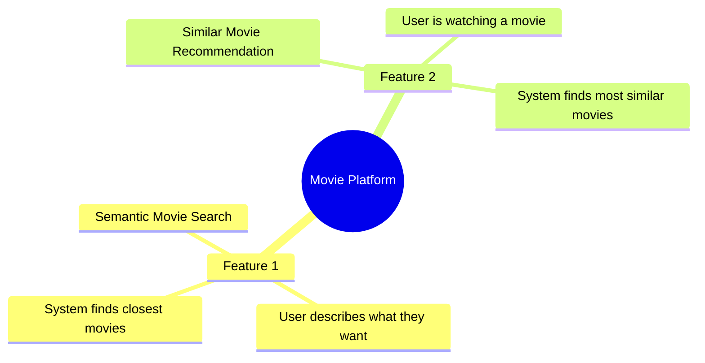
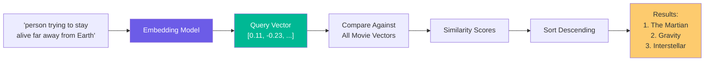
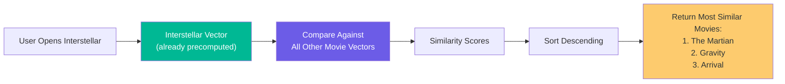
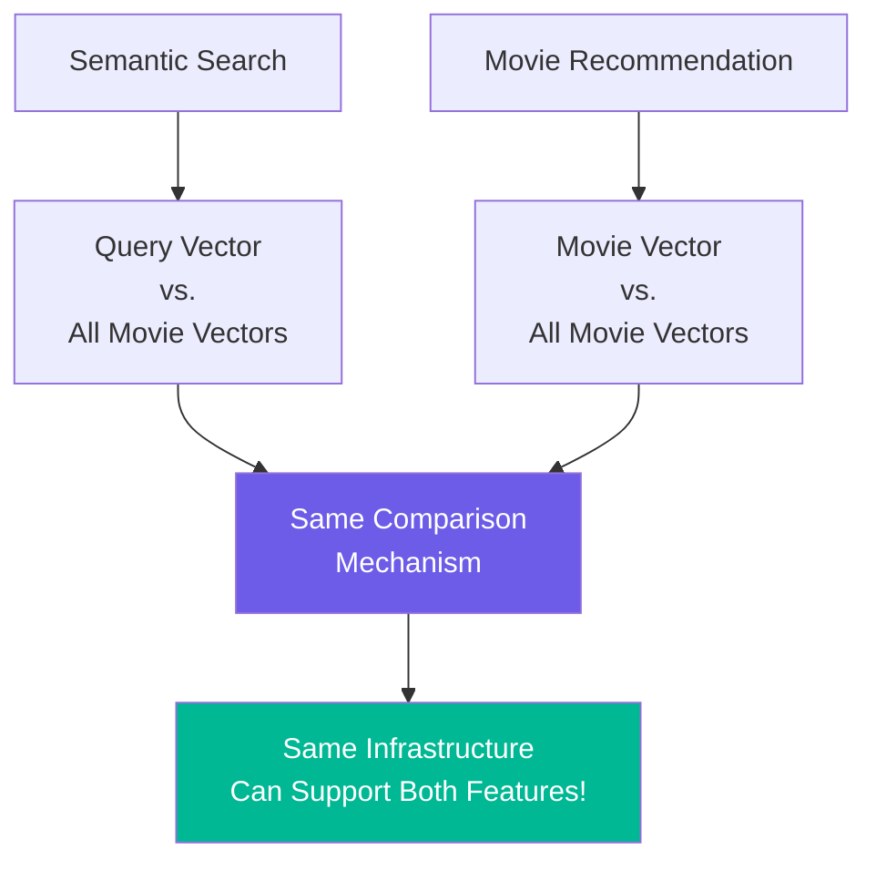
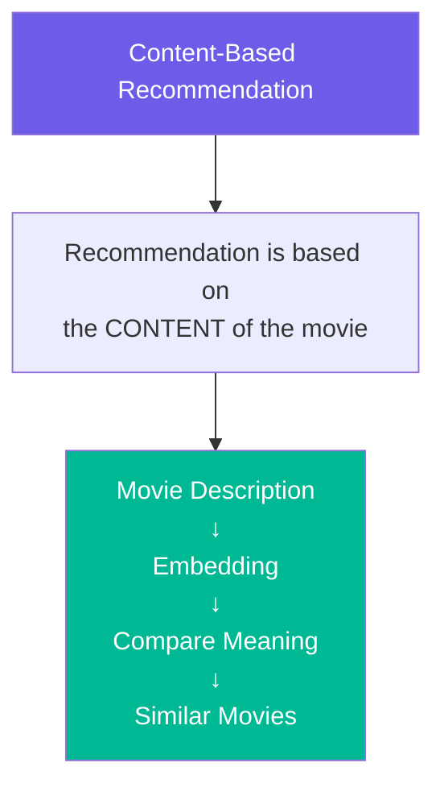
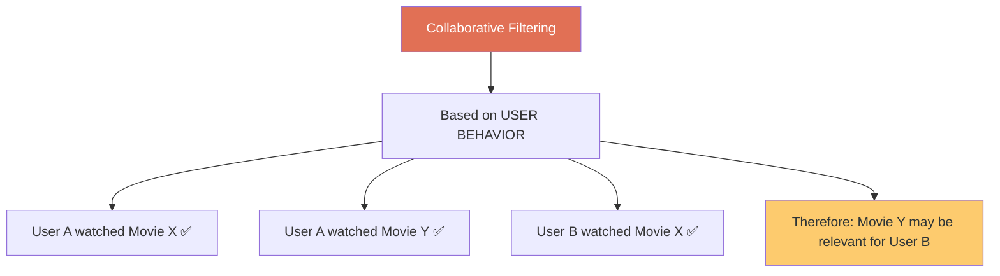
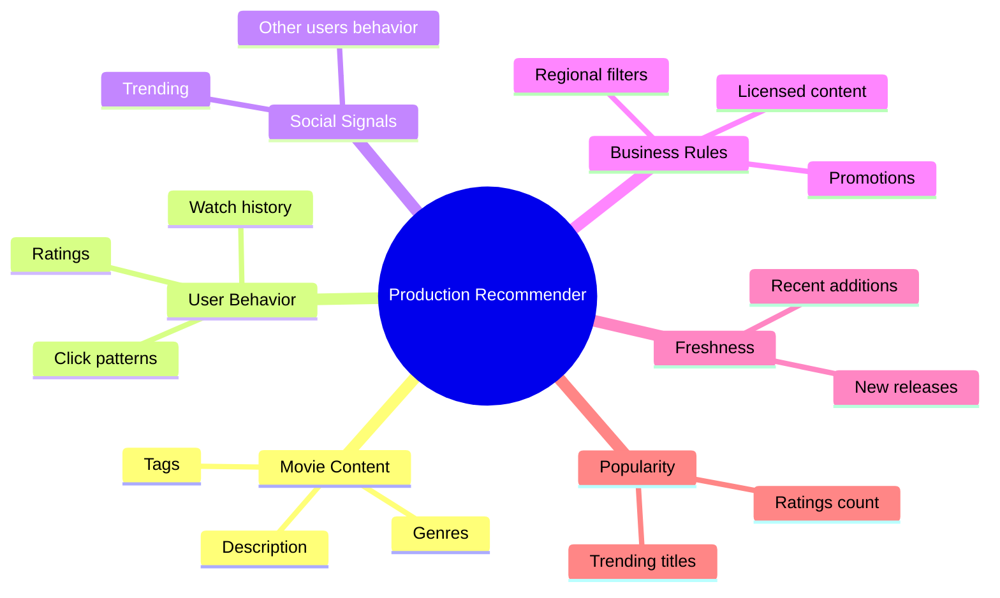
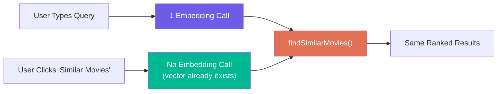

# Chapter 04: Semantic Search and Movie Recommendation

> **Chapter Goal:** Understand the two core features of the embedding-powered movie system — Semantic Movie Search and Similar Movie Recommendation — and see why they are essentially the same problem with a different starting vector.

---

## 4.1 The Two Features We Are Building

Our movie recommendation engine exposes two core features:



Both features rely on the **same underlying mechanism** — vector comparison. The only difference is where the starting vector comes from.

---

## 4.2 Feature 1: Semantic Movie Search

### The Problem with Keyword Search

Traditional keyword-based search fails when the user's words don't match the movie's description verbatim.

**User query:**
```
"I want something about a person trying to stay alive far away from Earth."
```

**Movie description in database:**
```
"An astronaut becomes stranded on Mars and must use science and ingenuity to survive."
```

Keyword overlap:
| User's Words       | Movie Description Words | Match?  |
|--------------------|-------------------------|---------|
| person             | astronaut               | ❌       |
| stay alive         | survive                 | ❌       |
| far away from Earth| Mars                    | ❌       |

A keyword search would find **zero matches** despite the perfect semantic alignment.

### How Semantic Search Solves This

Instead of matching words, we match **meaning**:



Even though the words are different, the **meaning** is similar, so the vectors are close in vector space — and the right movies surface.

### The Complete Semantic Search Flow

```
USER QUERY
    ↓
Embedding Model
    ↓
Query Vector
    ↓
Compare With All Movie Vectors
    ↓
Calculate Similarity Score (Cosine Similarity)
    ↓
Sort by Similarity (Descending)
    ↓
Return Top Movies
```

---

## 4.3 Feature 2: Similar Movie Recommendation

### The Scenario

The user has finished watching **Interstellar** and clicks:

```
[Show Similar Movies]
```

We don't need a text query. Interstellar **already has an embedding vector** — computed during Phase 1 (precomputation).

### The Flow



Key difference from search: **we skip the embedding step entirely** — we already have the vector.

```
Semantic Search:  Query Text → Embedding → Query Vector → Compare → Rank
Recommendation:   Existing Movie Vector (skip embedding) → Compare → Rank
```

---

## 4.4 Search and Recommendation Are Almost the Same Problem

This is a critical engineering insight:



The **source vector** changes, but the underlying comparison infrastructure is identical. This means:

- One similarity function serves both features
- One data store of movie vectors serves both features
- Adding new features (e.g., "Movies like my playlist") uses the same infrastructure

> **Engineering Insight:** The same similarity infrastructure can support multiple features. Build it once; add features cheaply.

---

## 4.5 Pseudo-Code: Both Features Using Shared Infrastructure

```js
// Shared infrastructure — works for BOTH features

function findSimilarMovies(
  sourceVector: number[],
  allMovies: Movie[],
  excludeMovieId?: string,
  topN: number = 5
): Movie[] {
  const scored = allMovies
    .filter(m => m.id !== excludeMovieId)  // exclude self for recommendation
    .map(movie => ({
      movie,
      score: cosineSimilarity(sourceVector, movie.vector)
    }));

  scored.sort((a, b) => b.score - a.score);
  return scored.slice(0, topN).map(s => s.movie);
}

// --- Feature 1: Semantic Search ---
async function semanticSearch(userQuery: string): Promise<Movie[]> {
  const queryVector = await embeddingModel.embed(userQuery);  // embed query
  return findSimilarMovies(queryVector, movieCatalog);        // reuse shared function
}

// --- Feature 2: Recommendation ---
function recommendSimilarMovies(movie: Movie): Movie[] {
  return findSimilarMovies(
    movie.vector,       // no embedding needed — already have it
    movieCatalog,
    movie.id            // exclude the current movie itself
  );
}
```

Both features call the same `findSimilarMovies` function — only the **source of the starting vector** differs.

---

## 4.6 What Type of Recommendation System Is This?

Our system is a **Content-Based Recommendation System**.



The recommendation is derived from **what a movie is about** — its description, themes, tone — not from any user behavior.

---

## 4.7 What We Are NOT Building: Collaborative Filtering

There is another major type of recommendation system called **Collaborative Filtering**, which we are intentionally NOT building:



Collaborative filtering logic:
```
User A watched Interstellar
User A watched The Martian
User B watched Interstellar
→ Recommend The Martian to User B
```

Our project does **not** use any user behavior data. No watch history, no ratings, no click patterns.

---

## 4.8 Comparing Content-Based vs. Collaborative Filtering

| Aspect                     | Content-Based (Ours)              | Collaborative Filtering          |
|----------------------------|-----------------------------------|----------------------------------|
| **Data source**            | Movie description / content       | User behavior history            |
| **Cold start problem**     | Handles new movies well           | Struggles with new movies/users  |
| **Requires user data**     | No                                | Yes                              |
| **Serendipity**            | Lower (stays within similar genre)| Higher (cross-genre discoveries) |
| **Explainability**         | High (based on content features)  | Lower (based on user patterns)   |
| **Privacy**                | No user data needed               | Requires user tracking           |

> **Note:** Real production systems (Netflix, Spotify, Amazon) combine **both** approaches along with many other signals.

---

## 4.9 Real Production Recommendation Systems Are More Complex

Our demo isolates one concept to make it clear. Real production systems combine many signals:



Our demo intentionally isolates:
```
Recommendation using embedding similarity on movie descriptions
```

This isolation makes it easier to understand the role of vector embeddings without mixing in multiple recommendation techniques.

---

## 4.10 Summary

| Feature                       | Starting Vector Source          | Embedding Call Needed?  |
|-------------------------------|----------------------------------|--------------------------|
| Semantic Movie Search         | User query text                  | Yes (once per search)    |
| Similar Movie Recommendation  | Precomputed movie vector          | No                       |



Both features share one infrastructure — the vector store and similarity function. Chapter 05 dives into how similarity is actually calculated mathematically.
