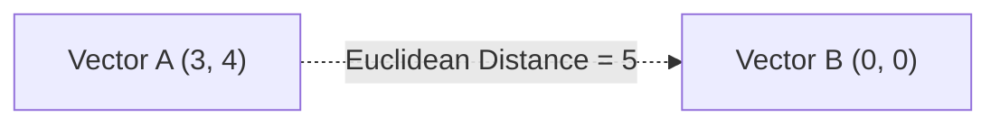
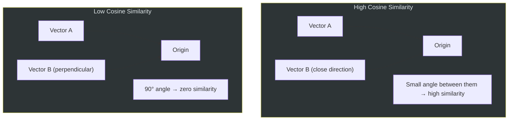
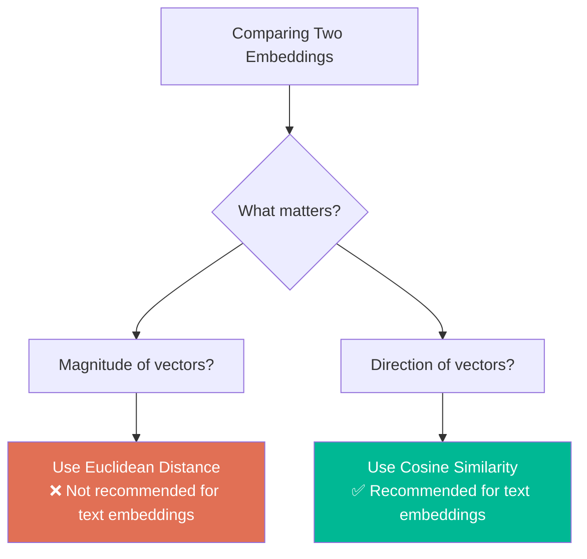
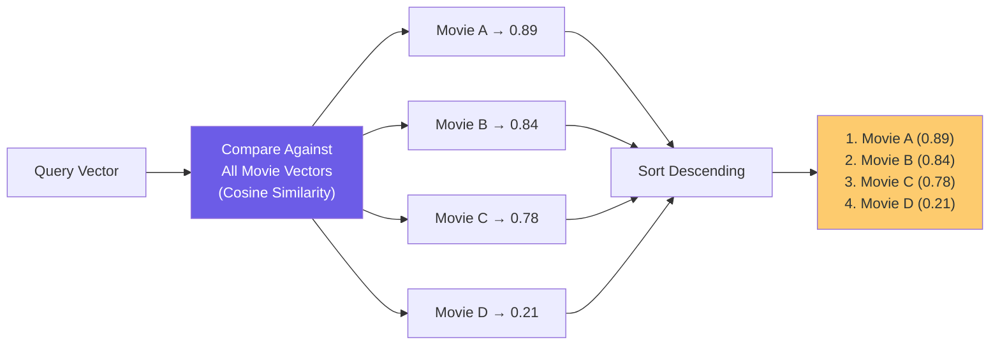
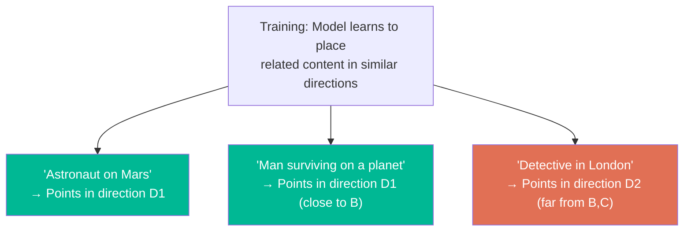

# Chapter 05: Cosine Similarity — How We Measure Closeness

> **Chapter Goal:** Understand how vector similarity is actually measured mathematically. Learn what Cosine Similarity is, why it's preferred for text embeddings, how it compares to Euclidean distance, and how to implement it. This chapter bridges the conceptual "closeness in space" with the actual mathematical operation.

---

## 5.1 The Core Question

After we convert movie descriptions and user queries into vectors, the key question becomes:

```
"How close is THIS vector to EVERY OTHER vector?"
```

This requires a **mathematical definition of closeness** between two high-dimensional vectors.

We have two main options:
1. **Euclidean Distance** — straight-line distance between points
2. **Cosine Similarity** — angle between vectors (direction comparison)

---

## 5.2 Euclidean Distance (and Its Limitations for Text)

Euclidean distance measures the **straight-line distance** between two points in space.

In 2D:

```
distance = √((x₂ - x₁)² + (y₂ - y₁)²)
```

In N dimensions (generalized):

```
distance = √(Σ (vᵢ - uᵢ)²)
```



**Problem with Euclidean distance for text embeddings:**

Embedding vectors can vary in magnitude (length) based on factors unrelated to meaning. A sentence that is naturally verbose may produce a vector with a larger overall magnitude than a short sentence, even if they mean the same thing.

```
"Mars" → short, compact embedding
"An astronaut was stranded on the cold and desolate surface of Mars" → longer embedding

Euclidean distance: LARGE (because magnitudes differ)
Actual semantic similarity: SHOULD BE HIGH
```

---

## 5.3 Cosine Similarity — Comparing Direction, Not Magnitude

Cosine similarity ignores the length of vectors and compares only their **direction** (angle between them).

**Formula:**

```
cosine_similarity(A, B) = (A · B) / (|A| × |B|)
```

Where:
- `A · B` = dot product (sum of element-wise multiplications)
- `|A|` = magnitude (length) of vector A
- `|B|` = magnitude (length) of vector B

**Result range:**

| Value | Interpretation                         |
|-------|----------------------------------------|
| `1.0` | Identical direction — perfectly similar|
| `0.5` | Moderately similar                     |
| `0.0` | Completely unrelated (90° apart)       |
| `-1.0`| Opposite meaning (180° apart)          |

---

## 5.4 Visual Intuition



Think of it geometrically:
- Two arrows pointing in the same direction → **similar** (high cosine similarity)
- Two arrows pointing at right angles → **unrelated** (zero cosine similarity)
- Two arrows pointing in opposite directions → **opposite meanings** (negative cosine similarity)

---

## 5.5 Worked Example (Simplified)

Suppose we have two 3D vectors (in reality they'd be 1536-dimensional):

```
The Martian    → [0.8, 0.6, 0.1]   (high space, high survival, low romance)
Interstellar   → [0.7, 0.5, 0.2]   (high space, moderate survival, low romance)
Titanic        → [0.1, 0.2, 0.9]   (low space, low survival, high romance)
```

Computing cosine similarity:

**The Martian vs. Interstellar:**
```
dot product  = (0.8×0.7) + (0.6×0.5) + (0.1×0.2) = 0.56 + 0.30 + 0.02 = 0.88
|A| = √(0.8² + 0.6² + 0.1²) = √(0.64 + 0.36 + 0.01) = √1.01 ≈ 1.005
|B| = √(0.7² + 0.5² + 0.2²) = √(0.49 + 0.25 + 0.04) = √0.78 ≈ 0.883

cosine_similarity = 0.88 / (1.005 × 0.883) ≈ 0.991  → Very similar ✅
```

**The Martian vs. Titanic:**
```
dot product  = (0.8×0.1) + (0.6×0.2) + (0.1×0.9) = 0.08 + 0.12 + 0.09 = 0.29
|A| ≈ 1.005  (same as above)
|C| = √(0.1² + 0.2² + 0.9²) = √(0.01 + 0.04 + 0.81) = √0.86 ≈ 0.927

cosine_similarity = 0.29 / (1.005 × 0.927) ≈ 0.31  → Very different ✅
```

---

## 5.6 Pseudo-Code Implementation

```js
// Cosine similarity between two vectors
function cosineSimilarity(vectorA: number[], vectorB: number[]): number {
  // Step 1: Compute dot product
  const dotProduct = vectorA.reduce(
    (sum, value, index) => sum + value * vectorB[index],
    0
  );

  // Step 2: Compute magnitudes
  const magnitudeA = Math.sqrt(vectorA.reduce((sum, val) => sum + val * val, 0));
  const magnitudeB = Math.sqrt(vectorB.reduce((sum, val) => sum + val * val, 0));

  // Step 3: Guard against zero-vectors
  if (magnitudeA === 0 || magnitudeB === 0) return 0;

  // Step 4: Return cosine similarity
  return dotProduct / (magnitudeA * magnitudeB);
}
```

**Usage:**
```js
const martianVector    = [0.8, 0.6, 0.1];
const interstellarVec  = [0.7, 0.5, 0.2];
const titanicVector    = [0.1, 0.2, 0.9];

console.log(cosineSimilarity(martianVector, interstellarVec));  // ~0.991
console.log(cosineSimilarity(martianVector, titanicVector));    // ~0.310
```

---

## 5.7 Euclidean Distance vs. Cosine Similarity for Embeddings



| Metric             | Considers Magnitude | Considers Direction | Good for Text? |
|--------------------|--------------------|--------------------|----------------|
| Euclidean Distance | Yes                | Yes                | ❌ Often not    |
| Cosine Similarity  | No (normalized)    | Yes                | ✅ Yes          |
| Dot Product        | Yes                | Yes                | Depends        |

> **Rule of Thumb:** For text embeddings, use **cosine similarity** unless you have a specific reason to use something else.

---

## 5.8 The Full Ranking Pipeline

Once we have cosine similarity scores, we sort and rank:



The movies with the **highest similarity** appear first. This gives us the semantic search results.

---

## 5.9 Pseudo-Code: Complete Ranking Function

```js
interface ScoredMovie {
  movie: Movie;
  score: number;
}

function rankMoviesBySimilarity(
  queryVector: number[],
  movies: Movie[]
): ScoredMovie[] {
  // Score every movie
  const scored: ScoredMovie[] = movies.map(movie => ({
    movie,
    score: cosineSimilarity(queryVector, movie.vector)
  }));

  // Sort by score descending (most similar first)
  scored.sort((a, b) => b.score - a.score);

  return scored;
}

// Return only the top N results
function getTopN(queryVector: number[], movies: Movie[], topN = 5): Movie[] {
  const ranked = rankMoviesBySimilarity(queryVector, movies);
  return ranked.slice(0, topN).map(item => item.movie);
}
```

---

## 5.10 Similarity Score Interpretation Guide

| Score Range   | Semantic Relationship     | Example                                          |
|---------------|---------------------------|--------------------------------------------------|
| 0.90 – 1.00   | Nearly identical meaning  | Two paraphrases of same sentence                 |
| 0.75 – 0.90   | Very similar meaning      | "Astronaut on Mars" vs. "Stranded in space"      |
| 0.50 – 0.75   | Related topic             | "Space survival" vs. "Mountain survival"         |
| 0.25 – 0.50   | Loosely related           | "Science fiction" vs. "Thriller"                 |
| 0.00 – 0.25   | Unrelated                 | "Astronaut" vs. "Romantic comedy"                |
| < 0.00        | Opposite/contradictory    | Rare in practice for general text embeddings     |

> **Note:** Exact thresholds depend on the specific embedding model. Always calibrate against your own data.

---

## 5.11 Why This Works: The Magic of the Embedding Space

The reason cosine similarity works so well for text embeddings is rooted in how embedding models are trained. They learn to place semantically related content in **similar directions** in high-dimensional space.



This directional property is exactly what cosine similarity measures.

---

## 5.12 Summary

| Concept                    | Key Takeaway                                            |
|----------------------------|---------------------------------------------------------|
| Euclidean distance         | Straight-line; affected by vector magnitude             |
| Cosine similarity          | Angle-based; ignores magnitude; better for text         |
| Output range               | -1 to +1 (in practice 0 to 1 for positive text)        |
| Implementation             | Dot product divided by product of magnitudes            |
| Ranking                    | Sort by score descending; highest = most similar        |

Chapter 06 covers the **core mental model** and **overall system architecture** that ties all these concepts together into a complete, working design.
