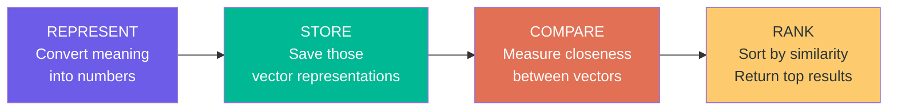
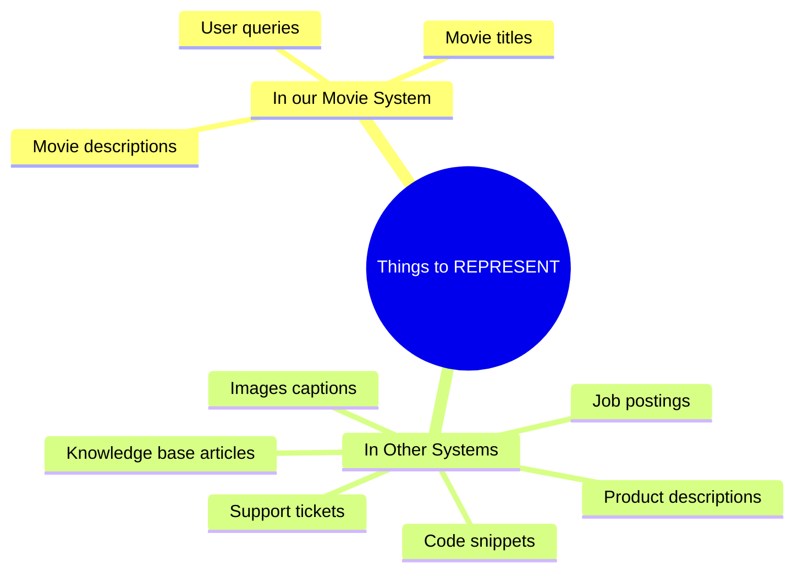
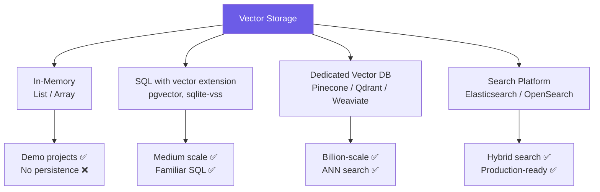
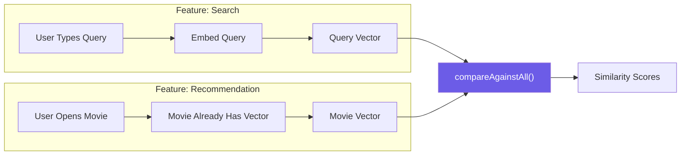
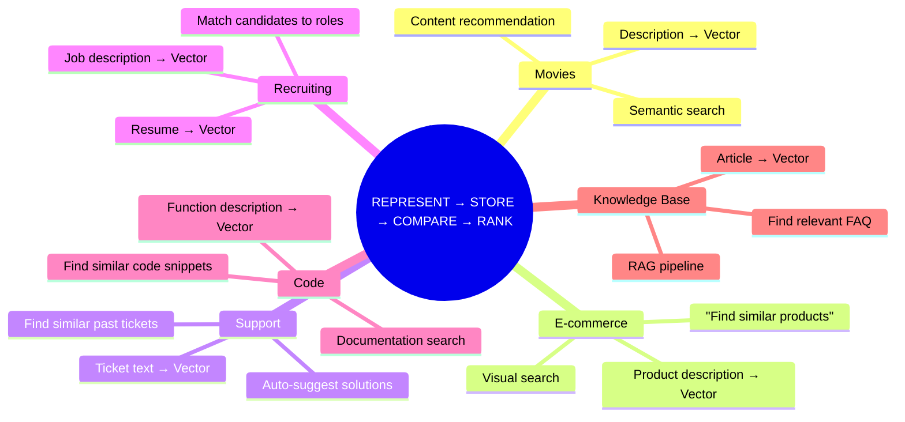
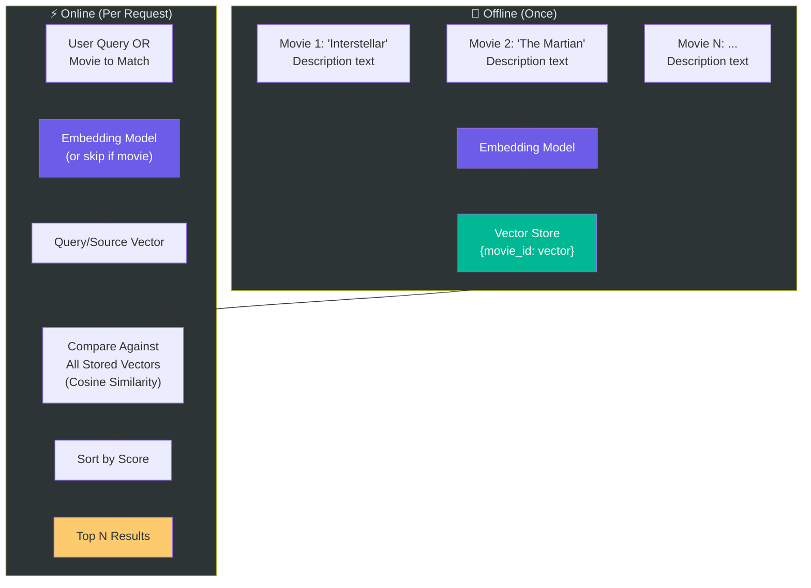

# Chapter 06: The Core Mental Model — REPRESENT → STORE → COMPARE → RANK

> **Chapter Goal:** Internalize the four-step mental model that drives all embedding-powered systems. This model applies not just to movies but to any problem where you need to find "the most relevant items in your dataset." It's the universal framework behind semantic search, recommendation systems, RAG, and more.

---

## 6.1 The Four-Operation Mental Model

Before thinking about APIs, databases, frameworks, or deployment — lock in four core operations:



Every embedding-powered system — no matter how complex — comes down to these four steps.

---

## 6.2 Step 1 — REPRESENT

**Convert meaning into numbers.**

```
Text
    ↓
Embedding Model
    ↓
Vector
```

**Example:**
```
"The Martian is about survival on Mars."
    ↓
Embedding Model
    ↓
[0.12, -0.43, 0.08, 0.91, -0.22, ...]
```

The embedding model is the **translation layer** between human language and machine mathematics. Think of it as a universal translator that converts any piece of text into a fixed-size array of numbers that encodes its semantic meaning.

### What Needs to Be Represented?



---

## 6.3 Step 2 — STORE

**Save those vector representations so they can be reused.**

```
Interstellar → [0.11, 0.42, -0.07, ...]  →  💾 Saved
The Martian  → [0.12, 0.39, -0.05, ...]  →  💾 Saved
Gravity      → [0.10, 0.45, -0.08, ...]  →  💾 Saved
Arrival      → [0.08, 0.31, -0.03, ...]  →  💾 Saved
```

For our project, storage is a simple in-memory list:

```js
// Simple in-memory storage
const movieCatalog: Movie[] = [
  { id: "1", title: "Interstellar", description: "...", vector: [0.11, 0.42, ...] },
  { id: "2", title: "The Martian",  description: "...", vector: [0.12, 0.39, ...] },
  // ...
];
```

### Storage Options at Scale



> **For this project:** In-memory storage (a `List<Movie>` or array) is sufficient. Don't over-engineer for scale before you have scale.

---

## 6.4 Step 3 — COMPARE

**Take a starting vector and compare it against all stored vectors.**

The starting vector can come from:
- A **search query**: user types text → embed it → get query vector
- An **existing item**: movie already has a vector → use it directly

The comparison question is always:

```
"How close is this vector to every other vector?"
```

We use **Cosine Similarity** (covered in Chapter 05):

```js
// Compare one vector against all others
function compareAgainstAll(
  sourceVector: number[],
  allMovies: Movie[]
): Array<{ movie: Movie; score: number }> {
  return allMovies.map(movie => ({
    movie,
    score: cosineSimilarity(sourceVector, movie.vector)
  }));
}
```

### Two Different Sources, Same Comparison



---

## 6.5 Step 4 — RANK

**Sort the similarity scores and surface the most relevant results.**

Suppose our comparison gives:

| Movie      | Similarity Score |
|------------|-----------------|
| Movie A    | 0.89            |
| Movie B    | 0.84            |
| Movie C    | 0.78            |
| Movie D    | 0.21            |

Sort descending:

```
1st → Movie A (0.89)
2nd → Movie B (0.84)
3rd → Movie C (0.78)
4th → Movie D (0.21)
```

The **highest similarity = most relevant** = appears first.

```js
function rankByScore(
  scored: Array<{ movie: Movie; score: number }>
): Movie[] {
  scored.sort((a, b) => b.score - a.score);
  return scored.map(s => s.movie);
}
```

This simple sort gives us both:
- ✅ Semantic search results
- ✅ Content-based movie recommendations

---

## 6.6 The Complete Pipeline in Pseudo-Code

```js
// === PHASE 1: REPRESENT + STORE (run once) ===

async function buildCatalog(movies: Movie[]): Promise<void> {
  for (const movie of movies) {
    // REPRESENT: Convert description to vector
    movie.vector = await embeddingModel.embed(movie.description);
    // STORE: Save in our in-memory catalog (or DB)
    catalog.push(movie);
  }
}

// === PHASE 2: COMPARE + RANK (run per request) ===

async function search(query: string, topN = 5): Promise<Movie[]> {
  // REPRESENT: Embed the user's query
  const queryVector = await embeddingModel.embed(query);

  // COMPARE: Score all movies
  const scored = catalog.map(movie => ({
    movie,
    score: cosineSimilarity(queryVector, movie.vector)
  }));

  // RANK: Sort and return top N
  scored.sort((a, b) => b.score - a.score);
  return scored.slice(0, topN).map(s => s.movie);
}

function recommend(movie: Movie, topN = 5): Movie[] {
  // No REPRESENT step needed — vector already exists

  // COMPARE: Score all other movies
  const scored = catalog
    .filter(m => m.id !== movie.id)
    .map(m => ({ movie: m, score: cosineSimilarity(movie.vector, m.vector) }));

  // RANK: Sort and return top N
  scored.sort((a, b) => b.score - a.score);
  return scored.slice(0, topN).map(s => s.movie);
}
```

---

## 6.7 The Mental Model Applied to Other Domains

This four-step model is universal. Whenever the problem is:

```
"Find the items in my dataset whose meaning is closest to this input."
```

The solution is:

```
REPRESENT → STORE → COMPARE → RANK
```



---

## 6.8 No Generative LLM Required for Recommendation

This is a critical insight:


The recommendation comes from **mathematical comparison of vectors** — not from an LLM generating text. The embedding model is used to create vectors, but the actual recommendation logic is pure math.

This means:
- **Faster** — no sequential token generation
- **Cheaper** — no generative model inference per recommendation
- **Deterministic** — same input always gives same result
- **Explainable** — similarity scores are concrete numbers

---

## 6.9 The Final Mental Model Diagram



---

## 6.10 Summary

| Step        | What Happens                               | When It Runs          |
|-------------|--------------------------------------------|-----------------------|
| REPRESENT   | Text → Embedding Model → Vector            | Offline (once per movie), Online (per query) |
| STORE       | Save vectors for reuse                     | Offline (build catalog)|
| COMPARE     | Cosine similarity between vectors          | Online (per request)  |
| RANK        | Sort by score, return top N                | Online (per request)  |

> **The fundamental idea:** Do not think of the embedding model as a chatbot. Think of it as a machine that converts meaning into coordinates. Once you have coordinates, mathematics does the rest.

Chapter 07 shows how all these concepts come together in the complete project design — including the architecture, data model, and design patterns you'd use to build this system.
