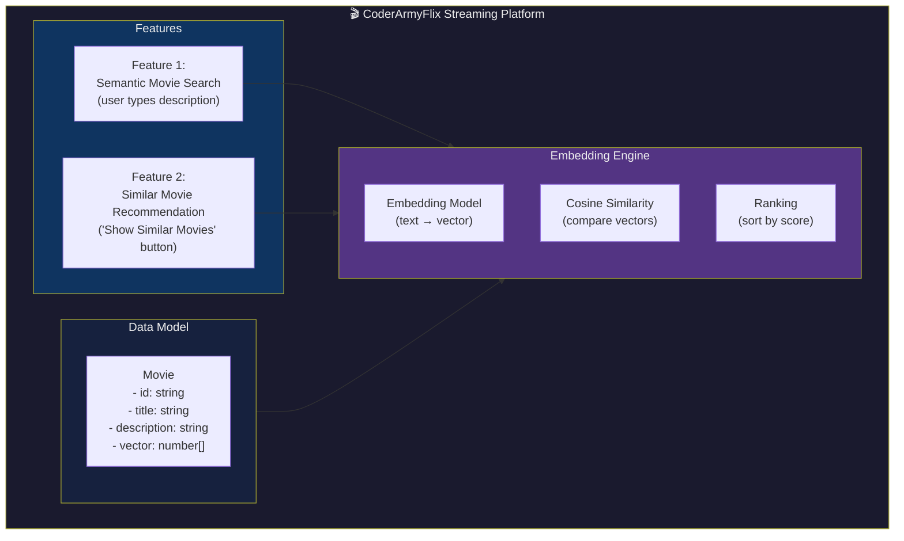
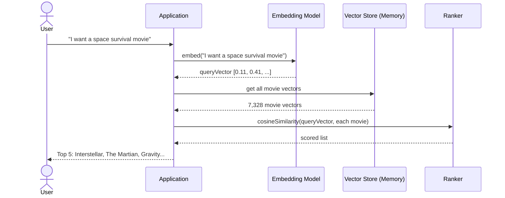
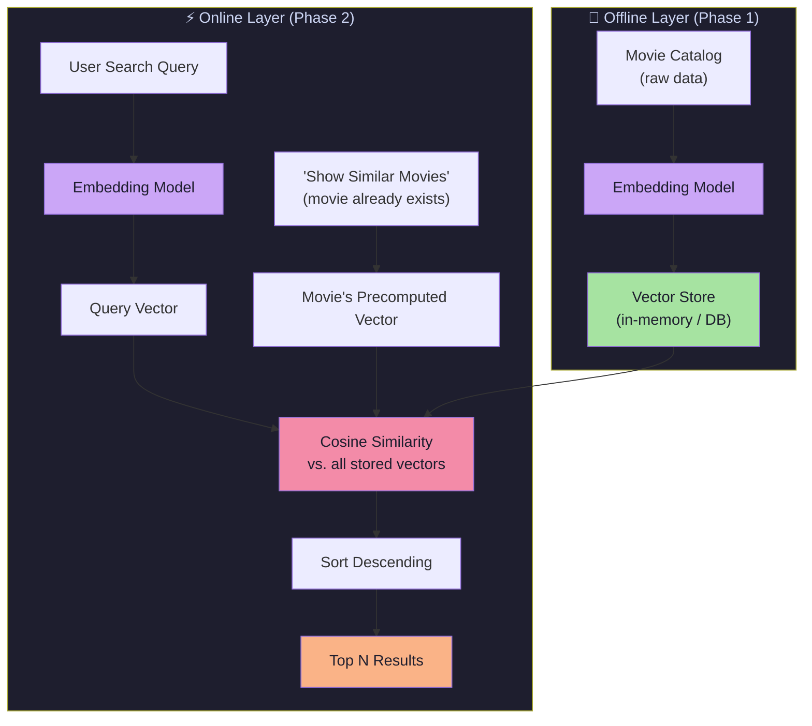
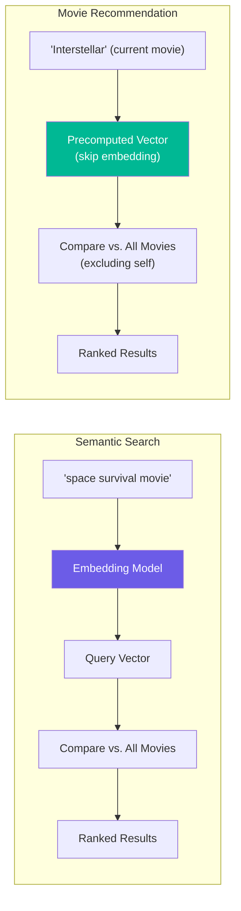
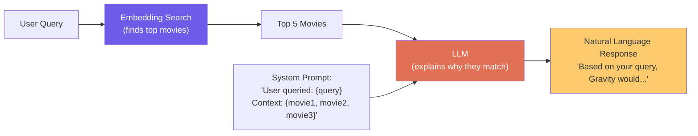
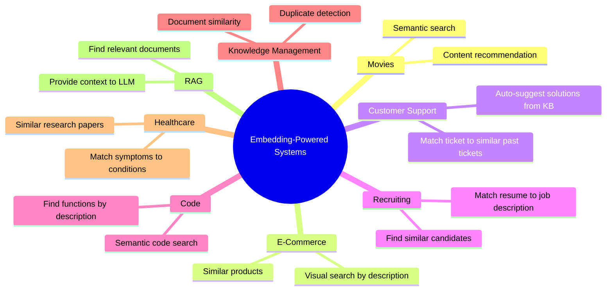
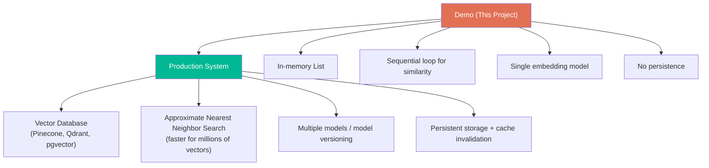
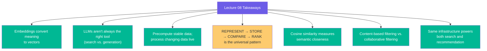

# Chapter 07: Complete System Design and Where This Pattern Lives

> **Chapter Goal:** Put all the pieces together into a complete system design. Understand the overall architecture, the data model, the two operational phases, and where this embedding-powered pattern applies beyond movies. This chapter is the capstone that connects all previous chapters and points toward next steps (RAG, vector databases, production design).

---

## 7.1 What We Are Building — Full Picture

A movie recommendation engine for a streaming platform with two features:



---

## 7.2 The Complete Data Model

Each movie in our system has exactly two user-facing properties and one internal property:

```js
interface Movie {
  id: string;           // Unique identifier
  title: string;        // Display name: "Interstellar"
  description: string;  // Plot summary: "A team of astronauts..."
  vector: number[];     // Precomputed embedding (internal, not shown to users)
}
```

**Example data:**

| id | title         | description                                              | vector            |
|----|---------------|----------------------------------------------------------|-------------------|
| 1  | Interstellar  | "A team of astronauts travels through a wormhole..."     | [0.11, 0.42, ...] |
| 2  | The Martian   | "An astronaut becomes stranded on Mars..."               | [0.12, 0.39, ...] |
| 3  | Gravity       | "Two astronauts work together to survive..."             | [0.10, 0.45, ...] |
| 4  | Arrival       | "A linguist works with the military to communicate..."   | [0.08, 0.31, ...] |
| 5  | Titanic       | "A seventeen-year-old aristocrat falls in love..."       | [0.02, 0.11, ...] |

Notice: The first four cluster together (space/survival themes); Titanic does not.

---

## 7.3 Phase 1 — Build the Movie Catalog

This runs **once** (or whenever the catalog is updated):


**Key points:**
- This is the expensive part — N embedding API calls (one per movie)
- Run it as a batch job, not on every user request
- Result: every movie has a precomputed vector ready for comparison

---

## 7.4 Phase 2 — Serving User Requests

Once the catalog is ready, every user request follows this flow:



**Cost per user request:**
- 1 embedding API call (for the query)
- 7,328 cosine similarity calculations (fast, local math)
- 0 additional LLM calls

---

## 7.5 Architecture at a Glance



---

## 7.6 Recommendation vs. Search: Side-by-Side



**Summary:**

| Aspect                        | Semantic Search               | Movie Recommendation          |
|-------------------------------|-------------------------------|-------------------------------|
| Starting vector               | Embed user query              | Movie's precomputed vector    |
| Embedding call per request    | Yes (1 call)                  | No (vector already exists)    |
| Exclude self?                 | Not applicable                | Yes (don't recommend itself)  |
| Output                        | Most relevant movies          | Most similar movies           |

---

## 7.7 Adding LLM Generation (Optional Enhancement)

For a richer user experience, an LLM can be added **after** the embedding-based search:



This pattern:
- Embedding model → **SEARCH** (find relevant items)
- LLM → **GENERATE** (explain, narrate, respond naturally)

This is the foundation of **Retrieval-Augmented Generation (RAG)** — covered in a future lecture.

---

## 7.8 Where This Pattern Applies Beyond Movies

The same REPRESENT → STORE → COMPARE → RANK pattern is used widely:



**Universal pattern:**

```
Whenever the problem is:
"Find the items in my dataset whose meaning is closest to this input."

The architecture is:
REPRESENT → STORE → COMPARE → RANK
```

---

## 7.9 Design Decisions Recap

| Decision                              | Choice                    | Reason                                                  |
|---------------------------------------|---------------------------|---------------------------------------------------------|
| Precompute or generate live?          | Precompute                | Movie descriptions rarely change; saves cost and time   |
| Storage (demo)                        | In-memory array           | Simple for demo; easily swapped for production DB       |
| Similarity metric                     | Cosine Similarity         | Ignores magnitude; better for text embeddings           |
| Recommendation type                   | Content-Based             | No user behavior data required                          |
| LLM for recommendation?               | Not required              | Pure math (cosine + rank) is sufficient                 |
| LLM for explanation? (optional)       | Yes, as optional layer    | Better UX; but optional — search works without it      |

---

## 7.10 Moving Toward Production: What Would Change?

Our demo uses in-memory storage. A production system would:



### Approximate Nearest Neighbor (ANN) Search

For millions of vectors, comparing every single one is too slow. Production systems use **Approximate Nearest Neighbor (ANN)** algorithms:

| Algorithm          | Description                                   |
|--------------------|-----------------------------------------------|
| HNSW               | Hierarchical Navigable Small World graphs      |
| IVF                | Inverted File Index (cluster-then-search)      |
| LSH                | Locality-Sensitive Hashing                    |
| ScaNN              | Google's Scalable Nearest Neighbors           |

These find **approximate** nearest neighbors in milliseconds, trading a tiny bit of accuracy for massive speed gains.

For our demo: **exact search (linear scan)** is fine.

---

## 7.11 The Final Complete Flow (Both Features)

```
=== FEATURE 1: SEMANTIC SEARCH ===

User types: "space survival movie where protagonist is alone"
    ↓
Embed query → [0.11, 0.41, -0.07, ...]
    ↓
Compare against all 7,328 stored movie vectors (cosine similarity)
    ↓
Score every movie
    ↓
Sort by score descending
    ↓
Return top 5:
  1. The Martian       (0.91)
  2. Interstellar      (0.88)
  3. Gravity           (0.85)
  4. Life              (0.72)
  5. Apollo 13         (0.68)


=== FEATURE 2: SIMILAR MOVIE RECOMMENDATION ===

User is watching: Interstellar
User clicks: "Show Similar Movies"
    ↓
Use precomputed Interstellar vector → [0.11, 0.42, -0.09, ...]
    ↓
Compare against all OTHER movie vectors (exclude Interstellar itself)
    ↓
Sort by score descending
    ↓
Return top 5:
  1. The Martian       (0.94)
  2. Gravity           (0.91)
  3. Arrival           (0.87)
  4. Life              (0.74)
  5. Ad Astra          (0.71)
```

---

## 7.12 Summary — What This Lecture Taught



### What Comes Next

| Topic                           | Description                                              |
|---------------------------------|----------------------------------------------------------|
| **RAG (Retrieval-Augmented Generation)** | Combining embedding search with LLM generation |
| **Vector Databases**            | Pinecone, Qdrant, Weaviate — production-scale storage   |
| **ANN Search**                  | HNSW, IVF — fast approximate nearest neighbor search    |
| **Hybrid Search**               | Combine keyword + semantic search                       |
| **Multi-Modal Embeddings**      | Embed images, audio, code — not just text               |

---

> **Final Mental Model:**
>
> Do not think of the embedding model as a chatbot.
>
> Think of it as a machine that converts meaning into coordinates.
>
> Once you have coordinates, mathematics answers the questions:
> - Which movies are close to Interstellar?
> - Which documents are closest to this question?
> - Which products are semantically related?
>
> **REPRESENT → STORE → COMPARE → RANK**
