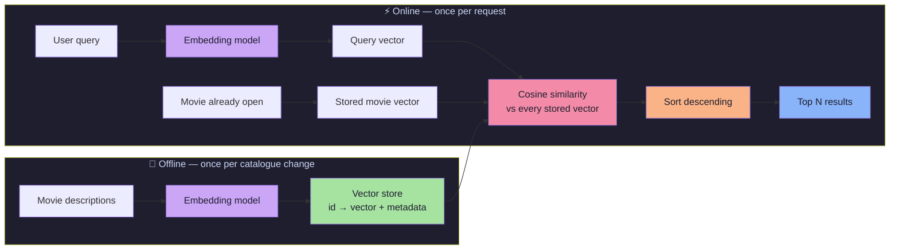
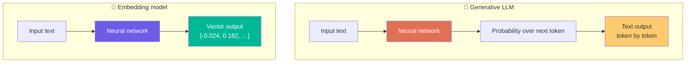
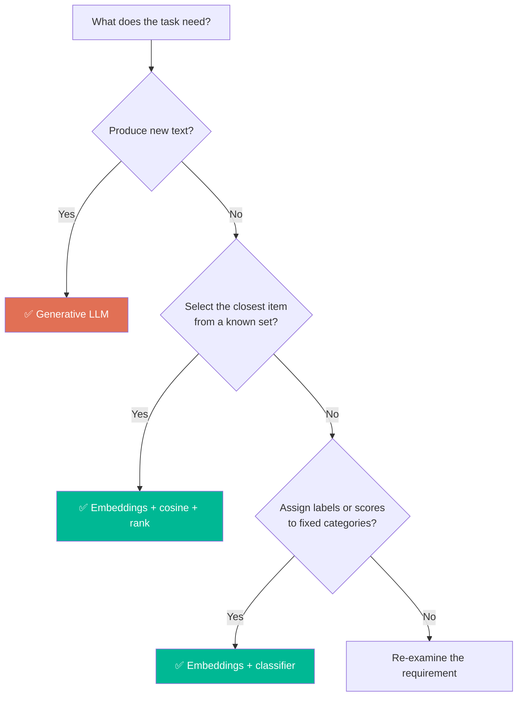
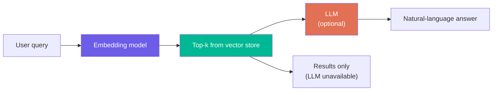
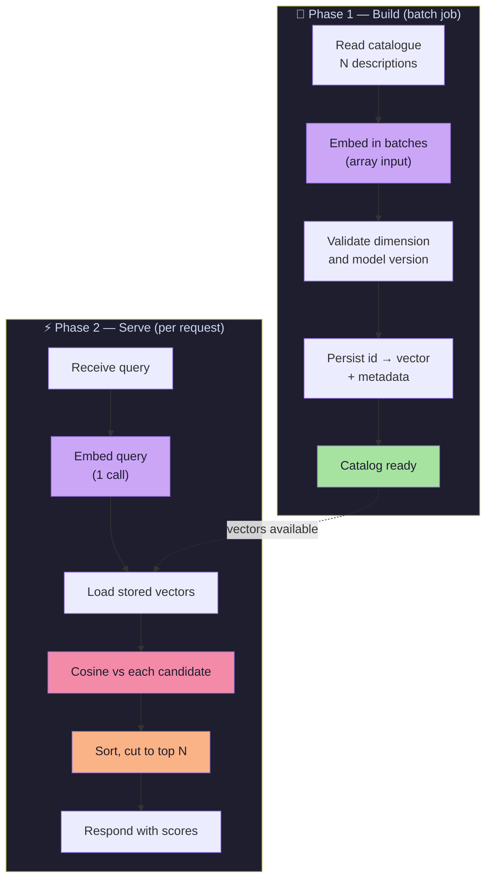
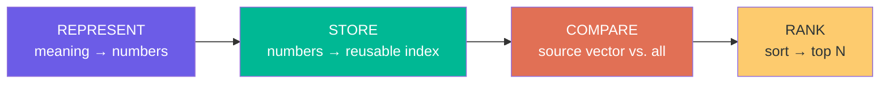
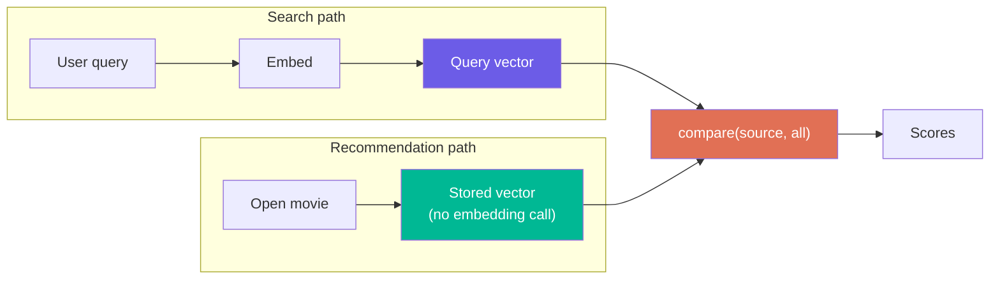
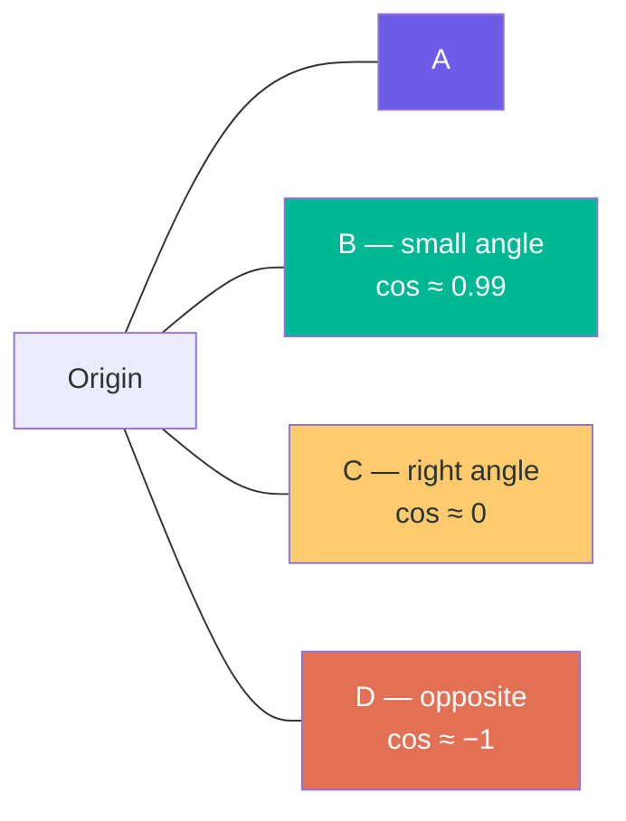
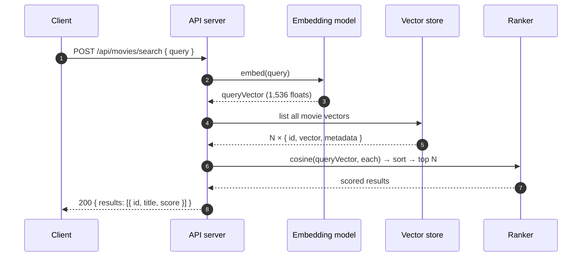
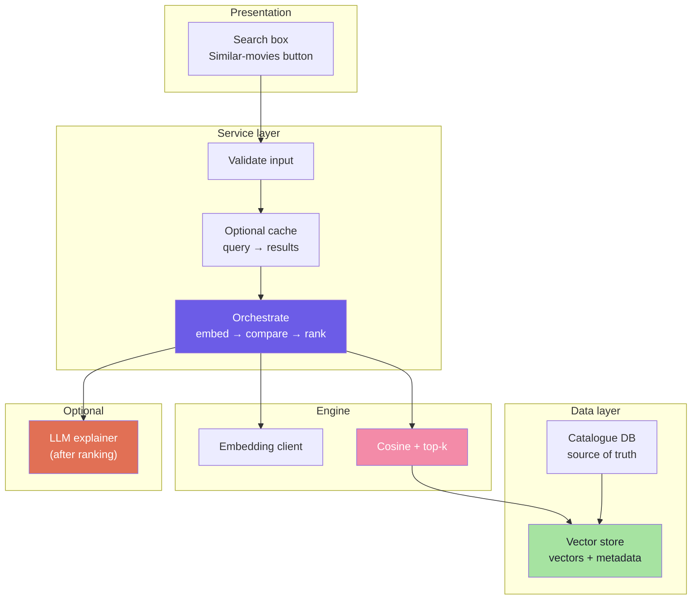

# Lecture 08: Vector Embeddings Project — Building the Movie Recommender

## Complete Consolidated Notes & Build Reference

> **Course:** Forward Deployed Engineer (FDE) & Generative AI Systems
> **Lecture:** 08 — Vector Embeddings Project
> **Source Material:** [`Notes.pdf`](./Notes.pdf) (31 sections) and [`Excalidraw-Notes.svg`](./Excalidraw-Notes.svg)
> **Reference Implementation:** [`../code`](../code/README.md) — Express + TypeScript, OpenAI `text-embedding-3-small` (1,536 dims)
> **Diagram Format:** Mermaid only
> **Snippet Style:** JS / TypeScript-style pseudocode — illustrative, not production code
> **Consolidates:** Chapters [01](./01_Embeddings_and_The_Problem_of_Meaning.md) → [07](./07_Complete_System_Design_and_Applications.md)

---

## How to Use This Document

This is the **map**, not the territory. Every part ends with a *Go deeper* link to the chapter that carries the full derivation, examples, and alternative designs. Nothing is duplicated here — if a detail is missing, it is one click away.

| If you want to… | Read | Time |
|---|---|---|
| Recall what the lecture was about | [Executive Summary](#executive-summary-the-whole-lecture-in-one-page) → [Cheat Sheet](#cheat-sheet) | 10 min |
| Actually build the system | Parts [1](#part-1-why-meaning-needs-coordinates) through [7](#part-7-the-complete-system-design) in order | 60 min |
| Defend a design decision in review | [2.3](#23-the-decision-rule), [3.3](#33-the-arithmetic-of-precomputation), [7.4](#74-design-decisions-and-their-costs), [7.5](#75-failure-modes) | 25 min |
| Prepare for an interview | [Six Sentences](#the-lecture-in-six-sentences), [Failure Modes](#75-failure-modes), [Self-Check](#self-check-questions) | 25 min |
| Know what to learn next | [Where This Goes Next](#where-this-goes-next) | 5 min |

> **Depth policy.** The chapters explain *how*; these notes explain *what matters and why*. Conceptual background on embeddings (vectors, dimensions, similarity) lives in [Lecture 07 Complete Notes](../../Lecture%2007/notes/Lecture_07_Complete_Notes.md).

---

## 📑 Table of Contents

- [How to Use This Document](#how-to-use-this-document)
- [Executive Summary: The Whole Lecture in One Page](#executive-summary-the-whole-lecture-in-one-page)
  - [The Thesis](#the-thesis)
  - [The Canonical Diagram](#the-canonical-diagram)
  - [The Numbers That Matter](#the-numbers-that-matter)
  - [The Lecture in Six Sentences](#the-lecture-in-six-sentences)
- [Chapter Map](#chapter-map)
- [Part 1: Why Meaning Needs Coordinates](#part-1-why-meaning-needs-coordinates)
  - [1.1 The Gap Between Symbols and Meaning](#11-the-gap-between-symbols-and-meaning)
  - [1.2 What an Embedding Actually Is](#12-what-an-embedding-actually-is)
  - [1.3 Embedding Model vs Chat Model](#13-embedding-model-vs-chat-model)
  - [1.4 Why the Dimensions Are Unreadable](#14-why-the-dimensions-are-unreadable)
- [Part 2: Why Not Just Use an LLM](#part-2-why-not-just-use-an-llm)
  - [2.1 The Question That Actually Matters](#21-the-question-that-actually-matters)
  - [2.2 Four Ways the Naive Approach Fails](#22-four-ways-the-naive-approach-fails)
  - [2.3 The Decision Rule](#23-the-decision-rule)
  - [2.4 Search First, Generate Second](#24-search-first-generate-second)
- [Part 3: Precomputation, the Key Engineering Insight](#part-3-precomputation-the-key-engineering-insight)
  - [3.1 Stable vs Volatile Data](#31-stable-vs-volatile-data)
  - [3.2 The Two-Phase Architecture](#32-the-two-phase-architecture)
  - [3.3 The Arithmetic of Precomputation](#33-the-arithmetic-of-precomputation)
  - [3.4 Keeping Vectors Fresh](#34-keeping-vectors-fresh)
  - [3.5 Where Vectors Live](#35-where-vectors-live)
- [Part 4: The Four-Step Mental Model](#part-4-the-four-step-mental-model)
  - [4.1 REPRESENT](#41-represent)
  - [4.2 STORE](#42-store)
  - [4.3 COMPARE](#43-compare)
  - [4.4 RANK](#44-rank)
  - [4.5 Why the Model Is Universal](#45-why-the-model-is-universal)
- [Part 5: Measuring Closeness with Cosine Similarity](#part-5-measuring-closeness-with-cosine-similarity)
  - [5.1 Euclidean Distance vs Cosine Similarity](#51-euclidean-distance-vs-cosine-similarity)
  - [5.2 The Formula](#52-the-formula)
  - [5.3 Worked Example](#53-worked-example)
  - [5.4 How to Read a Score](#54-how-to-read-a-score)
  - [5.5 Implementation](#55-implementation)
  - [5.6 The Normalization Shortcut](#56-the-normalization-shortcut)
- [Part 6: Two Features, One Engine](#part-6-two-features-one-engine)
  - [6.1 Semantic Search](#61-semantic-search)
  - [6.2 Similar Movie Recommendation](#62-similar-movie-recommendation)
  - [6.3 One Function, Two Features](#63-one-function-two-features)
  - [6.4 Content-Based vs Collaborative Filtering](#64-content-based-vs-collaborative-filtering)
- [Part 7: The Complete System Design](#part-7-the-complete-system-design)
  - [7.1 Data Model](#71-data-model)
  - [7.2 Request Lifecycle](#72-request-lifecycle)
  - [7.3 Architecture at a Glance](#73-architecture-at-a-glance)
  - [7.4 Design Decisions and Their Costs](#74-design-decisions-and-their-costs)
  - [7.5 Failure Modes](#75-failure-modes)
  - [7.6 What Breaks at Scale](#76-what-breaks-at-scale)
  - [7.7 Reference Implementation Map](#77-reference-implementation-map)
- [Cheat Sheet](#cheat-sheet)
- [Glossary](#glossary)
- [Common Misconceptions](#common-misconceptions)
- [Self-Check Questions](#self-check-questions)
- [Where This Goes Next](#where-this-goes-next)
- [Chapter Reference Map](#chapter-reference-map)

---

## Executive Summary: The Whole Lecture in One Page

### The Thesis

> **A recommender is not a chatbot. It is a coordinate system plus a sort.**

The lecture builds a "Netflix-like" recommendation engine in which **no language model decides what to recommend**. An embedding model converts text into vectors; a similarity function scores every candidate; a sort returns the top N. The intelligence is in the *geometry*, not in a generated paragraph.

### The Canonical Diagram



Read the two boxes separately: **the left box is where the money is spent, the right box is where the latency is spent.** Almost every design decision in this lecture follows from keeping the left box *off* the request path.

### The Numbers That Matter

| Number | What it is | Why it matters |
|---|---|---|
| **7,328** | Catalogue size used throughout the slides | Every cost is linear in `N`; the demo ships 18 movies, the math is identical |
| **1,536** | Dimensions from `text-embedding-3-small` | One vector ≈ 6 KB as `float32`; 1M movies ≈ 6.1 GB of raw vectors |
| **1** | Embedding calls per search request | The only network-bound step in the online path |
| **0** | Embedding calls for "show similar movies" | The movie's vector already exists |
| **0** | LLM calls per recommendation | Ranking is arithmetic, not generation |
| **7,328×** | Reduction in per-request catalogue work vs. the naive approach | The entire justification for precomputation |
| **5** | Default `topN` | Return size is a product decision, not an algorithm decision |
| **0.991 / 0.311** | Cosine scores in the worked example | Similar vs. unrelated, on a `−1 … +1` scale |

> **Precision note.** The slides describe the naive approach as "7,328,000,000 API calls per day". That figure is really *catalogue-item processings*: 1M users × 7,328 movies. It is not 7.3B HTTP requests — it is 7.3B items' worth of prompt tokens, which is worse than it sounds. Section [3.3](#33-the-arithmetic-of-precomputation) states the comparison carefully.

### The Lecture in Six Sentences

1. **Computers manipulate symbols, not meaning** — so meaning must be converted into coordinates before any math can touch it.
2. **An embedding model is a translator, not a chatbot** — one forward pass in, one fixed-size vector out, no text.
3. **An LLM is the wrong tool for "find the closest item in my catalogue"** — that is a search problem, not a generation problem.
4. **Stable data is processed once; volatile data is processed per request** — this single split is the architecture.
5. **REPRESENT → STORE → COMPARE → RANK** is the whole system; everything else (databases, queues, caches, indexes) is engineering around those four verbs.
6. **Cosine similarity compares direction, not length** — which is exactly what you want, because verbosity is not meaning.

**What you can build after this lecture:** semantic search over any text corpus, content-based recommendations, duplicate/near-duplicate detection, "more like this" for any entity, and the retrieval half of RAG.

---

## Chapter Map

The chapter files follow the slide order (01 → 07). These notes follow the *dependency* order — the mental model (Chapter 06) is moved ahead of similarity math (Chapter 05), because you should know *what* you are computing before you learn *how*.

| Part | Chapter | Question it answers | Go there for |
|---|---|---|---|
| [1](#part-1-why-meaning-needs-coordinates) | [01](./01_Embeddings_and_The_Problem_of_Meaning.md) | Why can't a computer compare meanings directly? | The three-sentence demo, "are dimensions interpretable?", embedding-vs-LLM table |
| [2](#part-2-why-not-just-use-an-llm) | [02](./02_Why_Not_Just_Use_an_LLM.md) | When is an embedding better than an LLM? | Full reasoning per failure mode, cost/latency detail, tool-selection diagram |
| [3](#part-3-precomputation-the-key-engineering-insight) | [03](./03_Precomputation_The_Key_Engineering_Insight.md) | How does this stay cheap as traffic grows? | Invalidation strategy, storage-option comparison, offline batch design |
| [4](#part-4-the-four-step-mental-model) | [06](./06_Core_Mental_Model_REPRESENT_STORE_COMPARE_RANK.md) | What is the invariant architecture? | Step-by-step pseudo-code, domain mindmap, final model diagram |
| [5](#part-5-measuring-closeness-with-cosine-similarity) | [05](./05_Cosine_Similarity_Measuring_Closeness.md) | How is closeness actually measured? | Euclidean critique, full worked example, ranking function |
| [6](#part-6-two-features-one-engine) | [04](./04_Semantic_Search_and_Movie_Recommendation.md) | What features fall out of this engine? | Feature framing, collaborative-filtering contrast, production mindmap |
| [7](#part-7-the-complete-system-design) | [07](./07_Complete_System_Design_and_Applications.md) | How does it all fit together? | Full architecture, decision recap, ANN preview, application catalogue |

---

## Part 1: Why Meaning Needs Coordinates

Three sentences open the lecture:

```text
A: "An astronaut is stranded on Mars."
B: "A man must survive alone on another planet."
C: "A detective investigates a murder in London."
```

You instantly see that **A ≈ B** and **A is nothing like C**. Now count the words they share.

### 1.1 The Gap Between Symbols and Meaning

| Pair | Human judgment | Shared content words | Keyword search says | Embedding says |
|---|---|---|---|---|
| A vs B | Same idea | **0** (`astronaut/Mars` vs `man/planet`) | No match ❌ | Close ✅ |
| A vs C | Unrelated | **0** | No match ❌ | Far ✅ |

That table contains the whole motivation. Keyword search gets A-vs-C right **by accident** — it cannot distinguish *"no overlap because it's a paraphrase"* from *"no overlap because it's unrelated."* It only knows that the strings differ.

The operation you actually want does not exist in any language runtime:

```text
similarity("An astronaut is stranded on Mars",
           "A man must survive alone on another planet")   // no such function
```

Computers are excellent at arithmetic on numbers and hopeless at arithmetic on ideas. So the requirement is:

> **Convert meaning into a numeric form that preserves semantic relationships — then let arithmetic do the comparing.**

### 1.2 What an Embedding Actually Is

> **Definition.** An embedding is a function `f: text → ℝᵈ` that maps an input to a **fixed-length** vector of real numbers, trained so that inputs with similar meaning map to vectors that are close in that space.

Three properties carry all the weight:

| Property | Consequence |
|---|---|
| **Fixed length** (`d = 1,536` here) | A 3-word query and a 300-word plot summary become the same shape — directly comparable |
| **Same model → same space** | Only vectors from the *same* model (and version) may be compared |
| **Similar meaning → nearby vector** | Distance becomes a proxy for semantics, which is what makes search possible |

Once text is a vector, four operations become available: **subtraction** (how far apart?), **dot product** (how aligned?), **cosine** (what angle?), and **sorting** (which is best?). Those four are the entire recommender.

### 1.3 Embedding Model vs Chat Model



| Property | Generative LLM | Embedding model |
|---|---|---|
| **Goal** | Produce language | Represent meaning |
| **Output** | Sequence of tokens | One fixed-size vector |
| **Work per call** | One forward pass *per output token* | One forward pass total |
| **Determinism** | Sampling-dependent | Effectively deterministic for a fixed model/version |
| **Right job** | Summarise, explain, converse | Search, compare, cluster, rank |

Ask an embedding model *"What is the capital of India?"* and you get `[0.023, -0.193, 0.082, …]` — **not** "New Delhi". That is not a limitation to work around; it is the division of labour. The model's job is to *place the question in space*, so that the document containing the answer lands nearby.

### 1.4 Why the Dimensions Are Unreadable

It is tempting to imagine embeddings as interpretable scores:

```text
[space_score, romance_score, action_score]     ← NOT how real embeddings work
```

In a real 1,536-dimensional vector, no single coordinate maps to a human concept. Meaning is **distributed** across all dimensions; the geometry of the whole vector is what carries semantics. Practically:

- You cannot debug a bad recommendation by "turning down dimension 284".
- You *can* debug it by inspecting the text that was embedded, the model version, and the similarity metric.
- Hand-crafted features are interpretable but do not scale ([Lecture 07](../../Lecture%2007/notes/Lecture_07_Complete_Notes.md)); learned embeddings scale but are opaque. That is the trade this lecture accepts.

**Takeaways**

- The problem is not "computers can't read" — it is "computers can't *compare meanings* without numbers".
- An embedding is a **fixed-size coordinate**, not a summary and not an answer.
- Embedding model ≠ chat model; confusing the two is the most common conceptual error in this lecture.
- Unreadable dimensions are part of the trade, not a bug to fix.

> **Go deeper:** [Chapter 01 — Embeddings and The Problem of Meaning](./01_Embeddings_and_The_Problem_of_Meaning.md) for the full walkthrough, the 2-D space picture, and the dimension discussion.

---

## Part 2: Why Not Just Use an LLM

An LLM *can* recommend movies. That is not the interesting question, and answering it is how teams end up with an expensive, unreliable recommender.

### 2.1 The Question That Actually Matters

| Scenario | Prompt | Does an LLM work? | Why |
|---|---|---|---|
| **Generic** | "Recommend films similar to *Interstellar*." | ✅ Yes | The model has seen decades of film commentary |
| **Your catalogue** | "Recommend three titles **from our 7,328-film catalogue**." | ❌ No | The catalogue contains titles the model never saw — or saw without rights, region, or availability metadata |

Your catalogue is full of things the model cannot know:

- **New releases** added after the training cut-off
- **Regional cinema** that never entered English-language training data
- **Independent productions** absent from major databases
- **Platform exclusives** that exist only in your CMS
- **Licensing and availability** — a title may exist in the model's memory but not be streamable in the user's country

Even when the model "knows" a title, it is *recalling a string*, not *querying your database*. It cannot guarantee the item exists, is licensed, or is in stock. That is a correctness problem, not a quality problem.

### 2.2 Four Ways the Naive Approach Fails

The tempting shortcut is to paste the whole catalogue into the prompt on every request: `Here are my 7,328 movies: … The user likes Interstellar. Recommend three movies.`

| # | Failure | Mechanism | What you observe |
|---|---|---|---|
| **1** | **Context limits** | The catalogue exceeds the context window | Silent truncation — the tail of your catalogue is invisible, so some films can never be recommended |
| **2** | **Repeated work** | Every user re-processes the same static catalogue | Cost scales with *users × catalogue*, not with users |
| **3** | **Unnecessary generation** | You need a **ranking**, not a paragraph | You pay for hundreds of tokens to extract three titles you then parse |
| **4** | **Cost and latency** | Output is generated token by token | p95 latency and per-request cost both grow with answer length, for no product benefit |

**What the feature actually needs:**

```text
NOT NEEDED:  "The Martian would be an excellent choice because its themes
              of scientific ingenuity and survival…"          ← prose

NEEDED:      The Martian  0.91
             Interstellar 0.88
             Gravity      0.85                              ← ranking
```

> **The context-window escape hatch is not an escape.** A larger window lowers failure #1 and leaves #2, #3 and #4 untouched — you now send 7,328 descriptions on *every* request, and pay for all of them, every time.

### 2.3 The Decision Rule



| Problem | Right tool | Reason |
|---|---|---|
| Write a synopsis, answer in prose, explain a choice | Generative LLM | Output is language |
| Find the 5 closest items in my data | Embeddings + similarity | Output is a *selection*, and the ordering is arithmetic |
| Route a ticket to one of 12 queues | Embeddings + classifier | Fixed label set, cheap and deterministic |
| Summarise the top 5 retrieved documents | LLM **after** retrieval | Generation operates on a small, already-relevant set |

> **The one-line rule:** if the answer is *a subset of things you already have*, use similarity; if the answer is *words that do not exist yet*, use generation.

### 2.4 Search First, Generate Second



| Stage | Tool | Why it is there | Can it fail alone? |
|---|---|---|---|
| **Retrieve** | Embedding model + cosine | Narrows 7,328 items to 5 | Yes — and then there is no product |
| **Generate** | LLM + retrieved context | Turns 5 titles into a sentence | Yes — and the product still works |

This ordering is the whole point: **ranking is load-bearing, generation is decoration.** A recommender whose explanation endpoint is down should still recommend. If the LLM sits in the ranking path, an outage becomes a product outage.

This "retrieve, then generate" shape is also the seed of **Retrieval-Augmented Generation (RAG)** — the same retrieval half, with a document corpus instead of a movie catalogue.

**Takeaways**

- An LLM recommending from your catalogue is *recalling strings*, not *querying data* — it cannot guarantee existence, rights, or availability.
- Pasting the catalogue into the prompt fails four ways: truncation, repeated work, wasted generation, and cost/latency.
- Larger context windows fix only the truncation failure.
- Decide by output type: **selection → embeddings, new text → LLM**.
- Keep generation *after* ranking so the two systems fail independently.

> **Go deeper:** [Chapter 02 — Why Not Just Use an LLM](./02_Why_Not_Just_Use_an_LLM.md) for the per-scenario walkthrough, the repeated-work sequence diagram, and the cost/latency analysis.

---

## Part 3: Precomputation, the Key Engineering Insight

The most valuable sentence in the lecture is a question:

> **"Which part of the system changes frequently?"**

Ask it before choosing a database, a framework, or a model. The answer *is* the architecture.

### 3.1 Stable vs Volatile Data

| Data | How often it changes | When it should be processed |
|---|---|---|
| Movie descriptions | Only when the catalogue is edited | **Once**, at build time |
| Movie titles / metadata | Rarely | Once (usually not embedded at all) |
| Embedding model version | Very rarely | Once per migration — rebuild everything |
| User query | Every single request | **Per request** |
| User preferences / session | Constantly | Per request (not used in this demo) |

The rule is an AND, not an OR:

> **Precompute only when the work is expensive *and* the input is stable.** Expensive + volatile → cache with a TTL at most. Cheap + stable → just compute it. Cheap + volatile → compute it and move on.

### 3.2 The Two-Phase Architecture



**Two production details the slides leave implicit:**

1. **Batch the build.** The embeddings API accepts an array of inputs; 7,328 descriptions should be a handful of chunked calls, not 7,328 HTTP round-trips. The reference implementation does exactly this for its 18 movies — one call instead of eighteen.
2. **"Run once" ≠ "run at boot".** For 18 movies, embedding during startup is the simplest correct thing. For 7,328 (or 7 million), boot-time embedding couples deploy time and availability to a third-party API. Move Phase 1 to a real job with retries, a manifest, and idempotent upserts; the server should start against an already-built index.

### 3.3 The Arithmetic of Precomputation

Assume 7,328 movies and 1,000,000 searches per day.

| Work per day | Naive: catalogue in prompt | Precomputed |
|---|---|---|
| Catalogue text pushed through a model | **7,328,000,000** item-processings | **7,328** — once, ever |
| Query embeddings | 1,000,000 (bundled into the same prompt) | **1,000,000** |
| Generated output tokens | Hundreds per request | **0** |
| Local float comparisons | 0 | 1,000,000 × 7,328 = **7.33B** |

The last row is the part people miss: **precomputation does not eliminate the O(N) work — it changes its unit.** You still touch every movie for every query; you just do it with a multiply-add instead of a transformer.

| | Naive | Precomputed |
|---|---|---|
| Unit of work | one token through a model | one multiply-add on two floats |
| Rough relative cost per unit | ~10⁶–10⁷× more expensive | 1× |
| Work grows with | users × catalogue × answer length | users × catalogue (floats) |
| Where it runs | vendor GPU | your CPU, in-process |
| Failure mode | rate limit, timeout, bill | slow loop, high memory |

**Per-query cost of the exact scan.** With pre-normalized vectors, one comparison is a single dot product: 1,536 multiply-adds. For 7,328 movies that is about **11.3 million multiply-adds per query** — a few milliseconds in plain JavaScript, and far less in a native or vectorised implementation. An unnormalized cosine costs roughly three times that (dot product plus both norms), which is one more reason to normalize on write. That is why the naive bar chart looks catastrophic and the smart one looks free: they are measured in different currencies.

**Memory.** `1,536 × 4 bytes = 6,144 bytes ≈ 6 KB` per vector.

| Catalogue | Raw `float32` vectors |
|---|---|
| 18 (the reference implementation) | ~108 KB |
| 7,328 (the slide example) | ~45 MB |
| 1,000,000 | ~6.1 GB |
| 100,000,000 | ~614 GB — needs quantisation and sharding |

**Build cost.** One-time: 7,328 descriptions × ~50 tokens ≈ 366K tokens. At an illustrative $0.02 per 1M tokens that is well under one cent — the catalogue embedding is a rounding error; the recurring cost is the *query* embeddings. Break-even against the naive approach happens on the **first request**, because the naive approach re-does the entire build per user.

> **Correction to the slide chart.** The deck plots both bars as "API calls per day". The naive figure is catalogue *item-processings*, not HTTP requests; the smart figure is query embeddings. The 7,328× ratio is real, but it compares work units, not bills. Convert to money only after pricing tokens per unit of work.

### 3.4 Keeping Vectors Fresh

A precomputed vector is a **cache entry**, and every cache needs an invalidation story.

| Trigger | Action | Cost |
|---|---|---|
| Description edited | Re-embed **that one** item | 1 call |
| New title added | Embed the new item | 1 call |
| Title removed | Delete its vector | 0 |
| Model/version upgraded | Re-embed **everything** into a new index | N calls + backfill |
| Bulk import | Chunked batch job | N calls |

Three habits that prevent most staleness bugs:

1. **Store a content hash.** Hash the exact text that was embedded; on update, skip re-embedding if the hash is unchanged. Prevent `updated_at` churn from triggering pointless API bills.
2. **Store the model id with the vector.** A vector is only meaningful alongside the model that produced it. Without this field, a model migration silently mixes incompatible spaces and produces plausible-looking nonsense.
3. **Migrate with dual-write, then cut over.** On a model change, build the new index in parallel, run both, compare top-N overlap on a labelled query set, then switch reads and delete the old index. Never re-embed in place.

**Symptom to watch for:** recommendations that describe the *old* plot. That is almost always a stale vector, not a bad model.

### 3.5 Where Vectors Live

| Option | Comfortable scale | Pros | Cons |
|---|---|---|---|
| **In-memory array** (this demo) | up to ~10⁴–10⁵ | Zero dependencies, trivial to debug, fastest possible lookup | Lost on restart, no persistence, no filtering, one process only |
| **Relational DB + `pgvector`** | ~10⁵–10⁷ | One system, transactions, joins with metadata, familiar SQL | Index tuning is manual; recall/latency trade-offs are yours to manage |
| **Dedicated vector DB** (Qdrant, Weaviate, Pinecone, Milvus) | 10⁶–10⁹+ | ANN indexes, metadata filters, replication, snapshots | Another service to operate; another consistency boundary |
| **Search engine with kNN** (Elasticsearch / OpenSearch) | 10⁶–10⁸ | Hybrid lexical + vector search in one query, mature ops tooling | Heavier JVM footprint; vector features vary by version |

> **Don't over-engineer before you have N.** The demo's in-memory store is the correct choice at 18 movies, and `pgvector` is usually the correct *first* production choice. Complexity should be purchased with measured need — the subject of [Lecture 09](../../Lecture%2009/notes/README.md).

**Takeaways**

- Precompute when work is **expensive and the input is stable**; that conjunction is the whole test.
- Precomputation converts *model inference on text* into *arithmetic on floats* — it does not remove the O(N) scan.
- The build is a batch job with retries and idempotency, not a loop bolted onto server startup.
- Every vector needs three companions: content hash, model id, and update timestamp.
- Storage choice is a scale question, not a fashion question: array → `pgvector` → vector DB.

> **Go deeper:** [Chapter 03 — Precomputation](./03_Precomputation_The_Key_Engineering_Insight.md) for the full build/serve pseudo-code and the storage-option comparison.

---

## Part 4: The Four-Step Mental Model

Strip away frameworks, vendors, and deployment topology and every embedding system is four verbs:



| Step | Question it answers | Input | Operation | Output | Runs |
|---|---|---|---|---|---|
| **REPRESENT** | What does this text *mean*? | Text | Embedding model (forward pass) | `number[d]` | Once per item; once per query |
| **STORE** | Where do I keep it? | Vector + id + metadata | Persist / index | Queryable store | Once per item |
| **COMPARE** | What is it near? | Source vector + all vectors | Cosine similarity | Score per candidate | Every request |
| **RANK** | What comes first? | Scores | Sort descending, cut to N | Ordered list | Every request |

### 4.1 REPRESENT

The only step that touches a model. Two rules make or break the system:

- **Pin the model.** Catalogue and query must be embedded by the *same* model and version. A query embedded with `text-embedding-3-small` compared against `text-embedding-ada-002` vectors is meaningless — same dimension count is not the same space.
- **Represent the right text.** For movies, that is the description (plot, themes, tone), not the title alone. A title is a label; a description is meaning. If your embeddings are bad, suspect the input text before you suspect the model.

### 4.2 STORE

Storage must do three things: look up by id, iterate all vectors, and carry metadata for filtering and display. Minimum viable record:

```text
{ id, vector: float32[1536], model: "text-embedding-3-small",
  contentHash, updatedAt, title, description }
```

> **The store is the system of record for geometry.** If it is lost on restart, you have not built a catalogue — you have built a warm-up cost.

### 4.3 COMPARE

The only mathematically interesting step, and the one that decides your latency budget. Two different starting points feed the *same* comparison:



Cost is `O(N × d)`: linear in catalogue size and in dimensions. That is fine at 7,328 and fatal at 100 million — the bridge to [Lecture 09](../../Lecture%2009/notes/README.md).

### 4.4 RANK

Sorting is trivial; the surrounding decisions are not:

| Decision | Default | Why it matters |
|---|---|---|
| **Direction** | Descending (highest similarity first) | Cosine is a similarity, not a distance — do not "sort ascending" out of habit |
| **Cut-off** | `topN = 5` | Return size is a product choice; the engine should accept it as a parameter |
| **Self-exclusion** | Exclude source id in recommendations | Otherwise the top result is always the movie the user is already watching |
| **Minimum score** | Optional threshold | With 18 movies, the 5th result is still reasonable; with 18,000 it may be noise wearing a number |
| **Deterministic ties** | Tie-break by id or popularity | Equal float scores otherwise produce unstable ordering across runs |

### 4.5 Why the Model Is Universal

The four verbs describe any system whose question is *"which of my items is closest in meaning to this input?"*

| Domain | REPRESENT | STORE | COMPARE | RANK |
|---|---|---|---|---|
| Movies | Plot description | Vector store | Cosine | Top 5 similar |
| E-commerce | Product copy | Vector store | Cosine | "More like this" |
| Support | Ticket text | Vector store | Cosine | Similar past tickets |
| Recruiting | Résumé / job post | Vector store | Cosine | Best-fit candidates |
| Code | Function docstring | Vector store | Cosine | Similar implementations |
| RAG | Document chunks | Vector store | Cosine | Context for an LLM |

The pattern is stable because it is not about movies, text, or even AI — it is about **turning retrieval into geometry**.

**Takeaways**

- REPRESENT and STORE are offline concerns; COMPARE and RANK are online concerns.
- Model identity is part of the data contract — pin it and store it.
- The comparison never changes; only the *source* of the starting vector does.
- Ranking policy (self-exclusion, thresholds, tie-breaks) is where most "weird results" bugs live.

> **Go deeper:** [Chapter 06 — The Core Mental Model](./06_Core_Mental_Model_REPRESENT_STORE_COMPARE_RANK.md) for the full pseudo-code of both phases and the cross-domain mindmap.

---

## Part 5: Measuring Closeness with Cosine Similarity

Everything so far assumed we can answer one question:

> **"How close is this vector to every other vector?"**

"Close" needs a definition. There are two candidates, and the choice is not cosmetic.

### 5.1 Euclidean Distance vs Cosine Similarity

Euclidean distance is the straight-line gap between two points:

```text
d(A, B) = √( Σᵢ (Aᵢ − Bᵢ)² )
```

It is intuitive in 2-D and wrong-headed for text, because it mixes **direction** (meaning) with **magnitude** (a property of the text's length and the model's output scale). A verbose description and a terse one can say the same thing and still sit far apart.

Cosine similarity throws magnitude away and keeps only the angle:

```text
cos(A, B) = (A · B) / (|A| × |B|)
```



| Metric | Uses magnitude | Uses direction | Range | Verdict for text |
|---|---|---|---|---|
| **Euclidean distance** | Yes | Yes | `0 … ∞` (lower = closer) | ❌ Sensitive to verbosity and vector scale |
| **Cosine similarity** | No | Yes | `−1 … +1` (higher = closer) | ✅ Default choice |
| **Dot product** | Yes | Yes | `−∞ … +∞` | ⚠️ Only safe when vectors are normalized |

> **Important nuance.** OpenAI returns **unit-normalized** embeddings, so on that provider `‖A − B‖² = 2 − 2·cos(A,B)`: Euclidean and cosine produce *identical rankings*. The distinction still matters the moment you switch providers, store raw vectors, or use dot product as a shortcut. Normalize on write and the question disappears ([5.6](#56-the-normalization-shortcut)).

### 5.2 The Formula

```text
cos(A, B) = (A · B) / (|A| × |B|)

A · B = Σᵢ Aᵢ Bᵢ              (dot product)
|A|   = √( Σᵢ Aᵢ² )           (L2 norm)
```

| Score | Meaning |
|---|---|
| `1.0` | Same direction — semantically equivalent (for this model) |
| `0.5` | Related |
| `0.0` | Orthogonal — no shared direction |
| `−1.0` | Opposite direction |

For general text embeddings, negative scores are rare — most pairs land in `0 … 1`. That does **not** mean the metric is a probability.

### 5.3 Worked Example

Three toy 3-D vectors (real ones have 1,536 dimensions):

```text
The Martian   [0.8, 0.6, 0.1]     high space, high survival, low romance
Interstellar  [0.7, 0.5, 0.2]     high space, moderate survival, low romance
Titanic       [0.1, 0.2, 0.9]     low space, low survival, high romance
```

**The Martian vs Interstellar**

```text
dot      = 0.8×0.7 + 0.6×0.5 + 0.1×0.2 = 0.56 + 0.30 + 0.02 = 0.88
|Martian|      = √(0.64 + 0.36 + 0.01) = √1.01 ≈ 1.005
|Interstellar| = √(0.49 + 0.25 + 0.04) = √0.78 ≈ 0.883
cos = 0.88 / (1.005 × 0.883) ≈ 0.991        → nearly identical direction
```

**The Martian vs Titanic**

```text
dot    = 0.8×0.1 + 0.6×0.2 + 0.1×0.9 = 0.08 + 0.12 + 0.09 = 0.29
|Titanic| = √(0.01 + 0.04 + 0.81) = √0.86 ≈ 0.927
cos = 0.29 / (1.005 × 0.927) ≈ 0.311        → weakly related at best
```

**Cross-check with Euclidean:** `‖Martian − Interstellar‖ ≈ 0.173` and `‖Martian − Titanic‖ ≈ 1.136` — the same ordering. When vectors are near unit length, the two metrics agree; they diverge when *magnitude* differs, which is exactly the case cosine was designed to survive.

### 5.4 How to Read a Score

| Score band | Typical relationship | Example |
|---|---|---|
| `0.90 – 1.00` | Near-paraphrase | Two phrasings of the same plot |
| `0.75 – 0.90` | Clearly related | "Astronaut on Mars" vs "stranded in space" |
| `0.50 – 0.75` | Same broad topic | Space survival vs mountain survival |
| `0.25 – 0.50` | Loosely connected | Sci-fi vs thriller |
| `0.00 – 0.25` | Unrelated | Astronaut vs romantic comedy |
| `< 0.00` | Contradictory direction | Rare for general text |

Three cautions that separate a demo from a product:

1. **Bands are model-specific.** They shift with the model, the corpus, and the text length distribution. Calibrate on your own labelled pairs; never hard-code `0.8` because a blog post said so.
2. **Scores are not probabilities.** `0.87` does not mean "87% match". If you display a percentage, you have promised a calibration you do not have.
3. **Absolute thresholds are fragile; relative order is not.** Within a single query, the ranking is trustworthy. Across queries, score scales drift — so prefer "top-k above the k-th score gap" to a global cut-off.

### 5.5 Implementation

```ts
function cosineSimilarity(a: number[], b: number[]): number {
  if (a.length !== b.length) {
    throw new Error(`dimension mismatch: ${a.length} vs ${b.length}`);
  }

  let dot = 0;
  let normA = 0;
  let normB = 0;

  for (let i = 0; i < a.length; i++) {
    dot += a[i] * b[i];
    normA += a[i] * a[i];
    normB += b[i] * b[i];
  }

  const denom = Math.sqrt(normA) * Math.sqrt(normB);
  return denom === 0 ? 0 : dot / denom;   // zero-vector guard
}
```

Notes that matter more than the arithmetic:

- **The dimension check is a feature.** It catches the most expensive bug in this domain — comparing vectors from two different models — at the first request instead of after a month of "weird recommendations".
- **One pass, not four.** Dot product and both norms accumulate in the same loop; `.reduce()` chains are readable but traverse the array repeatedly.
- **Use `Float32Array` in production.** Half the memory of `number[]`, cache-friendlier, and closer to what the vector store returns.

### 5.6 The Normalization Shortcut

If every vector is unit length, the denominator is `1`, and cosine collapses to a dot product:

```text
cos(Â, B̂) = Â · B̂        where  Â = A / |A|
```

| Approach | Work per comparison | When to use |
|---|---|---|
| Full cosine | 1 dot + 2 norms + 1 `sqrt` | Vectors arrive unnormalized and you cannot change storage |
| Cached norms | 1 dot + 1 divide | You store `‖v‖` alongside `v` |
| **Pre-normalized** | **1 dot** | You control the write path — the usual production choice |

Normalize at write time and again at query time, then treat the dot product as cosine. This is also what most ANN indexes assume: dot-product indexes are only equivalent to cosine when vectors are normalized ([Lecture 09](../../Lecture%2009/notes/README.md)).

> **Watch the edges:** a zero vector has no direction (guard it), and `float32` rounding leaves norms at `0.999999…` rather than exactly `1` — harmless for ranking, but do not assert equality in tests.

**Takeaways**

- Cosine compares **direction**; that is why verbosity does not corrupt meaning.
- On unit-normalized vectors, cosine and Euclidean rank identically — normalize and the debate is over.
- Scores are ordinal, model-specific, and not probabilities.
- Guard dimensions and zero vectors in the similarity function itself, not in the caller.
- Pre-normalization turns cosine into a dot product: fewer operations and compatibility with ANN indexes.

> **Go deeper:** [Chapter 05 — Cosine Similarity](./05_Cosine_Similarity_Measuring_Closeness.md) for the full derivation, the visual intuition, and the complete ranking function.

---

## Part 6: Two Features, One Engine

The system ships two user-facing features. They feel different to a product manager and are almost identical to an engineer.

### 6.1 Semantic Search

The query is a sentence; the catalogue is prose; the words do not match.

```text
User:        "I want something about a person trying to stay alive far away from Earth."
Catalogue:   "An astronaut becomes stranded on Mars and must use science and
              ingenuity to survive."

Shared content words: 0
Keyword search result: nothing
Embedding result:      The Martian, Gravity, Interstellar
```

| Query word | Catalogue word | Match |
|---|---|---|
| person | astronaut | ❌ |
| stay alive | survive | ❌ |
| far away from Earth | Mars | ❌ |

Semantic search fixes this by comparing **meaning** rather than strings:

```text
query text → embed → query vector → cosine vs every movie vector → sort → top N
```

Cost per search: **one** embedding call plus local arithmetic. Nothing else leaves the process.

### 6.2 Similar Movie Recommendation

The user finishes *Interstellar* and clicks **Show Similar Movies**. No text is typed, and no embedding call is made:

```text
movie id → look up stored vector → cosine vs every other movie → sort → top N
```

Two differences from search, both small and both important:

1. **No REPRESENT step** — the vector was built during Phase 1. This is precomputation paying its second dividend.
2. **Exclude self** — without it, the most similar movie to *Interstellar* is always *Interstellar*.

### 6.3 One Function, Two Features

| Aspect | Semantic search | Similar-movie recommendation |
|---|---|---|
| Source vector | Embed the user's query | Stored movie vector |
| Embedding calls per request | **1** | **0** |
| Exclude source id? | Not applicable | **Yes** |
| Typical `topN` | 5–10 | 5–20 |
| Latency driver | Network call to the embedding API | Local arithmetic only |

```ts
// Shared engine — the only difference is where the source vector comes from
function findSimilarMovies(
  sourceVector: number[],
  allMovies: Movie[],
  excludeMovieId?: string,
  topN = 5
): Array<{ movie: Movie; score: number }> {
  return allMovies
    .filter(m => m.id !== excludeMovieId)
    .map(movie => ({
      movie,
      score: cosineSimilarity(sourceVector, movie.vector),
    }))
    .sort((a, b) => b.score - a.score)
    .slice(0, topN);
}

// Feature 1 — pay for one embedding
async function semanticSearch(query: string) {
  const qv = await embeddingModel.embed(query);
  return findSimilarMovies(qv, movieCatalog);
}

// Feature 2 — pay for nothing
function recommendSimilar(movie: Movie) {
  return findSimilarMovies(movie.vector, movieCatalog, movie.id);
}
```

> **The reuse is the design.** "Because you watched…", "more from this collection", and "movies like this one" are all the same function with a different source vector. Build the comparison once; features become configuration.

### 6.4 Content-Based vs Collaborative Filtering

| Aspect | Content-based (what we built) | Collaborative filtering (what we skipped) |
|---|---|---|
| **Signal** | What the item *is* (description, genre, tone) | What *users did* (views, ratings, clicks) |
| **Data needed** | Item text only | Behaviour logs from many users |
| **Cold start** | Works for a brand-new title immediately | Fails — no interactions yet |
| **Serendipity** | Low — recommends more of the same | High — crosses genres via user taste |
| **Explainability** | High — "similar plot and themes" | Low — "users like you watched…" |
| **Privacy** | No user tracking | Requires behavioural tracking |
| **Failure mode** | Filter bubble | Popularity bias, cold-start void |

Our demo is deliberately **content-based**: it needs no users, no history, and no privacy budget, which makes the embedding mechanics visible. Production systems (Netflix, Spotify, Amazon) blend content, collaborative signals, popularity, freshness, and business rules — content-based retrieval is usually the *candidate generator*, not the final ranker.

**Takeaways**

- Search and recommendation are the same computation with different source vectors.
- Search pays one embedding call; recommendation pays none — that asymmetry is the reward for precomputation.
- Always exclude the source item from its own recommendations.
- Content-based filtering solves cold start and explainability; collaborative filtering buys serendipity at the cost of user data.
- One comparison function can power many features; treat it as infrastructure, not as feature code.

> **Go deeper:** [Chapter 04 — Semantic Search and Movie Recommendation](./04_Semantic_Search_and_Movie_Recommendation.md) for the feature-by-feature walkthrough and the production-signal mindmap.

---

## Part 7: The Complete System Design

### 7.1 Data Model

One entity carries the whole system:

```ts
interface Movie {
  id: string;            // stable key
  title: string;         // display
  description: string;   // the text that gets embedded
  vector: number[];      // precomputed; internal only
}
```

| id | title | description (abridged) | vector |
|---|---|---|---|
| 1 | Interstellar | A team of astronauts travels through a wormhole… | `[0.11, 0.42, …]` |
| 2 | The Martian | An astronaut becomes stranded on Mars… | `[0.12, 0.39, …]` |
| 3 | Gravity | Two astronauts work together to survive… | `[0.10, 0.45, …]` |
| 4 | Arrival | A linguist works with the military to communicate… | `[0.08, 0.31, …]` |
| 5 | Titanic | A seventeen-year-old aristocrat falls in love… | `[0.02, 0.11, …]` |

Two rules the schema implies:

- **Embed the field that carries meaning.** Descriptions cluster by theme; titles do not. Change what you embed and you change the product.
- **Never ship the vector to the client.** Five results × 1,536 floats ≈ 30 KB of useless JSON. Return `{ id, title, score }`; keep geometry server-side.

### 7.2 Request Lifecycle



The similar-movies path is the same diagram minus the first two hops — that is the entire difference between the two features.

**Where the time goes:** one network round-trip to the embedding provider dominates (tens to hundreds of milliseconds). The scan is single-digit milliseconds at this scale. Optimising the arithmetic before optimising the network is the classic misallocation of effort.

### 7.3 Architecture at a Glance



The layering matters for one reason: the **engine has no opinion about HTTP**, and the **service layer has no opinion about vectors**. That separation is what lets you replace the in-memory array with `pgvector` without touching the ranking logic.

### 7.4 Design Decisions and Their Costs

Every choice in this system buys something and pays for it somewhere. The table below adds the column most design docs omit.

| Decision | Choice here | Buys you | Costs you | Revisit when |
|---|---|---|---|---|
| Precompute vs. live | Precompute | ~7,328× less per-request work | Freshness is delayed until re-embedding | Descriptions change constantly, or ranking must be per-user |
| Similarity metric | Cosine | Magnitude-insensitive, interpretable | Extra norm work vs. plain dot product | You normalize on write — then use dot |
| Storage | In-memory array | Simplicity, zero ops, fastest lookup | No persistence, no multi-process, no filters | `N > ~10⁵`, or you run more than one instance |
| Recommendation type | Content-based | No user data, no cold start, explainable | No personalization, no serendipity | You have behaviour logs worth using |
| LLM in the loop | Not used | Deterministic, cheap, low latency | No natural-language justification | The UI needs explanations — add *after* ranking |
| Embedding model | `text-embedding-3-small` | Cheap, fast, 1,536 dims | Lower ceiling than larger models | Recall plateaus on domain-specific text |
| Search algorithm | Exact linear scan | 100% recall, trivial to debug | Latency grows linearly with `N` | `N` in the millions — see [7.6](#76-what-breaks-at-scale) |
| Result size | `topN = 5` | Simple UI contract | May truncate good results or over-return | The interface supports "show more" |
| Caching | None | Correctness, simplicity | Repeated identical queries pay again | High QPS with a Zipf-shaped query distribution |

### 7.5 Failure Modes

These are the bugs that actually happen. Most are silent — the system keeps returning results, they are just wrong.

| Failure | Symptom | Root cause | Guard |
|---|---|---|---|
| **Mixed embedding spaces** | Scores look plausible but rankings are nonsense | Catalogue embedded with a different model/version than queries | Store `model` + dimension with each vector; reject mismatches in `cosineSimilarity` |
| **Zero vector** | `NaN` scores, everything ranks equally | Empty or whitespace-only input | Reject empty input; return `0` when the denominator is `0` |
| **Stale vector** | Recommendations describe the old plot | Description edited, vector not rebuilt | Content hash + re-embed hook on update |
| **Self-recommendation** | The current movie is always #1 | No exclusion in the recommendation path | Pass `excludeMovieId` |
| **Mock/stub vectors in production** | Confident, meaningless results | Missing API key silently falls back to stubs | Fail fast outside development; surface mode in `/health` |
| **Truncated input** | Long plots lose their ending — and their meaning | Model token limit | Chunk and average, or summarise before embedding |
| **Unstable ties** | Order flips between identical requests | Equal float scores, unstable sort | Tie-break on id or popularity |
| **Weak matches returned as answers** | Irrelevant results with high-looking scores | No minimum threshold, fixed `topN` | Add `minScore` and an explicit "no matches" state |
| **PII in embeddings** | User text is memorised in vector form; deletion is hard | Embedding raw personal data | Redact before embedding; treat vectors as sensitive data with retention rules |

> **The meta-lesson:** almost every failure here is a *contract* failure — mismatched model, missing exclusion, unvalidated input — not a mathematical one. The cosine formula is the easy part.

### 7.6 What Breaks at Scale

The exact scan is the right default until it is not. Do the arithmetic before the rewrite:

| Catalogue `N` | Multiply-adds per query (`N × 1,536`, pre-normalized) | Raw vectors (`float32`) | Verdict |
|---|---|---|---|
| 18 | ~28 thousand | 108 KB | Trivial |
| 7,328 | ~11.3 million | ~45 MB | A few ms in JS |
| 1,000,000 | ~1.54 **billion** | ~6.1 GB | Seconds per query — unacceptable |
| 100,000,000 | ~154 billion | ~614 GB | Impossible on one node |

Three optimisations that buy time before an index is needed:

1. **Top-k with a heap, not a full sort.** You need the best 5 of 7,328, not a sorted list of 7,328. A bounded min-heap is `O(N log k)` and avoids allocating a scored array of size `N`.
2. **Pre-normalize vectors** so comparison is a dot product ([5.6](#56-the-normalization-shortcut)), and store `Float32Array` for cache efficiency.
3. **Shard by tenant or category** and only scan the relevant partition — a metadata filter applied *before* the scan usually beats a faster scan.

Beyond that, exactness has to be traded away:

| Index family | Idea | Trade |
|---|---|---|
| **HNSW** | Navigable small-world graph, greedy descent | Best recall/latency ratio; memory-hungry; expensive inserts |
| **IVF** | Cluster vectors, search only nearby cells | Cheap to build; needs training; recall depends on `nprobe` |
| **PQ** | Compress vectors into sub-quantised codes | Massive memory savings; lossy distances |
| **LSH** | Hash similar vectors into the same buckets | Simple and fast; poor recall at high dimension |

All of them are **approximate**: recall < 100%, and the recall/latency curve is a tuning parameter, not a constant. That is the subject of [Lecture 09 — Vector Embedding Search & Storage](../../Lecture%2009/notes/README.md).

### 7.7 Reference Implementation Map

The working TypeScript project lives in [`../code`](../code/README.md). It uses the same four verbs with real types, validation, and a mock mode.

**API surface**

| Method | Path | Feature |
|---|---|---|
| `GET` | `/health` | Liveness + embedding mode |
| `GET` | `/api/movies` | Catalogue listing |
| `GET` | `/api/movies/status` | How many movies are embedded |
| `POST` | `/api/movies/search` | **Feature 1** — semantic search |
| `GET` | `/api/movies/:id/similar` | **Feature 2** — similar movies |

**Code map**

| File | Responsibility |
|---|---|
| `src/config/env.ts` | Zod-validated config (`OPENAI_API_KEY`, model, port) |
| `src/data/movies.ts` | 18-movie catalogue across 5 genres |
| `src/services/embedding.service.ts` | Embedding client + deterministic mock fallback |
| `src/services/vector.store.ts` | In-memory store, `cosineSimilarity()`, top-k search |
| `src/services/recommendation.service.ts` | Orchestrates search and recommendation |
| `src/routes/movie.routes.ts` | Express routes + request validation |
| `src/server.ts` | Startup: build catalogue → serve |

Three implementation details worth copying:

- **One batched embedding call at startup** for all 18 movies, not 18 calls.
- **Mock mode** when no key is present, so the pipeline is runnable offline — with the explicit caveat that mock scores are semantically meaningless.
- **`totalSearched` in the response**, which makes "why did this rank first?" debuggable without a profiler.

**Takeaways**

- The data model is one row: id, text, vector, metadata. Everything else is plumbing.
- Return scores and metadata, never raw vectors.
- The request path is one network call plus local arithmetic; optimise in that order.
- Exact scan is correct until `N × d` exceeds your latency budget — then it is an index problem, not a code problem.
- Contract failures (model mismatch, missing exclusion, unvalidated input) cause more bad recommendations than math errors.

> **Go deeper:** [Chapter 07 — Complete System Design](./07_Complete_System_Design_and_Applications.md) for the full architecture diagrams, the application catalogue, and the ANN preview.

---

## Cheat Sheet

**The system in one line**

```text
text → embed → compare with cosine → sort descending → top N
```

**Formulas**

```text
cos(A, B) = (A · B) / (|A| × |B|)          similarity, −1 … +1
A · B     = Σᵢ AᵢBᵢ                         dot product
|A|       = √(Σᵢ Aᵢ²)                       L2 norm
d(A, B)   = √(Σᵢ (Aᵢ − Bᵢ)²)                Euclidean distance
cos(Â, B̂) = Â · B̂                           unit vectors: cosine == dot
```

**Skeleton**

```ts
// Offline — once per catalogue change
for (const movie of catalog) {
  movie.vector = await embed(movie.description);
  await store.upsert(movie.id, movie.vector, { model: MODEL });
}

// Online — per request
const qv = await embed(query);                       // search: 1 call
const ranked = catalog
  .filter(m => m.id !== excludeId)                   // recommendation only
  .map(m => ({ m, score: cosineSimilarity(qv, m.vector) }))
  .sort((a, b) => b.score - a.score)
  .slice(0, topN);
```

**Decision rules**

| Situation | Rule |
|---|---|
| Output is a subset of known items | Embeddings + similarity |
| Output is new text | LLM |
| Input is expensive **and** stable | Precompute |
| Text embeddings, unknown provider | Cosine (or normalize + dot) |
| `N × d` exceeds latency budget | Approximate index (Lecture 09) |
| Results look wrong but scores look fine | Check model identity, staleness, self-exclusion first |

**Numbers to remember**

- `1,536` dimensions × `4` bytes ≈ **6 KB** per vector
- `7,328 × 1,536` ≈ **11.3M** multiply-adds per exact query (pre-normalized)
- `1M` users × `7,328` movies = **7.33B** naive item-processings per day
- Embedding calls per search: **1**; per recommendation: **0**
- LLM calls per recommendation: **0**
- Cosine range: **−1 … +1**, text usually **0 … 1**

**If you remember only five things**

1. The embedding model is a translator, not an answerer.
2. Precomputation is the difference between a demo and a product.
3. REPRESENT → STORE → COMPARE → RANK covers every variant of this system.
4. Cosine measures direction; magnitude is noise.
5. The ranking is arithmetic — keep generation out of the critical path.

---

## Glossary

| Term | Meaning in this lecture |
|---|---|
| **Embedding** | Fixed-length numeric vector representing the meaning of an input |
| **Embedding model** | Model that maps text → vector in one forward pass; not a chatbot |
| **Vector space** | The `d`-dimensional coordinate system all embeddings of one model live in |
| **Dimension** | One coordinate of a vector; `1,536` here; individually uninterpretable |
| **Cosine similarity** | Dot product divided by the product of norms; measures angle |
| **Dot product** | Sum of element-wise products; equals cosine when vectors are unit length |
| **L2 norm** | Euclidean length of a vector, `√Σvᵢ²` |
| **Unit vector** | Vector of length 1; makes cosine equal to a dot product |
| **Precomputation** | Computing expensive, stable results once and reusing them |
| **Vector store** | Storage for id → vector + metadata, queryable for similarity |
| **Top-k** | The `k` highest-scoring results returned to the caller |
| **ANN** | Approximate nearest neighbour: faster search with recall < 100% |
| **Semantic search** | Retrieval by meaning rather than lexical overlap |
| **Content-based filtering** | Recommendation from item attributes, not user behaviour |
| **Collaborative filtering** | Recommendation from patterns across users' behaviour |
| **Cold start** | The no-history problem; content-based methods survive it, collaborative ones do not |
| **RAG** | Retrieval-augmented generation: embed-search first, then let an LLM answer from the retrieved context |

---

## Common Misconceptions

| Misconception | Reality |
|---|---|
| "An embedding is compressed text." | It is a *coordinate*, not a compression. You cannot reconstruct the sentence from the vector — information about wording is discarded on purpose. |
| "A cosine of 0.9 means a 90% match." | It means a small angle in one model's space. Scores are not calibrated probabilities. |
| "If the dimension count matches, the vectors are compatible." | Compatibility depends on the *model and version*, not on array length. `1,536` floats from two models are two unrelated universes. |
| "We need an LLM to build a recommender." | You need an embedding model and a sort. The LLM is an optional narration layer. |
| "Precompute once and you're done." | Precomputed vectors are a cache; without invalidation they silently drift from the catalogue. |
| "Cosine is always better than Euclidean." | On unit-normalized vectors they rank identically. Cosine matters when magnitude varies. |
| "Bigger embedding model = better product." | Bigger models cost more per call and per stored byte; domain fit and input text quality usually matter more. |
| "We need a vector database from day one." | At 18–100,000 vectors, an array or `pgvector` is simpler, cheaper, and easier to debug. |
| "Embeddings are anonymous, so they're safe." | Vectors can leak attributes and are hard to delete; treat them as sensitive data with retention rules. |

---

## Self-Check Questions

**1. Why does keyword search fail on "astronaut stranded on Mars" vs "man survives alone on a planet"?**
Because the two sentences share almost no tokens. Keyword matching measures lexical overlap; the meaning overlaps while the words do not. Embeddings compare positions in a learned semantic space, so paraphrases land close together.

**2. What exactly does an embedding model return for "What is the capital of India?"**
A fixed-length vector (1,536 floats for `text-embedding-3-small`) — not "New Delhi". Answering is a generative task; representing is an embedding task.

**3. When is a generative LLM the right tool in this architecture?**
When the output is new language: explanations, summaries, conversational answers. It belongs *after* retrieval, operating on a small set of already-ranked items.

**4. What does precomputation change — and what does it not change?**
It changes *when* and *how often* the model runs: once per item instead of once per user per item. It does not remove the O(N) comparison — it converts that comparison from model inference into float arithmetic.

**5. Why cosine similarity rather than Euclidean distance?**
Because Euclidean mixes direction with magnitude, and magnitude correlates with text length and model scale rather than meaning. Cosine keeps only direction. (On normalized vectors the two agree, which is why normalizing is a good habit.)

**6. What do semantic search and similar-movie recommendation share, and where do they differ?**
They share the vector store, the similarity function, and the ranking step. They differ in the source vector: search embeds a query (one API call); recommendation reuses the movie's stored vector (zero calls) and excludes the source item.

**7. What happens if the catalogue was embedded with model A and the query with model B?**
The vectors live in different spaces, so cosine scores are meaningless — but they still look like plausible numbers between 0 and 1. This is the most dangerous failure in the system. Guard it by storing the model id and validating dimensions.

**8. At what scale does the exact scan stop working, and what replaces it?**
When `N × d` exceeds the latency budget — around a million vectors at 1,536 dimensions, the scan is ~1.5B operations per query. Replace it with an approximate index (HNSW, IVF, PQ, LSH) and accept a measured recall trade-off — the subject of Lecture 09.

---

## Where This Goes Next

| Next topic | Why it follows from Lecture 08 | Where |
|---|---|---|
| **Vector search at scale** | The exact scan is `O(N × d)`; a million vectors make it a seconds-long query | [Lecture 09 — Vector Embedding Search & Storage](../../Lecture%2009/notes/README.md) |
| **RAG** | Swap "movie catalogue" for "document corpus": retrieve chunks, then generate | Later in the course |
| **Hybrid search** | Embeddings miss exact identifiers (SKUs, error codes); BM25 catches them — fuse both | Follows from the ANN/retrieval work |
| **Multimodal embeddings** | Same four verbs with images, audio, or code in a shared space | Extends [Lecture 07](../../Lecture%2007/notes/Lecture_07_Complete_Notes.md) and this system |
| **Ranking and evaluation** | Cosine gives a first-stage ranking; `precision@k`, `recall@k`, MRR, and nDCG tell you if it is good | Needed the moment you have users |
| **Personalisation** | Content-based retrieval plus behavioural signals is the production hybrid | After collaborative signals exist |

> **The evaluation gap.** This lecture builds the machine but never measures it. Before production, assemble a labelled set of (query, expected results) pairs and track `recall@k` and `precision@k`. Without that, every "improvement" — new model, new chunking, new threshold — is anecdote.

---

## Chapter Reference Map

What these notes compressed, and where the full treatment lives:

| Part | Chapter file | Detail that exists only there |
|---|---|---|
| 1 | [01 — Embeddings and the Problem of Meaning](./01_Embeddings_and_The_Problem_of_Meaning.md) | Full 2-D space illustration, the "does every dimension have meaning?" walkthrough, the transformation diagram |
| 2 | [02 — Why Not Just Use an LLM](./02_Why_Not_Just_Use_an_LLM.md) | Per-problem deep dives, the repeated-work sequence diagram, the cost/latency breakdown |
| 3 | [03 — Precomputation](./03_Precomputation_The_Key_Engineering_Insight.md) | Build/serve pseudo-code, the invalidation decision flow, storage option comparison |
| 4 | [06 — Core Mental Model](./06_Core_Mental_Model_REPRESENT_STORE_COMPARE_RANK.md) | Complete two-phase pseudo-code, the domain mindmap, the final model diagram |
| 5 | [05 — Cosine Similarity](./05_Cosine_Similarity_Measuring_Closeness.md) | Step-by-step worked example, ranking function, similarity interpretation guide |
| 6 | [04 — Semantic Search and Recommendation](./04_Semantic_Search_and_Movie_Recommendation.md) | Feature walkthroughs, shared `findSimilarMovies()` implementation, production-signal mindmap |
| 7 | [07 — Complete System Design](./07_Complete_System_Design_and_Applications.md) | Full architecture diagrams, application catalogue, design-decision recap, ANN preview |

**Sibling material**

- [Lecture 07 — Vector Embeddings: From First Principles](../../Lecture%2007/notes/Lecture_07_Complete_Notes.md) — the theory this project applies
- [Lecture 08 Codebase](../code/README.md) — runnable Express + TypeScript implementation
- [Lecture 08 Implementation Guide](../code/implementations%20guide/README.md) — chapter-by-chapter build tutorial
- [Lecture 09 — Vector Embedding Search & Storage](../../Lecture%2009/notes/README.md) — what replaces the exact scan

---

> **The lecture in one sentence:**
>
> Do not think of the embedding model as a chatbot — think of it as a machine that converts meaning into coordinates. Once you have coordinates, mathematics answers the question, and the LLM is only there to narrate the answer.
>
> **REPRESENT → STORE → COMPARE → RANK**

---

*End of Lecture 08 — Complete Consolidated Notes.*
