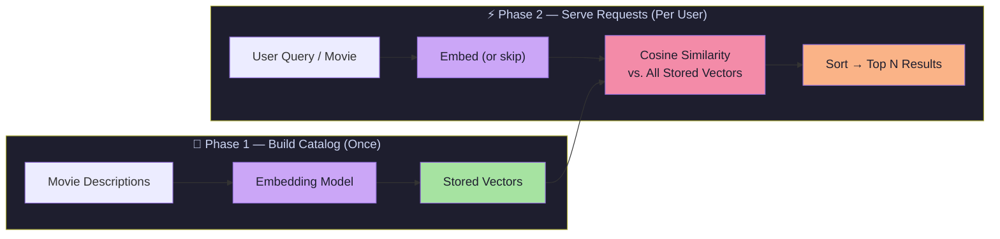

# Lecture 08 — Vector Embeddings Project: Building a Movie Recommendation System

> **Lecture Theme:** Apply vector embeddings to build a practical, working movie recommendation engine. Understand *why* embeddings are better than naive LLM approaches, *how* precomputation makes systems scalable, and *what* mathematical operations power semantic search and content-based recommendation.

---

## Chapter Index

| # | Chapter | Core Question Answered |
|---|---------|----------------------|
| [01](./01_Embeddings_and_The_Problem_of_Meaning.md) | Embeddings and The Problem of Meaning | What are embeddings and why do we need them? |
| [02](./02_Why_Not_Just_Use_an_LLM.md) | Why Not Just Use an LLM? | When is an embedding better than an LLM? |
| [03](./03_Precomputation_The_Key_Engineering_Insight.md) | Precomputation — The Key Engineering Insight | How do we make the system efficient at scale? |
| [04](./04_Semantic_Search_and_Movie_Recommendation.md) | Semantic Search and Movie Recommendation | What features does this system provide? |
| [05](./05_Cosine_Similarity_Measuring_Closeness.md) | Cosine Similarity — Measuring Closeness | How do we mathematically measure similarity? |
| [06](./06_Core_Mental_Model_REPRESENT_STORE_COMPARE_RANK.md) | Core Mental Model: REPRESENT → STORE → COMPARE → RANK | What is the universal pattern behind all embedding systems? |
| [07](./07_Complete_System_Design_and_Applications.md) | Complete System Design and Applications | How does everything fit together? |

---

## The Big Idea in One Diagram



---

## Key Concepts Quick Reference

| Concept | One-Line Definition |
|---------|---------------------|
| **Embedding** | Text converted to a fixed-size numerical vector that encodes meaning |
| **Embedding Model** | A neural network that transforms text → vector (not a chatbot) |
| **Cosine Similarity** | Measures the angle between two vectors; ignores magnitude |
| **Precomputation** | Process stable data once; cache results for reuse |
| **Content-Based Filtering** | Recommend based on *what* a movie is about |
| **Collaborative Filtering** | Recommend based on *what other users* watched |
| **Semantic Search** | Find results by meaning, not keyword matching |
| **RAG** | Search with embeddings → provide results as context to LLM |

---

## The Four-Step Mental Model

```
REPRESENT → Convert meaning into numbers (text → vector)
STORE     → Save those vectors for reuse (precomputation)
COMPARE   → Measure closeness (cosine similarity)
RANK      → Sort by score, return top N results
```

This pattern applies to: movies, products, documents, code, support tickets, job listings, images — any domain where you need to find "the most semantically similar items."

---

## Notes Sources

- 📄 [`Notes.pdf`](./Notes.pdf) — Original lecture slides
- 🖼️ [`Excalidraw-Notes.svg`](./Excalidraw-Notes.svg) — Handwritten visual notes covering: Batman/Titanic vector comparisons, Embedding Model vs LLM flow, Token → Neural Network → Embedding pipeline, Movie Recommendation Engine with LLM integration
