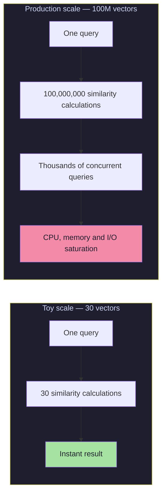
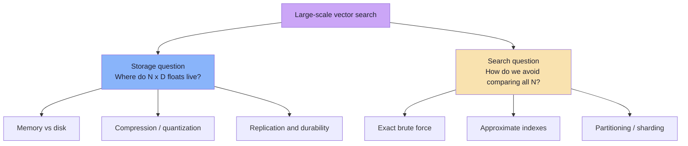
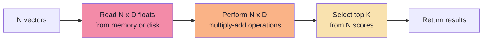
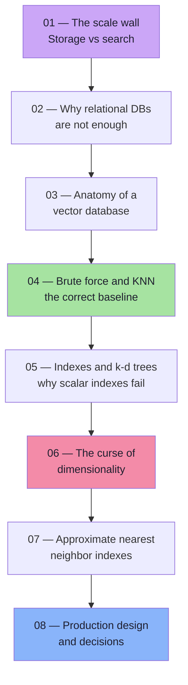

# Chapter 01: The Scale Wall — Why Toy Vector Search Breaks

> **Chapter Goal:** Start from the movie recommender built in Lecture 08 and push it past its limits. Understand exactly *which* assumption stops working when the catalogue grows from 30 vectors to hundreds of millions, and separate the two engineering problems that are often confused with each other: **storing** vectors and **searching** them.

---

## 1.1 The Demo That Worked Beautifully

In Lecture 08 we built a movie recommendation engine:

```ts
// The entire "vector database" from Lecture 08 (conceptual pseudo-code)
class Movie {
  id: string;
  title: string;
  description: string;
  embedding: number[]; // e.g. 1536 floats
}
```

And the "database" was simply:

```ts
const movies: Movie[] = [ /* 30 movies */ ];
```

A search looked like this:

```text
User query: "movie about space exploration and survival"
        ↓
Embedding model
        ↓
Query vector: [0.19, -0.44, 0.81, ...]
        ↓
For each movie: cosineSimilarity(queryVector, movie.embedding)
        ↓
Sort scores descending
        ↓
Return top K
```

With 30 movies, the loop runs 30 times. On a laptop that is effectively **instant**. It is also **exact** — we compare against every single vector, so we can never miss the true nearest neighbour.

This is the correct starting point. Every production vector system is an optimization of this exact loop.

---

## 1.2 Change One Variable: `N`

Now replace the 30-movie catalogue with realistic catalogues:

| System | Approximate number of vectors |
|---|---|
| Small SaaS knowledge base | 10,000 |
| Mid-size e-commerce catalogue | 1,000,000 |
| Spotify-scale music library | 100,000,000 |
| Large product marketplace | 500,000,000 |
| Web-scale search index | 10,000,000,000+ |

The algorithm does not change. The **cost** does.



With 100 million vectors, a **single** user query asks for 100 million comparisons. Now multiply by thousands of queries per second. The naive design collapses not because the math is wrong, but because the **work per query grows linearly with the dataset**.

> **The scale wall:** an algorithm whose cost is proportional to the size of the data is fine for a demo and fatal for a product.

---

## 1.3 The Two Questions That Must Be Separated

The lecture frames the entire problem as two distinct questions:

```text
Question 1:  How do I STORE hundreds of millions of vectors?

Question 2:  How do I SEARCH those vectors efficiently?
```

They feel like one problem, but they are not:

| Concern | Storage problem | Search problem |
|---|---|---|
| Core question | Where do the bytes live? | Which vectors are closest to this query? |
| Primary cost | Disk / RAM capacity, replication | CPU, memory bandwidth, I/O, latency |
| Typical solution | Object storage, database, vector DB persistence layer | ANN index (HNSW, IVF, PQ, DiskANN) |
| Failure mode | "We ran out of memory" | "p99 latency is 4 seconds" |
| Can be solved independently? | Yes | Yes — an index is a search structure, not a storage format |

A common mistake is to buy a "vector database" expecting it to solve both automatically. A vector database **does** provide both a storage layer and an index, but it is still your responsibility to understand the trade-offs you are selecting.



---

## 1.4 Why the Naive Approach Feels Deceptively Cheap

The brute-force loop hides three separate costs, and all three scale badly.

### Cost 1 — The number of comparisons

```text
comparisons per query = N
```

For `N = 100,000,000`, that is 100 million comparisons **per query**, not per day.

### Cost 2 — The work inside one comparison

A single embedding is not a scalar. A modern embedding may have 384, 768, 1536, or 3072 dimensions. A cosine similarity touches **every dimension**:

```text
work per comparison ≈ D
```

So the real cost is closer to:

```text
work per query ≈ N × D
```

### Cost 3 — The bytes that must be read

Each dimension is a number that occupies memory. Before the CPU can multiply anything, the vector must be fetched from RAM (or worse, from disk). At scale, **memory bandwidth and I/O** often become the bottleneck before raw arithmetic does.



Chapter 04 puts real numbers on each of these costs. For now, remember the shape: **read**, **compute**, **rank**.

---

## 1.5 A Concrete Preview of the Wall

Suppose:

- `N = 10,000,000` vectors
- `D = 1536` dimensions
- each dimension is a `float32` (4 bytes)

Three numbers fall out immediately:

| Quantity | Calculation | Result |
|---|---|---|
| Dimension-level operations per query | `10,000,000 × 1536` | **15.36 billion** |
| Raw bytes for vectors | `10,000,000 × 1536 × 4` | **61.44 GB** |
| Same, with IDs + metadata + index overhead | often 1.3× to 2× | **80–120 GB** |

And that is a *medium* system. At 100 million vectors the raw vector bytes alone are roughly **614 GB** before any overhead.

> **Key observation:** the naive loop is not "a bit slow". Its cost is a linear function of dataset size, times the dimension count, times the query rate. All three multipliers are large in production.

---

## 1.6 What Changes in Our Thinking

The Lecture 08 mental model was:

```text
REPRESENT → STORE → COMPARE → RANK
```

That model is still correct. Lecture 09 changes **how** we execute the last two steps at scale:

| Step | Toy version | Production version |
|---|---|---|
| REPRESENT | Embed query with the same model | Same, plus model versioning and batching |
| STORE | `Array<Movie>` in process memory | Vector DB / `pgvector` / object storage + index |
| COMPARE | Compare with all N | Compare with a small candidate set (ANN) |
| RANK | Sort all scores | Top-K heap, filters, then a reranker |

The new central question of this lecture:

> **Can we search only a small fraction of the vectors and still return results that are almost always the true nearest neighbours?**

That question is the definition of **Approximate Nearest Neighbor (ANN) search**, covered from Chapter 05 onward.

---

## 1.7 The Roadmap of This Lecture



---

## 1.8 Chapter Summary

| Idea | Takeaway |
|---|---|
| The Lecture 08 loop | Correct, exact, and fine for small `N` |
| The scale wall | Cost grows with `N × D` per query |
| Two problems | **Storage** and **search** are related but distinct |
| Hidden costs | Memory reads, arithmetic, and top-K selection all scale |
| Preview | 10M × 1536 = 15.36 billion dimension operations for one query |
| The new goal | Search a fraction of the data, keep near-perfect accuracy |

> **Final mental model:** A toy vector search fails at scale for the same reason a linear scan of a database table fails — it does work proportional to the data on every request. Indexes exist to avoid that. The rest of this lecture is about why the *usual* index does not work for vectors, and what we build instead.

---

**Next:** [Chapter 02 — Why a Relational Database Is Not Enough](./02_Why_Relational_Databases_Are_Not_Enough.md)
