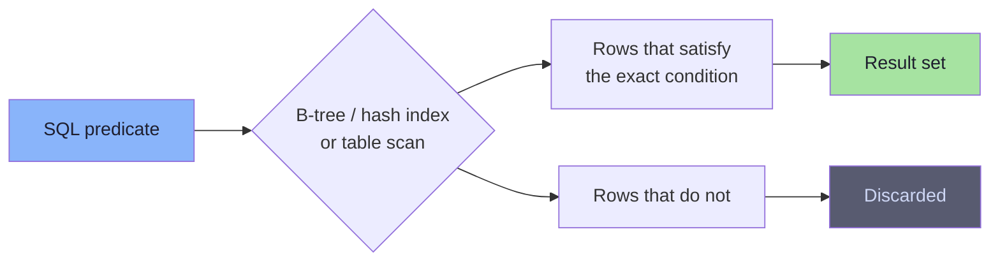
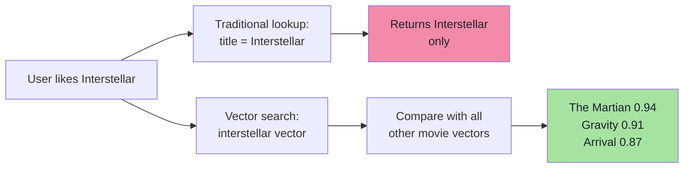
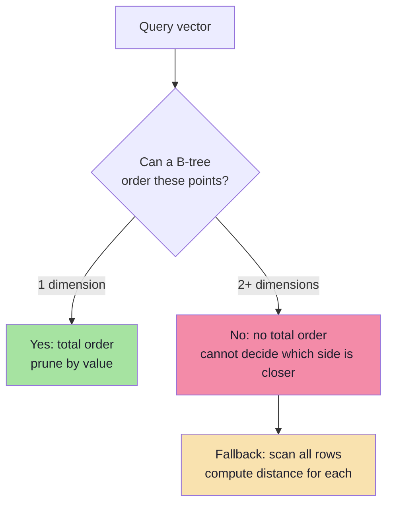
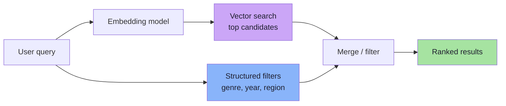
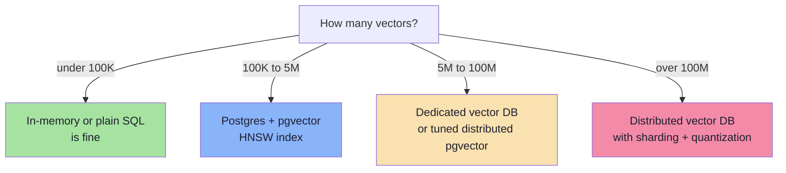

# Chapter 02: Why a Relational Database Is Not Enough

> **Chapter Goal:** Retire the myth that "normal databases cannot store vectors", then identify the real limitation. The problem is not storage — it is that relational databases are built to answer **exact and ordered** questions, while vector search asks a **graded similarity** question. This chapter also clarifies when a relational database *is* enough (for example PostgreSQL with `pgvector`).

---

## 2.1 The Wrong Question

A very common objection is:

```text
"We already have MySQL / PostgreSQL. Why do we need anything else?"
```

And the equally common, but incorrect, claim:

```text
"Traditional databases cannot store vectors."
```

That claim is false. A relational table can absolutely hold an array of numbers:

```text
movies
-------------------------------------------------------------
id | title        | description          | embedding
-------------------------------------------------------------
1  | Interstellar | Space exploration    | [...]
2  | Inception    | Dream manipulation   | [...]
3  | Titanic      | Romantic tragedy     | [...]
```

A vector can be persisted as:

| Storage form | Example | Notes |
|---|---|---|
| JSON / JSONB | `[0.21, -0.47, 0.83, ...]` | Readable, larger, slower to parse |
| Binary blob | `bytea`, `BLOB` | Compact, opaque to the database |
| Serialized text | CSV / base64 | Simple, wasteful |
| Native vector type | `vector(1536)` in `pgvector` | Compact and indexable |

So the honest framing is:

> **Relational databases can store vectors. The hard part is finding the nearest ones efficiently.**

---

## 2.2 What Relational Databases Are Designed For

Traditional databases were designed around **predicates over scalar columns**:

```sql
SELECT * FROM movies WHERE id = 10;              -- exact equality
SELECT * FROM movies WHERE genre = 'Sci-Fi';     -- exact equality
SELECT * FROM movies WHERE year >= 2010;         -- ordered comparison
SELECT * FROM movies WHERE title LIKE '%space%'; -- pattern match
SELECT * FROM movies WHERE year BETWEEN 2000 AND 2010;
SELECT * FROM movies ORDER BY year DESC;
SELECT * FROM movies GROUP BY genre;
SELECT * FROM movies JOIN actors ON ...;
```

The underlying question is always:

```text
Which rows satisfy my condition?
```

The answer is a **set of rows**. Each row either matches or it does not.



The index works because `id`, `genre`, and `year` have something a vector does not: **a total order** (or a small set of exact values) that lets the engine discard huge parts of the table.

---

## 2.3 What Vector Search Actually Asks

A vector query looks like this:

```text
Query vector Q = [0.2, 0.8, 0.3]
```

We almost never want:

```text
Find the stored vector exactly equal to [0.2, 0.8, 0.3]
```

Exact equality is useless in semantic search — no real embedding will ever be bit-for-bit identical to the query. Instead we ask:

```text
Which stored vectors are CLOSEST to Q?
```

Given:

```text
A = [0.21, 0.79, 0.31]
B = [0.19, 0.82, 0.30]
C = [-0.7, 0.10, 0.50]
```

`A` and `B` are near `Q`; `C` is far away. A useful answer is a **ranked list**:

```text
1. A  → 0.999
2. B  → 0.997
3. C  → 0.21
```

This is a **Nearest Neighbor Search**, not a `WHERE` clause.

---

## 2.4 Exact Lookup vs Similarity Lookup


| Traditional search | Vector search |
|---|---|
| Boolean match | Graded similarity |
| `true` / `false` | `0.94`, `0.87`, `0.31` |
| Result set is unordered by relevance | Result set is inherently ranked |
| Exact predicates | Approximate geometric proximity |
| Index on scalar value | Index on multi-dimensional space |

> **This is the key conceptual difference:** traditional search asks *"does it match?"*; vector search asks *"how similar is it, and how does that compare to everything else?"*

---

## 2.5 The Netflix Example

Suppose a user likes **Interstellar**.

A traditional query would be:

```sql
SELECT * FROM movies WHERE title = 'Interstellar';
```

That returns Interstellar itself. It is the correct answer to the wrong question.

What the product actually wants is:

```text
Movies similar to Interstellar.
```

That is a **similarity problem**, not an **exact-match problem**. It cannot be expressed as `WHERE title = ...` or `WHERE genre = ...` without losing the entire point of semantic recommendation. A genre filter returns every sci-fi movie, including weak matches; it cannot rank *how* space-survival-like each one is.



---

## 2.6 Why a B-Tree Cannot Save You

A B-tree index is a sorted structure. `age = 32` works because all numbers share one ordering. Once you reach a row whose value is `27` while searching for `32`, you know every smaller value is irrelevant.

For a vector, this reasoning breaks down immediately:

```text
A = [2, 8]
B = [5, 3]

Is A "less than" B?
```

- By `x`: `A.x < B.x` → A is smaller.
- By `y`: `A.y > B.y` → A is larger.

There is **no natural total order** over points in two dimensions, let alone 1536. Without an order, a B-tree cannot prune. Without pruning, "indexed" search degenerates to a scan of every row plus a distance computation.



Chapter 05 shows the structures people invented to work around this — and why even those break at high dimensions.

---

## 2.7 The Real Cost of "Just Use Postgres"

You *can* implement vector search in a relational database without any extension:

```ts
// Pseudo-code: what happens behind the scenes without a vector index
const rows = await db.query("SELECT id, embedding FROM movies");

const scored = rows.map(row => ({
  id: row.id,
  score: cosineSimilarity(queryVector, row.embedding),
}));

scored.sort((a, b) => b.score - a.score);
return scored.slice(0, k);
```

This is correct. It is also exactly the brute-force algorithm from Chapter 01, now with the additional cost of:

1. serializing/deserializing every embedding over the database protocol,
2. transferring `N × D` floats to the application,
3. computing distances in application code.

At 10 million movies and 1536 dimensions, that is **61 GB of data movement per query**. A dedicated vector index avoids ever leaving the storage engine.

---

## 2.8 Hybrid Queries: Where Relational Databases Still Win

Vectors rarely live alone. A realistic query combines **semantic similarity** with **structured filters**:

```text
Find movies similar to Interstellar
  WHERE genre = 'Sci-Fi'
  AND year > 2010
  AND available_in_region = 'IN'
```

This is the strongest argument for keeping vectors next to your relational data:

| Requirement | Best handled by |
|---|---|
| Transactional updates (price, stock, status) | Relational database |
| Joins, constraints, foreign keys | Relational database |
| Metadata filtering | Relational database / vector DB payload |
| Similarity ranking | Vector index |
| Hybrid text + vector ranking | Search engine or vector DB with hybrid support |



A vector database is not a replacement for your relational database. In production they usually run side by side, with the relational store acting as the **source of truth** and the vector index as a **derived search structure**.

> **Architectural rule:** if you can rebuild the vector index from the relational database, your design is healthy. If the vector index is the only place your data exists, you have created a durability problem.

---

## 2.9 When a Relational Database *Is* Enough

Modern PostgreSQL with the `pgvector` extension adds:

- a native `vector(D)` column type,
- distance operators (`<->` L2, `<#>` inner product, `<=>` cosine),
- HNSW and IVFFlat indexes.

That changes the decision considerably:

| Scenario | Recommendation |
|---|---|
| Fewer than ~100k vectors, low QPS | Plain PostgreSQL scan is often fine |
| Up to a few million vectors, moderate QPS | PostgreSQL + `pgvector` with HNSW |
| Need ACID + vectors + joins in one system | PostgreSQL + `pgvector` |
| Hundreds of millions of vectors | Dedicated vector DB / distributed ANN |
| Multi-tenant, high QPS, strict p99 latency | Dedicated vector DB |
| Rapid prototyping | In-memory array or SQLite/Chroma |



The thresholds are guidelines, not laws. The real inputs are **latency target, query rate, recall requirement, and operational budget**.

---

## 2.10 Chapter Summary

| Claim | Reality |
|---|---|
| "Relational DBs cannot store vectors" | False — JSON, blobs, and native vector types all work |
| "Then why not just use SQL?" | SQL answers exact/ordered predicates, not similarity ranking |
| "An index will fix it" | B-trees need a total order; vectors do not have one |
| "Vector DBs replace relational DBs" | No — they are derived search structures beside the source of truth |
| "Postgres is never enough" | Often it is, especially with `pgvector` and moderate scale |

> **Final mental model:** The database is not failing to *hold* the vectors. It is failing to *reason* about them. Traditional indexes exploit order; vector search needs geometry. That gap is what vector databases and ANN indexes were invented to fill.

---

**Next:** [Chapter 03 — Anatomy of a Vector Database](./03_Anatomy_of_a_Vector_Database.md)
