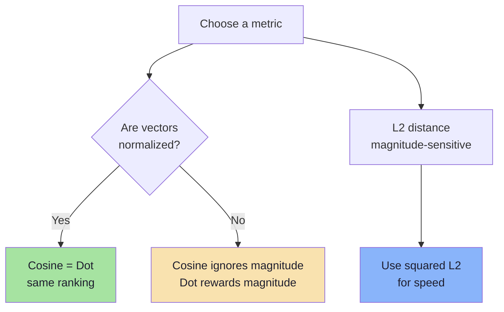
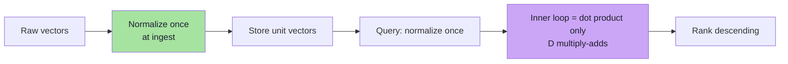
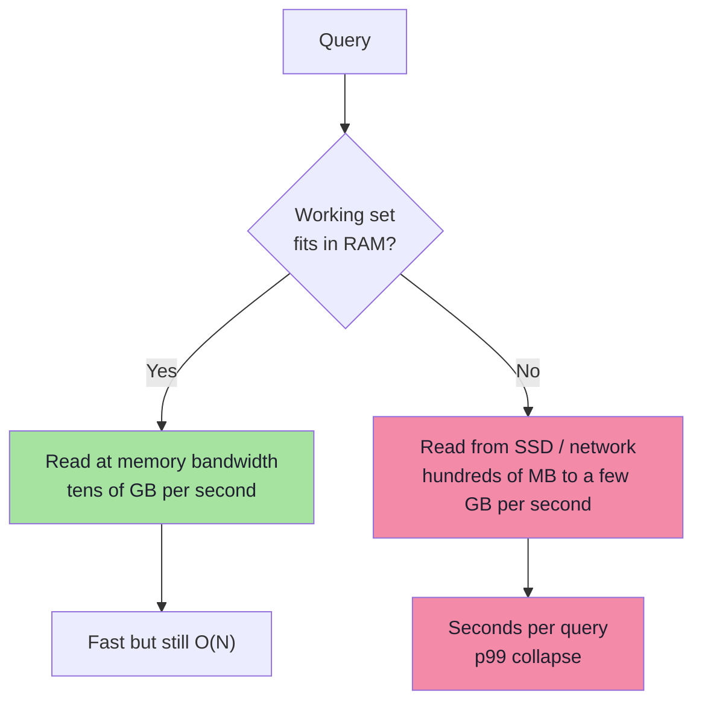
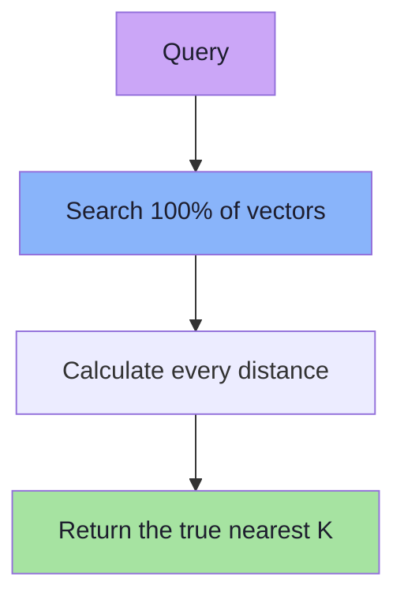
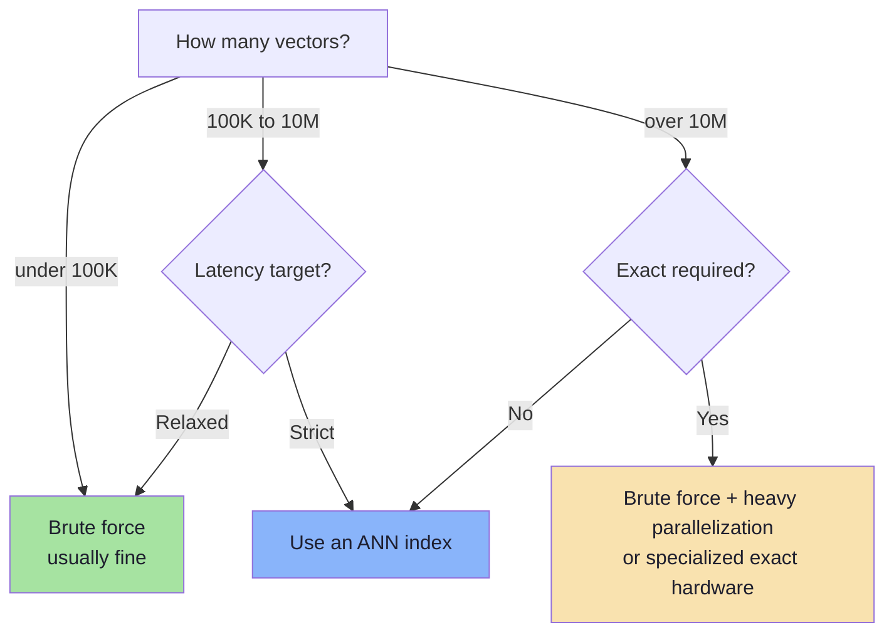

# Chapter 04: Brute Force and KNN — The Correct Baseline

> **Chapter Goal:** Understand the algorithm every vector database is trying to beat. Learn what K-Nearest Neighbor search means, how top-K selection works, which distance metric to use, and exactly how much CPU, memory, and I/O brute force costs at scale. This chapter is the **ground truth** against which every approximate index in Chapter 07 is measured.

---

## 4.1 K-Nearest Neighbor Search, Precisely

Given:

- a set of `N` stored vectors `M1 … MN`, each with `D` dimensions,
- a query vector `Q`,
- an integer `K`,
- a distance or similarity function,

KNN returns the `K` vectors that are closest to `Q`.

```text
KNN(Q, K) = the K stored vectors with the smallest distance(Q, Mi)
```

Concretely, the naive implementation is:

```ts
// Pseudo-code: the complete brute-force KNN algorithm
function knn(query: number[], vectors: VectorRecord[], k: number): Scored[] {
  const scored: Scored[] = [];

  for (const record of vectors) {
    const score = cosineSimilarity(query, record.embedding);
    scored.push({ id: record.id, score });
  }

  scored.sort((a, b) => b.score - a.score);
  return scored.slice(0, k);
}
```

That is the entire algorithm. Everything else in this lecture is about avoiding parts of this loop.

---

## 4.2 What Does K Mean?

Imagine the query vector as a point in space and the stored vectors as other points:

```text
              A ●

        B ●           ● C

                  X  ← query
             ● D

                        ● E
```

| K | Result |
|---|---|
| `K = 1` | Only the single closest point |
| `K = 3` | The three closest points |
| `K = 10` | The ten closest points |

So:

```text
K = how many nearest neighbours we want to return
```

### How K is chosen in practice

| Use case | Typical K | Reason |
|---|---|---|
| "Show similar movies" rail | 5–10 | UI space |
| Semantic search page | 10–20 | Then paginate or rerank |
| RAG context retrieval | 3–8 | Context window budget |
| Candidate generation for a reranker | 50–200 | Recall matters more than precision |
| Deduplication | 1–5 | Only the near-duplicates matter |
| Evaluation (recall@K) | 10–100 | Measures retrieval quality |

> **Important:** K is a **product** decision, not an algorithm decision. The index does not care whether K is 3 or 300, but latency and memory do.

---

## 4.3 Similarity vs Distance (and Why the Sign Flips)

Two families of metric appear everywhere:

| Family | Higher is better? | Example |
|---|---|---|
| **Similarity** | Yes | Cosine similarity, dot product |
| **Distance** | No (lower is better) | Euclidean L2, Manhattan L1 |

### Cosine similarity

```text
cos(A, B) = (A · B) / (‖A‖ × ‖B‖)

Range: −1 … +1
+1 = same direction, 0 = orthogonal, −1 = opposite
```

### Dot product

```text
dot(A, B) = Σ Ai × Bi
```

If both vectors are normalized to unit length, dot product **equals** cosine similarity.

### Euclidean distance

```text
L2(A, B) = √( Σ (Ai − Bi)² )
```

For ranking purposes, the square root is monotonic, so implementations usually compute **squared L2** and skip it:

```text
L2²(A, B) = Σ (Ai − Bi)²
```

### Manhattan distance

```text
L1(A, B) = Σ |Ai − Bi|
```

Rare for text embeddings, useful in some image and sparse-vector settings.



> **Rule:** The metric used at **index build time** must match the metric used at **query time**, and both must match what the embedding model was trained for. Most modern text embedding models are trained for cosine similarity on normalized vectors.

---

## 4.4 Worked Example: One Query Against Five Movies

Query: `"mind-bending movie about space"`

```text
Q = [0.23, 0.70, 0.16, ...]
```

Stored vectors (illustrative):

| Movie | Cosine similarity | Rank |
|---|---|---|
| Interstellar | 0.95 | 1 |
| The Martian | 0.91 | 2 |
| Gravity | 0.88 | 3 |
| Titanic | 0.29 | 4 |
| The Notebook | 0.21 | 5 |

With `K = 3`, the result is:

```text
1. Interstellar   0.95
2. The Martian    0.91
3. Gravity        0.88
```

Notice that the output is **ranked**, not filtered. There is no threshold by default. A threshold (`score >= 0.75`) is a separate product decision that prevents weak matches from being shown.

---

## 4.5 The True Cost of One Comparison

One vector comparison is **not** one operation. For `D = 1536`:

| Metric | Operations per comparison |
|---|---|
| Dot product | 1536 multiplications + 1535 additions |
| Cosine | Dot product + 2 magnitudes (or 1 if pre-normalized) |
| Squared L2 | 1536 subtractions + 1536 multiplications + 1535 additions |

For cosine similarity on pre-normalized vectors, the magnitude work disappears and cosine becomes a single dot product. This is why **normalizing at write time** is a standard optimization: it turns cosine into the cheapest possible inner loop.



Estimated total work for a single query:

```text
work ≈ N × D
```

where:

- `N` = number of stored vectors
- `D` = number of dimensions

This is the `O(N × D)` cost stated in the lecture.

---

## 4.6 Real Numbers: 10 Million Vectors

```text
N = 10,000,000
D = 1536
```

```text
N × D = 10,000,000 × 1536
      = 15,360,000,000
      ≈ 15.36 billion dimension-level operations
```

That is **one query**.

Now apply realistic traffic:

| QPS | Dimension operations per second |
|---|---|
| 1 | 15.36 billion |
| 10 | 153.6 billion |
| 100 | 1.536 trillion |
| 1,000 | 15.36 trillion |

Even at 100 QPS, brute force on 10 million vectors requires on the order of **1.5 trillion multiply-adds per second**, before accounting for memory reads, filters, and ranking. A single CPU core does a few billion per second. You would need dozens of cores just for arithmetic — and the data still has to reach them.

> **The lecture's core observation:** with brute-force search, the work grows with the size of the dataset. Adding data makes every query slower.

---

## 4.7 Real Numbers: Storage and Memory

Assume `float32` = 4 bytes.

```text
one vector = 1536 × 4 bytes
           = 6144 bytes
           ≈ 6 KB
```

| Number of vectors | Raw vector storage |
|---|---|
| 1,000 | ~6 MB |
| 100,000 | ~600 MB |
| 1,000,000 | ~6 GB |
| 10,000,000 | ~60 GB |
| 100,000,000 | ~600 GB |
| 1,000,000,000 | ~6 TB |

These match both the PDF (100 million ≈ 600 GB) and the Excalidraw note (10 million × 6 KB = 60 GB). The arithmetic is the same; only the row count differs.

And this excludes:

- IDs and metadata (often 1–5 KB per record),
- payload indexes,
- the ANN index itself (HNSW graphs can add 30–100% overhead),
- replication factor (×2 or ×3),
- temporary build space (often ×1.5–2 during merges),
- database overhead and fragmentation.

A realistic rule of thumb for a production system:

```text
provisioned RAM ≈ raw vector bytes × 1.5 to 3
```

> **Consequence:** storage is not just a disk bill. If the working set does not fit in RAM, queries hit disk, and latency changes by orders of magnitude.

---

## 4.8 The Hidden Cost: Memory Bandwidth and Disk I/O

Arithmetic is often not the bottleneck. Fetching the bytes is.

```text
15.36 billion operations
        requires reading
61.44 GB of vector data
        per query
```

Even at an optimistic 50 GB/s of memory bandwidth, that is more than a second **just to stream the vectors**, before any math. If the collection does not fit in RAM, the same read comes from SSD or network storage at 1–7 GB/s, and the query becomes unusable.



This is why serious vector systems use:

- **quantization** (float32 → int8 → binary) to shrink bytes,
- **sharding** to fit each shard in memory,
- **ANN indexes** to avoid reading most vectors at all.

---

## 4.9 The Top-K Selection Cost

After scoring, we have `N` scores:

```text
M1 → 0.71
M2 → 0.23
M3 → 0.94
M4 → 0.51
...
```

We need the highest `K`. Two implementations:

| Approach | Cost | Notes |
|---|---|---|
| Sort all scores | `O(N log N)` | Simple, wasteful when `K << N` |
| Min-heap of size K | `O(N log K)` | Standard; memory `O(K)` |
| Quickselect | `O(N)` average | Good for batch/offline |
| Streaming threshold | `O(N)` | Keep the current K-th best and compare |

```ts
// Pseudo-code: top-K with a bounded min-heap
function topK(scores: Scored[], k: number): Scored[] {
  const heap = new MinHeap<Scored>((a, b) => a.score - b.score);

  for (const item of scores) {
    if (heap.size < k) {
      heap.push(item);
    } else if (item.score > heap.peek().score) {
      heap.replaceRoot(item); // drop the weakest, keep the best K
    }
  }

  return heap.drainSortedDescending();
}
```

For `N = 10 million`, sorting all scores is `~230 million` comparisons. A size-`K` heap with `K = 10` needs roughly `10 million × log2(10) ≈ 33 million` comparisons. Both are dwarfed by the `15.36 billion` dimension operations, but the heap also avoids allocating a 10-million-element sorted array per query.

---

## 4.10 Exact Nearest-Neighbor Search

The brute-force approach has one enormous advantage:

```text
We check EVERY vector.
```

Therefore the true nearest neighbours **cannot be missed**.



This is **Exact Nearest-Neighbor Search**, often called **flat** or **brute-force** search.

| Property | Value |
|---|---|
| Accuracy | Perfect (100% recall by definition) |
| Build time | None — no index to build |
| Insert cost | `O(1)` — just append |
| Delete cost | `O(1)` with swap-remove |
| Query cost | `O(N × D)` |
| Memory overhead | Minimal |
| Scalability | Poor |

> **PDF framing:** *Excellent accuracy → Poor scalability.*

Exact search is not a "bad" algorithm. It is the **specification** that approximate algorithms try to satisfy. Every ANN system is evaluated by comparing its results to exact search on a sample of queries.

---

## 4.11 Making Brute Force Faster (Without Changing the Result)

Before reaching for an index, there are legitimate constant-factor optimizations:

| Optimization | What it does | Typical gain |
|---|---|---|
| **Pre-normalize vectors** | Cosine becomes a dot product | Removes 2 magnitude passes |
| **float32 → float16 / int8** | Halves or quarters bytes read | 2–4× memory bandwidth |
| **SIMD / vectorized loops** | Process 8–16 floats per instruction | 2–8× |
| **BLAS / matrix multiply** | Batch all queries into one GEMM | Large throughput gain |
| **Batch queries** | One query becomes a matrix row | Amortizes overhead |
| **Memory-mapped files** | Let the OS page cache do the work | Avoids copies |
| **Sharding + parallel scan** | Split N across cores/machines | Near-linear in shards |
| **Metadata pre-filter** | Score only eligible rows | Proportional to selectivity |

These lower the constant. They do **not** change the `O(N × D)` growth curve. That is the fundamental limit.

```ts
// Pseudo-code: batched brute force as matrix multiplication
// embeddings: N x D matrix, queries: B x D matrix
// scores = queries @ embeddings.T   ->   B x N matrix
const scores: number[][] = matMul(normalize(queries), transpose(normalizedEmbeddings));
const results = scores.map(row => topKIndices(row, k));
```

A single large matrix multiplication is often **orders of magnitude faster** than a JavaScript `for` loop, because it moves the inner loop into optimized native code. That is exactly what FAISS and `pgvector` do internally.

---

## 4.12 When Brute Force Is the Right Choice

Brute force is not a beginner mistake. It is frequently the correct engineering decision.

| Situation | Why brute force wins |
|---|---|
| `N < 100,000` | Index build time and complexity outweigh query savings |
| Low QPS, latency budget > 100 ms | No need to optimize |
| Exact results required (compliance, dedup) | ANN can miss true neighbours |
| Data changes constantly | No index maintenance backlog |
| You need a **ground-truth baseline** | Required to measure ANN recall |
| Filter is extremely selective | Pre-filtering leaves a tiny candidate set |
| Prototype / MVP | Ship the simple thing first |



> **Engineering rule:** start with brute force, measure, then add an index when a real latency or capacity constraint demands it. An index is a complexity purchase — make sure you are buying something you need.

---

## 4.13 Brute Force as the Evaluation Oracle

You cannot know whether an ANN index is good without exact search. The standard workflow:

```text
1. Take 1,000 real queries.
2. Run exact KNN on each → ground truth.
3. Run the ANN index on each → candidate results.
4. Compare: what fraction of true neighbours did ANN return?
   → that fraction is recall@K
```

```ts
// Pseudo-code: measuring ANN recall against exact search
function recallAtK(queries: Query[], ann: AnnIndex, exact: VectorStore, k: number): number {
  let hits = 0;
  let total = 0;

  for (const q of queries) {
    const truth = new Set(exact.knn(q.vector, k).map(r => r.id));
    const found = ann.search(q.vector, k).map(r => r.id);

    for (const id of found) {
      if (truth.has(id)) hits++;
    }
    total += k;
  }

  return hits / total;
}
```

This is why Chapter 07 treats **recall** as the central quality metric for approximate indexes.

---

## 4.14 Chapter Summary

| Concept | Takeaway |
|---|---|
| KNN | Return the `K` stored vectors closest to the query |
| K | A product decision (UI size, context budget, reranker candidates) |
| Metric | Cosine, dot, L2, or L1; must match the model and index |
| Normalization | Turns cosine into a dot product — a major constant-factor win |
| Cost per query | `O(N × D)`; 10M × 1536 = 15.36 billion operations |
| Storage | 1536 × 4 B ≈ 6 KB per vector; 1M ≈ 6 GB; 100M ≈ 600 GB |
| Hidden bottlenecks | Memory bandwidth, disk I/O, top-K selection |
| Top-K | Use a bounded heap (`O(N log K)`), not a full sort |
| Exact search | 100% recall, no build cost, poor scalability |
| Role in the course | The **baseline** and the **ground truth** for ANN |

> **Final mental model:** Brute force is the honest algorithm. It tells you the truth and sends you the bill. The bill is `N × D` per query, plus the cost of moving `N × D` numbers through memory. Chapters 05–07 are about reducing that bill without lying too much about the answer.

---

**Next:** [Chapter 05 — Indexes and Why Scalar Indexes Fail for Vectors](./05_Indexes_and_Why_Scalar_Indexes_Fail_for_Vectors.md)
