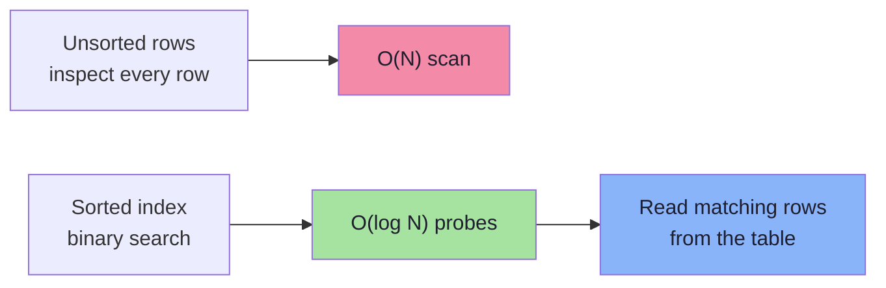
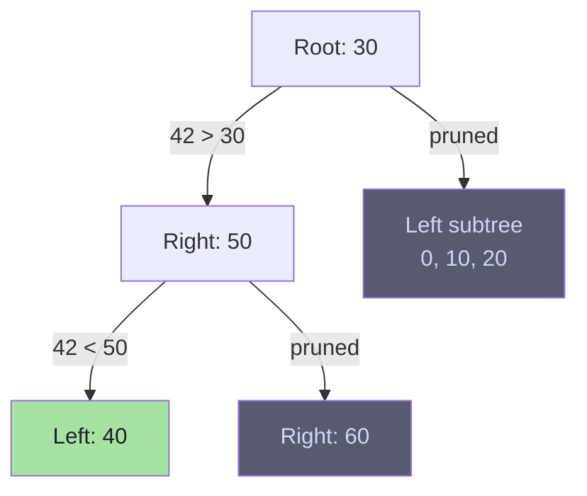
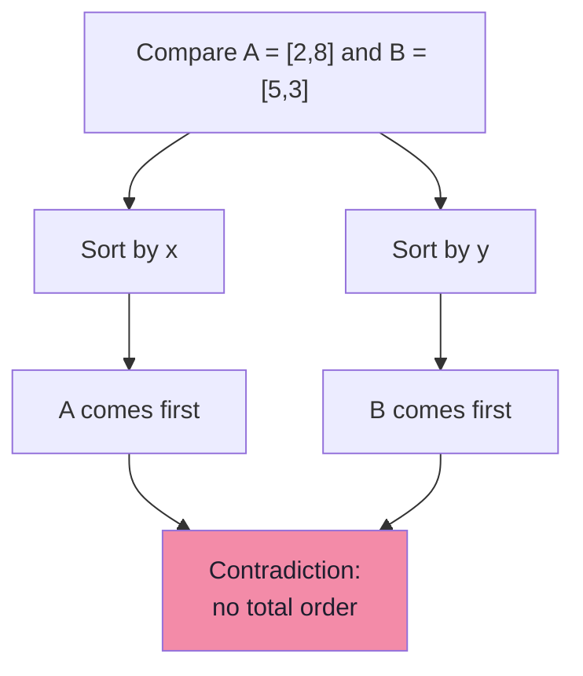
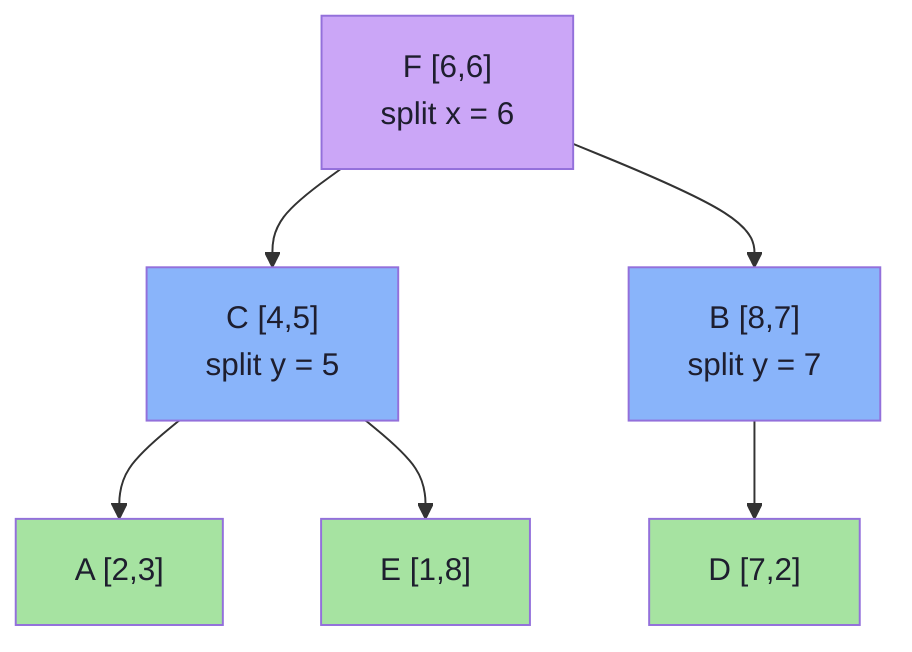
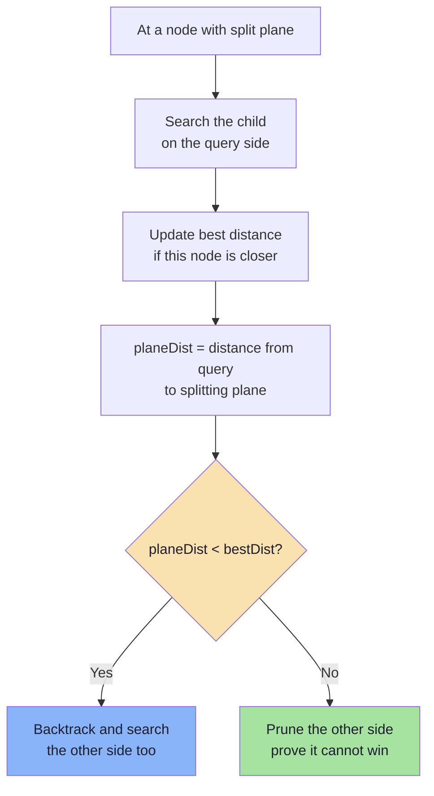
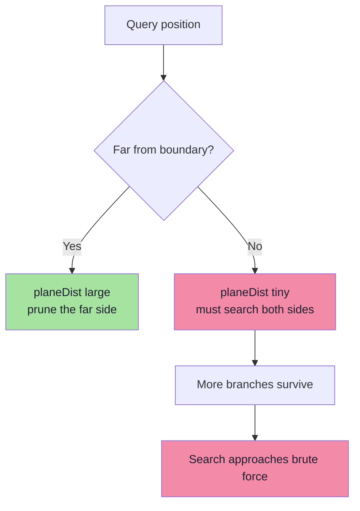

# Chapter 05: Indexes and Why Scalar Indexes Fail for Vectors

> **Chapter Goal:** Understand why a normal database index makes queries fast, then watch that same reasoning collapse as soon as a value has more than one dimension. Build a k-d tree by hand, search it, and learn the exact pruning rule — including the case where pruning is impossible. This chapter sets up the curse of dimensionality in Chapter 06.

---

## 5.1 The Question

Databases have already solved many search-performance problems with indexes. So why can't we simply create a normal index for embeddings?

```text
If age = 32 can use a B-tree, why can't embedding = [0.21, -0.42, ...]?
```

To answer that, we first have to see **why** ordinary indexes work so well.

---

## 5.2 Why Ordinary Indexes Work

Suppose we have an `employee` table with 10 million rows:

```text
Employee
----------------
id
name
age
```

and the query:

```sql
SELECT * FROM employee WHERE age = 32;
```

Without an index, the database may have to inspect every row:

```text
23
41
19
32  ← match
56
32  ← match
...
```

This is a **full table scan**: `O(N)`.

With an index on `age`, the database stores the values in sorted order:

```text
18, 20, 23, 27, 32, 36, 41, 50, ...
```

Now suppose we are looking for `32` and the current value is `27`. We already know:

```text
There is no reason to search toward smaller values.
```

We move toward the larger side. Large parts of the search space are eliminated without inspection.



> **The deep reason indexes work:** order lets you *prove* that a region of the search space cannot contain the answer. Proof is what enables pruning. Scanning is what happens when you cannot prove anything.

---

## 5.3 The Mechanism: B-Trees and Selectivity

A B-tree (or B+ tree) keeps keys sorted in pages and fans out with a high branching factor:

```text
                 [ 30 | 60 ]
               /      |      \
        [10|20]   [40|50]   [70|80]
        /  |  \    /  |  \   /  |  \
      ... pages of sorted rows ...
```

For an equality or range predicate, the engine:

1. descends from the root, comparing the key at each node,
2. discards every subtree whose key range cannot satisfy the predicate,
3. reads only the matching leaf pages.

This works because a scalar key has a **total order**: for any two values `a` and `b`, exactly one of `a < b`, `a = b`, `a > b` holds.

| Property | Scalar column | Embedding |
|---|---|---|
| Total order | Yes | **No** |
| Equality meaningful | Yes | Almost never |
| Range meaningful | Yes | Not semantically |
| Can prove "this subtree is irrelevant" | Yes | Rarely |
| Index structure | B-tree, hash | Needs geometric structures |

Indexes also exploit **selectivity**: `age = 32` might match 0.01% of rows, so reading the index plus a few rows beats scanning 10 million. A vector query has no equivalent notion of an exact key match.

---

## 5.4 One Dimension: A Number Line

Imagine a number line:

```text
0----10----20----30----40----50----60
```

Suppose we want the value closest to `42`. There is a natural order, so a tree can organize the values:

```text
                 30
              /      \
            10        50
           /  \      /  \
          0   20   40    60
```

For `42`:

```text
42 > 30  → move right
42 < 50  → move left
```

We never visit the subtree containing `0, 10, 20`. The interval `[0, 30]` is provably farther from `42` than `40` is.



In one dimension, pruning is easy because the geometry is an interval and the ordering is total.

---

## 5.5 Two Dimensions: Order Disappears

Now consider vectors with two dimensions:

```text
[x, y]

A = [2, 8]
B = [5, 3]
```

Which vector is smaller?

- Using `x`: `A.x (2) < B.x (5)` → A is smaller.
- Using `y`: `A.y (8) > B.y (3)` → A is larger.

There is **no single natural ordering** like the number line. The points are simply *incomparable* without a chosen criterion.



This is not a small inconvenience. B-trees rely on a total order. Points in `R²` form only a **partial order** (you can compare by a chosen coordinate, but that tells you nothing about geometric proximity). Two points can be close in space while being far apart on every individual axis, and vice versa.

> **This is the conceptual break:** scalar indexes exploit one-dimensional order. Vectors live in a multi-dimensional geometry where no such order exists.

---

## 5.6 Partitioning Space One Dimension at a Time

One approach is to divide the space using **one coordinate at a time**. This leads to the **k-d tree** (k-dimensional tree).

First split using `x`:

```text
                    x = 5
                 /         \
          x < 5             x >= 5
```

Inside each region, split using another dimension, such as `y`:

```text
                         x = 5
                    /             \
                 y = 5            y = 5
               /      \          /      \
            ...       ...      ...       ...
```

Geometrically, the plane is divided into rectangular regions:

```text
    +----------------+----------------+
    |                |                |
    |       E        |       B        |
    |                |                |
    +----------------+-------F--------+
    |       C        |                |
    |                |                |
    |   A            |       D        |
    +----------------+----------------+
```

Each internal node owns a **splitting plane**; each subtree owns a **region**. That region is what makes pruning provable: if the entire region is farther from the query than the current best candidate, the subtree can be skipped.

---

## 5.7 Building a Small k-d Tree (Worked Example)

Points:

```text
A = [2, 3]
B = [8, 7]
C = [4, 5]
D = [7, 2]
E = [1, 8]
F = [6, 6]
```

### Step 1 — Split on x

Sort temporarily by `x`:

```text
E [1,8]
A [2,3]
C [4,5]
F [6,6]
D [7,2]
B [8,7]
```

Choose a point near the median. Here we choose `F = [6,6]`:

```text
                         F [6,6]
                         x = 6
                       /        \
                  x < 6          x >= 6
```

Left side: `E [1,8]`, `A [2,3]`, `C [4,5]`
Right side: `D [7,2]`, `B [8,7]`

### Step 2 — Split each side on y

Left side sorted by `y`: `A [2,3]`, `C [4,5]`, `E [1,8]` → choose `C = [4,5]`:

```text
C [4,5]
y = 5
 /     \
A       E
```

Right side sorted by `y`: `D [7,2]`, `B [8,7]` → choose `B = [8,7]` as the upper median:

```text
B [8,7]
y = 7
 /
D [7,2]
```

### Step 3 — The complete tree

```text
                         F [6,6]   ← x split at 6
                       /        \
              C [4,5]            B [8,7]
              y split at 5       y split at 7
              /       \          /
        A [2,3]     E [1,8]   D [7,2]
```

The tree now represents geometric partitions of the vector space.

> **Implementation note:** the median choice does not have to be exact. Many implementations use the middle element after a partial sort, or stop when a leaf holds a small bucket of points (e.g. 16–64), then brute-force the bucket.



---

## 5.8 Building a k-d Tree: Pseudo-Code

```ts
// Pseudo-code: recursive k-d tree construction
type Point = { id: string; coords: number[] };

function buildKdTree(points: Point[], depth: number): KdNode | null {
  if (points.length === 0) return null;
  if (points.length <= LEAF_SIZE) return { leaf: points };

  const axis = depth % DIMENSIONS;             // cycle x, y, z, ...
  const sorted = [...points].sort((a, b) => a.coords[axis] - b.coords[axis]);
  const mid = Math.floor(sorted.length / 2);

  return {
    point: sorted[mid],
    axis,
    splitValue: sorted[mid].coords[axis],
    left: buildKdTree(sorted.slice(0, mid), depth + 1),
    right: buildKdTree(sorted.slice(mid + 1), depth + 1),
  };
}
```

| Property | Value |
|---|---|
| Build time | `O(N log N)` (with median selection; `O(N log² N)` if fully sorting each level) |
| Axis policy | Cycle through dimensions, or choose the widest-variance axis |
| Balance | Median split keeps the tree balanced |
| Leaf bucket | Brute force small leaves to avoid deep trees |
| Memory | `O(N)` nodes |

---

## 5.9 Searching the k-d Tree

Query:

```text
Q = [7, 6]
```

We want the nearest neighbour.

### Step 1 — Start at the root

Root is `F = [6,6]`, splitting on `x` at `6`.

```text
Q.x = 7
F.x = 6

7 > 6  →  investigate the RIGHT side first
```

Before descending, compute the distance to the node itself:

```text
distance(Q, F) = sqrt((7-6)² + (6-6)²) = 1
```

Current best: `F`, distance `1`.

### Step 2 — Descend into the right subtree

Node `B = [8,7]`, splitting on `y` at `7`.

```text
Q.y = 6
B.y = 7

6 < 7  →  go LEFT
```

Reach `D = [7,2]`:

```text
distance(Q, D) = sqrt((7-7)² + (6-2)²) = 4
```

Not better than `1`.

### Step 3 — Backtrack and test the splitting plane

At node `B` (splitting plane `y = 7`):

```text
distance from Q to plane = |Q.y - 7| = |6 - 7| = 1
best distance so far     = 1
```

Since `1 < 1` is false, we can prune the other side of `B`.

At node `F` (splitting plane `x = 6`):

```text
distance from Q to plane = |Q.x - 6| = |7 - 6| = 1
best distance so far     = 1
```

Again `1 < 1` is false, so we prune the entire left subtree of `F`.

### Step 4 — Result

```text
Nearest neighbour: F = [6,6], distance 1
```

Checking all points confirms this is correct:

| Point | Distance from Q |
|---|---|
| A [2,3] | 5.83 |
| B [8,7] | 1.41 |
| C [4,5] | 3.16 |
| D [7,2] | 4.00 |
| E [1,8] | 6.32 |
| **F [6,6]** | **1.00** |

We inspected `F`, `B`, and `D` — three of six points — and still found the true nearest neighbour.

> **Tie-handling detail:** using `distance_to_plane <= best_distance` when backtracking preserves ties. Using `<` may skip an equally-close point. Most implementations use `<=` on the pruning test to be safe.

---

## 5.10 The Pruning Rule

This is the heart of every geometric index:

```text
1. Search the side containing the query first.
2. Keep track of the best distance found so far.
3. Calculate the distance from the query to the splitting plane.
4. If distance_to_plane < best_distance:
       search the other side too.
5. Otherwise:
       safely prune the other side.
```



The logic is geometric: the closest possible point on the other side of the plane is at least `planeDist` away. If that lower bound already exceeds our best candidate, no point there can win.

---

## 5.11 k-d Tree Search: Pseudo-Code

```ts
// Pseudo-code: branch-and-bound nearest-neighbour search
function searchKdTree(node: KdNode | null, query: number[], best: Candidate): Candidate {
  if (node === null) return best;

  if (node.leaf) {
    for (const point of node.leaf) {
      const d = distance(query, point.coords);
      if (d < best.distance) best = { point, distance: d };
    }
    return best;
  }

  // 1. Compare against this node's own point
  const d = distance(query, node.point.coords);
  if (d < best.distance) best = { point: node.point, distance: d };

  // 2. Choose the near side first
  const q = query[node.axis];
  const near = q < node.splitValue ? node.left : node.right;
  const far  = q < node.splitValue ? node.right : node.left;

  best = searchKdTree(near, query, best);

  // 3. Prune only if the plane is farther than the best found
  const planeDistance = Math.abs(q - node.splitValue);
  if (planeDistance < best.distance) {
    best = searchKdTree(far, query, best);
  }

  return best;
}
```

For `K > 1`, replace the single `best` with a bounded max-heap of size `K`, and compare `planeDistance` against the heap's current worst distance.

---

## 5.12 When Pruning Works

Imagine a split at `x = 5`:

```text
        x < 5   |   x >= 5
                |
                |            Q  (x = 8)
                |            *
----------------|----------------
                x = 5
```

The query is far from the dividing boundary. Suppose the best distance already found is `1`. The opposite side starts at least `3` units away in the `x` dimension alone:

```text
planeDistance = |8 - 5| = 3
bestDistance  = 1
3 < 1         = false  →  prune
```

Therefore:

```text
left side cannot contain a closer point
```

We search only the right side. This is exactly what we want from an index.

---

## 5.13 When Pruning Fails

Now suppose the query sits almost on the boundary:

```text
                | Q  (x = 5.1)
                | *
----------------|----------------
                x = 5
```

```text
planeDistance = |5.1 - 5| = 0.1
bestDistance  = 2
0.1 < 2       = true  →  must search the other side
```

A point just across the boundary could easily be closer than our current best. We must search:

```text
RIGHT + LEFT
```

The pruning opportunity has disappeared. This is not a bug in the implementation — the geometry genuinely does not permit a proof.



---

## 5.14 Two Dimensions: Still Manageable

In 2D, the query may be close to an `x` boundary, forcing us to search both `x` regions. But it might still be far from the relevant `y` boundaries, so other regions can be pruned.

So k-d trees **can** be useful in relatively low-dimensional spaces — typically 2 to ~10 dimensions. They are used in graphics, collision detection, and GIS.

---

## 5.15 Three Dimensions: More Boundaries

With `x`, `y`, and `z`, the query has more opportunities to lie near a dividing boundary. Every dimension adds another plane that can fail to prune.

```text
dimension 1 boundary   → maybe skip
dimension 2 boundary   → maybe skip
dimension 3 boundary   → maybe skip
```

Whenever we cannot prove that the opposite region is irrelevant, we search it. More branches survive.

---

## 5.16 Complexity Summary

| Operation | Average (low D) | Worst case |
|---|---|---|
| Build | `O(N log N)` | `O(N log² N)` with naive sorting |
| Query | `O(log N)` | `O(N)` — every node visited |
| Insert | `O(log N)` | `O(N)` if unbalanced |
| Delete | `O(log N)` | `O(N)` plus rebalancing |
| Memory | `O(N)` | `O(N)` |

The worst case is not theoretical. It happens whenever pruning fails systematically — which is exactly what occurs as dimensionality grows (Chapter 06).

Other geometric structures attempt the same idea:

| Structure | Partition strategy | Typical use |
|---|---|---|
| k-d tree | Axis-aligned planes | Low-dimensional exact NN |
| Ball tree | Nested hyperspheres | Low-to-medium dimensions |
| R-tree | Bounding rectangles | GIS, spatial databases |
| VP-tree | Distance to vantage points | Metric spaces |
| Cover tree | Hierarchical covering | Theoretical guarantees in low intrinsic dimension |

All of them rely on the same assumption: **a region of space can be proven irrelevant using a cheap lower bound**. High dimensionality attacks that assumption directly.

---

## 5.17 Chapter Summary

| Idea | Takeaway |
|---|---|
| Why indexes work | A total order lets you prove regions are irrelevant |
| Scalar index | B-tree / hash; equality, range, joins |
| Vector space | No total order beyond one dimension |
| k-d tree | Recursively split space on alternating axes |
| Build | Choose a median, split, recurse |
| Search | Near side first, then test the splitting plane |
| Pruning rule | Search the far side only if `planeDist < bestDist` |
| Pruning failure | Query near a boundary → both sides must be searched |
| Dimensionality | More dimensions → more boundaries → less pruning |

> **Final mental model:** An index is a machine for *proving ignorance*. "I do not need to look there, and here is why." Scalar indexes prove it with order. k-d trees prove it with geometry — but each added dimension gives the geometry more ways to say *"you might still need to look."* Chapter 06 turns that intuition into the curse of dimensionality.

---

**Next:** [Chapter 06 — The Curse of Dimensionality](./06_The_Curse_of_Dimensionality.md)
