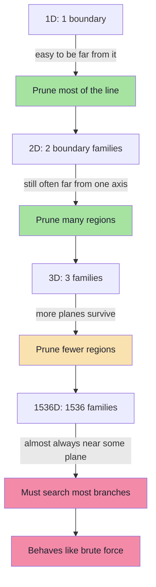
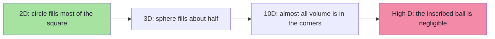
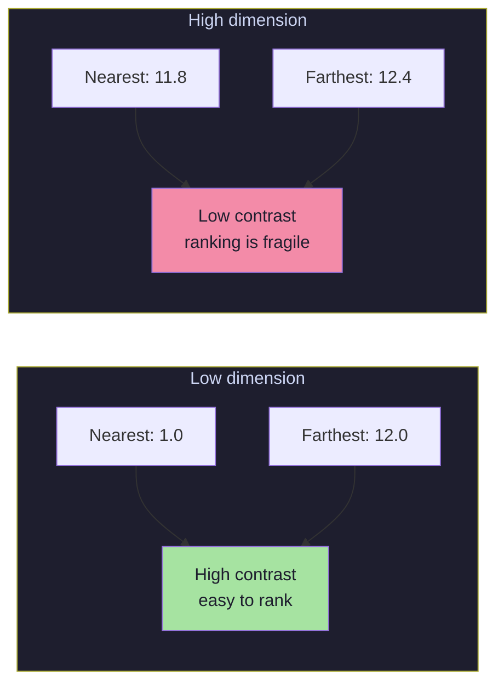
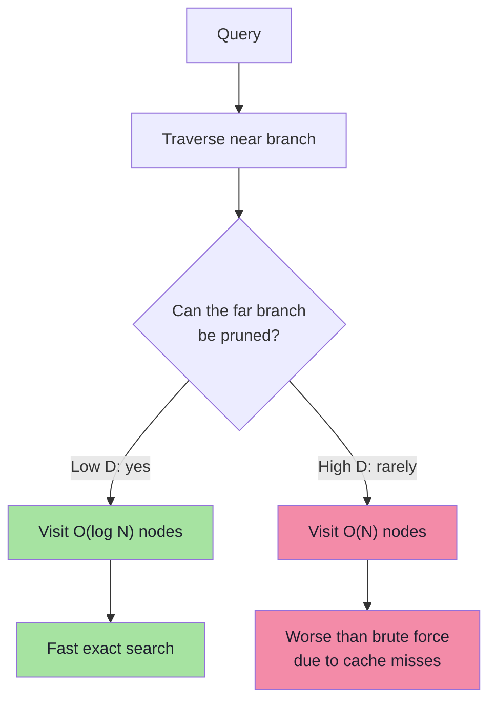
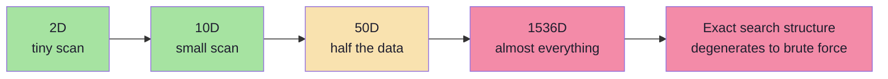
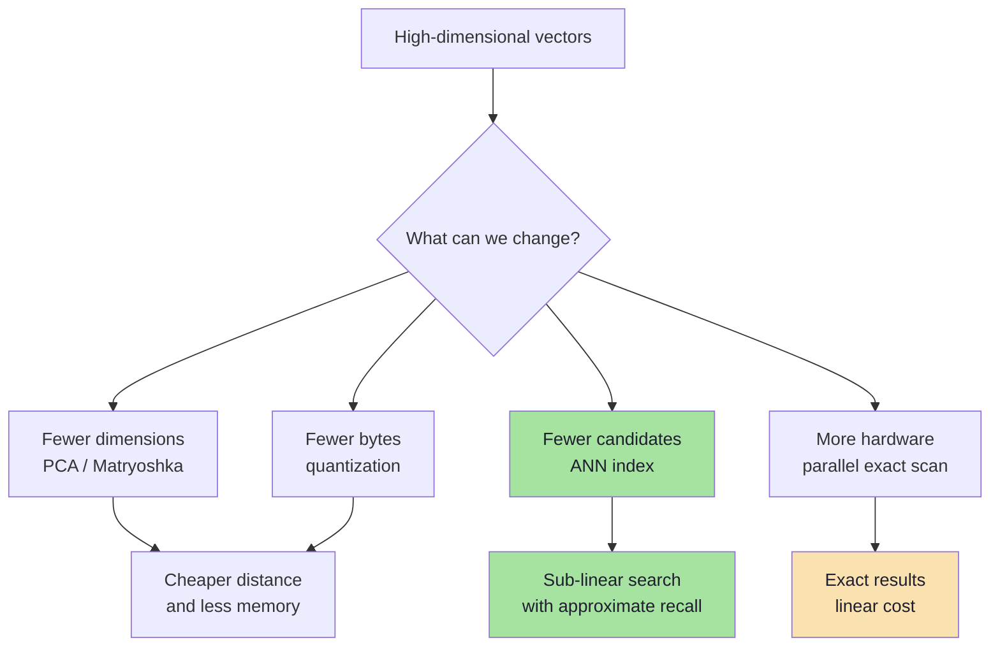
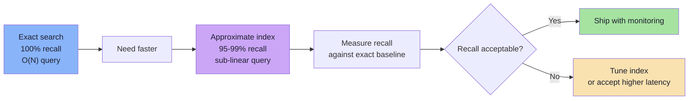

# Chapter 06: The Curse of Dimensionality

> **Chapter Goal:** Understand why geometric indexes that work beautifully in 2D and 3D collapse in 384, 768, or 1536 dimensions. Learn the two underlying phenomena — **boundary proliferation** and **distance concentration** — and why the failure is gradual rather than a sudden cliff. This chapter explains why k-d trees are not the answer and motivates approximate indexes.

---

## 6.1 What the Curse Actually Means

The phrase sounds dramatic, so it is worth stating precisely:

> **Curse of dimensionality:** as the number of dimensions grows, the geometry of space stops matching human intuition, and algorithms that rely on partitioning or distance contrast lose their ability to prune.

The Excalidraw notes state the nuance better than most textbooks:

```text
"Curse of dimensionality does not mean that adding one extra dimension
suddenly breaks search.

It means that every extra dimension adds more possible ways for points
to differ and more regions that might contain a neighbour.

As dimensions keep increasing, our ability to safely eliminate large parts
of the search space gets weaker and weaker.

Eventually, an exact search structure may need to inspect so much of the
dataset that it starts behaving almost like brute force."
```

That is the entire chapter in one paragraph. The rest is the *why* and the *how much*.

---

## 6.2 Boundary Proliferation

Every split in a k-d tree is a boundary. In 2D there are two axes; in 3D there are three; in 1536 dimensions there are 1536.

```text
1D:   one boundary per split
2D:   x-boundaries and y-boundaries
3D:   x, y, z boundaries
1536D: 1536 families of boundaries
```

For pruning to fail at a node, the query only needs to be **close to that node's splitting plane**. With more dimensions, each node's plane is defined on one axis, but the tree is deeper and there are far more nodes whose planes can be close to the query.

A simplified probability argument shows the effect. Suppose, for each dimension, the chance that the query lies within the pruning margin of a boundary is `p`. If dimensions were independent, the chance that the query is **far from every** boundary is:

```text
P(no near boundary) = (1 - p)^D
```

| Dimensions `D` | `p = 0.01` | `p = 0.05` |
|---|---|---|
| 2 | 0.980 | 0.902 |
| 10 | 0.904 | 0.599 |
| 100 | 0.366 | 0.0059 |
| 768 | 0.00045 | ~10⁻¹⁷ |
| 1536 | ~2×10⁻⁷ | ~10⁻³⁴ |

With `D = 1536`, even a 1% chance per dimension makes it almost certain that the query is near **some** boundary. Every such boundary is a subtree that cannot be pruned safely.



---

## 6.3 The Volume of a High-Dimensional Ball

Another way to see the strangeness: compare a sphere inscribed in a cube.

In 2D, a circle inscribed in a square covers about **78.5%** of the square's area.

In 3D, a sphere inscribed in a cube covers about **52.4%** of the volume.

In `D` dimensions:

```text
volume of unit ball / volume of cube = π^(D/2) / (2^D × Γ(D/2 + 1))
```

This ratio **tends to zero** as `D` grows.

| Dimensions | Ball / cube volume |
|---|---|
| 2 | 0.785 |
| 3 | 0.524 |
| 10 | 0.0025 |
| 100 | ~10⁻⁷⁰ |
| 1536 | effectively 0 |



Implications:

- Most of the volume of a high-dimensional cube sits near its **corners**, not its center.
- Most points sampled uniformly are near the **surface**, not the interior.
- "Radius" and "neighborhood" lose the intuitive meaning they have in 2D and 3D.
- A rectangular partition created by axis-aligned splits has enormous surface area relative to its volume — so queries are likely to be near a boundary.

This is precisely why axis-aligned partitioning stops being an effective pruning strategy.

---

## 6.4 Distance Concentration

The second phenomenon is arguably more important for nearest-neighbour search.

For random points in high-dimensional space, the distances between pairs become **surprisingly similar**.

```text
D = 2      distances differ a lot:   0.5, 3.1, 8.7, 12.0
D = 1536   distances cluster:        11.8, 12.1, 12.3, 12.5
```

The ratio between the nearest and farthest neighbour tends toward `1`:

```text
(max distance − min distance) / min distance  →  0   as D grows
```



Why does this matter for an index?

- Pruning compares a **lower bound** (`planeDist`) against a **best distance**.
- If all distances are nearly equal, the margin between the lower bound and the best candidate is tiny.
- Tiny margins mean the inequality `planeDist < bestDist` is true more often.
- More often true means more subtrees must be visited.

In low dimensions, finding a good candidate early gives you a strong bound that prunes most of the tree. In high dimensions, almost every candidate has a similar distance, so the bound prunes almost nothing.

> **This is the deep reason ANN indexes abandon exact pruning.** They stop trying to prove that a region is irrelevant and instead accept a small probability of missing a true neighbour.

---

## 6.5 What Happens to the Tree

In the ideal case, a k-d tree visits a path from root to leaf:

```text
ROOT
  ↓
  B
  ↓
  E
done
```

In high dimensions, the search starts to look like this:

```text
        ROOT
     ↙        ↘
    A          B
   ↙ ↘        ↙ ↘
  C   D      E   F
  ...
```

Instead of visiting a handful of nodes, the search may eventually inspect:

```text
70%
80%
90%
...
of the dataset
```

At that point we are back to:

```text
for every vector:
    calculate distance
```

which is brute-force search with extra pointer-chasing overhead.



Note the last line of the diagram: a degraded tree can be **slower than a flat scan**, because pointer-chasing visits random memory locations while brute force reads vectors sequentially (and can use SIMD/BLAS).

---

## 6.6 Empirical Shape of the Degradation

The exact numbers depend on the data distribution, but the pattern is consistent:

| Dimensions | Typical fraction of dataset inspected by a k-d tree | Practical verdict |
|---|---|---|
| 2–3 | 0.01%–0.1% | Excellent |
| 5–10 | 1%–10% | Usable |
| 10–20 | 10%–50% | Marginal |
| 50–100 | 50%–90% | Poor |
| 384–1536 | 90%–100% | Useless as an index |



This is why modern embedding search does **not** use k-d trees, R-trees, or quadtrees as its primary index.

---

## 6.7 Why Embeddings Are Not Purely Random

A fair objection: "Embeddings are not uniformly random points, so maybe the curse is weaker."

Correct — and it is worth being precise:

1. **Real embeddings lie on a lower-dimensional manifold.** The *intrinsic* dimensionality is smaller than the nominal 1536. Meaningful variation might occupy tens to a few hundred effective dimensions.
2. **Embeddings are anisotropic.** They cluster in cones rather than filling the sphere uniformly.
3. **Semantic neighborhoods are real.** Movies about space really do cluster together.

So the curse is **mitigated**, not eliminated:

| Property | Effect on search |
|---|---|
| Low intrinsic dimension | Some pruning remains possible |
| Clustering / anisotropy | IVF and graph indexes work well |
| Nominal dimension still high | k-d trees still fail |
| Hubness (some points near everything) | Ranking gets noisy; reranking helps |

This is exactly why the successful indexes (Chapter 07) are **data-adaptive**:

- **HNSW** builds a navigable graph from actual neighbor relationships, not axis-aligned boxes.
- **IVF** clusters data with k-means, so partitions follow the distribution.
- **PQ** compresses subspaces rather than partitioning the whole space.
- **LSH** uses random projections tuned to the metric.

---

## 6.8 Mitigation Strategies at a Glance

There are four broad ways to cope with high dimensionality:

| Strategy | Idea | Trade-off |
|---|---|---|
| **Reduce dimensions** | PCA, random projection, Matryoshka embeddings | Some information loss; cheaper search |
| **Compress values** | float16, int8, binary quantization, product quantization | Less memory; slight accuracy loss |
| **Use data-adaptive ANN** | HNSW, IVF, LSH, ScaNN | Approximate results; needs tuning |
| **Accept brute force** | Parallel scan, GPU, sharding | Exact but expensive at very large N |



### Matryoshka embeddings (worth knowing)

Some modern embedding models are trained so that the **first `n` dimensions** form a usable embedding on their own, like nested dolls:

```text
full vector:      [0.21, -0.47, 0.83, 0.11, ...]   1536 dims
truncated to 256: [0.21, -0.47, 0.83, 0.11, ...]    256 dims
```

You can then:

1. use 256 dimensions for cheap candidate generation,
2. rescore the top candidates with the full 1536 dimensions.

This is a practical two-stage pattern that combines dimension reduction with exact rescoring.

---

## 6.9 The Curse Is Also a Blessing

High dimensionality is not universally bad. It depends on the task:

| Task | Effect of more dimensions |
|---|---|
| **Nearest-neighbour search** | Worse — distances concentrate, pruning fails |
| **Linear classification** | Better — classes become more separable |
| **Random projection / hashing** | Still useful, but needs more bits |
| **Compression** | Harder — more information to preserve |
| **Visualization** | Impossible beyond 2–3 dimensions without projection |

The lesson is not "high dimensions are bad". It is:

> **Algorithms must match the geometry of their data.** A structure designed for 2D rectangles cannot index a 1536-dimensional semantic space, no matter how carefully it is implemented.

---

## 6.10 The Precise Consequence for Vector Search

Let us state the conclusion in engineering terms:

1. **Exact search still works** in high dimensions. It just costs `O(N × D)`.
2. **Exact geometric indexes stop pruning**, so they approach `O(N)` node visits with worse constants.
3. **The only remaining option for sub-linear search is to give up exactness.**
4. Giving up exactness must be **measured and bounded**, not accidental.

That fourth point is where **recall** becomes the central engineering metric:

```text
recall@K = (true neighbours retrieved) / K
```

An ANN index that returns 95 of the true top 100 has `recall@100 = 0.95`. Whether that is acceptable is a product decision, not a mathematical one.



---

## 6.11 Chapter Summary

| Concept | Takeaway |
|---|---|
| Curse of dimensionality | High-dimensional geometry breaks partitioning and distance contrast |
| Not a cliff | It degrades gradually with each added dimension |
| Boundary proliferation | More dimensions → more planes → fewer safe prunes |
| Volume concentration | Most volume sits near corners/surface, not the center |
| Distance concentration | Nearest and farthest distances become similar |
| Effect on k-d trees | 70–100% of the dataset may be inspected |
| Effect on embeddings | Real data is clustered, so the curse is milder but still fatal for k-d trees |
| Mitigations | Dimension reduction, quantization, data-adaptive ANN, parallel exact search |
| Engineering response | Accept approximation, then **measure recall** against exact search |

> **Final mental model:** In low dimensions, geometry lets an index say *"nothing over there can beat what I already found."* In high dimensions, that sentence becomes harder and harder to justify, until the index is forced to look almost everywhere. The curse is not that search becomes impossible — it is that **provable pruning** becomes impossible, so we trade proof for probability.

---

**Next:** [Chapter 07 — Approximate Nearest Neighbor Indexes](./07_Approximate_Nearest_Neighbor_Indexes.md)
