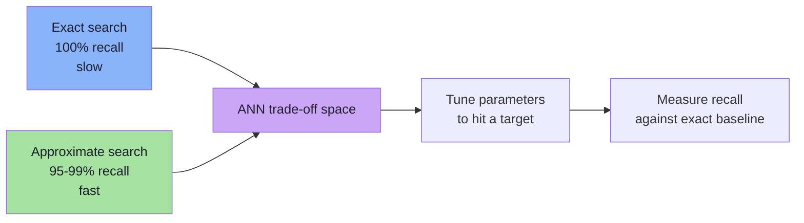
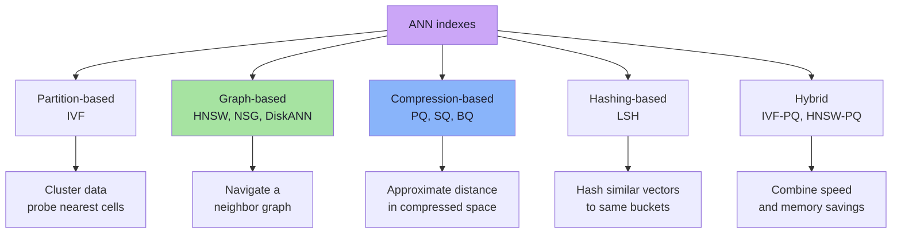
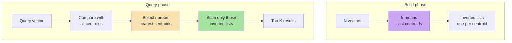
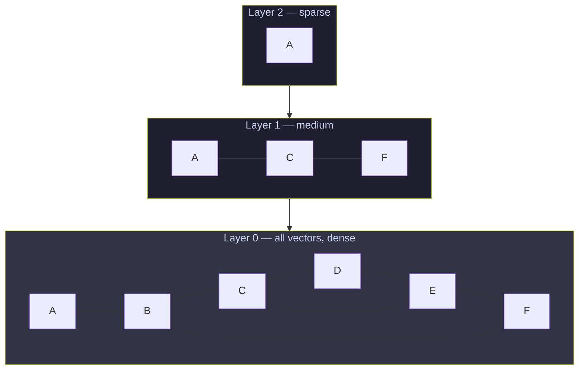
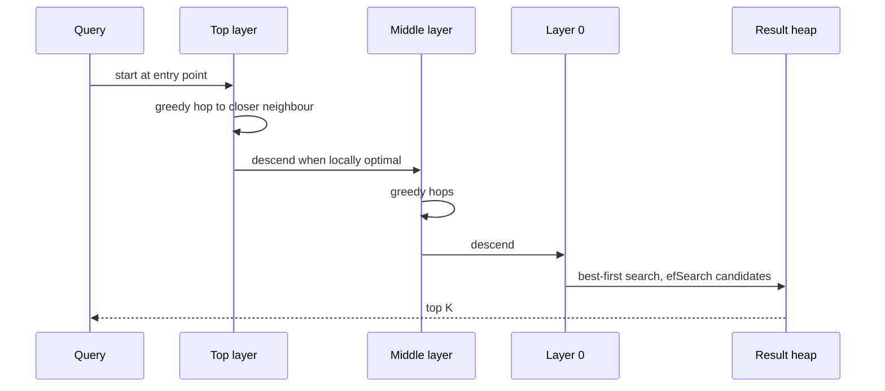
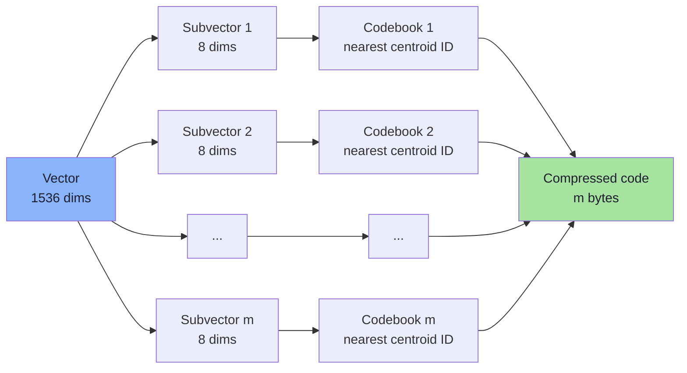
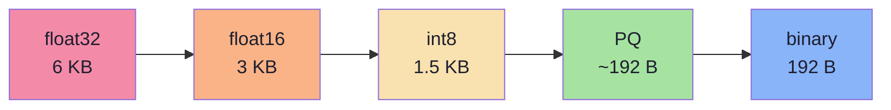
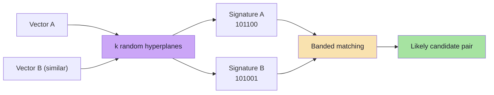
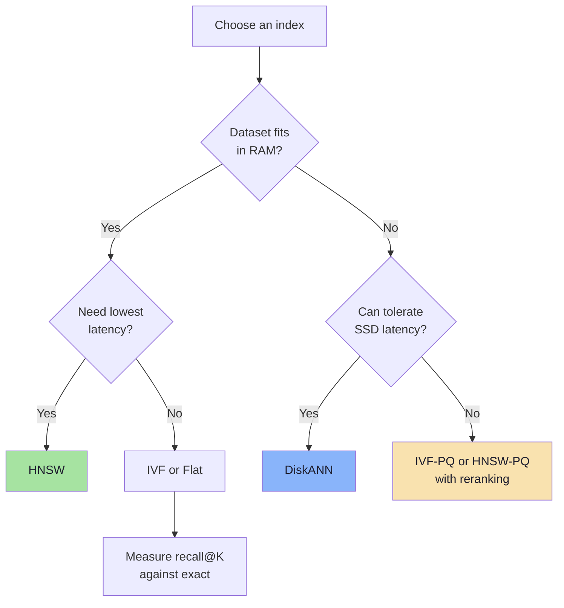
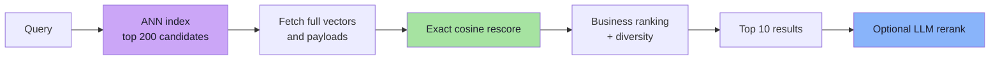

# Chapter 07: Approximate Nearest Neighbor Indexes

> **Chapter Goal:** Learn the indexes that actually power production vector search. Understand the shared trade-off (recall vs latency vs memory), then study the four families — **IVF**, **HNSW**, **PQ**, and **LSH** — well enough to reason about their parameters, failure modes, and cost. This is the direct answer to the question Chapter 06 left open.

---

## 7.1 The Bargain

Exact search guarantees the true top-K. High-dimensional geometry makes exact pruning impossible. The only way to get sub-linear search is to accept a small chance of missing a true neighbour:

```text
Exact:  search 100% of vectors  →  100% recall  →  O(N)
ANN:    search ~1% of vectors   →  95-99% recall  →  O(log N) or O(1)
```

This is not a compromise invented by lazy engineers. It is the only known way to search billions of high-dimensional vectors with millisecond latency.



The trade-off has **five** dimensions, not two:

| Dimension | Question | Typical knob |
|---|---|---|
| **Recall** | What fraction of true neighbours do we return? | `efSearch`, `nprobe`, `rerank` |
| **Latency** | How long does a query take (p50/p95/p99)? | index type, candidate count |
| **Memory** | How many bytes per vector? | quantization, replication |
| **Build cost** | How long to index N vectors? | `efConstruction`, IVF training |
| **Freshness** | How fast do updates become searchable? | index type, segment merges |

> **Rule:** never evaluate an ANN index on latency alone. A 1 ms query with 60% recall is worse than a 5 ms query with 98% recall, because the first one is confidently returning the wrong answer.

---

## 7.2 The Index Family Tree



Most production systems combine at least two: for example, **IVF-PQ** for memory-efficient billion-scale search, or **HNSW + quantization** for low-latency memory-resident search.

---

## 7.3 IVF — Inverted File Index

### The idea

Cluster the vectors into `nlist` groups using k-means. At query time, find the nearest centroids and search only those groups.

```text
Build:
  1. Run k-means on the vectors → nlist centroids
  2. Assign every vector to its nearest centroid
  3. Store an inverted list per centroid

Query:
  1. Compare query to all nlist centroids
  2. Pick the nprobe nearest centroids
  3. Scan only the vectors in those lists
```



### Why it works

Semantically similar vectors tend to fall into the same cluster. If the query's nearest centroid is the cluster containing the true neighbours, scanning that cluster finds them. The number of vectors scanned drops roughly to:

```text
scanned ≈ N × (nprobe / nlist)
```

### Parameters

| Parameter | Meaning | Effect |
|---|---|---|
| `nlist` | Number of clusters | More clusters = smaller lists, more centroid comparisons |
| `nprobe` | Clusters scanned per query | Higher = better recall, higher latency |
| Training sample size | Vectors used for k-means | Too small = poor centroids |
| Distance metric | Must match query metric | Mismatch invalidates assignment |

### Strengths and weaknesses

| Strengths | Weaknesses |
|---|---|
| Simple and interpretable | k-means training is expensive |
| Fast for large N | Bad on skewed data (one huge list) |
| Memory overhead is modest | Recall depends heavily on `nprobe` |
| Easy to shard | Updates require assignment + possible retraining |
| Works well with PQ | Boundary points may belong to the wrong list |

> **Intuition:** IVF is the vector equivalent of a library with rooms organized by topic. You check the few rooms most likely to contain the book, not every shelf.

---

## 7.4 IVF Query: Pseudo-Code and Tuning

```ts
// Pseudo-code: IVF search
function ivfSearch(query: number[], k: number, nprobe: number): Scored[] {
  // 1. Rank centroids by distance to the query
  const probes = centroids
    .map((c, i) => ({ listId: i, dist: distance(query, c.vector) }))
    .sort((a, b) => a.dist - b.dist)
    .slice(0, nprobe);

  // 2. Scan only the selected inverted lists
  const candidates: Scored[] = [];
  for (const probe of probes) {
    for (const record of invertedLists[probe.listId]) {
      candidates.push({
        id: record.id,
        score: similarity(query, record.embedding),
      });
    }
  }

  // 3. Keep the best K
  return topK(candidates, k);
}
```

Tuning heuristic:

```text
Start with:  nlist  ≈ sqrt(N)
             nprobe ≈ 1% to 10% of nlist
Then measure recall@10 against exact search.
Increase nprobe until the recall target is met.
```

For `N = 1,000,000`, `nlist ≈ 1000`; `nprobe = 10` scans roughly 1% of the data.

---

## 7.5 HNSW — Hierarchical Navigable Small World

HNSW is the dominant index for low-latency, memory-resident vector search. It is a **multi-layer proximity graph**.

### The structure



| Layer | Contents | Purpose |
|---|---|---|
| Top layers | Exponentially fewer nodes | Long-range jumps, coarse navigation |
| Layer 0 | Every vector | Fine-grained local search |

Each node keeps a bounded list of neighbours (`M` on upper layers, `2M` on layer 0). Layers are assigned randomly with an exponential distribution, which produces the "small world" property: the number of hops between any two nodes grows logarithmically.

### The search

```text
1. Enter at the top layer's entry point.
2. Greedily move to the neighbour closest to the query.
3. When no neighbour is closer, drop down one layer.
4. Repeat until layer 0.
5. At layer 0, run a best-first search with a candidate queue
   of size efSearch, and keep the best K.
```



### Parameters

| Parameter | Meaning | Typical range | Effect |
|---|---|---|---|
| `M` | Neighbours per node | 16–64 | Higher = better recall, more memory |
| `efConstruction` | Candidate list during build | 100–500 | Higher = better graph, slower build |
| `efSearch` | Candidate list during query | 50–500 | Higher = better recall, higher latency |

`efSearch` must be at least `K`. It is the main runtime knob:

```text
efSearch ↑  →  recall ↑  →  latency ↑
```

### Why HNSW beats k-d trees

HNSW does **not** partition space with axis-aligned planes. It builds a graph that follows the actual data distribution:

- Navigation is based on **neighbour relationships**, not coordinates.
- The hierarchy provides logarithmic path length even in high dimensions.
- No pruning proof is required, so distance concentration does not invalidate it.

### Strengths and weaknesses

| Strengths | Weaknesses |
|---|---|
| Excellent recall/latency curve | High memory (graph + vectors) |
| Fast queries (often sub-millisecond) | Slow build for large datasets |
| No training phase | Deletes are tricky (tombstones, graph repair) |
| Works well in high dimensions | Poor fit for write-heavy workloads |
| Tunable at query time | Graph can degrade after many updates |

> **Production note:** HNSW is usually the default choice when the dataset fits in RAM and queries must be fast. For billion-scale or memory-constrained systems, pair it with quantization or use DiskANN.

---

## 7.6 HNSW Search: Pseudo-Code

```ts
// Pseudo-code: HNSW greedy descent + layer-0 best-first search
function hnswSearch(query: number[], k: number, efSearch: number): Scored[] {
  let current = entryPoint;

  // 1. Greedy descent through upper layers
  for (let layer = topLayer; layer > 0; layer--) {
    let improved = true;
    while (improved) {
      improved = false;
      for (const neighbour of current.neighbours[layer]) {
        if (distance(query, neighbour.vector) < distance(query, current.vector)) {
          current = neighbour;
          improved = true;
        }
      }
    }
  }

  // 2. Best-first search on layer 0
  const candidates = new MinHeap<Candidate>(); // closest first
  const results = new MaxHeap<Candidate>();    // worst of the best first
  candidates.push({ node: current, dist: distance(query, current.vector) });
  results.push({ node: current, dist: distance(query, current.vector) });

  while (candidates.size > 0) {
    const closest = candidates.pop();
    if (closest.dist > results.peek().dist) break; // nothing better remains

    for (const neighbour of closest.node.neighbours[0]) {
      const d = distance(query, neighbour.vector);
      if (results.size < efSearch || d < results.peek().dist) {
        candidates.push({ node: neighbour, dist: d });
        results.push({ node: neighbour, dist: d });
        if (results.size > efSearch) results.pop(); // drop worst
      }
    }
  }

  return results.drainSortedAscending().slice(0, k);
}
```

The structure is a **best-first graph traversal with a bounded result heap**. This is much closer to how a human navigates a social network than to how a B-tree navigates sorted keys.

---

## 7.7 PQ — Product Quantization

PQ addresses the **memory** problem, not the candidate-count problem.

### The idea

Split each vector into `m` subvectors. Learn a small codebook of centroids for each subspace. Encode every subvector as the ID of its nearest centroid.

```text
Original vector: 1536 floats = 6144 bytes

Split into m = 192 subvectors of 8 dimensions each.
For each subspace, learn 256 centroids (1 byte per centroid ID).

Compressed vector: 192 bytes
Compression ratio: 6144 / 192 = 32×
```



### Asymmetric Distance Computation (ADC)

At query time, the query is **not** compressed. Instead, precompute the distance from the query to every centroid in every codebook, then look up distances for each stored code:

```text
distance(query, code) ≈ Σ over subspaces:
    distanceTable[subspace][code[subspace]]
```

This turns a 1536-dimensional distance computation into `m` table lookups (for example, 192 lookups). It is dramatically cheaper than a full float distance.

### Strengths and weaknesses

| Strengths | Weaknesses |
|---|---|
| 4×–64× memory reduction | Approximate distances |
| Very fast distance estimation | Codebook training required |
| Composes with IVF/HNSW | Recall loss, especially at high compression |
| Enables billion-scale in RAM | Needs reranking with full vectors |

> **Standard production pattern:** use IVF-PQ or HNSW-PQ to generate candidates, then **rerank** the top 50–200 with the original float32 vectors. This recovers most of the lost accuracy at a small cost.

---

## 7.8 Scalar and Binary Quantization

PQ is not the only compression option:

| Method | Bytes per dimension | 1536-dim size | Notes |
|---|---|---|---|
| float32 | 4 | 6144 B | Baseline |
| float16 | 2 | 3072 B | Usually negligible recall loss |
| int8 scalar | 1 | 1536 B | Needs per-dimension scaling |
| binary | 1 bit | 192 B | Hamming distance; large recall loss |
| PQ (m=192) | ~1 byte per subvector | ~192 B | Learned codebooks; better than binary |



Binary quantization is surprisingly effective when combined with **oversampling + reranking**: retrieve 10× candidates using Hamming distance, then rescore with full vectors.

---

## 7.9 LSH — Locality-Sensitive Hashing

LSH takes a different approach: instead of partitioning space, it uses hash functions designed so that **similar vectors are likely to land in the same bucket**.

For cosine similarity, a common family is random hyperplane hashing:

```text
h(v) = sign(r · v)

r = a random vector
sign(...) = +1 or -1
```

Two vectors with a small angle between them are likely to produce the same sign for a random hyperplane. Repeat with `k` random hyperplanes to build a `k`-bit signature.



### Bands and rows

A single signature is too fragile, so LSH uses `b` bands of `r` rows each. Two vectors become candidates if **any** band matches exactly.

```text
signature length = b × r

Example: b = 20 bands, r = 5 rows → 100 hash bits
```

The collision probability for a per-row collision probability `s` is:

```text
P(candidate) = 1 − (1 − s^r)^b
```

Here `s` is the chance that two vectors produce the same bit in one row. For random hyperplanes, `s = 1 − θ/π`, which is a monotonic function of cosine similarity (not equal to it).

| Per-row collision probability `s` | `P(candidate)`, `b = 20`, `r = 5` |
|---|---|
| 0.95 | ~1.000 |
| 0.80 | ~0.9996 |
| 0.50 | ~0.47 |
| 0.20 | ~0.006 |

LSH gives a clean probabilistic guarantee: similar items collide with high probability, dissimilar items rarely do.

| Strengths | Weaknesses |
|---|---|
| Theoretically grounded | Often lower recall than HNSW/IVF |
| Very fast candidate generation | Many hash tables consume memory |
| Handles streaming inserts well | Tuning `b` and `r` is unintuitive |
| Works for multiple metrics | Struggles when similarity is in a narrow band |

---

## 7.10 DiskANN and Other Production Variants

| Index | Core idea | Best for |
|---|---|---|
| **DiskANN / Vamana** | Graph index on SSD, compressed vectors in RAM | Billion-scale, low RAM budget |
| **ScaNN** | Anisotropic vector quantization | High-throughput, high-recall CPU search |
| **NSG** | Navigable Spreading Graph | Alternative graph index |
| **Annoy** | Random projection trees | Read-only, memory-mapped indexes |
| **Faiss** | Library implementing Flat, IVF, PQ, HNSW, LSH | Custom pipelines and research |
| **Symphony** | Multi-index routing | Very large distributed deployments |

The pattern across all of them is the same: **reduce the number of exact distance computations**, then recover accuracy with rescoring.

---

## 7.11 Comparison Table

| Index | Query speed | Recall | Memory | Build | Updates | Best use case |
|---|---|---|---|---|---|---|
| **Flat (brute force)** | Slow (`O(N)`) | 100% | Vectors only | None | Trivial | Small N, ground truth |
| **IVF** | Fast | Good, `nprobe`-dependent | Vectors + centroids | k-means training | Moderate | Large N, batch-heavy |
| **HNSW** | Very fast | Excellent | High (graph) | Slow | Tombstones | Low-latency in-RAM |
| **IVF-PQ** | Very fast | Good with rerank | Very low | Training + index | Moderate | Billion-scale, memory-bound |
| **LSH** | Very fast | Moderate | High (many tables) | Fast | Easy | Streaming, approximate dedup |
| **DiskANN** | Fast | Excellent | Low RAM, SSD | Slow | Moderate | Huge datasets on disk |



---

## 7.12 The Two-Stage Retrieval Pattern

Production search rarely relies on a single ANN query. The standard architecture is:

```text
Stage 1  Candidate generation   ANN over compressed/quantized vectors → 100-500 ids
Stage 2  Exact rescoring         Recompute full-precision similarity for candidates
Stage 3  Business ranking        Recency, popularity, diversity, filters
Stage 4  (Optional) LLM rerank   Cross-encoder or LLM relevance scoring
```



```ts
// Pseudo-code: candidate generation + exact rescoring
async function retrieve(query: string, k: number): Promise<Result[]> {
  const queryVector = await embeddingModel.embed(query);

  // Stage 1: cheap, approximate, high recall
  const candidates = await vectorDb.search({
    vector: queryVector,
    k: k * 20,              // oversample
    efSearch: 200,          // recall knob
    filter: { tenantId: currentTenant },
  });

  // Stage 2: exact, expensive, small set
  const rescored = candidates
    .map(c => ({
      ...c,
      score: cosineSimilarity(queryVector, c.fullVector),
    }))
    .sort((a, b) => b.score - a.score);

  // Stage 3: business logic
  return applyBusinessRules(rescored).slice(0, k);
}
```

> **Critical relationship:** the final recall cannot exceed the candidate-stage recall. If stage 1 retrieves 200 candidates with `recall@200 = 0.92`, the final `recall@10` is at most `0.92`. Improving the reranker cannot recover items that were never retrieved.

---

## 7.13 Tuning Playbook

| Symptom | Likely cause | Fix |
|---|---|---|
| Low recall | `efSearch` / `nprobe` too low | Increase candidate budget |
| Low recall only for filtered queries | Post-filtering after top-K | Use filtered ANN or pre-filter |
| High p99 latency | Candidate set too large | Reduce `efSearch`, add quantization |
| High memory | float32 vectors + graph | int8/PQ, shard, or DiskANN |
| Slow ingestion | HNSW rebuild per batch | Batch upserts, use segments |
| Results feel random | Wrong metric or model mismatch | Verify model id/version and metric |
| Duplicate results | Near-duplicate documents | Deduplicate at ingest, MMR diversity |
| Good offline, bad online | Eval queries not representative | Build a golden set from real traffic |

### Parameter direction cheat sheet

```text
efSearch ↑        recall ↑        latency ↑
nprobe ↑          recall ↑        latency ↑
nlist ↑           smaller lists   more centroid comparisons
M ↑               recall ↑        memory ↑        build ↑
efConstruction ↑  graph quality ↑ build time ↑
PQ subvectors ↑   memory ↑        accuracy ↑
```

---

## 7.14 Common Mistakes

1. **Comparing an ANN index against nothing.** Always measure recall against exact search on the same queries.
2. **Setting `efSearch < K`.** The result heap cannot return more than it explores.
3. **Using the wrong metric.** Cosine index + L2 query = silently wrong rankings.
4. **Post-filtering ACLs.** Security bug, not just a relevance bug.
5. **Ignoring the recall ceiling of stage 1.** A perfect reranker cannot fix missing candidates.
6. **Benchmarking with random vectors.** Real embeddings are clustered; random vectors make every index look worse (and hide tuning issues).
7. **Forgetting deletes.** Tombstones accumulate; schedule compaction and monitor deleted ratio.
8. **Assuming ANN is always necessary.** Under 100k vectors, flat search is often faster end-to-end.

---

## 7.15 Chapter Summary

| Index | One-line description |
|---|---|
| **Flat** | Compare everything; exact; the baseline |
| **IVF** | Cluster, then probe a few clusters |
| **HNSW** | Navigate a multi-layer neighbour graph |
| **PQ** | Compress vectors into codebook IDs |
| **LSH** | Hash similar vectors into the same buckets |
| **DiskANN** | Graph index on SSD for huge datasets |

| Principle | Takeaway |
|---|---|
| The bargain | Sub-linear speed requires approximate recall |
| Multiple trade-offs | Recall, latency, memory, build cost, freshness |
| HNSW | Best low-latency default when data fits in RAM |
| IVF | Simple, shardable, strong with PQ |
| Quantization | Solves memory, not candidate count |
| Two-stage retrieval | ANN candidates → exact rescore → business rank |
| Measurement | Recall@K against exact search is non-negotiable |

> **Final mental model:** An ANN index is a **search strategy that bets on the data distribution**. IVF bets that neighbours share a cluster. HNSW bets that neighbours are reachable through a short chain of neighbours. PQ bets that a coarse code preserves enough distance information. LSH bets that similar vectors collide. All of them win the bet most of the time — and all of them require you to measure how often they lose.

---

**Next:** [Chapter 08 — Production Vector Search Design](./08_Production_Vector_Search_Design.md)
