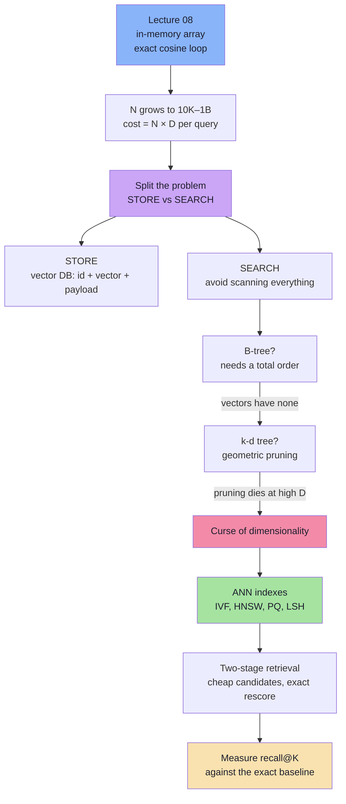
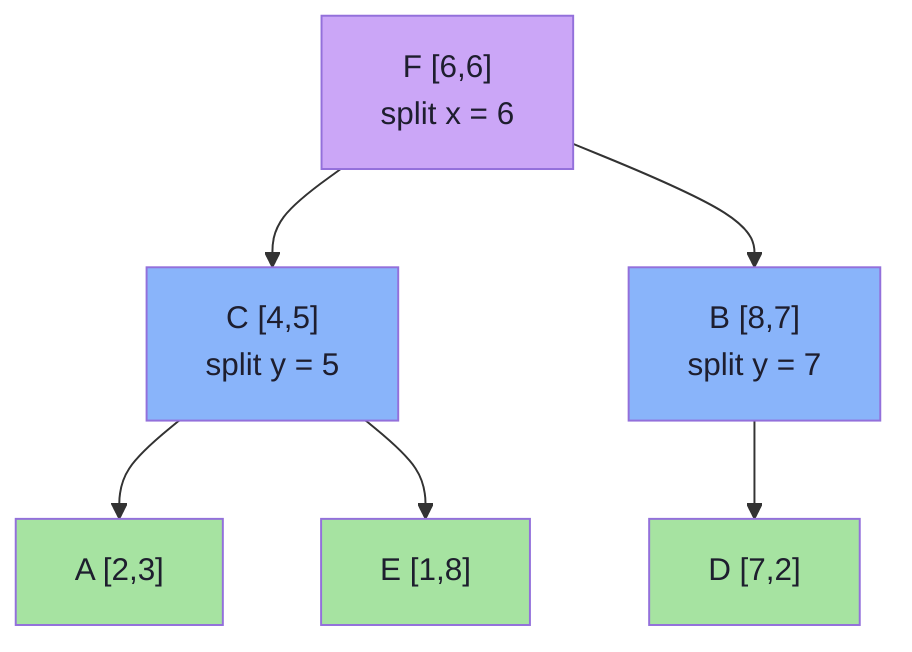
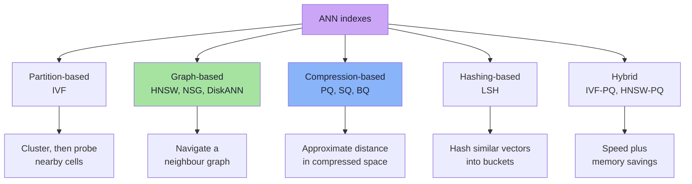
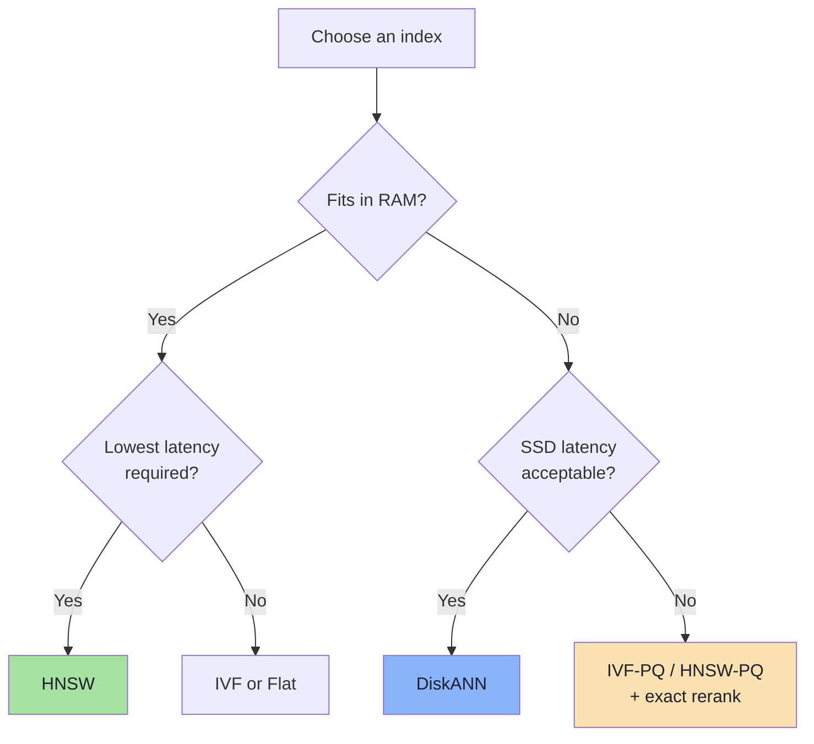
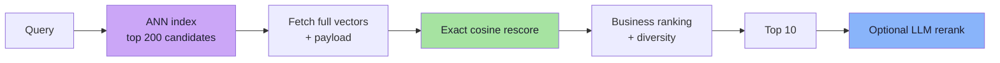
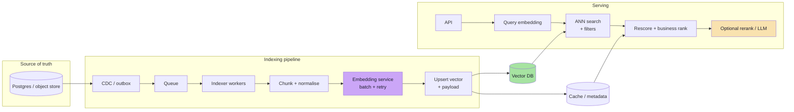

# Lecture 09: Vector Embedding Search & Storage

## Complete Consolidated Notes & Production Reference

> **Course:** Forward Deployed Engineer (FDE) & Generative AI Systems
> **Lecture:** 09 — Vector Embedding Search & Storage
> **Source Material:** [`Notes.pdf`](./Notes.pdf) (31 sections, ending at the curse of dimensionality) and [`Excalidraw-Notes.svg`](./Excalidraw-Notes.svg)
> **Scope:** Chapters [01](./01_The_Scale_Wall_Why_Toy_Vector_Search_Breaks.md) → [08](./08_Production_Vector_Search_Design.md); chapters 07–08 extend the slides into ANN indexes and production design
> **Diagram Format:** Mermaid only
> **Snippet Style:** JS / TypeScript-style pseudocode — illustrative, not production code
> **Prerequisite:** [Lecture 08 Complete Notes](../../Lecture%2008/notes/Lecture_08_Complete_Notes.md) (the in-memory recommender this lecture scales)

---

## How to Use This Document

This is the **map**, not the territory. Each part compresses one chapter to its load-bearing ideas and ends with a *Go deeper* link. The arithmetic is kept deliberately — it is the argument — but derivations, full pseudo-code, and alternative designs live in the chapters.

| If you want to… | Read | Time |
|---|---|---|
| Recall what the lecture was about | [Executive Summary](#executive-summary-the-whole-lecture-on-one-page) → [Cheat Sheet](#cheat-sheet) | 10 min |
| Understand why the naive scan fails | Parts [1](#part-1-the-scale-wall) and [4](#part-4-exact-knn-the-correct-baseline) | 25 min |
| Understand why k-d trees fail | Parts [5](#part-5-indexes-and-why-order-dies) and [6](#part-6-the-curse-of-dimensionality) | 25 min |
| Choose and tune an index | [Part 7](#part-7-approximate-nearest-neighbour-indexes) | 35 min |
| Design or review a production system | [Part 8](#part-8-production-design) + [Cheat Sheet](#cheat-sheet) | 40 min |
| Prep for an interview | [Six Sentences](#the-lecture-in-six-sentences), [Misconceptions](#common-misconceptions), [Self-Check](#self-check-questions) | 25 min |

> **Depth policy.** Chapters explain *how*; these notes explain *what matters, what it costs, and when it breaks*. If a number appears here without a derivation, the chapter has the derivation.

---

## 📑 Table of Contents

- [How to Use This Document](#how-to-use-this-document)
- [Executive Summary: The Whole Lecture on One Page](#executive-summary-the-whole-lecture-on-one-page)
  - [The Thesis](#the-thesis)
  - [The Canonical Diagram](#the-canonical-diagram)
  - [The Numbers That Matter](#the-numbers-that-matter)
  - [The Lecture in Six Sentences](#the-lecture-in-six-sentences)
- [Chapter Map](#chapter-map)
- [Part 1: The Scale Wall](#part-1-the-scale-wall)
  - [1.1 One Variable Changes Everything](#11-one-variable-changes-everything)
  - [1.2 Two Problems, Not One](#12-two-problems-not-one)
  - [1.3 The Four Verbs at Scale](#13-the-four-verbs-at-scale)
- [Part 2: Why a Relational Database Is Not Enough](#part-2-why-a-relational-database-is-not-enough)
  - [2.1 It Can Store Vectors, It Cannot Reason About Them](#21-it-can-store-vectors-it-cannot-reason-about-them)
  - [2.2 Order Is the Whole Trick](#22-order-is-the-whole-trick)
  - [2.3 When Postgres Is Enough](#23-when-postgres-is-enough)
- [Part 3: Anatomy of a Vector Database](#part-3-anatomy-of-a-vector-database)
  - [3.1 The Record Model](#31-the-record-model)
  - [3.2 The Division of Labour](#32-the-division-of-labour)
  - [3.3 Collections and Fixed Configuration](#33-collections-and-fixed-configuration)
  - [3.4 The Write Path](#34-the-write-path)
  - [3.5 The Read Path](#35-the-read-path)
  - [3.6 Filtering: Pre, Post, or Filtered ANN](#36-filtering-pre-post-or-filtered-ann)
  - [3.7 Hybrid Search](#37-hybrid-search)
- [Part 4: Exact KNN, the Correct Baseline](#part-4-exact-knn-the-correct-baseline)
  - [4.1 The Algorithm](#41-the-algorithm)
  - [4.2 Choosing K](#42-choosing-k)
  - [4.3 Metrics and the Sign Flip](#43-metrics-and-the-sign-flip)
  - [4.4 The Real Cost of One Query](#44-the-real-cost-of-one-query)
  - [4.5 Why Memory Bandwidth Beats CPU](#45-why-memory-bandwidth-beats-cpu)
  - [4.6 Constant-Factor Wins](#46-constant-factor-wins)
  - [4.7 When Flat Search Is the Right Answer](#47-when-flat-search-is-the-right-answer)
  - [4.8 The Evaluation Oracle](#48-the-evaluation-oracle)
- [Part 5: Indexes and Why Order Dies](#part-5-indexes-and-why-order-dies)
  - [5.1 Why B-Trees Work: Proof, Not Speed](#51-why-b-trees-work-proof-not-speed)
  - [5.2 Two Dimensions Break the Order](#52-two-dimensions-break-the-order)
  - [5.3 Building a k-d Tree](#53-building-a-k-d-tree)
  - [5.4 Searching a k-d Tree](#54-searching-a-k-d-tree)
  - [5.5 The Pruning Rule](#55-the-pruning-rule)
  - [5.6 When Pruning Fails](#56-when-pruning-fails)
  - [5.7 The Family of Geometric Trees](#57-the-family-of-geometric-trees)
- [Part 6: The Curse of Dimensionality](#part-6-the-curse-of-dimensionality)
  - [6.1 The Precise Statement](#61-the-precise-statement)
  - [6.2 Boundary Proliferation](#62-boundary-proliferation)
  - [6.3 Volume Concentration](#63-volume-concentration)
  - [6.4 Distance Concentration](#64-distance-concentration)
  - [6.5 The Degradation Curve](#65-the-degradation-curve)
  - [6.6 Why Embeddings Are Not Random](#66-why-embeddings-are-not-random)
  - [6.7 Four Ways Out](#67-four-ways-out)
- [Part 7: Approximate Nearest Neighbour Indexes](#part-7-approximate-nearest-neighbour-indexes)
  - [7.1 The Bargain](#71-the-bargain)
  - [7.2 The Family Tree](#72-the-family-tree)
  - [7.3 IVF: Cluster, Then Probe](#73-ivf-cluster-then-probe)
  - [7.4 HNSW: Navigate the Graph](#74-hnsw-navigate-the-graph)
  - [7.5 PQ and the Quantization Ladder](#75-pq-and-the-quantization-ladder)
  - [7.6 LSH: Hash Similar Vectors Together](#76-lsh-hash-similar-vectors-together)
  - [7.7 DiskANN and Friends](#77-diskann-and-friends)
  - [7.8 Choosing an Index](#78-choosing-an-index)
  - [7.9 Two-Stage Retrieval and the Recall Ceiling](#79-two-stage-retrieval-and-the-recall-ceiling)
  - [7.10 Tuning and Common Mistakes](#710-tuning-and-common-mistakes)
- [Part 8: Production Design](#part-8-production-design)
  - [8.1 Reference Architecture](#81-reference-architecture)
  - [8.2 Capacity Planning](#82-capacity-planning)
  - [8.3 Freshness, Deletes, and the Orphan Chunk Bug](#83-freshness-deletes-and-the-orphan-chunk-bug)
  - [8.4 Zero-Downtime Model Migration](#84-zero-downtime-model-migration)
  - [8.5 Sharding, Replication, Multi-Tenancy](#85-sharding-replication-multi-tenancy)
  - [8.6 Evaluation](#86-evaluation)
  - [8.7 Caching and Cost](#87-caching-and-cost)
  - [8.8 Security](#88-security)
  - [8.9 Landscape and Failure Runbook](#89-landscape-and-failure-runbook)
- [Cheat Sheet](#cheat-sheet)
- [Glossary](#glossary)
- [Common Misconceptions](#common-misconceptions)
- [Self-Check Questions](#self-check-questions)
- [Where This Goes Next](#where-this-goes-next)
- [Chapter Reference Map](#chapter-reference-map)

---

## Executive Summary: The Whole Lecture on One Page

### The Thesis

> **At scale, exact similarity search is a linear scan.** The only way to make it sub-linear is to give up a little exactness — and the only way to do that responsibly is to **measure how much you gave up**.

Lecture 08 proved the four verbs (REPRESENT → STORE → COMPARE → RANK) on 18 vectors. Lecture 09 asks what happens when `N` is 10 million, 100 million, or a billion — and discovers that the COMPARE step is the problem, that the ordinary fix (an index) does not survive high dimensions, and that the surviving fix (ANN) is a *probabilistic* one.

### The Canonical Diagram



Each arrow is a chapter: 01 → 03 → 04 → 05 → 06 → 07 → 08. The chain is not a list of alternatives — it is a forced sequence of discoveries, each one removing an option.

### The Numbers That Matter

| Number | What it is | Why it matters |
|---|---|---|
| **`N × D`** | Comparisons per query | The fundamental cost; everything else is a constant factor |
| **15.36 B** | `10M × 1536` dimension operations | One query against a medium corpus |
| **61.44 GB** | Bytes streamed for that query | Arithmetic is not the bottleneck — memory traffic is |
| **~6 KB** | One `float32[1536]` vector | The unit of storage planning |
| **6 GB / 600 GB / 6 TB** | Raw vectors at 1M / 100M / 1B | The storage wall, before metadata and replicas |
| **1.5–3×** | Provisioning multiplier | Index, payload, replicas, build headroom |
| **32×** | PQ compression (6,144 B → 192 B) | Turns 600 GB into ~19 GB |
| **95–99%** | Typical ANN recall target | The product decision that defines "good enough" |
| **90–100%** | Fraction of data a k-d tree inspects at 1536-D | Why geometric trees are not the answer |

> **One correction to the slide narrative.** The deck calls the Lecture 08 catalogue "30 movies"; the reference implementation ships **18**, and the Lecture 08 slides use **7,328**. The exact count is irrelevant — the argument only depends on `N` being small. These notes use "tens of vectors" for the demo and `N` for everything that follows.

### The Lecture in Six Sentences

1. **A linear scan is correct and unaffordable** — its cost grows with the dataset on every single query.
2. **Storage and search are separate problems** — a vector database solves both, but they fail for different reasons.
3. **Relational engines can hold vectors; they cannot index similarity** — B-trees need a total order that `ℝ¹⁵³⁶` does not have.
4. **Geometry buys pruning only in low dimensions** — a k-d tree proves regions irrelevant until the curse removes the proof.
5. **Sub-linear search requires approximation** — IVF, HNSW, PQ, and LSH each bet on a different property of the data.
6. **Recall is the price tag** — measure it against exact search, or you are shipping confident guesses.

**What you can build after this lecture:** a vector search service that survives millions of vectors, an index-selection decision you can defend, a capacity model with real numbers, and an evaluation harness that catches relevance regressions before users do.

---

## Chapter Map

Unlike Lecture 08, the chapters here already run in dependency order — so these notes follow them one-to-one, at roughly one third of the length.

| Part | Chapter | Question it answers | Go there for |
|---|---|---|---|
| [1](#part-1-the-scale-wall) | [01](./01_The_Scale_Wall_Why_Toy_Vector_Search_Breaks.md) | What exactly breaks when `N` grows? | The storage-vs-search split, the first cost preview, the roadmap |
| [2](#part-2-why-a-relational-database-is-not-enough) | [02](./02_Why_Relational_Databases_Are_Not_Enough.md) | Can't we just use Postgres? | Total order vs geometry, storage formats, `pgvector` thresholds |
| [3](#part-3-anatomy-of-a-vector-database) | [03](./03_Anatomy_of_a_Vector_Database.md) | What is actually inside a vector DB? | Record schema, filtering strategies, RRF, the store interface |
| [4](#part-4-exact-knn-the-correct-baseline) | [04](./04_Brute_Force_KNN_The_Correct_Baseline.md) | How expensive is exact search, precisely? | Metric catalogue, cost tables, heap top-K, SIMD/BLAS |
| [5](#part-5-indexes-and-why-order-dies) | [05](./05_Indexes_and_Why_Scalar_Indexes_Fail_for_Vectors.md) | Why does a B-tree work for `age` but not for a vector? | Full k-d tree build, worked search, pruning proof |
| [6](#part-6-the-curse-of-dimensionality) | [06](./06_The_Curse_of_Dimensionality.md) | Why do geometric indexes collapse? | Boundary and distance-concentration maths, degradation table |
| [7](#part-7-approximate-nearest-neighbour-indexes) | [07](./07_Approximate_Nearest_Neighbor_Indexes.md) | What do IVF, HNSW, PQ, LSH actually do? | Pseudo-code, parameters, LSH probability maths, comparisons |
| [8](#part-8-production-design) | [08](./08_Production_Vector_Search_Design.md) | How do we run, evaluate, secure, and migrate this? | Capacity workbook, runbooks, checklist, vendor matrix |

---

## Part 1: The Scale Wall

### 1.1 One Variable Changes Everything

Lecture 08's engine was this loop:

```ts
for (const movie of movies) {
  score = cosineSimilarity(queryVector, movie.vector);
}
```

With a few dozen movies it is **instant** and **exact**. It is also the correct starting point: every production system in this lecture is an optimisation of that loop, not a replacement for it.

Now change only `N`:

| System | Vectors |
|---|---|
| Small SaaS knowledge base | 10,000 |
| Mid-size e-commerce catalogue | 1,000,000 |
| Music streaming library | 100,000,000 |
| Large product marketplace | 500,000,000 |
| Web-scale index | 10,000,000,000+ |

The algorithm is unchanged. The **cost per query** now grows with the business.

> **The scale wall:** an algorithm whose cost is proportional to the size of the data is fine for a demo and fatal for a product.

### 1.2 Two Problems, Not One

The lecture's central reframing: **storing** vectors and **searching** them are different problems that happen to share a data type.

| Concern | Storage problem | Search problem |
|---|---|---|
| Core question | Where do the bytes live, durably? | Which vectors are closest to this query? |
| Primary cost | Capacity, replication, I/O | CPU, memory bandwidth, latency |
| Typical solution | Object store, relational DB, vector DB collections | ANN index (HNSW, IVF, PQ) |
| Failure mode | Data loss, corruption, drift, cost | Slow queries, low recall, tail latency |
| Scaling lever | Shard, compress, tier | Better index, fewer candidates, quantisation |

Conflating them produces the classic bad architecture: buying a vector database to solve a **storage** problem, or adding replicas to solve a **search** problem.

### 1.3 The Four Verbs at Scale

The Lecture 08 mental model survives; only the implementation changes:

| Step | Toy version | Production version |
|---|---|---|
| **REPRESENT** | Embed query in-process | Same, plus model versioning, batching, caching |
| **STORE** | `Movie[]` in memory | Vector DB with payload, replicas, snapshots |
| **COMPARE** | Against all `N` | Against a candidate set from an ANN index |
| **RANK** | Sort all scores | Bounded top-K heap, filters, then a reranker |

That last change is the whole lecture in one line:

> **Can we search a small fraction of the vectors and still return results that are almost always the true nearest neighbours?**

A method that answers "yes" is called **Approximate Nearest Neighbour (ANN)** search. "Almost always" is not hand-waving — it is `recall@K`, measured against exact search.

**Takeaways**

- The naive loop does not become *wrong* at scale; it becomes *unaffordable*, linearly.
- Storage and search are separate engineering problems with separate failure modes.
- The four verbs stay; COMPARE is the step that changes shape.
- The rest of the lecture is the forced sequence: no total order → geometry → curse → approximation → measurement.

> **Go deeper:** [Chapter 01 — The Scale Wall](./01_The_Scale_Wall_Why_Toy_Vector_Search_Breaks.md) for the full cost preview and the roadmap diagram.

---

## Part 2: Why a Relational Database Is Not Enough

### 2.1 It Can Store Vectors, It Cannot Reason About Them

The common claim is false:

```text
"We can't use Postgres — it doesn't support vectors."      ← wrong
```

A relational table holds an array of numbers perfectly well:

| Storage form | Example | Trade-off |
|---|---|---|
| JSON / JSONB | `[0.21, -0.47, 0.83, …]` | Readable, bulky, slow to parse |
| Binary blob | `bytea`, `BLOB` | Compact, opaque to the engine |
| Serialized text | CSV / base64 | Simple, wasteful |
| Native vector type | `vector(1536)` (`pgvector`) | Compact and indexable |

> **The honest framing:** relational databases can *store* vectors. The hard part is *finding the nearest ones efficiently*.

The mismatch is in the question being asked:

| Relational query | Vector query |
|---|---|
| "Which rows satisfy this predicate?" | "Which rows are closest to this point?" |
| Answer: a **set** — each row matches or not | Answer: a **ranking** — every row has a score |
| Index prunes because the predicate is exact | Index must prune on *geometry*, not equality |

`WHERE genre = 'Sci-Fi'` is a filter. `ORDER BY embedding <-> $1 LIMIT 10` is a *search*. SQL can express the second, but the classic B-tree cannot accelerate it.

### 2.2 Order Is the Whole Trick

A B-tree works because a scalar key has a **total order**: for any two values, exactly one of `<`, `=`, `>` holds. That lets the engine prove that a subtree cannot contain the answer, and skip it.

| Property | Scalar column | Embedding |
|---|---|---|
| Total order | Yes | **No** — `[2,8]` vs `[5,3]` is incomparable without a chosen axis |
| Equality meaningful | Yes | Almost never (exact float match) |
| Range meaningful | Yes | Not semantically |
| "This subtree is irrelevant" provable | Yes | Rarely |
| Index type | B-tree, hash | Geometric / graph structures |

Two-dimensional example: `A = [2,8]`, `B = [5,3]`. Sort by `x` → A first. Sort by `y` → B first. Both are "correct" orderings, and neither says anything about which point is closer to a query. That is what it means to lose total order.

### 2.3 When Postgres Is Enough

`pgvector` changes the decision materially: native `vector(D)` columns, distance operators (`<->` L2, `<#>` inner product, `<=>` cosine), and HNSW / IVFFlat indexes.

| Scenario | Sensible choice |
|---|---|
| `< ~100K` vectors, modest QPS | Plain scan or `pgvector`, no drama |
| `100K – 5M`, moderate QPS | Postgres + `pgvector` with HNSW |
| Need ACID, joins, and vectors in one system | Postgres + `pgvector` |
| Hundreds of millions | Dedicated vector DB / distributed ANN |
| Multi-tenant, high QPS, strict p99 | Dedicated vector DB |
| Prototype | In-memory array, SQLite, Chroma |

The production pattern is not replacement but **coexistence**:

```text
Relational DB  = source of truth (transactions, joins, permissions)
Vector index   = derived search structure (rebuildable at any time)
```

> **Architectural invariant:** if you can rebuild the vector index from the source of truth, the design is healthy. If the index is the only copy of the data, you have built a durability problem.

**Takeaways**

- "Relational databases can't store vectors" is false; "they can't index similarity with a B-tree" is the real constraint.
- SQL answers exact/ordered predicates; vector search answers graded similarity.
- A total order is the precondition for pruning, and embeddings do not have one.
- `pgvector` is genuinely sufficient up to a few million vectors; the thresholds are guidelines driven by latency, QPS, and recall targets.
- Keep the relational store as the source of truth and the vector index as a derived artifact.

> **Go deeper:** [Chapter 02 — Why a Relational Database Is Not Enough](./02_Why_Relational_Databases_Are_Not_Enough.md) for the storage-format detail, the SQL-vs-vector comparison, and the `pgvector` decision table.

---

## Part 3: Anatomy of a Vector Database

### 3.1 The Record Model

The minimum viable record is three fields; production records carry six or seven:

```ts
interface VectorRecord {
  id: string;                       // deterministic, stable
  embedding: number[];              // the searchable representation
  payload: Record<string, unknown>; // filters, permissions, display
  document: string;                 // original text, for return/rerank
  tenantId?: string;                // isolation boundary
  modelId: string;                  // which model produced this vector
  modelVersion: number;             // migration bookkeeping
  updatedAt: number;                // freshness
}
```

| Field | Engineering purpose |
|---|---|
| `id` | Idempotent upserts — re-ingesting the same row overwrites instead of duplicating |
| `embedding` | The thing being searched |
| `payload` | Pre-filtering, ACLs, faceting, display — without a second database |
| `document` | Avoids a round-trip when returning results or exact-rescoring |
| `tenantId` | Prevents cross-customer leakage |
| `modelId` / `modelVersion` | A vector is meaningless without the model that made it |
| `updatedAt` | Staleness detection, incremental re-indexing |

> **Critical rule:** an embedding is comparable only to embeddings from the **same model, same version, same preprocessing, and same metric**. Store those facts next to the vector, or you will eventually mix spaces and call the garbage "relevance".

### 3.2 The Division of Labour

```text
Embedding model:   meaning  →  numbers
Vector database:   numbers  →  efficient retrieval
```

The database does **not** know that *Interstellar* is about space. It knows coordinates and arithmetic.

| Responsibility | Embedding model | Vector database |
|---|---|---|
| Understands language | ✅ | ❌ |
| Produces vectors | ✅ | ❌ |
| Durable storage | ❌ | ✅ |
| ANN index | ❌ | ✅ |
| Distance ranking | ❌ | ✅ |
| Metadata filtering | ❌ | ✅ |
| Replication, sharding | ❌ | Usually ✅ |

> **Analogy:** the model is the translator; the database is the library catalogue. The catalogue does not understand the book — it knows where the book sits.

The practical consequence is the single most common production bug: **query with model B against vectors from model A**. The arithmetic runs, the scores look like numbers between 0 and 1, and the results are meaningless.

### 3.3 Collections and Fixed Configuration

Records live in a **collection** (Qdrant, Chroma), **index** (Pinecone, Elasticsearch), or **table** (Milvus, `pgvector`). A collection fixes:

| Setting | Why it is fixed at creation |
|---|---|
| Dimensions | The index is built for one vector shape |
| Metric | Cosine, dot, and L2 produce different rankings |
| Index type / params | HNSW graph vs IVF lists is structural, not cosmetic |
| Quantisation | int8/binary changes the on-disk format |

Three consequences to design around:

1. You cannot mix 768-dim and 1536-dim vectors in one index.
2. A model upgrade means a **new collection**, a backfill, and an alias switch — not an in-place update.
3. Switching cosine → L2 requires rebuilding the index, not changing a query flag.

Namespaces/partitions inside a collection give logical isolation for multi-tenancy without one collection per customer.

### 3.4 The Write Path

Ingestion is an **ETL pipeline**, not an insert:

```text
source row → chunk/normalize → batch embed → build payload → upsert by ID → index
```

| Property | Why it matters |
|---|---|
| **Idempotency** | Deterministic IDs (`hash(sourceId + chunkIndex)`) make retries safe |
| **Batching** | Dozens–hundreds of inputs per embedding call amortises latency |
| **Backpressure** | Rate-limit ingestion so the embedding API and DB survive |
| **Incremental indexing** | Re-embed only changed documents, not the corpus |
| **Atomicity per record** | A record becomes visible only after vector *and* payload are written |
| **Tombstones** | Deletes are logical first, compacted out of the index later |

The ID rule is worth stating explicitly: if IDs are non-deterministic, every retry creates duplicate vectors that are indistinguishable from genuine near-duplicates.

### 3.5 The Read Path

The read path is longer than "embed and search":

| Stage | What can go wrong |
|---|---|
| Query embedding | Wrong model version → incompatible space |
| ANN candidate selection | `efSearch` / `nprobe` too low → low recall |
| Metadata filtering | Post-filter after top-K → too few results |
| Exact rescoring | Missing normalisation → wrong ranking |
| Reranking | Latency blow-up; domain mismatch |
| Response assembly | Stale payload; missing permission checks |

> **The write path decides what *can* be found; the read path decides what *is* found.** Most relevance bugs are read-path bugs.

### 3.6 Filtering: Pre, Post, or Filtered ANN

Filtering is the most underestimated part of vector search, and all three strategies fail differently:

| Strategy | How it works | Strength | Weakness |
|---|---|---|---|
| **Post-filter** | ANN top-K, then discard non-matching | Trivial | Returns fewer than K; low-selectivity filters destroy recall |
| **Pre-filter** | Restrict candidates first, then score | Exact within the subset | Degenerates to a scan for broad filters |
| **Filtered ANN** | Traversal skips non-matching nodes | Best balance at scale | Needs payload indexes; graph connectivity can suffer |

Practical rule:

```text
Filter matches a large fraction of data  → filtered ANN
Filter matches a tiny fraction (0.1%)    → pre-filter, then brute force
Filter is for authorization              → must be inside the query
```

> **Authorization is never a post-filter.** If ACLs are applied after top-K, result counts and rank positions leak the existence of documents the user cannot read. That is a security bug, not a relevance bug.

### 3.7 Hybrid Search

Pure vector search is bad at exact tokens — SKUs, names, error codes, citations. Pure keyword search is bad at paraphrase. Production search fuses both:

```text
query → BM25 ranked list ─┐
      → vector ranked list ─┴→ fusion → top results
```

**Reciprocal Rank Fusion (RRF)** is the default because it needs no score calibration:

```text
RRF(d) = Σ over ranked lists L:  1 / (k + rank_L(d))        typical k = 60
```

Only ranks are used, so a BM25 score of 42 and a cosine of 0.83 never need to be normalised to a common scale. A document ranked highly by *either* retriever gets a strong fused score.

**Takeaways**

- A vector record is `id + vector + payload`, plus provenance (`modelId`, `modelVersion`).
- The database stores and retrieves; only the model understands meaning.
- Collections fix dimensions, metric, and index type — model changes require a new collection.
- Ingestion is idempotent, batched, and incremental; deletes are tombstones plus compaction.
- Filtering strategy is a correctness *and* security decision: ACLs belong inside the query.
- Hybrid search exists because embeddings are bad at exact strings and BM25 is bad at paraphrases.

> **Go deeper:** [Chapter 03 — Anatomy of a Vector Database](./03_Anatomy_of_a_Vector_Database.md) for the ingestion pseudo-code, the filtering decision flow, and the full vector-store interface.

---

## Part 4: Exact KNN, the Correct Baseline

### 4.1 The Algorithm

Given `N` stored vectors of dimension `D`, a query `Q`, and an integer `K`, KNN returns the `K` closest vectors:

```ts
function knn(Q: number[], vectors: VectorRecord[], k: number): Scored[] {
  const scored = vectors.map(v => ({
    id: v.id,
    score: cosineSimilarity(Q, v.embedding),
  }));
  scored.sort((a, b) => b.score - a.score);
  return scored.slice(0, k);
}
```

That is the whole algorithm. **Every index in Part 7 exists to avoid executing part of this loop** — and every one of them is judged by how closely it reproduces the output.

### 4.2 Choosing K

| Use case | Typical K | Why |
|---|---|---|
| "Similar items" rail | 5–10 | UI space |
| Search results page | 10–20 | Then paginate or rerank |
| RAG context | 3–8 | Context-window budget |
| Candidate generation | 50–200 | Recall matters more than precision here |
| Deduplication | 1–5 | Only near-duplicates matter |
| Evaluation | 10–100 | Measures retrieval quality |

> **K is a product decision.** The index does not care whether K is 3 or 300; the latency and memory bill does.

### 4.3 Metrics and the Sign Flip

| Family | Better when | Examples |
|---|---|---|
| **Similarity** | Higher | Cosine, dot product |
| **Distance** | Lower | L2 (Euclidean), L1 (Manhattan) |

```text
cos(A,B)  = (A · B) / (‖A‖ ‖B‖)          −1 … +1
dot(A,B)  = Σ AᵢBᵢ                        −∞ … +∞
L2(A,B)   = √Σ (Aᵢ − Bᵢ)²                0 … ∞
L2²(A,B)  = Σ (Aᵢ − Bᵢ)²                 same ranking, no sqrt
L1(A,B)   = Σ |Aᵢ − Bᵢ|                  robust to outliers
```

Two rules that prevent most silent ranking bugs:

1. **If vectors are unit-normalised, cosine = dot product.** Pre-normalising at write time removes the norm computation from the inner loop entirely.
2. **The metric at index-build time must equal the metric at query time, and both must match what the model was trained for.** Cosine index + L2 query returns plausible, wrong rankings.

### 4.4 The Real Cost of One Query

One comparison is not one operation. For `D = 1536`:

| Metric | Work per comparison |
|---|---|
| Dot product | 1,536 multiplications + 1,535 additions |
| Cosine (unnormalised) | Dot product + 2 norms |
| Cosine (pre-normalised) | Dot product only |
| Squared L2 | 1,536 subtractions + 1,536 multiplications + 1,535 additions |

So the cost model is:

```text
work per query ≈ N × D   (multiply-adds, ignoring constants)
```

**At `N = 10,000,000`, `D = 1,536`:**

```text
N × D = 15,360,000,000  ≈ 15.36 billion dimension operations   — for ONE query
```

| QPS | Dimension operations per second |
|---|---|
| 1 | 15.36 billion |
| 10 | 153.6 billion |
| 100 | 1.536 trillion |
| 1,000 | 15.36 trillion |

A single modern core sustains a few billion multiply-adds per second in a tight loop. At 100 QPS you are asking for roughly **1.5 trillion per second**, plus **~6 TB/s of memory traffic** (100 × 61.44 GB) — dozens of cores and many nodes, before filters and ranking. This is the number that ends the discussion.

### 4.5 Why Memory Bandwidth Beats CPU

The arithmetic is only half the bill. To do 15.36 billion operations, the CPU must **read** the vectors:

```text
10,000,000 vectors × 6,144 bytes = 61.44 GB streamed per query
```

At an optimistic 50 GB/s of memory bandwidth, that is **~1.2 seconds just to stream the data**, before any math. From SSD or network storage (1–7 GB/s), the same query is hopeless.

| Catalogue | Raw `float32` vectors |
|---|---|
| 1,000 | ~6 MB |
| 100,000 | ~600 MB |
| 1,000,000 | ~6 GB |
| 10,000,000 | ~60 GB |
| 100,000,000 | ~600 GB |
| 1,000,000,000 | ~6 TB |

And that excludes IDs, payload, payload indexes, the ANN graph (30–100% overhead), replicas (×2–3), and temporary build space.

> **Planning rule:** provision `1.5× – 3×` the raw vector bytes. If the working set does not fit in RAM, queries hit disk and latency changes by orders of magnitude — which is why quantisation and sharding are not optional at scale.

### 4.6 Constant-Factor Wins

Before reaching for an index, there are legitimate ways to make the same exact scan faster:

| Optimisation | What it does | Typical gain |
|---|---|---|
| **Pre-normalise vectors** | Cosine becomes a dot product | Removes 2 norm passes |
| **float32 → float16 / int8** | Halves or quarters bytes read | 2–4× bandwidth |
| **SIMD / vectorised loops** | 8–16 floats per instruction | 2–8× |
| **BLAS / GEMM** | Batch all queries into one matrix multiply | Large throughput gain |
| **Batch queries** | Amortise loop overhead | Proportional to batch |
| **Memory-mapped files** | Let the OS page cache work | Avoids copies |
| **Shard + parallel scan** | Spread `N` across cores/machines | Near-linear in shards |
| **Metadata pre-filter** | Score only eligible rows | Proportional to selectivity |

These lower the **constant**. They do not change the `O(N × D)` curve — that is the wall.

**Top-K selection** is a smaller but real cost:

| Approach | Cost | Note |
|---|---|---|
| Sort all scores | `O(N log N)` | Wasteful when `K ≪ N` |
| Min-heap of size K | `O(N log K)` | Standard; memory `O(K)` |
| Quickselect | `O(N)` average | Good for batch/offline |
| Streaming threshold | `O(N)` | Keep the K-th best, compare |

At `N = 10M` and `K = 10`: a full sort is ~230M comparisons; a heap is ~33M, and allocates only `K` items instead of a 10M-element array.

### 4.7 When Flat Search Is the Right Answer

Brute force is not a beginner mistake — it is frequently correct:

| Situation | Why flat wins |
|---|---|
| `N < 100,000` | Index build and complexity outweigh query savings |
| Low QPS, relaxed latency | Nothing to optimise |
| Exact results required (compliance, dedup) | ANN can miss true neighbours |
| Data changes constantly | No index maintenance backlog |
| Need a ground-truth baseline | Required to measure ANN recall |
| Filter is extremely selective | Pre-filter leaves a tiny candidate set |
| Prototype / MVP | Ship the simple thing first |

> **Engineering rule:** start flat, measure, then buy an index when a real constraint demands it. An index is a complexity purchase.

### 4.8 The Evaluation Oracle

Exact search is the **specification** that every ANN index tries to satisfy:

```text
recall@K = |returned ∩ true top-K| / K
```

Procedure:

1. Sample 500–2,000 real queries.
2. Run exact KNN for each → ground truth.
3. Run the ANN index for each → candidates.
4. Compute the fraction of true neighbours recovered.

An index that returns 95 of the true top 100 has `recall@100 = 0.95`. Whether that is acceptable is a **product** decision, not a mathematical one.

**Takeaways**

- KNN is a loop over all vectors; every index is an optimisation of that loop.
- `N × D` is the cost model — 15.36 billion operations for one query at 10M vectors.
- Memory bandwidth, not FLOPs, is usually the binding constraint.
- Pre-normalisation, quantisation, SIMD, and batching lower constants; none change the curve.
- Flat search is the correct choice below ~100K vectors and the mandatory baseline for measuring recall.

> **Go deeper:** [Chapter 04 — Brute Force and KNN](./04_Brute_Force_KNN_The_Correct_Baseline.md) for the full metric catalogue, the storage tables, and the batched GEMM pattern.

---

## Part 5: Indexes and Why Order Dies

### 5.1 Why B-Trees Work: Proof, Not Speed

A B-tree on `age` turns a 10-million-row scan into a handful of page reads. The reason is not "sorting is fast" — it is that **order lets the engine prove a region is irrelevant**:

```text
current key = 27, target = 32
→ nothing smaller than 27 can help
→ discard the entire left subtree without looking
```

| Property | Scalar column | Embedding |
|---|---|---|
| Total order | ✅ | ❌ |
| Equality meaningful | ✅ | Almost never |
| Range meaningful | ✅ | Not semantically |
| "This subtree cannot contain the answer" | Provable | Rarely provable |
| Index structure | B-tree, hash | Geometric / graph |

> **An index is a machine for proving ignorance.** "I do not need to look there, and here is why." Scanning is what remains when you cannot prove anything.

### 5.2 Two Dimensions Break the Order

```text
A = [2, 8]
B = [5, 3]

sort by x → A first
sort by y → B first
```

Both orderings are defensible; neither tells you which point is closer to a query. Points in `ℝ²` form only a **partial order** under any single coordinate, and proximity is not monotone in any one axis.

This is the conceptual break: a B-tree needs one ordering that is consistent with the question being asked. Similarity has no such ordering.

### 5.3 Building a k-d Tree

A k-d tree partitions space **one axis at a time**: split on `x`, then `y`, then `z`, cycling with depth. Each internal node owns a splitting plane; each subtree owns a region.

**Worked example** — six points:

```text
A [2,3]   B [8,7]   C [4,5]   D [7,2]   E [1,8]   F [6,6]
```

1. Split on `x`, median near `F [6,6]` → left `{E, A, C}`, right `{D, B}`.
2. Split each side on `y`: left median `C [4,5]`, right median `B [8,7]`.
3. Stop at leaves (or at a bucket of 16–64 points, scanned by brute force).



| Property | Value |
|---|---|
| Build | `O(N log N)` with median selection (`O(N log² N)` if fully sorting each level) |
| Axis policy | Cycle dimensions, or split the widest-variance axis |
| Balance | Median split keeps depth `O(log N)` |
| Leaves | Bucket of 16–64 points, brute-forced |
| Memory | `O(N)` nodes |

### 5.4 Searching a k-d Tree

Query `Q = [7,6]`, nearest neighbour:

| Step | Node | Action | Best so far |
|---|---|---|---|
| 1 | `F [6,6]`, split `x=6` | `7 > 6` → go **right**; distance to F = 1 | F, d = 1.00 |
| 2 | `B [8,7]`, split `y=7` | `6 < 7` → go **left**; distance to B = 1.41 | F, d = 1.00 |
| 3 | `D [7,2]` (leaf) | distance = 4.00 — not better | F, d = 1.00 |
| 4 | backtrack to `B` | plane distance `abs(6−7) = 1`, not `< 1` → prune right side of B | F |
| 5 | backtrack to `F` | plane distance `abs(7−6) = 1`, not `< 1` → prune left subtree of F | F |

Result: **F**, distance 1. Verified against brute force over all six points (B = 1.41, C = 3.16, D = 4.00, A = 5.83, E = 6.32). The tree inspected **3 of 6** points and still found the true nearest neighbour.

> **Tie handling:** use `planeDist <= bestDist` when deciding whether to explore the far side. A strict `<` can skip an equally close point.

### 5.5 The Pruning Rule

This is the heart of every geometric index:

```text
1. Search the child on the query's side first.
2. Track the best distance found so far.
3. Compute the distance from the query to the splitting plane.
4. If planeDist < bestDist → the far side might contain something closer: search it.
5. Otherwise → prune the far side; no point there can beat bestDist.
```

Why step 5 is valid: for an axis-aligned plane, the plane distance is a **lower bound** on the distance from the query to *any* point on the far side. If the lower bound already exceeds the best known distance, nothing there can win.

### 5.6 When Pruning Fails

If the query sits almost on the splitting plane, `planeDist` is tiny, the test passes, and both sides must be searched.

```text
query far from plane   → prune one side   → fast
query near plane       → search both      → slower
query near many planes → search most      → brute force with pointer-chasing
```

In 2-D this is still fine: a query may be near an `x` boundary but far from the relevant `y` boundaries. In 3-D there are more planes that can fail to prune. The trend is the subject of Part 6.

### 5.7 The Family of Geometric Trees

| Structure | Partition strategy | Typical use |
|---|---|---|
| k-d tree | Axis-aligned planes | Low-dimensional exact NN |
| Ball tree | Nested hyperspheres | Low-to-medium dimensions |
| R-tree | Bounding rectangles | GIS, spatial databases |
| VP-tree | Distance to vantage points | Metric spaces |
| Cover tree | Hierarchical covering | Low intrinsic dimension |

| Operation | Average (low D) | Worst case |
|---|---|---|
| Build | `O(N log N)` | `O(N log² N)` |
| Query | `O(log N)` | `O(N)` |
| Insert / delete | `O(log N)` | `O(N)` |

All of them share one assumption: **a region can be proven irrelevant with a cheap lower bound**. High dimensionality attacks that assumption directly, and the worst case stops being theoretical.

**Takeaways**

- Indexes work by *proving* regions irrelevant; order is what makes the proof possible.
- Vectors have no total order, so scalar indexes cannot be reused.
- k-d trees replace order with geometry: median split, alternating axes, leaf buckets.
- The pruning test is `planeDist < bestDist`; use `<=` to preserve ties.
- Pruning fails when the query is near a boundary — which becomes the normal case as `D` grows.

> **Go deeper:** [Chapter 05 — Indexes and Why Scalar Indexes Fail](./05_Indexes_and_Why_Scalar_Indexes_Fail_for_Vectors.md) for the full construction and search pseudo-code and the pruning proof.

---

## Part 6: The Curse of Dimensionality

### 6.1 The Precise Statement

> **Curse of dimensionality:** as dimensions grow, the geometry of space stops matching intuition, and algorithms that rely on partitioning or distance contrast lose the ability to prune.

Two clarifications that matter more than the name:

- It is **not a cliff**. Adding one dimension does not break search; each dimension adds more ways for points to differ and more regions that might contain a neighbour.
- It is **not about storage**. Exact search still works in 1536-D; it is *pruning* that stops working, so the index converges to a linear scan.

### 6.2 Boundary Proliferation

Every split is a boundary. In 1-D there is one family; in 1536-D there are 1536. Pruning fails at a node whenever the query is close to that node's splitting plane.

A simplified independence argument: if the chance of being within the pruning margin on one axis is `p`, the chance of being far from **every** boundary is:

```text
P(no near boundary) = (1 − p)^D
```

| `D` | `p = 0.01` | `p = 0.05` |
|---|---|---|
| 2 | 0.980 | 0.902 |
| 10 | 0.904 | 0.599 |
| 100 | 0.366 | 0.0059 |
| 768 | 0.00045 | ~10⁻¹⁷ |
| 1536 | ~2×10⁻⁷ | ~10⁻³⁴ |

At `D = 1536`, even a 1% per-dimension chance makes it almost certain that the query is near *some* boundary — and every such boundary is a subtree that cannot be safely pruned.

### 6.3 Volume Concentration

A second strangeness: the inscribed ball stops filling the box.

| Dimensions | Ball / cube volume |
|---|---|
| 2 | 0.785 |
| 3 | 0.524 |
| 10 | 0.0025 |
| 100 | ~10⁻⁷⁰ |
| 1536 | effectively 0 |

Consequences:

- Almost all volume sits near the **corners**, not the centre.
- Uniform samples are near the **surface**, not the interior.
- "Radius" and "neighbourhood" lose their 2-D meaning.
- Axis-aligned partitions have enormous surface area relative to volume — so queries are usually near a boundary.

That last point is the geometric explanation for §6.2's probability argument.

### 6.4 Distance Concentration

The effect that actually kills pruning:

```text
D = 2      distances:  0.5, 3.1, 8.7, 12.0        high contrast
D = 1536   distances: 11.8, 12.1, 12.3, 12.5      almost identical
```

Formally, `(max − min) / min → 0` as `D` grows.

Why that destroys an index: pruning compares a **lower bound** (`planeDist`) against the **best distance so far**. When all distances are nearly equal, the margin between them is tiny, so `planeDist < bestDist` is true far more often. A good early candidate no longer buys you a strong bound, so almost nothing gets pruned.

> **This is why ANN abandons proof.** It stops trying to show a region is irrelevant and instead accepts a bounded probability of missing a neighbour.

### 6.5 The Degradation Curve

The exact numbers depend on the data, but the shape is consistent:

| Dimensions | Fraction of dataset a k-d tree inspects | Verdict |
|---|---|---|
| 2–3 | 0.01%–0.1% | Excellent |
| 5–10 | 1%–10% | Usable |
| 10–20 | 10%–50% | Marginal |
| 50–100 | 50%–90% | Poor |
| 384–1536 | 90%–100% | Useless as an index |

There is a second-order penalty: a degraded tree can be **slower than a flat scan**. Pointer-chasing touches random memory, while brute force reads vectors sequentially and can use SIMD/BLAS. The tree keeps its overhead and loses its benefit.

This is why modern embedding search does not use k-d trees, R-trees, or quadtrees as its primary index.

### 6.6 Why Embeddings Are Not Random

A fair objection: real embeddings are not uniform random points, so the curse should be milder. It is — but not enough to save trees.

| Property | Effect on search |
|---|---|
| **Low intrinsic dimension** — meaning occupies a manifold, not the full space | Some pruning remains possible |
| **Anisotropy** — embeddings cluster in cones, not uniformly on the sphere | IVF and graph indexes work well |
| **Real semantic neighbourhoods** — space movies really do cluster | Local structure is exploitable |
| **Nominal dimension is still 1536** | k-d trees still fail |
| **Hubness** — some points are near everything | Ranking gets noisy; reranking helps |

The successful indexes are all **data-adaptive**: HNSW builds a graph from actual neighbour relationships; IVF clusters with k-means; PQ compresses subspaces; LSH tunes hash families to the metric. None of them partition space with axis-aligned boxes.

### 6.7 Four Ways Out

| Strategy | Idea | Trade-off |
|---|---|---|
| **Reduce dimensions** | PCA, random projection, Matryoshka truncation | Information loss; cheaper distance and memory |
| **Compress values** | float16, int8, binary, product quantisation | Less memory; slight accuracy loss |
| **Data-adaptive ANN** | HNSW, IVF, LSH, ScaNN | Approximate; needs tuning and measurement |
| **Accept brute force** | Parallel scan, GPU, sharding | Exact; expensive at very large `N` |

**Matryoshka embeddings** deserve a note: some models are trained so the first `n` dimensions form a usable embedding on their own.

```text
full:      [0.21, −0.47, 0.83, 0.11, …]     1536 dims
truncated: [0.21, −0.47, 0.83, 0.11, …]      256 dims
```

That enables a two-stage pattern: 256 dims for cheap candidate generation, full 1536 dims for exact rescoring of the top candidates.

**Takeaways**

- The curse is gradual: each dimension weakens pruning a little more.
- Boundary proliferation makes the query "near" some plane almost surely.
- Distance concentration removes the margin that pruning depends on — this is the decisive effect.
- At 384–1536 dimensions, a k-d tree inspects ~90–100% of the data and can be slower than a scan.
- Real embeddings are clustered, which softens the curse but does not rescue geometric trees.
- Four responses: fewer dimensions, fewer bytes, smarter candidates, or more hardware.

> **Go deeper:** [Chapter 06 — The Curse of Dimensionality](./06_The_Curse_of_Dimensionality.md) for the full probability tables, the volume derivation, and the mitigation diagrams.

---

## Part 7: Approximate Nearest Neighbour Indexes

### 7.1 The Bargain

```text
Exact:  scan 100% of vectors → 100% recall → O(N)
ANN:    scan ~1% of vectors  → 95–99% recall → O(log N) or better
```

This is not a shortcut invented by impatient engineers. It is the only known way to search billions of high-dimensional vectors with millisecond latency.

The trade-off has **five** dimensions, not two:

| Dimension | Question | Typical knob |
|---|---|---|
| **Recall** | What fraction of true neighbours are returned? | `efSearch`, `nprobe`, rerank depth |
| **Latency** | p50 / p95 / p99 per query | Index type, candidate count |
| **Memory** | Bytes per vector | Quantisation, replication |
| **Build cost** | Time and CPU to index `N` | `efConstruction`, k-means training |
| **Freshness** | How fast writes become searchable | Index type, segment merges |

> **Never evaluate an ANN index on latency alone.** A 1 ms query with 60% recall is worse than a 5 ms query with 98% recall — the first one is confidently wrong.

### 7.2 The Family Tree



Most production systems combine at least two: **IVF-PQ** for memory-efficient billion-scale search, or **HNSW + quantisation** for low-latency, memory-resident search.

### 7.3 IVF: Cluster, Then Probe

**Build:** run k-means to get `nlist` centroids, assign every vector to its nearest centroid, store one inverted list per centroid.

**Query:** compare the query to all centroids, pick the `nprobe` nearest, scan only those lists.

```text
vectors scanned ≈ N × (nprobe / nlist)
```

| Parameter | Meaning | Effect |
|---|---|---|
| `nlist` | Number of clusters | More clusters → smaller lists, more centroid comparisons |
| `nprobe` | Clusters scanned per query | Higher → better recall, higher latency |
| Training sample | Vectors used for k-means | Too small → poor centroids |
| Metric | Must match query metric | Mismatch invalidates assignments |

| Strengths | Weaknesses |
|---|---|
| Simple and interpretable | k-means training is expensive |
| Fast for large `N` | Skewed data creates one huge list |
| Modest memory overhead | Recall depends heavily on `nprobe` |
| Easy to shard | Updates require assignment, sometimes retraining |
| Composes well with PQ | Boundary points land in the wrong list |

**Tuning heuristic:**

```text
nlist  ≈ sqrt(N)
nprobe ≈ 1% – 10% of nlist
N = 1,000,000 → nlist ≈ 1,000; nprobe = 10 scans ~1% of the data
```

> **Intuition:** IVF is a library with rooms organised by topic. You check the few rooms most likely to hold the book, not every shelf.

### 7.4 HNSW: Navigate the Graph

HNSW is the dominant index for low-latency, memory-resident search. It is a **multi-layer proximity graph**:

| Layer | Contents | Purpose |
|---|---|---|
| Upper layers | Exponentially fewer nodes | Long-range jumps, coarse navigation |
| Layer 0 | Every vector | Fine-grained local search |

Each node keeps a bounded neighbour list (`M` on upper layers, `2M` on layer 0). Layer assignment is random with an exponential distribution, which yields logarithmic hop counts — the "small world" property.

**Search:**

```text
1. Enter at the top layer's entry point.
2. Greedily move to the neighbour closest to the query.
3. When no neighbour is closer, drop one layer.
4. Repeat to layer 0.
5. At layer 0, best-first search with a candidate queue of size efSearch; keep the best K.
```

| Parameter | Meaning | Typical | Effect |
|---|---|---|---|
| `M` | Neighbours per node | 16–64 | Higher → better recall, more memory |
| `efConstruction` | Candidate list during build | 100–500 | Higher → better graph, slower build |
| `efSearch` | Candidate list during query | 50–500 | Higher → better recall, higher latency |

`efSearch` **must be ≥ K** — a heap cannot return more than it explored. It is the main runtime knob: `efSearch ↑ → recall ↑ → latency ↑`.

**Why it beats a k-d tree:** no axis-aligned partitioning, no pruning proof required. Navigation follows actual neighbour relationships, and distance concentration does not invalidate a greedy walk the way it invalidates a lower-bound prune.

| Strengths | Weaknesses |
|---|---|
| Excellent recall/latency curve | High memory (graph + vectors) |
| Sub-millisecond queries typical | Slow build at large `N` |
| No training phase | Deletes require tombstones and graph repair |
| Works in high dimensions | Poor fit for write-heavy workloads |
| Tunable at query time | Graph degrades under heavy churn |

> **Default choice:** HNSW when the dataset fits in RAM and latency matters. For billion-scale or memory-constrained systems, pair it with quantisation or use DiskANN.

### 7.5 PQ and the Quantization Ladder

**Product Quantization** attacks **memory**, not candidate count.

```text
1536 floats = 6,144 bytes

split into m = 192 subvectors × 8 dims
learn 256 centroids per subspace (1 byte per centroid id)
compressed = 192 bytes            compression = 32×
```

**Asymmetric Distance Computation (ADC):** the query stays uncompressed. Precompute query→centroid distances for every codebook, then sum `m` table lookups per stored code. A 1,536-dimensional distance becomes ~192 lookups.

| Method | Bytes / dim | 1536-dim size | Notes |
|---|---|---|---|
| float32 | 4 | 6,144 B | Baseline |
| float16 | 2 | 3,072 B | Usually negligible recall loss |
| int8 scalar | 1 | 1,536 B | Needs per-dimension scaling |
| PQ (m = 192) | ~1 B / subvector | ~192 B | Learned codebooks |
| Binary | 1 bit | 192 B | Hamming distance; large recall loss |

| Strengths | Weaknesses |
|---|---|
| 4×–64× memory reduction | Approximate distances |
| Very fast distance estimation | Codebook training required |
| Composes with IVF/HNSW | Recall loss at high compression |
| Makes billion-scale feasible in RAM | Needs reranking with full vectors |

> **Standard pattern:** IVF-PQ or HNSW-PQ for candidates, then re-rank the top 50–200 with the original `float32` vectors. Binary quantisation works the same way at 32× compression: oversample ~10× with Hamming distance, then rescore exactly.

### 7.6 LSH: Hash Similar Vectors Together

LSH does not partition space — it hashes so that **similar vectors collide**.

For cosine similarity, use random hyperplanes:

```text
h(v) = sign(r · v)          r = random vector
```

A `k`-bit signature comes from `k` random hyperplanes. One signature is too fragile, so use `b` bands of `r` rows each; two vectors become candidates if **any** band matches exactly.

```text
signature length = b × r
P(candidate) = 1 − (1 − s^r)^b          s = per-row collision probability ≈ 1 − θ/π
```

| `s` | `P(candidate)`, `b = 20`, `r = 5` |
|---|---|
| 0.95 | ~1.000 |
| 0.80 | ~0.9996 |
| 0.50 | ~0.47 |
| 0.20 | ~0.006 |

| Strengths | Weaknesses |
|---|---|
| Theoretically grounded | Usually lower recall than HNSW/IVF |
| Very fast candidate generation | Many hash tables consume memory |
| Handles streaming inserts well | Tuning `b` and `r` is unintuitive |
| Works for several metrics | Struggles when similarity sits in a narrow band |

### 7.7 DiskANN and Friends

| Index | Core idea | Best for |
|---|---|---|
| **DiskANN / Vamana** | Graph on SSD, compressed vectors in RAM | Billion-scale with a small RAM budget |
| **ScaNN** | Anisotropic vector quantisation | High-throughput, high-recall CPU search |
| **NSG** | Navigable spreading graph | Alternative graph index |
| **Annoy** | Random projection trees | Read-only, memory-mapped indexes |
| **FAISS** | Library: Flat, IVF, PQ, HNSW, LSH | Custom pipelines and research |
| **Symphony** | Multi-index routing | Very large distributed deployments |

The shared pattern: **reduce the number of exact distance computations, then recover accuracy with rescoring.**

### 7.8 Choosing an Index

| Index | Query speed | Recall | Memory | Build | Updates | Best use |
|---|---|---|---|---|---|---|
| **Flat** | Slow (`O(N)`) | 100% | Vectors only | None | Trivial | Small `N`, ground truth |
| **IVF** | Fast | Good, `nprobe`-dependent | Vectors + centroids | k-means | Moderate | Large `N`, batch-heavy |
| **HNSW** | Very fast | Excellent | High (graph) | Slow | Tombstones | Low-latency, in-RAM |
| **IVF-PQ** | Very fast | Good with rerank | Very low | Training + index | Moderate | Billion-scale, memory-bound |
| **LSH** | Very fast | Moderate | High (tables) | Fast | Easy | Streaming, dedup |
| **DiskANN** | Fast | Excellent | Low RAM, SSD | Slow | Moderate | Huge datasets on disk |



### 7.9 Two-Stage Retrieval and the Recall Ceiling

Production search rarely trusts a single ANN query:

```text
Stage 1  ANN over compressed vectors   → 100–500 candidate ids
Stage 2  Exact rescore with float32    → re-ordered candidates
Stage 3  Business ranking              → recency, popularity, diversity
Stage 4  Optional LLM / cross-encoder  → final ordering
```



> **The recall ceiling:** final recall cannot exceed candidate-stage recall. If stage 1 returns 200 candidates with `recall@200 = 0.92`, then `recall@10 ≤ 0.92`. No reranker can recover an item that was never retrieved.

That inequality is the single most useful diagnostic in retrieval engineering: when quality drops, check stage 1 before blaming the reranker or the LLM.

### 7.10 Tuning and Common Mistakes

| Symptom | Likely cause | Fix |
|---|---|---|
| Low recall | `efSearch` / `nprobe` too low | Increase candidate budget |
| Low recall only with filters | Post-filtering after top-K | Filtered ANN or pre-filter |
| High p99 | Candidate set too large | Lower `efSearch`, quantise |
| High memory | float32 + graph | int8/PQ, shard, DiskANN |
| Slow ingestion | HNSW rebuild per batch | Batch upserts, segments |
| Results feel random | Metric or model mismatch | Verify `modelId` and metric |
| Duplicates | Near-duplicate documents | Dedup at ingest, MMR |
| Good offline, bad online | Unrepresentative eval queries | Golden set from real traffic |

**Parameter direction cheat sheet**

```text
efSearch ↑        recall ↑        latency ↑
nprobe ↑          recall ↑        latency ↑
nlist ↑           smaller lists   more centroid comparisons
M ↑               recall ↑        memory ↑        build ↑
efConstruction ↑  graph quality ↑ build time ↑
PQ subvectors ↑   memory ↑        accuracy ↑
```

**Six mistakes worth memorising**

1. Benchmarking an ANN index against nothing — always compare to exact search.
2. Setting `efSearch < K` — the heap cannot return what it never explored.
3. Mixing metrics (cosine index, L2 query) — silent ranking corruption.
4. Post-filtering ACLs — a security bug disguised as a relevance bug.
5. Ignoring the stage-1 recall ceiling — a perfect reranker cannot fix missing candidates.
6. Benchmarking with random vectors — real embeddings are clustered, and random data makes every index look worse while hiding tuning problems.

**Takeaways**

- Every ANN index bets on a property of the data; each bet wins most of the time.
- IVF bets on cluster locality, HNSW on graph reachability, PQ on coarse codes, LSH on collisions.
- HNSW is the low-latency default; IVF-PQ is the memory-constrained default.
- Two-stage retrieval — cheap candidates, exact rescore — is the production pattern.
- Recall is capped by candidate generation; measure it there first.

> **Go deeper:** [Chapter 07 — Approximate Nearest Neighbor Indexes](./07_Approximate_Nearest_Neighbor_Indexes.md) for full pseudo-code for IVF and HNSW, the LSH probability derivation, and the complete comparison matrix.

---

## Part 8: Production Design

### 8.1 Reference Architecture

A production system is a pipeline, not "an app plus a vector database":



| Component | Responsibility | Must not do |
|---|---|---|
| Source database | Truth, transactions, permissions | Store only vectors |
| CDC / queue | Reliable change propagation | Block the write path |
| Indexer | Chunking, embedding, upsert | Own business logic |
| Embedding service | Model calls, batching, retries, cache | Store vectors |
| Vector DB | ANN search, filters, payload | Be the source of truth |
| Retrieval API | Orchestration, rescore, rank | Leak raw DB errors |
| Reranker / LLM | Final relevance, explanation | Replace retrieval |

> **Architectural invariant:** the vector index must be **fully rebuildable** from the source of truth plus the model. If it is not, you have a durability and disaster-recovery problem.

### 8.2 Capacity Planning

Worked example — a document search product:

```text
Documents:            5,000,000
Chunks per document:  4
Vectors:              20,000,000
Dimensions:           1536 (float32)
Replicas:             2
```

```text
bytes per vector = 1536 × 4            = 6,144 B ≈ 6 KB
raw vectors      = 20,000,000 × 6 KB   = 120 GB
with 2 replicas  = 240 GB
```

Add everything the vectors need:

| Component | Estimate |
|---|---|
| Raw vectors (1 replica) | 120 GB |
| HNSW graph (`M = 32`) | 10–30 GB |
| Payload, IDs, document text | 40–100 GB |
| Build/compaction headroom (~1.5× peak) | — |
| **Total per replica** | **~200–300 GB** |
| **With 2 replicas** | **~400–600 GB** |

Quantisation changes the decision:

```text
int8:  20M × 1,536 B = 30 GB per replica     (4× reduction)
PQ:    20M ×   192 B = 3.8 GB per replica   (32× reduction)
```

With int8 plus a full-precision rescoring cache, a 200 GB deployment becomes ~50–80 GB — often the difference between "needs a fleet" and "fits on two nodes".

Latency budget for 200 peak QPS at p95 ≤ 100 ms:

| Stage | Budget |
|---|---|
| Query embedding (cached) | 20–40 ms (~2 ms cached) |
| ANN search | 5–20 ms |
| Rescore + business rank | 5–15 ms |

> **Capacity rules:** size memory for *index + payload + headroom*, not just vectors; size replicas for *peak QPS at p95*, not average QPS.

### 8.3 Freshness, Deletes, and the Orphan Chunk Bug

A vector index is a **materialized view** of your data plus a model. Treat it like one.

| Ingestion pattern | How it works | Best for |
|---|---|---|
| Batch job | Nightly scan of changed rows | Catalogues, low freshness needs |
| CDC | Stream inserts/updates/deletes from the DB log | Near-real-time search |
| Outbox table | Event written in the same transaction, relayed later | Reliable events without CDC |
| Dual write | App writes DB and vector DB | Simple, but drifts |
| Event-driven | Domain events trigger re-indexing | Microservices |

| Use case | Acceptable lag | Approach |
|---|---|---|
| Product catalogue | Minutes–hours | CDC + incremental embed |
| Support knowledge base | Minutes | Event-driven re-index |
| Chat with your docs | Seconds | Streaming + chunk upsert |
| Compliance / audit | Hours | Batch with verification |

| Operation | Vector DB action | Pitfall |
|---|---|---|
| Insert | Upsert new ID | Non-deterministic chunk IDs create duplicates |
| Update text | Re-embed + upsert same ID | Shrinking chunk count leaves orphans |
| Delete | Tombstone, then compact | Missing filters still return deleted rows |
| Model upgrade | New collection + alias swap | Mixed-model vectors in one index |

> **The orphan chunk bug:** a document that once produced 8 chunks and now produces 5 leaves 3 stale vectors unless you explicitly delete `id:6..8`. Version your chunks, or delete-by-source-id before re-inserting.

### 8.4 Zero-Downtime Model Migration

Changing the embedding model invalidates **every stored vector**. It is the most expensive routine operation in the system.

```text
new model → create collection v2 → backfill in batches (checkpointed)
→ shadow traffic (v1 vs v2 on the golden set) → alias switch
→ keep v1 warm for rollback → delete v1 after the cool-off window
```

Rules that prevent an outage:

1. **Never mix models in one collection.** New collection, or a hard `modelVersion` filter.
2. **Backfill in batches with checkpoints** — assume the job will be interrupted.
3. **Shadow-serve before switching.** Compare recall and online metrics, not vibes.
4. **Alias, don't hardcode.** Applications query `documents_live`; the alias points at a version.
5. **Keep the old index** until the rollback window closes, then delete it.

**Cost arithmetic:**

```text
5M documents × 4 chunks × 400 tokens = 8 billion tokens
8B / 1M × $0.02 (illustrative)        = $160 in embedding cost
```

The API bill is trivial compared with the two real constraints: **backfill duration** and **double storage** while both indexes are live.

### 8.5 Sharding, Replication, Multi-Tenancy

| Sharding strategy | How | Pro | Con |
|---|---|---|---|
| Hash by ID | `shard = hash(id) % S` | Even distribution | Every query fans out to all shards |
| Tenant-based | One shard per large tenant | Isolation, locality | Skew for small tenants |
| Semantic | Route by nearest centroid | Fewer shards touched | Rebalancing complexity |
| Time-based | Recent vs archive | Cheap archiving | Cross-shard queries |

Hash sharding means every query hits every shard and a coordinator merges the top-K lists.

> **Tail latency warning:** fan-out latency is set by the **slowest** shard. With 20 shards, the query's p99 is roughly the *single shard's p99.95*. Keep shards balanced; use hedged requests where latency is critical.

| Replication purpose | Mechanism |
|---|---|
| Read throughput | Read replicas |
| High availability | Leader + followers, automatic failover |
| Disaster recovery | Cross-region snapshots |
| Zero-downtime rebuild | Build new index alongside old |

| Tenancy model | Isolation | Cost | Use when |
|---|---|---|---|
| Collection per tenant | Strongest | Highest | Few, large enterprise tenants |
| Namespace / partition | Strong logical | Medium | Many tenants, shared infra |
| Payload `tenantId` filter | Logical only | Lowest | Very high tenant count |

Tenant filtering must happen **inside the query** and must be tested adversarially. A missing filter is a data breach, not a relevance bug.

### 8.6 Evaluation

Eyeballing a few results is not evaluation. You need a repeatable harness.

| Offline metric | Definition | Use |
|---|---|---|
| **Recall@K** | Fraction of true top-K returned | Index tuning, ANN quality |
| **Precision@K** | Fraction of returned items that are relevant | Result quality |
| **MRR** | Mean reciprocal rank of the first relevant result | Ranking quality |
| **nDCG@K** | Graded relevance, discounted by position | Search ranking |
| **Coverage** | Fraction of queries with at least one good result | System recall |

```text
recall@K    = |returned ∩ relevant| / |relevant|
precision@K = |returned ∩ relevant| / K
MRR         = average(1 / rank_of_first_relevant)
```

| Online metric | What it tells you |
|---|---|
| CTR | Whether results attract attention |
| Task success / conversion | Whether search achieves the goal |
| Zero-result rate | Queries the index cannot serve |
| Query reformulation rate | Users not finding what they want |
| Freshness lag | Source write → searchable |
| Empty-after-filter rate | Filtering is too aggressive |

**Golden set, in five steps:**

1. Sample 500–2,000 real queries, stratified by frequency.
2. Label the truly relevant items (human, or LLM-assisted and audited).
3. Freeze and version the set.
4. Run every index/model/threshold change against it.
5. Track `recall@10` and `nDCG@10` over time.

> **Evaluate retrieval and generation separately.** In a RAG system, a bad answer can come from bad retrieval or a bad LLM. Measure `recall@K` first; only then blame the model.

### 8.7 Caching and Cost

| Cache | Key | Hit saves | Invalidation |
|---|---|---|---|
| **Query embedding** | hash(normalised query + model) | 20–40 ms + API cost | Model change |
| **Result** | hash(query + filters + k + index version) | Entire search | Index or permission change |
| **Semantic** | nearest cached query above a threshold | Full pipeline incl. LLM | High risk — see below |
| **Payload** | document id | DB round-trip | Content update |
| **Popular queries** | top-N trending | Compute per request | Periodic refresh |

> **Semantic cache warning.** It is safe for FAQ-style questions and dangerous for anything personalised, time-sensitive, or permission-scoped.

```text
Safe:    "What is your refund policy?"
Unsafe:  "What is my order status?"        (per-user)
Unsafe:  "What is the stock price?"        (time-sensitive)
Unsafe:  any query whose results depend on ACLs
```

**Cost levers, in order of impact:**

1. **Reduce vector count** — better chunking, dedupe, fewer redundant chunks.
2. **Quantise** — int8 or PQ cuts memory 4×–32×.
3. **Cache embeddings** — repeated queries are common.
4. **Use a smaller model** where quality allows (384 vs 1536 dims).
5. **Lower `efSearch`** to the smallest value that meets recall targets.
6. **Batch ingestion** to amortise API overhead.
7. **Archive cold data** into a cheaper index.

### 8.8 Security

Vector search adds unusual risks, because embeddings leak information and filters enforce access:

| Risk | Description | Mitigation |
|---|---|---|
| **Cross-tenant retrieval** | A missing tenant filter returns another customer's data | Centralise the filter in one query builder; test adversarially |
| **ACL post-filtering** | Result counts and ranks reveal inaccessible documents | Filter inside the query |
| **Embedding inversion** | Embeddings can partially reconstruct source text | Treat as sensitive; encrypt at rest |
| **PII in payload** | Metadata holds emails, phone numbers | Minimise; tokenise or hash |
| **Prompt injection via retrieved text** | A malicious document instructs the LLM | Delimit retrieved content; treat it as data, never instructions |
| **Provider data retention** | Query text sent to a third-party API | Zero-retention endpoint or self-hosted model |
| **Index poisoning** | Attacker inserts content to manipulate results | Validate sources; sign documents; monitor anomalies |

> **Security invariant:** authorization is a **query constraint**, never a presentation-layer filter. If the vector database returns a document to your application, your application must be allowed to see it.

Data residency follows the content: if the source text is regulated, its embeddings usually are too. Plan region-pinned collections, per-jurisdiction indexes, deletion propagation (source delete → vector delete → backup expiry), and audit logs for sensitive collections.

### 8.9 Landscape and Failure Runbook

| Option | Type | Strength | Watch out |
|---|---|---|---|
| **pgvector** | Postgres extension | ACID, joins, familiar ops, HNSW/IVFFlat | Scaling past a few million; build memory |
| **Pinecone** | Managed SaaS | Zero ops, serverless | Lock-in, cost at scale |
| **Qdrant** | OSS / cloud | Strong filtering, payload indexes | Ops if self-hosted |
| **Weaviate** | OSS / cloud | Hybrid search, modules | Complexity |
| **Milvus** | OSS / cloud | Billion-scale, many index types | Heavy infrastructure |
| **FAISS** | Library | Fast research-grade indexes | Not a database: no auth, filtering, persistence |
| **OpenSearch / Elasticsearch** | Search engine | BM25 + kNN + aggregations | Vector performance trails dedicated DBs |
| **Chroma** | Lightweight DB | Great DX for prototypes | Not built for large production |

> **Vendor rule:** benchmark with **your** embeddings, **your** filters, and **your** query distribution. Public benchmarks rarely include filtered search — which is where most systems actually fail.

| Symptom | Probable cause | First check / fix |
|---|---|---|
| Zero results | Filters too strict; empty collection | `count()`, filter selectivity; relax filters |
| Sudden relevance drop | Model mismatch or bad deploy | Inspect `modelVersion`; roll back the alias |
| Latency spike | Rebuild, memory pressure, huge filter | p95 by stage; reduce candidates; scale out |
| Memory OOM | float32 + graph + replicas | Quantise, shard, add RAM |
| Stale results | CDC lag or failed consumer | Queue depth; replay events |
| Duplicates | Non-deterministic chunk IDs | Deterministic IDs + dedupe |
| Deleted docs still appear | Tombstone not filtered | Fix delete propagation and cache TTL |
| Cross-tenant leak | Missing filter in one code path | Centralise the query builder; add tests |

**Two runbooks worth memorising**

```text
Relevance regression:
1. Reproduce on the golden set (recall@10 vs baseline).
2. Did the model or index alias change?
3. Compare ANN vs exact search on 50 queries.
4. Check filter selectivity / empty-after-filter rate.
5. Roll back if a deploy is the cause; add the failing queries to the golden set.

Latency regression:
1. Break p95 down by stage: embed → ANN → filter → rescore → rerank.
2. Embedding stage: cache hit rate, provider status.
3. ANN stage: efSearch/nprobe changes, segment count, memory pressure.
4. Filter stage: low-selectivity filters forcing a scan.
5. Rescore stage: candidate-count explosion.
```

**Production checklist (condensed)**

| Area | Must be true |
|---|---|
| **Data** | Deterministic chunk IDs; deletes propagate (including orphans); index rebuildable from source; `modelId`/`modelVersion`/`updatedAt` in payload |
| **Index & query** | Metric matches model; dimensions validated at write; ANN tuned against exact recall; `efSearch ≥ K`; two-stage retrieval; query-embedding cache keyed by model |
| **Operations** | p50/p95/p99 dashboards; recall on a versioned golden set; queue/freshness alerts; tested restore; documented reindex and rollback |
| **Security** | Tenant/ACL filters inside the query; adversarial leakage tests; embeddings treated as sensitive; PII minimised; retrieved text delimited in prompts |

**Takeaways**

- The index is a derived artifact: rebuildable, versioned, rollback-able.
- Capacity is `vectors × bytes × overhead × replicas`; quantisation is the biggest lever.
- Freshness is a product promise; pick batch, CDC, or events to match it.
- Model migration is a project, not a deploy: new collection, backfill, shadow, alias.
- Fan-out sharding makes tail latency the enemy; tenant filters belong inside the query.
- Evaluate with a frozen golden set; relevance and latency regressions need runbooks.

> **Go deeper:** [Chapter 08 — Production Vector Search Design](./08_Production_Vector_Search_Design.md) for the full capacity workbook, the 20 takeaways, the vendor decision tree, and the complete checklist.

---

## Cheat Sheet

**The ladder in one block**

```text
flat scan (exact, O(N·D))
   → B-tree? needs total order → impossible for vectors
   → k-d tree (geometric pruning) → dies at high D
   → ANN (IVF / HNSW / PQ / LSH) → recall < 100%
   → two-stage retrieval (candidates + exact rescore)
   → measure recall@K against exact search
```

**Formulas**

```text
cos(A,B)        = (A · B) / (‖A‖ ‖B‖)
L2²(A,B)        = Σ (Aᵢ − Bᵢ)²                (skip the sqrt for ranking)
work per query  ≈ N × D                        (multiply-adds)
bytes           = N × D × bytes_per_dim        (float32 = 4)
IVF scanned     ≈ N × (nprobe / nlist)
LSH P(candidate)= 1 − (1 − s^r)^b
RRF(d)          = Σ 1 / (k + rank_L(d))        (k = 60 typical)
recall@K        = true neighbours returned / K
```

**Numbers to remember**

- `1,536 × 4 B` = **6 KB** per vector; **6 GB** per million; **600 GB** per 100M
- `10M × 1,536` = **15.36B** operations and **61.44 GB** streamed per query
- Provision **1.5×–3×** raw vector bytes; replicas multiply again
- **HNSW** adds 30–100% memory; **PQ** compresses 32×; **int8** compresses 4×
- **90–100%** of data inspected by a k-d tree at 1536-D
- **95–99%** typical ANN recall target — a product decision
- **200 candidates** in stage 1 caps `recall@10` at `recall@200`

**Decision rules**

| Situation | Rule |
|---|---|
| `N < ~100K` | Flat scan; skip the index |
| Fits in RAM, latency-critical | HNSW |
| Memory-bound, huge `N` | IVF-PQ (or HNSW-PQ) + exact rerank |
| Data on SSD, billion-scale | DiskANN |
| Exact results required | Flat + parallelisation |
| Filter is highly selective | Pre-filter, then brute force |
| Filter is broad | Filtered ANN |
| Filter is an ACL | Inside the query, always |
| Recall looks bad | Check stage-1 candidates before blaming the reranker |

**If you remember only five things**

1. Cost is `N × D` per query; indexes exist to avoid touching every vector.
2. B-trees need order; vectors do not have it.
3. Geometric pruning dies in high dimensions — not a bug, a geometry fact.
4. ANN trades measurable recall for sub-linear speed — measure it or you are guessing.
5. The index is a derived artifact: rebuildable, versioned, rollback-able.

---

## Glossary

| Term | Meaning in this lecture |
|---|---|
| **Vector database** | Persistence + payload + geometric index + lifecycle |
| **Payload** | Metadata attached to a vector for filtering, display, and authorization |
| **Collection** | A set of vectors sharing fixed dimensions, metric, and index type |
| **KNN** | Return the `K` stored vectors closest to the query |
| **Flat / brute force** | Score every vector; 100% recall; `O(N × D)` |
| **Recall@K** | Fraction of the true top-K that a search actually returned |
| **ANN** | Approximate nearest neighbour: sub-linear search with recall < 100% |
| **B-tree** | Sorted scalar index; requires a total order |
| **k-d tree** | Binary tree splitting space on alternating axes |
| **Splitting plane** | Boundary at a k-d tree node; used to prune |
| **`planeDist`** | Distance from the query to the splitting plane — a lower bound |
| **Curse of dimensionality** | High-dimensional geometry destroys partition-based pruning |
| **Distance concentration** | In high `D`, nearest and farthest distances become similar |
| **IVF** | Inverted file index: k-means clusters, probe the nearest `nprobe` |
| **HNSW** | Multi-layer navigable small-world graph; greedy descent + best-first search |
| **PQ** | Product quantisation: subvectors encoded by codebook IDs |
| **ADC** | Asymmetric distance computation: query vs codebook lookup tables |
| **LSH** | Locality-sensitive hashing: similar vectors collide in buckets |
| **DiskANN** | Graph index on SSD with compressed vectors in RAM |
| **Two-stage retrieval** | Cheap ANN candidates, then exact rescoring of the shortlist |
| **Golden set** | Frozen, labelled query set used to measure retrieval quality |

---

## Common Misconceptions

| Misconception | Reality |
|---|---|
| "A vector database understands meaning." | It understands coordinates. Meaning lives entirely in the embedding model. |
| "Relational databases can't store vectors." | They can — JSON, blobs, and native vector types all work. They cannot *index similarity* with a B-tree. |
| "Just add an index and it gets fast." | B-trees need total order; geometric trees stop pruning in high dimensions. Index choice is the whole argument. |
| "k-d trees work fine at 1536 dimensions." | At 384–1536-D they inspect ~90–100% of the data and are often slower than a flat scan. |
| "ANN is a small accuracy trade-off." | It is a *measurable product decision*. 95% recall may be excellent or unacceptable depending on the use case. |
| "Cosine and L2 are interchangeable." | They rank identically only on unit-normalised vectors; otherwise they disagree. |
| "Quantisation is free memory savings." | It is lossy. It works because a two-stage rerank recovers most of the accuracy. |
| "More replicas fix slow search." | Replication fixes throughput and availability; it does not reduce `O(N × D)` work per query. |
| "Post-filtering ACLs is fine if the UI hides results." | Result counts and ranks leak information. Authorization must be a query constraint. |
| "Bigger `efSearch` is strictly better." | Better recall, worse latency. It must be tuned against a recall target and a p95 budget. |

---

## Self-Check Questions

**1. Why exactly does the Lecture 08 loop fail at 10M vectors?**
Because it performs `N × D` comparisons per query: 10M × 1536 ≈ 15.36 billion operations, plus ~61 GB of memory traffic. The algorithm is correct; the cost is linear in the dataset and multiplies by QPS.

**2. What are the two problems the lecture separates, and why does the separation matter?**
Storage (durable bytes, replication, capacity) and search (candidate generation, latency, recall). They have different costs, failure modes, and scaling levers — buying storage to fix search, or replicas to fix complexity, is the classic mistake.

**3. Why can't a B-tree index an embedding column?**
A B-tree prunes using a total order: it can prove that a subtree cannot contain the answer. A vector has no total order — `[2,8]` vs `[5,3]` depends on the chosen axis — so no such proof exists.

**4. What is the k-d tree pruning rule, and when does it fail?**
Search the query side first, track `bestDist`, compute `planeDist` to the splitting plane; explore the far side only if `planeDist < bestDist` (use `<=` for ties). It fails when the query lies near the plane, because then both sides must be searched.

**5. Why is distance concentration worse for pruning than boundary proliferation?**
Boundary proliferation increases the *chance* of needing to search both sides. Distance concentration removes the *margin*: when all distances are nearly equal, `planeDist < bestDist` is almost always true, so the bound prunes nothing.

**6. What does HNSW do that a k-d tree cannot?**
It builds a graph from the data's actual neighbour relationships instead of axis-aligned partitions, and navigates it greedily from sparse upper layers to a dense layer 0. It never needs a pruning proof, so high dimensionality does not invalidate it.

**7. What is the recall ceiling, and why does it matter operationally?**
Final recall cannot exceed the candidate-stage recall. If stage 1 returns 200 candidates at `recall@200 = 0.92`, then `recall@10 ≤ 0.92`. When quality drops, fix candidate generation before touching the reranker.

**8. How do you migrate from a 768-dim to a 1536-dim model with zero downtime?**
Create a new collection at the new dimension, backfill in checkpointed batches, shadow-serve both and compare on the golden set, switch the read alias, keep the old collection warm for rollback, then delete it after the cool-off window. Never mix models in one index.

---

## Where This Goes Next

| Next topic | Why it follows from Lecture 09 | Where |
|---|---|---|
| **RAG** | Retrieval is the "R"; this lecture builds exactly that layer | Next in the course |
| **Hybrid search, deeply** | Exact tokens (codes, names) need BM25; paraphrases need vectors; RRF fuses them | Extends §3.7 |
| **Reranking** | Cross-encoders and LLMs improve the top of the list — but cannot exceed stage-1 recall | Extends §7.9 |
| **Vector DB operations** | Backups, upgrades, cost governance, multi-region, disaster recovery | Extends §8.9 |
| **Evaluation engineering** | Human labels, inter-annotator agreement, online experiments | Extends §8.6 |
| **Multimodal retrieval** | The same four verbs with shared text/image/audio spaces | Extends [Lecture 07](../../Lecture%2007/notes/Lecture_07_Complete_Notes.md) |

> **The evaluation gap to close first.** Before adding rerankers or new models, build the golden set. Every optimisation in this lecture is measured against exact search and a frozen query set; without those two artifacts, "better" is an opinion.

---

## Chapter Reference Map

What these notes compressed, and where the full treatment lives:

| Part | Chapter file | Detail that exists only there |
|---|---|---|
| 1 | [01 — The Scale Wall](./01_The_Scale_Wall_Why_Toy_Vector_Search_Breaks.md) | The full cost preview, hidden-cost breakdown, roadmap diagram |
| 2 | [02 — Why a Relational Database Is Not Enough](./02_Why_Relational_Databases_Are_Not_Enough.md) | SQL-vs-vector comparison, storage formats, `pgvector` thresholds |
| 3 | [03 — Anatomy of a Vector Database](./03_Anatomy_of_a_Vector_Database.md) | Ingestion pseudo-code, read-path sequence diagram, RRF derivation, store interface |
| 4 | [04 — Brute Force and KNN](./04_Brute_Force_KNN_The_Correct_Baseline.md) | Full metric catalogue, top-K heap pseudo-code, SIMD/GEMM pattern |
| 5 | [05 — Indexes and Why Scalar Indexes Fail](./05_Indexes_and_Why_Scalar_Indexes_Fail_for_Vectors.md) | Complete k-d tree build/search pseudo-code and the pruning proof |
| 6 | [06 — The Curse of Dimensionality](./06_The_Curse_of_Dimensionality.md) | Ball/cube derivation, boundary probability tables, mitigation diagrams |
| 7 | [07 — Approximate Nearest Neighbor Indexes](./07_Approximate_Nearest_Neighbor_Indexes.md) | IVF/HNSW pseudo-code, LSH probability maths, complete comparison matrix |
| 8 | [08 — Production Vector Search Design](./08_Production_Vector_Search_Design.md) | Capacity workbook, migration pseudo-code, 20 takeaways, full checklist |

**Sibling material**

- [Lecture 08 — Complete Consolidated Notes](../../Lecture%2008/notes/Lecture_08_Complete_Notes.md) — the system this lecture scales
- [Lecture 07 — Complete Consolidated Notes](../../Lecture%2007/notes/Lecture_07_Complete_Notes.md) — embeddings from first principles
- [Lecture 09 Index & Chapter Guide](./README.md) — navigation and study path

---

> **The lecture in one sentence:**
>
> Exact search is honest and unaffordable; geometric pruning is honest and impossible in high dimensions; so we make a deliberate bargain — search a small part of the data, return results that are *almost always* right, and measure the difference.
>
> **REPRESENT → STORE → INDEX → RETRIEVE → RERANK → MEASURE.**

---

*End of Lecture 09 — Complete Consolidated Notes.*
