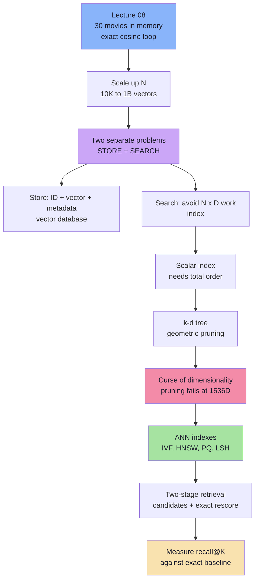

# Lecture 09 — Vector Embedding Search & Storage

> **Lecture Theme:** The movie recommender from Lecture 08 worked because the dataset was tiny. This lecture asks the engineering question that follows: **what breaks when the catalogue grows from 30 vectors to hundreds of millions — and what do we build instead?** The answer is a vector database: storage, metadata, exact KNN as the baseline, geometric indexes that fail in high dimensions, and approximate nearest-neighbor indexes that trade a measured amount of recall for sub-linear speed.

---

## Chapter Index

| # | Chapter | Core Question Answered |
|---|---------|----------------------|
| [01](./01_The_Scale_Wall_Why_Toy_Vector_Search_Breaks.md) | The Scale Wall — Why Toy Vector Search Breaks | What exactly stops working when `N` becomes huge? |
| [02](./02_Why_Relational_Databases_Are_Not_Enough.md) | Why a Relational Database Is Not Enough | Can't we just store vectors in Postgres/MySQL? |
| [03](./03_Anatomy_of_a_Vector_Database.md) | Anatomy of a Vector Database | What is inside a vector DB, and what does it *not* do? |
| [04](./04_Brute_Force_KNN_The_Correct_Baseline.md) | Brute Force and KNN — The Correct Baseline | How expensive is exact search, precisely? |
| [05](./05_Indexes_and_Why_Scalar_Indexes_Fail_for_Vectors.md) | Indexes and Why Scalar Indexes Fail for Vectors | Why does a B-tree work for `age` but not for embeddings? |
| [06](./06_The_Curse_of_Dimensionality.md) | The Curse of Dimensionality | Why do k-d trees collapse at 1536 dimensions? |
| [07](./07_Approximate_Nearest_Neighbor_Indexes.md) | Approximate Nearest Neighbor Indexes | What do IVF, HNSW, PQ, and LSH actually do? |
| [08](./08_Production_Vector_Search_Design.md) | Production Vector Search Design | How do we run, evaluate, secure, and migrate this system? |
| [**Complete**](./Lecture_09_Complete_Notes.md) | **Complete Consolidated Notes** | All 8 chapters synthesised into one production reference + cheat sheet, glossary, misconceptions, self-check, and capacity maths |

> 📄 **Prefer a single document?** Read the **[Lecture 09 — Complete Consolidated Notes](./Lecture_09_Complete_Notes.md)**. It follows the chapter dependency chain, keeps the arithmetic that makes the argument, and adds the decision tables, failure runbooks, and recall maths that the chapters spread across eight files.


---

## The Big Idea in One Diagram



---

## Key Concepts Quick Reference

| Concept | One-Line Definition |
|---|---|
| **Vector database** | A database with persistence, payload filtering, and a geometric (ANN) index |
| **Embedding model** | Converts meaning → numbers; the DB itself has no semantic understanding |
| **Payload / metadata** | Structured fields attached to a vector for filtering, display, and authorization |
| **KNN** | Return the `K` stored vectors closest to the query |
| **Brute force / flat** | Compare against every vector; 100% recall; `O(N × D)` per query |
| **`N × D`** | The fundamental cost: vector count times dimensions |
| **Recall@K** | Fraction of the true top-K that an approximate index actually returns |
| **B-tree** | Sorted scalar index; requires a total order |
| **k-d tree** | Recursively splits space on alternating axes; prunes in low dimensions |
| **Splitting plane** | The boundary at a k-d tree node; used to decide whether to search the far side |
| **Curse of dimensionality** | High-dimensional geometry makes safe pruning progressively impossible |
| **Distance concentration** | In high dimensions, nearest and farthest distances become similar |
| **ANN** | Approximate Nearest Neighbor: sub-linear search with bounded accuracy loss |
| **IVF** | Cluster vectors, then probe only the nearest clusters (`nprobe`) |
| **HNSW** | Multi-layer navigable graph; the low-latency default |
| **PQ** | Product quantization: compress vectors into codebook IDs |
| **LSH** | Hash similar vectors into the same buckets with high probability |
| **`efSearch` / `nprobe`** | Query-time recall/latency knobs |
| **Two-stage retrieval** | Cheap ANN candidate generation, then exact rescoring |
| **Hybrid search** | Fuse lexical (BM25) and vector rankings, often with RRF |

---

## The Three Mental Models

### 1. Two questions, not one

```text
STORE   Where do N × D numbers live, and how are they kept fresh?
SEARCH  How do we avoid comparing the query with every stored vector?
```

A vector database answers both, but they are separate design decisions. You can shard storage without changing the index, or change the index without changing storage.

### 2. An index is a machine for proving ignorance

```text
B-tree:    "age > 32, so this sorted subtree is irrelevant."
k-d tree:  "the query is far from this plane, so this region cannot be closer."
ANN:       "I cannot prove it, so I will sample and accept a small miss rate."
```

Every index is a strategy for avoiding work. The curse of dimensionality is the failure of the **proof**, not of the arithmetic.

### 3. The production retrieval ladder

```text
EMBED        query → vector (same model, same version)
CANDIDATES   ANN over millions → hundreds (approximate, high recall)
RESCORE      exact cosine on the candidates (precise, small set)
RANK         business rules, diversity, recency, popularity
RERANK       optional cross-encoder or LLM
MEASURE      recall@K, nDCG, p95, freshness, cost
```

> **The recall ceiling:** final recall can never exceed candidate-stage recall. If stage 1 misses it, no reranker can recover it.

---

## What This Lecture Adds Beyond `Notes.pdf`

The PDF covers the core argument: small-scale search, storage/search problems, relational databases, KNN, brute force cost, k-d trees, pruning, and the curse of dimensionality. These notes go further where the slides are compressed:

| Topic | Where |
|---|---|
| Distance metrics and normalization (cosine, dot, L2, L1) | Chapter 04 |
| Top-K with a heap and full cost breakdown | Chapter 04 |
| Memory bandwidth and disk I/O as the real bottleneck | Chapter 04 |
| Metadata filtering strategies (pre / post / filtered ANN) | Chapter 03 |
| Hybrid search and Reciprocal Rank Fusion | Chapter 03 |
| HNSW, IVF, PQ, LSH, DiskANN in detail | Chapter 07 |
| Quantization: float16, int8, binary, product | Chapters 07–08 |
| Two-stage retrieval and reranking | Chapters 07–08 |
| Recall, MRR, nDCG, golden sets | Chapter 08 |
| Model versioning and zero-downtime re-embedding | Chapter 08 |
| Sharding, replication, multi-tenancy | Chapter 08 |
| Security, ACL filtering, prompt injection via retrieved text | Chapter 08 |
| Vendor landscape and decision framework | Chapter 08 |

---

## Lecture 08 vs Lecture 09

| Lecture 08 | Lecture 09 |
|---|---|
| 30 movies in a `List` | Millions to billions of vectors |
| Compare with all | Compare with a candidate set |
| `O(N × D)` is fine | `O(N × D)` is the problem |
| In-memory array | Vector database + ANN index |
| Cosine similarity | Cosine + metric consistency + normalization |
| Exact by construction | Approximate by design, measured by recall |
| Build the feature | Operate the infrastructure |

---

## Study Path

1. **Read 01–04 in order** to establish the cost model. Do the arithmetic yourself.
2. **Work through 05 with pencil and paper.** Rebuild the k-d tree and re-run the search.
3. **Read 06 before 07.** The curse explains *why* ANN exists; otherwise HNSW looks arbitrary.
4. **Treat 07 as a menu**, not a checklist. Learn HNSW and IVF deeply; know when PQ and LSH apply.
5. **Use 08 as a design review checklist** for a real system.

---

## A Note on the Code Blocks

Every implementation-shaped block in these chapters is **TypeScript-style pseudo-code**, not runnable production code. The goal is to make data flow, state, and algorithmic decisions unambiguous — not to provide an implementation. Interfaces, function signatures, and comments describe the contract; the actual system belongs in `Lecture 09/code`.

---

## Notes Sources

- 📄 [`Notes.pdf`](./Notes.pdf) — Original lecture slides
- 🖼️ [`Excalidraw-Notes.svg`](./Excalidraw-Notes.svg) — Handwritten visual notes covering: movie-to-vector examples, the two questions (store/search), relational DB serialization, exact vs similarity matching, metadata, KNN, `N × D` cost, 6 KB per vector, 1-D vs 2-D ordering, k-d tree construction and the five-step search rule, and the precise statement of the curse of dimensionality.

---

## Chapter Summaries in One Line Each

| Chapter | One-line summary |
|---|---|
| 01 | Linear scan is correct but its cost grows with `N × D` per query. |
| 02 | Databases can store vectors; they cannot answer similarity with a B-tree. |
| 03 | A vector DB = storage + payload + ANN index + lifecycle; the model supplies meaning. |
| 04 | Brute force is exact, simple, and the ground truth for every approximation. |
| 05 | k-d trees prune by geometry; the pruning rule is `planeDist < bestDist`. |
| 06 | In 1536 dimensions, almost every query is near a boundary, so pruning dies. |
| 07 | ANN indexes trade measured recall for sub-linear search. |
| 08 | Production is ingestion, versioning, evaluation, security, and capacity planning. |

---

> **Final takeaway:** Do not ask "which vector database is best?" Ask:
>
> 1. How many vectors, at what dimension, with what growth rate?
> 2. What recall does the product need?
> 3. What latency must be met at p95?
> 4. How fresh must results be?
> 5. How will you rebuild and version the index?
>
> The answers choose the architecture. The vendor is the last decision, not the first.
