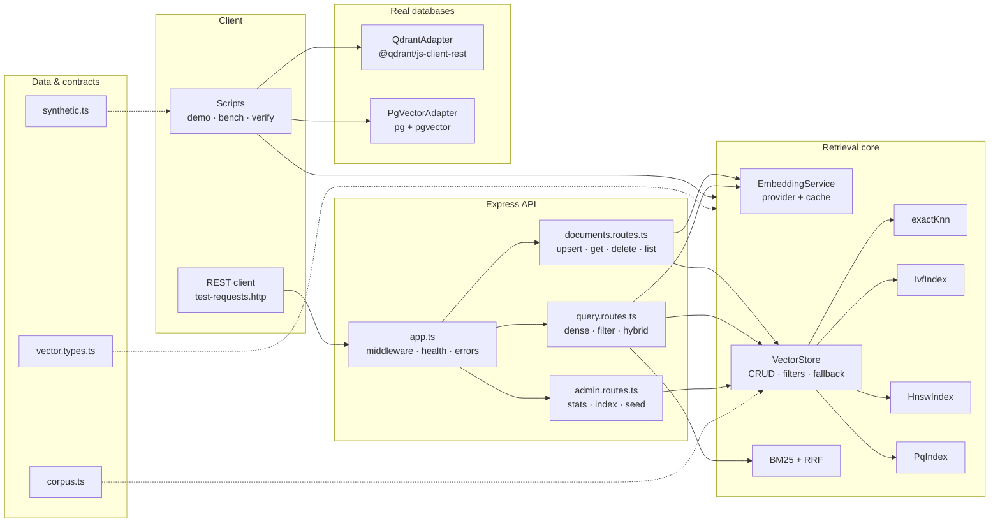

# Implementation Guide — Lecture 10: Vector Databases & ANN

Welcome to the chapter-by-chapter guide for the **Lecture 10 codebase**: embeddings, similarity metrics, exact KNN, IVF, HNSW, product quantization, a CRUD vector store, and real Qdrant/pgvector adapters.

This guide follows the format used in Lectures 03–08. Every chapter contains:

1. **Files covered** — what the chapter creates and why.
2. **Complete source code** — the full contents of every file discussed, not excerpts.
3. **Block-by-block explanation** — what each block does, how it works, and the engineering trade-off behind it.
4. **Commands and verification** — the exact command(s) that prove the chapter works.

> **Scope discipline:** this code stops at **retrieval**. It embeds, stores, indexes, filters, fuses and evaluates. It does not call an LLM to generate an answer — that is Lecture 11. No hidden RAG pipeline, no prompt construction, no generation endpoint.

---

## 🧭 System Topology



---

## 📚 Chapter Navigation

| Chapter | Title | Files Covered | Notes Mapping |
| :---: | :--- | :--- | :--- |
| **[00](./00_Overview_and_File_Structure.md)** | **Overview, Provider Structure & File Map** | `package.json`, `tsconfig.json`, `.env.example`, complete `src/` tree, request lifecycle. | All chapters |
| **[01](./01_Setup_Environment_and_Embedding_Providers.md)** | **Setup, Environment & Embedding Providers** | `types/vector.types.ts`, `config/env.ts`, `lib/async.ts`, all of `embeddings/`. | 01, 02 |
| **[02](./02_Metrics_Heaps_and_Ranking.md)** | **Metrics, Heaps & Ranking** | `core/metrics.ts`, `lib/heap.ts`, `lib/topk.ts`, `core/evaluation.ts`. | 02, 03 |
| **[03](./03_Exact_KNN_and_the_ANN_Bargain.md)** | **Exact KNN & the ANN Bargain** | `core/exact-knn.ts`, `data/synthetic.ts`. | 03 |
| **[04](./04_IVF_Index.md)** | **IVF — Inverted File Index** | `core/kmeans.ts`, `core/ivf.ts`. | 04 |
| **[05](./05_HNSW_Index.md)** | **HNSW — Hierarchical Graph** | `core/hnsw.ts`. | 05 |
| **[06](./06_Product_Quantization.md)** | **Product Quantization & ADC** | `core/pq.ts`. | 06 |
| **[07](./07_Vector_Store_CRUD_and_Filtering.md)** | **Vector Store, Filters & Hybrid Search** | `store/filters.ts`, `store/vector-store.ts`, `store/hybrid.ts`, `data/corpus.ts`, `services/seed.service.ts`. | 07, 09 |
| **[08](./08_Qdrant_Adapter.md)** | **Qdrant Adapter (official client)** | `adapters/qdrant.adapter.ts`, `scripts/seed.ts`, `scripts/check-services.ts`. | 08 |
| **[09](./09_pgvector_Adapter.md)** | **pgvector Adapter (official `pg` driver)** | `adapters/pgvector.adapter.ts`, `scripts/adapter-crud.ts`. | 08 |
| **[10](./10_HTTP_API_and_End_to_End_Verification.md)** | **HTTP API & End-to-End Verification** | routes, `app.ts`, `server.ts`, `verify.ts`, `demo.ts`, `benchmark.ts`, `test-requests.http`. | 03–09 |

---

## 🚦 Suggested Reading Paths

| If you want to… | Read |
| :--- | :--- |
| Understand the whole design first | **00 → 01 → 02 → 03** |
| Learn the ANN algorithms | **02 → 03 → 04 → 05 → 06** |
| Learn the database layer | **02 → 07 → 08 → 09** |
| Get the API running | **01 → 07 → 10** |
| Prove the code works | run **10** end to end |
| Connect code to theory | read the matching chapters in [`../../notes/README.md`](../../notes/README.md) |

---

## ⚙️ Commands Used Throughout

```bash
cd "Lecture 10/code"
npm install
cp .env.example .env

npm run verify              # 10 assertions, offline
npm run demo                # metrics, four indexes, filters, hybrid
npm run bench               # latency + recall table
npm run build               # tsc -> dist/
npm run dev                 # API on :3000
npm run services:check      # Qdrant + pgvector connectivity
npm run seed:qdrant         # load the 24-doc corpus into Qdrant
npm run seed:pgvector       # load it into PostgreSQL
npm run adapter:crud:qdrant # upsert/update/get/filter/delete on Qdrant
npm run adapter:crud:pgvector
```

Default environment: `mock` embeddings, 128 dimensions, cosine, flat index, auto-seeded corpus. No API key, network or Docker is needed for chapters 00–07 and 10.

---

## 🧠 Conventions That Apply Everywhere

1. **One score contract.** `score` is always higher-is-better. `cosine` and `dot` are used directly; `euclid` and `manhattan` are negated. `distance` carries the native value.
2. **Typed arrays.** The core stores `Float32Array`, not `number[]`. JSON arrays are converted at the API boundary.
3. **Precomputed norms.** Records carry their L2 norm, so cosine costs one dot product per comparison.
4. **Bounded top-K.** Every search keeps K candidates in a heap: `O(N log K)` time, `O(K)` memory.
5. **Indexes are derived artifacts.** The in-memory store rebuilds them lazily after a write. Qdrant/pgvector own their indexes.
6. **Measure, don't assume.** Every ANN result can be compared with `exactKnn`; `recallAtK` makes the trade-off explicit.
7. **No generation.** Retrieval returns ranked records. Lecture 11 adds the LLM.

---

## ✅ Validation Performed

| Check | Result |
| :--- | :--- |
| `tsc` strict build | pass |
| `npm run verify` | 10/10 checks |
| IVF recall@10 (clustered 1,200 × 32) | 100% |
| HNSW recall@10 (same data) | 100% |
| PQ recall@10 with rescore | 96.4% |
| Qdrant (Docker, official client) seed + CRUD | pass, 24 points |
| pgvector (`pgvector/pgvector:pg17`) seed + CRUD | pass, 24 rows |
| HTTP CRUD · filter · hybrid · index build | pass |

> Results are from the machine used to build this lecture. Absolute latency will differ; recall and correctness should not.

