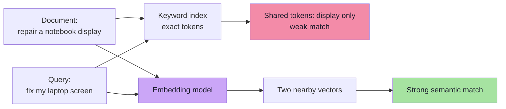
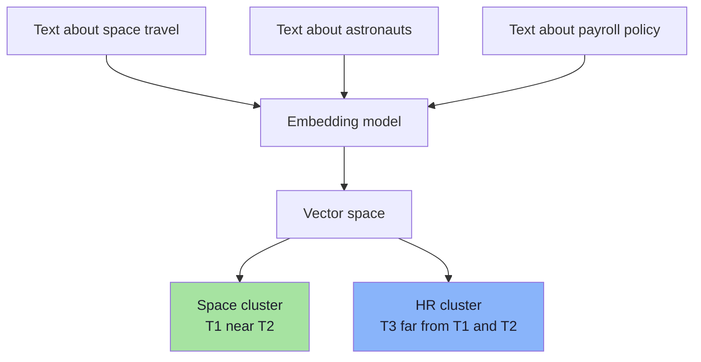
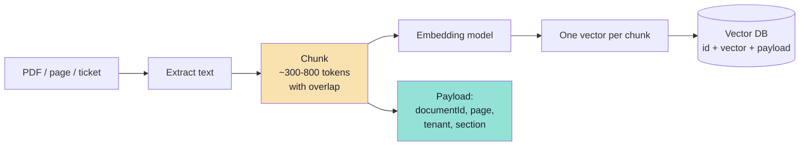
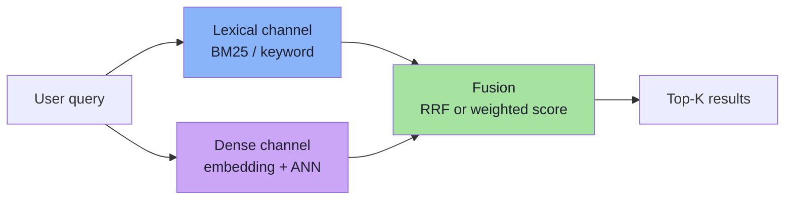
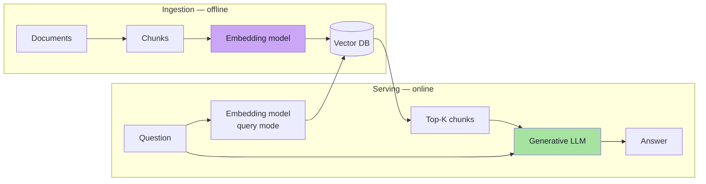
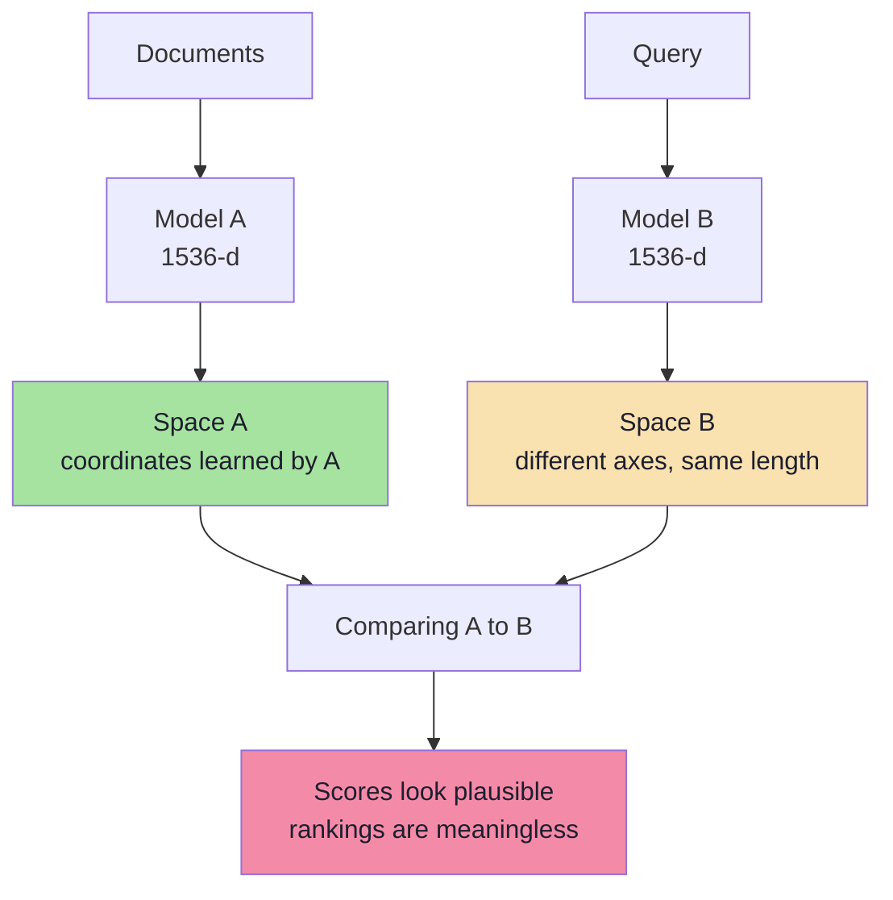
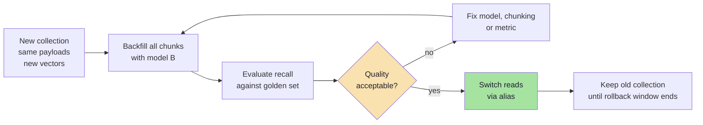

# Chapter 01: Embeddings and the Geometry of Meaning

> **Chapter Goal:** Understand what an embedding actually is, why it converts a language problem into a geometry problem, and which decisions made at embedding time are effectively irreversible. By the end you should be able to look at any vector collection and answer three questions: *what space is this, what does "near" mean here, and is my query in the same space as my documents?*

---

## 1.1 The Problem: A Computer Cannot Compare Meaning

Imagine a support knowledge base containing the sentence:

```text
How to repair a notebook display
```

A user types:

```text
How do I fix my laptop screen?
```

A keyword search engine sees almost no overlap:

```text
repair   ≠  fix
notebook ≠  laptop
display  ≈  screen
```

A human immediately understands that these two sentences are about the same task. The words differ; the **meaning** agrees. Traditional lexical search models words as independent tokens, so it has no way to represent that agreement.

This is the gap embeddings were invented to close:



> **Key idea:** Embeddings do not compare strings. They compare **positions in a learned space** where related meanings were placed close together during training.

---

## 1.2 What an Embedding Is

An **embedding** is a fixed-length list of floating-point numbers produced by a model from an input:

```text
"Employees receive 18 paid leaves annually."
                    │
                    ▼
            Embedding model
                    │
                    ▼
[0.021, -0.184, 0.762, 0.331, ... 1536 values]
```

Three properties matter:

| Property | Consequence |
|---|---|
| **Fixed length** | Every input becomes the same shape, so vectors can be stored in a matrix and compared arithmetically. |
| **Dense** | Almost every coordinate carries a small amount of information; there is no "word slot" to inspect. |
| **Learned** | The coordinates are a product of training data and objective, not hand-written features. |

No single coordinate has a human-readable meaning. You cannot point at dimension 412 and say "this is about holidays". The information is **distributed** across the vector, and it only becomes useful when compared with other vectors from the same model.

### Dense vs sparse representations

| Representation | Example | Strength | Weakness |
|---|---|---|---|
| One-hot / token ID | `[0,0,1,0,...]` | Trivial, exact | No similarity between related words |
| Sparse lexical (BM25, SPLADE) | Mostly zeros, huge dimension | Exact terms, IDs, rare words | Vocabulary mismatch |
| **Dense embedding** | 768–3072 floats | Semantic generalisation | Weak on exact identifiers, opaque |
| Hybrid (dense + sparse) | Both, fused | Best of both | More infrastructure |

This is why production systems often keep a lexical channel alongside the dense one (Chapter 07 and Chapter 09).

---

## 1.3 Semantic Geometry

The model places inputs in a high-dimensional space such that:

```text
similar meaning  →  nearby vectors
different meaning →  distant vectors
```

In two dimensions, a movie catalogue might look like this:

```text
        space / sci-fi
   Interstellar ●     ● The Martian
                  ● Gravity

  Titanic ●   ● The Notebook
        romance

                              ● Avengers
                         ● Iron Man
                              superhero
```

We can draw three dimensions or two. We cannot draw 1,536. But the **geometric intuition is identical**: neighbourhoods correspond to themes, genres, topics or functions, and distance corresponds to dissimilarity.



> **What the database sees:** numbers and distances. **What the model created:** meaning. Confusing the two is the most common conceptual error in vector search.

---

## 1.4 Dimensions: What the Vector Width Really Means

A vector is an array. Its length is the **dimensionality**:

```ts
// TypeScript-style shape, not a real embedding
const v: number[] = [0.12, -0.45, 0.78, 0.21]; // 4 dimensions

// Real text embedding models commonly return:
// 384, 768, 1024, 1536, 3072 dimensions
```

Dimensions are not "features" you can label. They are coordinates in a space the model learned. Two consequences follow immediately:

### Consequence 1 — Cost scales with `D`

Every vector costs `D × bytes_per_value` to store, and every distance computation costs roughly `D` multiply-adds. Doubling `D` doubles storage and roughly doubles comparison cost.

```text
1,536 dimensions × 4 bytes (float32) = 6,144 bytes ≈ 6 KB per vector
100,000,000 vectors × 6 KB          ≈ 614 GB of raw vectors
```

That number excludes IDs, payloads, indexes, graph edges and replicas (Chapter 06).

### Consequence 2 — More dimensions do **not** automatically mean better retrieval

Retrieval quality depends on the model's training, the domain, the language, the chunking strategy, the metric and the index configuration — not on width alone. A well-trained 768-dimensional model can beat a poorly matched 3,072-dimensional one.

Some models are trained so that a prefix of the vector is itself a usable embedding (**Matryoshka representation learning**). This allows dimension truncation as a cost knob, but truncation must be done according to the model's documentation, not by slicing an arbitrary vector.

| Dimension choice | Effect |
|---|---|
| Smaller (e.g. 256–768) | Cheaper storage and faster comparisons; may lose fine-grained distinctions |
| Larger (e.g. 1,536–3,072) | More capacity; higher cost; not automatically higher recall |
| Truncated with a supported model | Useful cost/quality knob; re-normalise if the model requires it |

> **Rule:** the embedding dimension is a property of the model and the collection configuration. You cannot change it casually later — see §1.8.

---

## 1.5 What Exactly Gets Embedded?

An embedding model maps **one input unit** to **one vector**. The retrieval unit determines what "one result" means.

| Unit | Typical use | Trade-off |
|---|---|---|
| Word / token | Rare in RAG | Too small to carry meaning |
| Sentence | FAQ matching | Precise but context-poor |
| **Chunk** (100–800 tokens) | RAG over documents | The standard compromise |
| Whole document | Classification, dedup | Too coarse for retrieval; diluted meaning |
| Image / audio / PDF page | Multimodal search | Requires a multimodal embedding model |

In a RAG system the stored unit is almost always a **chunk**: a contiguous passage with metadata pointing back to its source document. Chunking decides the ceiling on retrieval quality — if the answer is split across two chunks and neither contains it fully, no index can retrieve it (Chapter 09).



Two details are easy to miss:

1. **The chunk text is what gets embedded**, not the title or the file name. If a chunk says "as described above", the embedding has no idea what "above" means. Include a little context (heading, document title) when embedding.
2. **The chunk text is usually stored in the payload** as well, because the vector cannot be turned back into text. Embeddings are one-way.

---

## 1.6 Keyword Search vs Semantic Search vs Hybrid Search

| Query | Document | Keyword | Semantic |
|---|---|---|---|
| "fix my laptop screen" | "repair a notebook display" | ❌ weak | ✅ strong |
| "ERR_AUTH_4017" | "ERR_AUTH_4017 invalid token" | ✅ exact | ⚠️ unreliable |
| "cheap flights to Delhi" | "low-cost airfare to DEL" | ❌ weak | ✅ strong |
| "policy 4.2.1" | "Section 4.2.1 — Leave" | ✅ exact | ⚠️ may drift |

Semantic search generalises across vocabulary; lexical search preserves exact tokens. Neither dominates.



This is **hybrid search**. The lexical side is not a legacy fallback; for error codes, product SKUs, names, legal references and rare terms it is often the only channel that works. Chapter 07 covers fusion, Chapter 09 covers when to deploy it.

> **Mental model:** dense retrieval answers *"what is this about?"*; lexical retrieval answers *"does this exact thing appear?"*. Production retrieval frequently needs both questions answered.

---

## 1.7 The Embedding Model Is Not the Generative LLM

A RAG system uses at least two models with different jobs:

| | Embedding model | Generative LLM |
|---|---|---|
| Input | Text (or image/audio) | Prompt + retrieved context |
| Output | Fixed-length vector | Tokens / answer |
| Purpose | Represent meaning for comparison | Reason and write |
| Determinism | Deterministic for a given input and model version | Sampling-dependent |
| Cost driver | Input tokens, number of chunks | Input + output tokens, latency |
| Typical examples | `gemini-embedding-001`, `text-embedding-3-*`, open-source BGE/E5 family | Chat/completion models |

You can swap the generative model without re-embedding anything. You **cannot** swap the embedding model without re-embedding the corpus (see next section).



---

## 1.8 The Compatibility Rule (the Most Expensive Mistake to Get Wrong)

Two vectors may only be compared if they were produced by **the same embedding space**. In practice that means all of the following must match:

```text
same model family and version
+ same output dimension
+ same task type / instruction prefix
+ same preprocessing and normalization
+ same truncation behaviour
= one comparable space
```

The subtle failure is that **same dimension does not mean same space**:



A vector of length 1,536 is just 1,536 numbers. Nothing in the array records which model produced it. If you mix models — or even two versions of the same model — cosine similarity still returns a number between -1 and 1, so the system fails **silently**. You get confident, well-formatted, wrong results.

### Document mode vs query mode

Many retrieval models are trained asymmetrically: a document and a query play different roles. APIs expose this as a task type, and open-source models use instruction prefixes:

```text
Document → RETRIEVAL_DOCUMENT  (or "passage: ...")
Query    → RETRIEVAL_QUERY     (or "query: ...")
```

Using the query mode for documents (or omitting the prefix) degrades recall without any error message. Check the model card.

### Migrating to a new embedding model

Because the old and new spaces are incompatible, migration is a data project, not a configuration change:



Practical rules:

1. **Version everything.** Store `embedding_model`, `model_version`, `dim` and `normalized` in collection config and in each point's payload.
2. **Never mix spaces in one collection.** If you must run two models, use two collections (or named vectors) and fuse results at the application layer.
3. **Re-embed the whole corpus** when the model changes — including the query path.
4. **Keep a golden query set** so you can prove the new space is better before cutover (Chapter 09).

---

## 1.9 Choosing an Embedding Model

The lecture note's updated model information is summarised below. Always confirm against the provider's current documentation — embedding lineups change, and old models are retired.

| Model | Modality | Input limit | Output dimensions | Notes |
|---|---|---|---|---|
| `gemini-embedding-001` | Text | 2,048 tokens | Configurable 128–3,072; 768 / 1,536 / 3,072 recommended | Task types include document and query retrieval |
| `gemini-embedding-2` | Multimodal: text, image, video, audio, PDF | 8,192 tokens | Configurable 128–3,072; 768 / 1,536 / 3,072 recommended | Different embedding space from `-001`; migration requires re-embedding |
| `text-embedding-004` | Text | — | — | **Retired 14 January 2026** per the updated note; do not design new systems around it |
| OpenAI `text-embedding-3-*` | Text | Model-specific | Fixed or configurable | Widely used; verify the exact model snapshot |
| Open-source (BGE, E5, nomic, etc.) | Text / multimodal variants | Model-specific | Model-specific | Self-hostable; check licence, language coverage and prefix requirements |

### Selection checklist

| Question | Why it matters |
|---|---|
| Does it cover my languages? | Multilingual corpora fail quietly with monolingual models |
| Does it fit my chunk length? | Text beyond the input limit is truncated; content disappears |
| What is the output dimension? | Drives storage, latency and index memory |
| Is there a query/document distinction? | Misusing it costs recall |
| Where does inference run? | Cloud API vs self-hosted changes cost, latency and data-residency |
| Is the model versioned and stable? | A silent provider upgrade can invalidate your index |
| How does it score on **my** data? | Public benchmarks are a prior, not evidence |

> **Benchmark discipline:** MTEB-style leaderboards are useful for shortlisting. They do not tell you how a model performs on your domain, your language mix, or your chunk sizes. Measure on a labelled sample of real queries.

---

## 1.10 Pseudo-code: The Embedding Contract

The following TypeScript-style sketch is deliberately about **contracts**, not implementation. It encodes the rules from §1.8 so they cannot be forgotten at call sites.

```ts
// ---------- Types: the contract every embedding call must satisfy ----------
type TaskType = "RETRIEVAL_DOCUMENT" | "RETRIEVAL_QUERY";

interface EmbedRequest {
  text: string;
  taskType: TaskType;   // documents and queries are embedded differently
  outputDim: number;    // must match the collection configuration
}

interface EmbedResult {
  vector: number[];
  model: string;        // e.g. "gemini-embedding-001"
  modelVersion: string; // snapshot / revision
  dim: number;
  normalized: boolean;
}

// ---------- Ingest: one vector per chunk ----------
interface Chunk {
  id: string;
  text: string;
  documentId: string;
  page?: number;
  tenantId: string;
  modelId: string;      // which space this vector belongs to
  contentHash: string;  // detect real changes
}

async function ingestChunks(chunks: Chunk[]): Promise<void> {
  for (const chunk of chunks) {
    const embedding = await embed({
      text: chunk.text,
      taskType: "RETRIEVAL_DOCUMENT",
      outputDim: 1536,
    });

    await vectorDb.upsert({
      id: chunk.id,
      vector: embedding.vector,
      payload: {
        text: chunk.text,
        documentId: chunk.documentId,
        page: chunk.page,
        tenantId: chunk.tenantId,
        modelId: embedding.model,
        modelVersion: embedding.modelVersion,
        dim: embedding.dim,
        contentHash: chunk.contentHash,
      },
    });
  }
}

// ---------- Query: same model, same dimension, query task type ----------
async function search(question: string, tenantId: string): Promise<Chunk[]> {
  const q = await embed({
    text: question,
    taskType: "RETRIEVAL_QUERY",
    outputDim: 1536,
  });

  return vectorDb.query({
    vector: q.vector,
    limit: 10,
    filter: { must: [{ key: "tenantId", match: { value: tenantId } }] },
    withPayload: true,
  });
}
```

Notice what the types enforce:

- `taskType` is not optional, so a query cannot accidentally be embedded in document mode.
- `outputDim` is explicit, so a dimension mismatch is a compile-time conversation rather than a runtime error.
- Every payload records the model and version, making mixed-space bugs detectable by query.
- `contentHash` supports idempotent re-ingestion: skip the expensive embedding call when the text has not changed.

---

## 1.11 Common Mistakes

1. **Mixing embedding models or versions.** Same dimension is not same space; scores remain plausible while rankings become meaningless.
2. **Assuming more dimensions means better retrieval.** Width is capacity, not quality; measure on your own queries.
3. **Ignoring the input token limit.** Long chunks are silently truncated, so the vector represents only the first part of the text.
4. **Embedding the wrong unit.** Embedding whole manuals produces an average of everything and a match for nothing.
5. **Forgetting the document/query asymmetry.** Using one task type for both sides loses recall with no error.
6. **Using dense search for exact identifiers.** Error codes, SKUs and clause numbers need lexical retrieval or hybrid search.
7. **Treating similarity scores as probabilities or confidence.** Cosine 0.82 does not mean "82% likely correct".
8. **Storing no model metadata.** You cannot audit, migrate or debug the collection later.
9. **Re-embedding only new documents after a model change.** The old and new vectors now occupy different spaces in the same collection.
10. **Choosing a model from a leaderboard alone.** Domain, language and chunk length dominate real-world performance.

---

## 1.12 Chapter Summary

| Concept | Takeaway |
|---|---|
| Embedding | A fixed-length dense vector produced by a learned model |
| Meaning | Encoded as proximity: similar inputs land in nearby regions |
| Dimensions | Cost scales with `D`; width is not a quality guarantee |
| Retrieval unit | Chunks, not documents; chunking sets the quality ceiling |
| Lexical vs dense | Exact tokens vs semantic generalisation; combine when both matter |
| Embedding vs LLM | Different models, different jobs; only the embedding model forces re-indexing |
| Compatibility | Model + version + dimension + task type + normalization must match on both sides |
| Migration | New collection, full re-embed, evaluate, switch alias, keep a rollback window |

> **Final mental model:** An embedding is a **coordinate**, not a summary. The model defines the map, the dimension defines the resolution, and the task type defines which side of the retrieval you are standing on. Everything downstream — cosine, IVF, HNSW, PQ, Qdrant — is arithmetic performed on that map. If two vectors come from different maps, the arithmetic is still valid and the answer is still wrong.

---

**Next:** [Chapter 02 — Similarity, Distance and Metric Consistency](./02_Similarity_Distance_and_Metric_Consistency.md)


