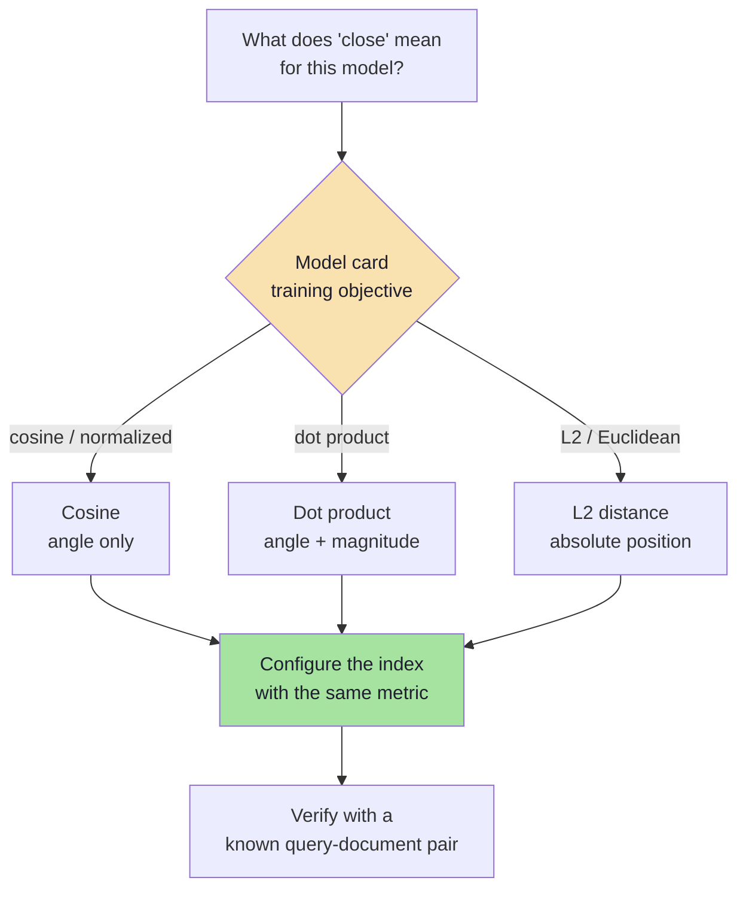
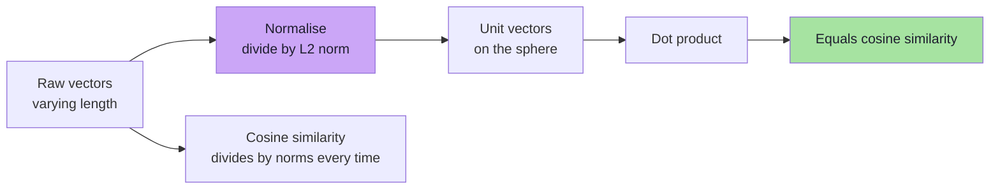
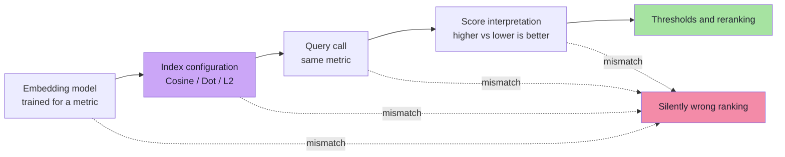

# Chapter 02: Similarity, Distance and Metric Consistency

> **Chapter Goal:** Learn the three metrics that power every vector search — **dot product**, **cosine similarity** and **Euclidean distance** — well enough to compute them by hand, explain when they disagree, and configure them correctly. The chapter ends with the rule that prevents the most common silent bug in RAG: the metric used to build the index must be the metric the embedding model was trained for, and the query must use the same one.

---

## 2.1 Two Vocabularies for the Same Question

Every vector search asks one question:

```text
How close are vector A and vector B?
```

Systems answer it with either a **similarity** or a **distance**:

| Term | Direction | Example | Meaning |
|---|---|---|---|
| **Similarity** | Higher is better | `0.94` | More alike |
| **Distance** | Lower is better | `0.10` | Closer |

```text
A ↔ B = 0.94 similarity   → very similar
A ↔ C = 0.23 similarity   → weakly related

A ↔ B = 0.10 distance     → very close
A ↔ C = 1.80 distance     → far apart
```

For cosine, the two are simple complements:

```text
cosine_distance(A, B) = 1 - cosine_similarity(A, B)
```

So similarity `0.94` is distance `0.06`. This is a **monotonic** transformation: it changes the numbers, not the ranking.

> **Rule:** always check which convention an API, dashboard or paper is using. A "0.9 score" can mean excellent (similarity) or terrible (distance).

---

## 2.2 Dot Product (Inner Product)

The dot product multiplies matching coordinates and sums the results:

```text
A · B = Σ Aᵢ × Bᵢ
      = A₁B₁ + A₂B₂ + ... + AₙBₙ
```

### Worked example

```text
A = [1, 2, 3]
B = [4, 5, 6]

A · B = (1×4) + (2×5) + (3×6)
      = 4 + 10 + 18
      = 32
```

### What it measures

The dot product combines **direction** and **magnitude**:

```text
A · B = ‖A‖ × ‖B‖ × cos(θ)
```

If you double the length of `A` without changing its direction, the dot product doubles — even though the semantic direction is identical. That is the key difference from cosine similarity.

| Property | Consequence |
|---|---|
| Grows with vector length | Long vectors can dominate rankings |
| Cheap to compute | One multiply-add per dimension |
| Sensitive to scale | Normalisation removes the scale effect |
| Supports negative values | Larger negative dot product means opposite directions |

Dot product is a good choice when the model was trained with a dot-product objective and vector magnitudes carry useful signal — for example, some recommendation and image models where confidence or popularity is encoded in length. For ordinary text embeddings, cosine is the safer default unless the model card says otherwise.

---

## 2.3 Cosine Similarity

Cosine similarity measures the **angle** between two vectors and ignores their length:

```text
cos(A, B) = (A · B) / (‖A‖ × ‖B‖)

where ‖A‖ = √(A₁² + A₂² + ... + Aₙ²)
```

It ranges from `-1` to `1`:

| Value | Angle | Interpretation |
|---|---|---|
| `1` | 0° | Same direction |
| `0` | 90° | Orthogonal / unrelated |
| `-1` | 180° | Opposite directions |

### Worked example

```text
A = [1, 0]
B = [1, 0]      → same direction      → cos = 1
C = [0, 1]      → perpendicular        → cos = 0
D = [-1, 0]     → opposite direction   → cos = -1
```

In two dimensions:

```text
            C [0,1]
              ↑
              │
              │  θ
              └────────→ A [1,0]
```

### Why text embeddings usually use cosine

Text length should not change meaning. "Paid leave" and "paid leave, as described in section 4.2.1 of the employee handbook" are semantically close, but the second sentence may produce a longer vector under some models. Cosine compares direction, so it is less sensitive to that effect.

### Cosine distance

Many databases report **cosine distance** instead of similarity:

```text
cosine_distance = 1 - cos(A, B)
```

| Cosine similarity | Cosine distance |
|---|---|
| `1.00` | `0.00` |
| `0.80` | `0.20` |
| `0.00` | `1.00` |
| `-1.00` | `2.00` |

Qdrant, for example, exposes a `Cosine` distance configuration and returns a similarity-style score for it; Postgres `pgvector` exposes the `<=>` operator, which returns cosine **distance**. Same metric, opposite direction — read the documentation.

---

## 2.4 Euclidean Distance (L2)

Euclidean distance is the straight-line distance between two points:

```text
d(A, B) = √( Σ (Aᵢ - Bᵢ)² )
```

### Worked example

```text
A = [1, 2]
B = [4, 6]

d(A, B) = √((1-4)² + (2-6)²)
        = √((−3)² + (−4)²)
        = √(9 + 16)
        = √25
        = 5
```

This is the familiar Pythagorean distance, extended to any number of dimensions.

### Squared L2

For **ranking**, the square root is unnecessary: if `d₁ < d₂`, then `d₁² < d₂²`. Many indexes compute squared L2 and skip the `sqrt`:

```text
squared_l2(A, B) = Σ (Aᵢ - Bᵢ)²
```

This saves one operation per comparison — irrelevant for one query, meaningful for billions.

### What it measures

L2 measures **absolute position**, including magnitude. Two vectors pointing in the same direction but at different lengths have non-zero L2 distance, while their cosine similarity is `1`.

| Property | Consequence |
|---|---|
| Includes magnitude | Sensitive to vector scaling |
| Symmetric | `d(A,B) = d(B,A)` |
| Triangle inequality | Supports metric-space indexes and bounds |
| Unbounded above | Scores have no fixed maximum |

L2 is the natural choice when position in space has physical meaning — image features, sensor readings, coordinates — and when the model was trained with an L2 objective.

---

## 2.5 Manhattan Distance (L1)

Manhattan distance sums absolute coordinate differences:

```text
d₁(A, B) = Σ |Aᵢ - Bᵢ|
```

```text
A = [1, 2], B = [4, 6]
d₁ = |1-4| + |2-6| = 3 + 4 = 7
```

It is less common for text embeddings, but Qdrant supports it (`Manhattan`) and it can be useful for certain feature spaces. It is more robust to isolated large differences than L2, because it does not square them.

---

## 2.6 The Metrics Disagree: A Full Worked Comparison

Take three toy embeddings:

```text
A = [1, 2, 3]
B = [1, 2, 4]     (very similar to A)
C = [3, 2, 1]     (same numbers, different order)
```

### Dot products

```text
A · B = 1 + 4 + 12 = 17
A · C = 3 + 4 + 3  = 10
```

### Magnitudes

```text
‖A‖ = √(1 + 4 + 9)  = √14 ≈ 3.742
‖B‖ = √(1 + 4 + 16) = √21 ≈ 4.583
‖C‖ = √(9 + 4 + 1)  = √14 ≈ 3.742
```

### Cosine similarity

```text
cos(A, B) = 17 / (3.742 × 4.583) ≈ 17 / 17.146 ≈ 0.991
cos(A, C) = 10 / (3.742 × 3.742) = 10 / 14     ≈ 0.714
```

### Euclidean distance

```text
d(A, B) = √((0)² + (0)² + (-1)²) = 1.000
d(A, C) = √((-2)² + 0² + 2²)     = √8 ≈ 2.828
```

All three metrics agree on the ordering: **B is closer to A than C is**. That is not guaranteed in general.

### Where they disagree

```text
A = [1, 0]
B = [10, 0]     same direction, 10× longer
C = [0, 1]      perpendicular, same length as A
```

```text
cos(A, B) = 1.00      cos(A, C) = 0.00     → B wins on angle
d(A, B)   = 9.00      d(A, C)   = 1.41     → C wins on L2
A · B     = 10        A · C     = 0        → B wins on dot product
```

| Question | Metric that answers it |
|---|---|
| "Same topic, regardless of emphasis?" | Cosine |
| "Same direction and similar strength?" | Dot product |
| "Nearby in absolute space?" | Euclidean |



> **There is no universal winner.** The correct metric is a property of the embedding model, not a matter of taste.

---

## 2.7 Normalisation: Where Cosine and Dot Product Collide

A vector is **normalised** (unit length) when:

```text
‖v‖ = 1
```

To normalise, divide every coordinate by the magnitude:

```text
v̂ = v / ‖v‖
```

### The key identity

If both vectors are unit length, then `‖A‖ = ‖B‖ = 1`, so:

```text
cos(A, B) = (A · B) / (1 × 1) = A · B
```

**Cosine similarity and dot product become identical.** This is not a coincidence; it is why many systems normalise vectors at write time and then use the cheaper dot product for search.



### Practical consequences

| Situation | What to do |
|---|---|
| Model outputs unit vectors | Cosine and dot are equivalent; pick either, but be consistent |
| Model outputs unnormalised vectors | Normalise once at ingest **and** at query time, or use cosine |
| Index configured for cosine | Most engines internally normalise and use dot product |
| Normalising twice | Harmless mathematically (unit vector stays unit), but signals confused code |
| Zero vector | Cannot be normalised (`‖0‖ = 0`); reject it at ingest |

> **Failure mode:** normalising documents but not queries (or vice versa) silently changes the ranking. Normalisation is part of the embedding contract, not an optional cleanup.

---

## 2.8 Metric Consistency Across the Whole Stack

The metric appears in four places, and all four must agree:



### API naming is not standardised

| System | Cosine | Dot / inner product | Euclidean | Manhattan |
|---|---|---|---|---|
| **Qdrant** | `Cosine` | `Dot` | `Euclid` | `Manhattan` |
| **pgvector** | `<=>` (cosine distance) | `<#>` (negative inner product) | `<->` (L2) | `<+>` (L1) |
| **FAISS** | Normalise + `METRIC_INNER_PRODUCT` | `METRIC_INNER_PRODUCT` | `METRIC_L2` | — |
| **Pinecone** | `cosine` | `dotproduct` | `euclidean` | — |

Two traps hide in this table:

1. **`<#>` returns the negative inner product.** Postgres needs `ORDER BY ... ASC` for every operator, so it negates the inner product to make "more similar" sort first. If you read the raw value, it is negative.
2. **Qdrant's `score` is not one thing.** For `Cosine` and `Dot`, a higher score is better; for `Euclid` and `Manhattan`, the returned value represents distance, where smaller is better. The server ranks results correctly, but your application code must not assume "bigger is better" across metrics.

### The three mismatch scenarios

| Scenario | Symptom | Fix |
|---|---|---|
| Model trained for cosine, index configured for dot with **unnormalised** vectors | Long chunks dominate results | Normalise, or switch the index to cosine |
| Index built with cosine, query embedded with a **different model** | Plausible but irrelevant results | Re-embed with one model (Chapter 01) |
| Index metric correct, application **sorts ascending** on a similarity score | Best result appears last | Match the sort direction to the metric |

> **Defensive habit:** write one function that produces a *comparable* score (`higher is better`) and convert at the boundary. Never let raw metric-specific numbers leak into business logic.

---

## 2.9 What a Score Actually Means

A similarity score is **not** a probability, a confidence, or a percentage of correctness.

| Claim | True? | Why |
|---|---|---|
| "0.82 cosine means 82% relevant" | ❌ | Cosine measures angle, not relevance |
| "0.82 is good for every model" | ❌ | Score distributions differ by model, dimension, language and query length |
| "0.82 today is comparable to 0.82 last month" | ⚠️ | Only if model, metric and data distribution are unchanged |
| "A fixed threshold of 0.75 filters noise" | ⚠️ | Must be calibrated on labelled data for **your** corpus |

### How to use thresholds responsibly

```text
1. Collect queries with known relevant chunks (a golden set).
2. Compute the score distribution for relevant and irrelevant pairs.
3. Choose a threshold that balances missed answers against noise.
4. Re-calibrate whenever the model, metric, chunking or domain changes.
```

For many RAG systems, a better pattern than a hard score cut is:

- retrieve a generous `topK` (e.g. 20–50),
- apply metadata/ACL filters,
- rerank with a cross-encoder,
- keep the top 3–8 for the prompt,
- and let the LLM answer "I don't know" when the context is weak.

Scores are useful for **ranking within one query**. They are fragile as absolute truth.

---

## 2.10 Numeric Precision and Edge Cases

| Issue | Effect | Mitigation |
|---|---|---|
| `float32` vs `float16` storage | Small rounding differences; near-ties can reorder | Accept for search; rescore with full precision if needed |
| Quantised vectors (int8/PQ) | Approximate distances (Chapter 06) | Rescore top candidates with original vectors |
| Zero vectors | Norm is zero; cosine divides by zero | Reject at ingest; validate embedding output |
| NaN / Infinity | Poisons distance calculations | Validate and fail the batch loudly |
| Duplicate vectors | Same score; arbitrary order | Tie-break deterministically by ID |
| Very long vectors | Dot products grow; float precision loss | Normalise; use float64 only if justified |

A useful production rule: **validate the vector before it enters the database**.

```ts
function isValidEmbedding(v: number[], expectedDim: number): boolean {
  if (v.length !== expectedDim) return false;
  if (!v.every(Number.isFinite)) return false;
  const norm = Math.sqrt(v.reduce((s, x) => s + x * x, 0));
  return norm > 1e-8; // reject the zero vector
}
```

---

## 2.11 Pseudo-code: Metrics and Top-K

```ts
type Metric = "cosine" | "dot" | "l2";

function dot(a: number[], b: number[]): number {
  let sum = 0;
  for (let i = 0; i < a.length; i++) sum += a[i] * b[i];
  return sum;
}

function magnitude(v: number[]): number {
  return Math.sqrt(dot(v, v));
}

function cosineSimilarity(a: number[], b: number[]): number {
  const denom = magnitude(a) * magnitude(b);
  if (denom === 0) throw new Error("zero vector");
  return dot(a, b) / denom;
}

function l2Distance(a: number[], b: number[]): number {
  let sum = 0;
  for (let i = 0; i < a.length; i++) {
    const d = a[i] - b[i];
    sum += d * d;
  }
  return Math.sqrt(sum);
}

function normalize(v: number[]): number[] {
  const n = magnitude(v);
  if (n === 0) throw new Error("cannot normalize zero vector");
  return v.map((x) => x / n);
}

interface Scored<T> { item: T; score: number }

// Convention: always return "higher is better" to callers.
function compare(metric: Metric, score: number): number {
  return metric === "l2" ? -score : score; // negate distance so higher wins
}

function topK<T>(
  query: number[],
  items: Array<{ item: T; vector: number[] }>,
  k: number,
  metric: Metric,
): Array<Scored<T>> {
  const scored = items.map(({ item, vector }) => {
    const raw =
      metric === "cosine" ? cosineSimilarity(query, vector)
      : metric === "dot" ? dot(query, vector)
      : l2Distance(query, vector);
    return { item, score: compare(metric, raw) };
  });

  scored.sort((x, y) => y.score - x.score);
  return scored.slice(0, k);
}
```

The important design choice is the line inside `compare`: **normalise the direction of every metric at the boundary**. Downstream code (filters, thresholds, UI badges) then has one rule — higher is better — instead of a per-metric branch.

> This loop is intentionally the brute-force baseline. Chapter 03 explains why it does not scale, and Chapters 04–05 replace the loop without changing the metric contract.

---

## 2.12 Common Mistakes

1. **Using raw dot product with unnormalised vectors.** Long vectors win regardless of meaning.
2. **Normalising documents but not queries.** The ranking changes and nothing errors.
3. **Confusing similarity with distance.** Sorting ascending on a similarity score returns the worst matches first.
4. **Assuming every API's `score` means the same thing.** Qdrant/FAISS/Pinecone/pgvector have different conventions.
5. **Setting a universal similarity threshold.** Thresholds are model- and corpus-specific and need calibration.
6. **Treating a score as a probability.** Cosine 0.8 is not 80% confidence.
7. **Mixing metrics between index build and query.** Some systems allow it and return garbage instead of an error.
8. **Ignoring quantisation effects.** int8/PQ scores are approximate; rescore when precision matters.
9. **Letting zero or NaN vectors into the index.** One bad vector can produce undefined scores.
10. **Assuming a metric is better because it is more complex.** Correctness comes from matching the model, not from exotic distance functions.

---

## 2.13 Chapter Summary

| Concept | Formula | Better direction | Typical use |
|---|---|---|---|
| Dot product | `Σ AᵢBᵢ` | Higher | Dot-trained models, normalised vectors |
| Cosine similarity | `(A·B)/(‖A‖‖B‖)` | Higher | Text semantic similarity |
| Cosine distance | `1 - cosine` | Lower | Same, reported by some APIs |
| Euclidean (L2) | `√Σ(Aᵢ-Bᵢ)²` | Lower | Absolute spatial distance |
| Squared L2 | `Σ(Aᵢ-Bᵢ)²` | Lower | Ranking without the square root |
| Manhattan (L1) | `Σ|Aᵢ-Bᵢ|` | Lower | Robust coordinate distance |

| Principle | Takeaway |
|---|---|
| Metric direction | Similarity: higher wins. Distance: lower wins. Know which you have. |
| Normalisation | Unit vectors make cosine and dot product identical |
| Model agreement | Use the metric the embedding model was trained for |
| API conventions | `<#>` is negative IP; Qdrant scores differ by metric |
| Scores | Relative within a query, not absolute probabilities |
| Consistency | Model → index → query → threshold must all match |

> **Final mental model:** A metric is a **definition of "near"**. Cosine asks "same direction?", dot product asks "same direction and strength?", L2 asks "same place?". The embedding model learned one of those notions of nearness. Your job is to use the same one everywhere — because a metric mismatch does not throw an exception, it returns a confident wrong answer.

---

**Next:** [Chapter 03 — Exact KNN and the ANN Bargain](./03_Exact_KNN_and_the_ANN_Bargain.md)


