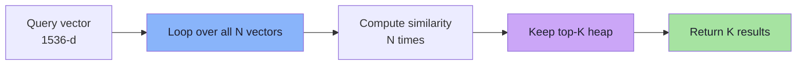
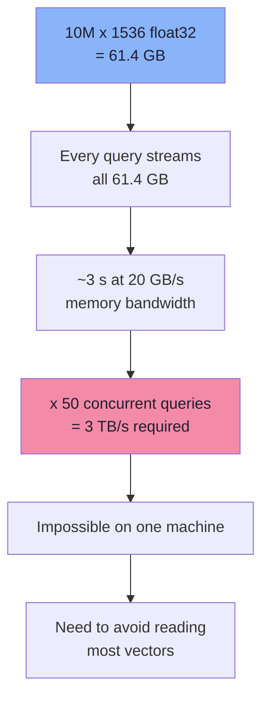
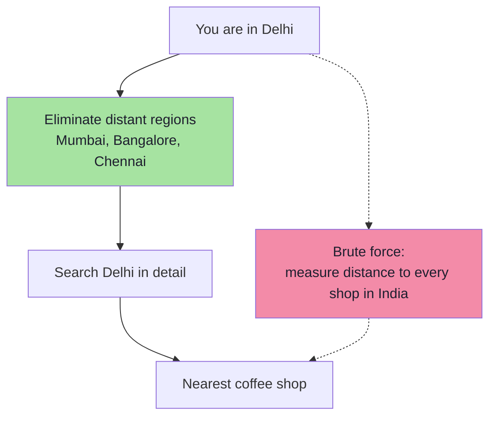
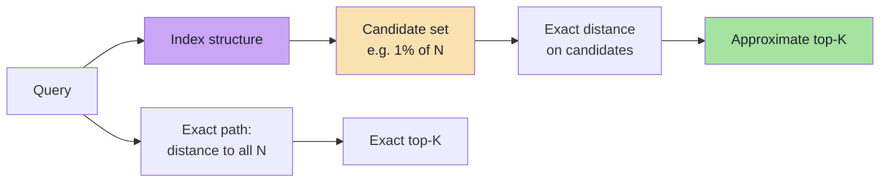
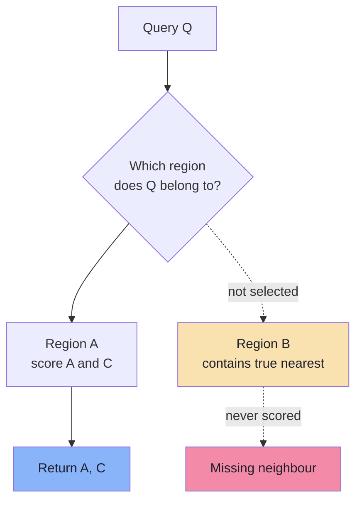
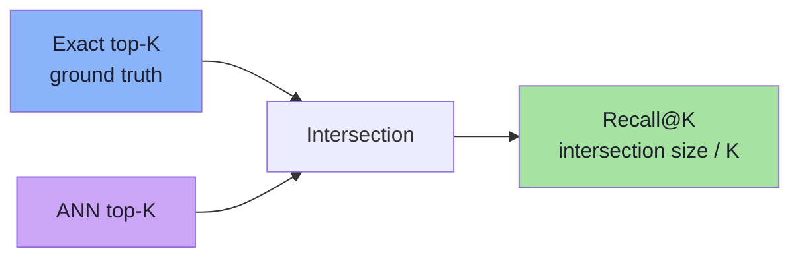
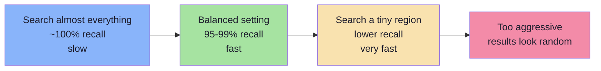
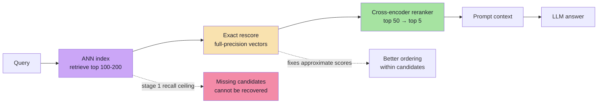
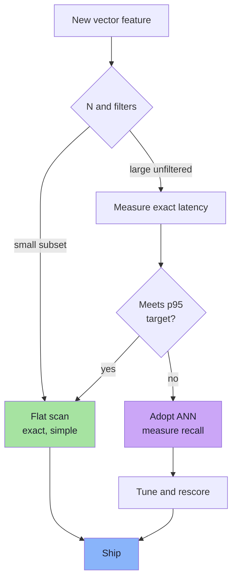
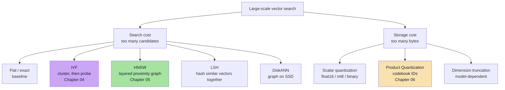

# Chapter 03: Exact KNN and the ANN Bargain

> **Chapter Goal:** Establish the baseline every approximate index is measured against. Compute the real cost of comparing a query with ten million vectors, define **Recall@K** precisely, and understand what an ANN index actually gives up. This chapter is the contract between "correct but too slow" and "fast but sometimes wrong" — everything in Chapters 04–06 is an implementation of this bargain.

---

## 3.1 The Baseline Loop

Suppose a movie catalogue contains ten million embeddings. A user searches:

```text
"movies about humans exploring deep space"
```

The embedding model produces a query vector:

```text
Q = [0.19, 0.71, -0.29, ...]   // 1,536 dimensions
```

The obvious algorithm is:

```text
for every movie vector V:
    score = cosine(Q, V)
keep the ten highest scores
```



This is **exact nearest-neighbour search** (exact KNN). Its defining property:

> **It does not guess.** If the distance function and the dataset are fixed, the returned top-K are the mathematically nearest items.

There is nothing wrong with exact KNN. It is:

- **correct** — the ground truth by definition,
- **simple** — no training, no parameters, no graph,
- **update-friendly** — insert a vector and it is immediately searchable,
- **filter-friendly** — a filter simply removes candidates from the loop.

Its only problem is cost.

---

## 3.2 The True Cost of One Query

Take a realistic but modest catalogue:

```text
N = 10,000,000 vectors
D = 1,536 dimensions
```

### Arithmetic cost

Cosine similarity requires roughly `D` multiply-adds per pair (norms can be precomputed):

```text
10,000,000 × 1,536 = 15,360,000,000
                   ≈ 15.4 billion multiply-adds per query
```

That is **one** query. At 50 queries per second, the system performs roughly **768 billion** multiply-adds per second.

### Memory cost — the number that actually dominates

Each float32 vector is:

```text
1,536 × 4 bytes = 6,144 bytes ≈ 6 KB
```

The full collection is:

```text
10,000,000 × 6 KB ≈ 61.4 GB of raw vectors
```

To compute a distance, the CPU must **read both vectors from memory**. A brute-force query therefore streams ~61 GB through the memory bus:

```text
61.4 GB per query
÷ ~20 GB/s effective memory bandwidth
≈ 3 seconds per query
```



> **The real bottleneck is not floating-point math; it is memory bandwidth.** A CPU that can do 100 billion operations per second still cannot compute a dot product on bytes it has not loaded. This is why ANN indexes are judged by *how many vectors they touch*, not by how fast they multiply.

### Scale it up

| Collection | Raw float32 storage | Bytes read per exact query |
|---|---|---|
| 100,000 | 0.61 GB | 0.61 GB |
| 1,000,000 | 6.14 GB | 6.14 GB |
| 10,000,000 | 61.4 GB | 61.4 GB |
| 100,000,000 | 614 GB | 614 GB |
| 1,000,000,000 | 6.14 TB | 6.14 TB |

At 100 million vectors the collection no longer fits in a single machine's RAM. Exact scan becomes a distributed storage problem, not a search problem.

---

## 3.3 Exact KNN Pseudo-code

The baseline is worth writing correctly once, because it becomes the **evaluation oracle** for every ANN index.

```ts
interface Point { id: string; vector: number[]; payload: Record<string, unknown> }
interface Hit { id: string; score: number; payload: Record<string, unknown> }

// Higher score = better. Metric is already normalised at this layer.
function exactKnn(
  query: number[],
  points: Point[],
  k: number,
  score: (q: number[], v: number[]) => number,
): Hit[] {
  // A bounded min-heap of size k: the weakest of the current best-k sits at the root.
  const heap = new MinHeap<Hit>((a, b) => a.score - b.score);

  for (const p of points) {
    const s = score(query, p.vector);
    if (heap.size < k) {
      heap.push({ id: p.id, score: s, payload: p.payload });
    } else if (s > heap.peek().score) {
      heap.pop();
      heap.push({ id: p.id, score: s, payload: p.payload });
    }
  }

  return heap.drainSortedDescending();
}
```

Two engineering notes:

1. **A heap of size `k` is enough.** You do not need to score the whole dataset and sort it; you need to keep the best `k` seen so far. This is `O(N × D)` comparisons but `O(k)` memory.
2. **Filters are just a predicate.** For a small filtered subset, exact search is often *faster* than an ANN index, because the loop only touches eligible vectors.

```ts
const eligible = points.filter((p) => p.payload.tenantId === tenantId);
const hits = exactKnn(query, eligible, 10, cosine);
```

That observation is the seed of **pre-filtering**, revisited in Chapter 07.

---

## 3.4 Why Exact Search Still Matters

Exact KNN is not a strawman to be discarded. It is:

| Role | Why it matters |
|---|---|
| **Ground truth** | Recall@K is defined against exact results |
| **Small collections** | Under ~100k vectors, a flat scan is often fast enough |
| **Compliance / correctness** | Some domains cannot accept "usually right" |
| **Debugging** | When ANN results look wrong, compare with exact results |
| **Filtered subsets** | After a selective filter, brute force may be cheaper than graph traversal |
| **Benchmarking** | A new index is only "fast" relative to a measured baseline |

> **Rule:** do not adopt an ANN index until you have measured exact search on your real data, dimension and filters. The baseline tells you whether you have a problem at all, and it gives you the number that defines "good enough".

---

## 3.5 The Delhi Coffee Shop Analogy

The lecture uses a spatial analogy that captures ANN in one sentence.

You are standing in Delhi and want the nearest coffee shop. You do **not** compute the distance to every coffee shop in India. You reason:

```text
Delhi      → promising, search here in detail
Mumbai     → probably irrelevant
Bangalore  → probably irrelevant
Chennai    → probably irrelevant
```

Large regions are eliminated *before* detailed comparison begins.



The mapping to vectors:

| Spatial reasoning | Vector search |
|---|---|
| City / region | Cluster or graph neighbourhood |
| Eliminate a region | Prune candidates without computing exact distance |
| Search locally | Score vectors inside the selected region |
| "Probably irrelevant" | Approximate decision, occasionally wrong |

ANN is the engineering of that "probably".

---

## 3.6 What ANN Actually Approximates

A common misconception is that ANN computes distances *incorrectly*. Usually it does not. The approximation happens **before** any distance is computed:

```text
Exact:  examine 10,000,000 candidates → compute 10,000,000 distances
ANN:    identify    10,000 candidates → compute     10,000 distances
```



This distinction has practical consequences:

| If the problem is… | Then the fix is… |
|---|---|
| The true neighbour was never a candidate | Better index / more probes / better graph |
| The true neighbour was a candidate but ranked low | Exact rescoring, better metric, reranking |
| The true neighbour is missing from the dataset | Ingestion or chunking problem, not an index problem |

> **Debugging rule:** before blaming the index, check whether the correct chunk was in the candidate set at all. Many "ANN is bad" reports are actually "the answer was never ingested" or "the chunk was split badly".

---

## 3.7 Why ANN Can Miss the True Nearest Neighbour

Picture three vectors and a query:

```text
            ● A

   ● B                  Q

                     ● C
```

Suppose the index decides that `Q` belongs to a region containing `A` and `C`, so it scores only those:

```text
distance(Q, A) = 0.31
distance(Q, C) = 0.28
```

But `B` lies just outside the selected region and is actually closer:

```text
distance(Q, B) = 0.26   ← never computed
```

The index did not miscalculate anything. It made a **routing decision** that excluded the winner.



Vector space has no walls. Clusters and graph neighbourhoods are **optimisation structures imposed by the index**, not real boundaries in the data. A neighbour can sit millimetres across a boundary that the index treats as a wall.

This is exactly why Chapter 04 introduces `nprobe` (search more than one cluster) and Chapter 05 introduces `efSearch` (explore more than one graph path).

---

## 3.8 Recall@K: Measuring the Damage

**Recall@K** answers:

> Of the true K nearest neighbours, how many did the approximate search return?

### Worked example

Exact search says the true top 10 are:

```text
A  B  C  D  E  F  G  H  I  J
```

ANN returns:

```text
A  B  C  D  E  F  G  H  X  Y
```

Eight of the true neighbours were recovered:

```text
Recall@10 = 8 / 10 = 0.80 = 80%
```

In general:

```text
                |ANN top-K ∩ true top-K|
Recall@K =  ---------------------------------
                          K
```



### Important properties

| Property | Meaning |
|---|---|
| Bounded `0..1` | 1.0 means every true neighbour was found |
| Depends on `K` | `Recall@10` and `Recall@100` are different measurements |
| Depends on the dataset snapshot | Re-measure after ingestion or model changes |
| Depends on the metric | Compare only against exact search with the same metric |
| Not the same as precision | Precision asks how many returned results were relevant |

### Precision@K

```text
Precision@K = relevant results in top-K / K
```

If the top 5 contain 4 relevant chunks:

```text
Precision@5 = 4 / 5 = 0.8
```

Recall and precision trade off. Returning 100 results may raise recall and lower precision; returning 3 may do the opposite. Chapter 09 covers the full evaluation stack (MRR, nDCG, answer quality).

> **The non-negotiable rule:** never report ANN latency without reporting recall against exact search on the same queries, vectors and metric. "2 ms per query" is meaningless if 30% of the true neighbours are missing.

---

## 3.9 ANN Is a Spectrum, Not a Boolean

"Approximate" is not a single setting. It is a dial:

```text
Exact search ───────────────────────────────► Aggressive pruning
search everything                            search a small region
recall 100%                                  lower recall
slow                                         very fast
```



Every ANN algorithm exposes a knob that controls **how much of the search space to explore**:

| Algorithm | Knob | Increasing it… |
|---|---|---|
| IVF | `nprobe` (lists searched) | More candidates, higher recall, slower |
| HNSW | `efSearch` (candidate list size) | More exploration, higher recall, slower |
| HNSW build | `efConstruction`, `M` | Better graph, higher build cost and memory |
| PQ | number of sub-vectors / bits | Better accuracy, more memory |
| Any | `topK` oversampling + rescore | Better final ranking, more work |

The trade-off is not just speed vs recall. It has **five dimensions**:

| Dimension | Question | Typical knob |
|---|---|---|
| **Recall** | What fraction of true neighbours are returned? | `nprobe`, `efSearch`, rescore |
| **Latency** | What is p50/p95/p99 per query? | Candidate budget, index type |
| **Memory** | How many bytes per vector? | Quantization, `M`, replicas |
| **Build cost** | How long to index N vectors? | `efConstruction`, IVF training |
| **Freshness** | How fast do writes become searchable? | Index type, segment merging |

A "fast" index that is expensive to build or impossible to update is not fast in production.

---

## 3.10 Measuring the Bargain

You cannot tune what you do not measure. A defensible evaluation loop:

```text
1. Sample 1,000-10,000 real queries (not synthetic vectors).
2. Run exact KNN with the same metric and full-precision vectors.
   → this is the ground truth top-K.
3. Run the ANN index at several parameter settings.
4. For each setting, compute Recall@K and latency percentiles.
5. Plot recall against p95 latency.
6. Pick an operating point with margin above the product's requirement.
7. Re-run whenever data, model, index parameters or filters change.
```

### What the curve looks like

| Operating point | Recall@10 | p95 latency | Interpretation |
|---|---|---|---|
| Conservative | ~0.99 | Higher | Safe, but may be unnecessary work |
| Balanced | ~0.95–0.98 | Moderate | Typical production target |
| Aggressive | ~0.80–0.90 | Very low | Only for forgiving use cases |
| Broken | < 0.70 | Low | Not "fast"; just wrong |

> The numbers above describe the **shape** of the curve, not a benchmark. Real values depend on data distribution, dimension, index parameters and hardware.

### Measurement traps

| Trap | Why it misleads |
|---|---|
| Random Gaussian vectors | Real embeddings are clustered; random data makes every index look worse |
| Tiny dataset (1k vectors) | Everything is fast; the index has nothing to prune |
| Warm cache only | Production sees cold and mixed workloads |
| Average latency only | Tail latency is what users feel |
| Unfiltered queries only | Filtered queries have very different recall |
| Recall measured once | Data drifts; yesterday's 0.97 is today's 0.91 |
| Comparing across metrics | Recall is only defined relative to the same metric |

---

## 3.11 Two-Stage Retrieval and the Recall Ceiling

Production systems rarely use one index and stop. The standard pattern:



Two distinct jobs:

1. **Candidate generation** (recall-oriented): cheap, approximate, generous `topK`.
2. **Candidate refinement** (precision-oriented): expensive, exact, applied to a small set.

### The recall ceiling

If stage 1 retrieves 200 candidates with `Recall@200 = 0.92`, then the final `Recall@10` is **at most 0.92**:

```text
final recall ≤ stage-1 candidate recall
```

A perfect reranker cannot rank a document that was never retrieved. This is why:

- `topK` for stage 1 should be larger than the number of results you show,
- recall must be measured at the candidate stage, not only after reranking,
- if final recall is poor, fix candidate generation before touching the reranker.

### Why rescore if ANN already used the same metric?

| Reason | Explanation |
|---|---|
| Quantized index | PQ/int8 scores are approximate; full vectors are exact |
| Graph approximation | Candidate set is incomplete, but scores within it can be exact |
| Fresh data | Some systems score unindexed recent writes separately |
| Consistency | Keeps the final ranking tied to one authoritative representation |

> **Two-stage rule:** use the index to decide **which** vectors to score, and full-precision vectors to decide **how to order** them.

---

## 3.12 When You Do **Not** Need ANN

ANN is not a maturity badge. Flat search is the right answer in several common situations:

| Situation | Why flat wins |
|---|---|
| Fewer than ~100k vectors | A scan is fast, simple and exact |
| Highly selective filter (`tenantId` matches 2k rows) | Only the filtered subset is scanned |
| Offline / batch jobs | Throughput matters more than per-query latency |
| Strict correctness requirement | No recall risk |
| Rapidly changing corpus | No index build/rebuild cost, no tombstone problem |
| Very small `D` (e.g. 64–256) | Arithmetic is cheap; pruning structures add overhead |
| Prototype / MVP | Measure first; optimise when the data says so |



> **Capacity honesty:** a flat scan of 50k vectors at 768 dimensions reads ~150 MB per query. That may already be too slow at high QPS. Measure with your real QPS, dimension and hardware — not with intuition.

---

## 3.13 The ANN Family Tree

The rest of this lecture studies three techniques. They solve two different problems:



| Family | Core idea | Solves | Chapter |
|---|---|---|---|
| **Flat** | Score every vector | Correct baseline | 03 |
| **IVF** | Partition space; probe few partitions | Candidate count | 04 |
| **HNSW** | Navigate a multi-layer neighbour graph | Candidate count + latency | 05 |
| **PQ / SQ / BQ** | Store fewer bits per vector | Memory / bandwidth | 06 |
| **LSH** | Hash similar vectors into buckets | Candidate count (specialised) | — |
| **DiskANN** | Graph index designed for SSD | Dataset larger than RAM | — |

A key clarification: **PQ is not an index**. It is a compression scheme that is often combined with an index (IVF-PQ, or HNSW + quantized storage). Choosing PQ changes memory and score precision; it does not by itself decide which candidates are visited.

---

## 3.14 Common Mistakes

1. **Reporting latency without recall.** A fast wrong answer is not a result.
2. **Thinking ANN computes distances incorrectly.** Usually it selects a candidate set; the distances themselves are exact.
3. **Tuning on random vectors.** Embedding distributions are clustered and anisotropic; random data tells you nothing useful.
4. **Setting `efSearch` or `nprobe` below `K`.** The candidate pool cannot return more items than it explores.
5. **Benchmarking on 1,000 vectors.** The index is not doing meaningful pruning at that size.
6. **Ignoring p99.** A 10 ms average with a 900 ms tail is a production incident.
7. **Skipping filtered-query evaluation.** ACL and tenant filters change recall dramatically.
8. **Assuming one index configuration works for every tenant and query type.** Different filters, languages and data volumes need different budgets.
9. **Forgetting the recall ceiling.** A reranker cannot recover candidates that were never retrieved.
10. **Adopting ANN before measuring exact search.** Sometimes the baseline already meets the SLO.

---

## 3.15 Chapter Summary

| Concept | Definition | Takeaway |
|---|---|---|
| Exact KNN | Compare query with every vector | Ground truth; `O(N × D)` |
| Real bottleneck | Memory bandwidth, not FLOPs | 61 GB scanned per query at 10M × 1536 |
| ANN | Approximate **candidate selection** | Distances on candidates are usually exact |
| Why misses happen | The true neighbour was never scored | Boundaries are index artefacts, not walls |
| Recall@K | Retrieved true neighbours / K | The metric that defines the bargain |
| Spectrum | Speed ↔ recall, plus memory/build/freshness | Every knob moves multiple dimensions |
| Two-stage retrieval | Candidates → exact rescore → rerank | Final recall ≤ stage-1 recall |
| When to skip ANN | Small or heavily filtered sets | Simplicity and exactness are features |

> **Final mental model:** Exact search is a **guarantee**; ANN is a **bet with a measured loss rate**. IVF bets that neighbours share a cluster, HNSW bets that they are a few graph hops apart, and PQ bets that a coarse code preserves enough distance information. None of these bets is free, and none of them is valid until you have measured `Recall@K` on your own data.

---

**Next:** [Chapter 04 — IVF: Inverted File Index](./04_IVF_Inverted_File_Index.md)


