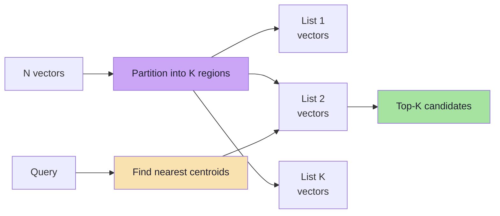
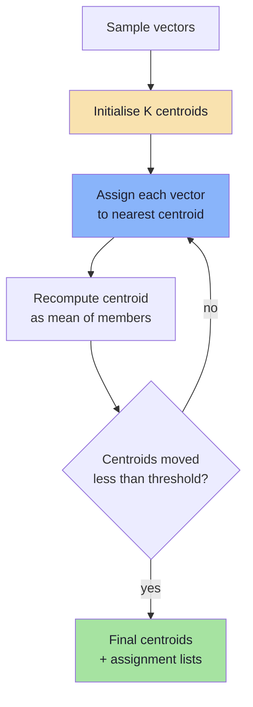
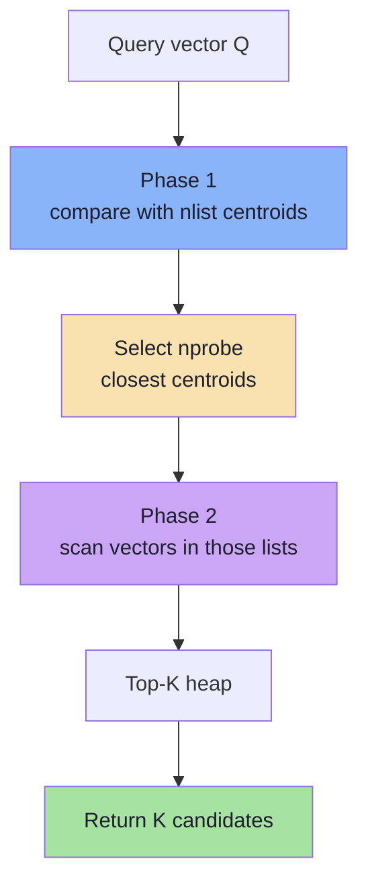
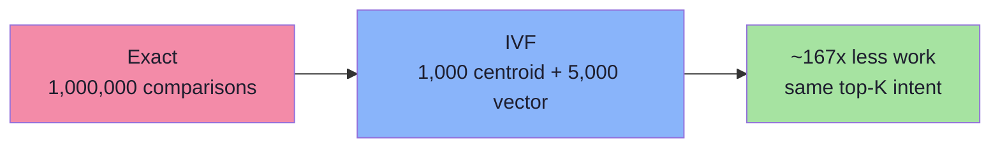
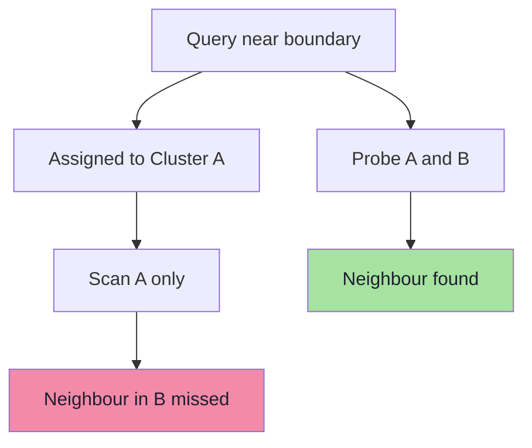
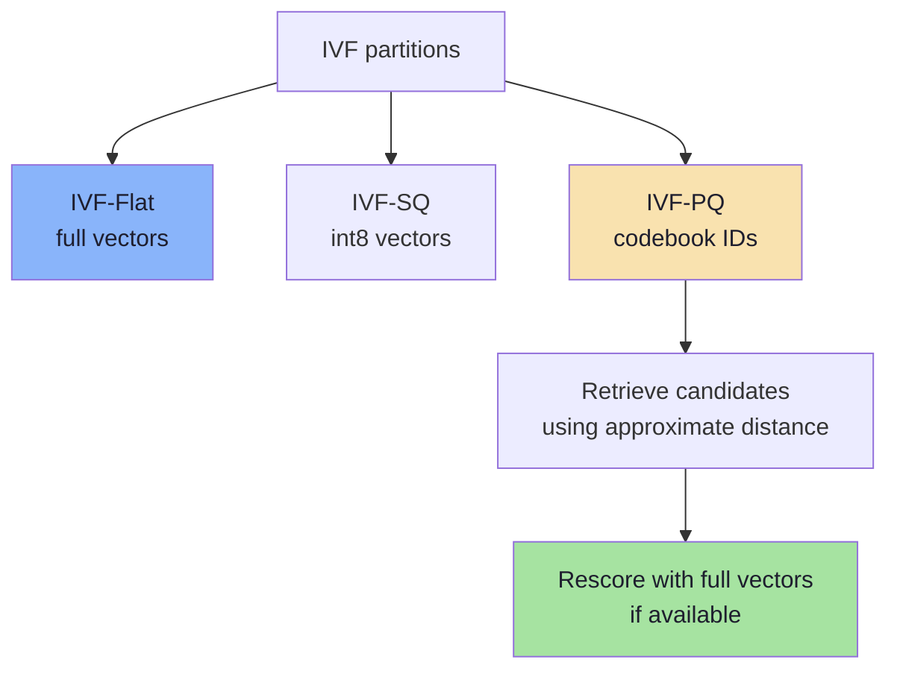
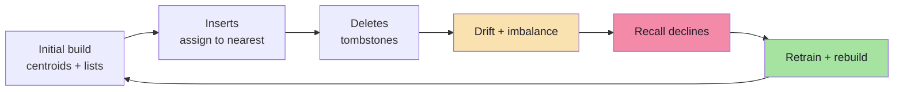

# Chapter 04: IVF — Inverted File Index

> **Chapter Goal:** Understand IVF from first principles: partition the vector space with k-means, store each vector in the list belonging to its nearest centroid, and at query time score only the few most promising lists. You should leave able to explain `nlist` and `nprobe`, compute the candidate reduction, describe the boundary failure, and decide when IVF is a better fit than HNSW.

---

## 4.1 The Intuition: Divide the Space

Embeddings are not uniformly spread through space. Similar items congregate:

```text
      Interstellar ●     ● The Martian
                ● Gravity

  Titanic ●    ● The Notebook

                              ● Avengers
                         ● Iron Man
```

Conceptually:

```text
space / sci-fi      → one region
romance             → another region
superhero           → another region
```

A real collection has 1,536 or 3,072 dimensions, so the picture is not drawable. The geometric idea survives: **nearby vectors form regions**, and a query only needs the region(s) near it.

IVF turns that observation into an index:

```text
Instead of:  one giant list of N vectors
Build:       K regions, each with a list of its vectors
Query:       find the few regions nearest the query
             scan only those lists
```



> **One-sentence version:** IVF replaces "compare with everything" with "compare with the centroids, then compare with a few lists".

---

## 4.2 Centroids: The Address of a Region

How do we represent a region? With a **centroid**: the representative central point of a cluster.

```text
        ●       ●
            ●
      ●         ●
            X  ← centroid
        ●       ●

Cluster A → centroid CA
Cluster B → centroid CB
Cluster C → centroid CC
```

A centroid is not necessarily an existing vector. It is usually the **mean** of the vectors assigned to that cluster, so it can sit in empty space between them.

With 1,000,000 vectors split into 1,000 clusters:

```text
1,000,000 vectors
      ↓
1,000 regions
      ↓
1,000 centroids
      ↓
~1,000 vectors per list (balanced ideal)
```

At query time the first comparison is:

```text
distance(Q, C1), distance(Q, C2), ..., distance(Q, C1000)
```

That is **1,000 centroid comparisons**, not 1,000,000 vector comparisons. Then the query scans the winning list(s).

---

## 4.3 Training the Clusters with k-means

The PDF shows the structure but not how the centroids are produced. The standard algorithm is **k-means**:

```text
Input: N vectors, desired number of clusters K = nlist
Output: K centroids

1. Choose K initial centroids
   (random sample, or k-means++ for better spread)

2. Repeat until stable or max iterations:
   a. Assign every vector to its nearest centroid
   b. Move each centroid to the mean of its assigned vectors

3. Return the final centroids
```



### What k-means optimises

k-means minimises the **within-cluster sum of squared distances**:

```text
minimise  Σ over clusters Σ over members ‖x - centroid‖²
```

It is a heuristic: it converges to a local optimum that depends on initialisation. That is acceptable for an index — "good regions" are enough; globally optimal regions are not required.

### Training on a sample, not the whole corpus

Training on millions of high-dimensional vectors is expensive. Implementations usually train on a representative sample:

```text
N = 100,000,000 vectors
train on 100,000 - 1,000,000 sampled vectors
→ centroids that approximately represent the distribution
→ assign the full corpus once
```

The sample must be **representative**. A sample biased toward one tenant, language or time period produces centroids that ignore the rest of the corpus.

### Training cost

A naive k-means iteration costs roughly:

```text
N × K × D distance operations per iteration
```

With `N = 1,000,000`, `K = 1,000`, `D = 1,536`, one iteration is ~1.5 trillion operations. This is why implementations:

- train on a sample,
- use approximate/optimised BLAS kernels,
- stop early,
- and do the expensive work **once at index build time**, not per query.

> **Key point:** IVF construction is expensive; IVF *querying* is cheap. Training happens during index build, never during a search.

---

## 4.4 Building the Inverted Lists

After training, each vector is assigned to exactly one list (its nearest centroid):

```text
Centroid A → [V3, V9, V81, V400, ...]
Centroid B → [V2, V7, V33, V101, ...]
Centroid C → [V1, V4, V18, V900, ...]
```

```ts
interface IvfIndex {
  centroids: number[][];        // nlist x D
  lists: Array<Array<{ id: string; vector: number[] }>>;
}

async function buildIvf(
  points: Point[],
  nlist: number,
): Promise<IvfIndex> {
  // 1. Train centroids on a representative sample (k-means).
  const sample = samplePoints(points, 100_000);
  const centroids = await kmeans(sample, nlist);

  // 2. Create one empty list per centroid.
  const lists = centroids.map(
    () => [] as Array<{ id: string; vector: number[] }>,
  );

  // 3. Assign every point to its nearest centroid.
  for (const p of points) {
    const c = nearestCentroid(p.vector, centroids); // nlist comparisons
    lists[c].push({ id: p.id, vector: p.vector });
  }

  return { centroids, lists };
}
```

Assignment is `O(N × nlist × D)` for the full corpus — expensive once, then fixed.

### Why is it called an "inverted file"?

A normal (forward) index maps:

```text
vector ID → vector
```

An inverted index maps:

```text
centroid / region → list of vector IDs
```

That is the same idea as a search engine's inverted index, which maps a *term* to the list of documents containing it. Here the "term" is a region.

```text
Centroid A
   ↓
[V3, V9, V81, V400, ...]
```

---

## 4.5 Querying: From Query to Candidates

The search has two phases:



```ts
async function searchIvf(
  query: number[],
  index: IvfIndex,
  k: number,
  nprobe: number,
): Promise<Hit[]> {
  // Phase 1: rank the centroids.
  const centroidHits = index.centroids
    .map((c, i) => ({ i, score: similarity(query, c) }))
    .sort((a, b) => b.score - a.score);

  // Phase 2: scan the nprobe most promising lists.
  const heap = new MinHeap<Hit>((a, b) => a.score - b.score);

  for (const { i } of centroidHits.slice(0, nprobe)) {
    for (const p of index.lists[i]) {
      const s = similarity(query, p.vector);
      if (heap.size < k) heap.push({ id: p.id, score: s });
      else if (s > heap.peek().score) {
        heap.pop();
        heap.push({ id: p.id, score: s });
      }
    }
  }

  return heap.drainSortedDescending();
}
```

Two costs are visible in the code:

```text
Phase 1: nlist distance computations           (centroids are D-dimensional)
Phase 2: nprobe × average_list_size distances  (vectors are D-dimensional)
```

The index is worthwhile when `nprobe × average_list_size` is much smaller than `N`.

---

## 4.6 The Arithmetic: 1,000,000 Vectors

Use the lecture's balanced example:

```text
N = 1,000,000 vectors
nlist = 1,000 lists
average list size = 1,000 vectors
nprobe = 5
```

### Exact search

```text
1,000,000 vector comparisons
```

### IVF search

```text
Phase 1:   1,000 centroid comparisons
Phase 2:   5 lists × 1,000 vectors = 5,000 candidate comparisons
Total:     6,000 comparisons
```

### Reduction

```text
1,000,000 / 6,000 ≈ 167× fewer comparisons
```



Three caveats keep this honest:

1. **Comparisons are not the only cost.** Heap operations, memory access patterns and list traversal add overhead.
2. **Lists are not perfectly balanced.** Real clusters vary in size; a skewed list can dominate the scan.
3. **`nprobe = 5` may not achieve your recall target.** The arithmetic measures *work*, not *quality*. Recall must be measured separately.

> **The IVF dial:** `nprobe` controls the work/recall trade-off directly. `nprobe = 1` is fastest and most fragile; increasing it scans more lists and recovers boundary neighbours.

---

## 4.7 The Boundary Problem

Searching one cluster is fast and occasionally wrong.

```text
        Cluster A                 |            Cluster B
                                  |
     ●                            |
                ●                 |
                          ●       |   ● ← true nearest
                                  |
                              Q   |
                                  |
```

The query sits slightly on Cluster A's side, so the index probes only A. But the true nearest vector is just across the boundary in B.

```text
If Cluster B is never searched:
    distance(Q, true nearest) is never computed
    → missed neighbour
```

Vector space has no walls. **Clusters are an optimisation structure imposed by the index**, not a property of the data. A point on the boundary is genuinely close to both centroids; the assignment of `Q` to A is a coarse decision, and it can be wrong.



### The fix: probe more than one list

```text
nprobe = 1      → fastest, misses boundary neighbours
nprobe = 5      → usually recovers them
nprobe = 20     → better recall, more work
nprobe = nlist  → exact search (defeats the index)
```

The relationship is monotonic:

```text
more lists searched
   ↓
more candidate vectors
   ↓
lower chance of missing a neighbour
   ↓
higher recall
   ↓
more computational work
```

### Why not just probe everything?

Because that is exact search with extra steps. The entire value of IVF is the assumption that **the true neighbours are concentrated in a few nearby regions**. If the data is uniformly distributed, or the query is far from every centroid, that assumption weakens.

---

## 4.8 Parameters: `nlist` and `nprobe`

| Parameter | What it controls | Increase it → | Decrease it → |
|---|---|---|---|
| `nlist` (number of lists / centroids) | Coarseness of the partition | Smaller lists, more centroid comparisons, more training data needed | Larger lists, less centroid work, coarser pruning |
| `nprobe` (lists searched per query) | Work/recall dial at query time | Higher recall, higher latency | Lower latency, lower recall |
| Training sample size | Centroid quality | Better representation | Faster build, worse regions |
| k-means iterations | Convergence | Better centroids | Faster build, possibly unstable |

### Choosing `nlist`

There is no universal formula, but three useful anchors:

```text
Simple anchor (used in the lecture):   nlist ≈ √N
FAISS-style guidance for large N:       nlist between 4√N and 16√N
pgvector guidance:                      lists ≈ rows / 1000 up to ~1M rows,
                                        then roughly √rows
```

For `N = 1,000,000`:

```text
√N      = 1,000
4√N     = 4,000
16√N    = 16,000
```

Trade-offs:

- **Too few lists** → each list is huge; a probe scans a large fraction of the corpus.
- **Too many lists** → centroid comparison dominates, many lists are tiny or empty, and training needs more data to populate them.
- **Imbalanced lists** → some probes do far more work than others; tail latency suffers.

### Choosing `nprobe`

Start empirically:

```text
1. Build the index with a candidate nlist.
2. Measure Recall@K at nprobe = 1, 2, 5, 10, 20, 50.
3. Plot recall vs p95 latency.
4. Choose the smallest nprobe that clears the product's recall target with margin.
```

Typical production settings scan a small percentage of lists (e.g. 1–10%), but the right value is dataset-specific.

> **Never tune `nprobe` without measuring recall.** It is easy to make a query 10× faster by silently returning worse neighbours.

---

## 4.9 IVF Variants

IVF is a family, not a single index. The list contents can be stored differently:

| Variant | What each list stores | Memory | Score accuracy | Typical use |
|---|---|---|---|---|
| **IVF-Flat** | Full float32 vectors | Highest | Exact within scanned lists | Quality baseline, moderate N |
| **IVF-SQ** | Scalar-quantized vectors (e.g. int8) | ~4× smaller | Slightly approximate | Memory-constrained, high recall |
| **IVF-PQ** | PQ codes (Chapter 06) | ~32–64× smaller | Approximate; often rescored | Very large N, RAM-limited |
| **IVF + rerank** | Codes plus full vectors on disk/RAM | Depends | Approximate candidates, exact rescore | Best quality/cost compromise |



The distinction matters when reading vendor documentation:

- **"IVF" alone** usually means IVF-Flat (full vectors in lists).
- **"IVF-PQ"** means the lists store compressed codes; distance computation uses ADC (Chapter 06).
- **Compression is orthogonal to partitioning.** You can combine IVF with almost any vector codec.

---

## 4.10 Updates, Deletes and Distribution Drift

IVF looks static, but production data is not.

### Inserting new vectors

A new vector can be assigned to its nearest existing centroid **without retraining**:

```text
new vector → nearest centroid → append to that list
```

This is cheap. But repeated inserts gradually unbalance lists, because the centroids no longer describe the current distribution.

### Deleting vectors

Most implementations tombstone the entry rather than rewriting the list:

```text
mark deleted (tombstone)
→ skipped at query time
→ space reclaimed during a later rebuild/compaction
```

Too many tombstones waste memory and scan time. Monitor the deleted ratio.

### Distribution drift

If the corpus changes — new product line, new language, seasonal content — the original centroids become stale:

```text
today's query lands between yesterday's regions
→ nearest centroid is not actually near
→ recall drops even though nothing "broke"
```

The fix is a **rebuild**: retrain centroids on a current sample, reassign vectors, swap the index. Plan for periodic rebuilds, and measure recall after each one.



### Why pgvector recommends loading data before creating an IVFFlat index

An IVFFlat index is built from the data present at creation time. If you create it on an empty or small table, the centroids represent almost nothing. The documented advice is to create the index **after** the table has representative data, and to rebuild when the distribution changes materially.

---

## 4.11 Filtering with IVF

Filters interact with partitioning in three ways:

| Strategy | How it works | Risk |
|---|---|---|
| **Pre-filter** | Restrict the candidate set, then scan/probe | May leave too few vectors per list |
| **Post-filter** | Retrieve top-K, then discard non-matching | Can return fewer than K results |
| **Filtered scan** | Apply predicate while scanning probed lists | Extra predicate cost, uneven list sizes |

A selective filter can make IVF's partition structure irrelevant:

```text
tenantId = "company-a"   → only 2,000 vectors exist
probing 5 lists of 1,000 → may include almost all eligible vectors
→ exact scan of the 2,000 eligible vectors is simpler and faster
```

Conversely, a broad filter (`year >= 2000` matching 80% of rows) forces almost every list to be probed, which erodes the index advantage.

Newer engines add **iterative scans** to avoid under-filling results when filters are selective: keep probing additional lists until enough eligible results are found or a budget is exhausted. Check whether your engine and version support this.

> **Filtering rule:** estimate filter cardinality first. Very selective → exact scan of the filtered set. Very broad → unfiltered ANN then post-filter. In between → filtered ANN with a tuned candidate budget.

---

## 4.12 IVF in Real Systems

| System | IVF support | Notes |
|---|---|---|
| **FAISS** | `IndexIVFFlat`, `IndexIVFPQ`, `IndexIVFScalarQuantizer` | The reference implementation; supports GPU |
| **pgvector** | `IVFFlat` | Created after data exists; `lists` at build, `ivfflat.probes` at query |
| **Milvus** | `IVF_FLAT`, `IVF_SQ8`, `IVF_PQ` | Distributed; selectable index type per collection |
| **Qdrant** | No IVF index | Uses HNSW; quantization is separate |
| **Pinecone / Weaviate** | Managed internals | Index family not necessarily user-selectable |

Two practical notes:

1. **Qdrant does not expose IVF.** If you are following the lecture with Qdrant, Chapter 05 (HNSW) is the relevant index; IVF remains essential for understanding FAISS/pgvector/Milvus and for interviews.
2. **pgvector's IVFFlat is a real production option** for Postgres-centric systems, especially when combined with filters on relational columns and moderate scale.

```sql
-- pgvector: build an IVFFlat index after loading data
CREATE INDEX ON documents
USING ivfflat (embedding vector_cosine_ops)
WITH (lists = 1000);

-- Query-time recall/performance dial
SET ivfflat.probes = 10;

SELECT id, content
FROM documents
ORDER BY embedding <=> :queryVector
LIMIT 10;
```

The SQL shape is the same as any pgvector query; only the index and session parameter change.

---

## 4.13 Tuning Playbook and Failure Modes

| Symptom | Likely cause | Fix |
|---|---|---|
| Recall lower than target | `nprobe` too small | Increase `nprobe`; measure again |
| Very high latency on some queries | One huge list dominates | Rebalance: retrain, increase `nlist`, rebuild |
| Poor recall for filtered queries | Post-filtering after top-K | Pre-filter or iterative scan; increase candidate budget |
| Index build takes hours | Too many lists / full-data training | Train on a sample; reduce `nlist`; parallelise |
| Recall decays over weeks | Distribution drift + tombstones | Scheduled rebuild; monitor deleted ratio |
| `nprobe` tuned on old data | Data changed | Re-tune on current queries |
| Empty or tiny lists | `nlist` too high for N | Reduce `nlist` |
| Query far from all centroids | Out-of-distribution query | Probe more lists; consider hybrid/lexical fallback |

### A tuning sequence that works

```text
1. Fix the metric and validate it (Chapter 02).
2. Build IVF-Flat at nlist ≈ √N.
3. Measure recall@10 at nprobe = 1, 5, 10, 20.
4. Pick nprobe for the recall target.
5. If memory is the problem, compress (IVF-SQ / IVF-PQ) and re-measure.
6. If build time is the problem, sample training data and reduce nlist.
7. Re-run the evaluation after any data or model change.
```

---

## 4.14 Common Mistakes

1. **Treating `nprobe = 1` as a production default.** It is a demonstration setting, not a recall guarantee.
2. **Choosing `nlist` without considering `N` and query volume.** A thousand lists is not universally right.
3. **Building IVFFlat on an empty table.** Centroids describe nothing; create after representative data exists.
4. **Assuming IVF updates itself.** Drift and tombstones degrade recall silently.
5. **Ignoring list imbalance.** Averages hide the one list that doubles p99.
6. **Post-filtering a top-10 result set.** You may return three results when the user asked for ten.
7. **Benchmarking without exact ground truth.** IVF "feels fast" because it skips work, not because it is correct.
8. **Using IVF for tiny datasets.** Flat search is simpler and exact.
9. **Confusing IVF-Flat with IVF-PQ.** One stores vectors; the other stores codes and approximate scores.
10. **Forgetting that Qdrant uses HNSW.** Following an IVF tutorial while running a different engine leads to meaningless tuning.

---

## 4.15 Chapter Summary

| Concept | Definition | Takeaway |
|---|---|---|
| Partitioning | Split space into `nlist` regions | Neighbours are assumed to share a region |
| Centroid | Mean of a cluster | The "address" used to route queries |
| k-means | Iterative assign-and-recentre | Trained once at build time on a sample |
| Inverted list | Centroid → vector IDs | The index lookup structure |
| `nprobe` | Number of lists scanned | The query-time recall/latency dial |
| Boundary problem | True neighbour may be in another list | Probe more than one region |
| Drift | Distribution changes over time | Retrain and rebuild periodically |
| Filtering | Pre / post / iterative | Cardinality decides the strategy |

> **Final mental model:** IVF is **geographic routing for vectors**. k-means draws the map, centroids are the city centres, and `nprobe` decides how many neighbouring cities to search. The map is useful only while it still describes the territory — which is why drift, rebalancing and rebuilds are part of the algorithm, not an operational afterthought.

---

**Next:** [Chapter 05 — HNSW: Hierarchical Navigable Small World](./05_HNSW_Hierarchical_Navigable_Small_World.md)


