# Chapter 05: HNSW — Hierarchical Navigable Small World

> **Chapter Goal:** Understand HNSW as a *navigable graph*, not a magic index. You should be able to explain why a flat proximity graph needs many hops, how the hierarchy fixes that, what `M`, `efConstruction` and `efSearch` actually control, and how to reason about HNSW's memory, build cost, deletion behaviour and filtered-search weaknesses.

---

## 5.1 From Partitioning to Connectivity

IVF divides space into regions. HNSW asks a different question:

```text
What if nearby vectors were connected to each other?
```

Then search becomes **navigation**: start somewhere, look at neighbours, move toward the query.

Suppose we have six vectors:

```text
A        B
    C          D
              E     F
```

Connect nearby vectors:

```text
A ───── B
│     ╱ │
C ───── D ───── E
         ╲
           F
```

Now:

- each vector is a **node**,
- each connection is an **edge**,
- a node's **neighbours** are the nodes it connects to.

```text
A knows B and C
B knows A, C and D
D knows B, C, E and F
...
```

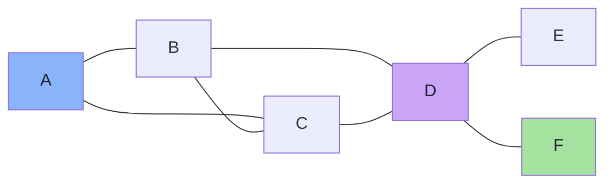

This is a **proximity graph**: vectors that are close in space are connected. Nothing has been indexed yet — but the structure already supports a search strategy that never scans every vector.

---

## 5.2 Search by Navigation

Suppose the query `Q` lands near `F`:

```text
A ───── B
│     ╱ │
C ───── D ───── E
         ╲
           F          × Q
```

Start at some node — say `A` — and compare:

```text
distance(Q, A) = 10
```

A's neighbours are `B` and `C`:

```text
distance(Q, B) = 8     ← closer
distance(Q, C) = 9
```

Move to `B`. Inspect B's neighbours (`A`, `C`, `D`):

```text
distance(Q, D) = 6     ← closer
```

Move to `D`. Inspect `B`, `C`, `E`, `F`:

```text
distance(Q, E) = 4.5
distance(Q, F) = 2.1   ← closer
```

Move to `F`. Its neighbours are no closer, so stop.

```text
A → B → D → F
```

The query never touched every vector. It walked a short chain of increasingly close neighbours.

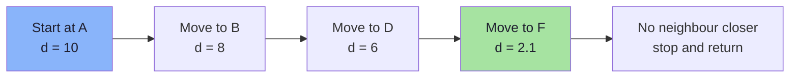

The basic loop:

```text
start somewhere
   ↓
inspect neighbours
   ↓
move to the most promising one
   ↓
repeat until no neighbour improves
```

> **Search becomes navigation.** The quality of the graph determines how often this walk reaches the true nearest neighbour.

---

## 5.3 The Problem with a Flat Graph

A single-layer graph works beautifully for a small example. At scale it has a structural problem.

Suppose the vectors form a long chain:

```text
A-B-C-D-E-F-G-H-I-J-K-L-M-N-O-P-Q-R-S-T-...-Z
```

If the entry point is `A` and the query is near `Z`, greedy navigation must crawl through the entire chain:

```text
A → B → C → D → E → ... → Z
```

That is **linear** in the number of nodes — exactly the cost we were trying to escape.

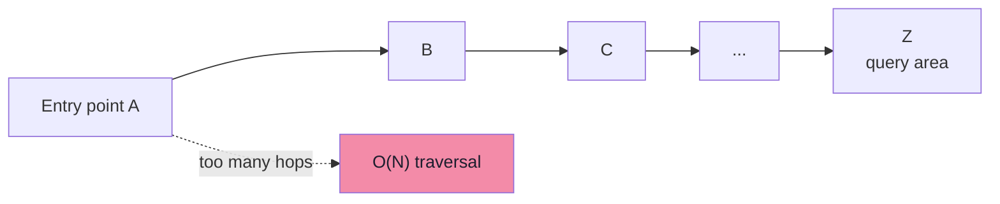

Real graphs are not literal chains, but local-only connectivity creates the same effect: a long journey across the space requires many small hops. Some nodes also become **local minima** for a greedy search — every neighbour is farther from the query, even though a better region exists elsewhere.

---

## 5.4 The Highway Analogy

When travelling a long distance, you do not use local streets for the entire journey:

```text
local street
     ↓
main road
     ↓
highway
     ↓
main road
     ↓
local street
```

Why?

```text
highways  → large jumps, few stops
local roads → precision, many stops
```

The combination gives both **reach** and **precision**. A journey from one city to another is fast because the highway layer ignores local detail; the final approach is precise because the local layer knows every street.

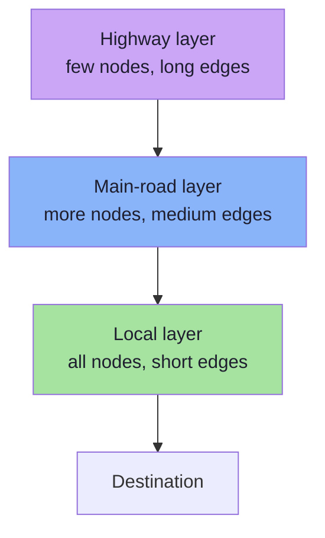

This is exactly the intuition behind the **hierarchical** part of HNSW: coarse layers for large jumps, dense layers for fine-grained search.

> **The bet:** a few long-range links can replace thousands of short hops, while the base layer preserves accuracy.

---

## 5.5 Multiple Graph Layers

HNSW builds several graphs on top of the same vectors:

```text
Layer 3   A ──────────────── M ──────────────── Z
          very few nodes, long jumps

Layer 2   A ────── F ────── M ────── S ────── Z
          more nodes

Layer 1   A ─ C ─ F ─ H ─ K ─ M ─ P ─ S ─ V ─ Z
          more detail

Layer 0   A-B-C-D-E-F-G-H-I-J-K-L-M-N-O-P-Q-R-S-T-U-V-W-X-Y-Z
          every vector
```

The pattern:

```text
higher layers  →  fewer nodes  →  longer jumps  →  coarse navigation
lower layers   →  more nodes   →  shorter edges →  fine navigation
```

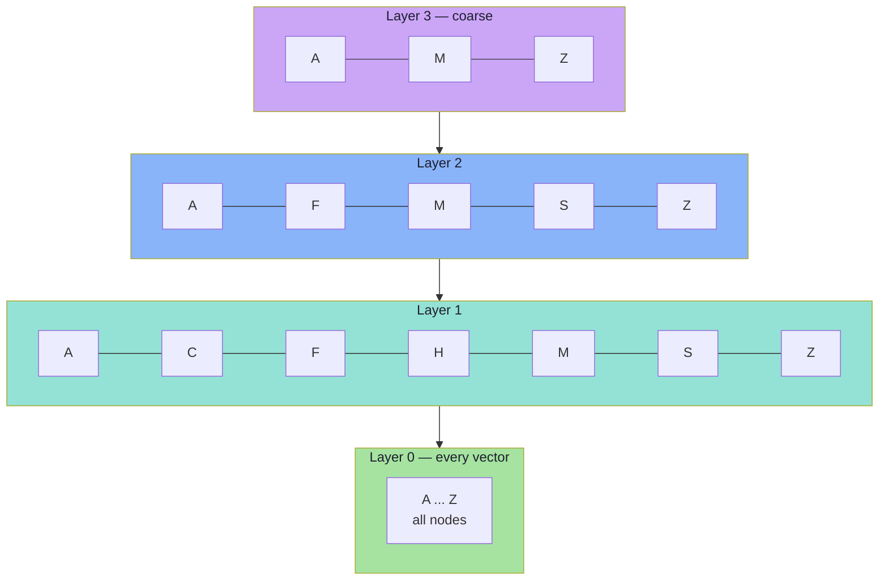

Two crucial facts:

1. **Layer 0 contains every vector.** No item is unreachable.
2. **Higher layers contain a subset of vectors** — the same nodes, not different ones. A node in layer 2 also exists in layer 1 and layer 0.

---

## 5.6 How Are Nodes Assigned to Layers?

Not every vector appears in every layer. Membership is **probabilistic**, with an exponential decay:

```text
P(node appears at layer 0) = 1
P(node appears at layer 1) = 1 / M
P(node appears at layer 2) = 1 / M²
P(node appears at layer l) = 1 / Mˡ
```

The standard construction samples a level:

```text
level = floor( -ln(U) × mL )

where U is uniform in (0, 1]
      mL = 1 / ln(M)
```

This produces the desired distribution:

```text
most nodes  → level 0 only
some nodes  → level 1
few nodes   → level 2
rare nodes  → higher levels
```

The rare high-level nodes become the "highway interchanges": they have long-range links and are reachable quickly from anywhere.

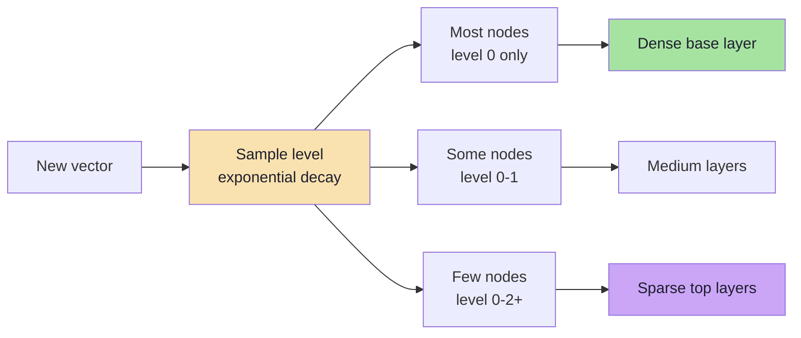

> **Why randomness?** A deterministic rule (e.g. every 100th node) would correlate layer membership with insertion order or ID, producing poor coverage. Random exponential sampling gives each region a roughly equal chance of having a high-level node.

---

## 5.7 Querying an HNSW Index

The search has two phases: **descend** through upper layers, then **search locally** at layer 0.

### Phase 1 — Descend greedily

Start at the entry point in the highest layer:

```text
Layer 3:   A ──────────── M ──────────── Z
```

From `A`, move to whichever neighbour is closest to the query. Suppose `M` is closer:

```text
A → M
```

Descend to the same node in the next layer:

```text
Layer 2:   A ── F ── M ── S ── Z
```

From `M`, `S` may be closer:

```text
M → S
```

Descend again:

```text
Layer 1:   ... S ── V ── Z
```

`V` is closer:

```text
S → V
```

At each upper layer, the search is **greedy**: keep the single best node and stop when no neighbour improves. The goal is not the final answer; it is a good **entry point** for the base layer.

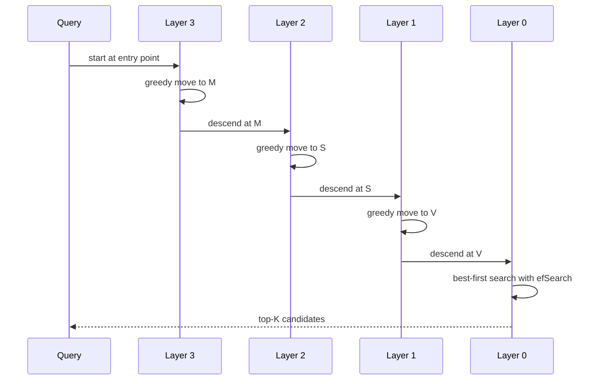

### Phase 2 — Best-first search at layer 0

At the base layer the search is no longer a single-path greedy walk. It maintains:

- a **candidate heap** (min-heap by distance): nodes still worth exploring,
- a **result heap** (max-heap by distance): the best `efSearch` nodes found so far,
- a **visited set**: nodes already evaluated.

```text
results ← {entry}
candidates ← {entry}

while candidates not empty:
    c ← closest candidate
    if distance(Q, c) > worst(result):
        break                      # no remaining candidate can improve
    for each neighbour n of c:
        if n not visited:
            visited.add(n)
            if |results| < ef or distance(Q, n) < worst(result):
                candidates.push(n)
                results.push(n)
                if |results| > ef: remove worst

return best K from results
```

```ts
function searchLayer(
  q: number[],
  entry: Node,
  ef: number,
  layer: number,
): Node[] {
  const visited = new Set<string>([entry.id]);
  const candidates = new MinHeap<Node>((a, b) => dist(q, a) - dist(q, b));
  const results = new MaxHeap<Node>((a, b) => dist(q, a) - dist(q, b));

  candidates.push(entry);
  results.push(entry);

  while (candidates.size > 0) {
    const c = candidates.pop();
    if (dist(q, c) > dist(q, results.peek())) break;

    for (const n of c.neighbours[layer]) {
      if (visited.has(n.id)) continue;
      visited.add(n.id);

      if (results.size < ef || dist(q, n) < dist(q, results.peek())) {
        candidates.push(n);
        results.push(n);
        if (results.size > ef) results.pop(); // drop the worst
      }
    }
  }

  return results.drain(); // best ef nodes, ascending distance
}
```

### Why `efSearch` matters

`efSearch` is the size of the result heap — the **exploration budget**:

```text
efSearch = K        → very narrow, may miss neighbours
efSearch = 50-200   → typical production range
efSearch = 1000     → higher recall, much more work
```

Two rules:

1. **`efSearch` must be at least `K`.** You cannot return 20 results from a heap that keeps 10.
2. **`efSearch` is a query-time parameter.** You can tune it per request without rebuilding the index — which makes it the primary recall/latency dial.

> HNSW is not pure greedy search. It keeps several promising candidates alive, which reduces the chance of getting trapped in a poor local region.

---

## 5.8 Building the Index: Inserting a Vector

Queries are only half the story. The graph must be built so that navigation works. When a new vector `X` arrives:

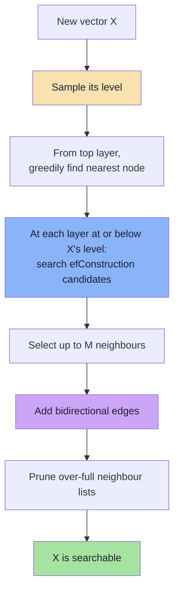

### The algorithm in outline

```text
insert(X):
    level = sampleLevel()

    if level > maxLevel:
        entryPoint = X
        maxLevel = level

    ep = entryPoint

    # 1. Descend through layers above X's level (greedy)
    for lc from maxLevel down to level + 1:
        ep = greedyClosest(X, ep, lc)

    # 2. At each layer X belongs to, connect it
    for lc from min(level, maxLevel) down to 0:
        candidates = searchLayer(X, ep, efConstruction, lc)
        neighbours = selectNeighbours(X, candidates, M)

        for n in neighbours:
            addEdge(X, n, lc)
            addEdge(n, X, lc)
            if degree(n, lc) > maxConnections(lc):
                pruneNeighbours(n, lc)

        ep = closest(candidates)   # better entry point for the next layer

    if level > oldMaxLevel:
        entryPoint = X
```

```ts
function insert(x: Node, index: HnswIndex): void {
  const level = sampleLevel(index.M);

  let ep = index.entryPoint;
  const top = index.maxLevel;

  // Greedy descent through layers above the new node's level.
  for (let lc = top; lc > level; lc--) {
    ep = greedyClosest(x.vector, ep, lc);
  }

  // Connect at every layer the node belongs to.
  for (let lc = Math.min(level, top); lc >= 0; lc--) {
    const candidates = searchLayer(x.vector, ep, index.efConstruction, lc);
    const neighbours = selectNeighbours(x, candidates, index.M, lc);

    for (const n of neighbours) {
      link(x, n, lc);
      link(n, x, lc);
      if (n.neighbours[lc].length > maxConnections(lc, index.M)) {
        n.neighbours[lc] = selectNeighbours(n, n.neighbours[lc], index.M, lc);
      }
    }

    ep = candidates[0];
  }

  if (level > top) {
    index.entryPoint = x;
    index.maxLevel = level;
  }
}
```

The critical step is `selectNeighbours`. A naive choice — take the `M` closest candidates — produces a graph that clusters tightly and is hard to navigate. Production implementations use a **diversity heuristic**.

### The neighbour-selection heuristic

For each candidate `c` (closest first), keep it only if it is closer to the new node `x` than to any already-selected neighbour:

```text
selected = []
for c in candidates (ascending distance to x):
    if distance(x, c) < distance(c, s) for every s in selected:
        selected.push(c)
    if selected.length == M: break
```

Why this helps:

| Naive "M closest" | Diversity heuristic |
|---|---|
| All neighbours in one tight direction | Neighbours spread around the node |
| Long edges may be missing | Some longer edges are preserved |
| Navigation gets stuck in local clusters | Better reachability across regions |

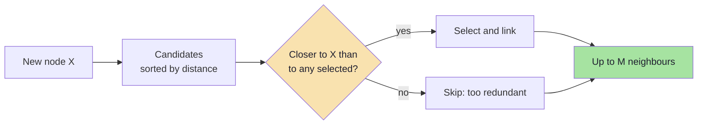

> **Build-time quality is permanent.** `efConstruction` and the neighbour heuristic determine the graph every future query navigates. A rushed build cannot be fixed by raising `efSearch` later.

---

## 5.9 Parameters: `M`, `M0`, `efConstruction`, `efSearch`

| Parameter | Meaning | Typical range | Increase → | Decrease → |
|---|---|---|---|---|
| **`M`** | Max neighbours per node in upper layers | 16–64 | Better connectivity, more memory, slower build | Less memory, sparser graph, worse recall |
| **`M0`** | Max neighbours at layer 0 (usually `2 × M`) | 32–128 | Better base-layer recall, more memory | Less memory, higher risk of local minima |
| **`efConstruction`** | Candidate list size while inserting | 100–500 | Better graph quality, slower build | Faster build, worse graph |
| **`efSearch`** | Candidate list size while querying | ≥ K, often 50–200 | Higher recall, higher latency | Lower latency, lower recall |
| **`mL`** | Level normalisation constant | `1 / ln(M)` | Rarely tuned | — |

### What `M` really controls

```text
M = 2     → very sparse graph
            low memory, hard navigation, poor recall

M = 16    → common default
            good balance for most workloads

M = 64    → dense graph
            better recall, more memory, slower build
```

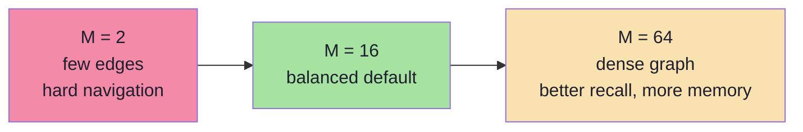

Why layer 0 gets `2M`: the base layer contains every node and performs the fine-grained search, so it needs more connectivity than the sparse upper layers. This is why implementations document `M0` separately.

### Why not connect every node to every other node?

If every node connected to every other node:

```text
1,000,000 vectors
→ each node would need ~1,000,000 connections
→ ~10¹² edges
```

That is worse than the original brute-force problem, just moved into memory.

```text
enough connections  → good navigation
too many connections → memory and build costs explode
```

HNSW deliberately builds a **sparse** graph: each node keeps a small, strategically chosen neighbourhood. The hierarchy supplies reach; the sparsity supplies feasibility.

---

## 5.10 What an HNSW Node Stores

A node is more than its vector:

```text
Interstellar
   ├── vector: [0.21, -0.45, ...]
   ├── payload / id
   └── layer 2: [The Martian, Arrival]
       layer 1: [The Martian, Gravity, Ad Astra, Arrival]
       layer 0: [The Martian, Gravity, Ad Astra, Arrival, Contact, ...]
```

| Component | Purpose |
|---|---|
| Vector | Distance computation |
| ID | Result identity, payload lookup |
| Neighbour lists per layer | Graph navigation |
| Payload (separate storage) | Filtering and result data |

The connections differ per layer. A node may have four neighbours at layer 1 and thirty-two at layer 0.

> HNSW stores **graph relationships in addition to vectors**. That is the source of its speed and the source of its memory cost.

---

## 5.11 Memory: Where HNSW Spends It

Approximate memory per vector:

```text
vector:        D × 4 bytes              (float32)
layer-0 links: 2M × 4 bytes             (32-bit neighbour IDs)
upper links:   ~M × 4 bytes × 1/(M-1)   (few nodes have upper layers)
```

For `M = 16`, `D = 1,536`:

```text
vector        = 1,536 × 4        = 6,144 bytes
layer-0 links = 32 × 4           =   128 bytes
upper links   ≈ 16 × 4 / 15      ≈     4 bytes
total         ≈ 6,276 bytes      ≈ 6.1 KB per vector
```

For 10,000,000 vectors:

```text
vectors ≈ 61.4 GB
links   ≈  1.3 GB
```

The graph adds roughly **2%** on top of float32 vectors — cheap relative to the vectors themselves.

### But compression changes the ratio

| Vector storage | 10M vectors | HNSW links | Links as share |
|---|---|---|---|
| float32 | 61.4 GB | ~1.3 GB | ~2% |
| int8 | ~15.4 GB | ~1.3 GB | ~8% |
| binary | ~1.9 GB | ~1.3 GB | ~40% |

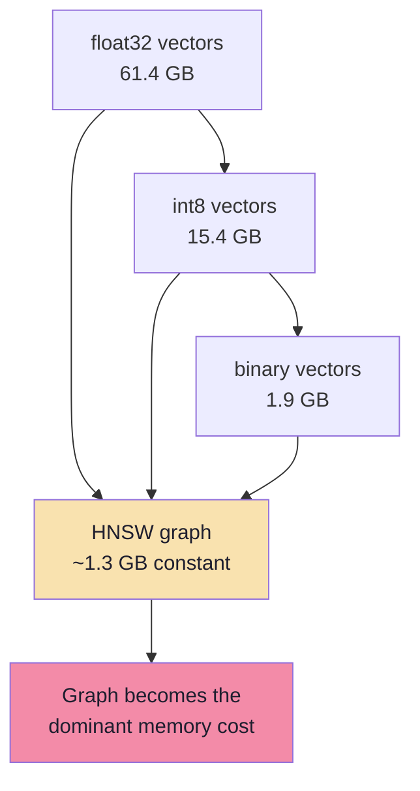

This is a crucial production insight: **quantization reduces vector memory but not graph memory**. At extreme compression, the graph may become the largest component, and `M` becomes a memory parameter as much as a recall parameter.

### Other memory consumers

- **Payload storage and payload indexes** (keyword, integer, geo) for filtering.
- **Deleted/tombstoned nodes** still occupying graph space.
- **Per-query memory**: visited sets and heaps, proportional to the explored candidate set.
- **Replicas**: multiply everything by the replication factor.
- **Segment overhead**: engines may keep several graph segments during merges.

> HNSW is memory-hungry not because the graph is huge in absolute terms, but because it must live in RAM alongside the vectors to deliver low latency.

---

## 5.12 HNSW Does Not Understand Meaning

This distinction is easy to blur:

```text
Embedding model
   ↓
creates semantic geometry
   ("Interstellar" and "The Martian" get nearby vectors)

HNSW
   ↓
navigates that geometry efficiently
   (it only sees vectors and distances)
```

HNSW has no concept of movies, language, genres or intent. It receives:

```text
Vector A
Vector B
distance(A, B)
```

and nothing else. If the embedding space is bad, HNSW will navigate a bad space very quickly.

| Layer | Responsibility |
|---|---|
| Embedding model | Meaning, geometry, recall ceiling |
| HNSW | Fast approximate navigation of that geometry |
| Application | Filtering, reranking, prompt construction |

> **Never blame HNSW for a semantic problem.** If "space movies" returns romance, the graph may have done its job perfectly: the query vector was closer to romance in the embedding space.

---

## 5.13 Build Cost: Why Ingestion Is Slow

HNSW is an **incremental** index: each vector is inserted into an existing graph. That is convenient — no global training step — but each insert is itself a small search.

Approximate build cost per insert:

```text
layers visited × efConstruction candidate evaluations
```

Total build cost is commonly described as `O(N log N)` distance computations, with a large constant:

- `M` increases the number of edges to maintain and prune.
- `efConstruction` increases the candidate set examined per layer.
- High-dimensional vectors make each distance expensive.
- Single-threaded inserts serialise the work.

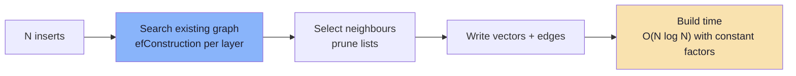

### Build vs IVF training

| | IVF | HNSW |
|---|---|---|
| Build model | Global k-means training + one assignment pass | Incremental inserts |
| Bulk build speed | Often faster for a fixed corpus | Slower, but parallelisable |
| Adding one vector | Cheap assignment (no retrain) | Requires graph insertion |
| Changing data | Retrain/rebuild for drift | Insert incrementally, compact later |
| Build tuning | `nlist`, sample size | `M`, `efConstruction` |

In practice, engines parallelise HNSW builds across threads and build in **segments**: new writes go to a small segment with its own graph, and background merges combine segments. This keeps ingestion responsive while maintaining search quality. It also explains why recall may temporarily differ between freshly written and long-indexed data.

---

## 5.14 Deletes, Updates and the Tombstone Problem

HNSW has no cheap way to remove a node. Deleting a node would require:

- removing it from every neighbour list at every layer,
- repairing connectivity so the graph does not fragment,
- potentially re-linking neighbours that relied on it as a bridge.

Most systems avoid this:

```text
delete(id)
   → mark as deleted (tombstone)
   → skip in results
   → keep the node and its edges in the graph
```

Consequences:

| Consequence | Effect |
|---|---|
| Deleted nodes still occupy memory | Memory grows even as live data shrinks |
| Deleted nodes still participate in navigation | They can help or hurt path quality |
| Result under-filling | Query asks for 10, finds 7 live nodes |
| Updates | Usually `delete old + insert new`, doubling temporary graph pressure |

The remedy is **compaction/rebuild**:

- Qdrant: segments are optimised and merged in the background; old segments are replaced.
- pgvector: deleted tuples are removed by vacuum; an index rebuild reclaims graph space.
- Custom systems: periodic full rebuild or segment merge.

> **Operational rule:** monitor deleted/tombstoned ratios and segment counts. HNSW does not shrink by itself.

---

## 5.15 The Filtered-Search Weakness

HNSW assumes the graph is the search space. Filters break that assumption.

Suppose a tenant filter matches only 0.5% of the corpus:

```text
graph traversal reaches many nodes
→ almost all are ineligible
→ visited set fills with rejects
→ eligible neighbours are never reached
→ fewer than K results returned
```

Three failure modes:

1. **Disconnection** — eligible nodes are not connected to each other; the walk cannot move between them.
2. **Budget exhaustion** — `efSearch` candidates are consumed by ineligible nodes.
3. **Under-filling** — the index returns fewer than `K` results, and the application silently shows a short list.

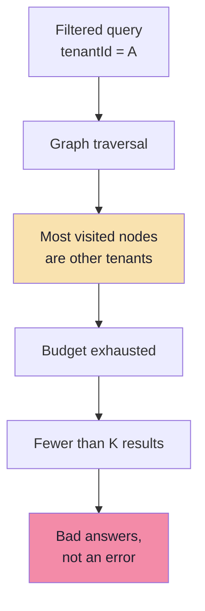

### Mitigations

| Mitigation | How it works | Trade-off |
|---|---|---|
| **Pre-filter** | Restrict to eligible vectors, then search | May reduce the graph to a small set |
| **Filter-aware HNSW** | Extra links for payload-indexed fields (Qdrant's filterable HNSW) | More memory, build time |
| **Oversampling** | Retrieve `K × factor`, then filter | Recall can still miss rare subsets |
| **Iterative scan** | Keep exploring until K eligible results or a budget cap (pgvector 0.8+) | Higher latency for selective filters |
| **Partition by tenant** | Separate collections/partitions per tenant | Operational overhead, but excellent isolation |

> **Security note:** filtering must happen **inside** the retrieval layer, not after the LLM sees the text. An ACL filter applied after generation is an information leak, not a ranking bug.

---

## 5.16 HNSW in Qdrant and pgvector

### Qdrant

Qdrant uses HNSW as its vector index. Conceptually:

```json
{
  "hnsw_config": {
    "m": 16,
    "ef_construct": 100,
    "payload_m": 16,
    "full_scan_threshold": 10000,
    "on_disk": false
  }
}
```

At query time, `hnsw_ef` (often inside `params`) controls exploration. Defaults and exact field names vary by version — always check the client schema.

Key Qdrant-specific ideas:

- **Segments** hold independent indexes; background optimisers merge them.
- **Payload indexes** are required for efficient filtering.
- **Filterable HNSW** adds extra graph links for indexed payload fields (`payload_m`), improving filtered recall.
- **`full_scan_threshold`** lets small segments be scanned exactly instead of using the graph.
- **On-disk** options trade latency for memory.

### pgvector

```sql
CREATE INDEX ON documents
USING hnsw (embedding vector_cosine_ops)
WITH (m = 16, ef_construction = 64);

SET hnsw.ef_search = 100;

SELECT id, content
FROM documents
ORDER BY embedding <=> :queryVector
LIMIT 10;
```

| Setting | Meaning |
|---|---|
| `m` | Max connections per layer (as in the paper) |
| `ef_construction` | Build-time candidate list |
| `hnsw.ef_search` | Query-time candidate list (default 40) |
| `maintenance_work_mem` | Memory available for index build |
| `hnsw.iterative_scan` | Continue scanning for filtered queries (0.8+) |

pgvector notes:

- Index op class must match the metric: `vector_cosine_ops`, `vector_l2_ops`, `vector_ip_ops`.
- HNSW index size grows with `m`; build time grows with `ef_construction`.
- Filtering with `WHERE` can under-fill results; iterative scans help.
- Very high dimensions may require `halfvec` to stay within index limits.

---

## 5.17 IVF vs HNSW

Both indexes avoid scanning every vector, but they make different bets.

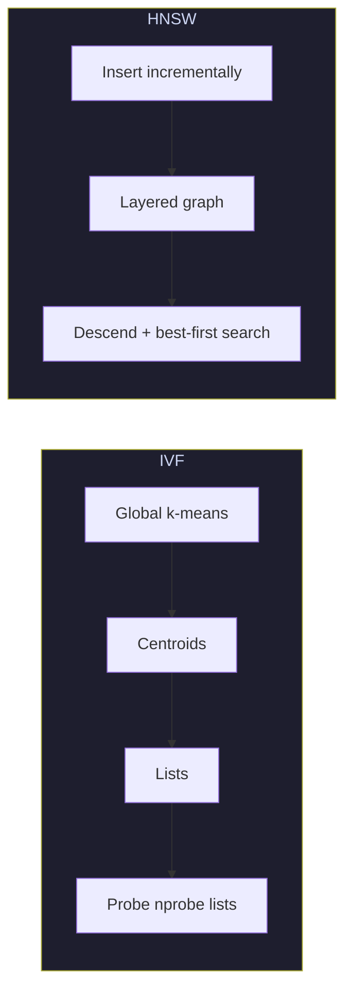

| Dimension | IVF | HNSW |
|---|---|---|
| Core structure | Centroids + inverted lists | Multi-layer proximity graph |
| Build | Train k-means, assign all vectors | Incremental graph insertion |
| Query | Compare centroids, scan `nprobe` lists | Descend layers, search `efSearch` candidates |
| Main query knob | `nprobe` | `efSearch` |
| Main build knob | `nlist`, sample size | `M`, `efConstruction` |
| Memory | Centroids + vectors (+ optional codes) | Vectors + edges + layers |
| Updates | Cheap assignment; drift needs rebuild | Incremental insert; tombstones need compaction |
| Filtered queries | Pre/post filtering; cardinality matters | Weak without filter-aware links |
| Typical strength | Very large, shardable, IVF-PQ memory savings | Low-latency, high-recall in-RAM search |
| Typical weakness | Boundary effects, stale centroids | Memory, slow build, deletion complexity |

### Which one should you learn/use?

| Situation | Reasonable choice |
|---|---|
| Low-latency RAG up to a few hundred million vectors in RAM | HNSW |
| Massive collection with tight memory budget | IVF-PQ (or HNSW + quantization) |
| Frequent writes and quick freshness | HNSW with segments, or a flat small segment |
| Postgres-centric application | pgvector HNSW (or IVFFlat for simpler workloads) |
| Need to shard by tenant/region | IVF lists shard naturally; HNSW graphs are per shard |
| Strict exactness | Flat |

> **Most production systems use HNSW by default** because it delivers excellent latency/recall without a global training step. IVF remains important when memory, sharding or very large collections dominate.

---

## 5.18 Tuning Playbook and Failure Modes

| Symptom | Likely cause | Fix |
|---|---|---|
| Low recall at low latency | `efSearch` too small | Increase `efSearch`; measure |
| Low recall even at high `efSearch` | Poor graph from low `efConstruction` / `M` | Rebuild with higher build parameters |
| High memory | `M` too high or float32 vectors | Reduce `M`, quantize vectors, shard |
| Slow ingestion | High `efConstruction`, single-threaded build | Lower build quality, more threads, batch/segments |
| Fewer than K results | Tombstones or selective filters | Compact, oversample, iterative scan |
| Recall collapses with filters | Graph disconnection | Payload index + filter-aware HNSW / pre-filter |
| High p99 latency | Large `efSearch`, hot shard, cold cache | Cap `efSearch`, rebalance, cache |
| Results become stale after updates | Tombstones / old segments | Trigger optimizer/compaction |
| Recall drifts over time | Data distribution changed | Rebuild the graph |

### Parameter direction cheat sheet

```text
M ↑                recall ↑     memory ↑      build ↑
efConstruction ↑   graph quality ↑            build ↑
efSearch ↑         recall ↑     latency ↑     (no rebuild needed)
efSearch < K       guaranteed to under-return
```

### A tuning sequence

```text
1. Build with M = 16, efConstruction = 200.
2. Measure recall@10 at efSearch = 40, 80, 160, 320.
3. Choose the smallest efSearch that clears the recall target.
4. If the target is unreachable, rebuild with higher M/efConstruction.
5. Re-measure with filtered queries.
6. Re-check p95/p99 and segment/tombstone metrics.
```

---

## 5.19 Common Mistakes

1. **Setting `efSearch` below `K`.** The result heap cannot return more than it holds.
2. **Blaming HNSW for semantic quality.** The embedding model defines meaning; HNSW only navigates.
3. **Thinking higher `M` is always better.** It improves connectivity but costs memory and build time.
4. **Skipping filtered-query evaluation.** Filtered recall is often much worse than unfiltered recall.
5. **Expecting deletes to free memory immediately.** Tombstones persist until compaction.
6. **Building with tiny `efConstruction` to save time.** Graph damage is permanent for that build.
7. **Assuming the graph is static.** Segments, merges and updates change behaviour over time.
8. **Using HNSW for 20k vectors.** Flat search is simpler and exact.
9. **Ignoring query-time memory.** Large `efSearch` allocates larger heaps per concurrent query.
10. **Treating recall as a fixed property of the engine.** It depends on parameters, data and filters.

---

## 5.20 Chapter Summary

| Concept | Meaning | Takeaway |
|---|---|---|
| Proximity graph | Nearby vectors connected by edges | Search becomes navigation |
| Greedy descent | Move to the closest neighbour per layer | Fast coarse routing |
| Hierarchy | Sparse upper layers, dense base layer | Large jumps + local precision |
| Level sampling | Exponential decay, `mL = 1/ln(M)` | Random sparse top layers |
| `M` | Max neighbours per node | Connectivity vs memory |
| `efConstruction` | Build candidate budget | Permanent graph quality |
| `efSearch` | Query candidate budget | Primary recall/latency dial |
| Tombstones | Deleted nodes left in graph | Requires compaction |
| Filtering | Breaks graph assumptions | Use payload indexes and filter-aware search |

> **Final mental model:** HNSW is a **road network built from the data itself**. Upper layers are highways with few interchanges; layer 0 is every local street. `M` decides how many roads connect at each junction, `efConstruction` decides how carefully the roads were planned, and `efSearch` decides how far you are willing to drive before answering. The network does not know what the destination *means* — it only knows which junctions are close.

---

**Next:** [Chapter 06 — Vector Compression and Product Quantization](./06_Vector_Compression_and_Product_Quantization.md)


