# Chapter 06: Vector Compression and Product Quantization

> **Chapter Goal:** Understand the second large-scale problem — **storage** — and the techniques that solve it. You should be able to compute the memory cost of a collection, explain scalar and binary quantization, derive Product Quantization step by step (sub-vectors, codebooks, codewords, 8-bit codes), and describe how a compressed index still answers distance queries using ADC.

---

## 6.1 The Problem Behind the Index

ANN indexes answer:

```text
How do we search huge collections quickly?
```

They do not answer:

```text
How do we store huge collections affordably?
```

Suppose:

```text
N = 100,000,000 vectors
D = 1,536 dimensions
each value = float32 = 4 bytes
```

One vector:

```text
1,536 × 4 = 6,144 bytes ≈ 6 KB
```

The collection:

```text
6,144 × 100,000,000
= 614,400,000,000 bytes
≈ 614 GB
```

And that is only the raw vectors. It excludes:

```text
IDs
metadata / payloads
ANN graph edges
payload indexes
database overhead
replication (×2 or ×3)
backups
```

At three replicas, 614 GB becomes **1.8 TB** of RAM before any index structure is counted. That is the storage wall.

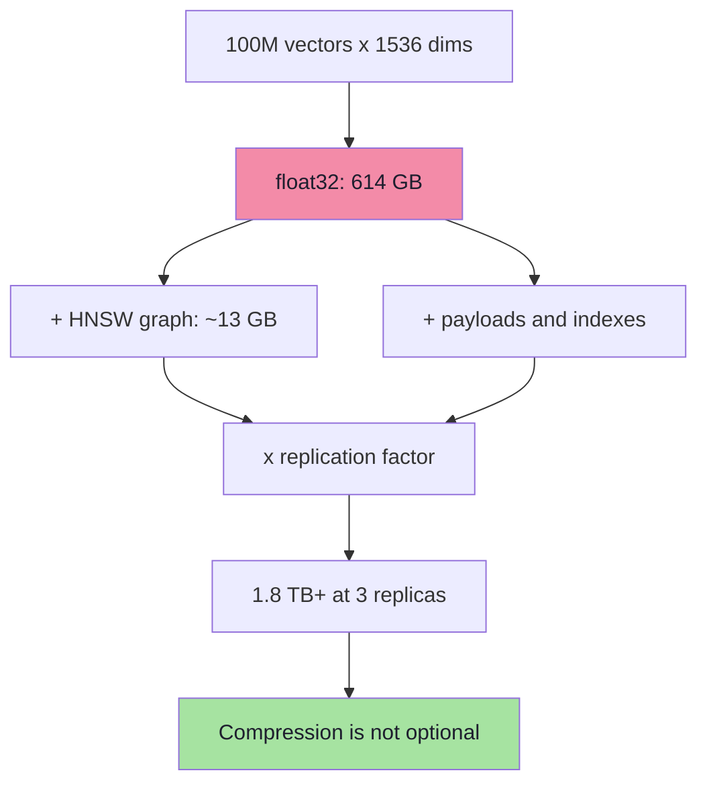

> **Two independent problems:** ANN reduces the number of vectors you *touch*; compression reduces the number of bytes each vector *occupies*. You usually need both.

---

## 6.2 Do We Really Need Full Precision?

An embedding looks like this:

```text
[
   0.183742,
  -0.729182,
   0.029117,
   0.441827,
   ... 1,536 values
]
```

Each value is stored with high precision. But nearest-neighbour search asks a coarse question: **which vectors are closest?** It does not need the exact seventh decimal place.

```text
full precision  →  exact distance  →  exact ranking
lower precision →  approximate distance →  usually the same ranking
```

That is the bet behind **quantization**:

> Represent high-precision values with lower-precision representations, and accept a small, measurable loss in ranking quality.

---

## 6.3 Scalar Quantization

Scalar quantization keeps the same number of dimensions but stores each value in fewer bits.

### float16 (half precision)

```text
float32: 4 bytes per value
float16: 2 bytes per value

1,536 × 4 = 6,144 bytes  →  1,536 × 2 = 3,072 bytes
```

Compression: **2×**. Quality loss is usually negligible for search, because float16 has ~3 decimal digits of precision and embeddings rarely need more.

### int8 (one byte per value)

Map each dimension's range to `0..255`:

```text
scale = (max - min) / 255
q     = round((x - min) / scale)
x'    = q × scale + min
```

```text
1,536 × 1 = 1,536 bytes
```

Compression: **4×**. The error per coordinate is at most `scale / 2`.

Better implementations compute the range **per dimension** across the dataset, or use a quantile (e.g. 99th percentile) to clip outliers. Qdrant's scalar quantization exposes a `quantile` setting for exactly this reason.

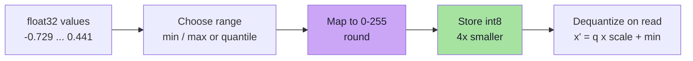

### Binary quantization

Store only the sign of each coordinate:

```text
x > 0  →  1
x ≤ 0  →  0
```

```text
1,536 bits = 192 bytes
```

Compression: **32×** relative to float32. Distance is computed with **Hamming distance** (count differing bits), which is extremely fast using XOR + popcount.

Binary quantization is aggressively lossy. It works best when:

- the embedding model's dimensions are roughly centred around zero,
- the index uses **oversampling + rescoring** with higher-precision vectors,
- recall requirements are moderate or the corpus is huge.

| Format | Bytes / vector (D=1,536) | Compression | Typical role |
|---|---|---|---|
| float32 | 6,144 | 1× | Exact, baseline |
| float16 | 3,072 | 2× | Cheap, near-lossless |
| int8 | 1,536 | 4× | Strong default for memory savings |
| binary | 192 | 32× | Extreme scale, requires rescoring |

---

## 6.4 Product Quantization: The Idea

Product Quantization (PQ) takes compression much further than scalar quantization:

> **Instead of storing the entire vector precisely, split it into chunks and store which representative pattern each chunk most closely resembles.**

Three steps:

```text
1. Split   → divide the vector into m sub-vectors
2. Learn   → cluster the sub-vectors in each position, build a codebook
3. Encode  → replace each sub-vector with the ID of its nearest codeword
```

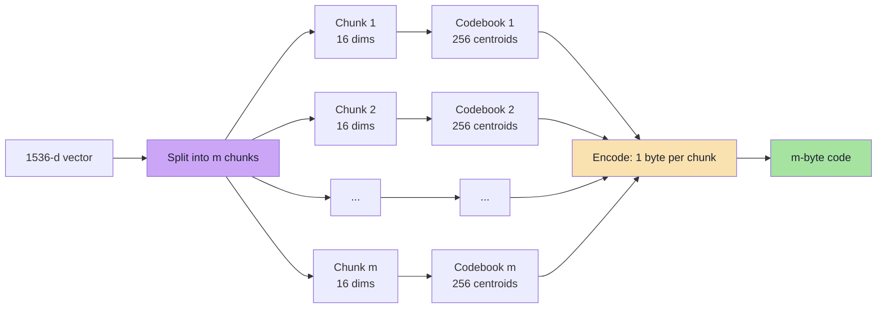

---

## 6.5 Step 1 — Split the Vector into Sub-Vectors

Take the lecture's tiny example:

```text
V = [0.2, 0.8, -0.4, 0.1, 0.7, -0.2, 0.9, 0.3]
```

This vector has 8 dimensions. Split it into four pieces of two dimensions:

```text
Part 1: [0.2, 0.8]
Part 2: [-0.4, 0.1]
Part 3: [0.7, -0.2]
Part 4: [0.9, 0.3]
```

These pieces are **sub-vectors**.

```text
8 dimensions
   ↓
4 sub-vectors
   ↓
2 dimensions each
```

Importantly, each **position** gets its own codebook. Part 1 is always the first two dimensions; Part 2 is always the next two. The algorithm does not mix positions, because different dimensions encode different information.

---

## 6.6 Step 2 — Learn Codewords for Each Sub-Vector

Suppose we have one million full vectors. Take only the **first sub-vector** from each:

```text
Vector A → [0.20, 0.80]
Vector B → [0.21, 0.82]
Vector C → [0.18, 0.84]
Vector D → [0.21, 0.77]
Vector E → [-0.42, 0.12]
...
```

Many of these two-dimensional pieces look similar. Instead of storing every version independently, cluster them with k-means:

```text
Cluster 0:
  [0.20, 0.80]
  [0.22, 0.79]
  [0.18, 0.84]
  Representative: C0 = [0.20, 0.81]

Cluster 1:
  [-0.42, 0.12]
  [-0.39, 0.08]
  [-0.45, 0.14]
  Representative: C1 = [-0.42, 0.11]
```

The representative is a **centroid**, also called a **codeword**. All the codewords for one subspace form a **codebook**.

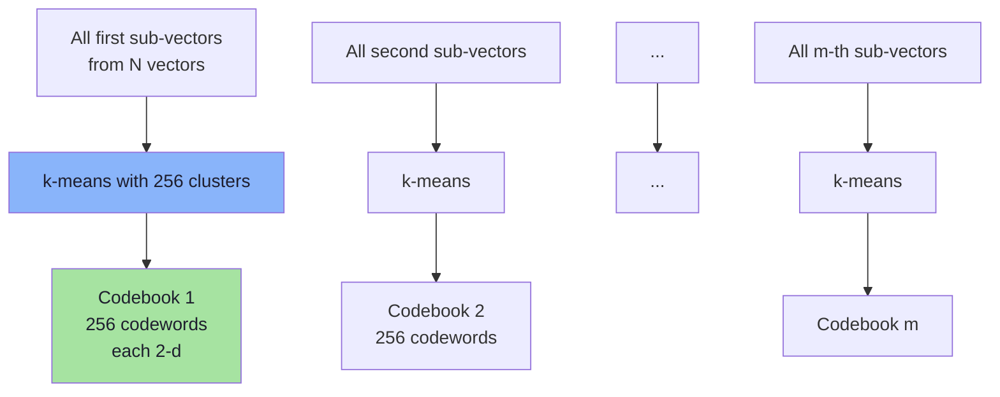

### Training details

| Question | Answer |
|---|---|
| What is clustered? | Sub-vectors at one position, across the training set |
| How many clusters? | Usually `k = 256` per subspace |
| Algorithm | k-means (same as IVF training) |
| Training data | A representative sample, not necessarily the full corpus |
| Number of codebooks | One per sub-vector position (`m` codebooks) |

> PQ training is per-position. Codebook 1 has no relationship to codebook 2; they live in different subspaces.

---

## 6.7 Step 3 — Encode with Codeword IDs

Once the codebooks exist, encoding is a nearest-codeword lookup:

```text
[0.22, 0.79]  →  codeword 0
[-0.39, 0.08] →  codeword 1
```

Instead of storing the floating-point values, store the **IDs**:

```text
Original:
[0.2, 0.8 | -0.4, 0.1 | 0.7, -0.2 | 0.9, 0.3]

PQ code:
[17, 203, 81, 6]
```

Each number means: *"use centroid 17 from codebook 1, centroid 203 from codebook 2, ..."*

The original vector had 8 float32 values = **32 bytes**. The PQ code has 4 byte-sized IDs = **4 bytes**.

```text
32 bytes → 4 bytes = 8× compression
```

### Why 256 centroids?

```text
256 = 2⁸
→ 8 bits to identify one centroid
→ 8 bits = 1 byte
→ each sub-vector costs exactly 1 byte
```

This is a hardware convenience, not a law. Some implementations use 16 centroids (4 bits, packed two per byte) or 65,536 centroids (2 bytes). 256 is the common default because it balances codebook size, accuracy and byte alignment.

---

## 6.8 PQ for a 1,536-Dimensional Embedding

Real embeddings are much larger than the 8-dimensional toy example. Use:

```text
D = 1,536
m = 96 sub-vectors
```

Each sub-vector:

```text
1,536 / 96 = 16 dimensions
```

### Storage calculation

```text
Original float32:
1,536 × 4 = 6,144 bytes

PQ code:
96 sub-vectors × 1 byte = 96 bytes

Compression:
6,144 / 96 = 64×
```

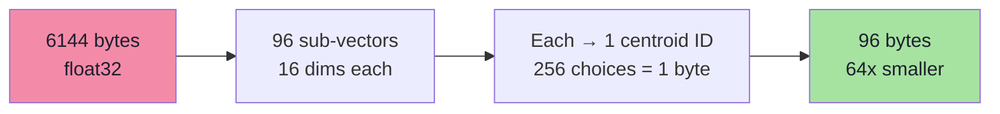

### What the codebook costs

Each subspace needs 256 codewords of 16 dimensions:

```text
per codebook: 256 × 16 × 4 bytes = 16,384 bytes
96 codebooks: 96 × 16,384      = 1,572,864 bytes ≈ 1.5 MB
```

That cost is independent of the number of vectors. For 100 million vectors, 1.5 MB is negligible — which is the entire point.

### Choosing `m`

| Sub-vectors `m` | Dimensions per sub-vector | Code size | Compression | Accuracy |
|---|---|---|---|---|
| 48 | 32 | 48 bytes | 128× | Lower |
| 96 | 16 | 96 bytes | 64× | Balanced |
| 192 | 8 | 192 bytes | 32× | Higher |
| 384 | 4 | 384 bytes | 16× | Higher still |

**More sub-vectors means more bytes but better accuracy.** Each additional sub-vector gives the code another chance to represent local structure. The choice is a direct recall/memory trade-off.

> **Rule of thumb:** 8–16 dimensions per sub-vector is a common starting range. Measure recall; do not guess.

---

## 6.9 How Does a Compressed Vector Compute Distance? (ADC)

A PQ code is not a vector. You cannot subtract it from a query. So how does search work?

The answer is **Asymmetric Distance Computation (ADC)**.

### Step 1 — Split the query

```text
Query q → [q₁ | q₂ | ... | qₘ]
```

The query stays in full precision. The database vectors are compressed. That asymmetry gives ADC its name.

### Step 2 — Precompute a distance table

For every subspace `i` and every codeword `c`:

```text
T[i][c] = ‖ qᵢ - centroid(i, c) ‖²
```

Table size:

```text
m × 256 entries
```

For `m = 96`:

```text
96 × 256 = 24,576 floats ≈ 96 KB
```

### Step 3 — Score a candidate by table lookups

Given a code `[c₁, c₂, ..., c₉₆]`:

```text
distance(q, code) ≈ T[1][c₁] + T[2][c₂] + ... + T[96][c₉₆]
```

No multiplications over 1,536 dimensions. Just **96 additions**.

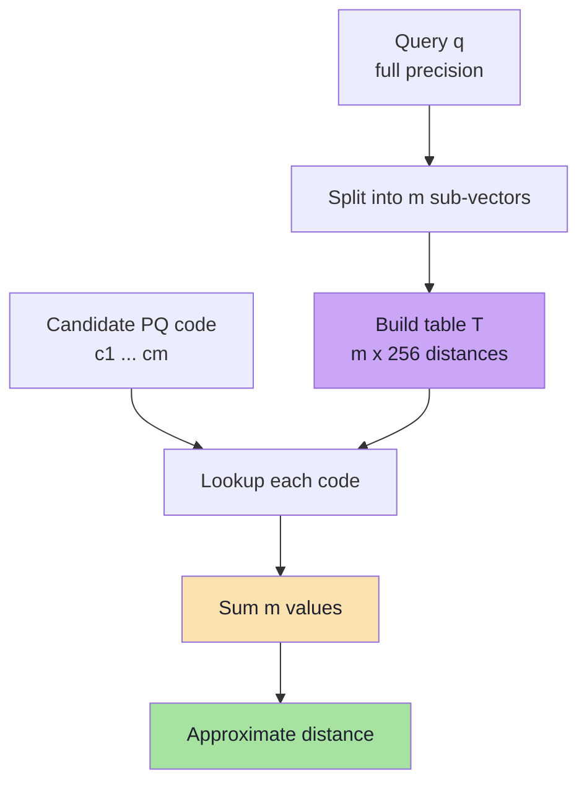

### The cost comparison

| Operation | float32 | PQ + ADC |
|---|---|---|
| Bytes per vector | 6,144 | 96 |
| Work per candidate | ~1,536 multiply-adds | ~96 table lookups + adds |
| Query setup | none | build a 96 × 256 table |

The table build costs `256 × D` operations (about 393k for `D = 1,536`), which is amortised across all candidates. For a scan of thousands of candidates, the saving is substantial.

### Symmetric Distance Computation (SDC)

An alternative scores **code against code**:

```text
distance(codeA, codeB) ≈ Σ Dᵢ[cAᵢ][cBᵢ]
```

where `Dᵢ` is a precomputed 256 × 256 table of codeword-to-codeword distances per subspace. This avoids a query table build but is less accurate, because both sides are approximations. ADC is generally preferred for query-time search.

> **ADC intuition:** precompute "how far is the query's first chunk from each of the 256 possible first-chunk patterns?", then add up the answers for a candidate's code. The additions are cheap; the expensive part was done once per query.

---

## 6.10 PQ Is Lossy Compression

PQ does not store the original values. It stores the **nearest codeword**:

```text
Original sub-vector:  [0.217, 0.794]
Stored codeword:      [0.200, 0.810]
```

These are close, but not identical. The reconstructed vector is an approximation:

```text
PQ encode → code
code → decode → approximate vector
```

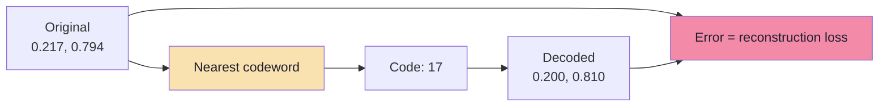

### Consequences

| Consequence | Effect |
|---|---|
| Approximate distances | Near-ties may reorder |
| Recall loss | Some true neighbours fall outside the candidate set |
| Error accumulates across sub-vectors | More chunks bound the total error statistically |
| Not reversible | You cannot recover the exact embedding |

PQ is therefore a **lossy** compression scheme, like JPEG. The question is not "is it lossy?" but "is the loss acceptable for this retrieval task?"

### Where the error hurts most

- **Near-duplicate documents** — small distance differences decide the ranking.
- **Fine-grained filters** — the shortlist is small, so a small error matters more.
- **Out-of-distribution queries** — the codebook may not represent them well.
- **Low `m`** — fewer sub-vectors means coarser codes.

---

## 6.11 Rescoring: Getting Precision Back

Compression is usually paired with a **rescore** step:

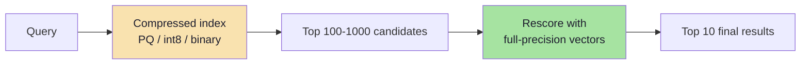

The logic:

```text
compressed vectors  → cheap, approximate, high recall at large K
full vectors        → expensive, exact, applied to a small K
```

This is the same two-stage pattern as Chapter 03, applied to precision instead of candidate generation.

### What rescoring requires

| Requirement | Why |
|---|---|
| Original vectors available | On disk, in RAM, or in a second collection |
| Candidate oversampling | Retrieve more than the final `K` |
| Same metric | Rescoring must use the same notion of distance |
| Stable IDs | Map codes back to original vectors |

Qdrant exposes this directly: quantization can be enabled with `always_ram`, and queries can request **rescore** with an **oversampling** factor. Binary quantization in particular is intended to be used with rescoring.

```json
{
  "quantization_config": {
    "binary": { "always_ram": true }
  }
}
```

Conceptually at query time:

```text
retrieve 4x candidates from binary index
→ rescore with original float32 vectors
→ return top K
```

---

## 6.12 Variants and Combinations

### OPQ (Optimised Product Quantization)

Plain PQ splits dimensions in their original order. If some dimensions carry much more variance than others, one subspace may dominate the error. OPQ learns a **rotation** of the vector before splitting, balancing variance across subspaces and reducing quantization error.

```text
vector → learned rotation → split → PQ
```

It costs a training step and a matrix multiply per vector, but often improves recall at the same code size.

### IVF-PQ

Combine partitioning and compression:

```text
IVF: choose nprobe lists
PQ:  store 96-byte codes instead of 6 KB vectors
ADC: score codes with a lookup table
```

This is the classic billion-scale configuration: lists keep candidate counts low, PQ keeps memory low, ADC keeps scoring cheap.

### HNSW + quantization

Keep the HNSW graph but store vectors in int8, PQ or binary:

```text
graph edges: full precision IDs
vectors:     compressed
optional:    original vectors on disk for rescoring
```

Qdrant supports scalar, binary and product quantization on top of HNSW. The graph still guides navigation; the compressed vectors make each distance cheaper and the collection smaller.

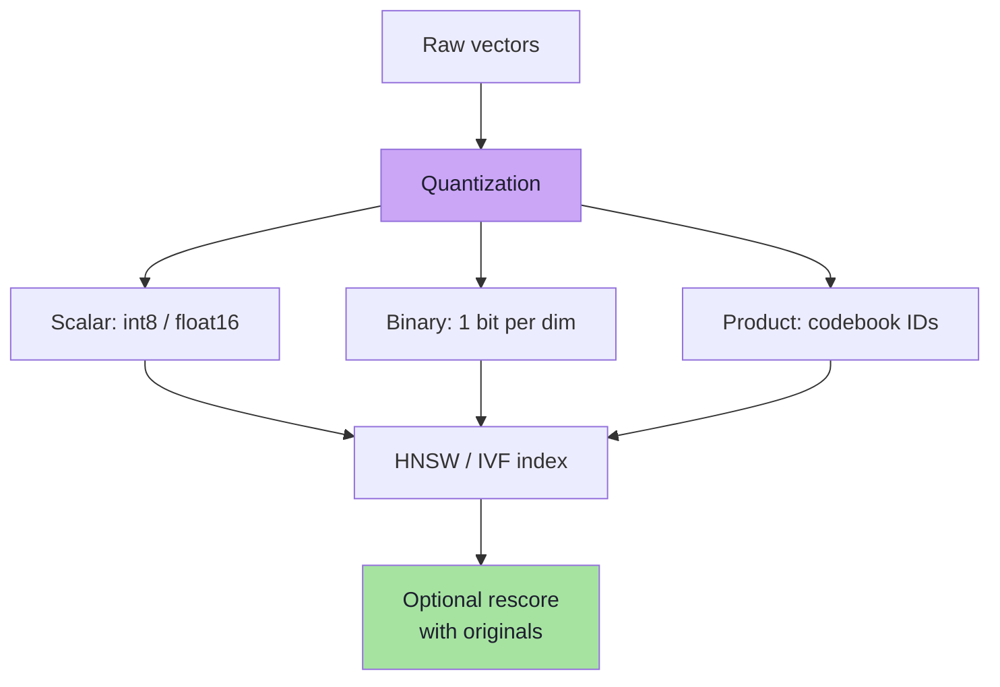

### Modern combinations

| Combination | Memory | Recall | Notes |
|---|---|---|---|
| HNSW + float32 | Highest | Highest | Baseline |
| HNSW + int8 | 4× smaller | Slightly lower | Strong default |
| HNSW + binary + rescore | 32× smaller | Good with oversampling | Very large collections |
| IVF-PQ | 64× smaller | Moderate | Classic billion-scale |
| HNSW + PQ + rescore | 64× smaller | Good | Graph quality plus compression |

---

## 6.13 Capacity Planning: The Numbers That Matter

For `D = 1,536`, `N = 100,000,000`:

| Representation | Bytes / vector | Total vectors | Plus HNSW graph* |
|---|---|---|---|
| float32 | 6,144 | 614.4 GB | ~628 GB |
| float16 | 3,072 | 307.2 GB | ~320 GB |
| int8 | 1,536 | 153.6 GB | ~167 GB |
| PQ (`m = 96`) | 96 | 9.6 GB | ~23 GB |
| binary | 192 | 19.2 GB | ~32 GB |

\* Graph estimate: `100M × ~33 links × 4 bytes ≈ 13.2 GB`, before upper-layer and per-node overhead. Payloads, indexes and replicas are additional.

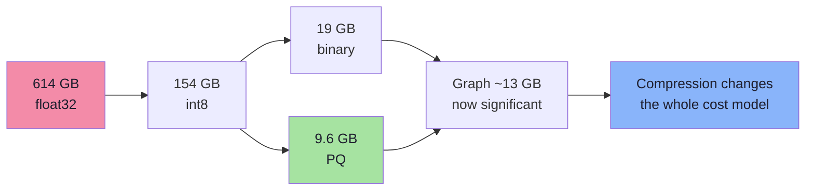

### Reading the table correctly

1. **Compression ratios apply to vectors, not payloads.** Text payloads can easily exceed compressed vectors.
2. **Graph memory does not compress.** At high compression, the graph dominates.
3. **Replication multiplies everything.** Three replicas turn 9.6 GB into 28.8 GB.
4. **Rescoring needs the originals somewhere.** If they are on disk, latency includes I/O.
5. **Compression changes recall.** Always measure after enabling it.

---

## 6.14 Choosing a Compression Strategy

| Situation | Recommended starting point | Why |
|---|---|---|
| < 1M vectors, RAM is fine | float32, no compression | Simplicity; exact distances |
| 1–10M vectors | float32 or int8 | int8 cuts memory 4× with small recall loss |
| 10–100M vectors | int8 or PQ + rescore | Memory becomes the constraint |
| > 100M vectors, RAM-limited | PQ / binary + rescore, or DiskANN | Vectors must shrink dramatically |
| Latency-critical, memory available | HNSW + float32 or int8 | Avoid rescore round-trips |
| Near-duplicate / fine-grained ranking | float16 or int8, avoid aggressive PQ | Small distance errors reorder near-ties |
| Strict exactness | No lossy compression | Approximation is unacceptable |
| Payload-heavy documents | Compress vectors, budget for text separately | Payloads often dominate memory |

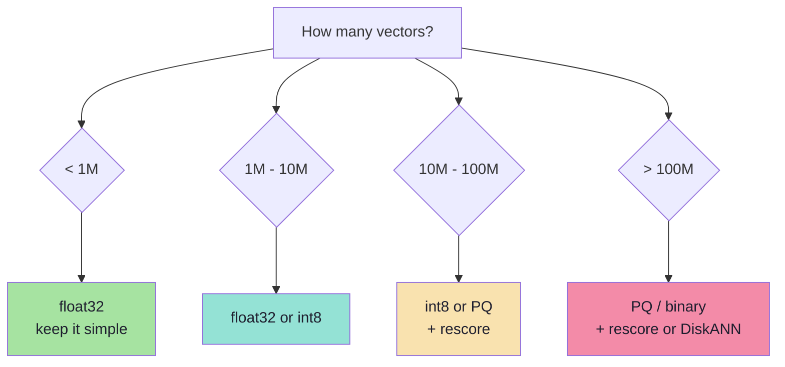

### A compression evaluation protocol

```text
1. Measure recall@10 with float32 (the baseline).
2. Enable int8; measure recall and memory.
3. Enable PQ at two or three values of m; measure.
4. Enable binary with oversampling + rescore; measure.
5. Compare recall, p95 latency, memory and cost.
6. Choose the least aggressive setting that meets the recall target.
```

Never accept a compression setting because it is the default. Defaults are chosen for general workloads, not for your data.

---

## 6.15 Pseudo-code: PQ Training, Encoding and ADC

```ts
interface PqModel {
  m: number;                       // number of sub-vectors
  k: number;                       // codewords per subspace (256)
  subDim: number;                  // D / m
  codebooks: number[][][];         // [m][k][subDim]
}

function split(v: number[], m: number): number[][] {
  const subDim = v.length / m;
  const parts: number[][] = [];
  for (let i = 0; i < m; i++) {
    parts.push(v.slice(i * subDim, (i + 1) * subDim));
  }
  return parts;
}

async function trainPq(
  sample: number[][],
  m: number,
  k = 256,
): Promise<PqModel> {
  const subDim = sample[0].length / m;
  const codebooks: number[][][] = [];

  for (let i = 0; i < m; i++) {
    const subspace = sample.map((v) => v.slice(i * subDim, (i + 1) * subDim));
    const centroids = await kmeans(subspace, k); // k x subDim
    codebooks.push(centroids);
  }

  return { m, k, subDim, codebooks };
}

function encode(v: number[], model: PqModel): Uint8Array {
  const parts = split(v, model.m);
  const code = new Uint8Array(model.m);

  for (let i = 0; i < model.m; i++) {
    let best = 0;
    let bestDist = Infinity;
    for (let c = 0; c < model.k; c++) {
      const d = l2Squared(parts[i], model.codebooks[i][c]);
      if (d < bestDist) {
        bestDist = d;
        best = c;
      }
    }
    code[i] = best; // 0..255
  }

  return code;
}

// ADC: one table per query, reused for every candidate.
function buildAdcTable(q: number[], model: PqModel): Float32Array[] {
  const parts = split(q, model.m);
  const table: Float32Array[] = [];

  for (let i = 0; i < model.m; i++) {
    const row = new Float32Array(model.k);
    for (let c = 0; c < model.k; c++) {
      row[c] = l2Squared(parts[i], model.codebooks[i][c]);
    }
    table.push(row);
  }

  return table;
}

function adcDistance(code: Uint8Array, table: Float32Array[]): number {
  let sum = 0;
  for (let i = 0; i < code.length; i++) {
    sum += table[i][code[i]];
  }
  return sum;
}
```

The contract is visible in the types:

- `encode` returns **`m` bytes**, never floats.
- `buildAdcTable` is called **once per query**, not once per candidate.
- `adcDistance` is `O(m)` additions, not `O(D)` multiplications.
- The original vector is not needed for search — only for optional rescoring.

---

## 6.16 Common Mistakes

1. **Compressing without re-measuring recall.** Every quantization level changes rankings.
2. **Expecting PQ to reduce the number of candidates.** PQ reduces bytes and distance cost, not candidate count; combine it with an index.
3. **Skipping rescoring with binary or aggressive PQ.** Codes are approximations; final ordering deserves full precision.
4. **Training codebooks on an unrepresentative sample.** Rare languages or tenants get poorly represented.
5. **Forgetting to retrain PQ after changing the embedding model.** The codebook describes an obsolete space.
6. **Mixing codebook versions in one collection.** Codes become meaningless relative to the wrong table.
7. **Ignoring graph memory after compression.** HNSW links do not shrink; they can become the dominant cost.
8. **Compressing payloads by accident.** Vector compression does not touch metadata or text.
9. **Using PQ on tiny collections.** The codebook training and ADC setup may cost more than it saves.
10. **Assuming ADC gives exact distances.** It sums approximations from the codebook; error is inherent.

---

## 6.17 Chapter Summary

| Technique | Idea | Compression | Key trade-off |
|---|---|---|---|
| float16 | Fewer bits per value | 2× | Minor precision loss |
| int8 scalar | Map range to 0–255 | 4× | Quantization error per coordinate |
| binary | Keep the sign | 32× | Very lossy; needs rescoring |
| PQ | Split, cluster sub-vectors, store IDs | 32–128× | Approximate distances; codebook training |
| OPQ | Rotate before PQ | Same as PQ | Better accuracy, extra training |
| IVF-PQ | Partition + codes | 64×+ | Moderate recall, huge scale |
| Rescoring | Full vectors for top candidates | — | Restores precision at extra cost |

> **Final mental model:** Product Quantization is **vector fingerprinting by parts**. Instead of remembering every coordinate, it remembers which of 256 prototype patterns each chunk of the vector most resembles. A 1,536-dimensional vector becomes 96 bytes, and distance becomes 96 table lookups. The compression is enormous, the distance is approximate, and the engineering discipline is to measure the recall you paid for it.

---

**Next:** [Chapter 07 — Anatomy of a Vector Database](./07_Anatomy_of_a_Vector_Database.md)


