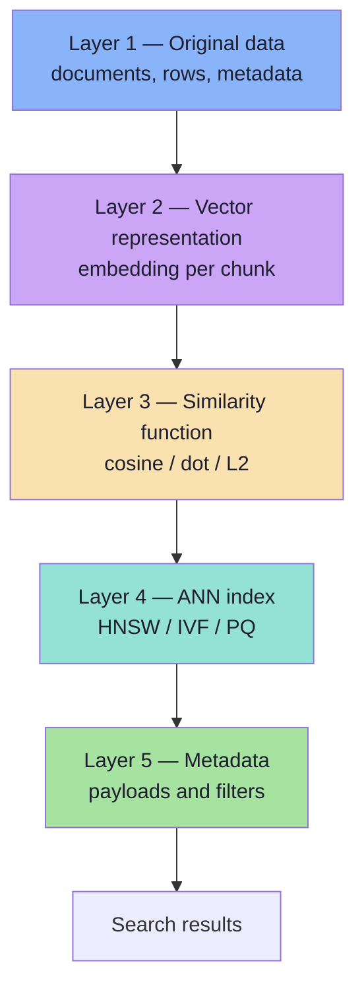
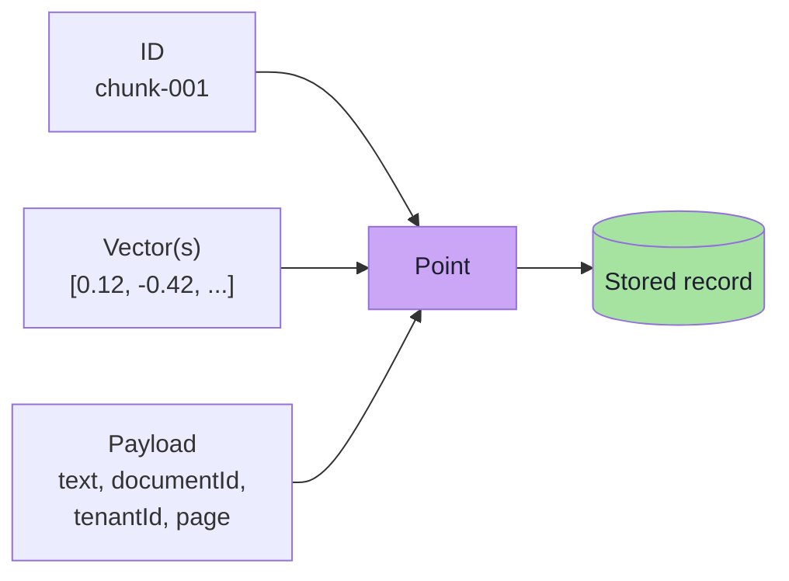
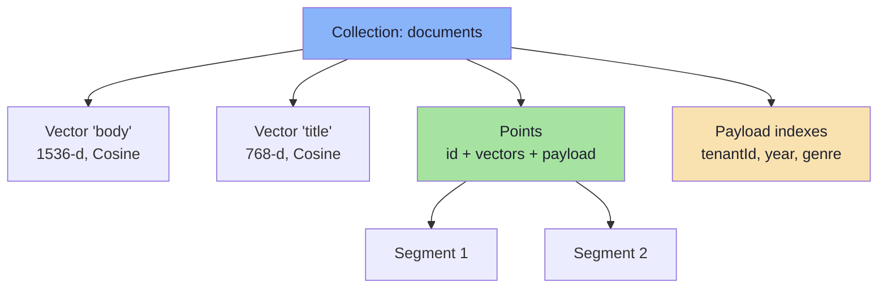
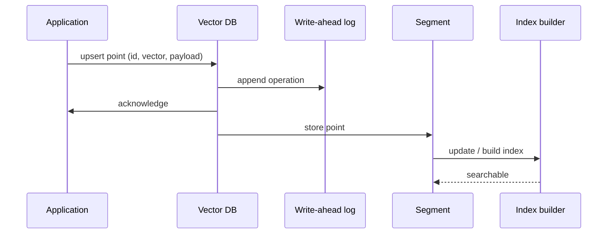
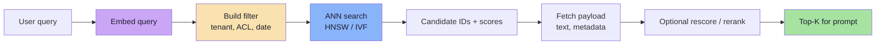
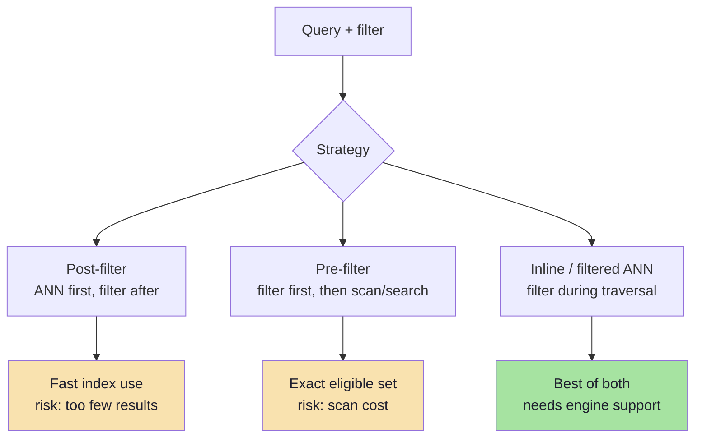
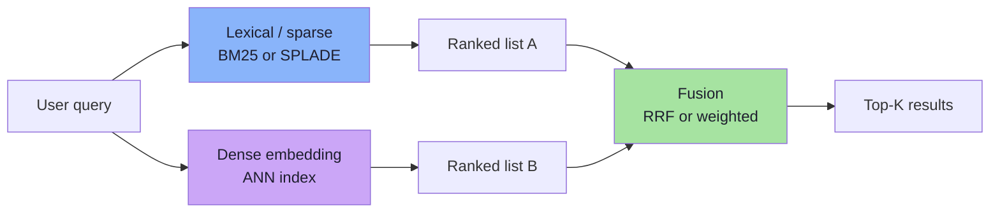
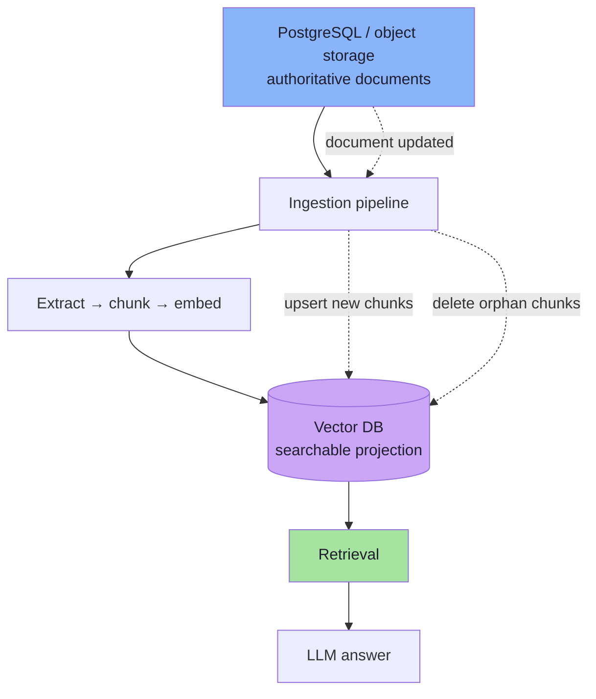

# Chapter 07: Anatomy of a Vector Database

> **Chapter Goal:** Stop thinking of a vector database as "an array of embeddings with a search function". Learn the five layers every practical system needs — data, vectors, metric, index, metadata — plus the record model, write/read paths, filtering strategies, hybrid search and lifecycle. This is the bridge between the algorithms of Chapters 04–06 and the products in Chapter 08.

---

## 7.1 More Than a Pile of Vectors

A naive vector store is:

```text
[vector, vector, vector, ...]
```

That is enough for a demo and insufficient for a product. A real system must answer:

```text
What is this vector attached to?
Which tenant / user / document does it belong to?
Which metric was it built for?
How do I search it quickly?
How do I update or delete it?
How do I filter by date, language, permission?
How do I combine semantic and keyword search?
```

The lecture models this as **five layers**:



Each layer has a failure mode:

| Layer | If missing or wrong | Symptom |
|---|---|---|
| Original data | Nothing to show or cite | Answers without sources |
| Vector | No semantic search | Keyword-only retrieval |
| Metric | Wrong ranking | Plausible but irrelevant results |
| ANN index | Slow at scale | High latency, timeouts |
| Metadata | No filtering, no security | Wrong tenant's data, stale results |

---

## 7.2 Layer 1 — Original Data

For a movie:

```text
ID: 101
Title: Interstellar
Description: A team travels through a wormhole...
Genre: Sci-Fi
Year: 2014
```

For a document chunk:

```text
documentId: employee-handbook
page: 12
section: Leave Policy
text: "Employees receive 18 paid leaves annually."
tenantId: company-a
updatedAt: 2026-03-14
```

This is ordinary application data. It has three jobs:

1. **Provenance** — where the chunk came from, so answers can cite it.
2. **Filtering** — tenant, language, date, permissions, genre.
3. **Display** — the text shown to the user or injected into the prompt.

> The vector database is usually **not** the authoritative store for this data. It is a searchable projection of it (see §7.14).

---

## 7.3 Layer 2 — Vector Representation

The same record also has an embedding:

```text
embedding: [0.21, -0.45, 0.81, ... 1536 values]
```

The vector is produced by the embedding model from the **searchable text** — usually a chunk, sometimes chunk + heading + title.

```text
┌──────────────────────────────────┐
│ ID: 101                          │
│ Title: Interstellar              │
│ Genre: Sci-Fi                    │
│ Year: 2014                       │
│                                  │
│ Vector: [0.21, -0.45, ...]       │
└──────────────────────────────────┘
```

The vector is what enables semantic retrieval; the other fields are what make the result usable and safe.

### Named vectors

Modern engines support multiple vectors per record:

```json
{
  "id": "chunk-1",
  "vectors": {
    "title": [0.12, ...],
    "body": [0.44, ...],
    "image": [0.91, ...]
  },
  "payload": { "documentId": "doc-1", "page": 3 }
}
```

This allows, for example, searching titles with one model and body text with another, then fusing the scores. Each named vector has its own dimension and metric — and must be queried with the matching embedding space.

### Dense and sparse vectors

| Type | Example | Strength |
|---|---|---|
| **Dense** | 1,536-float embedding | Semantic generalisation |
| **Sparse** | BM25 / SPLADE weights over vocabulary | Exact terms, rare tokens |

A record can hold both. This is the foundation of hybrid search (§7.12).

---

## 7.4 Layer 3 — The Similarity Function

Given a query vector `Q` and a stored vector `M`, the system needs a definition of closeness:

```text
cosine similarity
dot product
Euclidean / L2
Manhattan / L1
```

This layer is configured **per collection** (or per named vector) and must match the embedding model and the query path (Chapter 02).

| Decision | Consequence |
|---|---|
| Metric stored in collection config | Index is built for that metric |
| Query uses the same metric | Rankings are meaningful |
| Query uses a different metric | Silent quality loss, sometimes an error |
| Metric changed after build | Requires reindexing |

The metric is not a query-time preference in most engines; it is part of the index definition. Choose it once, document it, and validate it with a known pair of vectors.

---

## 7.5 Layer 4 — The ANN Index

Without an index:

```text
Query → compare against every vector → top K
```

At scale this is too slow (Chapter 03). So the system adds an index:

```text
Vectors → ANN index → efficient candidate search
```

| Index | Strength | Chapter |
|---|---|---|
| **Flat** | Exact, simple | 03 |
| **IVF** | Shardable, memory-efficient with PQ | 04 |
| **HNSW** | Low latency, high recall in RAM | 05 |
| **PQ / SQ / BQ** | Compression layer, often combined | 06 |

Two important framing points:

1. **The index is a search structure, not a storage format.** HNSW can index vectors stored as float32, int8, PQ codes or on disk.
2. **Index configuration is a product decision.** It determines recall, latency, memory and build time — the five-dimensional trade-off from Chapter 03.

---

## 7.6 Layer 5 — Metadata and Payloads

Applications almost never search with semantic similarity alone. Suppose the user asks:

```text
"Recommend recent Hindi comedy movies similar to this movie."
```

The system needs:

```text
language = Hindi
genre    = Comedy
year     >= 2020
AND nearest vectors to Query Q
```

Conceptually:

```text
Find top 10 vectors nearest to Q
WHERE language = "Hindi"
  AND genre    = "Comedy"
  AND year    >= 2020
```

This is **metadata filtering** (also called scalar filtering or payload filtering).

A practical record therefore looks like:

```text
ID
+
VECTOR
+
PAYLOAD / METADATA
```

not:

```text
[0.21, 0.54, ...]
```

### What belongs in the payload

| Field type | Examples | Use |
|---|---|---|
| Identity | `documentId`, `chunkId`, `parentId` | Provenance, dedup, joins |
| Security | `tenantId`, `acl`, `classification` | Isolation and access control |
| Business filters | `genre`, `language`, `year`, `status` | Retrieval constraints |
| Display | `text`, `title`, `url` | Prompt context and citations |
| Freshness | `updatedAt`, `version`, `modelVersion` | Lifecycle and debugging |
| Ranking hints | `popularity`, `recency` | Post-retrieval adjustments |

### Why metadata filtering matters

Semantic search returns:

```text
Interstellar     Sci-Fi   2014
The Martian      Sci-Fi   2015
Gravity          Sci-Fi   2013
Apollo 13        Drama    1995
```

The user requires `genre = Sci-Fi` and `year >= 2014`. After filtering:

```text
Interstellar
The Martian
```

Metadata turns a semantically plausible list into a **correct and compliant** list. It also carries the tenant and ACL fields that prevent cross-customer leakage.

> **Security framing:** tenancy and permission filters are not "nice-to-have ranking constraints". They are authorization checks that must execute inside the database query.

---

## 7.7 The Record Model

Qdrant calls its records **points**. A point is:

```ts
interface Point {
  id: string | number;
  vector: number[] | Record<string, number[]>; // named vectors
  payload: Record<string, unknown>;
}
```



Every field has a job:

| Field | Required? | Purpose |
|---|---|---|
| **ID** | Yes | Updates, deletes, dedup, citations |
| **Vector** | Yes (at least one) | Similarity search |
| **Payload** | Often | Filtering, display, security, provenance |

### ID strategy

IDs should be **deterministic** wherever possible:

```text
documentId + chunkIndex + contentHash
```

Deterministic IDs make ingestion **idempotent**: re-running the pipeline overwrites the same point instead of creating duplicates. Random UUIDs make duplicates invisible until the corpus is audited.

---

## 7.8 Collections, Points and Segments

| Concept | Meaning | Analogy |
|---|---|---|
| **Collection** | A named set of points with one vector configuration | Table |
| **Point** | One record (id + vector + payload) | Row |
| **Payload index** | An index on a payload field for filtering | Database index |
| **Segment** | Internal storage/index unit | Table partition / LSM segment |
| **Alias** | A stable name pointing to a collection | DNS name / view |
| **Snapshot** | A backup of a collection | Dump |

### Collection configuration is mostly immutable

A collection fixes:

```text
vector dimension
distance metric
named vectors and their configs
quantization settings (can often be updated)
HNSW parameters (can often be updated)
```

Changing the **dimension** or **model** requires a new collection and a re-embed (Chapter 01). Changing `M` or quantization may rebuild indexes.



### Why segments exist

An append-only segment is easy to write and search. A large merged segment is efficient to query. Engines balance the two:

```text
new writes → small mutable segment → searchable quickly
background optimizer → merge small segments into large ones
large segment → compact HNSW graph, better recall/latency
```

This is why:

- freshly written data may behave slightly differently from old data,
- deletes do not immediately free memory,
- index build/merge activity can affect tail latency.

---

## 7.9 The Write Path

A typical upsert:



Steps:

1. **Validate** dimension, metric compatibility and payload schema.
2. **Persist** the operation (write-ahead log / durability).
3. **Store** the point in a segment.
4. **Index** the vector (HNSW insert / list assignment) and payload fields.
5. **Acknowledge** — note that "acknowledged" and "fully indexed" are not always the same. Many engines are eventually consistent for search; check the `wait` semantics.

### Idempotent ingestion

```ts
async function upsertChunk(chunk: Chunk, embedding: number[]): Promise<void> {
  await db.upsert({
    id: chunk.deterministicId,     // same input → same ID
    vector: embedding,
    payload: {
      text: chunk.text,
      documentId: chunk.documentId,
      tenantId: chunk.tenantId,
      contentHash: chunk.contentHash,
      modelVersion: chunk.modelVersion,
      updatedAt: new Date().toISOString(),
    },
  });
}
```

Deterministic IDs + content hashes let you re-run ingestion safely and skip unchanged chunks.

---

## 7.10 The Read Path

A query is a pipeline, not a single call:



Two performance details matter:

1. **Payload projection.** Request only the fields you need (`with_payload: ["text", "documentId"]`). Fetching large payloads for 100 candidates can dominate latency and bandwidth.
2. **Score thresholds.** A threshold can reduce prompt noise, but must be calibrated per model and metric (Chapter 02).

### Pagination and scrolling

Search returns top-K, not "all matches". For exports, audits or UI pagination, use a **scroll** API that iterates points by ID rather than by similarity. Similarity pagination is unstable because scores change relative to each query.

---

## 7.11 Filtering Strategies

There are three ways to combine a filter with ANN search, and they have very different behaviour.



| Strategy | How | Best when | Risk |
|---|---|---|---|
| **Post-filter** | Retrieve top-K, then discard non-matching | Filter is broad (matches most rows) | Under-filling; can leak if used for ACL |
| **Pre-filter** | Restrict candidates first, then search | Filter is very selective | Expensive if the eligible set is large |
| **Filtered ANN** | Traverse the index while honoring the filter | Middle ground | Engine-specific; may reduce recall |
| **Partitioning** | Store tenants in separate collections/partitions | Strict isolation, large tenants | Operational overhead |

### Cardinality decides the strategy

```text
Filter matches 0.1% of the corpus
    → pre-filter: exact scan of a small set is fast

Filter matches 20% of the corpus
    → filtered ANN or post-filter

Filter matches 95% of the corpus
    → post-filter is fine; the filter barely prunes
```

This is why "just add a WHERE clause" is not a plan. The right strategy depends on the **selectivity** of the filter, which you can measure.

### Payload indexes

Filtering without a payload index often means scanning payloads for every candidate:

```text
no index  → O(candidates) payload checks
index     → O(log n) lookup + candidate intersection
```

Create payload indexes for fields used in filters:

```json
{
  "field_name": "tenantId",
  "field_schema": "keyword"
}
```

| Field type | Index schema |
|---|---|
| Tenant, genre, status | `keyword` |
| Year, price, count | `integer` / `float` |
| Timestamp | `datetime` |
| Coordinates | `geo` |
| Full-text match | `text` |

> **Rule:** every field that appears in a `must` / `should` / `must_not` filter should have a payload index, unless you have measured that it does not matter.

---

## 7.12 Hybrid Search

Pure dense retrieval is not always enough. Consider a document containing:

```text
Error code: ERR_AUTH_4017
```

A semantic embedding understands the general topic ("authentication error") but may not privilege the exact identifier. A user searching `ERR_AUTH_4017` needs lexical precision.

So production systems combine:

```text
Keyword / sparse search
        +
Dense vector search
        ↓
     Fusion
        ↓
   Top results
```



### Fusion methods

**Reciprocal Rank Fusion (RRF)** combines lists using ranks only:

```text
RRF(d) = Σ over lists  1 / (k + rank_list(d))

k is a constant, commonly 60
```

Why ranks instead of scores? Because dense cosine scores and BM25 scores live on incomparable scales. Ranks are comparable.

**Weighted score fusion** requires normalising each channel's scores first (min-max or z-score), then combining:

```text
final = α × dense_norm + (1 - α) × sparse_norm
```

This gives more control but is sensitive to score distributions and query type.

| Fusion | Strength | Weakness |
|---|---|---|
| RRF | No score calibration, robust | Ignores magnitude of confidence |
| Weighted | Tunable per domain | Needs normalisation and evaluation |

### Where hybrid helps most

| Query type | Dense | Lexical | Hybrid |
|---|---|---|---|
| Conceptual question | Strong | Weak | Strong |
| Exact error code / SKU | Weak | Strong | Strong |
| Person or product name | Medium | Strong | Strong |
| Rare domain jargon | Weak | Strong | Strong |
| Paraphrase across languages | Strong | Weak | Strong |

Qdrant supports sparse vectors alongside dense vectors, and its Query API can run multiple prefetches and fuse them. The implementation details vary, but the pattern is universal.

---

## 7.13 Lifecycle: Updates, Deletes and the Source of Truth

A vector database is usually a **derived index**, not the system of record.



### Why not make the vector DB the source of truth?

| Reason | Explanation |
|---|---|
| No transactions across business data | Users, orders and permissions live elsewhere |
| Re-embedding is routine | Model changes require rebuilding the index |
| Vendor portability | You may change vector engines |
| Recovery | Restoring a relational DB is a well-understood operation |
| Cost | Keeping full documents in RAM-resident search stores is expensive |

### What happens when a document changes

```text
Document updated
      ↓
Detect change (hash / updatedAt / event)
      ↓
Extract text
      ↓
Chunk (deterministic IDs)
      ↓
Generate new embeddings
      ↓
Upsert new chunks
      ↓
Delete chunks that no longer exist
```

The last step is the one teams forget. If the old version had 12 chunks and the new version has 9, three **orphan chunks** remain searchable and can be cited as current policy. Always reconcile the chunk set, not just the changed text.

```ts
async function syncDocument(doc: Document): Promise<void> {
  const newChunks = chunk(doc.text, { documentId: doc.id });

  await db.upsertMany(newChunks.map(toPoint));

  const keep = new Set(newChunks.map((c) => c.id));
  const existing = await db.scrollByFilter({ documentId: doc.id });

  const orphans = existing.filter((p) => !keep.has(p.id));
  if (orphans.length > 0) {
    await db.deleteMany(orphans.map((p) => p.id));
  }
}
```

### Model migration

Changing the embedding model is a full re-index:

```text
new collection → backfill → evaluate → alias switch → rollback window → delete old
```

This is why aliases matter: application code queries `documents` while the alias points at `documents_v1` or `documents_v2`.

---

## 7.14 What a Vector Database Does **Not** Do

| Expectation | Reality |
|---|---|
| "It understands meaning." | The embedding model does; the DB stores geometry. |
| "It answers questions." | It retrieves chunks; the LLM answers. |
| "It replaces PostgreSQL." | It is a specialised index, usually derived from another store. |
| "It guarantees the true nearest neighbours." | ANN is approximate; measure recall. |
| "It enforces authorization." | It applies the filters you pass; your application must pass them correctly. |
| "It chunks documents for you." | Chunking is an ingestion responsibility. |
| "It fixes bad embeddings." | It navigates whatever space it is given. |
| "It is exact by default." | Only a flat index is exact. |

> **Division of labour:** the embedding model creates meaning, the vector database stores and searches geometry, and the application enforces business rules. Confusing these responsibilities produces systems that are fast, fluent and wrong.

---

## 7.15 Design Checklist

Before calling a vector collection "done", verify:

| Area | Check |
|---|---|
| Record | Deterministic IDs; vector(s); payload includes text, source and tenant |
| Metric | Matches the embedding model; documented in config |
| Index | HNSW/IVF parameters chosen from measurements, not defaults |
| Compression | Recall measured after quantization; rescore configured |
| Filtering | Payload indexes exist for every filtered field; ACL filters are mandatory |
| Tenancy | `tenantId` filter or separate collections; tested with two tenants |
| Hybrid | Lexical channel considered for identifiers and rare terms |
| Lifecycle | Update, delete and orphan-chunk reconciliation implemented |
| Source of truth | Documents live outside the vector DB; aliasing supports migration |
| Observability | Recall sample, p95/p99 latency, segment count, deleted ratio, index size |
| Backup | Snapshot/restore tested, not just configured |

---

## 7.16 Common Mistakes

1. **Treating the vector DB as the source of truth.** Re-embedding, recovery and business transactions become painful.
2. **Storing no metadata.** No filtering, no citations, no isolation, no debugging.
3. **Forgetting payload indexes.** Filters silently scan payloads and destroy latency.
4. **Post-filtering ACLs.** The model may see forbidden text before the filter is applied.
5. **Leaving orphan chunks after a document update.** Old policy remains searchable.
6. **Mixing embedding models in one collection.** Plausible but meaningless scores (Chapter 01).
7. **Using the vector DB as a relational database.** Joins, constraints and transactions belong elsewhere.
8. **Storing entire documents in payloads.** Fetching 100 candidates becomes a bandwidth problem.
9. **Assuming `wait=true` means "fully indexed".** Search consistency may lag the acknowledgement.
10. **No snapshot/restore drill.** A backup that has never been restored is a hope, not a plan.

---

## 7.17 Chapter Summary

| Layer | Component | Question it answers |
|---|---|---|
| 1 | Original data | What is this, where did it come from? |
| 2 | Vector representation | What does it mean, numerically? |
| 3 | Similarity function | What does "near" mean? |
| 4 | ANN index | How do we avoid scanning everything? |
| 5 | Metadata / payload | Which results are allowed and useful? |

| Concept | Takeaway |
|---|---|
| Record model | ID + vector(s) + payload; all three matter |
| Collection | Fixed dimension and metric; changes require migration |
| Segment | Write/merge unit; explains freshness and tombstones |
| Write path | Validate, persist, store, index, acknowledge |
| Read path | Embed → filter → ANN → payload → rerank |
| Filtering | Cardinality decides pre/post/inline; ACLs are mandatory |
| Hybrid | Dense + lexical, fused by RRF or weighted scores |
| Lifecycle | Derived index; reconcile chunks on update; alias for migration |

> **Final mental model:** A vector database is a **searchable projection of your data**, not the data itself. The five layers form a contract: the source supplies truth, the model supplies geometry, the metric defines closeness, the index supplies speed, and the payload supplies permission and context. Break any layer and the system still returns results — which is exactly why the failures are dangerous.

---

**Next:** [Chapter 08 — Qdrant, pgvector and the Storage Decision](./08_Qdrant_pgvector_and_the_Storage_Decision.md)


