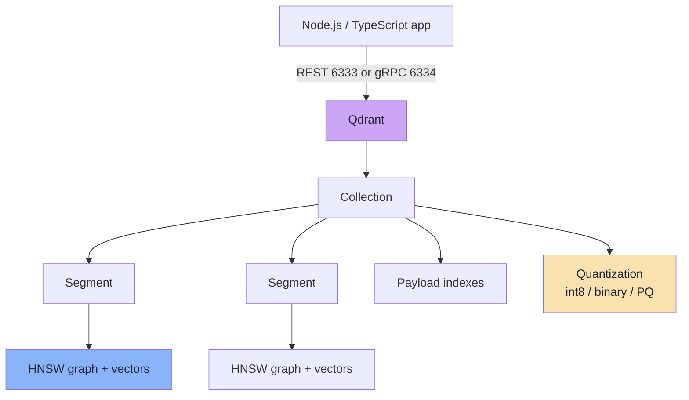
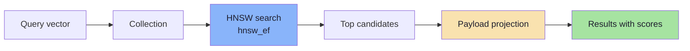
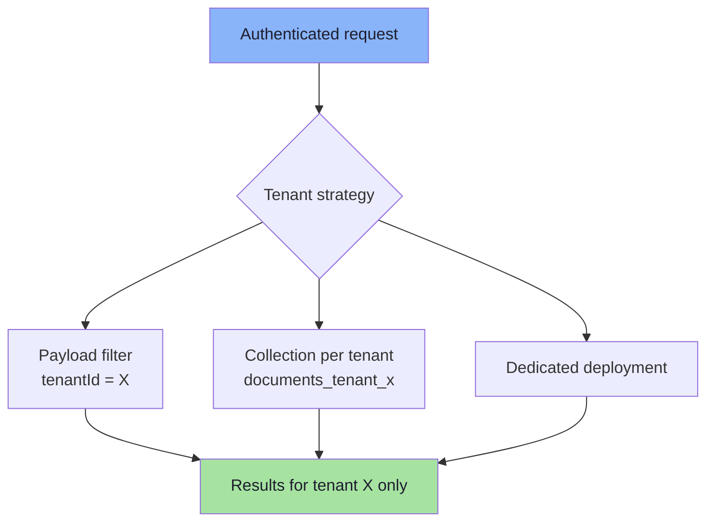
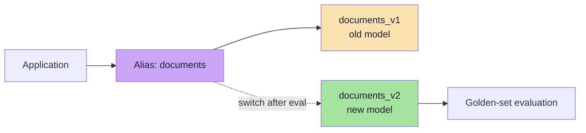
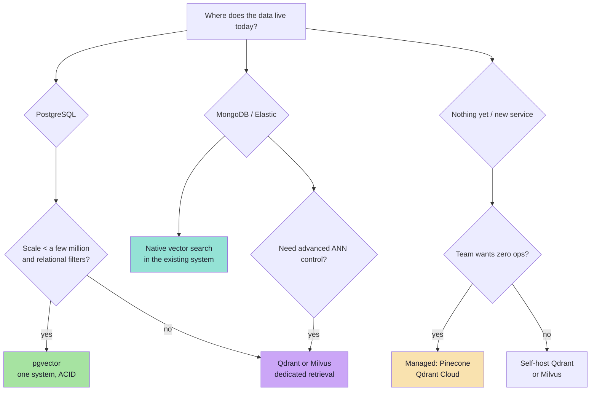

# Chapter 08: Qdrant, pgvector and the Storage Decision

> **Chapter Goal:** Turn the concepts into a working system. Learn Qdrant's object model and JavaScript client, pgvector's SQL model and index options, and a decision framework for choosing between a dedicated vector database and vectors inside Postgres. The goal is not brand loyalty — it is matching the storage engine to the retrieval workload and the team's operational reality.

---

## 8.1 The Practical Question

You have embeddings. Where do they live?

```text
Option A: dedicated vector database   → Qdrant, Pinecone, Weaviate, Milvus
Option B: vectors inside PostgreSQL   → pgvector
Option C: vector search in an existing system → MongoDB Atlas, Elasticsearch/OpenSearch
Option D: in-memory / prototype       → Chroma, FAISS, a local index
```

The right answer depends on:

| Question | Why it matters |
|---|---|
| How many vectors, at what dimension? | Determines memory and index type |
| How selective are filters? | Determines filtering strategy and engine |
| How fresh must results be? | Determines write/index architecture |
| What is the p95 latency target? | Determines index and deployment |
| Does the team already run Postgres? | Operational leverage |
| Is hybrid search required? | Narrows the engine choice |
| What are the isolation requirements? | Multi-tenancy design |
| Who operates it? | Managed vs self-hosted |

---

## 8.2 Qdrant's Object Model

Qdrant is a dedicated vector database written in Rust. It exposes REST (port 6333) and gRPC (port 6334), plus official clients including JavaScript/TypeScript.

```text
Qdrant
  └── Collection "documents"
        ├── vector config: size 1536, distance Cosine
        ├── HNSW config: m, ef_construct
        ├── quantization config: scalar / binary / product
        ├── payload indexes: tenantId, year, genre
        └── Points
              ├── id: chunk-001
              ├── vector: [0.12, ...]
              └── payload: { text, documentId, tenantId, page }
```



Qdrant strengths:

- HNSW with filterable payload indexes
- dense and sparse vectors (hybrid retrieval)
- scalar, binary and product quantization
- strong payload filtering and multitenancy support
- self-hosted (Docker/binary) or managed cloud
- snapshots, aliases, sharding and replication in distributed mode

Limits to know:

- no IVF index (HNSW is the vector index)
- vector size and distance are collection-level decisions
- filtered HNSW needs payload indexes to perform well

---

## 8.3 Running Qdrant Locally with Docker

```bash
docker run -d \
  --name qdrant \
  -p 6333:6333 \
  -p 6334:6334 \
  -v "$(pwd)/qdrant_storage:/qdrant/storage" \
  qdrant/qdrant
```

| Port | Purpose |
|---|---|
| 6333 | REST API and web dashboard (`http://localhost:6333/dashboard`) |
| 6334 | gRPC API |

```text
Node.js app
   │
   ▼
localhost:6333
   │
   ▼
Qdrant container
   │
   ▼
./qdrant_storage  (persistent volume)
```

> **Always mount a volume.** Without it, `docker rm` deletes the index and every embedding with it.

---

## 8.4 The JavaScript Client

```bash
npm install @qdrant/js-client-rest
```

```ts
import { QdrantClient } from "@qdrant/js-client-rest";

const qdrant = new QdrantClient({
  url: "http://localhost:6333",
  // apiKey: process.env.QDRANT_API_KEY, // required for Qdrant Cloud
});
```

Client versions differ. Older clients expose `search`; newer clients expose the **Query API** via `query`. The concepts are stable; the method names may need checking against the installed version.

---

## 8.5 Creating a Collection

```ts
await qdrant.createCollection("documents", {
  vectors: {
    size: 1536,          // must match the embedding model
    distance: "Cosine",  // must match how the model was trained
  },
  hnsw_config: {
    m: 16,
    ef_construct: 200,
  },
  quantization_config: {
    scalar: {
      type: "int8",
      quantile: 0.99,
      always_ram: true,
    },
  },
});
```

What each setting does:

| Setting | Effect |
|---|---|
| `size` | Vector dimension; writes with a different size fail |
| `distance` | Metric used to build the index and rank results |
| `m` | HNSW connectivity/memory |
| `ef_construct` | HNSW build quality |
| `scalar` quantization | 4× smaller vectors; measure recall |
| `always_ram` | Keep quantized vectors in RAM |

### Why the dimension must match

```text
Collection expects: 1536
You send:            768
→ rejected (or, worse, a different model's 768-dim vector accepted into a 768-dim collection)
```

A dimension mismatch is usually a loud error. The dangerous case is a **dimension match with a model mismatch** (Chapter 01): the write succeeds and every result is wrong.

---

## 8.6 Inserting Points

```ts
await qdrant.upsert("documents", {
  wait: true,
  points: [
    {
      id: "chunk-001",
      vector: embedding, // number[1536]
      payload: {
        text: "Employees receive 18 paid leaves annually.",
        documentId: "employee-handbook",
        tenantId: "company-a",
        page: 12,
        language: "en",
        updatedAt: "2026-03-14T10:00:00Z",
        modelVersion: "gemini-embedding-001",
      },
    },
  ],
});
```

| Field | Notes |
|---|---|
| `id` | String or integer; deterministic IDs make ingestion idempotent |
| `vector` | Array of numbers, or named-vector object |
| `payload` | Arbitrary JSON; keep it small and indexed |
| `wait` | Ask the server to apply the change before returning |

### Batch upserts

```ts
const BATCH = 100;

for (let i = 0; i < points.length; i += BATCH) {
  await qdrant.upsert("documents", {
    wait: false, // higher throughput during backfill
    points: points.slice(i, i + BATCH),
  });
}
```

Batching reduces HTTP overhead and lets the server index more efficiently. Use `wait: true` for user-facing writes where read-after-write matters; use `wait: false` for bulk backfills, then verify counts.

---

## 8.7 Querying

### Query API (newer clients)

```ts
const result = await qdrant.query("documents", {
  query: queryVector,        // a dense vector
  limit: 5,
  with_payload: ["text", "documentId", "page"],
  params: {
    hnsw_ef: 128,            // exploration budget
  },
});

for (const point of result.points) {
  console.log(point.id, point.score, point.payload?.documentId);
}
```

### Search API (older clients)

```ts
const hits = await qdrant.search("documents", {
  vector: queryVector,
  limit: 5,
  with_payload: true,
});
```

Both forms express the same request: *find the points nearest to this vector, under this metric, with these filters, and return this much payload.*



### Reading scores correctly

| Metric | Score meaning |
|---|---|
| `Cosine` | Similarity; higher is better |
| `Dot` | Inner product; higher is better |
| `Euclid` | Distance; lower is better |
| `Manhattan` | Distance; lower is better |

Qdrant returns results in best-first order, but application code must not assume a universal "higher is better" rule across collections with different metrics.

---

## 8.8 Filtering and Payload Indexes

Semantic search plus a tenant filter:

```ts
const result = await qdrant.query("documents", {
  query: queryVector,
  limit: 5,
  filter: {
    must: [
      { key: "tenantId", match: { value: "company-a" } },
      { key: "language", match: { value: "en" } },
    ],
    must_not: [
      { key: "status", match: { value: "archived" } },
    ],
  },
  with_payload: ["text", "documentId"],
});
```

### Create payload indexes first

```ts
await qdrant.createPayloadIndex("documents", {
  field_name: "tenantId",
  field_schema: "keyword",
  wait: true,
});
```

For multi-tenant collections, Qdrant supports a tenant-optimised payload index:

```ts
await qdrant.createPayloadIndex("documents", {
  field_name: "tenantId",
  field_schema: {
    type: "keyword",
    is_tenant: true,
  },
  wait: true,
});
```

The tenant index improves filtered search by co-locating data for the same tenant, rather than forcing the HNSW traversal to filter after the fact.

### Filter types

| Filter | Meaning |
|---|---|
| `must` | All conditions must match (AND) |
| `should` | At least one should match (OR) |
| `must_not` | None may match (NOT) |
| `match` | Exact value or keyword |
| `range` | Numeric / date range |
| `geo_bounding_box` | Geospatial filter |
| `has_id` | Restrict to specific IDs |

> **Filtering is part of retrieval, not presentation.** Build the filter from the authenticated user's identity and permissions **before** the query reaches the database, and treat a missing tenant filter as a security bug.

---

## 8.9 Multi-Tenancy Patterns

| Pattern | How | When |
|---|---|---|
| **Payload filter** | One collection, `tenantId` filter on every query | Many small tenants |
| **Tenant payload index** | `is_tenant: true` on the tenant field | Many tenants with filtering-heavy workloads |
| **Collection per tenant** | Separate collections | Few large tenants, strict isolation |
| **Database/cluster per tenant** | Separate deployment | Regulatory or contractual isolation |



Practical rules:

1. **Never accept a tenant ID from the client.** Derive it from the authenticated session.
2. **Test with two tenants and a query that should return nothing.** A missing filter often shows up as one tenant seeing another's document.
3. **Partition large tenants** if a single tenant dominates the collection; its queries otherwise traverse a graph built mostly for others.
4. **Include tenant isolation in deletion workflows.** Deleting a tenant must delete its points and payload data.

---

## 8.10 Qdrant Operations

| Operation | Why it matters |
|---|---|
| **Snapshots** | Backup and restore; test the restore, not just the snapshot |
| **Aliases** | Zero-downtime model migration and collection swaps |
| **Optimizers** | Merge segments, reclaim tombstones, improve graph quality |
| **Metrics** | Latency, QPS, segment count, memory, deleted vectors |
| **API keys / TLS** | Never expose an unauthenticated Qdrant to the internet |
| **Resource limits** | Prevent one tenant or query from exhausting memory |

### Alias-based migration

```text
1. Create documents_v2 with the new dimension/model.
2. Backfill and index all chunks.
3. Evaluate recall on a golden set.
4. Point alias "documents" to documents_v2.
5. Keep documents_v1 for rollback.
6. Delete v1 after the rollback window.
```



Without an alias, every migration becomes a coordinated application deploy with a downtime window.

---

## 8.11 pgvector: Vectors Inside PostgreSQL

pgvector is a PostgreSQL extension that adds vector types, distance operators and ANN indexes.

```sql
CREATE EXTENSION IF NOT EXISTS vector;

CREATE TABLE documents (
  id           BIGSERIAL PRIMARY KEY,
  document_id  TEXT NOT NULL,
  tenant_id    TEXT NOT NULL,
  content      TEXT NOT NULL,
  page         INT,
  embedding    VECTOR(1536)
);
```

### Inserting

```sql
INSERT INTO documents (document_id, tenant_id, content, page, embedding)
VALUES ($1, $2, $3, $4, $5);
```

The vector arrives as a parameter (for example, a JSON array or pgvector's text format), produced by the same embedding model used for queries.

### Querying

```sql
SET hnsw.ef_search = 100;

SELECT id, content, page,
       1 - (embedding <=> $1) AS cosine_similarity
FROM documents
WHERE tenant_id = $2
ORDER BY embedding <=> $1
LIMIT 10;
```

Note the direction:

```text
<=>  returns cosine DISTANCE (lower is better)
1 - distance = cosine similarity (higher is better)
```

### Operators

| Operator | Meaning | Sort |
|---|---|---|
| `<->` | Euclidean / L2 distance | ASC |
| `<#>` | Negative inner product | ASC |
| `<=>` | Cosine distance | ASC |
| `<+>` | L1 / Manhattan distance | ASC |
| `<~>` | Hamming distance (bit vectors) | ASC |
| `<%>` | Jaccard distance (bit vectors) | ASC |

Postgres requires a uniform `ORDER BY ... ASC` for index scans, which is why inner product is negated: the largest inner product becomes the smallest negative value.

### Indexes

```sql
-- HNSW, cosine
CREATE INDEX documents_embedding_hnsw
ON documents
USING hnsw (embedding vector_cosine_ops)
WITH (m = 16, ef_construction = 64);

-- IVFFlat, cosine (create after data exists)
CREATE INDEX documents_embedding_ivf
ON documents
USING ivfflat (embedding vector_cosine_ops)
WITH (lists = 1000);
```

| Index | Build | Query knob | Best for |
|---|---|---|---|
| **HNSW** | Slower, higher memory | `hnsw.ef_search` | Low latency, frequent updates |
| **IVFFlat** | Faster, lower memory | `ivfflat.probes` | Large, relatively static data |

The operator class must match the metric:

```text
vector_cosine_ops  →  <=>  cosine
vector_l2_ops      →  <->  L2
vector_ip_ops      →  <#>  inner product
```

A mismatch between the index op class and the query operator can prevent the index from being used.

### Filtering in SQL

```sql
SELECT id, content
FROM documents
WHERE tenant_id = $2
  AND page BETWEEN 10 AND 20
ORDER BY embedding <=> $1
LIMIT 10;
```

Postgres chooses between:

- **filter then index scan**, or
- **index scan then filter**,

based on statistics and cost. For selective filters, this can return fewer than `LIMIT` rows. pgvector 0.8 added **iterative index scans** to keep scanning until enough rows are found:

```sql
SET hnsw.iterative_scan = relaxed_order;
SET hnsw.max_scan_tuples = 40000;
```

For very large tenants, a **partial index** can be effective:

```sql
CREATE INDEX ON documents
USING hnsw (embedding vector_cosine_ops)
WHERE tenant_id = 'company-a';
```

### Transactions and joins

This is pgvector's defining advantage:

```sql
BEGIN;

INSERT INTO documents (...) VALUES (...);
INSERT INTO audit_log (...) VALUES (...);

COMMIT;
```

Vectors participate in the same transactions, constraints, joins and backups as the rest of the relational data. If your retrieval is tightly coupled to business rows, this is a major simplification.

---

## 8.12 pgvector Limits and Tuning

### Index dimension limits

| Type | Dimensions indexable | Notes |
|---|---|---|
| `vector` | up to 2,000 | float32 |
| `halfvec` | up to 4,000 | float16, half the storage |
| `bit` | up to 64,000 | binary vectors |
| `sparsevec` | up to 1,000 non-zero | sparse representations |

If your model outputs 3,072 dimensions, a plain `vector` HNSW index is not possible; use `halfvec(3072)` or reduce the output dimension if the model supports it. Check the limits for your installed version — they have changed over releases.

### Build and query tuning

```sql
-- More memory for index build
SET maintenance_work_mem = '2GB';
SET max_parallel_maintenance_workers = 4;

-- Query-time exploration
SET hnsw.ef_search = 100;

-- IVFFlat query-time probes
SET ivfflat.probes = 10;
```

| Symptom | Tuning |
|---|---|
| Slow index build | Raise `maintenance_work_mem`, parallel workers |
| Low recall (HNSW) | Raise `hnsw.ef_search` |
| Low recall (IVFFlat) | Raise `ivfflat.probes` |
| High memory | Lower `m`, use `halfvec`, partition |
| Few results with filters | Iterative scan, partial index, or pre-filter |
| Stale results / bloat | `VACUUM`, `REINDEX` |

### Operational characteristics

| Aspect | pgvector |
|---|---|
| Scaling | Primarily vertical; read replicas help reads |
| Sharding | Manual partitioning / Citus-style approaches |
| Hybrid search | Postgres full-text (`tsvector`) + vector, fused in SQL or app |
| Transactions | Full ACID with business data |
| Backups | Standard Postgres tooling |
| Multi-tenancy | Row-level filters, schemas, databases, partial indexes |
| Best scale | Up to low millions comfortably; larger with careful engineering |

> **When pgvector is the right answer:** your data already lives in Postgres, the vector count is moderate, filters are relational, and the team values one system over a specialised one. **When it is not:** hundreds of millions of vectors, heavy hybrid retrieval, aggressive quantization, or strict p95 latency at high QPS.

---

## 8.13 The Wider Landscape

| System | Type | Strengths | Watch-outs |
|---|---|---|---|
| **Qdrant** | Dedicated vector DB | HNSW, payload filtering, quantization, sparse + dense, self-host/cloud | Another system to operate; no IVF |
| **Pinecone** | Managed vector DB | Serverless operations, low maintenance | Managed-only, vendor lock-in, cost at scale |
| **Weaviate** | Vector DB | Hybrid search, modules, multi-tenancy | Operational complexity |
| **Milvus** | Distributed vector DB | Very large scale, multiple index types, GPU options | Heaviest operational footprint |
| **Chroma** | Developer vector store | Simple, embedded, fast prototyping | Not built for large production scale |
| **pgvector** | Postgres extension | One database, ACID, joins, familiar ops | Dimension and scale limits; tuning is Postgres tuning |
| **MongoDB Atlas Vector Search** | Vector search in MongoDB | Vectors beside existing documents | Atlas dependency, fewer index controls |
| **Elasticsearch / OpenSearch** | Search engine + vectors | Mature lexical search, hybrid, aggregations | Cluster operations, vector features vary by version |

No entry is universally best. The table is a **shortlist generator**, not a decision.

---

## 8.14 Decision Framework



### A weighted scorecard

Score each candidate 1–5 on:

| Criterion | Weight (example) |
|---|---|
| Recall/latency at your scale | 25% |
| Filtering and multi-tenancy | 20% |
| Operational burden | 15% |
| Cost at 12–24 months | 15% |
| Hybrid search support | 10% |
| Ecosystem / client quality | 10% |
| Migration and exit cost | 5% |

The weights depend on the business. A startup optimises for speed of delivery; a regulated enterprise optimises for isolation and auditability.

### Qdrant vs pgvector, directly

| Dimension | Qdrant | pgvector |
|---|---|---|
| Model | Dedicated retrieval service | Postgres extension |
| Query language | REST/gRPC + client SDK | SQL |
| Filtering | Payload indexes, filterable HNSW | SQL `WHERE`, iterative scans |
| Hybrid | Dense + sparse + fusion | Postgres FTS + vector, app fusion |
| Quantization | Scalar, binary, product | `halfvec`, `bit`, dimensions |
| Transactions | Per-operation | Full ACID across tables |
| Scaling | Sharding/replication (distributed) | Vertical + replicas |
| Ops | Separate service, snapshots, dashboards | Existing Postgres tooling |
| Sweet spot | Retrieval-heavy, large, filtered | Relational app, moderate scale |

> **The honest default:** if you already run Postgres and have fewer than a few million chunks, start with pgvector. Move to a dedicated engine when measured latency, filtering or scale demands it — not because a benchmark says so.

---

## 8.15 Cost and Operations

Vector search is **memory-bound**, so cost is dominated by RAM and replicas, not by CPU.

```text
cost ≈ (vectors × bytes_per_vector × replicas)
     + payload / index overhead
     + compute for embedding and queries
     + egress / managed fees
```

### Cost levers

| Lever | Effect |
|---|---|
| Quantization | 2×–64× less vector memory |
| Smaller embedding dimension | Linear reduction in memory and distance cost |
| Fewer replicas | Lower cost, lower availability |
| Tiered storage / on-disk index | Lower RAM, higher latency |
| Caching frequent queries | Fewer repeat searches |
| Batching embeddings | Lower API cost and better throughput |

### Operational checklist

| Area | Question |
|---|---|
| Backup | Are snapshots scheduled and **restore-tested**? |
| Upgrade | Can you upgrade the engine without downtime? |
| Auth | Are API keys/TLS enabled? Is the dashboard exposed? |
| Monitoring | Do you track p95/p99, QPS, recall samples, memory, segment count? |
| Scaling | How do you add shards/replicas? What is the rebalance procedure? |
| Isolation | Can one tenant exhaust resources or see another's data? |
| Cost | What is the cost per 1M vectors at your dimension and replication factor? |
| Exit | Can you export vectors + payloads and rebuild elsewhere? |

> **Managed vs self-hosted is an operations decision, not a feature decision.** The feature matrix narrows the shortlist; the team's ability to run the system picks the winner.

---

## 8.16 Common Mistakes

1. **Choosing a vendor before measuring the workload.** Scale, filters and latency targets choose the architecture.
2. **Mismatching dimension or metric.** The write succeeds and results are wrong (Chapters 01–02).
3. **Forgetting payload indexes.** The filter works but scans every payload.
4. **Post-filtering ACLs.** A security incident disguised as a ranking issue.
5. **Assuming `wait=true` means "immediately searchable".** Check consistency semantics.
6. **Requesting full payloads for large candidate sets.** Bandwidth and latency explode.
7. **Using default HNSW parameters for a filtered, multi-tenant workload.** Tune for the real query mix.
8. **Ignoring pgvector index dimension limits.** A 3,072-d `vector` index will not build; use `halfvec`.
9. **Building an IVFFlat index on an empty table.** Centroids represent nothing.
10. **Treating a benchmark as a substitute for your own recall measurement.** Different data, different result.

---

## 8.17 Chapter Summary

| Topic | Takeaway |
|---|---|
| Qdrant model | Collection → points (id + vectors + payload) → segments |
| Qdrant query | `query` (new) / `search` (old), with `hnsw_ef`, filters, payload projection |
| Qdrant filtering | Payload indexes are mandatory for performance; tenant index for multitenancy |
| Qdrant ops | Snapshots, aliases, optimizers, metrics, auth |
| pgvector model | `vector(n)` column, distance operators, HNSW/IVFFlat indexes |
| pgvector query | `ORDER BY embedding <=> $1 LIMIT k`, with SQL filters |
| pgvector limits | 2,000 indexable dims for `vector`; use `halfvec`/`bit` beyond |
| pgvector strength | ACID, joins, one system, familiar operations |
| Decision | Start where the data lives; specialise when measurements demand it |

> **Final mental model:** A vector store is a **retrieval engine plus an operational contract**. Qdrant gives you a specialised engine with strong filtering, quantization and hybrid support — at the cost of running another system. pgvector gives you vectors inside the database you already trust — at the cost of dimension limits and vertical scaling. Neither choice is "modern" or "legacy"; the correct one is the one your workload and your team can operate well.

---

**Next:** [Chapter 09 — Production RAG Retrieval Systems](./09_Production_RAG_Retrieval_Systems.md)


