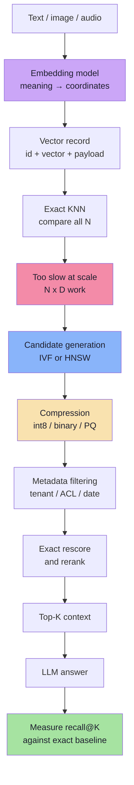
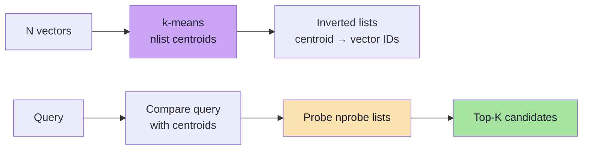
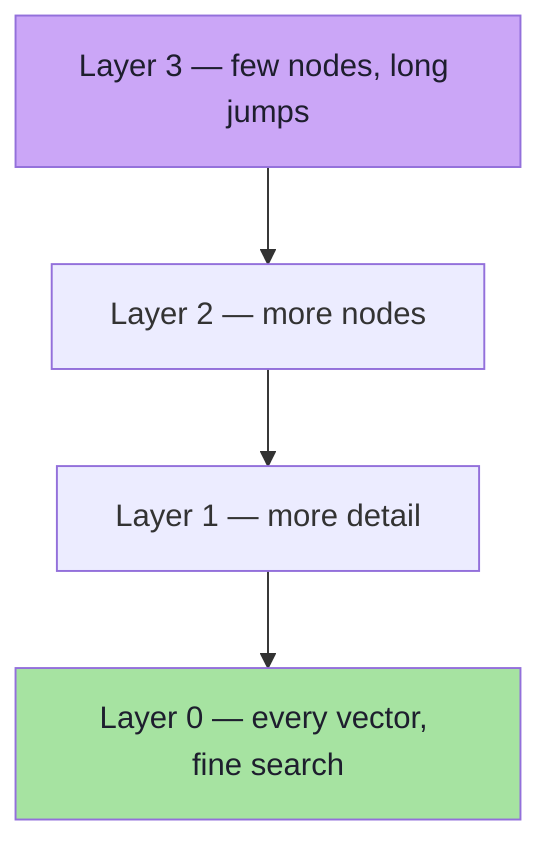
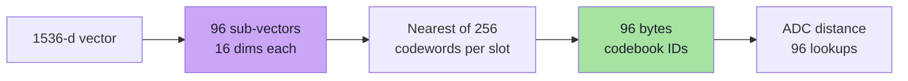
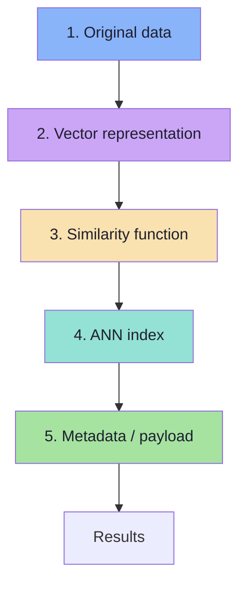
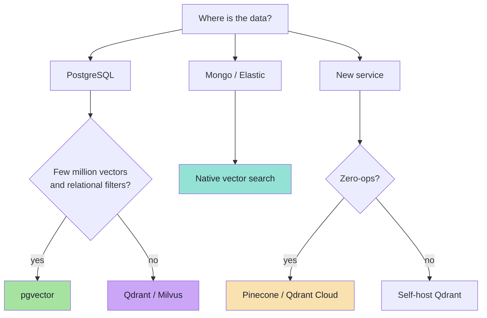

# Lecture 10: Deep Dive into Vector Databases and ANN Algorithms

## Complete Consolidated Notes & Production Reference

> **Course:** Forward Deployed Engineer (FDE) & Generative AI Systems
> **Lecture:** 10 — Deep Dive into Vector Databases and ANN Algorithms
> **Source Material:** [`Notes.pdf`](./Notes.pdf) (54 numbered sections), [`Excalidraw-Notes.svg`](./Excalidraw-Notes.svg), and the lecture's embedding/vector-database notes
> **Scope:** Chapters [01](./01_Embeddings_and_the_Geometry_of_Meaning.md) → [09](./09_Production_RAG_Retrieval_Systems.md)
> **Diagram Format:** Mermaid only
> **Snippet Style:** TypeScript-style pseudo-code — illustrative, not production code
> **Prerequisite:** [Lecture 09 Complete Notes](../../Lecture%2009/notes/Lecture_09_Complete_Notes.md) (why exact search breaks at scale)

---

## How to Use This Document

This is the **map**, not the territory. Each part compresses one chapter to its load-bearing ideas and ends with a *Go deeper* link. The arithmetic is kept because it is the argument; derivations, full pseudo-code and edge cases live in the chapters.

| If you want to… | Read | Time |
|---|---|---|
| Recall what the lecture was about | [Executive Summary](#executive-summary-the-whole-lecture-on-one-page) → [Cheat Sheet](#cheat-sheet) | 10 min |
| Understand embeddings and metrics | Parts [1](#part-1-embeddings-and-the-geometry-of-meaning) and [2](#part-2-similarity-distance-and-metric-consistency) | 20 min |
| Understand the ANN bargain | [Part 3](#part-3-exact-knn-and-the-ann-bargain) | 15 min |
| Choose and tune an index | Parts [4](#part-4-ivf--cluster-then-probe), [5](#part-5-hnsw--navigate-the-graph), [6](#part-6-vector-compression-and-pq) | 35 min |
| Design or review a vector DB | Parts [7](#part-7-anatomy-of-a-vector-database) and [8](#part-8-qdrant-pgvector-and-the-storage-decision) | 25 min |
| Build a production RAG system | [Part 9](#part-9-production-rag-retrieval) + [Cheat Sheet](#cheat-sheet) | 30 min |
| Prep for an interview | [Six Sentences](#the-lecture-in-six-sentences), [Misconceptions](#common-misconceptions), [Self-Check](#self-check-questions) | 25 min |

> **Depth policy.** The chapters explain *how*; these notes explain *what matters, what it costs, and when it breaks*.

---

## Executive Summary: The Whole Lecture on One Page

### The Thesis

> **Embeddings turn meaning into geometry. ANN indexes trade measurable recall for speed. Compression trades precision for memory. A vector database is the operational shell that makes those trades usable.**

Lecture 09 showed that exact similarity search is a linear scan and that geometric indexes fail in high dimensions. Lecture 10 opens the approximate indexes — **IVF**, **HNSW** — and the compression layer — **scalar quantization and Product Quantization** — then assembles them into a real database and a real RAG pipeline.



### The Numbers That Matter

| Quantity | Calculation | Result |
|---|---|---|
| One float32 vector, 1,536-d | `1536 × 4` | 6,144 B ≈ **6 KB** |
| 10M vectors | `10M × 6 KB` | **61.4 GB** |
| 100M vectors | `100M × 6 KB` | **614 GB** |
| One exact query, 10M × 1,536 | multiply-adds | **15.4 billion** |
| IVF, 1M vectors, 1,000 lists, `nprobe=5` | `1,000 + 5,000` | **6,000 comparisons ≈ 167× less** |
| HNSW links, 10M vectors, `M=16` | `10M × 32 × 4 B` | **≈ 1.3 GB** |
| int8 vectors, 100M | `100M × 1,536 B` | **153.6 GB (4×)** |
| Binary vectors, 100M | `100M × 192 B` | **19.2 GB (32×)** |
| PQ, 1,536-d, `m=96` | `6,144 ÷ 96` | **96 B (64×)** |
| Recall@10 example | `8 ÷ 10` | **0.80** |

### The Lecture in Six Sentences

1. An embedding is a learned coordinate; only vectors from the **same model, version, dimension and task type** may be compared.
2. Similarity is a choice — cosine, dot product or L2 — and the index, query and thresholds must use the same choice.
3. Exact KNN is ground truth, but its cost grows with `N × D` and its real bottleneck is memory bandwidth.
4. IVF partitions space with k-means and scans only the `nprobe` most promising lists.
5. HNSW navigates a probabilistic multi-layer proximity graph, making large jumps then local ones.
6. PQ replaces a vector with `m` codebook IDs, and a real vector database adds payload filtering, lifecycle and operations around all of it.

---

## Chapter Map

| Part | Chapter | One-line summary |
|---|---|---|
| 1 | [Embeddings and the Geometry of Meaning](./01_Embeddings_and_the_Geometry_of_Meaning.md) | A vector is a coordinate; the model and task type define the map. |
| 2 | [Similarity, Distance and Metric Consistency](./02_Similarity_Distance_and_Metric_Consistency.md) | "Near" must mean the same thing at index, query and threshold. |
| 3 | [Exact KNN and the ANN Bargain](./03_Exact_KNN_and_the_ANN_Bargain.md) | ANN approximates *which* vectors to score, not *how* to score them. |
| 4 | [IVF — Inverted File Index](./04_IVF_Inverted_File_Index.md) | Cluster with k-means, then probe a few lists. |
| 5 | [HNSW — Hierarchical Navigable Small World](./05_HNSW_Hierarchical_Navigable_Small_World.md) | Highways above, local streets below, all built from data. |
| 6 | [Vector Compression and Product Quantization](./06_Vector_Compression_and_Product_Quantization.md) | Store codebook IDs instead of coordinates; rescore the winners. |
| 7 | [Anatomy of a Vector Database](./07_Anatomy_of_a_Vector_Database.md) | Data + vector + metric + index + payload, plus lifecycle. |
| 8 | [Qdrant, pgvector and the Storage Decision](./08_Qdrant_pgvector_and_the_Storage_Decision.md) | Match the engine to the workload and the team. |
| 9 | [Production RAG Retrieval Systems](./09_Production_RAG_Retrieval_Systems.md) | Retrieval quality is the product; measure every link. |

---

## Part 1: Embeddings and the Geometry of Meaning

**Core idea:** an embedding is a fixed-length dense vector from a learned model. Meaning is encoded as **proximity**, not as inspectable coordinates.

```text
"Employees receive 18 paid leaves annually."
        ↓  embedding model
[0.021, -0.184, 0.762, 0.331, ... 1536 values]
```

| Fact | Consequence |
|---|---|
| Fixed length | Vectors can be stored in a matrix and compared arithmetically |
| Dense | No word slot to inspect; information is distributed |
| Learned | The model, version and training define the space |
| One-way | You cannot reconstruct the text; store it in the payload |

### Dimensions and cost

`D` drives storage (`D × 4` bytes) and distance cost (`D` operations). More dimensions do **not** automatically improve retrieval. Common widths: 384, 768, 1,536, 3,072. Some models support truncation (Matryoshka-style); use only documented settings.

### The retrieval unit is a chunk

| Unit | Problem |
|---|---|
| Whole document | Vector averages everything; matches nothing specific |
| Sentence | Precise but context-poor |
| **Chunk (300–800 tokens)** | Standard compromise |
| Chunk + heading/title | Better semantic completeness |

Embedding is one-way: the vector cannot be turned back into text, so the chunk text must also be stored in the payload.

### Keyword vs semantic vs hybrid

| Query | Dense | Lexical |
|---|---|---|
| "fix my laptop screen" vs "repair a notebook display" | ✅ | ❌ |
| `ERR_AUTH_4017` | ⚠️ | ✅ |

Dense answers *"what is this about?"*; lexical answers *"does this exact thing appear?"*. Production often needs both.

### The compatibility rule

```text
same model family + version
+ same output dimension
+ same task type (document vs query)
+ same preprocessing / normalisation
= one comparable space
```

**Same dimension is not the same space.** Mixing models produces plausible scores and meaningless rankings, silently. Store `model`, `modelVersion`, `dim` and `normalized` in payload/config. Migration = new collection → full re-embed → evaluate → alias switch → rollback window.

### Model notes from the lecture

- `gemini-embedding-001`: text, 2,048-token input, configurable 128–3,072 output dimensions.
- `gemini-embedding-2`: multimodal, 8,192-token input, different embedding space — migration requires re-embedding.
- `text-embedding-004` was retired on 14 January 2026 per the updated notes; do not design new systems around it.
- Verify provider details against current documentation.

**Go deeper:** [Chapter 01](./01_Embeddings_and_the_Geometry_of_Meaning.md)

---

## Part 2: Similarity, Distance and Metric Consistency

**Core idea:** "near" is a definition, not a fact. The definition must be identical at index build, query time and thresholding.

| Metric | Formula | Better | Typical use |
|---|---|---|---|
| Dot product | `Σ AᵢBᵢ` | Higher | Dot-trained models; normalised vectors |
| Cosine similarity | `(A·B) / (‖A‖‖B‖)` | Higher | Text semantic similarity |
| Cosine distance | `1 − cosine` | Lower | Cosine reported as a distance |
| Euclidean (L2) | `√Σ(Aᵢ−Bᵢ)²` | Lower | Absolute spatial distance |
| Squared L2 | `Σ(Aᵢ−Bᵢ)²` | Lower | Ranking without the square root |
| Manhattan (L1) | `Σ|Aᵢ−Bᵢ|` | Lower | Robust coordinate distance |

### Worked numbers

```text
A = [1, 2, 3]   B = [1, 2, 4]   C = [3, 2, 1]

A·B = 17           A·C = 10
‖A‖ = √14 ≈ 3.742  ‖B‖ = √21 ≈ 4.583
cos(A,B) ≈ 0.991   cos(A,C) ≈ 0.714
L2(A,B) = 1.000    L2(A,C) ≈ 2.828
```

All three agree here — but not in general:

```text
A = [1, 0]   B = [10, 0]   C = [0, 1]

cos(A,B) = 1.0   cos(A,C) = 0.0    → B on angle
L2(A,B)  = 9.0   L2(A,C)  = 1.41   → C on position
A·B = 10         A·C = 0           → B on direction + magnitude
```

### Normalisation

If `‖A‖ = ‖B‖ = 1`, then `cos(A,B) = A·B`. Many engines normalise at write time and use dot product internally. Normalise **both** documents and queries, or neither; doing one side only silently changes rankings.

### Direction and API conventions

| System | Cosine | Dot | L2 |
|---|---|---|---|
| Qdrant | `Cosine` (higher) | `Dot` (higher) | `Euclid` (distance) |
| pgvector | `<=>` distance | `<#>` negative IP | `<->` distance |
| FAISS | normalise + IP | `METRIC_INNER_PRODUCT` | `METRIC_L2` |

- `<#>` is negated so ascending sort puts the best match first.
- Qdrant's `score` for Euclidean is a distance; do not assume "bigger is better" everywhere.
- A score is not a probability. Thresholds must be calibrated per model, metric and corpus.

**Go deeper:** [Chapter 02](./02_Similarity_Distance_and_Metric_Consistency.md)

---

## Part 3: Exact KNN and the ANN Bargain

**Core idea:** ANN approximates **candidate selection**, not the distance arithmetic. Exact KNN remains the ground truth.

```text
Exact:  examine 10,000,000 → compute 10,000,000 distances
ANN:    identify    10,000 → compute     10,000 distances
```

### Why exact search breaks

```text
N = 10,000,000, D = 1,536, float32
Arithmetic:  ~15.4 billion multiply-adds per query
Memory:      10M × 6 KB = 61.4 GB streamed per query
At 20 GB/s:  ~3 seconds for ONE cold query
```

The bottleneck is **memory bandwidth**, not FLOPs.

### What can go wrong

| Problem | Real cause | Fix |
|---|---|---|
| True neighbour missing | Never selected as a candidate | Better index / more probes |
| True neighbour ranked low | Approximate score | Exact rescore |
| No correct result at all | Never ingested / badly chunked | Fix ingestion |

### Recall@K

```text
                |ANN top-K ∩ true top-K|
Recall@K =  ---------------------------------
                          K

Example: 8 of the true 10 returned → Recall@10 = 0.80
```

| Property | Meaning |
|---|---|
| Range `0..1` | 1.0 = all true neighbours found |
| Depends on K | `Recall@10` ≠ `Recall@100` |
| Depends on snapshot | Re-measure after data/model changes |
| Not precision | Precision = relevant returned / K |

### The five-dimensional trade-off

| Dimension | Knob |
|---|---|
| Recall | `nprobe`, `efSearch`, rescore |
| Latency | Candidate budget, index type |
| Memory | Quantization, `M`, replicas |
| Build cost | `efConstruction`, IVF training |
| Freshness | Segments, compaction |

### Two-stage retrieval


**Recall ceiling:** final recall ≤ stage-1 candidate recall. A reranker cannot recover a chunk that was never retrieved.

**When to skip ANN:** fewer than ~100k vectors, highly selective filters, batch jobs, strict exactness, prototypes.

**Go deeper:** [Chapter 03](./03_Exact_KNN_and_the_ANN_Bargain.md)

---

## Part 4: IVF — Cluster, Then Probe

**Core idea:** divide the vector space into `nlist` regions with k-means, then search only the `nprobe` regions nearest the query.



### Build

```text
1. Sample representative vectors.
2. Run k-means with K = nlist.
3. Assign every vector to its nearest centroid.
4. Store one inverted list per centroid.
```

k-means alternates **assign** and **recentre** to minimise within-cluster squared distance. It is a heuristic; good regions are enough.

### Query

```text
1. Compare Q with all nlist centroids.
2. Select the nprobe closest.
3. Scan vectors in those lists.
4. Keep the top K.
```

### The arithmetic (1M vectors)

```text
nlist = 1,000 → ~1,000 vectors per list
nprobe = 5

Exact: 1,000,000 comparisons
IVF:   1,000 centroid + 5 × 1,000 vector = 6,000
Reduction: ~167×
```

### Parameters

| Parameter | Effect of increasing |
|---|---|
| `nlist` | Smaller lists, more centroid work, more training data |
| `nprobe` | Higher recall, higher latency |
| Training sample | Better centroids, slower build |

Anchors for `nlist`: `√N` (lecture example), `4√N–16√N` (FAISS-style guidance), `rows/1000` up to ~1M (pgvector guidance). Tune `nprobe` by plotting recall against p95 latency.

### The boundary problem

A query near a cluster boundary may have its true nearest neighbour in the **next** cluster. Probing only one list misses it. Vector space has no walls; clusters are an index artefact. The fix is to probe more lists — at the cost of more work.

### Variants and lifecycle

| Variant | List contents | Memory | Accuracy |
|---|---|---|---|
| IVF-Flat | Full vectors | Highest | Exact within probed lists |
| IVF-SQ | int8 vectors | 4× smaller | Slightly approximate |
| IVF-PQ | PQ codes | 32–64× smaller | Approximate; rescore |

- **Inserts** assign to the nearest centroid; lists slowly unbalance.
- **Deletes** tombstone; compaction reclaims.
- **Drift** makes centroids stale; retrain and rebuild.

**In practice:** FAISS, pgvector (`IVFFlat`), Milvus. **Qdrant does not expose IVF** — it uses HNSW.

**Go deeper:** [Chapter 04](./04_IVF_Inverted_File_Index.md)

---

## Part 5: HNSW — Navigate the Graph

**Core idea:** connect nearby vectors in a graph, then search by walking toward the query. Add a hierarchy so long distances need few hops.



### Why the hierarchy

A flat graph requires many small hops to cross the space (worst case `O(N)`). Upper layers act as highways: few nodes, long edges. Layer 0 contains every vector.

### Level assignment

```text
P(level ≥ l) = 1 / Mˡ
level = floor( -ln(U) × mL ),  mL = 1 / ln(M)
```

Most nodes exist only at layer 0; a few reach higher layers. Membership is random so coverage is not correlated with insertion order.

### Query

```text
1. Start at the entry point in the top layer.
2. Greedily move to the closest neighbour; descend when no improvement.
3. At layer 0, run best-first search with budget efSearch.
4. Return the best K.
```

At layer 0 the search keeps:

- a min-heap of candidates to explore,
- a max-heap of the best `efSearch` results,
- a visited set.

`efSearch` is the recall/latency dial and must be **at least K**.

### Build

```text
1. Sample the new node's level.
2. Descend greedily to its level.
3. At each layer: search efConstruction candidates.
4. Select up to M neighbours (diversity heuristic).
5. Add bidirectional edges, prune over-full lists.
```

The diversity heuristic keeps a candidate only if it is closer to the new node than to any already-selected neighbour. This preserves long edges and reachability.

### Parameters

| Parameter | Typical | Increase → |
|---|---|---|
| `M` | 16–64 | Better connectivity, more memory, slower build |
| `M0` | `2 × M` | Denser base layer |
| `efConstruction` | 100–500 | Better graph, slower build |
| `efSearch` | ≥ K, 50–200 | Higher recall, higher latency |

### Memory

```text
M = 16 → 32 links at layer 0
10M vectors → 10M × 32 × 4 B ≈ 1.3 GB of edges
Vectors (float32) → 61.4 GB
```

Graph ≈ 2% of float32 vectors — but with binary vectors (~1.9 GB) the graph becomes ~40% of memory. **Quantization shrinks vectors, not edges.**

### Weaknesses

| Weakness | Consequence | Mitigation |
|---|---|---|
| Expensive inserts | Slow bulk builds | Parallel builds, segments |
| No cheap deletes | Tombstones, under-filled results | Compaction/rebuild |
| Filtered traversal | Graph disconnection, low recall | Payload indexes, filter-aware HNSW, pre-filter |
| Memory resident | Cost | Quantization, sharding, on-disk |

### IVF vs HNSW

| | IVF | HNSW |
|---|---|---|
| Structure | Centroids + lists | Layered graph |
| Build | Global k-means | Incremental inserts |
| Query knob | `nprobe` | `efSearch` |
| Updates | Cheap assign; drift rebuild | Insert; tombstones |
| Filtering | Cardinality-based | Weak without filter-aware links |
| Strength | Very large, shardable, IVF-PQ | Low latency, high recall in RAM |

**Go deeper:** [Chapter 05](./05_HNSW_Hierarchical_Navigable_Small_World.md)

---

## Part 6: Vector Compression and PQ

**Core idea:** search cost is about *candidate count*; storage cost is about *bytes per vector*. Compression solves the second without changing the first.

### The storage wall

```text
100,000,000 vectors × 1,536 dims × 4 bytes = 614 GB
+ graph edges + payloads + indexes + replicas → terabytes
```

### The compression ladder

| Format | Bytes / vector (D=1,536) | Compression | Notes |
|---|---|---|---|
| float32 | 6,144 | 1× | Baseline |
| float16 | 3,072 | 2× | Near-lossless |
| int8 | 1,536 | 4× | Strong default |
| binary | 192 | 32× | Very lossy; rescore |
| PQ (`m=96`) | 96 | 64× | Codebook IDs |

### Product Quantization in four steps

```text
1. Split   1536-d → 96 sub-vectors × 16 dims
2. Train   k-means per subspace → 256 codewords each
3. Encode  each sub-vector → nearest codeword ID (1 byte)
4. Store   96 bytes instead of 6,144
```



### ADC: distance without decompression

```text
T[i][c] = ‖qᵢ − centroid(i, c)‖²   for m × 256 combinations
distance(q, code) ≈ Σᵢ T[i][codeᵢ]
```

- Query stays full precision; database is compressed → **asymmetric**.
- Table build ≈ `256 × D` operations once per query.
- Each candidate costs `m` lookups instead of `D` multiply-adds.
- For `m=96`, that is 96 additions vs 1,536 multiplications.

### Compression is lossy

```text
original sub-vector  [0.217, 0.794]
stored codeword      [0.200, 0.810]
```

Consequences: approximate distances, near-tie reordering, recall loss. The remedy is **rescoring**: retrieve top 100–1000 with codes, rescore with full-precision vectors, keep the best K.

### Choosing a setting

| Scale | Starting point |
|---|---|
| < 1M | float32 |
| 1–10M | float32 or int8 |
| 10–100M | int8 or PQ + rescore |
| > 100M, RAM-limited | PQ / binary + rescore, or DiskANN |
| Near-duplicate ranking | Avoid aggressive PQ |
| Strict exactness | No lossy compression |

**Go deeper:** [Chapter 06](./06_Vector_Compression_and_Product_Quantization.md)

---

## Part 7: Anatomy of a Vector Database

**Core idea:** five layers make vector search a product: original data, vector representation, metric, ANN index, metadata — plus the lifecycle around them.



### The record

```text
Point = ID + vector(s) + payload
```

| Part | Purpose |
|---|---|
| ID | Updates, deletes, dedup, citations |
| Vector | Similarity search |
| Payload | Filtering, security, display, provenance |

Use **deterministic IDs** (`documentId + chunkIndex + contentHash`) so ingestion is idempotent.

### Filtering strategies

| Strategy | Best when | Risk |
|---|---|---|
| Post-filter | Filter matches most rows | Under-filling; unsafe for ACL |
| Pre-filter | Filter is very selective | Scan cost if the set is large |
| Filtered ANN | Middle ground | Engine-specific recall loss |
| Partitioning | Strict tenant isolation | Operational overhead |

Cardinality decides. Every filtered field needs a **payload index**.

### Hybrid search

```text
BM25 / sparse  ─┐
                ├→ fusion (RRF or weighted) → top-K
dense ANN      ─┘
```

RRF: `score = Σ 1 / (60 + rank)`. It uses ranks because dense and lexical scores are not comparable.

### Lifecycle

```text
Document updated → re-extract → re-chunk → re-embed
                 → upsert → delete orphan chunks
```

The vector DB is a **derived index**, not the source of truth. Re-embedding on model change is routine, so keep authoritative documents elsewhere and migrate through aliases.

**Go deeper:** [Chapter 07](./07_Anatomy_of_a_Vector_Database.md)

---

## Part 8: Qdrant, pgvector and the Storage Decision

**Core idea:** the engine choice is a workload-and-operations decision. Features narrow the list; the team picks the winner.

### Qdrant in one page

```text
Collection → points (id + vectors + payload) → segments
```

```ts
await qdrant.createCollection("documents", {
  vectors: { size: 1536, distance: "Cosine" },
  hnsw_config: { m: 16, ef_construct: 200 },
  quantization_config: { scalar: { type: "int8", always_ram: true } },
});

await qdrant.upsert("documents", {
  wait: true,
  points: [{ id: "chunk-1", vector, payload: { text, tenantId } }],
});

const res = await qdrant.query("documents", {
  query: queryVector,
  limit: 5,
  filter: { must: [{ key: "tenantId", match: { value: "company-a" } }] },
  with_payload: ["text", "documentId"],
  params: { hnsw_ef: 128 },
});
```

| Concern | Qdrant answer |
|---|---|
| Index | HNSW (no IVF) |
| Filtering | Payload indexes; filterable HNSW; tenant index |
| Hybrid | Dense + sparse vectors, fusion |
| Memory | Scalar, binary, product quantization |
| Ops | Snapshots, aliases, optimizers, metrics |
| Deployment | Docker/self-host or Qdrant Cloud |

Run locally:

```bash
docker run -d -p 6333:6333 -p 6334:6334 \
  -v "$(pwd)/qdrant_storage:/qdrant/storage" qdrant/qdrant
```

REST/dashboard: `6333`; gRPC: `6334`. Always mount a volume.

### pgvector in one page

```sql
CREATE EXTENSION vector;

CREATE TABLE documents (
  id BIGSERIAL PRIMARY KEY,
  tenant_id TEXT NOT NULL,
  content TEXT NOT NULL,
  embedding VECTOR(1536)
);

CREATE INDEX ON documents
USING hnsw (embedding vector_cosine_ops)
WITH (m = 16, ef_construction = 64);

SET hnsw.ef_search = 100;

SELECT id, content, 1 - (embedding <=> $1) AS similarity
FROM documents
WHERE tenant_id = $2
ORDER BY embedding <=> $1
LIMIT 10;
```

| Operator | Meaning |
|---|---|
| `<->` | L2 distance |
| `<#>` | Negative inner product |
| `<=>` | Cosine distance |
| `<+>` | L1 distance |

| Limit | Value |
|---|---|
| Indexable `vector` dims | 2,000 |
| Indexable `halfvec` dims | 4,000 |
| Indexable `bit` dims | 64,000 |

pgvector gives **ACID transactions, joins and one system**. It gives up horizontal vector scaling and specialised filtering/quantization.

### The decision



| | Qdrant | pgvector |
|---|---|---|
| Model | Dedicated service | Postgres extension |
| Filtering | Payload indexes + filterable HNSW | SQL `WHERE` + iterative scans |
| Hybrid | Native dense + sparse | Postgres FTS + app fusion |
| Transactions | Per-operation | Full ACID |
| Scaling | Sharding + replication | Vertical + replicas |
| Sweet spot | Retrieval-heavy, large, filtered | Relational app, moderate scale |

**Default advice:** start where the data already lives. Move to a dedicated engine when measured latency, filtering or scale demands it.

**Go deeper:** [Chapter 08](./08_Qdrant_pgvector_and_the_Storage_Decision.md)

---

## Part 9: Production RAG Retrieval

**Core idea:** RAG is a chain of narrowing decisions. Most failures are retrieval failures, not LLM failures.


### Chunking sets the ceiling

| Strategy | Strength | Weakness |
|---|---|---|
| Fixed size + overlap | Simple | Splits ideas |
| Recursive by structure | Respects headings/paragraphs | Needs clean structure |
| Semantic | Coherent topics | More compute |
| Parent-child | Precise retrieval + rich context | Extra plumbing |

Start at **300–800 tokens, 10–20% overlap**, and prepend a context header (document + section) before embedding.

### Retrieval stack

| Stage | Goal | Typical technique |
|---|---|---|
| Query | Express intent | Rewrite, filter extraction, HyDE |
| Candidates | Maximise recall | Dense + sparse, oversample |
| Filter | Enforce eligibility | Payload/ACL filters |
| Rerank | Maximise precision | Cross-encoder, MMR |
| Context | Fit the window | Deduplicate, order, cite |

**Recall ceiling:** final recall ≤ candidate recall. Reranking cannot recover missing chunks.

### Evaluation

| Metric | Formula / meaning |
|---|---|
| Recall@K | relevant retrieved / total relevant |
| Precision@K | relevant in top K / K |
| MRR | `1 / rank of first relevant` |
| nDCG@K | graded gain discounted by position |
| Faithfulness | every claim supported by context |
| Citation accuracy | citations point to supporting passage |

Build a **golden set** from real queries; version it; grow it from production failures; re-run after every model, chunking or index change.

```text
Relevant: A, C
Retrieved: B, A, D, E, C

Recall@5 = 2/2 = 1.0
Precision@5 = 2/5 = 0.4
MRR = 1/2 = 0.5
```

### Latency budget

| Stage | Typical |
|---|---|
| Query embedding | 20–80 ms |
| ANN retrieval | 5–30 ms |
| Payload fetch | 5–20 ms |
| Rerank | 50–250 ms |
| LLM first token | 300–1500 ms |

Measure per stage. A 10 ms vector query can sit inside a 6-second product.

### Security

1. **Authorization before retrieval** — tenant and ACL filters are mandatory server-side.
2. **Retrieved text is untrusted** — defend against indirect prompt injection.
3. **Data protection** — redact PII, protect embeddings, limit logs, delete chunks with documents.

### Failure runbook (top five)

| Symptom | Likely cause | Fix |
|---|---|---|
| "I don't know" for known content | Chunk missing or badly split | Fix extraction/chunking; reindex |
| Outdated policy cited | Orphan chunks | Reconcile chunk set on update |
| Irrelevant results | Model/metric mismatch | Align embedding + index metric |
| Cross-tenant leakage | Missing filter in a code path | Enforce filter centrally; test |
| High p99 | Large candidate set / payload | Reduce `efSearch`; project payload |

**Go deeper:** [Chapter 09](./09_Production_RAG_Retrieval_Systems.md)

---

## Cheat Sheet

### Formulas

```text
dot(A,B)        = Σ AᵢBᵢ
‖A‖             = √(Σ Aᵢ²)
cos(A,B)        = dot(A,B) / (‖A‖ ‖B‖)
cos_distance    = 1 - cos(A,B)
L2(A,B)         = √(Σ (Aᵢ-Bᵢ)²)
recall@K        = |ANN top-K ∩ true top-K| / K
precision@K     = relevant in top-K / K
MRR             = 1 / rank(first relevant)
RRF(d)          = Σ 1 / (60 + rank(d))
```

### Metric directions

```text
Cosine / Dot        higher is better
Euclid / Manhattan  lower is better
pgvector <=>        cosine distance (lower)
pgvector <#>        negative inner product (lower)
```

### Parameter directions

```text
IVF:  nprobe ↑       recall ↑   latency ↑
      nlist ↑        smaller lists, more centroid work
HNSW: efSearch ↑     recall ↑   latency ↑   (no rebuild)
      M ↑            recall ↑   memory ↑    build ↑
      efConstruction ↑ graph quality ↑      build ↑
PQ:   m ↑            accuracy ↑ memory ↑
      k = 256        1 byte per sub-vector
```

### Index selection

| Situation | Choose |
|---|---|
| < 100k vectors, exactness | Flat |
| In-RAM low latency, high recall | HNSW |
| Very large, memory-constrained | IVF-PQ or HNSW + quantization |
| Filters are highly selective | Pre-filter + flat scan |
| Filters are broad | Post-filter |
| Strict ACLs | Filtered ANN / partition per tenant |

### Capacity math (D = 1,536)

```text
float32   6,144 B/vector   → 6.14 GB per 1M  → 614 GB per 100M
float16   3,072 B/vector   → 3.07 GB per 1M  → 307 GB per 100M
int8      1,536 B/vector   → 1.54 GB per 1M  → 154 GB per 100M
PQ m=96      96 B/vector   → 0.096 GB per 1M → 9.6 GB per 100M
binary      192 B/vector   → 0.192 GB per 1M → 19.2 GB per 100M
HNSW edges ~33 links × 4 B → ~132 B/vector   → ~13 GB per 100M
```

### The 60-second architecture answer

```text
Chunk documents with metadata.
Embed with one versioned model, document mode.
Store id + vector + payload in a collection with the matching metric.
Index with HNSW; add payload indexes for tenant, ACL and business filters.
At query time: embed in query mode, filter by tenant, retrieve 100,
rerank to 5, fit the token budget, cite, and answer.
Measure recall@10 against exact search and faithfulness against a golden set.
```

---

## Glossary

| Term | Definition |
|---|---|
| **Embedding** | Fixed-length dense vector produced by a learned model |
| **Dimension (`D`)** | Number of coordinates in a vector |
| **Chunk** | The unit of text that is embedded and retrieved |
| **Payload** | Structured metadata attached to a vector (also called metadata) |
| **Point / record** | ID + vector(s) + payload in a vector database |
| **Collection** | Named set of points with fixed vector configuration |
| **Metric** | Definition of distance/similarity (cosine, dot, L2, L1) |
| **Normalisation** | Scaling a vector to unit length |
| **KNN** | k-nearest neighbours; exact when it scans all vectors |
| **ANN** | Approximate nearest neighbour; trades recall for speed |
| **Recall@K** | Fraction of the true top-K returned by an approximate search |
| **Precision@K** | Fraction of the returned top-K that are relevant |
| **MRR** | Mean reciprocal rank of the first relevant result |
| **nDCG** | Rank-quality metric with graded relevance |
| **IVF** | Inverted File Index: cluster with k-means, probe `nprobe` lists |
| **Centroid** | Representative point of a cluster |
| **`nlist`** | Number of IVF clusters/lists |
| **`nprobe`** | Number of IVF lists scanned per query |
| **HNSW** | Hierarchical Navigable Small World graph index |
| **`M` / `M0`** | Maximum graph connections per node (upper layers / layer 0) |
| **`efConstruction`** | Candidate budget during HNSW insertion |
| **`efSearch`** | Candidate budget during HNSW query |
| **Entry point** | Node where HNSW search starts |
| **Tombstone** | Deleted record left in the index until compaction |
| **Quantization** | Reducing numeric precision to save memory |
| **SQ / int8** | Scalar quantization to one byte per dimension |
| **BQ / binary** | One bit per dimension, Hamming distance |
| **PQ** | Product Quantization: sub-vectors mapped to codebook IDs |
| **Codebook / codeword** | Set of centroids for a subspace / one centroid |
| **ADC** | Asymmetric Distance Computation using a query lookup table |
| **Rescoring** | Re-ranking candidates with full-precision vectors |
| **Filterable HNSW** | Graph variant with extra links for payload filters |
| **RRF** | Reciprocal Rank Fusion for hybrid search |
| **MMR** | Maximal Marginal Relevance for diverse results |
| **Reranker** | Cross-encoder scoring query–document pairs |
| **pgvector** | PostgreSQL extension for vector storage and ANN |
| **`halfvec`** | pgvector half-precision vector type |
| **Golden set** | Versioned labelled queries used for evaluation |
| **Faithfulness** | Degree to which an answer is supported by context |

---

## Common Misconceptions

1. **"A vector database understands meaning."**
   No. The embedding model creates the geometry; the database measures distances.

2. **"Same dimension means compatible embeddings."**
   No. Two 1,536-dimensional vectors from different models occupy different spaces. Scores remain plausible; rankings are meaningless.

3. **"ANN computes distances incorrectly."**
   Usually it computes distances correctly but never considers the true neighbour. The approximation is in **candidate selection**.

4. **"Higher recall is always better, regardless of latency."**
   Recall must be balanced against p95 latency, memory, build cost and freshness. A 99% recall index that misses the SLO is not better.

5. **"Latency alone is a valid benchmark."**
   A 2 ms query with 70% recall is not fast; it is wrong quickly.

6. **"PQ speeds up candidate generation."**
   No. PQ compresses storage and scoring; it does not decide which vectors to visit.

7. **"HNSW deletes free memory immediately."**
   No. Deletes become tombstones; compaction or rebuild reclaims space.

8. **"Filtering is just a WHERE clause."**
   Filters interact with the ANN structure. Selective filters can disconnect a graph and under-fill results.

9. **"pgvector cannot scale."**
   It scales further than many teams need and offers ACID and joins. It has dimension and horizontal-scaling limits, not a hard ceiling at 10k rows.

10. **"A bigger LLM fixes bad retrieval."**
    A better model can produce a more fluent wrong answer. Fix retrieval first.

11. **"Cosine 0.8 means 80% confidence."**
    No. Similarity is a geometric quantity, not a probability.

12. **"Compression is free."**
    Every quantization level changes rankings. Measure recall after enabling it.

13. **"Chunking is preprocessing."**
    Chunking is retrieval design: boundaries determine what can ever be found.

14. **"The vector DB is the source of truth."**
    It is usually a derived, rebuildable projection. Keep authoritative data elsewhere.

---

## Self-Check Questions

| # | Question | Short answer |
|---|---|---|
| 1 | Why is exact search's real bottleneck memory bandwidth? | Every query must read all vectors; 10M × 6 KB = 61.4 GB per scan. |
| 2 | What does ANN approximate? | Which candidates are examined, not the distance formula. |
| 3 | Define Recall@10. | True neighbours returned in the top 10 divided by 10. |
| 4 | When is cosine equal to dot product? | When both vectors are unit length. |
| 5 | What happens if documents use cosine but queries are L2? | Rankings change silently; no error is raised. |
| 6 | What does IVF's `nprobe` control? | How many lists are scanned; recall vs latency. |
| 7 | Why does IVF need more than one probe? | The true neighbour may sit across a cluster boundary. |
| 8 | What is the HNSW hierarchy for? | Large jumps in sparse upper layers, precision in the dense base layer. |
| 9 | What does `efSearch` control? | The query-time candidate budget; must be ≥ K. |
| 10 | Why is HNSW memory-hungry after quantization? | The graph edges do not compress. |
| 11 | How does PQ represent a 1,536-d vector in 96 bytes? | 96 sub-vectors, each mapped to one of 256 codewords (1 byte). |
| 12 | What is ADC? | Precomputing query-to-codeword distances, then summing lookups per code. |
| 13 | Why rescore after PQ? | Codes are lossy; full vectors restore precise ordering. |
| 14 | What are the five layers of a vector DB? | Data, vector, metric, index, metadata. |
| 15 | Which filter strategy for 0.1% selectivity? | Pre-filter and scan the small eligible set exactly. |
| 16 | When is pgvector the right choice? | Existing Postgres, moderate scale, relational filters, ACID needs. |
| 17 | Why is hybrid search useful? | Dense handles meaning; lexical handles exact identifiers. |
| 18 | What is the recall ceiling? | Final recall cannot exceed the candidate-stage recall. |
| 19 | Name two retrieval and two generation metrics. | Recall@K / MRR; faithfulness / citation accuracy. |
| 20 | Why must ACL filters run inside retrieval? | Post-filtering can expose forbidden text to the model. |

---

## Final Takeaway

> **Do not ask "which vector database is best?" Ask:**
>
> 1. How many vectors, at what dimension, with what growth rate?
> 2. What recall does the product need, and at what p95 latency?
> 3. How selective are the filters, and who is allowed to see what?
> 4. How fresh must results be, and how often will the embedding model change?
> 5. What memory, build time and operational budget can we afford?
>
> The answers choose the index, the compression, the engine and the architecture. The vendor is the last decision, not the first.

---

## Chapter Reference Map

| Topic | Where it is covered |
|---|---|
| Embedding definition, dimensions, chunking | [Chapter 01](./01_Embeddings_and_the_Geometry_of_Meaning.md) |
| Embedding model compatibility and migration | [Chapter 01](./01_Embeddings_and_the_Geometry_of_Meaning.md) §1.8 |
| Cosine, dot product, L2, Manhattan | [Chapter 02](./02_Similarity_Distance_and_Metric_Consistency.md) |
| Normalisation and metric consistency | [Chapter 02](./02_Similarity_Distance_and_Metric_Consistency.md) §2.7–2.8 |
| Exact KNN cost and baseline | [Chapter 03](./03_Exact_KNN_and_the_ANN_Bargain.md) |
| Recall@K, precision, two-stage retrieval | [Chapter 03](./03_Exact_KNN_and_the_ANN_Bargain.md) §3.8–3.11 |
| IVF, k-means, `nlist`, `nprobe`, boundary | [Chapter 04](./04_IVF_Inverted_File_Index.md) |
| HNSW graph, layers, `M`, `ef` parameters | [Chapter 05](./05_HNSW_Hierarchical_Navigable_Small_World.md) |
| HNSW memory, deletes, filtered search | [Chapter 05](./05_HNSW_Hierarchical_Navigable_Small_World.md) §5.11–5.15 |
| float16, int8, binary quantization | [Chapter 06](./06_Vector_Compression_and_Product_Quantization.md) §6.3 |
| Product Quantization and ADC | [Chapter 06](./06_Vector_Compression_and_Product_Quantization.md) §6.4–6.9 |
| Rescoring and combinations | [Chapter 06](./06_Vector_Compression_and_Product_Quantization.md) §6.11–6.12 |
| Five layers, record model, filtering, hybrid | [Chapter 07](./07_Anatomy_of_a_Vector_Database.md) |
| Lifecycle, orphan chunks, source of truth | [Chapter 07](./07_Anatomy_of_a_Vector_Database.md) §7.13 |
| Qdrant client, collections, filters | [Chapter 08](./08_Qdrant_pgvector_and_the_Storage_Decision.md) |
| pgvector schema, operators, indexes, limits | [Chapter 08](./08_Qdrant_pgvector_and_the_Storage_Decision.md) §8.11–8.12 |
| Vendor landscape and decision framework | [Chapter 08](./08_Qdrant_pgvector_and_the_Storage_Decision.md) §8.13–8.14 |
| RAG pipeline, chunking, reranking, evaluation | [Chapter 09](./09_Production_RAG_Retrieval_Systems.md) |
| Security, prompt injection, runbook | [Chapter 09](./09_Production_RAG_Retrieval_Systems.md) §9.11–9.12 |

---

**Complete chapter set:**

1. [Embeddings and the Geometry of Meaning](./01_Embeddings_and_the_Geometry_of_Meaning.md)
2. [Similarity, Distance and Metric Consistency](./02_Similarity_Distance_and_Metric_Consistency.md)
3. [Exact KNN and the ANN Bargain](./03_Exact_KNN_and_the_ANN_Bargain.md)
4. [IVF — Inverted File Index](./04_IVF_Inverted_File_Index.md)
5. [HNSW — Hierarchical Navigable Small World](./05_HNSW_Hierarchical_Navigable_Small_World.md)
6. [Vector Compression and Product Quantization](./06_Vector_Compression_and_Product_Quantization.md)
7. [Anatomy of a Vector Database](./07_Anatomy_of_a_Vector_Database.md)
8. [Qdrant, pgvector and the Storage Decision](./08_Qdrant_pgvector_and_the_Storage_Decision.md)
9. [Production RAG Retrieval Systems](./09_Production_RAG_Retrieval_Systems.md)


