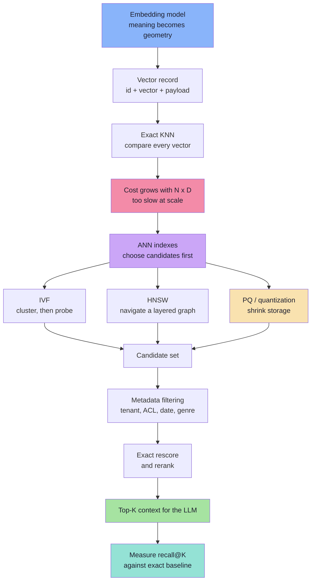

# Lecture 10 — Deep Dive into Vector Databases and ANN Algorithms

> **Lecture Theme:** Lecture 09 established that exact similarity search becomes a linear scan and that a vector database needs an approximate index. This lecture opens the index. It asks: **how do IVF and HNSW avoid comparing a query with every vector, how does Product Quantization shrink a vector by 64×, and what must a database provide besides an index?** The destination is a production RAG retrieval system you can reason about, tune, and measure.

---

## Chapter Index

| # | Chapter | Core Question Answered |
|---|---------|------------------------|
| [01](./01_Embeddings_and_the_Geometry_of_Meaning.md) | Embeddings and the Geometry of Meaning | What is an embedding, and which choices are irreversible? |
| [02](./02_Similarity_Distance_and_Metric_Consistency.md) | Similarity, Distance and Metric Consistency | Why do cosine, dot product and L2 disagree — and which one is correct? |
| [03](./03_Exact_KNN_and_the_ANN_Bargain.md) | Exact KNN and the ANN Bargain | What exactly are we giving up when we go approximate? |
| [04](./04_IVF_Inverted_File_Index.md) | IVF — Inverted File Index | How does "cluster, then probe" cut a million comparisons to a few thousand? |
| [05](./05_HNSW_Hierarchical_Navigable_Small_World.md) | HNSW — Hierarchical Navigable Small World | How does a layered graph turn search into navigation? |
| [06](./06_Vector_Compression_and_Product_Quantization.md) | Vector Compression and Product Quantization | How do we store 100M vectors without 614 GB of RAM? |
| [07](./07_Anatomy_of_a_Vector_Database.md) | Anatomy of a Vector Database | What are the five layers, and where does filtering belong? |
| [08](./08_Qdrant_pgvector_and_the_Storage_Decision.md) | Qdrant, pgvector and the Storage Decision | When do you adopt a dedicated vector DB, and when is Postgres enough? |
| [09](./09_Production_RAG_Retrieval_Systems.md) | Production RAG Retrieval Systems | How do ingestion, retrieval, reranking, evaluation and security fit together? |
| [**Complete**](./Lecture_10_Complete_Notes.md) | **Complete Consolidated Notes** | All nine chapters condensed into one reference with cheat sheet, glossary and self-check |

> 📄 **Prefer a single document?** Read the **[Lecture 10 — Complete Consolidated Notes](./Lecture_10_Complete_Notes.md)**. It keeps the load-bearing ideas, numbers and decision tables, and links back to the chapters for derivations and full pseudo-code.

---

## The Big Idea in One Diagram

---

## How to Read These Notes

1. **Chapters 01–02 are the foundation.** They define the vector, the metric, and the compatibility rules. Every later chapter assumes them.
2. **Chapter 03 is the contract.** It defines exact search, recall@K, and the speed–recall trade-off. Do not skip the arithmetic.
3. **Chapters 04–06 are the algorithms.** IVF and HNSW are alternative answers to the same question: *which candidates should I score?* PQ answers a different question: *how do I store them?*
4. **Chapters 07–08 are the product.** A vector database is an index plus storage, filtering, lifecycle and operations.
5. **Chapter 09 is the system.** Retrieval quality is decided by chunking, filtering, reranking and evaluation, not by choosing a vendor.

---

## Conventions Used in This Lecture

| Convention | Meaning |
|---|---|
| **Mermaid** | Every structural diagram is Mermaid (`flowchart`, `sequenceDiagram`, `classDiagram`). |
| **TypeScript-style pseudo-code** | Snippets describe data flow, contracts and algorithmic decisions. They are **not** runnable production code. |
| **Measured claims** | Recall and latency are always "typically" or "for this configuration" — never universal constants. |
| **Sources** | `Notes.pdf` (54 numbered sections), `Excalidraw-Notes.svg`, and the legacy `vdb&EMB.md` notes, consolidated into these chapters. |

---

## Sources

- 📄 [`Notes.pdf`](./Notes.pdf) — *Deep Dive into Vector Databases and ANN Algorithms*: exact KNN, ANN, Recall@K, IVF, HNSW, Product Quantization, the five layers of a vector database, pgvector.
- 🖼️ [`Excalidraw-Notes.svg`](./Excalidraw-Notes.svg) — hand-drawn notes: KNN pseudo-code, cosine formula, the Delhi coffee-shop analogy, IVF with K-means, HNSW distances and node structure, PQ worked example, vector record shape, pgvector query.
- 📝 `vdb&EMB.md` (legacy, now consolidated into these chapters and removed) — embeddings, similarity metrics, Qdrant JavaScript client, embedding-model compatibility, hybrid search, reranking and production RAG. Its content lives in Chapters 01, 02, 07, 08 and 09.

---

## One-Line Summaries

| Chapter | One-line summary |
|---|---|
| 01 | An embedding is a learned coordinate; the model, version, dimension and task type define the space. |
| 02 | Cosine, dot product and L2 rank vectors differently unless you normalize — pick the metric the model was trained for. |
| 03 | Exact search is ground truth; ANN buys sub-linear speed by choosing candidates and accepting measurable misses. |
| 04 | IVF partitions space with centroids and searches only the `nprobe` most promising lists. |
| 05 | HNSW descends a probabilistic hierarchy of proximity graphs, making large jumps then local ones. |
| 06 | Quantization trades numerical precision for memory; PQ stores codebook IDs instead of coordinates. |
| 07 | A vector DB = data + embeddings + metric + ANN index + payload filtering + lifecycle. |
| 08 | Qdrant is retrieval-first; pgvector keeps vectors beside relational data; the decision is operational, not tribal. |
| 09 | RAG quality is retrieval quality: chunk well, filter early, rerank, measure, and keep the source of truth outside the vector DB. |

