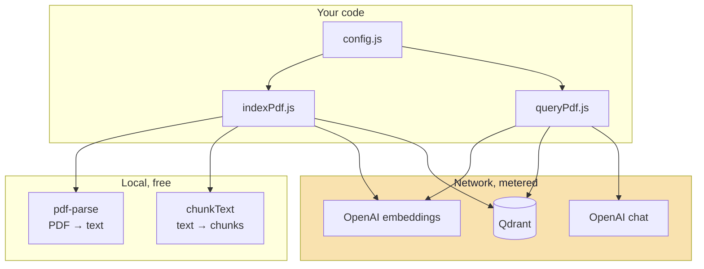
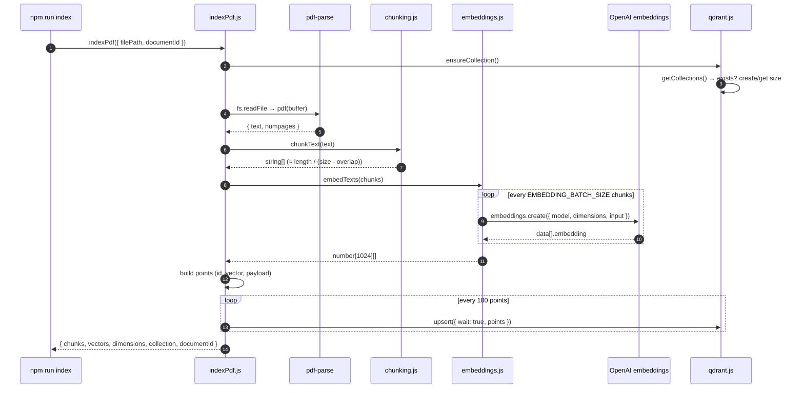
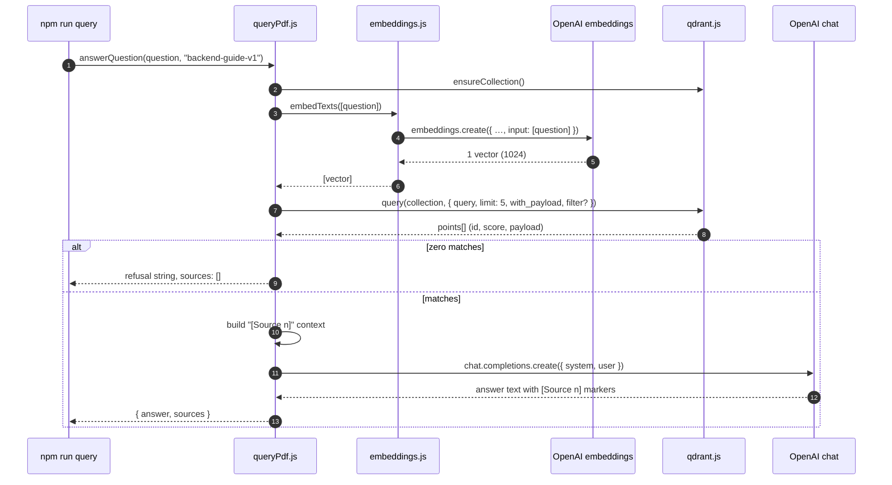

# Chapter 01: Overview, Provider Structure & File Map

> **Chapter Goal:** See the whole system before reading a function. Know what each file owns, which external service sits behind each stage, what a "record" looks like, and how one question travels from text to a cited answer.

> **Lecture mapping:** Chapter 02 (the open-book architecture) and Chapter 03 (ingestion). This chapter is the map; 02–07 are the territory.

> **Files covered:**

| File | Lines | Purpose |
| :--- | ---: | :--- |
| `package.json` | 17 | Four dependencies and two npm scripts. |
| `.env` | 14 | Every tunable, with working defaults. |
| `documents/README.md` | 19 | Where the PDF goes and the command that indexes it. |
| `src/**` | 477 | Six modules, one per pipeline stage. |

---

## 1. What This Codebase Builds

The notes answer one question: **how does a model answer from *your* documents, and show what it used?** This code implements the smallest honest version of that answer.

```text
offline:  PDF ──► text ──► clean ──► chunks ──► vectors ──► Qdrant points
online:   question ──► vector ──► top-5 matches ──► labelled context ──► answer + sources
```

Two properties make it RAG rather than a chat demo:

1. **The answer is bounded by what was indexed.** Ingestion is the only writer; querying is the only reader. If the PDF never contained the fact, no prompt can supply it.
2. **The evidence is returned.** Every answer ships with the exact chunks that were placed in the prompt, their scores, and their positions in the source document.

Everything else — batching, UUID ids, dimension guards, the `[Source n]` labels — exists to keep those two properties true.

### The seven serving steps, mapped to files

The notes list seven steps for one question. Here is where each one lives:

| # | Step | File | Function |
| :---: | :--- | :--- | :--- |
| 1 | Accept the question | `queryPdf.js` | `answerQuestion(question)` |
| 2 | Embed it with the *same* model | `embeddings.js` | `embedTexts([question])` |
| 3 | Search the index | `qdrant.js` | `qdrant.query(collection, …)` |
| 4 | Take the top-K | `qdrant.js` | `limit: config.topK` |
| 5 | Assemble context with labels | `queryPdf.js` | `matches.map(…).join("\n\n")` |
| 6 | Generate under a prompt contract | `queryPdf.js` | `openai.chat.completions.create(…)` |
| 7 | Return the answer and its sources | `queryPdf.js` | `return { answer, sources }` |

Step 0 — building the index those steps read — is the other pipeline: `indexPdf.js` orchestrating `chunking.js`, `embeddings.js` and `qdrant.js`.

---

## 2. The Five Design Decisions

### 2.1 Stages are modules, not classes

There is no `RagService`, no dependency-injection container, no interface file. `chunkText` takes a string and returns strings. `embedTexts` takes strings and returns vectors. `ensureCollection` takes nothing and returns a collection name.

That is not laziness — it is a teaching constraint. When every stage is a pure-ish function in its own file, you can test and replace one stage without touching the others:

| Stage | Function | Swap it with |
| :--- | :--- | :--- |
| Load | `readPdfText(filePath)` | `unpdf`, `pdfjs-dist`, an S3 download, a `.md` reader |
| Chunk | `chunkText(text, size, overlap)` | recursive/semantic/parent-child chunkers |
| Embed | `embedTexts(texts, batchSize)` | Cohere, Gemini, a local model, a cache |
| Store | `ensureCollection()`, `qdrant.upsert/query` | pgvector, Pinecone, an in-memory array |
| Generate | `openai.chat.completions.create(…)` | any chat model, or an extractive stub |

### 2.2 One config object, read once

`src/config.js` is the only file that touches `process.env`. Everything downstream imports `config`, so ingestion and querying cannot drift apart. This matters more than it sounds: **if the indexer embeds with `text-embedding-3-small` at 1024 dimensions and the query path embeds at 1536, cosine similarity becomes meaningless and the system fails silently** — no error, just bad answers. One config object makes that impossible.


### 2.3 Three external services, four providers

The word "provider" in this codebase means *the thing that owns an SDK*. There are four stages that wrap one, and each is confined to a single file:

| Provider | File | SDK | What you configure | What it costs |
| :--- | :--- | :--- | :--- | :--- |
| Embeddings | `src/embeddings.js` | `openai` | model + dimensions | per token, per re-index |
| Vector store | `src/qdrant.js` | `@qdrant/js-client-rest` | URL, API key, collection | storage + queries |
| Generation | `src/queryPdf.js` | `openai` | chat model | per input token (context × topK) + output token |
| PDF text | `src/indexPdf.js` | `pdf-parse` | nothing | free, local, CPU |



Note the asymmetry: the **same embedding provider is used twice**, once at write time and once at read time. The chat provider is used once. The store is the only shared mutable state.

### 2.4 A record is id + vector + payload

Qdrant calls this a *point*. The code stores exactly four payload fields per chunk, and those four fields are the entire provenance story:

```js
{
  id: "3dcdd949-b7cc-1f05-5008-d43640b21c9e",   // deterministic UUID from documentId + chunkIndex
  vector: [0.013, -0.004, …],                    // 1024 floats
  payload: {
    text:       "Express middleware runs before the route handler…",  // the evidence
    source:     "backend-guide.pdf",                                  // which file
    documentId: "backend-guide-v1",                                   // which version of that file
    chunkIndex: 0                                                     // where inside it
  }
}
```

`text` is what makes retrieval useful: k-NN can rank a point without ever decoding its text, but the model needs the words. `documentId` doubles as the filter key and as the id seed, which is why re-indexing is idempotent.

### 2.5 Two entry points, one contract

`npm run index` writes. `npm run query` reads. They share `config`, `embedTexts` and `ensureCollection` — and nothing else. There is no code path in which answering can quietly re-index, or in which indexing calls the chat model. The separation is what makes "is the index stale?" a solvable question.

---

## 3. Complete File Tree

```text
Lecture 11/code/Eassy RAG/
├── package.json                 # 4 deps, 2 scripts, "type": "module"
├── package-lock.json            # resolved versions (openai 4.104.0, qdrant client 1.19.0)
├── .env                         # every tunable; contains a PLACEHOLDER key
├── .gitignore                   # ignores .env and node_modules/
├── guide.md                     # 778-line article this code was written for (prose, not docs)
├── documents/
│   └── README.md                # "put your PDF here" + the indexing command
├── src/
│   ├── config.js                # 62  env → config + fail-fast guards
│   ├── chunking.js              # 64  chunkText(): fixed window, word snap, overlap
│   ├── embeddings.js            # 75  embedTexts(): batched, index-aligned, validated
│   ├── qdrant.js                # 50  client + ensureCollection() + dimension guard
│   ├── indexPdf.js              # 104 PDF → chunks → vectors → points → upsert
│   └── queryPdf.js              # 122 question → vector → matches → prompt → answer
└── implementations guide/       # this guide (01 → 08)
```

Two files deserve a warning before you read any code:

- **`.env` is on disk with a placeholder key** and is correctly ignored by the adjacent `.gitignore` (`.env`, `node_modules/`). Keep it that way: the file is the right place for a key locally, the wrong place for one in git. Chapter 08 lists secrets handling as a remaining gap for production.
- **`guide.md` is the article, not the documentation.** It contains the same code with variations (a `vectors.some()` version, an in-memory illustration) that the source no longer uses. When they disagree, the source wins, and this guide documents the source.

---

## 4. `package.json` — the project contract

#### 📄 `package.json`

```json
{
  "name": "pdf-rag",
  "version": "1.0.0",
  "type": "module",
  "description": "PDF RAG system using OpenAI embeddings and Qdrant",
  "main": "src/indexPdf.js",
  "scripts": {
    "index": "node --input-type=module -e 'import { indexPdf } from \"./src/indexPdf.js\"; const result = await indexPdf({ filePath: \"./documents/backend-guide.pdf\", documentId: \"backend-guide-v1\" }); console.log(result);'",
    "query": "node src/queryPdf.js"
  },
  "dependencies": {
    "@qdrant/js-client-rest": "^1.13.0",
    "dotenv": "^16.0.0",
    "openai": "^4.0.0",
    "pdf-parse": "1.1.1"
  }
}
```

**Block by block:**

- **`"type": "module"`** — every `.js` file is an ES module, so `import`/`export` and top-level `await` work with no build step. This is also why the `pdf-parse` import needs care (Chapter 06): that package is CommonJS, and Node's ESM loader treats it differently from `require()`.
- **`"main": "src/indexPdf.js"`** — cosmetic here; nothing imports the package. It signals that ingestion is the module with the public function.
- **`"index"` script** — a one-liner that imports `indexPdf` and calls it with a hard-coded PDF path and document id. Two details matter:
  - `--input-type=module` lets `node -e` parse `import` and top-level `await`, so you get a runnable pipeline without a CLI file.
  - The path and `documentId` live **inside the script**, so switching documents means editing `package.json`. A CLI (`node src/indexPdf.js ./documents/x.pdf x-v1`) would be cleaner; the article chose the shortcut. Chapter 06 shows both.
- **`"query"` script** — `node src/queryPdf.js` forwards everything after `--` to `process.argv.slice(2)`. So `npm run query -- "What is middleware?"` becomes `node src/queryPdf.js "What is middleware?"`.
- **`"@qdrant/js-client-rest": "^1.13.0"`** — the official REST client. `^` resolved to **1.19.0** in the installed tree, which is why `qdrant.query()` (the newer search API) exists; `search()` is the older name for the same call.
- **`"dotenv": "^16.0.0"`** — loaded for its side effect (`import "dotenv/config"`) in `config.js` and nowhere else.
- **`"openai": "^4.0.0"`** — v4 of the SDK, which exposes `embeddings.create({ dimensions })` and `chat.completions.create`. Resolved to **4.104.0**.
- **`"pdf-parse": "1.1.1"`** — **pinned exactly**, not `^1.1.1`. Two reasons: 2.x changed the API to a `PDFParse` class, and 1.1.1's top-level `index.js` contains a debug block that breaks ESM imports on modern Node. The pin keeps behaviour reproducible; Chapter 06 shows the import workaround regardless.

**Command:**

```bash
npm install
node -e "console.log(require('./node_modules/openai/package.json').version)"   # 4.104.0
```


---

## 5. `.env` — the eleven numbers that decide everything

#### 📄 `.env`

```ini
OPENAI_API_KEY=your_openai_api_key

EMBEDDING_MODEL=text-embedding-3-small
EMBEDDING_DIMENSIONS=1024
CHAT_MODEL=gpt-4o-mini

CHUNK_SIZE=1000
CHUNK_OVERLAP=150
EMBEDDING_BATCH_SIZE=100

QDRANT_URL=http://localhost:6333
QDRANT_API_KEY=
QDRANT_COLLECTION=pdf_knowledge
TOP_K=5
```

**Block by block:**

| Variable | Default here | What it controls | What breaks if you change it later |
| :--- | :--- | :--- | :--- |
| `OPENAI_API_KEY` | placeholder | Auth for both embeddings and chat. | `config.js` throws at import time if empty. |
| `EMBEDDING_MODEL` | `text-embedding-3-small` | Which space the text is projected into. | A different model = a different space = **re-index everything**. |
| `EMBEDDING_DIMENSIONS` | `1024` | Output width, and the collection's `size`. | Fixed at collection creation; Chapter 05 shows the guard that catches a mismatch. |
| `CHAT_MODEL` | `gpt-4o-mini` | The generator. | Swappable any time; no re-index needed. |
| `CHUNK_SIZE` | `1000` | Characters per chunk. | Changing it changes chunk boundaries = re-index. |
| `CHUNK_OVERLAP` | `150` | Shared characters between neighbours. | Must stay `< CHUNK_SIZE`; enforced in `config.js` and again in `chunkText`. |
| `EMBEDDING_BATCH_SIZE` | `100` | Inputs per embedding request. | Does **not** change vectors — only request count and memory. |
| `QDRANT_URL` | `http://localhost:6333` | REST endpoint (the gRPC port 6334 is unused). | — |
| `QDRANT_API_KEY` | empty | Empty for local Docker, required for Qdrant Cloud. | `|| undefined` in config so the client omits the header instead of sending `""`. |
| `QDRANT_COLLECTION` | `pdf_knowledge` | One collection = one vector space. | Different corpora should use different collections. |
| `TOP_K` | `5` | How many chunks reach the prompt. | Bigger K = more recall, more tokens, more distraction. |

### The three independent limits

The article is explicit about this, and it matters, because conflating them is the most common misunderstanding:

| Setting | Limits | Unit |
| :--- | :--- | :--- |
| `CHUNK_SIZE=1000` | text per retrieval unit | **characters** |
| `EMBEDDING_BATCH_SIZE=100` | inputs per HTTP request | **chunks** |
| `EMBEDDING_DIMENSIONS=1024` | width of one vector | **floats** |

A 5,000-character document at `CHUNK_SIZE=1000`, `overlap=150` produces 6 chunks; those 6 chunks travel in one embedding request whether `EMBEDDING_BATCH_SIZE` is 100 or 1,000; each vector is 1024 numbers regardless of either. Measured example: `Lecture 10/notes/Notes.pdf` → 32,381 characters → **36 chunks** → 1 embedding request at batch size 100.

### Why 1024 and not 1536

`text-embedding-3-small` outputs 1536 dimensions by default but accepts a `dimensions` parameter (Matryoshka truncation). The Qdrant collection in the article's scenario is fixed at 1024, so the code asks OpenAI for 1024. **The rule is that the request, the query and the collection must agree** — 1024/1024/1024 or 1536/1536/1536. `config.js` refuses >1536 for this model, `ensureCollection()` refuses a collection whose size differs, and `answerQuestion()` refuses a query vector of the wrong width.

---

## 6. `documents/` — the corpus

#### 📄 `documents/README.md`

````md
# documents/

Place your PDF files here.

Example: `backend-guide.pdf`

When indexing, use:
```
node --input-type=module -e '
import { indexPdf } from "./src/indexPdf.js";

const result = await indexPdf({
  filePath: "./documents/backend-guide.pdf",
  documentId: "backend-guide-v1"
});

console.log(result);
'
```
````

**Block by block:**

- The directory is the **input contract**: one PDF in, one indexed document out. Everything the system knows must arrive here.
- `filePath` is relative to the **project root**, not to `src/`, because both npm scripts run with `cwd = project root`.
- `documentId` is the version handle. `backend-guide-v1` → `backend-guide-v2` when the PDF changes produces **new point ids**, so both versions coexist until you delete the old one (Chapter 06 explains the consequence; Chapter 08 shows the cleanup call).
- The PDF itself is **not** in the repository — the folder ships with this README only. Any PDF works; Chapter 06 measures real extraction on 57-page lecture decks.

---

## 7. Data contracts

Four shapes cross module boundaries. Nothing else does.

### 7.1 Chunk — `string`

```js
"Express middleware runs before the route handler and can read the request."
```

A chunk is just a trimmed string. No id, no metadata, no page number. Everything else is added at the point stage. That is a real simplification and a real limitation: because `chunkText` never learns *where* in the PDF it is, the payload's `chunkIndex` is its only locator. The notes' "context header" recommendation (prepend `Document: …, Section: …` to each chunk) would be added here.

### 7.2 Vector — `number[]` of length `EMBEDDING_DIMENSIONS`

```js
[0.0153, -0.0071, 0.0339, …]   // 1024 finite floats
```

`embedTexts` guarantees three things about every vector it returns: it is an array, it has exactly `config.openai.embeddingDimensions` entries, and every entry passes `Number.isFinite`. Anything else throws — before a corrupt point can be written.

### 7.3 Point — what Qdrant stores

| Field | Type | Source | Used for |
| :--- | :--- | :--- | :--- |
| `id` | UUID string | `createPointId(documentId, index)` | idempotent upsert |
| `vector` | `number[1024]` | `vectors[index]` | similarity search |
| `payload.text` | string | `chunks[index]` | the evidence placed in the prompt |
| `payload.source` | string | `path.basename(filePath)` | human-readable attribution |
| `payload.documentId` | string | argument | filtering, versioning |
| `payload.chunkIndex` | number | loop index | ordering, citation granularity |

### 7.4 Match — what Qdrant returns

Verified against a live 1.19 client:

```js
{
  points: [
    { id: "3dcdd949-…", score: 1.0,    payload: { text, source, documentId, chunkIndex } },
    { id: "b42e10f1-…", score: 0.5403, payload: { … } },
    { id: "b5812165-…", score: -0.4163, payload: { … } }
  ]
}
```

Two things to internalise:

- `score` is **cosine similarity**, `-1 … 1`. With `Cosine` distance, unrelated text can score near zero and anti-correlated text negative. There is **no threshold** in this codebase, so a low-scoring match is still sent to the model.
- `payload` is only present because the query passed `with_payload: true`. Forget that flag and the answer degenerates to "I couldn't find relevant information" with five perfectly good matches in hand.

### 7.5 Answer — the function's return value

```js
{
  answer:  "Middleware runs before the route handler … [Source 1]",
  sources: [
    { sourceNumber: 1, document: "backend-guide.pdf", chunkIndex: 0, score: 1.0, text: "…" }
  ]
}
```

`sources` is the whole point of the exercise: the caller can render the same `[Source n]` labels the model was told to use, with the text and score behind each one.


---

## 8. The Two Lifecycles, End to End

### 8.1 Indexing one PDF



### 8.2 Answering one question



Read those two diagrams again at the end of the guide. Each chapter is one box in them.

---

## 9. Commands

| Command | What it does | Needs |
| :--- | :--- | :--- |
| `npm install` | Installs the four dependencies. | network |
| `docker run -d --name qdrant -p 6333:6333 -p 6334:6334 qdrant/qdrant` | Local Qdrant. | Docker |
| `npm run index` | Index `./documents/backend-guide.pdf` as `backend-guide-v1`. | key, Qdrant, the PDF |
| `npm run query -- "…"` | Top-5 retrieval + grounded answer. | key, Qdrant, an index |
| `node --check src/config.js` | Parse-only syntax check. | nothing |
| `curl localhost:6333/collections` | Confirm Qdrant is up. | Qdrant |
| `docker rm -f qdrant` | Stop and remove the container (data is lost). | Docker |

---

## 10. Reading Order

- **Configuration and guards** → 02
- **Turning a PDF into chunks** → 03
- **Turning chunks into vectors** → 04
- **Creating the collection and the client** → 05
- **The write pipeline** → 06
- **The read pipeline and prompt** → 07
- **Making it run, and what still breaks** → 08

**Next:** [Chapter 02 — Configuration](./02_Configuration.md)

