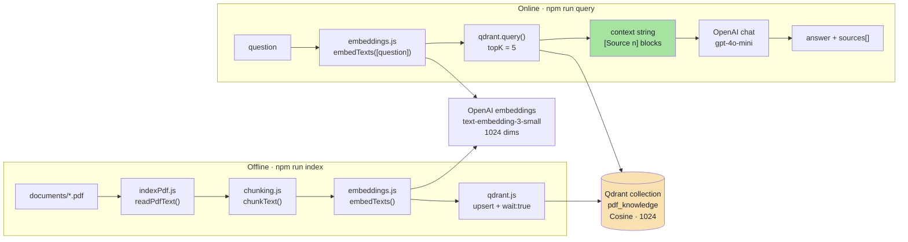

# Implementation Guide — Lecture 11 · *Eassy RAG*

**PDF → chunks → embeddings → Qdrant → grounded answer, in six JavaScript files.**

This is the chapter-by-chapter build guide for the lecture's minimal RAG implementation (`Lecture 11/code/Eassy RAG`). It follows the format used across Lectures 03–11:

1. **File details** — path, role, exports, dependencies, line count.
2. **Complete source code** — the whole file, never an excerpt.
3. **Block-by-block explanation** — what the block does, how it works, and why it is written that way.
4. **Commands + verification** — how to run or prove the block, including what was actually executed while writing this guide.

> **Scope.** Six source files, 477 lines, four runtime dependencies (`openai`, `@qdrant/js-client-rest`, `pdf-parse@1.1.1`, `dotenv`), two scripts. Everything the notes call the *open-book architecture* is here: the offline pipeline (extract → clean → chunk → embed → upsert) and the online pipeline (embed question → search → assemble context → generate a grounded answer → return sources). Nothing else is here: no HTTP server, no sessions, no hybrid search, no golden set. Those live in the sibling [`Productions RAG`](../../Productions%20RAG/implementations%20guide/README.md) codebase and its 15-chapter guide.

---

## 🧭 System Topology



---

## 📚 Chapter Navigation

| Chapter | Title | Files Covered | Notes Mapping |
| :---: | :--- | :--- | :--- |
| **[01](./01_Overview_Provider_Structure_and_File_Map.md)** | **Overview, Provider Structure & File Map** | `package.json`, `.env`, `.gitignore`, `documents/README.md`, the full `src/` tree, data contracts, both pipelines. | 02, 03 |
| **[02](./02_Configuration.md)** | **Configuration** | `src/config.js` | 03, 04 |
| **[03](./03_Chunking.md)** | **Chunking** | `src/chunking.js` | 03 |
| **[04](./04_Embeddings.md)** | **Embeddings** | `src/embeddings.js` | 04 |
| **[05](./05_Qdrant_Client_and_Collection.md)** | **Qdrant Client & Collection** | `src/qdrant.js` | 05 |
| **[06](./06_Indexing_Pipeline.md)** | **The Indexing Pipeline** | `src/indexPdf.js` | 03, 05 |
| **[07](./07_Query_Pipeline_and_Grounded_Answers.md)** | **The Query Pipeline & Grounded Answers** | `src/queryPdf.js` | 04, 05, 06 |
| **[08](./08_Run_Verify_and_Troubleshoot.md)** | **Run, Verify & Troubleshoot** | commands, Docker, expected output, failure matrix, production gaps. | 08, 09 |

### 🗺️ Reading Paths

| If you want to… | Read |
| :--- | :--- |
| See the whole system before any code | **01** |
| Understand the settings that break silently | **02** |
| Learn ingestion | **02 → 03 → 04 → 05 → 06** |
| Learn retrieval + generation | **04 → 05 → 07** |
| Just make it run | **08** |
| Connect code to theory | the matching chapters in [`../../../notes/README.md`](../../../notes/README.md) |


---

## 🗂️ The Six Source Files

| File | Lines | Owns | External dependency |
| :--- | ---: | :--- | :--- |
| `src/config.js` | 62 | Environment → one validated `config` object, fail-fast guards. | `dotenv` |
| `src/chunking.js` | 64 | Character-window chunking with word-boundary snap and overlap. | — |
| `src/embeddings.js` | 75 | Batched embedding calls, position alignment, vector validation. | `openai` |
| `src/qdrant.js` | 50 | Qdrant client, collection lifecycle, dimension guard. | `@qdrant/js-client-rest` |
| `src/indexPdf.js` | 104 | Offline pipeline: PDF text → points → batched upload. | `pdf-parse`, `node:crypto` |
| `src/queryPdf.js` | 122 | Online pipeline: question → matches → prompt → answer + sources. | `openai` |

Each file depends only on the ones to its left. There are no circular imports, no class hierarchies, no framework. That is deliberate: every boundary in the notes (loader, chunker, embedder, store, generator) is a visible module boundary you can replace on its own.

---

## ⚙️ Commands Used Throughout

```bash
cd "Lecture 11/code/Eassy RAG"
npm install

# Qdrant — required for chapters 05, 06, 07
docker run -d --name qdrant -p 6333:6333 -p 6334:6334 qdrant/qdrant

npm run index      # index ./documents/backend-guide.pdf as documentId "backend-guide-v1"
npm run query -- "What is middleware in Express?"

node --check src/chunking.js   # syntax-check any file without running it
```

| Command | What it does | Needs |
| :--- | :--- | :--- |
| `npm install` | Installs `openai`, `@qdrant/js-client-rest`, `pdf-parse@1.1.1`, `dotenv`. | network |
| `docker run … qdrant/qdrant` | Local Qdrant on `:6333` (REST) and `:6334` (gRPC). | Docker |
| `npm run index` | Extract → chunk → embed → upsert one PDF. | `OPENAI_API_KEY`, Qdrant, the PDF |
| `npm run query -- "…"` | Retrieve top-5 chunks and generate a cited answer. | `OPENAI_API_KEY`, Qdrant, an index |
| `node --check src/*.js` | Parses the file, prints nothing on success. | nothing |

---

## 🧠 Conventions That Apply Everywhere

1. **One embedding model, one dimension.** `EMBEDDING_MODEL` and `EMBEDDING_DIMENSIONS` are read once, used by ingestion, querying and the Qdrant collection. There is no second source of truth.
2. **A chunk is the unit of retrieval.** One chunk → one vector → one Qdrant point → one `[Source n]` label.
3. **Point ids are deterministic.** `sha256(documentId:chunkIndex)` shaped into a UUID, so re-indexing overwrites the same points instead of duplicating them.
4. **The payload carries the text back.** Vector search returns numbers; the words only arrive because `payload.text` was stored.
5. **Labels before generation.** The context string numbers its blocks `[Source 1] …`; the model is asked to reuse those labels, and the same numbering is returned in `sources`.
6. **No evidence, no generation.** If Qdrant returns zero points, the function returns a refusal string and never calls the chat model.
7. **Fail fast.** Missing API key, `overlap >= chunkSize`, too many dimensions, a collection with the wrong size, or a chunk/vector count mismatch all throw before a partial index can be written.

---

## ✅ What Was Actually Verified

| Check | Result |
| :--- | :--- |
| `node --check` on all six source files | pass |
| `chunkText` on a 130,074-character synthetic document | 154 chunks, lengths 499–1000 |
| `chunkText` on `Lecture 01/notes/Notes.pdf` (57 pages) | 47,665 chars → 56 chunks |
| `chunkText` on `Lecture 10/notes/Notes.pdf` (57 pages) | 32,381 chars → 36 chunks |
| `chunkText` with `overlap === chunkSize` | throws `Chunk overlap must be non-negative and smaller than chunk size` |
| `chunkText` with an 850+ character whitespace-free run | throws `Chunking failed to advance` (documented in **03**) |
| `ensureCollection()` against Docker Qdrant, client 1.19.0 | creates `pdf_knowledge` with `{size:1024, distance:"Cosine"}` |
| Second `ensureCollection()` on the same collection | returns the name, no error |
| `ensureCollection()` with `EMBEDDING_DIMENSIONS=768` | throws `Collection dimension mismatch. Expected 768, but collection uses 1024…` |
| `qdrant.upsert()` with the deterministic UUIDs | 3 points stored; a repeated upsert leaves `points_count = 3` |
| `qdrant.query()` shape | `{ points: [ { id, score, payload } ] }`, cosine scores `1.00 / 0.54 / -0.42` |
| `qdrant.query()` with a non-matching `documentId` filter | 0 points → the refusal branch |
| `import pdf from "pdf-parse"` under Node 24 (ESM) | **fails** with `ENOENT: ./test/data/05-versions-space.pdf` (see **06**) |
| `require("pdf-parse/lib/pdf-parse.js")` via `createRequire` | extracts text from a real 57-page PDF |
| OpenAI embeddings + chat completions | **not executed** — no API key in this environment; request shapes are in **04** and **07** |

> Absolute timings and costs depend on your machine, quota and model. Correctness should not.

---

## 📁 What Each Chapter Assumes

| Chapter | Assumes you have read |
| :--- | :--- |
| 02 | 01 (the map, and where `.env` lives) |
| 03 | 02 (`CHUNK_SIZE`, `CHUNK_OVERLAP`) |
| 04 | 03 (what one embedding input is) |
| 05 | 02 (`EMBEDDING_DIMENSIONS`, `QDRANT_*`) |
| 06 | 03, 04, 05 (all three stages it orchestrates) |
| 07 | 04, 05 (the same embedding call and the same collection) |
| 08 | everything |

---

Start here: **[Chapter 01 — Overview, Provider Structure & File Map](./01_Overview_Provider_Structure_and_File_Map.md)**

