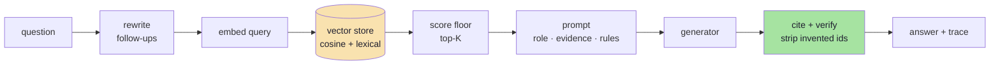

# Lecture 11 — RAG, implemented

A small, runnable implementation of the pipeline in [`../notes`](../notes): ingest
documents, chunk them, embed and index them, retrieve evidence, answer **only**
from that evidence with citations, keep conversation state, and evaluate retrieval
separately from generation.

It is deliberately basic — one class per stage, no framework — but every decision
that decides whether RAG works in production is present and configurable.

> **Guided tour:** [`implementations guide/`](./implementations%20guide/README.md)
> walks this codebase in 15 chapters (00 → 14), with the full source of every file
> and a block-by-block explanation of what it does and why.

> `index.js` is the lecture's original single-file sample (OpenAI + Pinecone +
> `pdf-parse`). It is kept for reference. Everything below lives in `src/` and
> also runs offline.

---

## Quick start

```bash
npm install

npm run demo     # full walkthrough, no API key, deterministic
npm run eval     # golden set: recall@K, citations, refusals, expected facts
```

With an OpenAI key, the same pipeline uses real embeddings and a real model:

```bash
cp .env.example .env      # set OPENAI_API_KEY
npm run ingest
npm run ask -- "What is the refund window for apparel?"
npm run dev               # http://localhost:3000
```

Without a key the providers auto-select `mock` embeddings and an `extractive`
generator, which quotes real paragraphs from the retrieved chunks. That keeps the
citation, refusal and evaluation paths testable in CI.

---

## Scripts

| Script | What it does |
|---|---|
| `npm run demo` | Offline walkthrough: chunking → prompt → answer → refusal → follow-up → trace |
| `npm run ingest` | Rebuilds the index from `knowledge/` and reports coverage |
| `npm run ask -- "…"` | One question, answer, citations and trace |
| `npm run eval` | Runs `eval/golden.json` and prints per-case metrics |
| `npm run dev` | Express API with watch mode |
| `npm run build` / `npm start` | Compile to `dist/` and run the compiled server |

---

## API

| Route | Purpose |
|---|---|
| `POST /api/query` | `{ question, sessionId? }` → `{ answer, citations[], refused, sessionId, trace }` |
| `POST /api/ingest` | Re-index. Idempotent, safe to retry |
| `GET /health` | Providers, dimensions, chunk count |
| `DELETE /api/sessions/:id` | Deletes one conversation (history, memory, caches) |

The `trace` is the part most RAG demos omit: the rewritten `searchQuery`, every
retrieved chunk with its score, context tokens, citation validity, refusal flag
and per-stage latency. Without it, a bad answer becomes an argument instead of an
investigation.

See [`test-requests.http`](./test-requests.http).

---

## How a request flows



Retrieval and generation are measured and degraded separately: an empty retrieval
returns the refusal **without calling the model**, which is both cheaper and more
honest than letting the model guess.

---

## Files, mapped to the chapters

| Chapter | Files |
|---|---|
| 01 — the stateless model | [`src/generation/provider.ts`](src/generation/provider.ts), [`src/session/store.ts`](src/session/store.ts) |
| 02 — the architecture | [`src/rag.service.ts`](src/rag.service.ts), [`src/container.ts`](src/container.ts) |
| 03 — ingestion | [`src/ingest/loader.ts`](src/ingest/loader.ts), [`src/ingest/chunker.ts`](src/ingest/chunker.ts) |
| 04 — embeddings | [`src/embeddings/provider.ts`](src/embeddings/provider.ts), [`openai`](src/embeddings/openai.provider.ts), [`mock`](src/embeddings/mock.provider.ts) |
| 05 — the vector index | [`src/store/vector-store.ts`](src/store/vector-store.ts), [`pinecone.store.ts`](src/store/pinecone.store.ts), [`src/retrieval/retriever.ts`](src/retrieval/retriever.ts), [`lexical.ts`](src/retrieval/lexical.ts) |
| 06 — grounded generation | [`src/generation/prompt.ts`](src/generation/prompt.ts), [`src/grounding/context.ts`](src/grounding/context.ts), [`citations.ts`](src/grounding/citations.ts) |
| 07 — conversation state | [`src/session/store.ts`](src/session/store.ts), [`src/session/rewrite.ts`](src/session/rewrite.ts) |
| 08 — evaluation | [`src/scripts/eval.ts`](src/scripts/eval.ts), [`eval/golden.json`](eval/golden.json) |
| 09 — production | [`src/app.ts`](src/app.ts), [`src/server.ts`](src/server.ts), [`src/config/env.ts`](src/config/env.ts) |

Supporting files: [`src/types/rag.types.ts`](src/types/rag.types.ts) (data
contracts), [`src/lib`](src/lib) (text, vectors, retry, errors),
[`knowledge/`](knowledge) (three policy documents used as the corpus).

---

## Configuration

Everything is validated at boot: an impossible chunk size or a missing key stops
the process instead of surfacing as a 500 on the first customer question.

| Variable | Default | Why it matters |
|---|---|---|
| `EMBEDDING_PROVIDER` | auto (`openai` if a key exists) | `mock` is deterministic and offline |
| `EMBEDDING_DIMENSIONS` | `1024` | Must be identical at ingestion and query time |
| `LLM_PROVIDER` | auto | `extractive` quotes, `openai` writes |
| `CHUNK_SIZE` / `CHUNK_OVERLAP` | `300` / `50` | Sets the unit of retrieval and the ceiling on recall |
| `TOP_K` | `4` | More context is more noise, cost and lost-in-the-middle |
| `MIN_SCORE` | `0.15` | Calibrated on the golden set, not guessed |
| `HYBRID_LEXICAL_WEIGHT` | `0.35` | `0` = pure vectors, `1` = pure keywords |
| `MAX_CONTEXT_TOKENS` | `1200` | Hard budget for retrieved evidence |
| `HISTORY_TURNS` | `6` | History is re-sent every turn; cost grows with its square |
| `SESSION_TTL_MINUTES` | `60` | How long a conversation is kept in memory |
| `VECTOR_STORE` | `memory` | `pinecone` swaps in the managed adapter |

`MIN_SCORE` is the one number you must re-measure when the embedding model, the
corpus or the chunk size changes. Run `npm run eval` after any of those changes.

---

## The four decisions the code is built around

1. **Chunk by structure, then by size.** Markdown headings become sections, then
   each section is cut into overlapping token windows. Ids are
   `sha256(source:index:text)`, so re-ingesting unchanged bytes is a no-op, and a
   changed document replaces its own chunks instead of leaving orphans behind.
2. **Retrieve with a floor, then trim.** Fetch `topK × 3` candidates, blend
   cosine with lexical overlap, drop everything under the floor. No evidence →
   refusal in code, no model call.
3. **Ground every sentence.** Retrieved text goes inside `<documents>` in the user
   turn, labelled `[n]`. Labels are assigned before the call and verified after it;
   invented ids are counted and stripped.
4. **Keep state server-side.** Sessions are a `Map` with a TTL and a turn cap. The
   client sends an id, never a transcript, and a follow-up is rewritten into a
   standalone search query before retrieval.

## Deliberately missing

A reranker (chapter 05 explains why you would add one), authentication and
per-tenant ACLs in the filter, streaming, response caching keyed by
`corpusVersion`, PDF OCR for scanned files, and any persistence for sessions.
Each is a small, well-defined addition on top of the interfaces here — which are
the point of the exercise.

