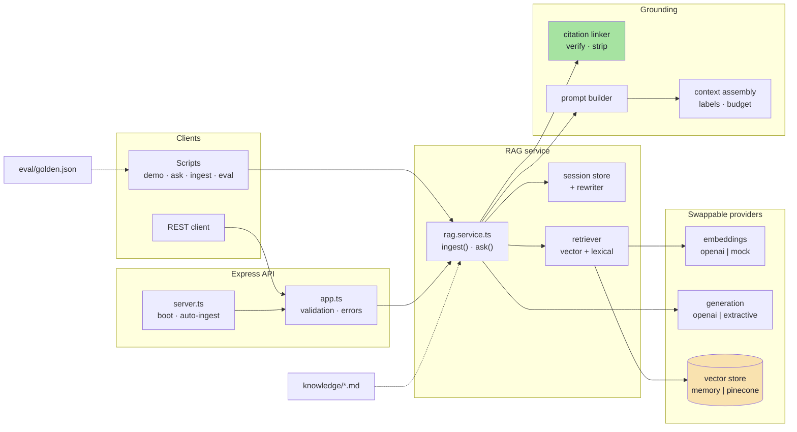
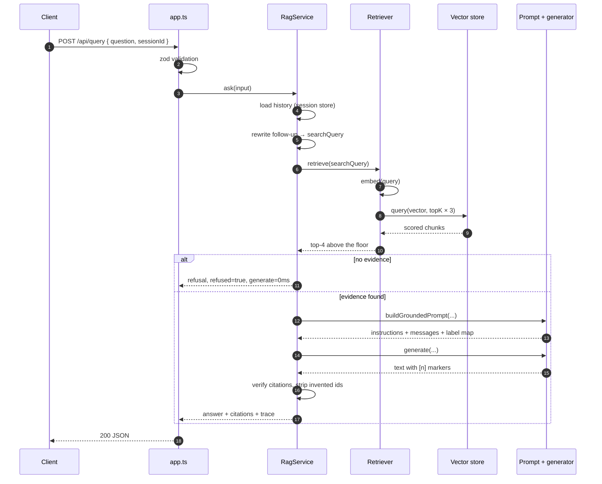

# Chapter 00: Overview, Provider Structure & File Map

> **Chapter Goal:** See the whole pipeline before reading a single function. Know which layer owns which decision, how a provider plugs in, and how one customer question travels from text to a cited answer.

> **Lecture mapping:** all chapters. This is the map; Chapters 01–14 are the territory.

> **Files covered:**

| File | Purpose |
| :--- | :--- |
| `package.json` | Dependencies and scripts: Express, Zod, OpenAI SDK, Pinecone client, tiktoken, unpdf. |
| `tsconfig.json` | Strict ES2022 / NodeNext compilation to `dist/`. |
| `.env.example` | Every environment variable, with offline defaults. |
| `.gitignore` | Keeps secrets, build output and the generated index out of git. |
| `src/**` | 30 source files, grouped by pipeline stage. |

---

## 1. What This Codebase Builds

Lecture 11 answers one question: **how does a model answer from *your* documents, and prove it?**

The code implements both pipelines the notes describe, in the order they teach them:

```text
offline:  documents ──► clean ──► chunk ──► embed ──► index
online:   question ──► rewrite ──► embed ──► retrieve ──► prompt ──► generate ──► cite ──► trace
```

Two properties make it a RAG system rather than a chat demo:

1. **The answer is bounded by the evidence.** If retrieval finds nothing above the score floor, the refusal is returned *without calling the model at all*.
2. **Every claim is checkable.** Citations are labels the code assigned before generation and verified after it, not text the model invented.

Everything else — chunking, embeddings, indexes, sessions, evaluation — exists to make those two properties true.

---

## 2. System Topology



---

## 3. The Five Design Decisions

### 3.1 Two pipelines, one class

`RagService` owns `ingest()` (offline, slow, runs when documents change) and `ask()` (online, latency-bound). Keeping them together makes the contract visible: **whatever ingestion wrote is the only thing answering can retrieve.** There is no second path that "just asks the model".

### 3.2 Providers are adapters

Nothing above `src/embeddings` knows OpenAI exists. Nothing above `src/generation` knows the Responses API exists. The interfaces are narrow:

```text
EmbeddingProvider  { name, model, dimensions, embed(texts, task) }
GenerationProvider { name, model, generate({ instructions, messages }) }
VectorStore        { upsert, query, deleteBySource, count, listSources? }
```

That boundary is what lets every chapter run offline with `mock` + `extractive` and still use a real model with one environment change.

### 3.3 Evidence is data, never instructions

Retrieved chunks go inside `<documents>` in the **user** turn. Rules stay in `instructions`. This is not cosmetic: it is the only structural defence against a document that says "ignore previous instructions".

### 3.4 Refusal is a contract

One exact sentence, exported as `REFUSAL_MESSAGE`, used by the prompt and by the refusal detector. Measurable refusals are testable refusals; "I'm sorry, I can't help with that" is not.

### 3.5 Nothing is trusted, everything is traced

Citations are resolved against a `Map` built before the call. Invented ids are counted and stripped. Every request returns a trace with the rewritten query, matched chunks and per-stage latency — because "the answer was wrong" is not a bug report.

---

## 4. Complete File Tree

```text
Lecture 11/code/
├── package.json                  # dependencies + scripts
├── tsconfig.json                 # strict ES2022 / NodeNext
├── .env.example                  # providers, chunking, retrieval, sessions
├── .gitignore
├── README.md                     # architecture, quick start, measured results
├── test-requests.http            # every endpoint, ready for REST Client
├── index.js                      # the lecture's original single-file sample
├── eval/
│   └── golden.json               # 12 questions: 10 answerable, 2 not
├── knowledge/                    # the corpus ingested at boot
│   ├── refund-policy.md
│   ├── shipping-policy.md
│   └── warranty-policy.md
├── implementations guide/        # this guide (00 → 14)
└── src/
    ├── server.ts                 # boot → auto-ingest → listen → shutdown
    ├── app.ts                    # Express app, routes, error mapping
    ├── container.ts              # composition root: the only wiring file
    ├── rag.service.ts            # ingest() + ask() + trace
    ├── config/env.ts             # Zod-validated environment
    ├── types/rag.types.ts        # chunk, record, match, citation, trace
    ├── lib/                      # text, vectors, retry, errors
    ├── ingest/                   # loader + chunker
    ├── embeddings/               # provider factory, mock, OpenAI
    ├── store/                    # vector-store interface, memory, Pinecone
    ├── retrieval/                # retriever + lexical scoring
    ├── grounding/                # context blocks + citation linker
    ├── generation/               # prompt builder, OpenAI, extractive
    ├── session/                  # conversation store + query rewriter
    └── scripts/                  # ingest, ask, demo, eval
```

Thirty TypeScript files, roughly 2,400 lines. Every one of them is reproduced in full in this guide.

---

## 5. Dependencies and Scripts

#### 📄 `package.json`

```json
{
  "name": "lecture-11-rag",
  "version": "1.0.0",
  "description": "Lecture 11 — Retrieval-Augmented Generation: ingest documents, embed chunks, index, retrieve, ground answers in evidence with citations, keep conversation state, and evaluate retrieval separately from generation. Learning-focused, production-shaped TypeScript.",
  "main": "dist/server.js",
  "type": "module",
  "engines": {
    "node": ">=20.0.0"
  },
  "scripts": {
    "dev": "tsx watch src/server.ts",
    "build": "tsc",
    "start": "node dist/server.js",
    "ingest": "tsx src/scripts/ingest.ts",
    "ask": "tsx src/scripts/ask.ts",
    "demo": "tsx src/scripts/demo.ts",
    "eval": "tsx src/scripts/eval.ts"
  },
  "keywords": [
    "fde",
    "genai",
    "rag",
    "retrieval-augmented-generation",
    "embeddings",
    "vector-search",
    "grounding",
    "citations",
    "chunking",
    "typescript"
  ],
  "author": "Forward Deployed Engineering Team",
  "license": "MIT",
  "dependencies": {
    "@pinecone-database/pinecone": "^9.1.0",
    "cors": "^2.8.5",
    "dotenv": "^16.4.7",
    "express": "^4.22.3",
    "js-tiktoken": "^1.0.21",
    "openai": "^5.23.2",
    "unpdf": "^1.9.1",
    "zod": "^3.25.76"
  },
  "devDependencies": {
    "@types/cors": "^2.8.17",
    "@types/express": "^4.17.25",
    "@types/node": "^22.13.8",
    "tsx": "^4.23.15",
    "typescript": "^5.9.3"
  }
}
```

**Block by block:**

- **`"type": "module"`** — the whole project is native ESM, so every relative import carries a `.js` extension even in `.ts` files. That is a NodeNext rule, not a style choice: without it, the compiled output cannot resolve its own imports.
- **`engines.node >= 20`** — the code uses native `fetch`, `AbortController`, `Array.prototype.at` and top-level `await` in scripts.
- **`scripts.demo` / `eval`** — the two commands that prove the system works offline. `demo` walks the pipeline, `eval` scores it.
- **`openai`** — used for both embeddings and generation; the SDK owns retries, timeouts and typed responses.
- **`@pinecone-database/pinecone`** — imported lazily, only when `VECTOR_STORE=pinecone`. The in-memory path never loads the SDK.
- **`js-tiktoken`** — `cl100k_base`, the tokenizer behind `text-embedding-3-*`. Chunk sizes are counted in tokens, never in characters, because a token budget is what the model and the bill actually use.
- **`unpdf`** — text extraction for PDFs. It is a modern ESM package, so it works when imported dynamically from ESM code (the classic `pdf-parse` v1 has a debug branch that fires on import).
- **`zod`** — configuration and request validation. Both fail with readable field errors instead of a 500.

---

## 6. Compiler Settings

#### 📄 `tsconfig.json`

```json
{
  "compilerOptions": {
    "target": "ES2022",
    "module": "NodeNext",
    "moduleResolution": "NodeNext",
    "lib": ["ES2022"],
    "outDir": "./dist",
    "rootDir": "./src",
    "strict": true,
    "esModuleInterop": true,
    "skipLibCheck": true,
    "forceConsistentCasingInFileNames": true,
    "declaration": true,
    "sourceMap": true,
    "resolveJsonModule": true
  },
  "include": ["src/**/*"],
  "exclude": ["node_modules", "dist"]
}
```

**Block by block:**

- **`module`/`moduleResolution: NodeNext`** — tells TypeScript to mirror Node's real ESM resolution. This is why `import { words } from '../lib/text.js'` needs the extension.
- **`strict: true`** — no implicit `any`, no unchecked index access. In a pipeline that moves strings through five shapes, the compiler is the cheapest test suite you have.
- **`rootDir: ./src`, `outDir: ./dist`** — `npm run build` produces a runnable tree, not a flat pile of JS files.
- **`declaration` + `sourceMap`** — declarations make the modules usable as a library; source maps make a stack trace point at the `.ts` file you wrote.
- **`include: ["src/**/*"]`** — the original `index.js` sample at the project root is deliberately outside the build.

---

## 7. Environment Template

#### 📄 `.env.example`

```ini
# ── HTTP ──────────────────────────────────────────────────────────────────────
PORT=3000
NODE_ENV=development

# ── Embeddings ────────────────────────────────────────────────────────────────
# openai | mock
# Leave blank to auto-select: openai when OPENAI_API_KEY is set, otherwise mock.
# `mock` is deterministic, offline and free — use it for demos and evaluation.
EMBEDDING_PROVIDER=
# openai -> text-embedding-3-small ; mock -> mock-hash-v1
EMBEDDING_MODEL=
# Must be identical at ingestion and query time. 1024 is a good cost/recall point.
EMBEDDING_DIMENSIONS=1024

# ── Generation ────────────────────────────────────────────────────────────────
# openai | extractive
# Leave blank to auto-select. `extractive` quotes real sentences from the
# retrieved chunks, so the citation and refusal paths can be tested offline.
LLM_PROVIDER=
CHAT_MODEL=gpt-4o-mini

OPENAI_API_KEY=

# ── Ingestion (chapter 03) ────────────────────────────────────────────────────
# Folder holding .md / .txt / .pdf sources. Relative paths resolve from code/.
KNOWLEDGE_DIR=knowledge
# Target chunk size in tokens (cl100k_base) and the tokens shared with the next chunk.
CHUNK_SIZE=300
CHUNK_OVERLAP=50
# Re-index at boot when the store is empty.
AUTO_INGEST=true

# ── Retrieval (chapters 04–05) ────────────────────────────────────────────────
# How many chunks are injected into the prompt. 4–6 beats 40.
TOP_K=4
# Candidates fetched before the score floor is applied (over-fetch, then trim).
CANDIDATE_MULTIPLIER=3
# Calibrate against a golden set — do not guess. 0.15 suits the mock provider;
# with text-embedding-3-small this usually lands between 0.3 and 0.45.
MIN_SCORE=0.15
# Blend of vector similarity and keyword overlap: 0 = pure vectors, 1 = pure keywords.
# 0.35 is a safe default; set 0 to compare against pure vector search.
HYBRID_LEXICAL_WEIGHT=0.35
# Hard ceiling on retrieved context sent to the model.
MAX_CONTEXT_TOKENS=1200

# ── Conversation (chapter 07) ─────────────────────────────────────────────────
HISTORY_TURNS=6
SESSION_TTL_MINUTES=60

# ── Vector store (chapter 05) ─────────────────────────────────────────────────
# memory | pinecone
VECTOR_STORE=memory
# Where the in-memory store persists its records between runs.
INDEX_PATH=data/index.json

PINECONE_API_KEY=
PINECONE_INDEX_NAME=shop-support
PINECONE_NAMESPACE=policies
```

**Block by block:**

- **`EMBEDDING_PROVIDER=` and `LLM_PROVIDER=`** — left blank on purpose. Blank means *auto*: `openai` when `OPENAI_API_KEY` is set, otherwise `mock` / `extractive`. A learner with no account gets a working system; a learner with a key gets real vectors without editing a file.
- **`EMBEDDING_DIMENSIONS=1024`** — sent on every embedding call at ingestion *and* query time. If these two disagree, the query vector cannot be compared with the index.
- **`CHUNK_SIZE` / `CHUNK_OVERLAP`** — 300 tokens with 50 tokens of overlap. Overlap must be smaller than size or the window never advances, which `env.ts` rejects at boot.
- **`TOP_K=4`**, **`CANDIDATE_MULTIPLIER=3`** — fetch 12 candidates, keep the best 4 above the floor.
- **`MIN_SCORE=0.15`** — calibrated on the golden set for the mock provider. With `text-embedding-3-small` this usually lands between 0.30 and 0.45.
- **`HYBRID_LEXICAL_WEIGHT=0.35`** — the blend between cosine and keyword overlap. Set `0` to compare against pure vector search.
- **`SESSION_TTL_MINUTES=60`**, **`HISTORY_TURNS=6`** — how long a conversation lives and how much of it is re-sent on every turn.
- **`VECTOR_STORE=memory`** — the offline default. `pinecone` switches to the managed adapter with no other change.

---

## 8. Ignored Files

#### 📄 `.gitignore`

```
node_modules/
dist/
.env
.env.local

# Generated vector index (rebuild with `npm run ingest`)
data/index.json
```

The generated index is ignored because it is a build artifact: `data/index.json` is reproducible from `knowledge/` with `npm run ingest`, and committing it would ship vectors from whichever provider happened to be configured.

---

## 9. One Question, End to End



Read that diagram again at the end of the guide. Every chapter is one box in it.

---

## 10. Commands

| Command | What it does | Needs |
| :--- | :--- | :--- |
| `npm install` | Installs 95 packages | network |
| `npm run demo` | Offline walkthrough: chunking → prompt → answer → refusal → follow-up → trace | nothing |
| `npm run eval` | Golden set: recall@K, citation validity, refusal accuracy, expected facts | nothing |
| `npm run ingest` | Rebuilds the index from `knowledge/` | nothing |
| `npm run ask -- "…"` | One question, with citations and trace | nothing |
| `npm run dev` | Watch-mode API on `:3000` | nothing |
| `npm run build` / `npm start` | Compile to `dist/` and run the compiled server | nothing |
| `npm run eval` with a key | Same metrics against real embeddings and a real model | `OPENAI_API_KEY` |

---

## 11. Reading Order

Read in numeric order for the full build. If you are here for one topic:

- **Configuration, env, contracts** → 01
- **Text normalisation, cosine, retries** → 02
- **Loading documents** → 03
- **Chunking** → 04
- **Embeddings and the mock provider** → 05
- **Vector stores and Pinecone** → 06
- **Retrieval, hybrid scoring, thresholds** → 07
- **Context assembly and citations** → 08
- **The grounded prompt** → 09
- **Generation providers** → 10
- **Sessions and query rewriting** → 11
- **The orchestrator** → 12
- **Wiring, CLI scripts, evaluation** → 13
- **HTTP API, operations, proof** → 14

**Next:** [Chapter 01 — Data Contracts & Configuration](./01_Data_Contracts_and_Configuration.md)

