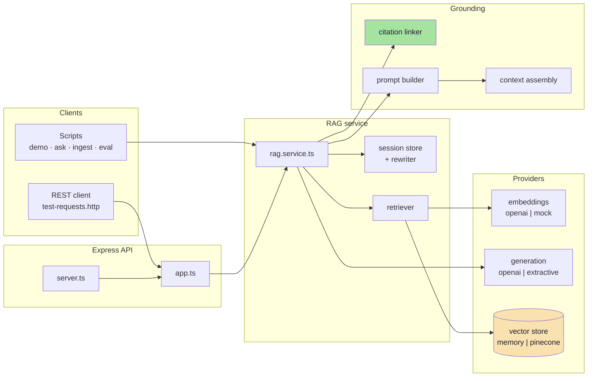

# Implementation Guide — Lecture 11: Retrieval-Augmented Generation

Welcome to the chapter-by-chapter guide for the **Lecture 11 codebase**: document ingestion, token chunking, embeddings, vector storage, hybrid retrieval, grounded prompting, citation verification, conversation state, evaluation and the HTTP API.

This guide follows the format used in Lectures 03–10. Every chapter contains:

1. **Files covered** — what the chapter creates and why.
2. **Complete source code** — the full contents of every file discussed, not excerpts.
3. **Block-by-block explanation** — what each block does, how it works, and the trade-off behind it.
4. **Commands and verification** — the exact command(s) that prove the chapter works.

> **Scope:** this is a working RAG system, deliberately small. Roughly 2,400 lines across 30 files, no framework, one class per stage. It answers questions from `knowledge/`, cites what it used, refuses when it cannot, keeps conversation state, and scores itself against a golden set.

---

## 🧭 System Topology



---

## 📚 Chapter Navigation

| Chapter | Title | Files Covered | Notes Mapping |
| :---: | :--- | :--- | :--- |
| **[00](./00_Overview_and_File_Structure.md)** | **Overview, Provider Structure & File Map** | `package.json`, `tsconfig.json`, `.env.example`, `.gitignore`, full `src/` tree, request lifecycle. | All |
| **[01](./01_Data_Contracts_and_Configuration.md)** | **Data Contracts & Configuration** | `types/rag.types.ts`, `config/env.ts`, `lib/errors.ts`. | 01, 02 |
| **[02](./02_Text_Vector_and_Retry_Utilities.md)** | **Text, Vector & Retry Utilities** | `lib/text.ts`, `lib/vectors.ts`, `lib/retry.ts`. | 03, 04, 09 |
| **[03](./03_Document_Loading.md)** | **Document Loading** | `ingest/loader.ts`, the three corpus files. | 03 |
| **[04](./04_Chunking.md)** | **Chunking** | `ingest/chunker.ts`. | 03 |
| **[05](./05_Embedding_Providers.md)** | **Embedding Providers** | `embeddings/provider.ts`, `mock.provider.ts`, `openai.provider.ts`. | 04 |
| **[06](./06_Vector_Stores.md)** | **Vector Stores** | `store/vector-store.ts`, `factory.ts`, `pinecone.store.ts`. | 05 |
| **[07](./07_Retrieval_and_Hybrid_Scoring.md)** | **Retrieval & Hybrid Scoring** | `retrieval/lexical.ts`, `retriever.ts`. | 05 |
| **[08](./08_Context_Assembly_and_Citations.md)** | **Context Assembly & Citations** | `grounding/context.ts`, `grounding/citations.ts`. | 06 |
| **[09](./09_The_Grounded_Prompt.md)** | **The Grounded Prompt** | `generation/prompt.ts`. | 06 |
| **[10](./10_Generation_Providers.md)** | **Generation Providers** | `generation/provider.ts`, `openai.provider.ts`, `extractive.provider.ts`. | 06, 09 |
| **[11](./11_Conversation_State.md)** | **Conversation State** | `session/store.ts`, `session/rewrite.ts`. | 07 |
| **[12](./12_The_RAG_Service.md)** | **The RAG Service** | `rag.service.ts`. | 02, 06, 08, 09 |
| **[13](./13_Composition_Scripts_and_Evaluation.md)** | **Composition, Scripts & Evaluation** | `container.ts`, all `scripts/`, `eval/golden.json`. | 08, 09 |
| **[14](./14_HTTP_API_Server_and_Operations.md)** | **HTTP API, Server & Operations** | `app.ts`, `server.ts`, `test-requests.http`, runbook. | 09 |

---

## 🚦 Suggested Reading Paths

| If you want to… | Read |
| :--- | :--- |
| Understand the whole design first | **00 → 01 → 12** |
| Learn ingestion | **01 → 02 → 03 → 04** |
| Learn retrieval | **02 → 05 → 06 → 07** |
| Learn grounding and citations | **07 → 08 → 09 → 10** |
| Learn the conversation layer | **11** |
| Prove the system works | run **13** and **14** |
| Connect code to theory | read the matching chapters in [`../../notes/README.md`](../../notes/README.md) |

---

## ⚙️ Commands Used Throughout

```bash
cd "Lecture 11/code"
npm install

npm run demo                  # offline walkthrough: chunking → prompt → answer → refusal → follow-up → trace
npm run eval                  # golden set: recall@4, citations, refusals, expected facts
npm run ingest                # rebuild the index
npm run ask -- "…"            # one question with citations and trace
npm run dev                   # API on :3000
npm run build && npm start    # compiled server
npx tsc --noEmit              # strict type check
```

Default environment: `mock` embeddings, `extractive` generation, in-memory store, 1024 dimensions, cosine plus 0.35 lexical blend, `topK=4`, floor `0.15`. **No API key, network or Docker is needed for any chapter.**

---

## 🧠 Conventions That Apply Everywhere

1. **Two pipelines.** `ingest()` writes; `ask()` reads. Retrieval can only find what ingestion wrote.
2. **Providers are interfaces.** `EmbeddingProvider`, `GenerationProvider`, `VectorStore`. Only `container.ts` knows which implementation is live.
3. **Evidence is data.** Retrieved text lives inside `<documents>` in the user turn; rules live in `instructions`.
4. **Labels before generation.** The code assigns `[n]`; the citation linker verifies it. Invented ids are counted and stripped.
5. **Refuse before generating.** No chunk above the floor means no model call.
6. **Everything is traced.** Every answer carries the query, the matches, the budget, the citations and the latency.
7. **Measure, don't assume.** `npm run eval` is the arbiter for `MIN_SCORE`, chunk size and lexical weight.
8. **No framework.** The pipeline is explicit so the boundaries are visible.

---

## ✅ Validation Performed

| Check | Result |
| :--- | :--- |
| `tsc --noEmit` (strict, NodeNext) | pass |
| `npm run ingest` | 3 documents → 19 chunks → 870 tokens |
| `npm run demo` | seven stages, `invalid=0`, refusal with `generate=0ms` |
| `npm run eval` | recall@4 **1.00**, citations **12/12**, refusals **12/12**, facts **12/12** |
| `POST /api/query` (compiled server) | answer + valid citations + full trace |
| `POST /api/ingest`, `DELETE /api/sessions/:id` | 200 / 404 as expected |
| Invalid body, unknown route | 400 `ValidationError`, 404 `NotFound` |

> Numbers are from the machine that built this lecture. Absolute latency will differ; correctness should not. The OpenAI provider paths are type-checked and share every interface with the offline pair, but were not executed without a key.

---

## 📁 What Each Chapter Assumes

| Chapter | Assumes you have read |
| :--- | :--- |
| 01–02 | 00 (the map) |
| 03–04 | 01 (contracts), 02 (text helpers) |
| 05 | 04 (what a chunk is) |
| 06 | 05 (vectors have a model and a dimension) |
| 07 | 06 (what the store can return) |
| 08–09 | 07 (matches) |
| 10 | 09 (the prompt format) |
| 11 | 09 (history goes into messages) |
| 12 | 03–11 (everything it orchestrates) |
| 13–14 | 12 (the service they call) |

Start here: **[Chapter 00 — Overview, Provider Structure & File Map](./00_Overview_and_File_Structure.md)**
