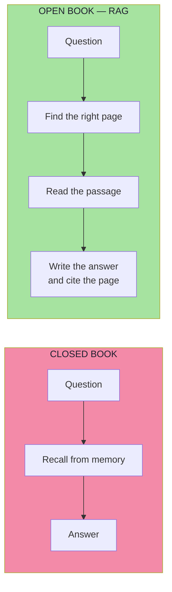
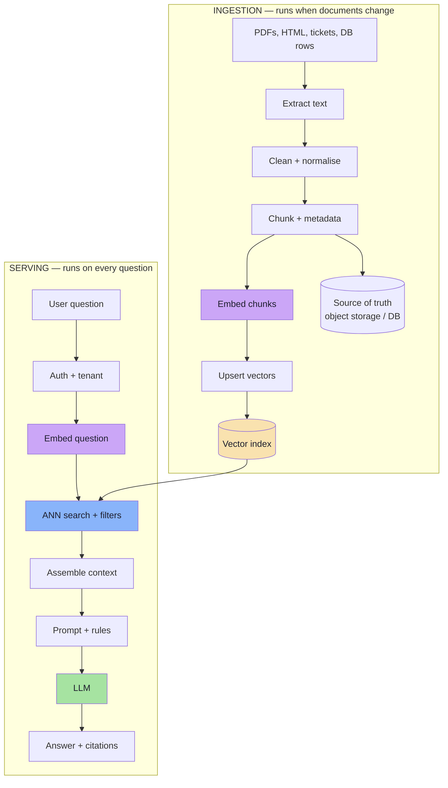
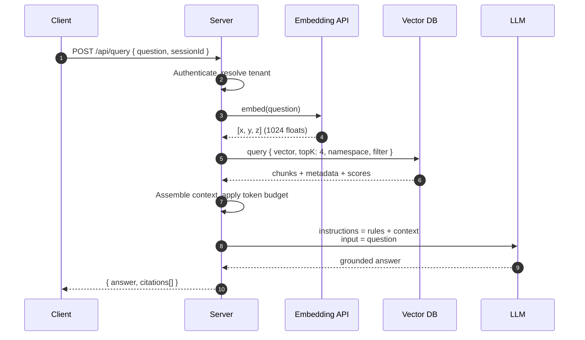
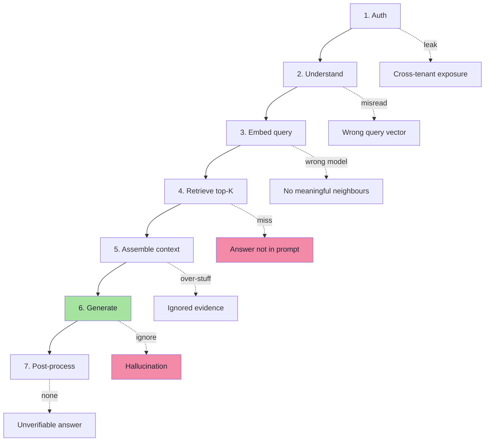
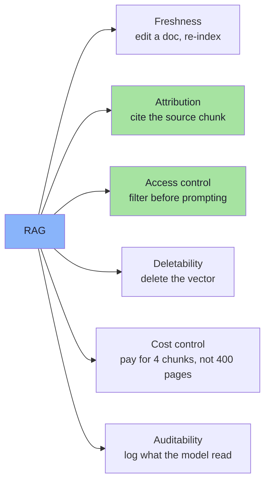
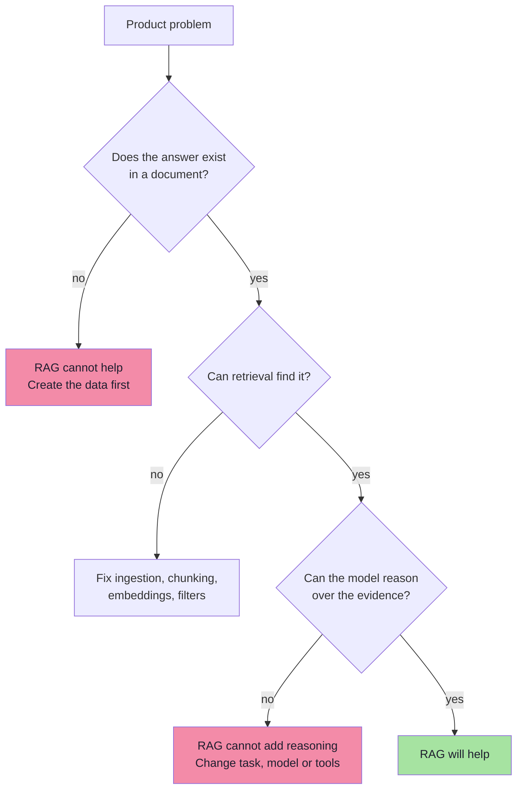
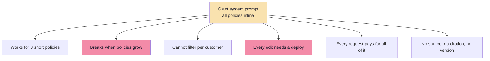
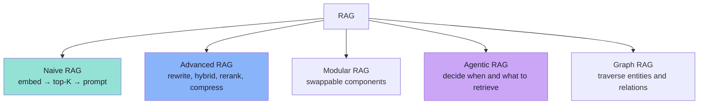

# Chapter 02: RAG — The Open-Book Architecture

> **Chapter Goal:** Turn the motivation from Chapter 01 into an architecture. You should leave this chapter able to draw the complete RAG data flow from memory — the two pipelines, the seven steps of a query, and the exact place where each kind of failure enters — and able to explain why "put the policy in the system prompt" is not the same thing as RAG.
>
> The running example throughout is **Tomato**, the food-delivery company from the lecture board, whose support assistant must answer refund, return and payment questions using company documents only.

---

## 2.1 What "Retrieval-Augmented Generation" Actually Says

The name is a literal description of the mechanism:

```text
Retrieval   →  find text that is relevant to the question
Augmented   →  add that text to the model's input
Generation  →  let the model write the answer from that input
```

The term was popularised by Lewis et al. (2020), *Retrieval-Augmented Generation for Knowledge-Intensive NLP Tasks*. The engineering idea predates and outlives the paper: **separate what the model knows from how the model reasons.**

### The open-book exam analogy



The analogy is exact, including its failure modes:

| Exam analogy | RAG equivalent | Failure |
|---|---|---|
| Student never learned the topic | Model lacks the capability | Reasoning failure — retrieval cannot fix it |
| Student studied but forgot the detail | Parametric knowledge gap | Retrieval fixes it |
| Student opens the **wrong** page | Retrieval miss | Most common RAG failure |
| Student reads the right page but answers from memory | Unfaithful generation | Prompt / model failure |
| Page is outdated | Stale index | Ingestion failure |
| Student copies an instruction written on the page | Prompt injection | Security failure |

> **Key idea:** RAG moves the problem from *memorisation* to *lookup*. Lookup can be engineered, measured and fixed. Memorisation cannot.

---

## 2.2 The Two Pipelines

Every RAG system has two pipelines that run at different times, at different frequencies, with different priorities.



| Property | Ingestion | Serving |
|---|---|---|
| Trigger | Document upload, schedule, webhook | Every user question |
| Frequency | Thousands of chunks per batch | Thousands of requests per minute |
| Priority | **Correctness and completeness** | **Latency and safety** |
| Failure symptom | Answer exists but is never found | Answer exists in the index but not in the prompt |
| Can be retried | Yes, idempotently | Must degrade gracefully |
| Cost driver | Embedding tokens (one-off) | LLM tokens (recurring) |

> **The most common architectural mistake** is to build the serving path first and treat ingestion as a script. Ingestion decides the ceiling; serving can only reach what ingestion created.

---

## 2.3 The Canonical Query Path (from the Board)

The lecture board draws the smallest complete RAG system:

```text
Client  ──"Can I get a refund?"──►  Server  ──►  Embedding model
                                      │              │
                                      │              ▼
                                      │        [x, y, z]  ──►  Pinecone
                                      │                          │
                                      │◄──── top-K chunks ───────┘
                                      ▼
                              System prompt + context + question
                                      ▼
                                     LLM
                                      ▼
                          "Yes — within 3 days for clothing."
```

As a sequence:



The board annotates this loop as **Input + Output**: the *input* to the LLM is the system prompt plus retrieved context plus the question; the *output* is the answer. Everything else in RAG exists to make that single call correct.

### The seven steps, with their failure modes

| # | Step | Question it answers | If it fails |
|---|---|---|---|
| 1 | **Authenticate** | Who is asking, and what may they see? | Data leak across tenants |
| 2 | **Understand** | What is the user really asking? | Retrieval searches for the wrong thing |
| 3 | **Embed the query** | Where is this question in vector space? | Everything after this is noise |
| 4 | **Retrieve** | Which chunks are nearest? | Answer is simply not in the prompt |
| 5 | **Assemble context** | What fits, in what order, with what labels? | Correct chunk retrieved but ignored |
| 6 | **Generate** | What does the evidence say? | Hallucination or refusal |
| 7 | **Post-process / validate** | Citations, formatting, guardrails, logging | Unverifiable or unsafe answer |



> **Debugging rule:** when an answer is wrong, walk the seven steps **in order**. If step 4 did not return the gold chunk, no amount of prompt engineering in step 6 will help.

---

## 2.4 What RAG Actually Buys You

RAG is not only a hallucination fix. It changes six properties of the product:



| Property | Without RAG | With RAG |
|---|---|---|
| **Freshness** | Model frozen at cutoff | Update the file, re-embed, live in minutes |
| **Attribution** | "Trust me" | "Refund policy §2" with a link |
| **ACL** | Everything the model knows, everyone gets | Filter chunks by tenant / role / region |
| **Deletion / GDPR** | Cannot remove from weights | Delete records; re-ingest without the doc |
| **Cost** | Fine-tune or huge prompts | One small prompt per query |
| **Auditability** | Unknown provenance | Full trace: query → chunks → prompt → answer |
| **Domain ownership** | ML team owns knowledge | Content team owns markdown files |

The last row is underrated. RAG lets **non-engineers** change what the assistant knows by editing documents, because knowledge is data rather than weights.

> **Key idea:** RAG's real product is not "fewer hallucinations". It is **operational control over knowledge** — who can change it, who can see it, and how you prove what the model read.

---

## 2.5 What RAG Does **Not** Fix

RAG is often sold as a universal cure. It is not. Being explicit about the boundary prevents months of misdirected work.



| Limitation | Example | What actually helps |
|---|---|---|
| **No source exists** | "Why did revenue drop in Q3?" (not written down) | Analytics tool / SQL, not RAG |
| **Multi-step arithmetic** | "Total refunds for orders 1–40" | Tool call, calculator, deterministic code |
| **Reasoning quality** | "Which clause wins in this conflict?" | Better model, better prompt, human review |
| **Live state** | "Where is my order right now?" | Order API (tool), not the document index |
| **Structured aggregation** | "How many tickets per region?" | Database query |
| **Bad source documents** | Contradictory, outdated policies | Content governance |
| **Ambiguous questions** | "Can I return it?" (no product named) | Clarifying question, conversation state |

> **Design rule:** RAG answers *"what do the documents say about X?"*. If the product question is *"what is X right now?"* or *"compute X"*, RAG is the wrong primitive.

### RAG vs long context vs fine-tuning

| Criterion | Big context window | Fine-tuning | **RAG** |
|---|---|---|---|
| Corpus size | A few hundred pages | Unbounded (but lossy) | Millions of chunks |
| Freshness | Per request | Retrain cycle | Minutes |
| Citation | Possible if you format it | No | Native |
| ACL per user | You filter before sending | Impossible | Native filters |
| Per-query cost | High (all tokens) | Low after training | Low (top-K tokens) |
| Latency | High prefill | Normal | + retrieval hop |
| Learning new *behaviour* | Weak | Strong | Weak |
| Failure transparency | Opaque | Opaque | Traceable |

They compose: fine-tune the *style*, retrieve the *facts*, and use tools for *live state*. A refunds assistant may do all three.

---

## 2.6 The Anti-Pattern on the Board: "System Prompt Only"

The lecture board shows a first attempt at the Tomato assistant:

```text
System Prompt:
You are an AI assistant integrated with a food delivery company called Tomato.

----
Refund policy:
-------
Return policy
-----
Payment
---
```

Everything the bot knows is pasted into the system prompt. It works in a demo, and it is a dead end.



| Problem | At 3 policies | At 300 policies |
|---|---|---|
| Prompt length | ~500 tokens | ~50,000 tokens |
| Cost per question | Negligible | Significant, every time |
| Relevance | All of it | 99% irrelevant noise |
| Update path | Edit prompt, redeploy | Impossible to keep consistent |
| Personalisation | None | None |
| Audit trail | "The prompt" | No mapping from answer to source |

The board's next iteration is the whole point of this lecture: keep the **rules** in the system prompt, move the **knowledge** into documents, and retrieve the relevant 3–4 chunks per question.

```text
System prompt  →  stable instructions (role, tone, refusal rule, format)
Context        →  volatile knowledge (retrieved chunks, per question)
Question       →  the user's actual ask
```

> **Key insight:** prompts are for *behaviour*; retrieval is for *knowledge*. Mixing them is what makes a prototype impossible to operate.

---

## 2.7 The Variants You Will Meet

"RAG" describes a family. Naming the variant matters when you discuss trade-offs.



| Variant | Extra machinery | When it is worth it |
|---|---|---|
| **Naive** | One embed, one search, one prompt | Small, clean corpora; first version |
| **Advanced** | Query rewriting, hybrid search, reranking, context compression | Almost any production system |
| **Modular** | Pluggable retriever/reranker/generator interfaces | Multiple corpora and teams |
| **Agentic** | Model decides to search, which tool, how many times | Research questions, multi-hop |
| **Graph** | Entity/relationship index | "Who reports to whom", supply chains |
| **Multimodal** | Image/audio embeddings | Screenshots, product photos, calls |

This lecture builds the **naive-to-advanced** path end to end, because every advanced technique is an optimisation of one of the seven steps above.

> **Sequencing advice:** ship naive RAG with a golden set of questions first. Add reranking, hybrid search and query rewriting only when the measurements show which step is losing recall.

---

## 2.8 Pseudo-code: The System Skeleton

The whole architecture in one shape. Names match the lecture's companion script ([`../code/index.js`](../code/index.js)) so the chapters and the code can be read side by side.

```ts
// pseudo-code: the two halves of a RAG service

// ---------- 1. INGESTION (offline, idempotent) ----------
async function loadKnowledgeBase(): Promise<number> {
  const files = await listFiles(KNOWLEDGE_DIR, { ext: ".pdf" });

  let total = 0;
  for (const file of files) {
    const text = await extractText(file);          // PDF → plain text
    const chunks = splitIntoTokenChunks(text, { size: 300, overlap: 0 });

    for (const batch of batches(chunks, 100)) {
      const vectors = await embedBatch(batch.map(c => c.text)); // same model as queries
      const records = batch.map((c, i) => ({
        id: stableId(c),                            // sha256(source:index:text)
        values: vectors[i],
        metadata: { source: file.name, chunk: c.index, text: c.text },
      }));
      await vectorStore.upsert(records);            // idempotent by id
    }
    total += chunks.length;
  }
  return total;
}

// ---------- 2. SERVING (online, per request) ----------
async function answerUserQuery(question: string, ctx: RequestContext) {
  const queryVector = await embed(question);        // MUST match ingestion model

  const matches = await vectorStore.query({
    vector: queryVector,
    topK: 4,
    filter: { tenantId: ctx.tenantId },             // authorisation inside retrieval
    includeMetadata: true,
  });

  const context = assembleContext(matches);         // dedupe, order, label, budget

  const response = await llm.generate({
    instructions: SUPPORT_SYSTEM_PROMPT + "\n\nCOMPANY INFORMATION\n" + context,
    input: question,
    temperature: 0.2,
  });

  return { answer: response.text, citations: matches.map(toCitation) };
}
```

| Skeleton element | Chapter | Why it is there |
|---|---|---|
| `extractText` | 03 | Garbage in, garbage retrieved |
| `splitIntoTokenChunks` | 03 | Defines the unit of retrieval |
| `embedBatch` | 04 | Same space as queries |
| `stableId` | 03 | Idempotent re-ingestion |
| `vectorStore.upsert` | 05 | Storage + replacement semantics |
| `vectorStore.query` | 05 | Top-K, filters, scores |
| `assembleContext` | 06 | Ordering, dedupe, budget |
| `SUPPORT_SYSTEM_PROMPT` | 06 | Grounding + refusal contract |
| `answerUserQuery` | 06, 07 | The online path |

> **Note the two `embed` calls.** Ingestion and serving must use the *same model and dimension*. This is the single most expensive mistake in RAG (Chapter 04, §4.8).

---

## 2.9 Common Mistakes

| Mistake | Symptom | Fix |
|---|---|---|
| Building the serving path before ingestion | Great demo, useless on real documents | Get ingestion correct and idempotent first |
| Putting all knowledge in the system prompt | Costly, unfilterable, stale | Documents + retrieval |
| Treating RAG as a hallucination cure-all | Wrong answers persist | Fix retrieval, then grounding |
| One giant index for all tenants | Data leaks or empty results | Namespace/filter per tenant |
| Testing with 3 hand-written docs | Works in dev, fails in prod | Test with the real corpus |
| No refusal path | Model invents answers for out-of-scope questions | Explicit "not in documents" instruction |
| No citations | Cannot verify or debug | Return source + chunk id |
| Assuming retrieval returns the answer | "I don't know" for known facts | Measure recall on a golden set |
| Skipping the reranker on noisy corpora | Many near-miss chunks | Over-fetch, then rerank (Ch 05) |

---

## 2.10 Chapter Summary

| Layer | Decision | Consequence |
|---|---|---|
| Architecture | Two pipelines: ingestion and serving | Different priorities, different failure modes |
| Query path | Seven ordered steps | Debug in order; the earliest failure dominates |
| Knowledge | Documents, not prompts | Fresh, filterable, citable, deletable |
| Behaviour | System prompt | Stable rules, refusal contract, format |
| Boundary | RAG = "what do the documents say?" | Not live state, not arithmetic, not reasoning |
| Variant | Start naive, measure, then advance | Avoid architecture you cannot justify |
| Skeleton | `ingest → embed → upsert` / `embed → query → assemble → generate` | The whole lecture in two functions |

> **Final mental model:** RAG is a **pipeline of narrowing** — the corpus narrows to chunks, chunks narrow to top-K, top-K narrows to a context window, and the context narrows to an answer. Every stage can silently drop the one chunk that mattered. Production RAG is the discipline of measuring each narrowing instead of trusting the final output.

---

## Where This Goes Next

- **Chapter 03** builds the ingestion pipeline: extraction, chunking, metadata and deterministic IDs.
- **Chapter 04** pins down the embedding contract shared by ingestion and serving.
- **Chapter 05** replaces "some vector store" with a concrete index, query and filter design.

---

**Back to:** [Lecture 11 — Chapter Index](./README.md) · [Complete Consolidated Notes](./Lecture_11_Complete_Notes.md)
