# Chapter 03: Ingestion — From Documents to Chunks

> **Chapter Goal:** Learn to turn a folder of PDFs into a retrieval-ready knowledge base: text that is faithful to the source, chunks that are the right size to be useful, metadata that supports citation and filtering, and IDs that make re-ingestion safe. This is the stage that **sets the ceiling** on every answer the system will ever give.
>
> If a fact is not in a chunk, no embedding, index or prompt can recover it. Ingestion is therefore not plumbing — it is retrieval design.

---

## 3.1 The Offline Pipeline

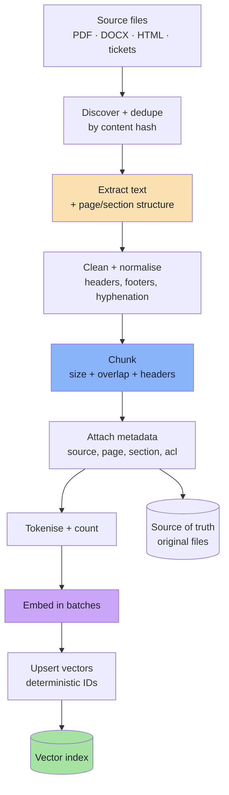

Each stage has a specific, observable failure:

| Stage | Failure | Symptom in production |
|---|---|---|
| Discover | Missed files, duplicates | "It doesn't know about the new policy" |
| Extract | Empty or garbled text | Answers about nothing; empty chunks |
| Clean | Boilerplate dominates | Every chunk similar; retrieval degenerate |
| Chunk | Split mid-clause | Answers missing the qualifier |
| Metadata | No page/section | Cannot cite or filter |
| Embed | Wrong model/batch | No relevant neighbours at all |
| Upsert | Random IDs | Duplicate vectors after every re-run |

> **Ingestion principle:** every stage should be **deterministic** and **idempotent** — running the pipeline twice on unchanged input must produce the same records, not twice as many.

---

## 3.2 Extraction: The Part That Quietly Ruins Everything

A PDF is a **print format**, not a data format. It stores glyphs at coordinates, not paragraphs. Extraction is therefore reconstruction, and it fails in specific ways.

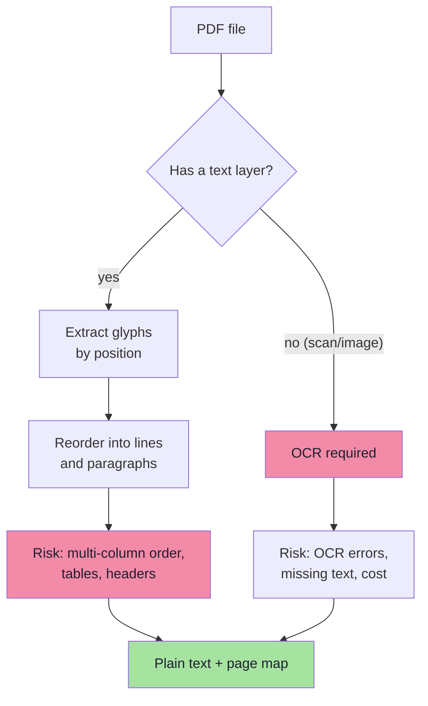

### The seven extraction hazards

| Hazard | What it looks like | Mitigation |
|---|---|---|
| **Scanned pages** | Empty string for half the document | Detect low text/page ratio; route to OCR |
| **Multi-column layout** | Sentences interleaved from two columns | Layout-aware parser; column detection |
| **Tables** | Cells flattened into a word salad | Table extraction to markdown/CSV; keep as own chunk |
| **Repeated headers/footers** | "Confidential — page 4 of 32" in every chunk | Strip lines repeated on > N pages |
| **Hyphenation** | "refun-\nd" | Join hyphenated line breaks |
| **Ligatures / encoding** | "fi" instead of "fi", broken apostrophes | Unicode normalisation (NFKC) |
| **Navigation debris** | "Table of contents" entries as content | Drop TOC pages or mark them low-priority |

### The empty-extraction guard

The most common silent bug: a scanned PDF produces **zero characters**, and the pipeline happily inserts zero chunks. Always assert:

```ts
// pseudo-code: fail loudly on unusable extraction
const text = await extractText(file);
const charsPerPage = text.length / Math.max(pageCount, 1);

if (text.trim().length < 200 || charsPerPage < 100) {
  throw new IngestionError(
    `Suspicious extraction for ${file.name}: ` +
      `${text.length} chars over ${pageCount} pages. ` +
      `Likely scanned — needs OCR.`,
  );
}
```

A build that fails is infinitely better than an index that is quietly empty.

> **Design rule:** validate extraction per document and report a **coverage metric** (`indexed chars / expected chars`). Ingestion without coverage metrics is guesswork.

---

## 3.3 Cleaning and Normalisation

Cleaning is not cosmetic. Boilerplate that appears in every chunk makes every chunk look alike, which **flattens the vector space** and destroys retrieval precision.

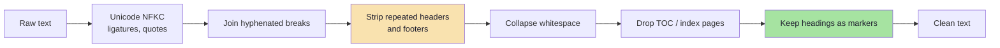

| Do | Don't |
|---|---|
| Normalise Unicode and whitespace | Lowercase everything (breaks names, IDs, headings) |
| Remove repeated page furniture | Remove section headings — they are retrieval gold |
| Preserve bullet and numbering structure | Reflow tables into prose |
| Keep the source language | Translate silently (bug reports are untranslatable) |
| Record what was removed | Strip without logging |

### Preserve structure, not just characters

```text
BAD  (structure destroyed)
"Refund Policy Refunds are allowed within 3 days for clothing
 and 7 days for electronics provided the item is unused..."

GOOD  (structure preserved)
"# Refund Policy
 ## Apparel
 Refunds are allowed within 3 days of delivery, provided the item is unused."
```

Headings and list markers are **semantic signal**. They tell the chunker where a topic ends, and they tell the LLM what a passage is about. Keeping them costs a few tokens and buys real accuracy.

> **Rule:** clean for noise, not for uniformity. The goal is faithful text with structure, not a bag of words.

---

## 3.4 Why Not Embed Whole Documents?

The naive ingestion is `document → embedding → store`. It fails for four reasons.

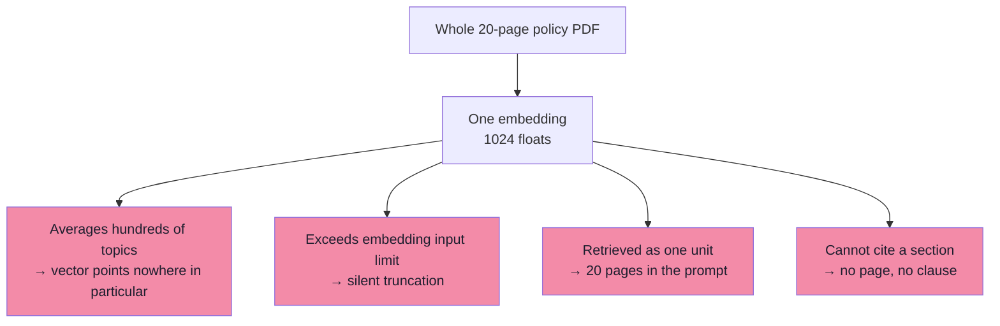

### 1. Averaging destroys specificity

An embedding is a single point. A document about refunds, payments, delivery and careers averages into a point that is *close to everything and near nothing*. Its similarity to any specific question is mediocre — sometimes lower than a genuinely irrelevant but topically focused chunk.

```text
Document vector  ≈  average(refund, payment, delivery, careers)
Query "refund"   →  similarity 0.62   (mediocre)
Wrong chunk      →  similarity 0.71   (a careers FAQ that mentions "policy")
```

### 2. Input limits cause silent truncation

Embedding models accept a bounded number of tokens (for OpenAI's `text-embedding-3-*`, 8,191 tokens). Longer input is truncated, often **without an error**. A 40-page document becomes the first ~6,000 words and the rest never existed.

### 3. Retrieval granularity is too coarse

Retrieval returns the unit you stored. Store whole documents and every answer drags an entire document into the prompt — cost, latency and lost-in-the-middle in one move.

### 4. Citation becomes impossible

"We found it in the 20-page PDF" is not a citation. A user needs "Refund Policy → Apparel → §2.1", and support needs the exact sentence to verify the answer.

> **The unit of retrieval is the chunk.** Its boundaries decide what can ever be found, and its metadata decides what can be cited.

### The right size is a design decision

| Unit | Retrieval quality | Prompt cost | Typical use |
|---|---|---|---|
| Whole document | Very poor | Very high | Never |
| Chapter / section | Moderate | High | Long-form summaries |
| **Paragraph / 200–500 tokens** | **Good** | **Moderate** | **Default for RAG** |
| Sentence | Precise but ambiguous | Low | Reranking, fact lookup |
| Fixed 50-token window | Fragmented | Low | Rarely useful alone |

---

## 3.5 Chunking Strategies

A **chunk** is a contiguous span of source text plus metadata, stored as one vector. Four strategies cover almost every real corpus.

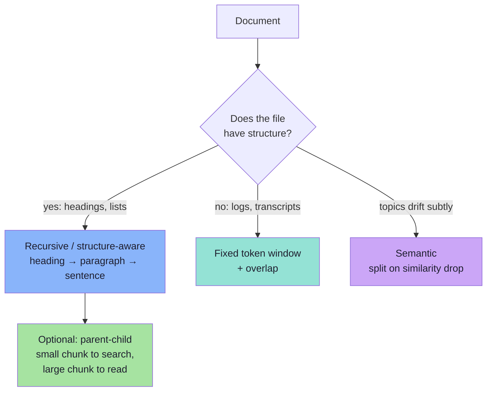

### 3.5.1 Fixed-size token windows (the lecture's example)

The simplest strategy: walk the token stream in windows of `size`, stepping by `size - overlap`.

The board illustrates it with two vectors built from a 1,000-word policy:

```text
chunk v1:  tokens  1 → 1000
chunk v2:  tokens 801 → 1800        ← 200-token overlap with v1

             1                     1000
             ├──────────────────────┤
                       801                  1800
                       ├──────────────────────┤
                       └── overlap 200 ──┘
```

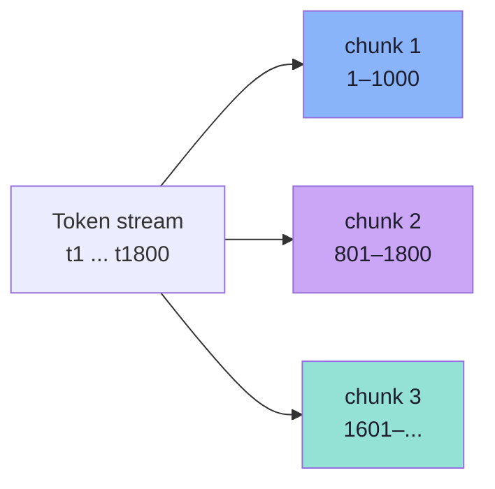

**Why overlap exists:** a rule that spans the boundary ("…is allowed within 3 days **provided the item is unused**") is destroyed by a hard cut. With overlap, at least one chunk contains the whole sentence.

**What overlap costs:** more vectors, more storage, more embedding cost, and near-duplicate results in the top-K. Overlap is insurance, not a free parameter.

| Overlap | Effect | Recommended |
|---|---|---|
| 0% | Cheapest; boundary sentences lost | Only for structured docs with clean splits |
| **10–20%** | Recovers most boundary context | **Default** |
| 30–50% | High duplication, redundant hits | Rare, for very dense legal text |
| > 50% | Index mostly duplicates | Never |

### 3.5.2 Recursive / structure-aware chunking

Split on the **largest** boundary that fits the budget, then recurse into smaller boundaries:

```text
1. Split on document/section headings   → sections
2. If a section > budget → split on blank lines (paragraphs)
3. If a paragraph > budget → split on sentences
4. If a sentence > budget → split on tokens (rare)
5. Merge adjacent small pieces up to the budget
```

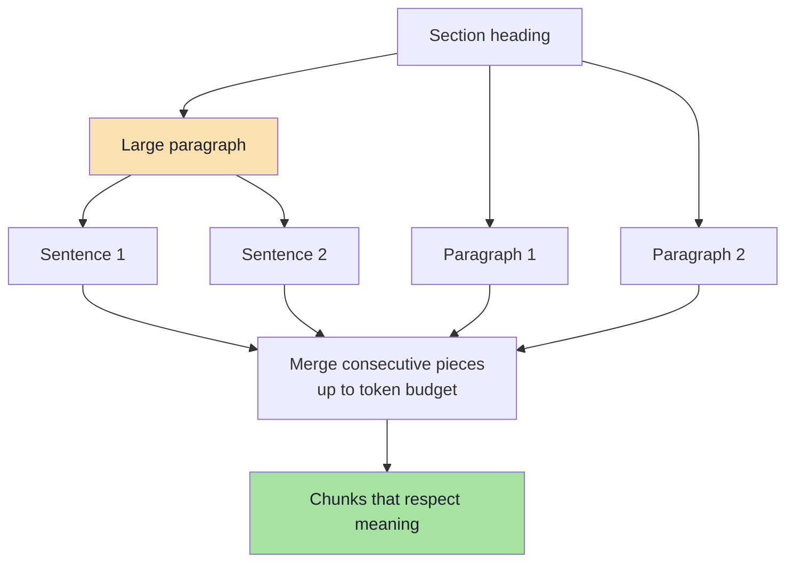

This is the best default for handbooks, policies, documentation and anything with headings. It keeps clauses intact and produces chunks whose first line states their topic.

### 3.5.3 Semantic chunking

Embed consecutive sentences, then cut where similarity between neighbours drops below a threshold.

| Strength | Weakness |
|---|---|
| Boundaries follow topic shifts, not character counts | Requires an embedding call per sentence |
| Good for unstructured prose and transcripts | Threshold is corpus-specific and hard to tune |
| | Non-deterministic across model versions |

Use it when structure is absent and quality matters more than ingestion cost. Do **not** start here.

### 3.5.4 Parent-child (small-to-big)

Store **small** chunks for precise matching, but return the **parent section** to the model.

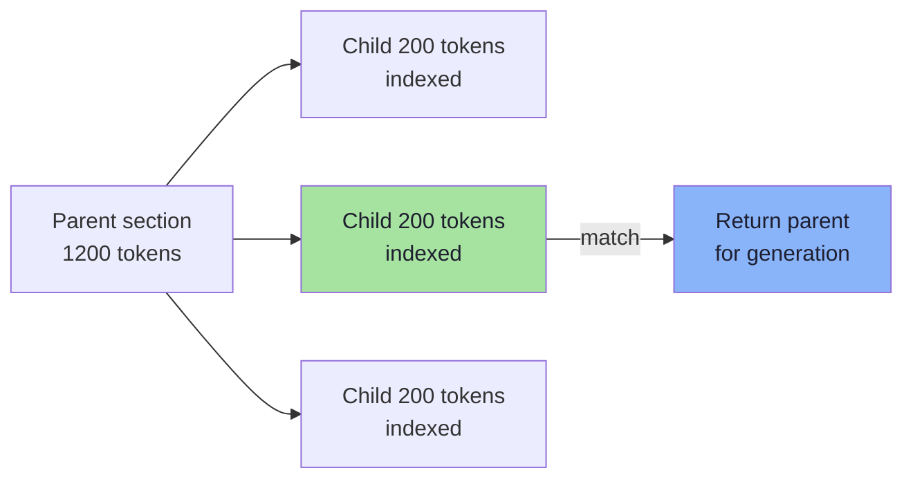

This decouples the two jobs chunk size normally has to do at once: **matching** wants precision (small), **answering** wants context (large). It costs an extra metadata pointer and a parent lookup.

### 3.5.5 Element-aware chunking

Some content must never be split by a token counter:

| Element | Handling |
|---|---|
| **Tables** | Convert to markdown/CSV, one chunk per table, repeat the header row |
| **Code blocks** | Keep function boundaries; never split a signature from its body |
| **Lists** | Keep numbering; keep the intro line with the list |
| **Q&A / tickets** | One chunk per exchange; include the subject |
| **Slides** | One chunk per slide, title as heading |

> **Heuristic:** if a human would be confused by the split, so is the retriever. Chunk on the unit a reader would call "the relevant part".

---

## 3.6 Sizing: The Arithmetic of Chunking

Two numbers decide the size of your index: `size` (tokens per chunk) and `overlap` (shared tokens).

```text
stride      = size - overlap
num_chunks  = ceil( (T - overlap) / stride )        for T > size
```

Worked example — a 6-page policy, `T = 4,000` tokens:

| Size | Overlap | Stride | Chunks | Vectors vs. minimum | Notes |
|---|---|---|---|---|---|
| 300 | 0 | 300 | 14 | 1.00× | Cheapest, boundary loss |
| 300 | 50 | 250 | 16 | 1.14× | **Recommended default** |
| 300 | 100 | 200 | 20 | 1.43× | Heavy duplication |
| 600 | 100 | 500 | 8 | 0.57× | Fewer, coarser |
| 1000 | 200 | 800 | 5 | 0.36× | The board's example: long chunks |
| 150 | 30 | 120 | 34 | 2.43× | Precise, fragmented |

### The size trade-off

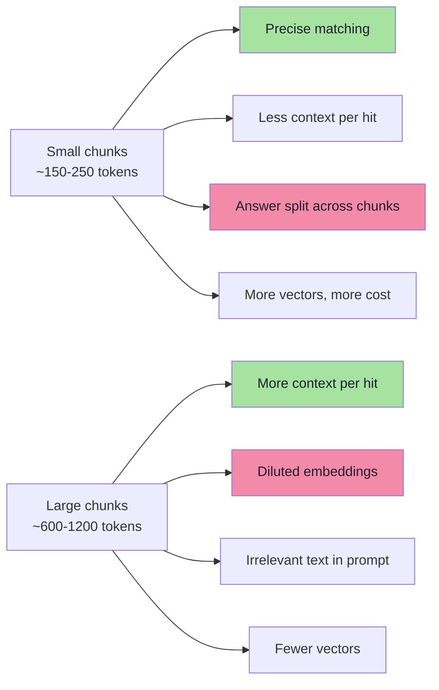

| If retrieval is… | Because chunks are… | Do this |
|---|---|---|
| Returning near-misses | Too large / too generic | Reduce size, add headings, add a reranker |
| Returning fragments with no answer | Too small | Increase size or use parent-child |
| Returning duplicates | Overlap too high | Reduce overlap, dedupe by parent |
| Missing exact clause numbers | Boundaries cut the clause | Structure-aware chunking, overlap |
| Missing tables entirely | Table flattened | Element-aware extraction |

### The production default

```text
size     = 300–500 tokens      (≈ 1,200–2,000 characters)
overlap  = 10–20% of size
unit     = heading → paragraph → sentence
header   = document title + section prepended to every chunk
```

The lecture's companion script uses `CHUNK_SIZE = 300` tokens with no overlap (`splitIntoTokenChunks`), which is the correct *teaching* default: simple, predictable, and easy to reason about. Overlap is the first production upgrade.

> **Tuning rule:** never choose a chunk size by taste. Build 30 gold question→chunk pairs, then measure recall@4 for three sizes. The corpus will pick the winner.

---

## 3.7 Tokenisation: Count in Tokens, Not Characters

Embedding models and LLM context budgets are measured in **tokens**, so chunking must be too.

```text
"Refunds are allowed within 3 days."
  → tokens: ["Ref", "unds", " are", " allowed", " within", " 3", " days", "."]
```

| Rule of thumb | Value | Use for |
|---|---|---|
| English characters per token | ≈ 4 | Quick sanity checks |
| English words per token | ≈ 0.75 | Estimating from word counts |
| 300 tokens | ≈ 1,200 characters ≈ 225 words | Chunk sizing |
| 1 page of text | ≈ 500–700 tokens | Capacity planning |

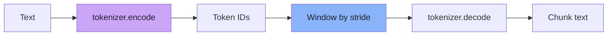

Why this matters in JavaScript/TypeScript: the popular libraries (`tiktoken`, `js-tiktoken`) expose the same encodings as the model provider. Use **`cl100k_base`** for OpenAI's `text-embedding-3-*` and GPT-4 class models, and **`o200k_base`** for the GPT-4o/GPT-5 family. If you size chunks in characters, a chunk that "fits" in your budget can still overflow the embedding limit on dense text (code, numbers, non-Latin scripts).

> **Warning:** token counts differ by language. In Hindi, Tamil, Chinese or code, the characters-per-token ratio can drop below 1.5. Size by tokens and verify with the actual tokenizer.

---

## 3.8 Contextual Headers and Metadata

### The context header

A chunk that begins "As described above, the same applies…" is semantically incomplete: the embedding has no idea what it refers to. Prepend a short header **before embedding**:

```text
Source: Refund Policy.pdf · Section: Apparel · Page 3
Refunds are allowed within 3 days of delivery, provided the item is unused.
```

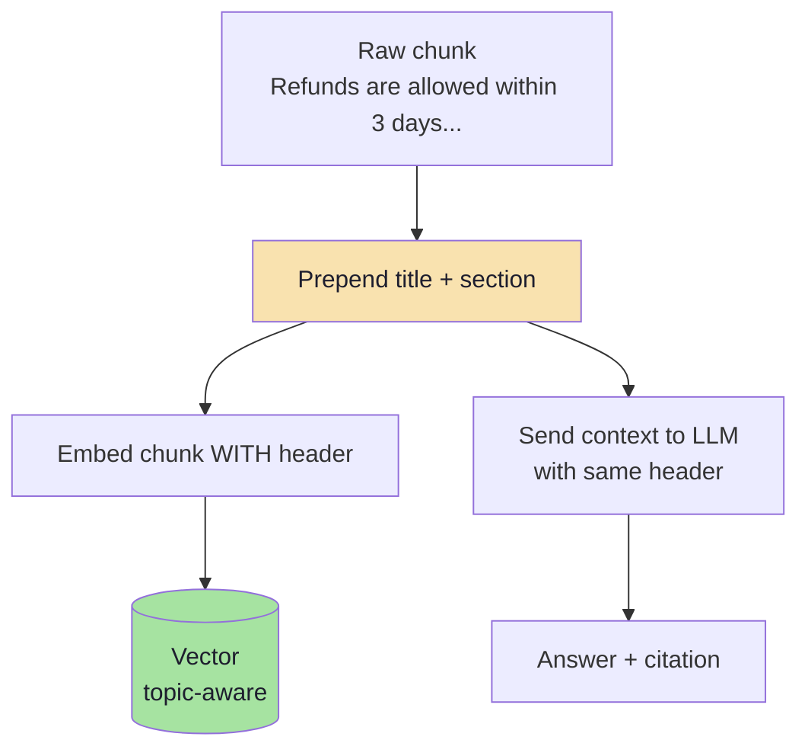

This one change often improves retrieval more than swapping models, because it puts the *topic* into the vector, not just the clause.

| Header ingredient | Why |
|---|---|
| Document title | Distinguishes "Refund Policy" from "Return Policy" |
| Section path (`Apparel > Sizing`) | Adds hierarchical context |
| Page number | Enables citation and UI deep-links |
| Effective date | Lets the model prefer current policy |

### Metadata schema

| Field | Type | Purpose |
|---|---|---|
| `source` | `"refund-policy.pdf"` | Citation, debugging, deletion by source |
| `chunk` | `0..n` | Ordering, parent-child, dedupe |
| `text` | string | The chunk itself (so one query is enough) |
| `page` | number | Deep link, "page 3" citation |
| `section` | string | Context header, filters |
| `docId` | stable id | Update all chunks of one document |
| `contentHash` | sha256 | Change detection, cache key |
| `version` | `"2026-03-01"` | Freshness, blue/green re-index |
| `embeddingModel` | `"text-embedding-3-small"` | Migration safety |
| `tenantId` / `acl` | string / array | **Security filter, enforced in retrieval** |
| `updatedAt` | ISO date | Recency ranking, staleness alerts |
| `lang` | `"en"` | Routing, multilingual models |

> **Storage note:** keeping `text` in metadata makes retrieval a single round-trip (as the companion script does). The trade-off is metadata size limits — check your vector DB's per-record limit before storing full pages.

---

## 3.9 Deterministic IDs and Idempotent Ingestion

This is the most under-taught part of ingestion, and the cause of the classic production bug: **the same document stored 14 times**.

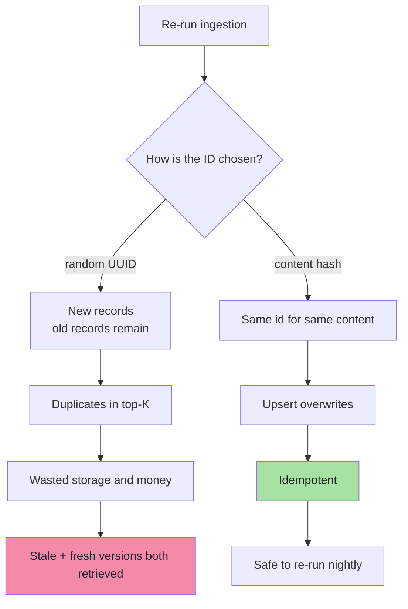

### Content-addressed identity

The companion script computes:

```ts
// pseudo-code: identity derived from what the record IS
function stableId(chunk: Chunk): string {
  return sha256(`${chunk.metadata.source}:${chunk.metadata.chunk}:${chunk.text}`);
}
```

| ID design | Re-run behaviour | Delete by source | Notes |
|---|---|---|---|
| `randomUUID()` | Duplicates every run | Impossible without listing | Never use for chunk IDs |
| `source + chunkIndex` | Overwrites (stale text if chunk count shrinks) | Easy via prefix | Good, but content-blind |
| **`sha256(source:index:text)`** | Overwrites exactly the same content | Good | **Best default** |
| `sha256(text)` | Identical chunks across docs collapse | Hard | Useful for global dedupe |

```text
Re-ingest unchanged file  →  same ids  →  upsert is a no-op  ✅
Edit one paragraph        →  one new id →  one new vector    ✅
Delete paragraph          →  id disappears → orphan remains  ⚠️
```

**The orphan problem:** upsert never deletes. If a document loses a section, its old vectors survive. Production ingestion therefore needs a reconciliation step:

```text
1. Compute the new id set for the document
2. Query existing ids for that docId (metadata filter / list by prefix)
3. Delete ids in (old − new)
4. Upsert ids in (new)
```

> **Idempotency is not a nice-to-have.** Scheduled re-ingestion is how you keep a RAG system fresh, and scheduled re-ingestion without deterministic IDs is a slow-motion outage.

---

## 3.10 Batching, Retries and Partial Failure

Embedding APIs accept arrays of inputs but not unlimited ones. Batch, count, and retry deliberately.

| Concern | Practical guidance |
|---|---|
| Batch size | 50–100 chunks per request (the script uses 100) |
| Max inputs per request | Provider-specific (often 2,048 for embeddings) |
| Token ceiling | Also bounded per request — batch by tokens, not just count |
| Concurrency | 3–8 in-flight requests; higher triggers rate limits |
| Retry policy | Exponential backoff **with jitter** on 429/5xx only |
| Non-retryable | 400 (bad input), 401 (key), 413 (too large) |
| Partial failure | Upsert each batch after it succeeds; record which batches landed |
| Progress | Persist a checkpoint (`docId → lastChunk`) for large corpora |

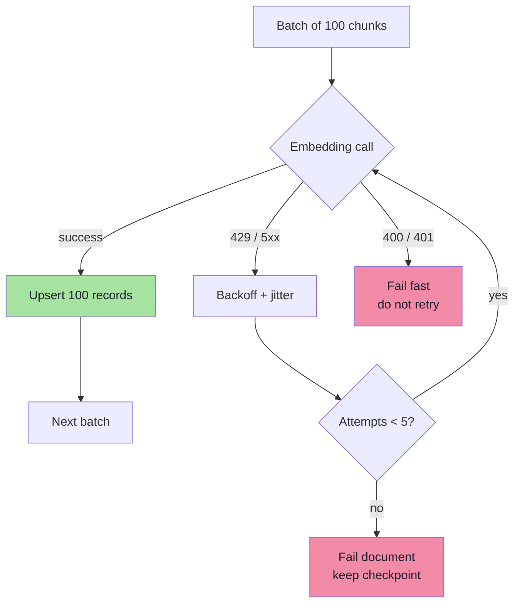

> **Why idempotency pays here:** a partial failure followed by a re-run is only safe because the IDs are deterministic. Batching and content-addressed IDs are the same design decision seen from two angles.

---

## 3.11 Re-indexing, Versioning and Model Migration

Ingestion never happens once. Documents change, the embedding model changes, and the schema changes.

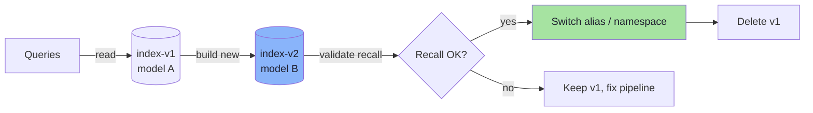

| Change | Migration strategy |
|---|---|
| One document edited | Upsert changed chunks; delete removed ones |
| Embedding model upgrade | **Full re-embed** into a new namespace/index; never mix spaces |
| Chunk size change | Full re-chunk + re-embed; IDs change by design |
| Metadata schema change | Re-ingest or backfill metadata via update operations |
| Embedding dimension change | New index (dimension is fixed at creation) |

**Blue/green in one sentence:** build the new index beside the old one, run the golden-set evaluation against both, then flip reads and delete the loser. There is no safe in-place path when the vector space changes.

---

## 3.12 Pseudo-code: The Ingestion Loop

```ts
// pseudo-code: deterministic, batched, observable ingestion

const CHUNK_SIZE = 300;        // tokens
const OVERLAP = 0;             // raise to ~50 in production
const BATCH = 100;

async function ingestFile(file: SourceFile): Promise<IngestReport> {
  const pages = await extractPages(file);              // [{ page, text }]
  assertUsableExtraction(file, pages);                 // fail loudly

  const chunks = chunkPages(pages, {
    size: CHUNK_SIZE,
    overlap: OVERLAP,
    keepHeadings: true,
    header: (c) => `${file.title} · ${c.section} · page ${c.page}`,
  });

  let embedded = 0;
  for (const batch of batches(chunks, BATCH)) {
    const vectors = await embedWithRetry(batch.map((c) => c.embedText));

    const records = batch.map((c, i) => ({
      id: sha256(`${file.name}:${c.index}:${c.text}`),
      values: vectors[i],
      metadata: {
        source: file.name,
        docId: file.docId,
        chunk: c.index,
        page: c.page,
        section: c.section,
        text: c.text,
        contentHash: sha256(c.text),
        embeddingModel: EMBEDDING_MODEL,
        updatedAt: new Date().toISOString(),
      },
    }));

    await vectorStore.upsert(records);
    embedded += records.length;
  }

  await removeOrphans(file.docId, chunks.map(chunkId));  // stale vectors
  return { file: file.name, chunks: chunks.length, embedded };
}
```

| Token in the pseudo-code | Why it must be there |
|---|---|
| `assertUsableExtraction` | A silent empty index is worse than a failed build |
| `keepHeadings` + `header` | Puts the topic into the vector |
| `embedWithRetry` | Rate limits are normal, not exceptional |
| `sha256(...)` id | Makes re-runs idempotent |
| `metadata.text` | Enables single-round-trip retrieval |
| `embeddingModel` | Makes the vector space self-describing |
| `removeOrphans` | Upsert alone never deletes |

---

## 3.13 Common Mistakes

| Mistake | Consequence | Fix |
|---|---|---|
| Embedding whole documents | Diluted vectors, truncation | Chunk at 300–500 tokens |
| Ignoring scanned PDFs | Missing chunks, silent gaps | Detect and OCR |
| Random UUID chunk IDs | Duplicated index after re-runs | Content-addressed IDs |
| No `docId` in metadata | Cannot delete or update a document | Add `docId` |
| Chunking by characters | Overflow on dense text | Tokenise with the real encoder |
| No overlap | Clauses split at boundaries | 10–20% overlap |
| Overlap 50%+ | Duplicate hits, wasted cost | Reduce overlap; dedupe |
| Dropping headings | Topic-less chunks | Preserve and prepend |
| No extraction validation | Empty index, no error | Assert coverage |
| Ingestion with no report | "Did it work?" is unanswerable | Count files, chunks, tokens |

---

## 3.14 Chapter Summary

| Stage | Decision | Default |
|---|---|---|
| Extract | Text fidelity + page map | Layout-aware parser; OCR fallback; validate |
| Clean | Remove noise, keep structure | NFKC, strip page furniture, keep headings |
| Chunk | Unit of retrieval | 300–500 tokens, 10–20% overlap, structure-aware |
| Header | Give the vector a topic | `title · section · page` prepended |
| Metadata | Enable citation and filtering | `source, chunk, page, docId, hash, acl` |
| Identify | Idempotent writes | `sha256(source:index:text)` |
| Embed | Batched, retried, same model | 100 per batch, backoff + jitter |
| Reconcile | Delete what disappeared | Diff old vs new id sets |
| Version | Safe model changes | Blue/green index, evaluate, flip |

> **Final mental model:** ingestion is where you decide **what the system is allowed to know**. Chunk boundaries are the edges of the model's world; metadata is its ability to say *where* it learned something; IDs are its ability to forget.

---

## Where This Goes Next

- **Chapter 04** defines the embedding contract that both ingestion and serving must obey.
- **Chapter 05** stores these chunks in an index and retrieves them.
- **Chapter 08** measures whether the chunks you created can actually be found.

---

**Back to:** [Lecture 11 — Chapter Index](./README.md) · [Complete Consolidated Notes](./Lecture_11_Complete_Notes.md)
