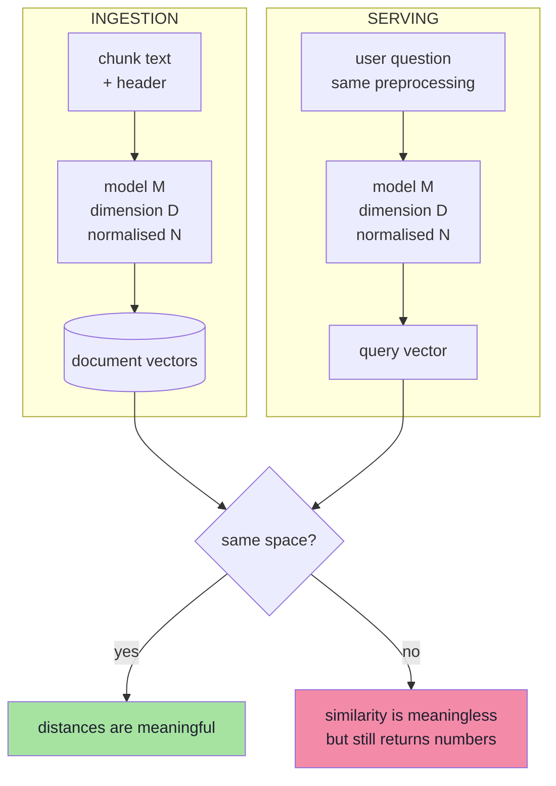
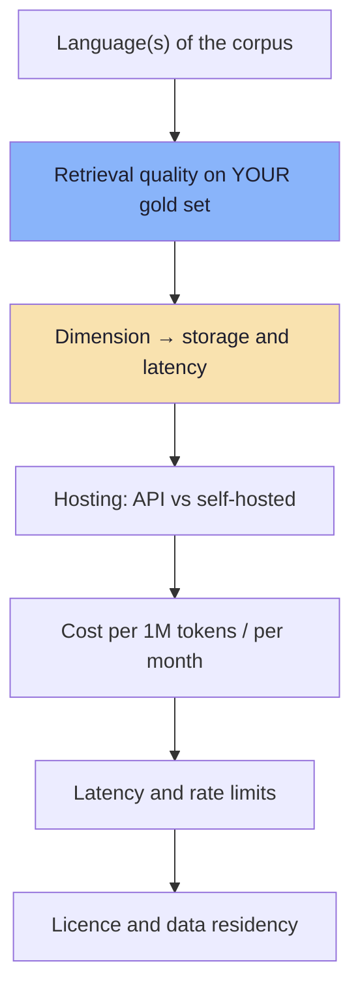
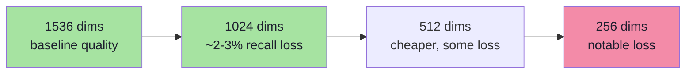
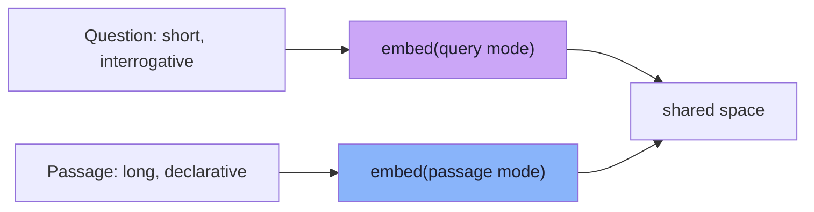
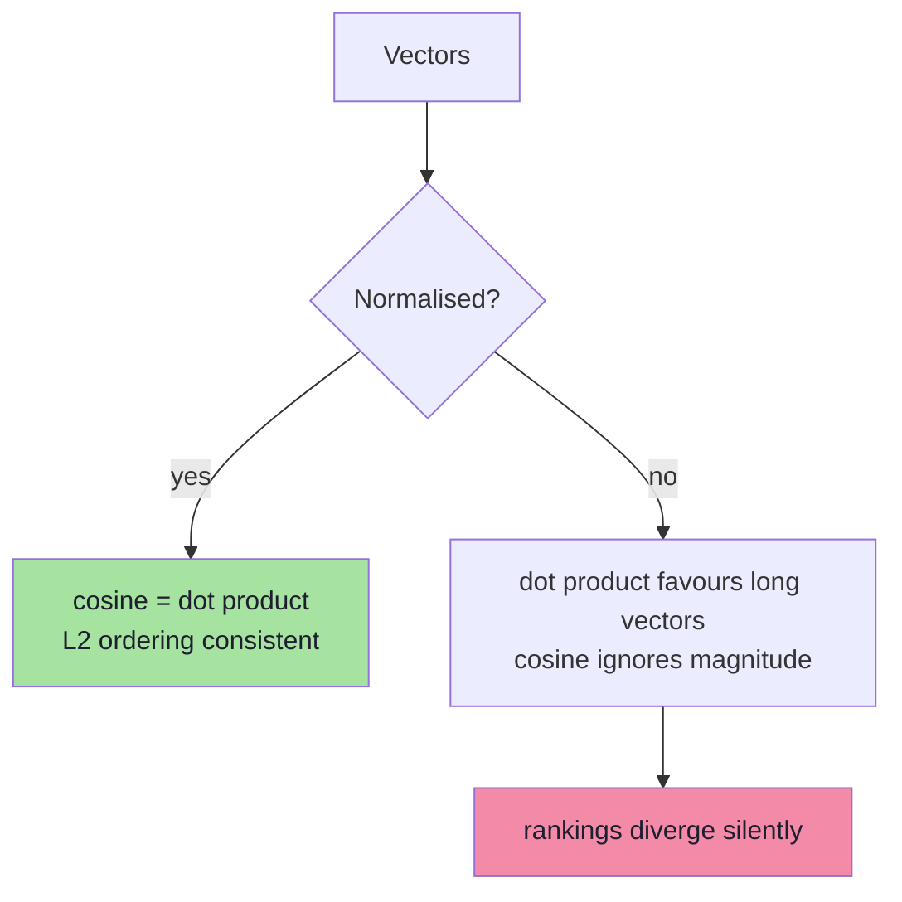
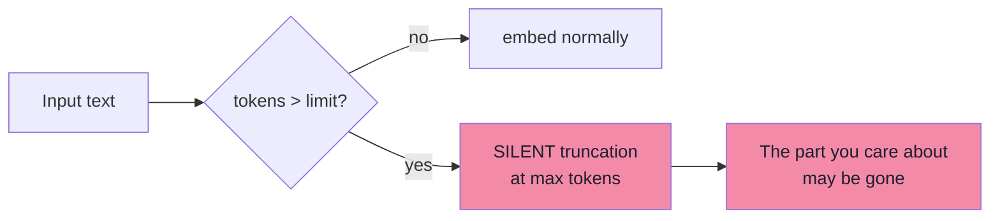
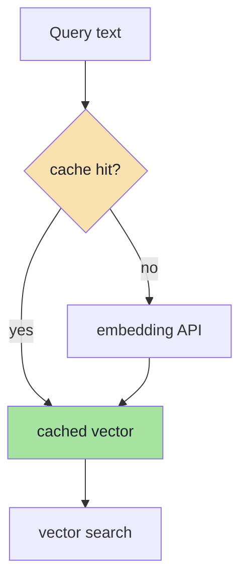
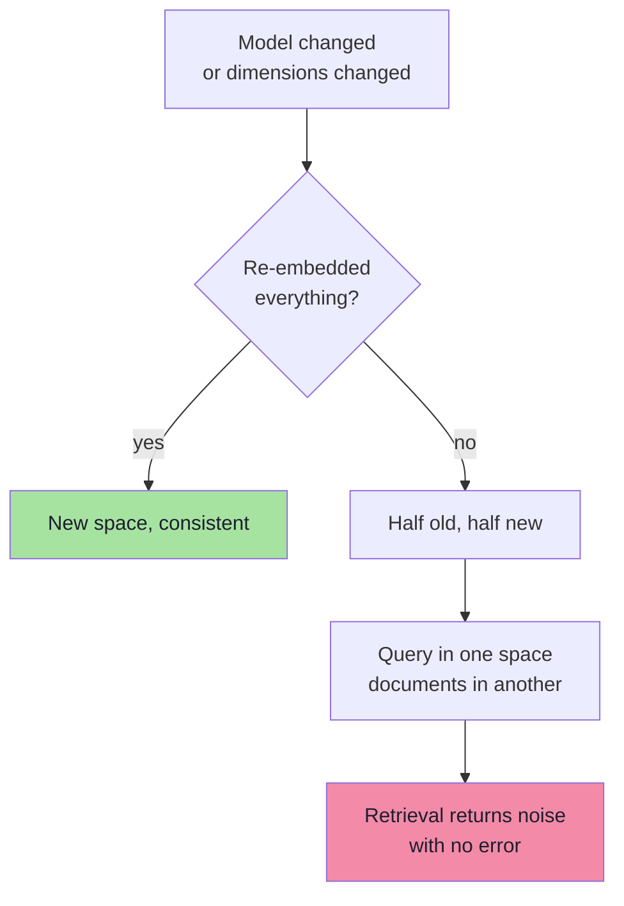
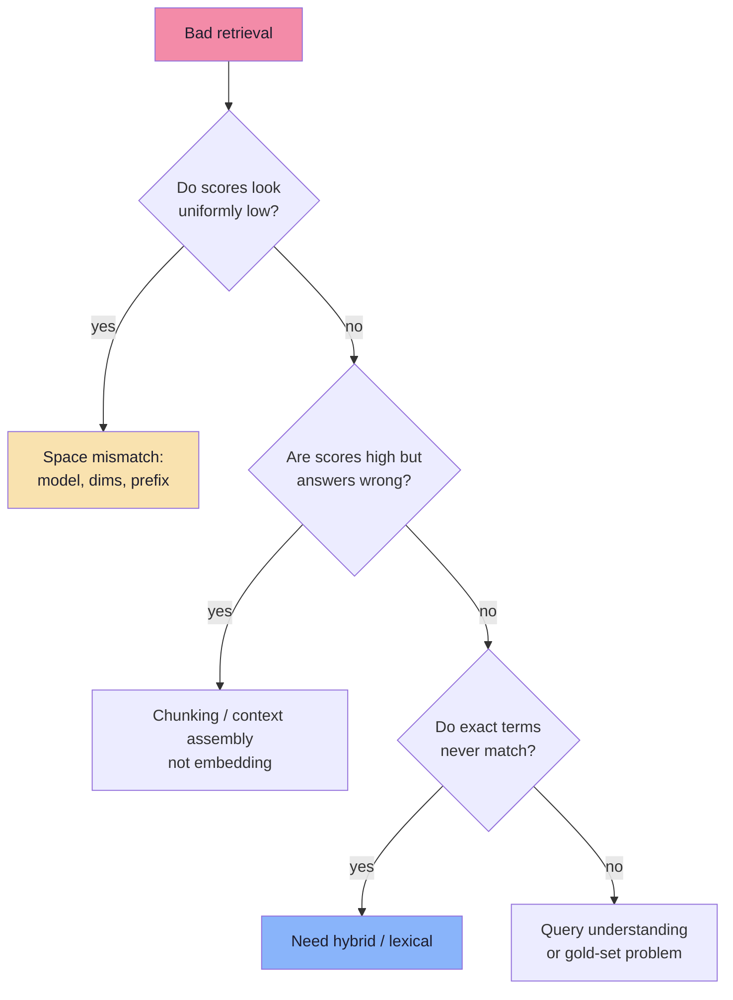

# Chapter 04: Embeddings at Query Time

> **Chapter Goal:** Make the embedding layer boring and correct. The geometry of meaning and the metric mathematics were covered in [Lecture 10, Chapters 01–02](../../Lecture%2010/notes/01_Embeddings_and_the_Geometry_of_Meaning.md); this chapter is the **operational contract**: one model, one dimension, one preprocessing pipeline, applied identically at ingestion and at query time. Almost every "RAG returns nothing relevant" incident is a violation of this contract.
>
> At the end of this chapter you should be able to answer: *what space is my query in, and is it the same space as my documents?*

---

## 4.1 The Contract in One Sentence

> **A query is only meaningful in the space where the documents were embedded.**



Three parameters define the space, and **all three must match**:

| Parameter | Example | What breaks if it differs |
|---|---|---|
| Model family/version | `text-embedding-3-small` | Coordinates are unrelated → noise |
| Dimensions | 1024 (or 1536) | Distance computation is invalid |
| Normalisation | L2-normalised | Dot product ≠ cosine → length bias |

And two more that are easy to forget:

| Parameter | Why it matters |
|---|---|
| **Input preprocessing** | Headers, lowercase, prefixes change the vector |
| **Task type / prefix** | Some models embed questions and passages differently |

> **The failure is silent.** Mixing spaces raises no error: the API accepts the query, the database returns the "nearest" vectors, and the results are confidently wrong. This is why model version belongs in metadata and in the index name.

---

## 4.2 Choosing an Embedding Model

| Model class | Typical dims | Strengths | Costs / limits |
|---|---|---|---|
| **OpenAI `text-embedding-3-small`** | 1536 (can shorten) | Cheap, fast, strong general baseline | English-centric; API dependency |
| **OpenAI `text-embedding-3-large`** | 3072 (can shorten) | Higher accuracy, better multilingual | ~6× price of small |
| **Open-source (BGE, E5, GTE, Nomic)** | 384–1024 | Self-hosted, no per-token cost, fine-tunable | Ops burden; GPU for throughput |
| **Multilingual (e.g. `multilingual-e5`)** | 384–1024 | Cross-language retrieval | Needs query/passage prefixes |
| **Domain-specific / fine-tuned** | varies | Jargon, code, legal, medical | Training data + eval effort |
| **Multimodal (CLIP-style)** | 512–1024 | Text→image, image→image | Separate index per modality |

### Selection criteria, in priority order



**Benchmarks do not transfer.** MTEB scores are averaged over tasks and languages; your corpus has its own vocabulary, document length and question style. The only number that matters is **recall@K on 30–100 of your own question→chunk pairs** (Chapter 08).

> **Rule:** choose the model once, pin it, and evaluate it. Model-shopping without an evaluation set is guessing with extra steps.

---

## 4.3 Dimensions: The Storage You Pay Forever

Each vector costs `dimensions × 4 bytes` in float32, **plus** index overhead (graph edges for HNSW, codes for quantization) and **plus** metadata.

```text
bytes_per_vector = dimensions × 4                (float32)
storage          = num_chunks × bytes_per_vector × overhead_factor
```

| Chunks | Dims | Raw vectors | ≈ With index overhead (1.5×) |
|---|---|---|---|
| 100k | 1536 | 0.61 GB | ~0.9 GB |
| 1M | 1536 | 6.14 GB | ~9.2 GB |
| 1M | 1024 | 4.10 GB | ~6.1 GB |
| 10M | 1024 | 40.96 GB | ~61 GB |
| 10M | 256 | 10.24 GB | ~15 GB |

### Matryoshka dimensions

Modern OpenAI embedding models are trained so that a **prefix** of the vector is itself a usable embedding. The API exposes this as the `dimensions` parameter:

```ts
// pseudo-code: same model, shorter vectors
const res = await openai.embeddings.create({
  model: "text-embedding-3-small",
  input: texts,
  dimensions: 1024,        // default 1536; 256/512/1024 are common choices
});
```



| Dimension choice | Effect |
|---|---|
| Larger | Slightly better separation, more RAM, slower distance computation |
| Smaller | Cheaper storage and bandwidth, small recall loss, faster |
| **Mixed across index** | **Invalid** — every vector must have the same dimension |

> **Practical guidance:** 1024 dimensions is a sane default for a support corpus. Measure recall at 256 / 512 / 1024 before committing — the storage difference at 10M chunks is tens of gigabytes.

---

## 4.4 Symmetric vs Asymmetric Embedding

A question and its answer are not written in the same style. "Can I get a refund?" (short, interrogative) versus "Refunds are allowed within 3 days for apparel…" (declarative clause). This asymmetry is a first-class concern.



| Model family | Convention |
|---|---|
| OpenAI `text-embedding-3-*` | No prefixes; same call for both sides |
| E5 / multilingual-e5 | `"query: …"` and `"passage: …"` prefixes **required** |
| BGE (v1.5) | Query instruction prefix recommended for retrieval |
| Cohere embed | `input_type: "search_query"` vs `"search_document"` |
| Voyage | `input_type: "query"` vs `"document"` |

**Mixing these up costs recall silently.** If a model documents prefixes and you omit them, retrieval still "works" — just measurably worse. If you add prefixes to a model that expects none, you inject noise into every query.

> **Checklist:** read the model card once, write the convention into code as a single function, and never let ingestion and serving build inputs independently.

---

## 4.5 Normalisation and Metric Consistency

If vectors are L2-normalised (length 1), then:

```text
cosine(a, b) = a · b        (because |a| = |b| = 1)
```

So cosine similarity, dot product and (monotonically) L2 distance agree. Without normalisation they do **not**, and long documents/chunks acquire an arbitrary length bias.



| Index metric | Requirement |
|---|---|
| **Cosine** | Use when magnitude is meaningless (usual for text) |
| **Dot product** | Normalise first, unless magnitude carries signal |
| **L2** | Normalise if you want equivalence with cosine |
| **Changing metric after ingestion** | Invalid — the index must be rebuilt |

> **Never mix metrics between write and read.** Creating an index with `cosine` and querying with `dotproduct` produces plausible, wrong rankings. Set the metric at index creation and treat it as immutable (Lecture 10, §2.7).

---

## 4.6 Input Hygiene: What You Actually Send

The query string is not the only thing you can send. Two decisions change results substantially.

### 1. Raw question vs rewritten question

```text
raw:        "and for shoes?"
rewritten:  "What is the refund policy for shoes?"
```

The raw form has almost no semantic content; the rewritten form is retrievable. Rewriting belongs to Chapter 07 (conversation) and Chapter 05 (query understanding), but the *embedding* consequence belongs here: **embed the string you intend to retrieve with.**

### 2. Length and truncation

| Input | Risk |
|---|---|
| Very short ("refund?") | Little signal; matches many chunks weakly |
| Very long (a pasted email) | Truncated at the model limit, tail ignored |
| Mixed language | Weak match unless multilingual model |
| Tables/code pasted raw | Token-heavy, low semantic density |



The embedding limit for `text-embedding-3-*` is **8,191 tokens per input**. Exceeding it does not always throw — the provider may truncate. Defend in code:

```ts
// pseudo-code: make truncation explicit, not accidental
const MAX_INPUT_TOKENS = 8_000;

function prepareEmbeddingInput(text: string): string {
  const ids = tokenizer.encode(text);
  if (ids.length <= MAX_INPUT_TOKENS) return text;

  // Truncate deliberately and log it — never silently
  logger.warn("embedding_input_truncated", {
    originalTokens: ids.length,
    keptTokens: MAX_INPUT_TOKENS,
  });
  return tokenizer.decode(ids.slice(0, MAX_INPUT_TOKENS));
}
```

> **Rule:** an oversized input is a bug in your chunker, not a fact of life. Log it, alert on it, and fix the pipeline.

---

## 4.7 Batching, Caching and Cost

Embeddings are the cheapest part of RAG per token, but they are paid **twice**: once at ingestion, once per query.



### Cost model (illustrative)

| Item | Quantity | Notes |
|---|---|---|
| Corpus | 1M chunks × 300 tokens | = 300M tokens, one-off |
| Embedding price | `text-embedding-3-small` ≈ $0.02 / 1M tokens | Verify current pricing |
| Ingestion cost | ≈ 300 × $0.02 = **$6** | Cheap relative to engineering time |
| Query cost | 20 tokens per question | ~$0.0000004 per question |
| Re-embed on model change | Another **$6** + engineering + eval | The real cost is the migration |

**Conclusion:** embedding cost is rarely the bottleneck. **Storage, latency, and migration effort** are. Optimise dimensions for memory before optimising token price.

### Caching layers

| Cache | Key | Saves |
|---|---|---|
| Query-vector cache | `sha256(normalised query + model + dims)` | Repeat questions (very common in support) |
| Answer cache | `sha256(query + tenant + corpusVersion)` | Full pipeline on exact repeats |
| Semantic cache | Nearest cached query above threshold | Paraphrases — **risky**, can return a stale/wrong answer |
| Prompt cache (provider-side) | Stable prefix (system prompt) | Input-token cost on repeated prompts |

> **Warning about semantic caches:** a paraphrase is not always the same question ("refund for shoes" vs "refund for food"). Gate semantic caching behind a high similarity threshold, per-tenant keys, and a corpus-version component.

---

## 4.8 Pinning: The Compatibility Rule



| Rule | Implementation |
|---|---|
| One model per index | Index name includes model + dims: `policies__te3s__1024` |
| Record the model per vector | `metadata.embeddingModel` |
| Record the model per query log | Enables post-hoc diagnosis |
| Never mix in one namespace | Use a new namespace for a new space |
| Re-embed **all** or nothing | Blue/green migration (Chapter 03, §3.11) |
| Pin the version string | `text-embedding-3-small` today is not guaranteed identical tomorrow |

> **The compatibility rule (Lecture 10, §1.8) restated for RAG:** vectors are only comparable inside the model that produced them. A "small upgrade" without a full re-embed is a silent outage.

---

## 4.9 Failure Modes and Diagnosis

| Symptom | Likely cause | Diagnostic |
|---|---|---|
| Every result is unrelated | Different model/space | Log model + dims on both sides; compare |
| Results are vaguely related but never exact | Missing query prefix (E5/BGE) | Add the documented prefix |
| Similar items cluster by length | Un-normalised vectors + dot product | Normalise; switch to cosine |
| Short queries return nothing useful | Query too vague | Rewrite or expand the query |
| "It worked yesterday" | Model version or index changed | Diff deployment + index metadata |
| One language fails | Monolingual model | Switch to multilingual; evaluate |
| Random results after re-ingest | Mixed old and new vectors | Rebuild a namespace |
| Numbers/IDs never match | Dense-only retrieval | Add BM25/hybrid (Chapter 05) |



> **The most valuable log line in a RAG system:**
> `{ query, model, dims, norm, topK, scores[], chunkIds[], corpusVersion }`.
> Without it, embedding bugs are unfalsifiable.

---

## 4.10 Pseudo-code: One Embedding Function

Both pipelines must call **the same function**. This is the whole chapter in one snippet.

```ts
// pseudo-code: a single, contract-enforcing embedding entry point

const MODEL = "text-embedding-3-small";
const DIMS = 1024;
const MAX_BATCH = 100;
const MAX_INPUT_TOKENS = 8_000;

type EmbedInput = { text: string; kind: "query" | "document" };

const PREFIX_STYLE: "none" | "e5" = "none";   // switch to "e5" for E5/BGE models

function formatForModel({ text, kind }: EmbedInput): string {
  const clean = normaliseWhitespace(text);
  if (PREFIX_STYLE === "e5") {
    return kind === "query" ? `query: ${clean}` : `passage: ${clean}`;
  }
  return clean;                                // OpenAI v3: no prefixes
}

async function embedOne(input: EmbedInput): Promise<number[]> {
  const prepared = prepareEmbeddingInput(formatForModel(input));
  const cacheKey = sha256(`${MODEL}:${DIMS}:${prepared}`);

  const cached = await vectorCache.get(cacheKey);
  if (cached) return cached;

  const res = await openai.embeddings.create({
    model: MODEL,
    dimensions: DIMS,
    input: prepared,
  });

  const vector = res.data[0].embedding;
  assert(vector.length === DIMS, "dimension mismatch");

  await vectorCache.set(cacheKey, vector, { ttlSeconds: 60 * 60 * 24 });
  return vector;
}

async function embedMany(texts: string[], kind: "document"): Promise<number[][]> {
  // batch, retry, and preserve input order
  const out: number[][] = [];
  for (const batch of batches(texts, MAX_BATCH)) {
    const inputs = batch.map((text) => formatForModel({ text, kind }));
    const res = await embedWithRetry(inputs);
    out.push(...res.map((d) => d.embedding));
  }
  return out;
}
```

| Guarantee | Enforced by |
|---|---|
| One model + dimension | `MODEL` / `DIMS` constants, asserted at runtime |
| One preprocessing path | `formatForModel` used by both kinds |
| No silent truncation | `prepareEmbeddingInput` + warning log |
| Cost control | `vectorCache` keyed by content + model |
| Ordering safety | Batch loop writes results positionally |

> **Anti-pattern to avoid:** ingestion calling `openai.embeddings.create({ dims: 1536 })` while serving calls a helper with `dims: 1024`. Two files, two defaults, one broken index.

---

## 4.11 Common Mistakes

| Mistake | Consequence |
|---|---|
| Different model at ingest vs query | Silent, total retrieval failure |
| Different dimensions | Invalid distance computation or index rejection |
| Forgetting E5/BGE prefixes | Measurable recall loss |
| Normalising on one side only | Dot-product bias |
| Embedding raw boilerplate | Everything looks similar |
| No query cache | Paying for the same questions repeatedly |
| Ignoring the 8,191-token limit | Silent truncation of long chunks |
| Changing model without re-embedding | Half-old, half-new index |
| Judging a model on MTEB alone | Benchmarks are not your corpus |
| Not logging model + dims per request | Undebuggable incidents |

---

## 4.12 Chapter Summary

| Decision | Default | Revisit when |
|---|---|---|
| Model | `text-embedding-3-small` (or multilingual equivalent) | Recall below target, non-English corpus |
| Dimensions | 1024 | Memory pressure (↓) or recall shortfall (↑) |
| Prefixes | None for OpenAI; documented prefixes elsewhere | Switching to E5/BGE/Cohere |
| Normalisation | Let the provider normalise; verify | Using self-hosted models |
| Metric | Cosine | Magnitude carries meaning (rare) |
| Max input | 8,000 tokens, explicit truncation warning | Never — chunk smaller instead |
| Pinning | Model + dims in index name and metadata | Every migration |

> **Final mental model:** the embedding model is a **coordinate system**, not a search engine. It does not know what is relevant; it only places strings in space. Correctness comes from putting *questions* and *the exact text that answers them* into the **same** coordinate system.

---

## Where This Goes Next

- **Chapter 05** indexes these vectors and retrieves the top-K candidates.
- **Lecture 10, Chapters 01–02** cover the underlying geometry and metric proofs.
- **Chapter 08** turns "recall below target" into a measurable experiment.

---

**Back to:** [Lecture 11 — Chapter Index](./README.md) · [Complete Consolidated Notes](./Lecture_11_Complete_Notes.md)
