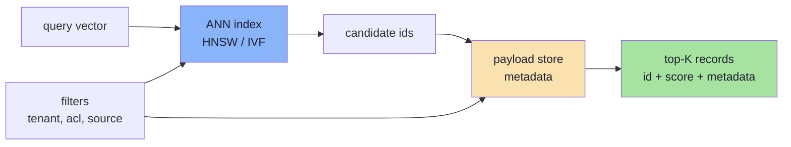
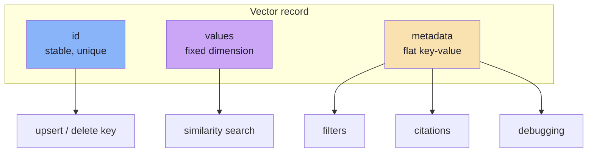
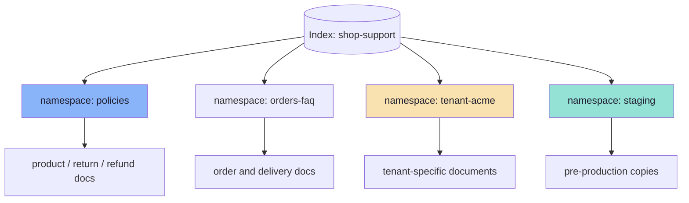
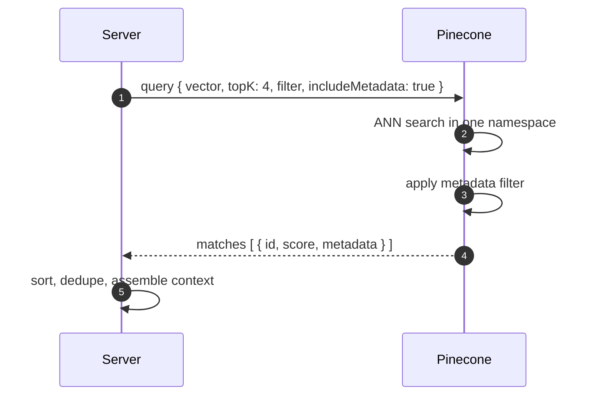
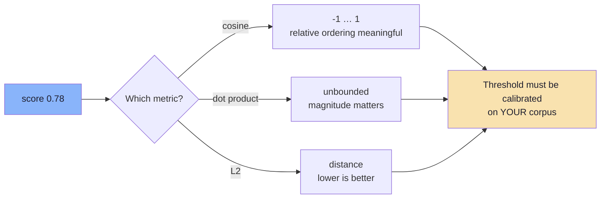
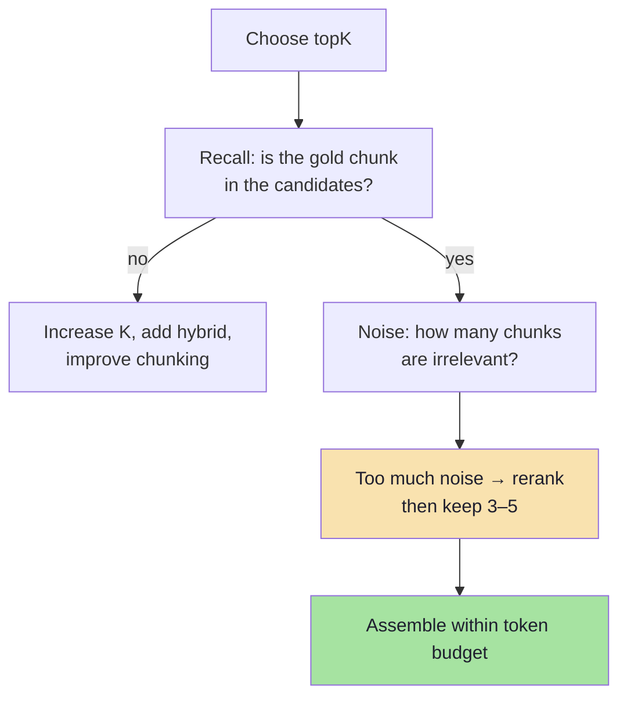
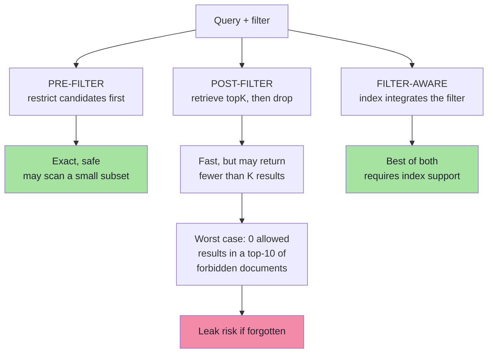
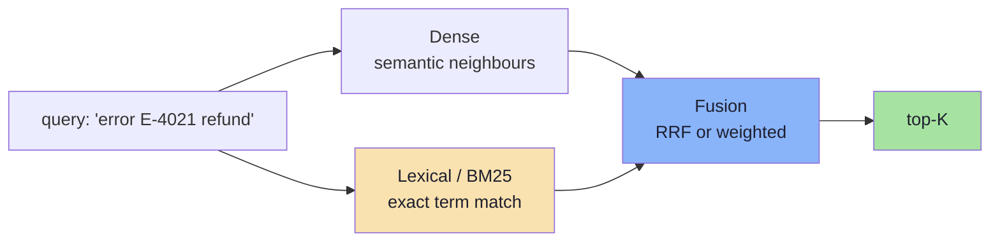
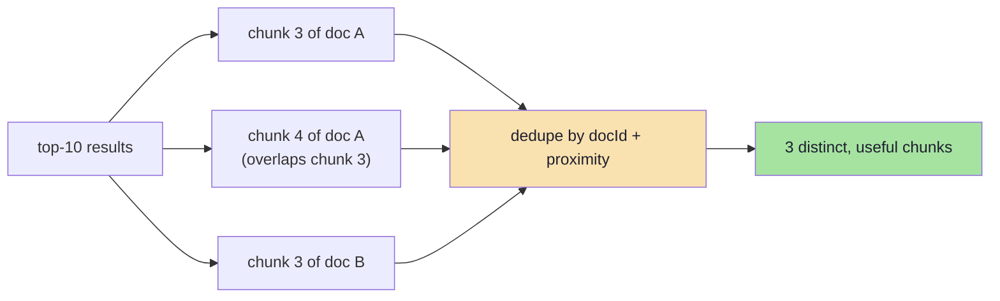
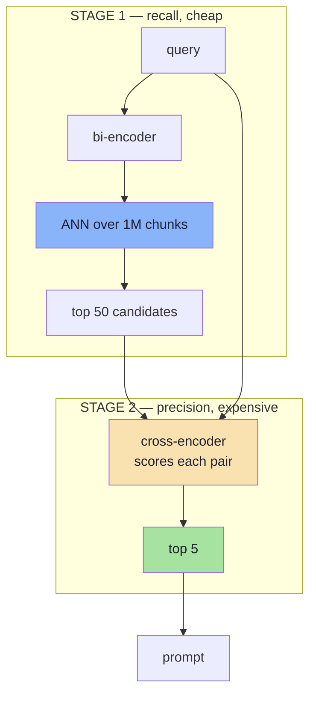

# Chapter 05: The Vector Index — Storing and Searching Knowledge

> **Chapter Goal:** Own the retrieval half of the online path: what a vector record is, how upserts and namespaces behave, how to call a query correctly, how to interpret scores, how to filter safely, and when to add hybrid search or reranking. Algorithm internals (HNSW, IVF, PQ) were covered in [Lecture 10](../../Lecture%2010/notes/Lecture_10_Complete_Notes.md); here we operate them.
>
> The concrete example is **Pinecone** with namespace `policies`, as drawn on the lecture board and used in the companion script — but the concepts transfer to Qdrant, pgvector, Weaviate, Milvus or OpenSearch.

---

## 5.1 The Minimum Contract of a Vector Store

A RAG system needs exactly five capabilities from storage. Anything beyond them is optimisation.

| Capability | Why it is required | Missing → |
|---|---|---|
| **Upsert by id** | Re-ingestion must overwrite, not duplicate | Growing duplicate index |
| **ANN top-K search** | Sub-linear retrieval | Too slow at scale |
| **Metadata payload + filter** | Tenant, ACL, source, date | Data leaks, wrong answers |
| **Delete by id / filter** | Removing stale or forbidden content | Permanent stale knowledge |
| **Namespaces / collections** | Isolation of environments and tenants | Cross-contamination |



> **Key idea:** a vector database is an **index plus a payload store plus an operational lifecycle**. The index finds candidates; the payload decides whether they are allowed and whether they can be cited.

---

## 5.2 The Record Model: id + vector + metadata

```json
{
  "id": "9f2c8b1e4d7a...",
  "values": [0.021, -0.184, 0.762, "… 1024 floats"],
  "metadata": {
    "source": "refund-policy.pdf",
    "chunk": 3,
    "page": 2,
    "section": "Apparel",
    "text": "Refunds are allowed within 3 days of delivery…",
    "embeddingModel": "text-embedding-3-small",
    "updatedAt": "2026-03-01T10:12:00Z"
  }
}
```



### Metadata constraints that bite

| Constraint | Practical effect |
|---|---|
| **Flat structure** (no nested objects, usually) | Flatten `{"doc": {"page": 2}}` → `doc_page` |
| **Size limit per record** (e.g. ~40 KB) | Do not store entire documents in metadata |
| **Filterable types** | strings, numbers, booleans, lists of strings |
| **Indexed fields** | Filters on unindexed fields may be slow or rejected |
| **Text is not searchable** | Metadata filters are exact/range, not full-text |

> **Design rule:** metadata is for **finding, filtering and citing**, not for storing the corpus. The original file remains the source of truth (Chapter 03).

---

## 5.3 Namespaces: The Cheapest Isolation You Will Ever Get

The board shows a Pinecone namespace called **`policies`**. Namespaces partition one index into independent key spaces: ids can repeat across namespaces, and queries are scoped to one.



| Partitioning strategy | When to use | Trade-off |
|---|---|---|
| **Namespace per tenant** | Strong isolation, per-tenant delete | Many namespaces; cross-tenant search impossible |
| **Namespace per corpus** | Policies vs orders vs product docs | Query must decide which namespace(es) |
| **Namespace per environment** | `dev`, `staging`, `prod` | Duplicate storage, clean separation |
| **Metadata filter only** | Few tenants, shared corpus | One bad filter = data leak |
| **Namespace + filter** | Regulated data | Most robust, most setup |

> **Security rule:** authorisation must be part of the *query*, not a post-processing step. Filtering after retrieval means forbidden text entered your process and possibly your prompt.

---

## 5.4 Anatomy of the Query Call

The companion script's retrieval step, annotated:

```ts
// pseudo-code: the retrieval call, piece by piece
const searchResult = await pineconeIndex.query({
  vector: queryEmbedding,     // 1. same space as documents
  topK: 4,                    // 2. how many candidates to bring back
  includeMetadata: true,      // 3. we need text + source for the prompt
  // filter: { tenantId: "acme" },   // 4. authorisation (add in production)
  // namespace is bound at construction: index.namespace("policies")
});
```

| Parameter | Meaning | Default guidance |
|---|---|---|
| `vector` | Query embedding | Must match index dimension and metric |
| `topK` | Candidates to return | 3–10 for generation; 30–100 before reranking |
| `includeMetadata` | Return payload | **true** — you need `text` and `source` |
| `filter` | Metadata predicate | Always set tenant/ACL in multi-tenant systems |
| `namespace` | Partition | One per corpus/tenant |
| `includeValues` | Return raw vectors | Usually false (bandwidth) |



**Latency expectation:** ANN search on a serverless index is typically tens of milliseconds; the embedding call before it is often the slower half of retrieval (~50–200 ms). Retrieval is rarely the bottleneck compared with generation.

---

## 5.5 Reading Scores Correctly

A score is **not** a probability and **not** a universal measure of relevance. It is a similarity under a specific metric, model and corpus.



| Misconception | Reality |
|---|---|
| "Score > 0.8 means relevant" | Thresholds are corpus- and model-specific |
| "Score is confidence" | It is geometric similarity, not calibrated probability |
| "Same score = same quality across queries" | Score distributions shift by query length and topic |
| "Low score means the answer isn't there" | It may be phrased very differently, or missing from the index |
| "Higher topK always finds it" | Noise increases; the ranking may still be wrong |

### Calibrating a threshold (do this, do not guess)

```text
1. Collect 50 real questions with their gold chunk ids.
2. Retrieve top-20 for each; record the gold chunk's rank and score.
3. Plot: how many gold chunks appear above score T?
4. Choose T where recall is acceptable and the "no answer" rate is honest.
5. Re-calibrate after any model, chunking or corpus change.
```

> **Practical stance:** prefer *relative* ranking + an explicit refusal path over a magic absolute threshold. A score cut is a useful filter, not a correctness proof.

---

## 5.6 Tuning top-K

`topK` is a **budget**, not a quality dial.



| topK | Prompt tokens (300-token chunks) | Behaviour |
|---|---|---|
| 1 | ~300 | Precise, brittle; one miss = total failure |
| **3–5** | ~900–1,500 | **Best default for generation** |
| 10 | ~3,000 | More recall, more noise, higher cost |
| 50–100 | ~15,000–30,000 | Only with a reranker or context compression |

```text
retrieve top 50  →  rerank to top 5  →  prompt 5
        (recall)        (precision)      (focus)
```

The two-stage pattern is the single highest-value retrieval upgrade: cheap recall in stage one, expensive precision in stage two.

---

## 5.7 Metadata Filtering: Pre, Post or Filter-Aware

Filtering is where retrieval and security meet. Three strategies exist, and only one is safe at scale.



| Strategy | How it works | Danger |
|---|---|---|
| **Pre-filter** | Compute eligible id set, search inside it | Large sets are expensive; very small sets are cheap |
| **Post-filter** | Search top-K, discard non-matching | You may discard most of the K → too few results |
| **Filter-aware (integrated)** | Index traverses only allowed nodes | Best default when available |

### The over-fetch pattern

```text
topK = 10, filter selectivity = 5%
Expected allowed results ≈ 0.5  → usually returns 0 or 1

Fix: request more candidates, then filter, then truncate
     fetch 100 → filter → keep best 4
```

```ts
// pseudo-code: filter inside retrieval, over-fetch when needed
const matches = await index.query({
  vector,
  topK: 60,                               // over-fetch
  includeMetadata: true,
  filter: {
    tenantId: { $eq: ctx.tenantId },      // authorisation
    acl: { $in: ctx.roles },              // coarse permissions
    lang: { $eq: ctx.locale },
  },
});

const allowed = matches
  .filter((m) => isAuthorised(ctx, m.metadata))   // defence in depth
  .slice(0, 4);
```

> **Always apply the authorisation filter twice:** once in the query (for correctness and cost) and once in application code (for defence in depth). Never rely on prompt instructions to hide data.

### Filters worth indexing

| Filter | Why |
|---|---|
| `tenantId` | Isolation |
| `acl` / `role` | Permissioned content |
| `lang` | Route to the right embedding space |
| `sourceType` | "policies only", "tickets only" |
| `updatedAt` | Freshness, "current policy only" |
| `version` | Exclude superseded documents |
| `docId` | Update/delete scope |

---

## 5.8 Hybrid Search: When Dense Alone Is Not Enough

Dense retrieval is excellent at *meaning* and weak at *identifiers*: SKUs, error codes, clause numbers, names, currency amounts.



### Recipient Rank Fusion (RRF)

RRF merges ranked lists without needing comparable scores:

```text
RRF(d) = Σ_over_lists  1 / (k + rank_list(d))          k ≈ 60
```

| Property | Why it matters |
|---|---|
| Uses ranks, not scores | Cosine and BM25 scores are not comparable |
| No normalisation needed | Simple and robust |
| Favours documents ranked by both | Consensus signal |
| One constant (`k`) | 60 is the common default |

```text
dense:   [A, C, D, B]
sparse:  [B, A, E]
RRF:      A high in both → wins
          B appears in both → strong
          D only dense     → weaker
```

| When hybrid is essential | When dense is enough |
|---|---|
| Support tickets with order IDs | Conversational FAQ |
| Code / API references | Prose policies |
| Legal clause numbers | Marketing content |
| Product SKUs and model numbers | General knowledge questions |
| Names of people or places | |

> **Cost note:** hybrid search requires maintaining a second index and tuning fusion. Do it when your golden set shows identifier queries failing — not pre-emptively.

---

## 5.9 Duplicates, Diversity and MMR

Overlapping chunks and repeated boilerplate produce near-identical hits, which waste the context budget without adding evidence.



### Deduplication rules

| Rule | Effect |
|---|---|
| Drop identical `contentHash` | Removes exact duplicates |
| Keep max 2 chunks per `docId` | Encourages source diversity |
| Merge overlapping ranges from the same doc | Prevents the same sentence twice |
| Prefer higher-scoring representative | Preserves relevance |

### Maximal Marginal Relevance (MMR)

MMR balances relevance against novelty:

```text
MMR = argmax_d [ λ · sim(q, d) − (1 − λ) · max_{s∈S} sim(d, s) ]
```

| λ | Behaviour |
|---|---|
| 1.0 | Pure relevance (no diversity) |
| **0.5–0.7** | **Balanced — good default** |
| 0.0 | Pure diversity (often irrelevant) |

Use MMR when you ask broad questions ("what are our delivery options?") and top-K keeps returning five near-identical paragraphs.

---

## 5.10 Reranking: Precision on a Small Set

A bi-encoder (your embedding model) encodes query and document **separately**, then compares vectors. That is what makes it fast enough to search millions of chunks — and what limits its precision, because the two texts never "see" each other.

A **cross-encoder** reads the pair `(query, chunk)` together and outputs a relevance score. Much slower, much more accurate.



| | Bi-encoder | Cross-encoder |
|---|---|---|
| Reads query + doc together | No | Yes |
| Precomputable doc vectors | Yes | No |
| Cost per query | 1 embedding | N forward passes |
| Used for | Candidate generation | Final ordering |
| Typical N | 1,000,000+ | 20–100 |

**Practical rules**

1. Only rerank when stage-one recall is already acceptable — reranking cannot recover a chunk that was never retrieved.
2. Rerank 20–100 candidates; 5–10 is usually too few to change much.
3. Measure nDCG@5 or exact-match rate before/after; a reranker that does not improve the golden set is pure latency.
4. Hosted rerankers and small local cross-encoders both work; the interface (`(query, docs[]) → scores`) is what matters.

---

## 5.11 Operating the Index

### Eventual consistency

Serverless and distributed vector databases are often **eventually consistent**: an upsert returns success before the record is searchable.

```text
t0  upsert(new policy chunk)  → 200 OK
t1  query immediately         → old results only
t2  ~seconds later            → new chunk visible
```

| Consequence | Mitigation |
|---|---|
| "Read your own writes" fails right after upload | Poll with retry on the specific id, or show "indexing…" |
| Re-ingest then immediately evaluate | Wait, or evaluate against the write-time snapshot |
| Deletion looks ineffective | Verify by id fetch, not by search |

### Limits worth knowing before you design

| Limit | Typical order of magnitude | Design response |
|---|---|---|
| Vectors per upsert request | 100–1,000 | Batch (script uses 100) |
| Request payload | A few MB | Keep metadata small |
| `topK` maximum | ~10,000 | Over-fetch ≤ a few hundred |
| Metadata per record | ~40 KB | Store long text elsewhere |
| Namespaces per index | Thousands+ | Namespace per tenant is feasible |
| Dimensions | Fixed at index creation | New index for a new model |

### Deletes, updates and truth

| Operation | Semantics | Watch out |
|---|---|---|
| Upsert by id | Insert or replace | Orphans when chunks disappear (§3.9) |
| Delete by id | Remove one record | Track ids per document |
| Delete by filter | Bulk remove | Confirm selector before running |
| Metadata update | Change payload only | Vector stays; filters change behaviour |
| Full rebuild | New namespace/index | Safest for model changes |

> **Source of truth rule:** the vector DB is a **derived index**. If you lose it, you must be able to rebuild it from the original documents. Never let it become the only copy of any content.

### Cost drivers

| Driver | Grows with | Lever |
|---|---|---|
| Storage | chunks × dimensions × bytes | Smaller chunks count, fewer dims, quantization |
| Query compute | QPS × topK | Caching, lower topK, replicas |
| Egress | metadata returned | Do not return `values` |
| Ingestion | re-embeds | Idempotent IDs, content hashing |
| Namespace sprawl | tenants × environments | Shared namespaces + filters where safe |

---

## 5.12 Failure Modes

| Symptom | Likely cause | Check |
|---|---|---|
| Empty result set | Wrong namespace or over-restrictive filter | Log namespace + filter; query without filter |
| Too few results with a filter | Post-filtering a selective filter | Over-fetch or pre-filter |
| Stale answer after upload | Eventual consistency | Fetch by id; add a short delay |
| Deleted doc still answered | Orphan vectors | Reconcile ids on ingest |
| Duplicate chunks in context | Overlap + no dedupe | Dedupe by `contentHash`, cap per `docId` |
| Right doc never appears | Wrong space (model/dims) | Chapter 04 diagnostics |
| Irrelevant but high scores | Boilerplate chunks, generic text | Clean, add headers, rerank |
| Cross-tenant leak | Filter missing/ignored | Enforce filter in a shared query builder |
| Slow queries | Very large topK, no index on filter field | Reduce topK, index filter fields |
| Index rejected upsert | Dimension mismatch or metadata too large | Validate before writing |

---

## 5.13 Pseudo-code: The Retrieval Function

```ts
// pseudo-code: one retrieval entry point used by every route

type Match = {
  id: string;
  score: number;
  metadata: { text: string; source: string; page?: number; docId: string };
};

async function retrieve(
  question: string,
  ctx: { tenantId: string; roles: string[] },
  opts = { fetch: 60, keep: 4 },
): Promise<Match[]> {
  const vector = await embedOne({ text: question, kind: "query" });

  const { matches } = await index.query({
    vector,
    topK: opts.fetch,
    includeMetadata: true,
    includeValues: false,
    filter: {
      tenantId: { $eq: ctx.tenantId },
      acl: { $in: ctx.roles },
    },
  });

  return matches
    .filter((m) => isAuthorised(ctx, m.metadata))   // defence in depth
    .filter((m) => m.score >= SCORE_FLOOR)          // calibrated, not guessed
    .sort((a, b) => b.score - a.score)
    .filter(dedupeByHashAndDoc(2))                  // max 2 per document
    .slice(0, opts.keep);
}
```

| Line | Why |
|---|---|
| `embedOne({ kind: "query" })` | Same function and space as ingestion |
| `topK: opts.fetch` | Over-fetch for the reranker / filter |
| `filter: tenantId` | Authorisation **inside** the query |
| `isAuthorised` | Second check in application code |
| `SCORE_FLOOR` | Removes obvious noise; calibrated per corpus |
| `dedupeByHashAndDoc(2)` | Stops five near-identical chunks eating the budget |
| `keep: 4` | Matches the prompt budget in Chapter 06 |

---

## 5.14 Common Mistakes

| Mistake | Fix |
|---|---|
| Retrieval without a tenant filter | Shared query builder that injects it |
| Trusting a score threshold copied from a blog | Calibrate on your golden set |
| topK = 1 for "efficiency" | 3–5, plus a refusal path |
| topK = 100 straight into the prompt | Over-fetch then rerank |
| No dedupe | Hash + `docId` cap |
| Assuming immediate consistency | Verify by id; show indexing state |
| Treating the index as the source of truth | Keep originals; make rebuilds routine |
| Adding hybrid search without measurement | Measure identifier queries first |
| Forgetting to index filter fields | Slow or rejected queries |
| One index shared by dev and prod | Namespace per environment |

---

## 5.15 Chapter Summary

| Layer | Decision | Default |
|---|---|---|
| Record | `id + values + metadata` | Stable id, flat metadata, text in payload |
| Partition | Namespace + filter | Namespace per tenant/corpus, always filter |
| Query | Vector, topK, filter, metadata | Over-fetch 50–60, keep 3–5 |
| Score | Similarity, not confidence | Calibrate, do not guess |
| Candidates | Recall first | Add hybrid when identifiers fail |
| Ordering | Precision second | Rerank to 5 with a cross-encoder |
| Diversity | Dedupe and MMR | Cap 2 per doc; λ ≈ 0.6 if needed |
| Operations | Derived index | Rebuildable, idempotent, authorised |

> **Final mental model:** the index answers one question — *"which stored chunks are closest to this query, among those this user may see?"* Everything else (reranking, dedupe, thresholds, budgets) exists to turn that candidate list into **four paragraphs worth reading**.

---

## Where This Goes Next

- **Chapter 06** turns retrieved chunks into a grounded, cited answer.
- **Lecture 10, Chapters 04–07** explain the ANN indexes and quantization behind the query.
- **Chapter 08** defines the recall@K and nDCG measurements referenced throughout.

---

**Back to:** [Lecture 11 — Chapter Index](./README.md) · [Complete Consolidated Notes](./Lecture_11_Complete_Notes.md)
