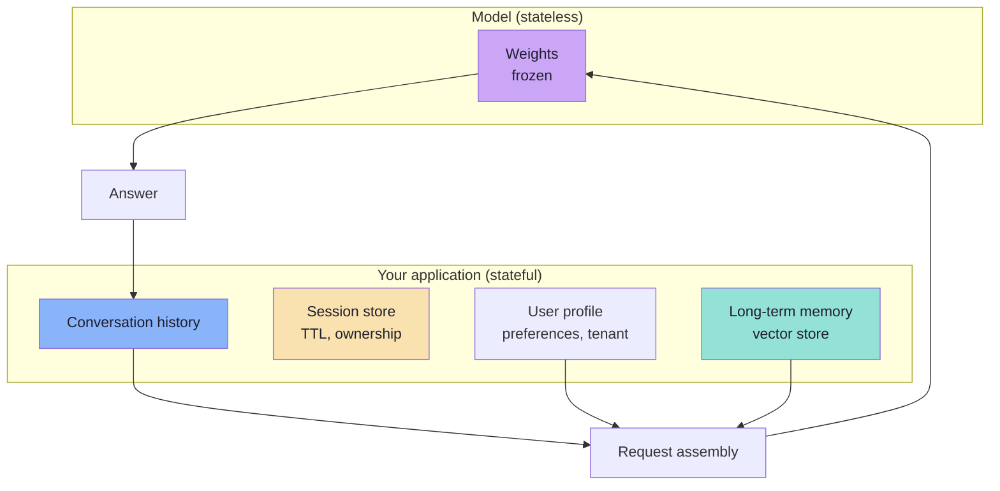
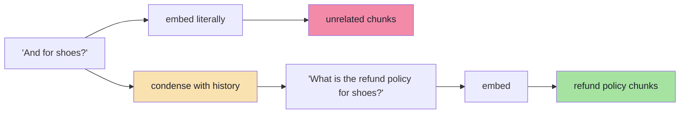
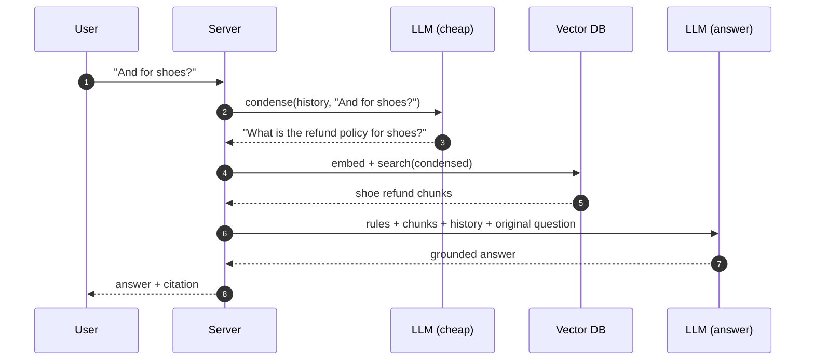
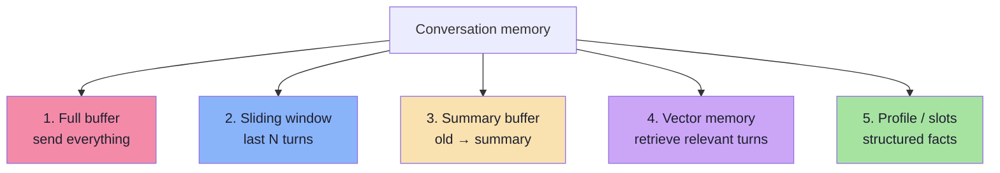
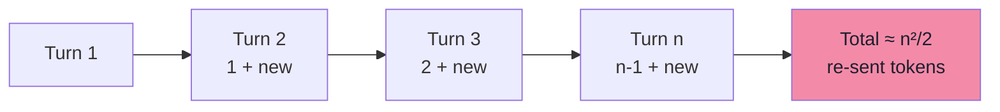
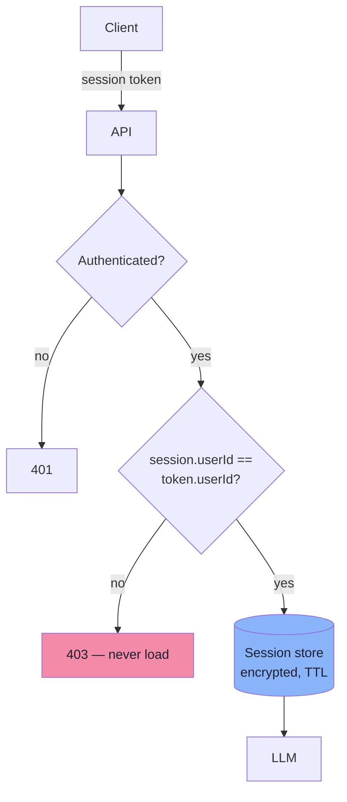

# Chapter 07: Conversation State — Memory and Multi-Turn RAG

> **Chapter Goal:** Make the assistant behave as if it remembers, without pretending that the model does. Chapter 01 established that the model is stateless; this chapter builds the state layer. You will learn to store history safely, keep it inside a token budget, and — critically — **turn follow-up questions into retrievable queries**.
>
> The lecture board's second demo is the whole chapter in three lines:
>
> ```text
> User: My name is Aditya      →  LLM: Hello Aditya
> User: What is my name?       →  LLM: (without History) "I don't have that information"
> ```

---

## 7.1 What "Memory" Actually Is



| Layer | Stores | Lifetime | Cost |
|---|---|---|---|
| **Weights** | Everything learned in training | Forever (until retrained) | Fixed |
| **Context window** | What you send *this* request | One call | Per token, every call |
| **Conversation history** | Recent turns | Session | Re-sent every turn |
| **Summary memory** | Compressed older turns | Session / user | One summarisation call |
| **Long-term memory** | Durable facts ("prefers email") | Until deleted | Embedding + retrieval |
| **Profile** | Structured attributes | Until changed | Negligible |

> **Key idea:** the model never remembers. **You** decide what it is allowed to see again. Memory is a retrieval problem with a different corpus — the conversation.

---

## 7.2 History Is Also a Retrieval Problem

Most tutorials treat history as a *generation* concern: resend it so the model can resolve "it". In RAG it is worse than that — an unresolved follow-up produces a **useless query vector**.

```text
Turn 1: "Can I get a refund for a jacket?"
Turn 2: "And for shoes?"

Embedded literally, "And for shoes?" →
  short, pronoun-free, context-free
  → nearest chunks: shoe size guides, unrelated FAQ
  → answer: wrong, or a refusal
```



So history has **two jobs**:

| Job | Consumer | Mechanism |
|---|---|---|
| Resolve references | Retrieval | Query condensation / rewriting |
| Provide continuity | Generation | Messages array with prior turns |

If you only do the second, the assistant will "remember" the conversation but retrieve for the wrong question — the most confusing failure mode in multi-turn RAG, because the answer is fluent, contextual and wrong.

---

## 7.3 Query Condensation (Standalone Question)

A **condensed query** is a self-contained rewrite of the user's latest message, using the conversation only to resolve references.



### Condensation prompt (small, strict)

```text
Given the conversation and the latest user message, rewrite the latest message
as a standalone search query.

Rules:
- Keep the user's intent and all constraints (product, dates, amounts).
- Resolve pronouns and ellipsis using the conversation.
- Do not answer the question.
- Do not add facts that were not stated.
- If the message is already standalone, return it unchanged.
- Output only the rewritten query.
```

| Rule | Why |
|---|---|
| **Do not answer** | A model that answers here skips retrieval entirely |
| **Do not add facts** | Invented constraints cause empty result sets |
| **Return unchanged if standalone** | Avoids drift on clear questions |
| **Output only the query** | Cheap parsing, no preamble |
| **Keep constraints** | "for shoes, ordered last week" must survive |

### When to condense

| Condition | Action |
|---|---|
| Message has pronouns/ellipsis ("it", "that one", "and for…") | Condense |
| Message is a fragment (< ~6 tokens) | Condense |
| Previous turn was a clarifying question | Condense |
| Message is already self-contained | Skip (save a call) |
| User explicitly changes topic | Skip; reset context |

```ts
// pseudo-code: cheap heuristic before spending a model call
function needsCondensation(message: string, history: Message[]): boolean {
  if (history.length === 0) return false;
  const words = message.trim().split(/\s+/);
  const hasReference = /\b(it|that|those|them|this|same|also|and)\b/i.test(message);
  return words.length <= 6 || hasReference;
}
```

> **Always retrieve with the condensed query, but answer with the original message.** The rewrite is for search; the user's actual words are for the answer.

---

## 7.4 Memory Strategies



| Strategy | How it works | Cost | Fails when |
|---|---|---|---|
| **Full buffer** | Resend all turns | Grows quadratically | Long chats: expensive, diluted attention |
| **Sliding window** | Last N turns (e.g. 6) | Constant | Old constraints are dropped |
| **Summary buffer** | Summarise turns older than N | One extra call | Summary loses exact numbers |
| **Vector memory** | Embed turns; retrieve relevant ones | Retrieval hop | "What did I just say?" needs recency, not similarity |
| **Profile/slots** | Extract facts into fields | Tiny | Schema cannot express the fact |

### Quadratic growth is the hidden cost

```text
Turn 1:  send 1 message
Turn 2:  send 2 messages
...
Turn n:  send n messages

Total input tokens ≈ n²/2 × avg_message_tokens
```

For 30 turns at ~80 tokens each: `30²/2 × 80 = 36,000` tokens **cumulatively**, versus 2,400 if you had sent each once. Context is re-billed on every call.



### The recommended hybrid

```text
system rules
+ profile slots            (name, tenant, plan — structured, tiny)
+ rolling summary          (older turns, compressed)
+ last 4–6 turns verbatim  (recent context, exact wording)
+ retrieved documents      (per condensed query)
+ current question
```

| Slot | Budget guidance |
|---|---|
| System rules | 150–400 tokens |
| Profile | 50–150 tokens |
| Summary | 200–400 tokens |
| Recent turns | 600–1,200 tokens |
| Documents | 1,000–2,000 tokens |
| **Total** | Keep well below the model limit |

> **Summarise decisions, keep constraints verbatim.** A summary may say "user is asking about a late delivery"; it must not paraphrase "order #A-1042" into "an order".

---

## 7.5 Storing Sessions Safely

Once you own the history, you own a small database of personal data.



| Requirement | Implementation |
|---|---|
| **Ownership check** | Session id must be bound to the authenticated user |
| **No client-trusted history** | Never accept a full history array from the browser and use it as truth |
| **TTL** | Expire after 30 min–24 h; delete on request |
| **Encryption at rest** | History contains PII and order details |
| **PII minimisation** | Do not persist card numbers, addresses unless required |
| **Audit** | Log session lifecycle events, not full message bodies |
| **Deletion** | One call removes history + long-term memory + cached answers |

### The IDOR trap

```text
POST /api/query { sessionId: "abc123", question: "..." }
```

If the server loads `abc123` without checking that the caller owns it, any user who guesses or observes an id can read another customer's conversation. This is an **Insecure Direct Object Reference**, and it is the most common security bug in chat applications.

> **Rule:** the session id identifies a record; the auth token authorises access to it. Never conflate the two.

---

## 7.6 Multi-Turn Failure Modes

| Failure | Example | Cause | Fix |
|---|---|---|---|
| **Retrieval drift** | "And for shoes?" retrieves a sizing guide | Uncondensed query | Condense before embed |
| **History poisoning** | User says "you said refunds are 30 days" | Model trusts a false premise | Instruct: documents override conversation |
| **Stale context** | Old policy quoted after an update | Old chunk retrieved or old answer in history | Version filter; prefer `updatedAt` |
| **Constraint loss** | "the blue one, size 42" becomes "the blue one" | Aggressive summarisation | Keep entities verbatim |
| **Context overflow** | Cheap model suddenly answers poorly | History ate the document budget | Summarise + cap turns |
| **Cross-session leak** | User B sees User A's order | Missing ownership check | Bind session to auth |
| **Topic confusion** | Answers about refunds during a payment question | History weighted too heavily | Recent turns + stronger rules |
| **Refusal loops** | "I don't have that information" repeated | Condensation produced an unanswerable query | Log condensed queries; test |

### The history-poisoning rule

Conversation is **unverified input**. If the user asserts a false fact, the assistant must not adopt it as evidence:

```text
User:  "You told me refunds are 30 days, so I want a refund."
BAD:   "Yes, since refunds are 30 days, you can…"      ← adopted a false premise
GOOD:  "The refund policy allows 3 days for apparel [1]. If you were told
        otherwise, I can connect you to support."
```

Prompt clause that handles it:

```text
The conversation may contain claims that contradict the documents.
The documents are authoritative. If the user states a policy that is not
supported by the documents, correct it politely and cite the document.
```

> **Design principle:** history provides *context*, documents provide *truth*. Ranking them is an explicit prompt decision, not an emergent property.

---

## 7.7 Pseudo-code: Condensation, Budget and Assembly

```ts
// pseudo-code: multi-turn RAG request

const MAX_TURNS = 6;
const MAX_HISTORY_TOKENS = 1_200;

async function handleTurn(sessionId: string, message: string, auth: Auth) {
  const session = await sessions.load(sessionId);
  if (!session || session.userId !== auth.userId) throw new Forbidden();

  // 1) Make the question retrievable on its own
  const searchQuery = needsCondensation(message, session.history)
    ? await condenseQuestion(session.history, message)
    : message;

  // 2) Retrieve using the condensed query
  const matches = await retrieve(searchQuery, auth, { fetch: 60, keep: 4 });
  if (matches.length === 0) {
    return { answer: REFUSAL, citations: [], refused: true };
  }

  // 3) Build messages: summary + recent turns, both within budget
  const history = fitToBudget(
    [session.summaryMessage, ...session.history.slice(-MAX_TURNS)],
    MAX_HISTORY_TOKENS,
  );

  const messages = buildPrompt(matches, history, message);

  // 4) Generate, validate, persist
  const res = await llm.generate({ messages, temperature: 0.2, maxOutputTokens: 400 });
  const citations = resolveCitations(res.text, matches);

  await sessions.append(sessionId, { message, answer: res.text, citations });
  await sessions.maybeSummarise(sessionId);   // compress turns beyond MAX_TURNS

  return { answer: res.text, citations, searchQuery };
}
```

```ts
// pseudo-code: keep the budget, drop the oldest first
function fitToBudget(items: Message[], budget: number): Message[] {
  const kept: Message[] = [];
  let used = 0;
  for (const item of [...items].reverse()) {        // newest first
    const cost = countTokens(item.content);
    if (used + cost > budget) break;
    kept.unshift(item);
    used += cost;
  }
  return kept;
}
```

| Decision | Why |
|---|---|
| Ownership check before load | Prevents IDOR |
| Condense only when needed | Saves a model call on clear questions |
| Retrieve with `searchQuery`, answer with `message` | Search needs clarity; answers need fidelity |
| Summarise beyond `MAX_TURNS` | Bounds quadratic growth |
| Evict oldest first | Recency matters most |
| Persist `searchQuery` | Makes drift debuggable |
| Return `searchQuery` in traces | Essential for evaluation |

> **Log the condensed query.** Half of all "it forgot what we were talking about" bugs are visible the moment you compare the user's message with the string that was embedded.

---

## 7.8 Common Mistakes

| Mistake | Effect | Fix |
|---|---|---|
| Sending no history | Assistant "forgets" mid-conversation | Persist and resend recent turns |
| Sending all history forever | Cost grows quadratically; attention dilutes | Window + summary |
| Trusting client-supplied history | Users can inject fake assistant turns | Server-side store only |
| Skipping ownership checks | Cross-user data exposure | Bind session to auth |
| Retrieving with the raw follow-up | Wrong or no chunks | Condense first |
| Answering with the condensed query | Loss of nuance and constraints | Answer with the original message |
| Summaries that drop numbers | "An order" instead of `#A-1042` | Keep entities verbatim |
| Letting history override documents | Repeats user's false premise | Explicit authority rule |
| No TTL or deletion | Compliance and privacy risk | Expire, delete on request |
| Not logging the condensed query | Multi-turn bugs are invisible | Trace it |

---

## 7.9 Chapter Summary

| Layer | Decision | Default |
|---|---|---|
| Model | Stateless | Always resend what matters |
| History | Recent turns verbatim | Last 4–6 turns, ≤ 1,200 tokens |
| Older turns | Compressed | Rolling summary, entities preserved |
| Retrieval | Needs a standalone question | Condense when fragmentary |
| Answering | Uses original wording | Never answer the rewrite |
| Truth | Documents over conversation | Explicit prompt clause |
| Storage | Server-side, owned, expiring | Encrypted, TTL, deletion path |
| Security | Session id ≠ authorisation | Ownership check on every load |

> **Final mental model:** memory is not a place inside the model — it is a **budget you spend each turn**. Spend it on what the next answer needs: the constraints, the entities and the recent intent. Everything else belongs in a summary or in storage, not in the prompt.

---

## Where This Goes Next

- **Chapter 08** builds the evaluation harness that catches drift, poisoning and refusal loops.
- **Chapter 09** places sessions behind an authenticated API with limits.
- **Chapter 06** is the grounding contract this chapter must not weaken.

---

**Back to:** [Lecture 11 — Chapter Index](./README.md) · [Complete Consolidated Notes](./Lecture_11_Complete_Notes.md)
