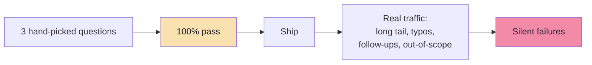
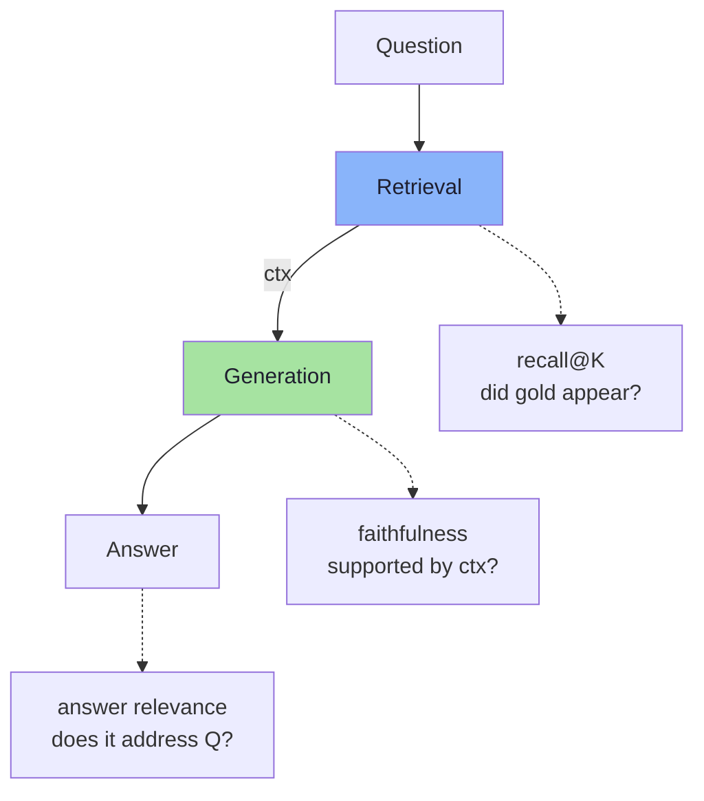
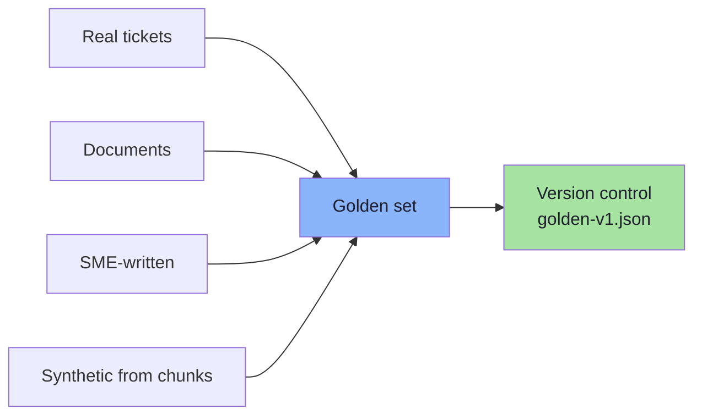
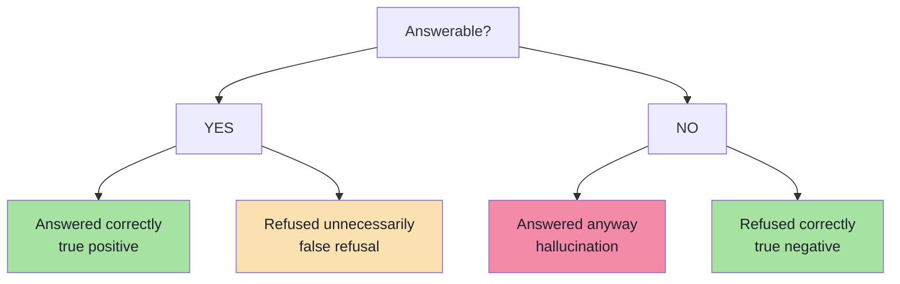
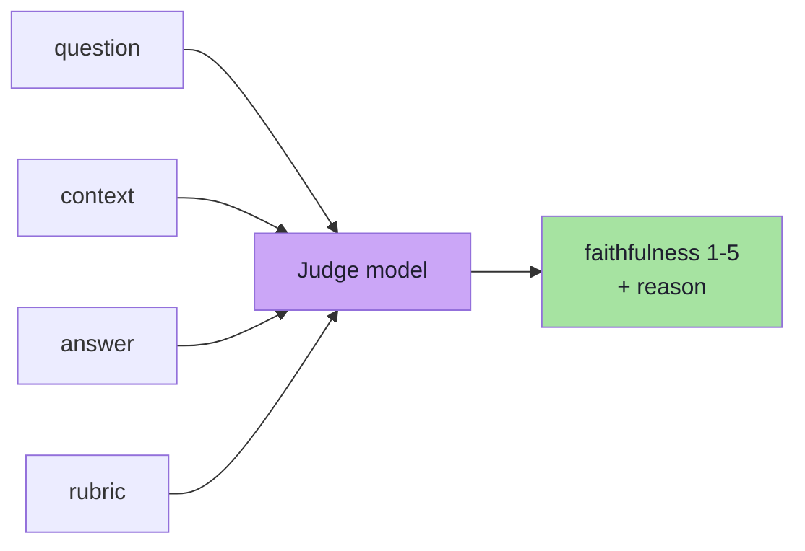
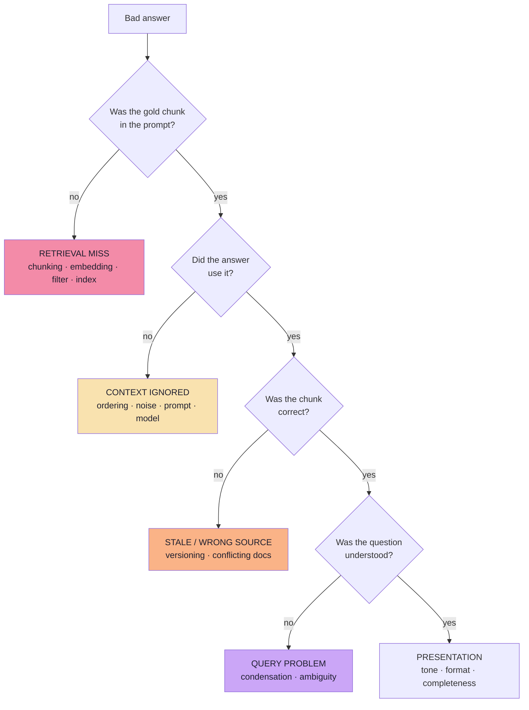
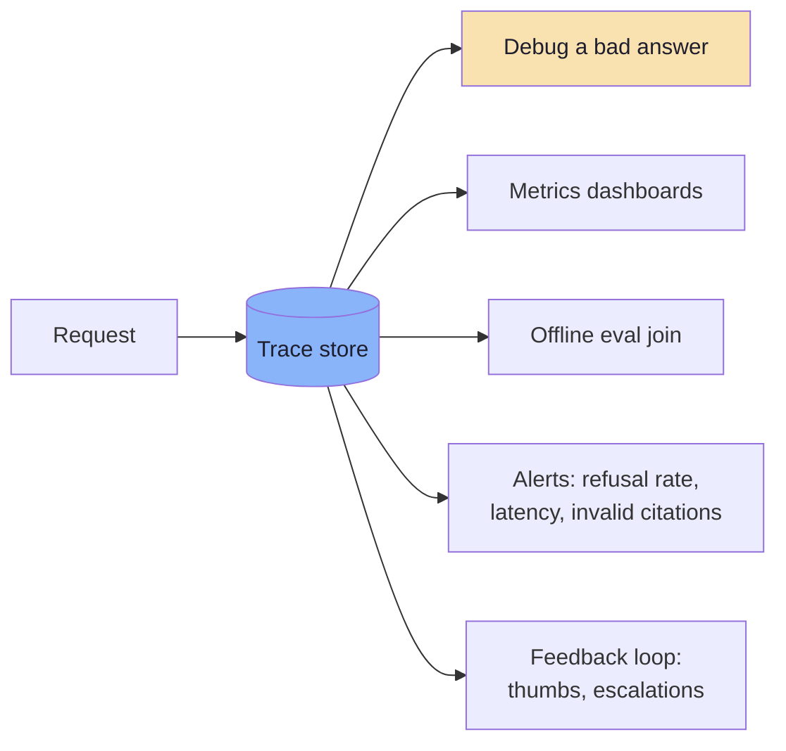
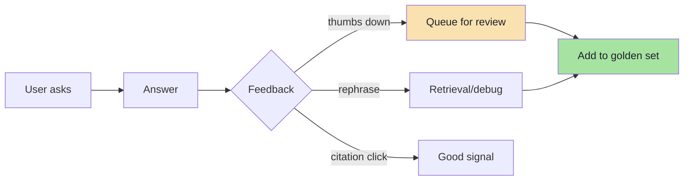
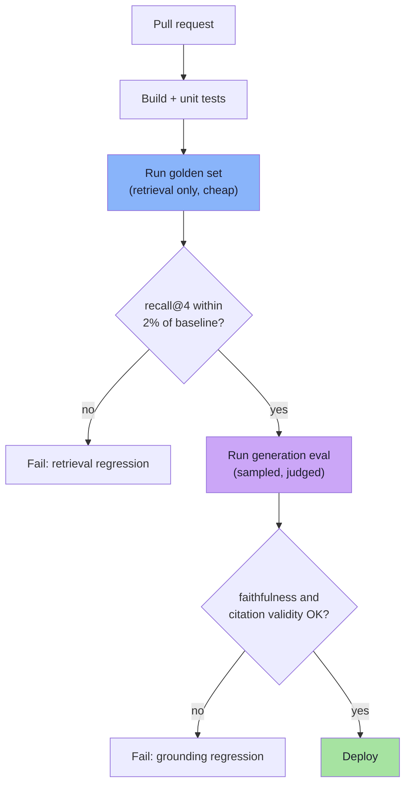

# Chapter 08: Evaluation and Debugging — Knowing If It Works

> **Chapter Goal:** Replace "it looks good" with numbers you can defend. Learn to build a golden set, measure retrieval and generation **separately**, trace every request, and turn a bad answer into a specific diagnosis. Without this chapter, every other chapter is unfalsifiable.
>
> The core discipline: **when an answer is wrong, decide first whether the evidence reached the model.** Everything else follows from that.

---

## 8.1 Why Vibes Fail

RAG systems fail in ways that look fine in a demo:

```text
Demo question 1  → correct answer  ✅
Demo question 2  → correct answer  ✅
Demo question 3  → correct answer  ✅
Shipped: 40% of real questions get a confident wrong answer  ❌
```



There are **two systems** to evaluate, and they fail independently:

| System | Question | Metric family |
|---|---|---|
| **Retrieval** | Did the right chunks reach the prompt? | recall@K, MRR, nDCG |
| **Generation** | Did the answer use them faithfully? | faithfulness, answer relevance, citation accuracy |



> **Rule:** never evaluate RAG with a single score. A single score cannot tell you which of the two systems to fix, and the fixes are completely different.

---

## 8.2 Building the Golden Set

A **golden set** is a versioned list of questions with known-good answers and known-relevant chunks. It is the most valuable artifact in a RAG project — more valuable than the model choice.

| Field | Purpose |
|---|---|
| `id` | Stable reference |
| `question` | Verbatim user-style phrasing (including typos) |
| `gold_chunk_ids[]` | What retrieval *must* find |
| `gold_answer` | Reference answer (for judge comparisons) |
| `answerable` | boolean — supports refusal tests |
| `tags[]` | `refund`, `payment`, `multi-turn`, `identifier` |
| `difficulty` | easy / medium / hard |
| `notes` | Why this case exists |
| `createdFrom` | Real ticket / synthetic / SME |

### How many, and of what?

```text
30 questions  → enough to catch major regressions
100 questions → enough to compare models and tune topK
300+          → needed for per-topic dashboards
```

| Category | Share | Why |
|---|---|---|
| Common questions | 40% | The head of the distribution |
| Long-tail / specific | 25% | Where retrieval breaks |
| **Unanswerable** | 15% | Tests the refusal path |
| Adversarial / injection | 10% | Security behaviour |
| Multi-turn follow-ups | 10% | Condensation quality |



**Sourcing in order of value:**

1. **Real user questions** (support logs, search logs) — highest signal.
2. **SME-authored** questions targeting specific policies.
3. **Synthetic** questions generated from chunks (fast, but biased toward the chunk's wording).

> **Unanswerable questions are not optional.** A system that never refuses is not "helpful"; it is unmeasured. Include questions whose answers genuinely do not exist in the corpus.

---

## 8.3 Retrieval Metrics

Let `K` be the number of chunks passed to the model (e.g. 4), and `R` the set of gold chunk ids for a question.

| Metric | Definition | What it answers |
|---|---|---|
| **Recall@K** | \|retrieved ∩ gold\| ÷ \|gold\| | Is the evidence *present*? |
| **Precision@K** | \|retrieved ∩ gold\| ÷ K | How much of the context is useful? |
| **Hit rate@K** | 1 if any gold chunk is in top-K | Did we get at least one? |
| **MRR** | mean of 1/rank of the first gold chunk | How high is the first hit? |
| **nDCG@K** | DCG ÷ IDCG | Rank-weighted quality |

### Worked example

Five questions, single gold chunk each, rank of the gold chunk in the top-10:

```text
Q1 → rank 1
Q2 → rank 2
Q3 → rank 6
Q4 → rank 3
Q5 → not retrieved
```

| Metric | Calculation | Value |
|---|---|---|
| Recall@4 | gold in top-4 for Q1, Q2, Q4 → 3/5 | **0.60** |
| Hit rate@4 | 3/5 | 0.60 |
| MRR@4 | (1/1 + 1/2 + 0 + 1/3 + 0) ÷ 5 | **0.367** |
| nDCG@4 | mean of per-query nDCG | **0.426** |

```text
nDCG per query (binary relevance, one gold chunk):
  Q1 rank 1 → 1 / log2(2) = 1.000
  Q2 rank 2 → 1 / log2(3) = 0.631
  Q3 rank 6 → 0            (outside top-4)
  Q4 rank 3 → 1 / log2(4) = 0.500
  Q5 absent → 0

  mean nDCG@4 = (1.000 + 0.631 + 0 + 0.500 + 0) / 5 = 0.426
```

Note how the metric choice changes the story: MRR@10 would count Q3 at rank 6 (1/6) and rise to 0.40, while recall@4 ignores it entirely. **Always state the `K`.**

### Reading the numbers

| Pattern | Diagnosis | Action |
|---|---|---|
| High recall@20, low recall@4 | Ranking is poor | Rerank, tune chunk size |
| Low recall@20 | Evidence not retrievable | Chunking, embeddings, hybrid |
| High recall, low precision | Noise in context | Reduce K, dedupe, rerank |
| Zero recall on identifier queries | Dense-only limitation | Add BM25/hybrid |
| Zero recall on one document | Ingestion failure | Check extraction and coverage |

---

## 8.4 Generation Metrics

Retrieval metrics assume you know the gold chunks. Generation metrics ask whether the **answer** is supported and useful.

| Metric | Question | How measured |
|---|---|---|
| **Faithfulness / groundedness** | Is every claim in the answer supported by the context? | Claim decomposition + entailment (LLM judge) |
| **Answer relevance** | Does it answer the question asked? | Judge or embedding similarity to the question |
| **Citation accuracy** | Do citations point to the passages that support the claim? | Deterministic id check + spot review |
| **Refusal correctness** | Does it refuse exactly when it should? | Confusion matrix on `answerable` labels |
| **Completeness** | Did it include all required parts? | Judge against `gold_answer` |
| **Conciseness** | Is it free of padding? | Judge / length heuristics |
| **Tone / policy compliance** | Does it follow brand and legal rules? | Rubric judge / classifier |

### Refusal correctness is a 2×2 problem



| Error | User experience | Cost |
|---|---|---|
| **False refusal** | "It says it doesn't know, but the answer is on the website" | Trust, containment |
| **Hallucination** | Confident wrong policy | Refunds, legal, compliance |

Both rates must be reported. Optimising only one moves the other: tell the model "never say I don't know" and hallucinations rise; tell it "refuse when unsure" and refusals rise.

### The metrics stack (RAGAS-style)

| Layer | Metric | Typical target |
|---|---|---|
| Retrieval | recall@4 | ≥ 0.85 on the golden set |
| Retrieval | nDCG@4 | ≥ 0.70 |
| Generation | faithfulness | ≥ 0.90 |
| Generation | citation validity | ≥ 0.98 |
| Generation | answer relevance | ≥ 0.85 |
| Refusal | false-refusal rate | ≤ 5% |
| Refusal | hallucination rate | ≤ 2% |
| System | p95 latency, cost/query | Product-defined |

> Targets are **project-specific**. A medical or financial assistant needs a far lower hallucination rate than a pizza FAQ. What matters is that the target exists and is measured.

---

## 8.5 LLM-as-Judge: Useful, Fragile

Judges scale evaluation without human labels. They also introduce their own biases.



| Bias | Effect | Mitigation |
|---|---|---|
| **Verbosity bias** | Longer answers score higher | Explicit rubric; length-normalised comparison |
| **Position bias** | Prefers the first option in A/B | Swap order, average |
| **Self-preference** | Favours its own family's output | Use a different model than the generator |
| **Sycophancy** | Agrees with the answer's tone | Ask for evidence quotes first, score second |
| **Rubric drift** | Scores change between runs | Pin judge model + prompt; re-check a sample |

### A rubric that works

```text
Score the ANSWER on faithfulness to the CONTEXT.

1 = contradicts the context
2 = mostly unsupported; key claims invented
3 = partially supported; some claims unsupported
4 = supported, minor imprecision
5 = fully supported by the cited passages

Rules:
- Quote the supporting sentence for score 4 or 5.
- If no sentence supports a claim, score at most 3.
- Do not reward length or style.
- Output JSON: { score, unsupported_claims[], evidence[] }
```

| Practice | Why |
|---|---|
| Ask for evidence before the score | Reduces post-hoc rationalisation |
| Score one dimension per call | Multi-dimension prompts blur |
| Validate against 30 human labels | Establishes agreement |
| Freeze the judge prompt + model version | Reproducibility |
| Never make the judge the only CI gate | Flaky; combine with deterministic checks |

> **Rule:** if a deterministic check can answer the question (citation id exists, number appears in context, refusal string present), **never** spend a judge call on it.

---

## 8.6 The Failure Taxonomy and Debug Tree

Every bad answer belongs to one of five buckets. Naming the bucket selects the fix.



| Bucket | Typical fix | Chapter |
|---|---|---|
| **Retrieval miss** | Chunk size, headers, hybrid search, model, filters | 03–05 |
| **Context ignored** | Fewer chunks, better ordering, stronger rules, better model | 06 |
| **Stale / wrong source** | Version filter, delete old docs, resolve conflicts | 03, 05 |
| **Query problem** | Condensation, spelling normalisation, clarification | 07 |
| **Presentation** | Format instructions, length caps, tone | 06 |

This is why logging the **retrieved chunk ids** is non-negotiable: without them, you cannot answer the first question in the tree.

---

## 8.7 Tracing: The Data You Must Keep

A **trace** is one record per request. It is the difference between "the bot is bad" and "chunk 7 was filtered out by a stale ACL field".

```json
{
  "requestId": "req_01HX...",
  "timestamp": "2026-03-01T10:12:00Z",
  "tenantId": "acme",
  "sessionId": "sess_88f",
  "question": "Can I get a refund for a jacket?",
  "searchQuery": "refund policy for jacket",
  "embedding": { "model": "text-embedding-3-small", "dims": 1024 },
  "retrieval": {
    "namespace": "policies",
    "topK": 60,
    "filter": { "tenantId": "acme" },
    "matches": [
      { "id": "a91f", "score": 0.83, "source": "refund-policy.pdf", "page": 2 },
      { "id": "b07c", "score": 0.79, "source": "refund-policy.pdf", "page": 3 }
    ]
  },
  "context": { "chunksUsed": 4, "tokens": 1287 },
  "generation": {
    "model": "gpt-5-mini",
    "promptTokens": 1620,
    "outputTokens": 142,
    "temperature": 0.2
  },
  "answer": "Yes, within 3 days of delivery for apparel [1].",
  "citations": [{ "id": "a91f", "valid": true }],
  "refused": false,
  "latencyMs": { "embed": 92, "search": 31, "llm": 1840, "total": 2010 },
  "corpusVersion": "2026-02-14",
  "feedback": null
}
```



### What to log, and what not to

| Log | Do not log |
|---|---|
| Chunk ids, scores, sources | Full document contents |
| Token counts, model, versions | API keys, auth tokens |
| Latency per stage | Raw PII beyond retention policy |
| The prompt **hash** and template version | Passwords, card numbers |
| Refusal flag and reason | — |
| User feedback | — |

> **PII discipline:** traces are copied everywhere (logs, APM, warehouses). Minimise at write time; redaction after the fact never catches everything.

### Alerts worth having

| Alert | Threshold idea |
|---|---|
| Refusal rate spike | > 2× baseline over 15 min |
| Invalid citation rate | > 2% |
| Retrieval empty rate | > 5% |
| p95 latency | > budget |
| Ingestion coverage drop | < 95% of expected chars |
| Embedding model mismatch | Any occurrence |

---

## 8.8 Online Signals: What Production Tells You

Offline evaluation covers what you thought to test. Online signals cover what users actually do.

| Signal | Interpretation | Caveat |
|---|---|---|
| **Thumbs up/down** | Coarse satisfaction | Skewed by prompt placement; few users respond |
| **Follow-up rephrase** | Answer was unclear or wrong | Could be user exploring |
| **Escalation to human** | Deflection failure | Some topics should escalate |
| **Conversation abandonment** | Frustration | Ambiguous |
| **Copy / citation click** | Answer was useful and trusted | Strong positive signal |
| **"I don't know" rate** | Coverage gap | High = retrieval or corpus problem |
| **Repeat question within a session** | First answer failed | Very strong negative signal |
| **Time to resolution** | Product outcome | Lagging indicator |



> **The most valuable loop in RAG:** a thumbs-down becomes a golden-set row, which becomes a failing test, which becomes a fix. If negative feedback does not enter the test suite, the same bug returns forever.

---

## 8.9 Regression Testing in CI

Treat the golden set like unit tests. A prompt change, chunk-size change or model upgrade is a code change and must be evaluated.



| Test type | Cost | Runs on |
|---|---|---|
| Deterministic unit tests (chunker, ID, prompt builder) | Free | Every commit |
| Retrieval eval on golden set | Embedding calls only | Every PR |
| Generation eval (sampled) | LLM calls | Every PR / nightly |
| Full judge sweep | Highest | Nightly / pre-release |
| Adversarial suite (injection, PII) | Low | Pre-release |

### What to pin for reproducibility

```text
golden_set_version    v3 (git sha)
corpus_version        2026-02-14
embedding_model       text-embedding-3-small
embedding_dims        1024
chunk_size            300
top_k                 60 → 4
prompt_template       support-v7 (hash)
chat_model            gpt-5-mini
judge_model           <pinned>
temperature           0.2
```

> Without this block in an evaluation report, two scores are not comparable — and you cannot tell whether a change helped or the corpus drifted underneath you.

---

## 8.10 Pseudo-code: The Evaluation Harness

```ts
// pseudo-code: offline evaluation, retrieval first, generation second

type GoldenCase = {
  id: string;
  question: string;
  goldChunkIds: string[];
  answerable: boolean;
  tags: string[];
};

async function evaluate(cases: GoldenCase[], config: EvalConfig) {
  const rows = [];

  for (const c of cases) {
    const matches = await retrieve(c.question, config.auth, {
      fetch: config.topK,
      keep: config.k,
    });

    const retrievedIds = matches.map((m) => m.id);
    const hit = c.goldChunkIds.some((id) => retrievedIds.includes(id));
    const firstRank = firstGoldRank(retrievedIds, c.goldChunkIds);

    const answer = await answerUserQuery(c.question, config);
    const cited = answer.citations.map((x) => x.id);
    const citationValid = cited.every((id) => retrievedIds.includes(id));
    const refused = isRefusal(answer.answer);

    rows.push({
      id: c.id,
      hit,
      recall: recallAtK(retrievedIds, c.goldChunkIds),
      mrr: firstRank ? 1 / firstRank : 0,
      citationValid,
      refused,
      refusalCorrect: c.answerable ? !refused : refused,
      faithfulness: config.judge ? await judgeFaithfulness(c, matches, answer) : null,
    });
  }

  return summarise(rows);   // means by tag + overall
}
```

| Output | Meaning |
|---|---|
| `recall@K` | Coverage of the evidence |
| `MRR` | Ranking quality |
| `refusalCorrect` | Did the refusal decision match the label? |
| `citationValid` | No fabricated sources |
| `faithfulness` | Supported by context (judged) |

```text
Example report
--------------
corpus      policies@2026-02-14   prompt support-v7
retrieval   recall@4 0.87   nDCG@4 0.74
generation  faithful 0.93   citation-valid 0.99
refusal     false-refusal 4%   hallucination 1%
worst tag   identifiers (recall@4 0.55) → add hybrid
```

> **Report by tag, not only overall.** An overall 0.87 can hide a 0.55 on identifier questions, which is exactly the segment that generates escalations.

---

## 8.11 Common Mistakes

| Mistake | Consequence | Fix |
|---|---|---|
| One overall "quality score" | Cannot tell which system to fix | Separate retrieval and generation |
| Golden set written by the developer only | Misses real phrasing | Source from logs and SMEs |
| No unanswerable cases | Refusal path never tested | 15% unanswerable |
| No gold chunk ids | Retrieval cannot be measured | Label chunks, not just answers |
| Evaluating only after big changes | Regressions accumulate | Run in CI |
| Not recording corpus/model versions | Scores not comparable | Pin everything |
| Judging with the same model family | Self-preference bias | Independent judge |
| Trusting the judge's number blindly | False confidence | Calibrate on human labels |
| Logging only the final answer | Undebuggable | Trace ids, scores, query |
| Ignoring the long tail | Head-only optimisation | Report by tag |

---

## 8.12 Chapter Summary

| Question | Metric | Where it lives |
|---|---|---|
| Was the evidence found? | recall@K, MRR, nDCG | Offline + CI |
| Was the context clean? | precision@K, dedupe rate | Offline |
| Was the answer supported? | faithfulness, citation validity | Offline + sampled online |
| Did it answer the question? | answer relevance, completeness | Offline |
| Did it refuse correctly? | false refusal, hallucination rate | Offline |
| Is it healthy in production? | refusal rate, rephrase rate, escalation | Online dashboards |
| Why did this one fail? | Trace + debug tree | Per request |

> **Final mental model:** evaluation is not a report you write at the end — it is the **instrument panel** you fly with. Retrieval recall tells you whether the evidence arrived, faithfulness tells you whether it was used, and traces tell you which of the two broke.

---

## Where This Goes Next

- **Chapter 09** turns this into an operating system: SLOs, alerts, runbooks and cost control.
- **Lecture 10, Chapter 09** covers retrieval evaluation vocabulary (recall ceiling, two-stage retrieval).
- **Chapter 03** is where most retrieval-miss fixes actually live.

---

**Back to:** [Lecture 11 — Chapter Index](./README.md) · [Complete Consolidated Notes](./Lecture_11_Complete_Notes.md)
