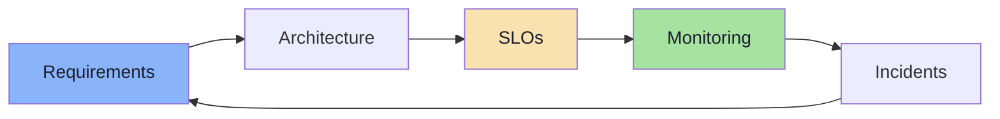
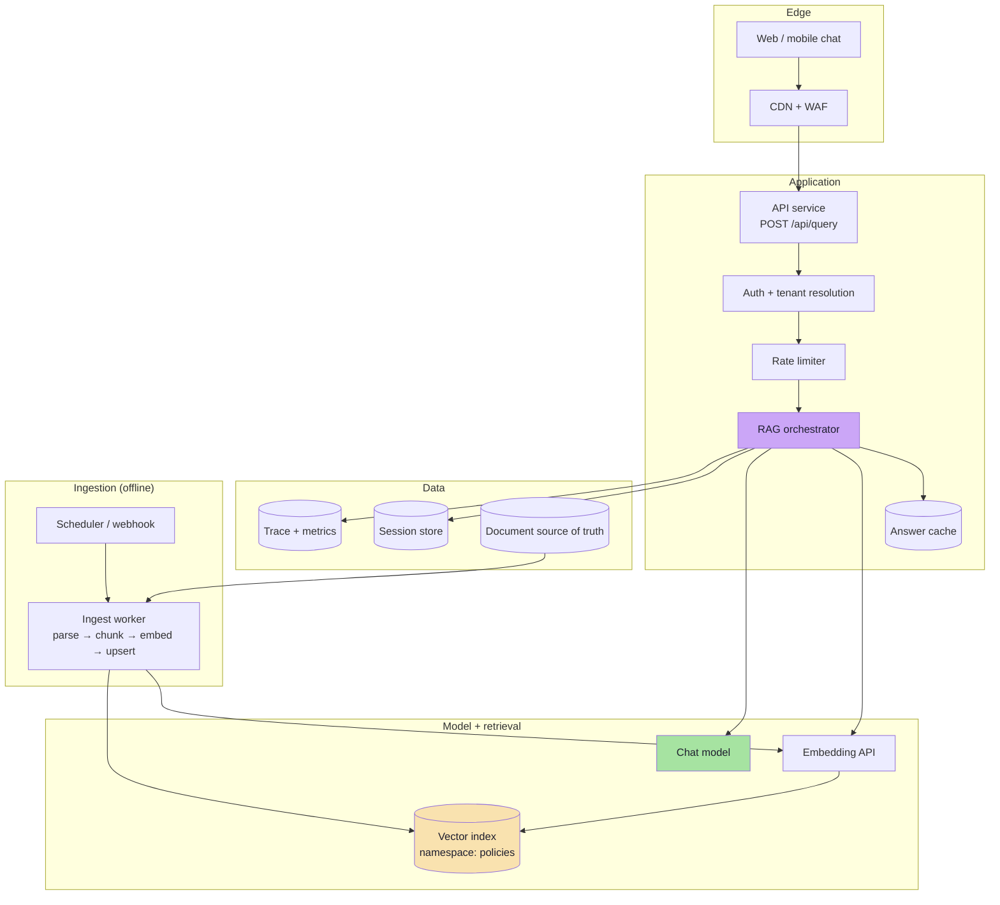
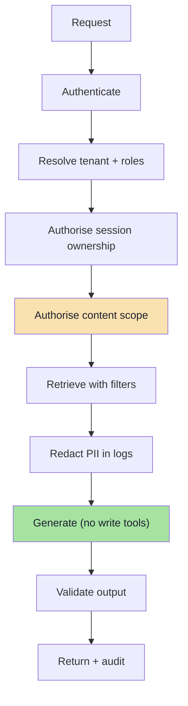
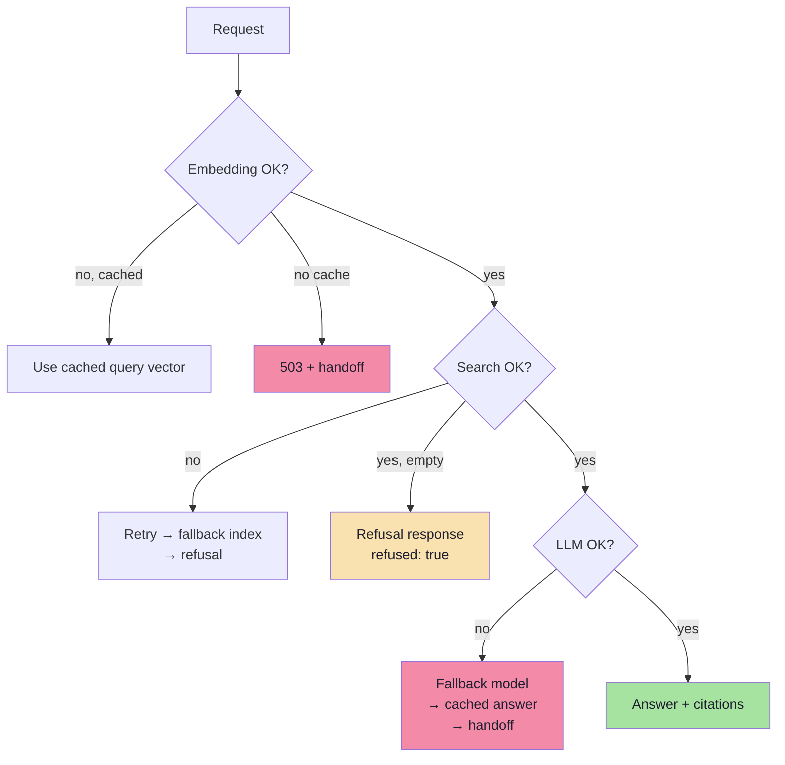
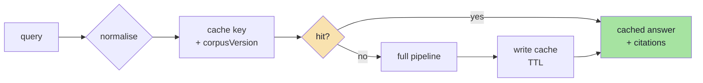
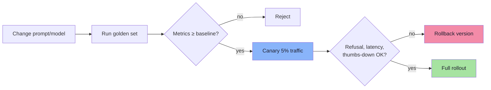
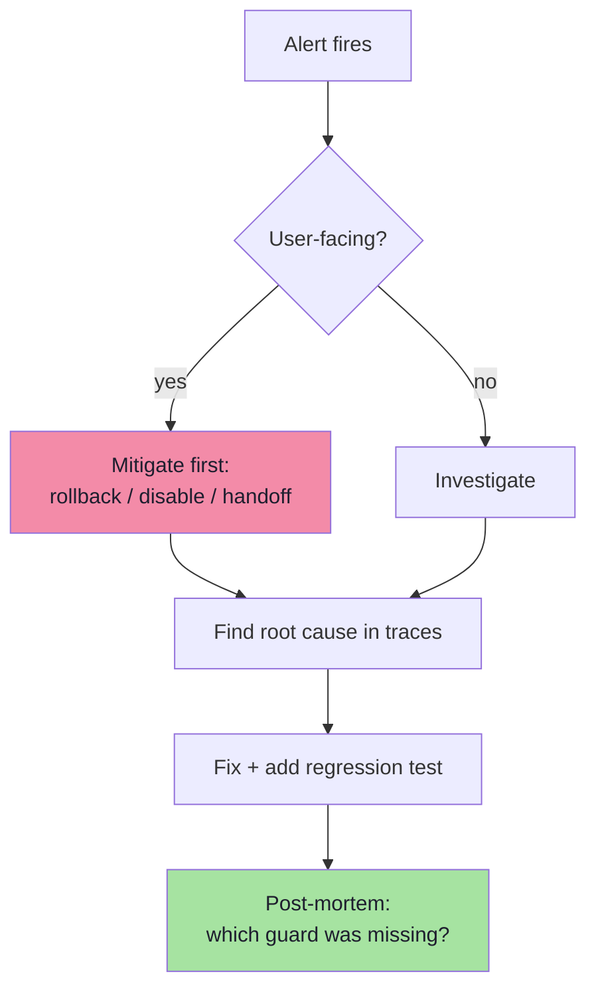
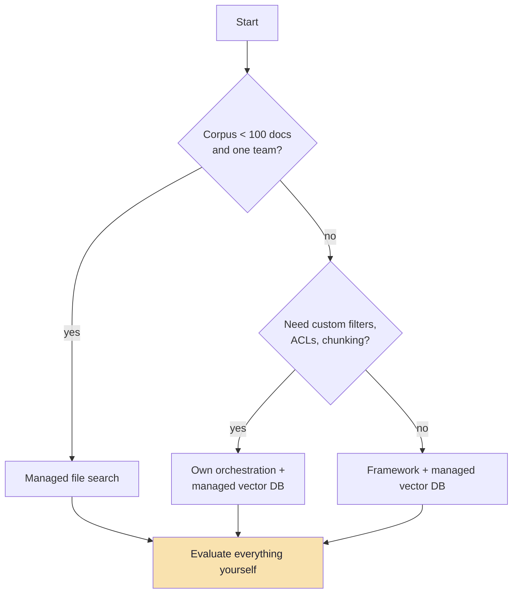
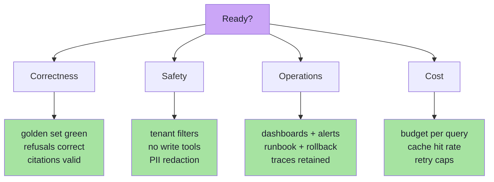

# Chapter 09: Production System Design — The Tomato Support Assistant

> **Chapter Goal:** Assemble every previous chapter into one operable system. Define SLOs, design the API, secure the boundary, make failure graceful, control cost, and know what to do at 2 a.m. when the refusal rate doubles. The running example is the **Tomato** e-commerce support assistant from the lecture board, implemented by [`../code/index.js`](../code/index.js).

---

## 9.1 Start from Requirements, Not Frameworks

```text
Product:  Answer post-purchase questions (refunds, returns, payments, tracking)
Users:    Customers + support agents
Scope:    Company policy documents only; no order-specific data in the index
Out of scope: order status (needs the orders API), pricing changes, complaints
```

| Requirement | Target | Why |
|---|---|---|
| **Answer accuracy** | Faithfulness ≥ 0.90 on the golden set | Wrong refund terms cost money |
| **Refusal honesty** | Hallucination rate ≤ 2% | Legal and trust risk |
| **Coverage** | Recall@4 ≥ 0.85 | Fewer "I don't know" |
| **Latency** | p95 ≤ 3 s; first token ≤ 1.2 s | Chat UX |
| **Availability** | 99.9% monthly | Customer-facing |
| **Freshness** | Policy changes live within 15 min | Ops promise |
| **Cost** | ≤ $0.002 per question | Unit economics |
| **Security** | Zero cross-tenant leaks; no write actions | Compliance |



> **Design rule:** every SLO needs a metric, a dashboard panel and an alert. An SLO without a metric is a wish.

---

## 9.2 Component Architecture



| Component | Responsibility | Failure behaviour |
|---|---|---|
| **API** | Validation, auth, response shape | 4xx without touching models |
| **Orchestrator** | Condense → retrieve → assemble → generate → validate | Degrade, never crash |
| **Embedding API** | Query vectors | Retry; fall back to cache |
| **Vector index** | Top-K candidates | Empty → refusal, not invention |
| **Chat model** | Grounded answer | Fallback model or cached answer |
| **Session store** | History | Continue without history (degraded) |
| **Trace store** | Observability | Never blocks the request |
| **Ingest worker** | Keeps knowledge current | Alarm on coverage drop |

> **Keep the orchestrator thin and testable.** It should read like the seven steps of Chapter 02, with each dependency injected — so you can unit-test the pipeline with fake retrievers and fake models.

---

## 9.3 API Design

The board's endpoint is `/api/query`. Design it like a product, not a script.

```http
POST /api/query
Authorization: Bearer <token>
Content-Type: application/json
Idempotency-Key: 4b1c...

{
  "message": "Can I get a refund for a jacket?",
  "sessionId": "sess_88f",
  "locale": "en-IN",
  "stream": true
}
```

```json
{
  "answer": "Yes — apparel can be refunded within 3 days of delivery [1].",
  "citations": [
    { "id": "1", "source": "refund-policy.pdf", "page": 2, "url": "/policies/refunds#apparel" }
  ],
  "refused": false,
  "sessionId": "sess_88f",
  "requestId": "req_01HX..."
}
```

| Design decision | Recommendation | Why |
|---|---|---|
| Endpoint | `POST /api/query` | Idempotent-read semantics, no query-string limits |
| Session | Server-side id, validated against auth | Prevents IDOR |
| Streaming | SSE / chunked | Perceived latency; first token in ~1 s |
| Errors | Stable codes (`rate_limited`, `retrieval_unavailable`) | Clients can react |
| Retries | `Idempotency-Key` on writes; safe retry on 5xx | No duplicate charges/records |
| Timeouts | Per dependency (embed 3 s, search 2 s, LLM 30 s) | One slow hop should not hang the request |
| Versioning | `/api/v1/query` or a contract test | Prompt/model changes are breaking |

### Error contract

| Status | Code | When | Client action |
|---|---|---|---|
| 400 | `invalid_request` | Missing message, bad JSON | Fix and retry |
| 401 | `unauthorized` | Missing/expired token | Re-auth |
| 403 | `forbidden` | Session not owned by caller | Do not retry |
| 404 | `session_not_found` | Expired session | Start new session |
| 409 | `session_conflict` | Duplicate turn in flight | Retry with same key |
| 422 | `unsupported_language` | Locale not indexed | Offer supported locales |
| 429 | `rate_limited` | Quota exceeded | Back off with `Retry-After` |
| 503 | `model_unavailable` | Provider outage and no fallback | Show cached/handoff |
| 504 | `upstream_timeout` | Retries exhausted | Handoff |

> **Never return a 200 with an empty or guessed answer.** A structured refusal with `refused: true` is a valid product response; a silent hallucination is not.

---

## 9.4 Security Model



### Secrets

| Secret | Storage | Never |
|---|---|---|
| `OPENAI_API_KEY` | Secret manager, injected at runtime | In git, in the client bundle, in logs |
| `PINECONE_API_KEY` | Secret manager, separate permission scope | Reused across environments |
| Session signing keys | KMS / secret manager, rotated | Hard-coded |

The companion script reads `OPENAI_API_KEY` and `PINECONE_API_KEY` from the environment (with an `OWN_KEY` fallback for local use) and **fails fast** if they are missing — the right pattern for a CLI. In a server, add rotation and least-privilege scopes.

### Access control checklist

| Control | Implementation |
|---|---|
| **Tenant isolation** | Namespace per tenant **and** `tenantId` filter |
| **Document ACL** | `acl` metadata, filtered in the query |
| **Row-level scope** | Region, brand, plan, language |
| **Admin content** | Separate namespace; never in the customer index |
| **Post-retrieval check** | Re-verify authorisation in code |
| **Prompt boundary** | Documents are data, never instructions (Ch 06) |
| **No write capability** | Refunds are *explained*, never *executed* |

### PII handling

```text
Collected in conversation  →  order ids, addresses, sometimes card fragments
Needed for the answer      →  rarely
Policy                     →  minimise, redact logs, short TTL, delete on request
```

| Stage | Control |
|---|---|
| Input | Detect and mask card/account patterns before logging |
| Retrieval | Do not index documents containing customer PII |
| Prompt | Send only what is required for the question |
| Output | Optional redaction pass before display |
| Storage | Encrypt session store; TTL; deletion endpoint |
| Logs | Hash identifiers; never store raw messages by default |

> **Threat model in one line:** the model is an untrusted component that reads untrusted text and produces untrusted output. Authenticate before it, authorise around it, validate after it.

---

## 9.5 Reliability: Degrade, Do Not Collapse



| Failure | Mitigation |
|---|---|
| Rate limit (429) | Exponential backoff + jitter; queue; per-tenant quota |
| Timeout | Per-dependency timeouts shorter than the request timeout |
| Provider outage | Secondary model/provider; cached answers; human handoff |
| Vector DB outage | Read replica; serve "temporarily unavailable" not hallucination |
| Bad deploy | Canary + instant rollback of prompt/model versions |
| Ingestion bug | Alarm on coverage; keep the previous namespace live |
| Traffic spike | Rate limit, queue, autoscale; do not let timeouts cascade |

### Timeout and retry budget

```text
request budget        8,000 ms
  auth                 50 ms
  condense            800 ms  (1 retry max)
  embed               900 ms  (1 retry)
  search              500 ms  (1 retry)
  generate          5,000 ms  (no retry if tokens already streamed)
  validation          100 ms
```

```ts
// pseudo-code: a retry policy that cannot melt the provider
async function withRetry<T>(fn: () => Promise<T>, opts = { attempts: 3 }) {
  for (let attempt = 1; ; attempt++) {
    try {
      return await fn();
    } catch (err) {
      const retryable = isRateLimit(err) || isServerError(err) || isTimeout(err);
      if (!retryable || attempt >= opts.attempts) throw err;
      await sleep(backoffWithJitter(attempt));   // 250ms, 500ms, 1000ms ± jitter
    }
  }
}
```

> **Circuit breaker rule:** if the provider error rate exceeds ~30% for 30 seconds, stop calling it for a minute. Retries amplify outages; a breaker contains them.

---

## 9.6 Performance and Caching

| Cache layer | Key | Hit rate expectation | Invalidation |
|---|---|---|---|
| **Query embedding** | `sha256(model + dims + normalised query)` | Medium (repeated questions) | Model change |
| **Answer** | `sha256(tenant + query + corpusVersion + promptVersion)` | Low–medium | Any corpus/prompt change |
| **Prompt prefix** (provider) | Stable system prompt | High | Prompt change |
| **Document parse** | `sha256(file bytes)` | Very high on re-ingest | File change |
| **CDN** | Static assets only | — | — |



**Why `corpusVersion` must be in the key:** a cached answer is only correct for the corpus it was generated from. Without the version, a policy update keeps serving old answers until the TTL expires — a subtle and expensive bug.

### Latency engineering checklist

| Technique | Gain |
|---|---|
| Stream tokens | Perceived latency (1 s to first token) |
| Parallelise condense + retrieval warm-up | 100–300 ms |
| Cache embeddings | 50–200 ms on repeats |
| Pre-warm the vector index connection | 20–100 ms |
| Lower topK after reranking | 100–500 ms |
| Cap output tokens | 200 ms–2 s |
| Skip the LLM on empty retrieval | 1–3 s and full cost |

---

## 9.7 Unit Economics

Illustrative model — replace prices with current provider rates.

```text
per request
  embedding    ~25 tokens × $0.02 / 1M      = $0.0000005
  vector query                             = $0.00002
  LLM input    ~1,600 tokens × $0.25 / 1M  = $0.00040
  LLM output   ~150 tokens × $2.00 / 1M    = $0.00030
  ---------------------------------------------------
  total                                    ≈ $0.0007 per question
```

| Volume | LLM cost/month | Notes |
|---|---|---|
| 10k questions | ~$7 | Prototype |
| 100k questions | ~$70 | Small product |
| 1M questions | ~$700 | Add caching + batching |
| 10M questions | ~$7,000 | Negotiate, distil, cache aggressively |

| Lever | Typical saving | Cost |
|---|---|---|
| Answer cache (30% hit) | 30% of LLM spend | Staleness risk |
| Shorter answers (`maxOutputTokens`) | 20–40% of output spend | Less detail |
| Lower topK | 20–30% of input spend | Recall risk |
| Smaller model for simple intents | 40–60% on those requests | Routing complexity |
| Prompt caching | Provider-dependent | Prompt restructuring |

> **Where the money actually goes:** engineering time and re-indexing, not per-token cost. A model migration that costs $6 in embeddings can cost a week of evaluation. Budget accordingly.

---

## 9.8 Deployment and Operations

### Configuration

```text
# .env (never committed)
OPENAI_API_KEY=...
PINECONE_API_KEY=...
PINECONE_INDEX_NAME=shop-support
PINECONE_NAMESPACE=policies
EMBEDDING_MODEL=text-embedding-3-small
EMBEDDING_DIMENSIONS=1024
CHAT_MODEL=gpt-5-mini
CHUNK_SIZE=300
TOP_K=4
```

| Practice | Why |
|---|---|
| Same config keys in every environment | No surprise defaults |
| Fail fast on missing secrets | The script's `requireKey` pattern |
| Separate index/namespace per environment | Never test against prod vectors |
| Deploy prompt templates as versioned artifacts | Roll back a bad prompt in seconds |
| Keep ingestion and serving deployable separately | Content changes without app releases |

### Release process for prompt/model changes



> A prompt is **production code**. Treating it as a config string that anyone can edit live is how quality silently regresses.

### Dashboards

| Panel | Metrics |
|---|---|
| Traffic | QPS, unique users, sessions |
| Quality | refusal rate, thumbs-down rate, citation-invalid rate |
| Retrieval | empty-result rate, mean top score, chunks per answer |
| Latency | p50/p95 per stage (embed, search, LLM) |
| Errors | 4xx/5xx by code, provider error rate |
| Cost | tokens in/out per request, daily spend |
| Ingestion | documents, chunks, coverage %, last successful run |

---

## 9.9 Runbook: Five Incidents You Will Actually Have

| Incident | First check | Likely cause | Action |
|---|---|---|---|
| **Refusal rate doubles** | Did the corpus namespace change? Is retrieval empty? | Bad ingest, filter too strict, outage | Roll back namespace; verify filters; re-run golden set |
| **Answers cite the old policy** | `corpusVersion` and cache keys | Cache without version; orphan vectors | Purge cache; reconcile deletes |
| **Latency p95 doubles** | Per-stage latency | Larger topK, longer history, provider slowdown | Trim context; enable cache; check provider status |
| **Cross-tenant content appears** | Filter in trace | Missing/ignored filter | **Disable the feature**, fix the shared query builder, add a test |
| **Costs spike 5×** | Tokens per request, retries | Retry storm, history growth, prompt bloat | Cap retries, trim history, alert on token budget |



> **Mitigate before you understand.** Rolling back a namespace or prompt takes seconds; root-causing takes an hour. Do both, in that order.

---

## 9.10 Build vs Buy

You rarely need to build ingestion, indexing and evaluation from scratch.

| Option | What you get | Trade-off |
|---|---|---|
| **Provider file search / assistant APIs** | Upload-and-query, managed chunking and citations | Less control over chunking and filters; vendor lock-in |
| **Managed vector DB + your own orchestration** | Control + operational simplicity | Two vendors to manage |
| **Framework (LangChain / LlamaIndex)** | Connectors, splitters, retrievers, evaluators | Abstraction leakage; harder debugging |
| **AI SDK / framework integrations** | Streaming, typed providers, UI hooks | Still your job to get retrieval right |
| **Full custom** | Exact control, best fit | Highest build and maintenance cost |



> **The invariant:** whatever you buy, you still own **chunking, the system prompt, evaluation and authorisation**. Those four decisions determine quality; the vendor does not.

---

## 9.11 Capstone: The Tomato Assistant, Milestone by Milestone

The lecture's companion script is a **vertical slice** of this chapter. Read it as the smallest end-to-end system that is still honest about its parts.

| Script symbol | Does | Chapter |
|---|---|---|
| `requireKey("OPENAI_API_KEY", "OWN_KEY")` | Fails fast on missing secrets | 09 |
| `splitIntoTokenChunks(text, 300)` | Token-window chunking | 03 |
| `readKnowledgeBase()` | Lists `.pdf` files, parses, chunks, attaches `{source, chunk}` | 03 |
| `stableId(chunk)` | `sha256(source:chunk:text)` → idempotent upserts | 03 |
| `loadKnowledgeBase()` | Batches of 100 → embeddings → `upsert` | 03, 04 |
| `answerUserQuery()` | Embed query → `query(topK: 4)` → prompt → `responses.create` | 04, 05, 06 |
| `main()` | Joins CLI args as the question, re-ingests, prints the answer | 02, 09 |

### What the script deliberately leaves out (and you should add)

| Missing | Why it matters | Where |
|---|---|---|
| Metadata filter / tenant | Multi-tenant safety | 05, 09 |
| Citations in the output | Verifiability | 06 |
| History / session store | Follow-ups | 07 |
| Overlap in chunking | Boundary clauses | 03 |
| Golden set + eval | Quality measurement | 08 |
| HTTP API + auth | Real deployment | 09 |
| Retries / timeouts | Reliability | 09 |
| Re-ingest only on change | Cost and latency | 03 |

> The script re-ingests the whole knowledge base on every run. That is a **demo convenience**. In production, ingestion is a separate job triggered by file changes, and serving never re-embeds the corpus.

### Milestones

| # | Milestone | Done when |
|---|---|---|
| 1 | Ingest | All PDFs produce chunks with `source` and `chunk` metadata |
| 2 | Baseline answer | Refund question returns the 3-day apparel rule |
| 3 | Refusal | An out-of-scope question returns the exact refusal sentence |
| 4 | Citations | Every answer carries a resolvable source |
| 5 | Multi-turn | "And for shoes?" retrieves shoe policy via condensation |
| 6 | Isolation | A second tenant's documents never appear |
| 7 | Evaluation | 30-case golden set with recall@4 and faithfulness reported |
| 8 | Operations | Dashboard + alerts + runbook + rollback path |

### Acceptance test (copy into CI)

```text
Given  a clean namespace "policies-test"
When   the knowledge base is ingested
Then   chunk count > 0
And    re-running ingestion does not increase the chunk count
When   the question "Can I get a refund for a jacket?"
Then   the answer cites "refund-policy.pdf"
And    no citation id outside the retrieved set appears
When   the question "Do you ship to Mars?"
Then   the answer is exactly the refusal sentence
And    no model call was made after retrieval returned nothing
```

---

## 9.12 Production Readiness Checklist



| Area | Check | ✅ |
|---|---|---|
| Ingestion | Deterministic IDs, orphan cleanup, coverage alarm | ☐ |
| Embeddings | Model + dims pinned and recorded per record | ☐ |
| Retrieval | Tenant filter in every query; filters indexed | ☐ |
| Prompt | Rules before documents; question last; refusal string | ☐ |
| Citations | Resolved server-side; invalid-citation metric | ☐ |
| Evaluation | Golden set in CI; pinned corpus/model/prompt versions | ☐ |
| Multi-turn | Server-side sessions, ownership check, TTL | ☐ |
| Security | Secrets in a manager; no write-capable tools | ☐ |
| Reliability | Timeouts, retries with jitter, circuit breaker, fallback | ☐ |
| Observability | Trace per request; stage latency; refusal and empty rates | ☐ |
| Cost | Per-query budget, cache keys include `corpusVersion` | ☐ |
| Lifecycle | Blue/green re-index; rollback of prompt and namespace | ☐ |

---

## 9.13 Chapter Summary

| Concern | Decision | Default |
|---|---|---|
| Requirements | SLOs before architecture | Accuracy, refusal, latency, cost |
| API | One query endpoint, stable errors | `POST /api/query`, structured refusal |
| Security | Authenticate, authorise, validate | Filters in retrieval + code |
| Reliability | Degrade gracefully | Timeouts, retries, breaker, handoff |
| Performance | Cache with versions | Embedding + answer caches |
| Cost | Bound tokens and calls | `maxOutputTokens`, lower topK |
| Operations | Version prompts like code | Evaluate → canary → rollback |
| Ownership | Four things you always own | Chunking, prompt, evaluation, auth |

> **Final mental model:** a production RAG system is not a model with a database attached. It is a **content pipeline plus an authorisation boundary plus a measurement loop**, with a model call in the middle. The model is the least surprising part.

---

## Where This Goes Next

- **Agents and tools:** let the model call the orders API — and re-read Chapter 06 §6.9 first.
- **Advanced retrieval:** hybrid, multi-vector, graph RAG for multi-hop questions.
- **Evaluation at scale:** online judges, A/B tests, and per-segment dashboards.
- **Cost engineering:** distillation, quantization, routing between model sizes.

---

**Back to:** [Lecture 11 — Chapter Index](./README.md) · [Complete Consolidated Notes](./Lecture_11_Complete_Notes.md)
