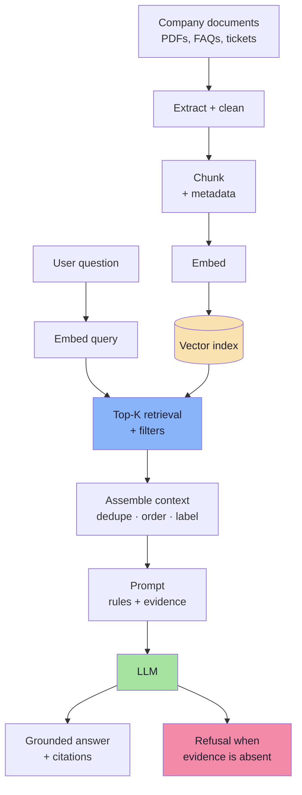

# Lecture 11 — Retrieval-Augmented Generation: From Documents to Grounded Answers

> **Lecture Theme:** Lecture 10 built the retrieval machinery — embeddings, ANN indexes, vector databases. This lecture closes the loop: **how do you turn a folder of company documents into an assistant that answers from them, cites them, refuses when they are silent, and keeps working in production?** The running example is *Tomato*, a food-delivery support assistant, and the reference implementation is [`../code/index.js`](../code/index.js).

---

## Chapter Index

| # | Chapter | Core Question Answered |
|---|---------|------------------------|
| [01](./01_The_Stateless_Model.md) | The Stateless Model | Why can't an LLM just know our policies? |
| [02](./02_RAG_The_Open_Book_Architecture.md) | RAG — The Open-Book Architecture | What exactly is retrieval-augmented generation? |
| [03](./03_Ingestion_Documents_to_Chunks.md) | Ingestion — From Documents to Chunks | What can retrieval never find? |
| [04](./04_Embeddings_at_Query_Time.md) | Embeddings at Query Time | Why must queries and documents share one space? |
| [05](./05_The_Vector_Index.md) | The Vector Index | How does top-K retrieval actually work? |
| [06](./06_Grounded_Generation.md) | Grounded Generation | How do we make the model answer *only* from context? |
| [07](./07_Conversation_State_and_Memory.md) | Conversation State & Memory | Why does it forget my name? |
| [08](./08_Evaluation_and_Debugging.md) | Evaluation & Debugging | How do we know it works? |
| [09](./09_Production_System_Design.md) | Production System Design | How does Tomato ship? |
| [**Complete**](./Lecture_11_Complete_Notes.md) | **Complete Consolidated Notes** | All nine chapters condensed into one reference with cheat sheet, glossary and self-check |

> 📄 **Prefer a single document?** Read the **[Lecture 11 — Complete Consolidated Notes](./Lecture_11_Complete_Notes.md)**. It keeps the load-bearing ideas, numbers and decision tables, and links back to the chapters for derivations and full pseudo-code.
>
> 💻 **Companion code:** [`../code/index.js`](../code/index.js) — a Node/ESM RAG script using OpenAI embeddings, Pinecone and the Responses API.

---

## The Big Idea in One Diagram

---

## How to Read These Notes

1. **Chapters 01–02 are the argument.** Parametric memory is lossy and frozen; RAG moves knowledge out of the weights and into documents. If you skip these, everything later looks like arbitrary machinery.
2. **Chapters 03–05 are the knowledge path.** Chunking sets the ceiling, embeddings define "similar", the index decides what is reachable.
3. **Chapter 06 is the product.** Retrieval only creates the *opportunity* for a grounded answer; the prompt contract decides whether you get one.
4. **Chapter 07 is the illusion of memory.** Conversation state is application state, and follow-up questions must be rewritten before they are embedded.
5. **Chapters 08–09 are the discipline.** Measure retrieval and generation separately, then operate the thing.

---

## Conventions Used in This Lecture

| Convention | Meaning |
|---|---|
| **Mermaid** | Every structural diagram is Mermaid (`flowchart`, `sequenceDiagram`). |
| **TypeScript-style pseudo-code** | Snippets describe data flow and contracts for a JS/TS environment. They are **not** runnable production code. |
| **Measured claims** | Latency, cost and recall figures are "typical" or "illustrative", never universal constants. |
| **Board references** | Passages described as *from the board* reproduce the hand-drawn `Excalidraw-Notes.svg`. |

---

## Sources

- 🖼️ [`Excalidraw-Notes.svg`](./Excalidraw-Notes.svg) — the lecture board: the RAG title, the "capital of India" and "What is my name?" demos, the Tomato system prompt, the client/server/LLM query path, `refund policy.pdf` / `payment.pdf` / `orders.pdf`, the `v1`/`v2` chunk overlap, the Pinecone namespace `policies`, and the API-key boxes.
- 💻 [`../code/index.js`](../code/index.js) — reference implementation: PDF loading, 300-token chunking, SHA-256 chunk ids, batched embeddings, Pinecone upsert/query, and a grounded prompt with an exact refusal sentence.
- 📚 Prior lectures — [Lecture 08](../../Lecture%2008/notes/Lecture_08_Complete_Notes.md) (semantic search), [Lecture 09](../../Lecture%2009/notes/Lecture_09_Complete_Notes.md) (why exact search breaks), [Lecture 10](../../Lecture%2010/notes/Lecture_10_Complete_Notes.md) (ANN indexes, vector databases, production retrieval).

> **Note on `Notes.pdf`:** this folder does not contain a `Notes.pdf`. These chapters were written from the board, the companion script, and the RAG foundations established in Lectures 08–10. If a PDF is added later, the chapters are structured so its sections can be folded in without restructuring.

---

## One-Line Summaries

| Chapter | One-line summary |
|---|---|
| 01 | An LLM is a frozen, lossy, private-less memory; statelessness and hallucination are consequences, not bugs. |
| 02 | RAG = retrieve evidence, augment the prompt, generate an answer — two pipelines, seven steps. |
| 03 | Chunking decides what can ever be found; metadata decides what can be cited; ids decide what can be forgotten. |
| 04 | A query is only meaningful inside the same embedding space as the documents. |
| 05 | The index answers "which allowed chunks are nearest?"; reranking and dedupe turn candidates into useful context. |
| 06 | Make transcription easy, invention expensive, and honesty allowed. |
| 07 | Memory is a budget you spend each turn; follow-ups must be rewritten before they are embedded. |
| 08 | Measure retrieval and generation separately, and trace every request. |
| 09 | Production RAG is a content pipeline, an authorisation boundary and a measurement loop, with a model in the middle. |
