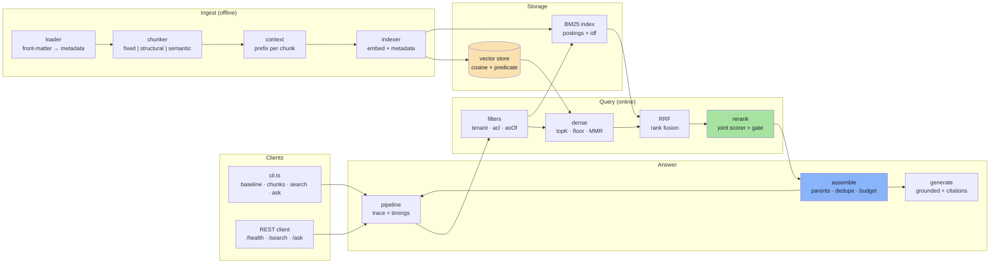

# Chapter 00: Overview, Provider Structure & File Map

> **Chapter Goal:** See the whole pipeline before reading a single function. Know which layer owns which decision, where a provider plugs in, and how one customer question travels from text to a cited answer.

> **Lecture mapping:** all chapters. This is the map; Chapters 01–10 are the territory.

> **Files covered:**

| File | Purpose |
| :--- | :--- |
| `package.json` | Dependencies and scripts. Five runtime packages, no framework. |
| `tsconfig.json` | Strict ES2022 / NodeNext compilation to `dist/`. |
| `.env.example` | Every knob, with offline defaults, grouped by the chapter that uses it. |
| `.gitignore` | Keeps secrets and build output out of git. |
| `data/policies/*.md` | Eight policy documents with front-matter metadata. |
| `data/eval/golden.json` | Fourteen questions with expected sources, required facts and an `asOf` date. |
| `src/**` | 26 source files, grouped by pipeline stage. |

---

## 1. What This Codebase Builds

Lecture 12 asks a harder question than Lecture 11 did. Lecture 11 built a RAG system that
answers from your documents and cites them. Lecture 12 asks: **when that system is wrong,
which control was wrong — and how would you prove it?**

So this codebase is built around measurement. Every stage is a small function with a
narrow contract, and every stage reports what it did into one trace:

```text
offline:  policies ──► clean ──► chunk ──► context ──► embed ──► index (+ BM25)
online:   question ──► filter ──► dense ──┐
                          └──► bm25 ──► RRF ──► rerank ──► gate ──► assemble ──► generate ──► verify
```

Two properties make it a *measurable* system rather than a demo:

1. **Every stage can be turned off.** Chunking strategy, hybrid search, reranking, parent
   expansion, bookend ordering and both score floors are config values. The ablation in
   Chapter 10 re-runs the same fourteen questions with one of them changed at a time.
2. **Nothing is hidden in a framework.** BM25, RRF, MMR, the filter DSL, the reranker and
   the metrics are implemented here, in about a thousand lines, so every number in the
   notes has a line of code you can point at.

---

## 2. System Topology



---

## 3. The Five Design Decisions

### 3.1 Config is a value, not a global

`config/env.ts` parses the environment once and exports a plain `RagConfig` object. The
pipeline takes `Partial<RagConfig>` overrides and merges them. That is the whole reason
the ablation matrix is ten lines of code instead of ten processes: a preset is a config,
and a config is a value.

### 3.2 One contract file

`src/types.ts` holds every shape that crosses a boundary: `SourceDocument`, `Chunk`,
`IndexRecord`, `ScoredChunk`, `ContextBlock`, `RagTrace`, `AccessContext`. If you can read
that file, you can see where information is created and where it is lost — which is
exactly the failure you are hunting.

### 3.3 Providers are adapters, and the offline one is honest

`EmbeddingProvider` has two implementations: `hash` (deterministic, offline, lexical) and
`openai` (real, over plain `fetch` so the request is visible). `Reranker` has `heuristic`
and `cohere`. `Generator` has `extractive` and `openai`. Nothing above those interfaces
knows which is in use, so every command runs with no API key and the same code path runs
with one.

### 3.4 Access control is not a filter you can forget

`compileFilter(filter, access)` always applies tenant, group and date rules, and the
caller's filter can only *narrow* the result. A document with no `tenantId`, no matching
group, or a validity window that excludes `asOf` is invisible — and the loader refuses to
ingest a document whose metadata cannot support that check.

### 3.5 Refusal is a contract with a cost of zero

`REFUSAL` is one exported string. When the reranker's gate decides nothing is relevant, the
pipeline returns it *without calling a model*: `assemble` gets zero blocks, `generate` is
never invoked, and the trace shows the stage that made the decision. A system that always
calls the model to say "I don't know" pays for its refusals; this one does not.


---

## 4. File Map

```
advanced-rag/
├── package.json                    5 runtime deps: express, cors, dotenv, js-tiktoken, zod
├── tsconfig.json                   ES2022 · NodeNext · strict
├── .env.example                    every knob, grouped by chapter
├── data/
│   ├── policies/
│   │   ├── returns-general.md            general 30-day window
│   │   ├── returns-electronics.md        7-day window, 15% restocking fee
│   │   ├── returns-electronics-2025.md   superseded: 14-day window (temporal demo)
│   │   ├── damaged-goods.md              48-hour reporting window
│   │   ├── exchanges.md                  14-day exchange window
│   │   ├── refund-timing.md              5 to 7 business days
│   │   ├── warranty.md                   AX-204 12 months, BX-900 24 months
│   │   └── shipping.md                   delivery definition, redirects
│   └── eval/golden.json            14 cases: sources, facts, answerable, asOf
└── src/
    ├── types.ts                    (165) all data contracts
    ├── config/env.ts               (224) zod-validated config + paths + access defaults
    ├── lib/text.ts                 (159) tokenizer, cleaning, sentences, stemming, ids
    ├── lib/vectors.ts              (52)  dot, cosine, normalise, blend
    ├── embeddings.ts               (150) hash | openai
    ├── ingest/loader.ts            (111) front matter → validated DocMeta
    ├── ingest/fixed-chunker.ts     (124) char + token windows, orphan report
    ├── ingest/structural-chunker.ts(268) heading stack, breadcrumbs, parents
    ├── ingest/semantic-chunker.ts  (85)  similarity breakpoints (the third family)
    ├── ingest/context.ts           (119) template | llm context prefixes
    ├── ingest/indexer.ts           (167) chunk → contextualise → embed → records
    ├── store/filters.ts            (155) filter DSL, ACL, temporal validity
    ├── store/vector-store.ts       (88)  cosine search, pre/post filtering
    ├── search/dense.ts             (125) embed → search → floor → MMR
    ├── search/bm25.ts              (124) postings, idf, k1/b
    ├── search/hybrid.ts            (99)  RRF + the score-fusion anti-pattern
    ├── search/rerank.ts            (235) joint scorer, Cohere adapter, the gate
    ├── search/calibrate.ts         (134) floor sweeps and balanced accuracy
    ├── context/assemble.ts         (170) expand, dedupe, precedence, budget, labels
    ├── generate.ts                 (200) prompt, extractive + OpenAI, citations
    ├── pipeline.ts                 (296) orchestration + trace
    ├── eval/metrics.ts             (160) recall@k, MRR, nDCG, summarise
    ├── eval/diagnose.ts            (78)  the four-step failure tree
    ├── eval/run.ts                 (125) golden-set runner + ablation presets
    ├── cli.ts                      (434) one subcommand per chapter
    └── server.ts                   (129) Express API
```

---

## 5. Commands

```bash
cd "Lecture 12/code/advanced-rag"
npm install
npm run typecheck        # tsc --noEmit
```

| Command | Chapter | What it proves |
| :--- | :--- | :--- |
| `npm run cli -- chunks [detail]` | 02, 03 | what each chunking strategy produces, and what a chunk actually carries |
| `npm run cli -- baseline` | 01 | the naive pipeline fails, and the failing stage is named |
| `npm run cli -- search "…"` | 04–08 | every score that touched each candidate |
| `npm run cli -- ask "…"` | 08, 09 | the answer, its citations and the stage trace |
| `npm run cli -- calibrate` | 04, 07 | both score floors, swept against the golden set |
| `npm run cli -- filters` | 05 | tenant, ACL, temporal and pre/post behaviour |
| `npm run cli -- ablation` | 09 | one control at a time, same questions |
| `npm run cli -- eval [preset]` | 09 | per-case retrieval and answer scores |
| `npm run dev` | 09 | the HTTP API |


---

## 6. Environment

Every value has a default, so `.env` is optional. The grouping is the reading order.

| Variable | Default | Chapter |
| :--- | :--- | :--- |
| `EMBEDDING_PROVIDER` | `auto` (openai if a key exists, else hash) | 04 |
| `EMBEDDING_MODEL`, `EMBEDDING_DIMENSIONS` | `text-embedding-3-small`, `1024` | 04 |
| `LLM_PROVIDER`, `CHAT_MODEL` | `auto`, `gpt-4o-mini` | 09 |
| `CHUNK_STRATEGY`, `CHUNK_SIZE`, `CHUNK_OVERLAP`, `CHUNK_UNIT` | `structural`, `400`, `80`, `tokens` | 02, 03 |
| `MIN_CHUNK_TOKENS` | `150` | 03 |
| `PARENT_MAX_TOKENS` | `700` | 03, 09 |
| `CONTEXTUALIZE`, `LATE_CHUNK_ALPHA` | `template`, `0.25` | 03, 04 |
| `K_RETRIEVE`, `K_CONTEXT` | `25`, `5` | 04 |
| `MIN_SCORE` | `0.15` (calibrated) | 04 |
| `MMR_LAMBDA` | `0` | 04 |
| `TENANT_ID`, `ACL`, `AS_OF` | `northwind-eu`, `support,customer`, `2026-06-01` | 05 |
| `HYBRID`, `RRF_K`, `BM25_K1`, `BM25_B` | `rrf`, `60`, `1.2`, `0.75` | 06 |
| `RERANK`, `RERANK_MODEL` | `heuristic`, `rerank-v3.5` | 07 |
| `RERANK_MIN_BEST`, `RERANK_MAX_DROP` | `0.25`, `0.25` (calibrated) | 07 |
| `MAX_CONTEXT_TOKENS`, `EXPAND_PARENTS`, `BOOKEND_ORDER` | `1400`, `true`, `true` | 08 |
| `PORT` | `3100` | 09 |

---

## 7. One Question, End to End

Following `ask "Is the AX-204 still covered after 18 months?"`:

1. **Config** is parsed and validated once at import; the CLI or the API merges overrides.
2. **Access** arrives with the request: `{tenantId, acl, asOf}`. There is no server-side
   default, because a default is how one tenant ends up reading another tenant's data.
3. **Dense search** embeds the question, scans the store with the compiled predicate
   (tenant + groups + date + any caller filter), scores by cosine, applies the floor and
   optionally diversifies with MMR.
4. **BM25** scores the same eligible documents on exact terms — which is where `AX-204`
   becomes a 10.47 instead of a vague similarity.
5. **RRF** fuses the two rankings by rank, not by score.
6. **Rerank** scores each surviving candidate against the question *jointly*, and reorders.
7. **Gate** keeps everything within `maxDrop` of the best result, or refuses outright when
   the best result is below `minBest`.
8. **Assemble** expands each hit to its parent, dedupes by parent, orders by relevance with
   a specificity tie-break, drops what does not fit the budget, then bookends the list.
9. **Generate** answers from `<documents>` only, and cites `[n]` labels that code assigned.
10. **Verify** resolves every `[n]` back to a block; an unresolvable label is counted as an
    invalid citation in the trace.
11. **Trace** returns every stage, its latency, and every candidate with each score it
    collected. Nothing about the answer requires a debugger to explain.

---

## 8. How to Read the Rest of This Guide

Chapters 01–10 follow the pipeline in the order the data flows. Each is self-contained: it
lists the files, prints the **full source**, explains it block by block, and shows the real
command output that the code produces.

```text
01 contracts, config, loader, utils, and the broken baseline
02 fixed-size chunking and overlap
03 structural, semantic and contextual chunking
04 indexing: embeddings and the vector store
05 top-K, thresholds and calibration
06 metadata filters, ACL and time
07 hybrid search and RRF
08 reranking and two-stage retrieval
09 context engineering
10 evaluation, ablation and the API
```

> **Where This Goes Next:** [Chapter 01](./01_Contracts_Config_and_Loader.md) starts with the
> contracts and the naive pipeline, because the fastest way to understand a fix is to watch
> the thing it fixes fail.
