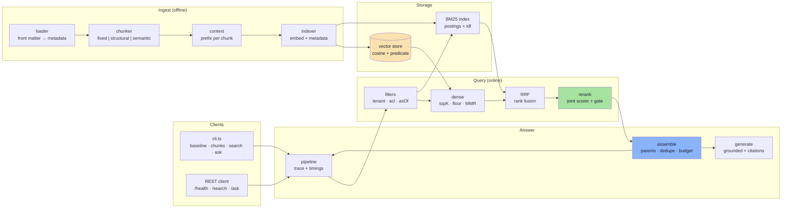

# Implementation Guide — Lecture 12: Advanced RAG

Welcome to the chapter-by-chapter guide for the **Lecture 12 codebase**: chunking strategies and
overlap arithmetic, parent-child and contextual retrieval, top-K and calibrated score floors,
metadata/ACL/temporal filters, hybrid search with RRF, two-stage reranking with a gate, context
engineering, evaluation and an ablation matrix — plus an HTTP API.

This guide follows the format used in Lectures 03–11. Every chapter contains:

1. **Files covered** — what the chapter creates and why.
2. **Complete source code** — the full contents of every file discussed, not excerpts. The
   files are inlined at build time, so the guide cannot drift from the code.
3. **Block-by-block explanation** — what each block does, how it works, and the trade-off behind it.
4. **Commands and measured output** — the exact command and the real output that proves the chapter.

> **Scope:** ~4,200 lines of TypeScript across 26 files, five runtime dependencies, no
> framework. It answers questions from `data/policies/`, cites the chunks it used, refuses when
> it cannot, and scores itself against a 14-case golden set — **all offline, with no API key**.

---

## 🧭 System Topology



---

## 📚 Chapter Navigation

| Chapter | Title | Files Covered | Notes Mapping |
| :---: | :--- | :--- | :--- |
| **[00](./00_Overview_Provider_Structure_and_File_Map.md)** | **Overview, Provider Structure & File Map** | project files, `src/` tree, request lifecycle | All |
| **[01](./01_Contracts_Config_and_Loader.md)** | **Contracts, Config, Loading — and the Broken Baseline** | `types.ts`, `config/env.ts`, `lib/`, `ingest/loader.ts`, `eval/diagnose.ts` | 01 |
| **[02](./02_Fixed_Size_Chunking_and_Overlap.md)** | **Fixed-Size Chunking and Overlap** | `ingest/fixed-chunker.ts` | 02 |
| **[03](./03_Structural_Semantic_and_Contextual_Chunking.md)** | **Structural, Semantic and Contextual Chunking** | `ingest/structural-chunker.ts`, `semantic-chunker.ts`, `context.ts` | 03 |
| **[04](./04_Indexing_Embeddings_and_the_Vector_Store.md)** | **Indexing: Embeddings and the Vector Store** | `embeddings.ts`, `ingest/indexer.ts`, `store/vector-store.ts` | 02, 03, 05 |
| **[05](./05_TopK_Thresholds_and_Calibration.md)** | **Top-K, Thresholds and Calibration** | `search/dense.ts`, `search/calibrate.ts` | 04 |
| **[06](./06_Metadata_Filters_ACL_and_Time.md)** | **Metadata Filters, ACL and Time** | `store/filters.ts`, `ingest/loader.ts` | 05 |
| **[07](./07_Hybrid_Search_and_RRF.md)** | **Hybrid Search and RRF** | `search/bm25.ts`, `search/hybrid.ts` | 06 |
| **[08](./08_Reranking_Two_Stage_Retrieval.md)** | **Reranking and Two-Stage Retrieval** | `search/rerank.ts` | 07 |
| **[09](./09_Context_Engineering.md)** | **Context Engineering** | `context/assemble.ts`, `generate.ts` | 08 |
| **[10](./10_Evaluation_Ablation_and_the_API.md)** | **Evaluation, Ablation and the API** | `eval/metrics.ts`, `eval/run.ts`, `pipeline.ts`, `cli.ts`, `server.ts` | 09 |

---

## 🚦 Prerequisites

```bash
cd "Lecture 12/code/advanced-rag"
node --version     # >= 20
npm install
npm run typecheck  # expect no output
npm run baseline   # expect 8 of 14 cases to fail, each with a named stage
```

Nothing else is required. `OPENAI_API_KEY` and `COHERE_API_KEY` are optional and only change
which provider implementation runs behind the same interfaces.

---

## 📖 How to Read This Guide

Read 00 first: it is the map, and it explains the five design decisions that make the rest of the
code readable. Then follow the pipeline in order — each chapter ends with a **Where This Goes
Next** pointer to the next stage.

If you only have twenty minutes, read these three:

1. **[Chapter 01](./01_Contracts_Config_and_Loader.md)** — the failure tree, and eight real failures.
2. **[Chapter 03](./03_Structural_Semantic_and_Contextual_Chunking.md)** — the largest quality change in the lecture.
3. **[Chapter 10](./10_Evaluation_Ablation_and_the_API.md)** — the ablation table that decides what is worth keeping.

---

## 📄 Related Documents

- **[Lecture 12 notes index](../../notes/README.md)** — the chapter-by-chapter notes this code implements
- **[Lecture 12 consolidated notes](../../notes/Lecture_12_Complete_Notes.md)** — the full reference
- **[Codebase README](../advanced-rag/README.md)** — install, commands, measured results and honest limits
