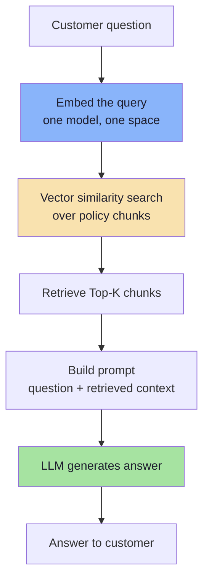
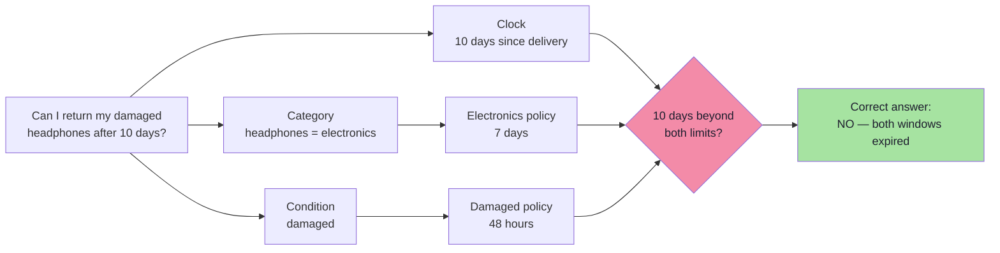
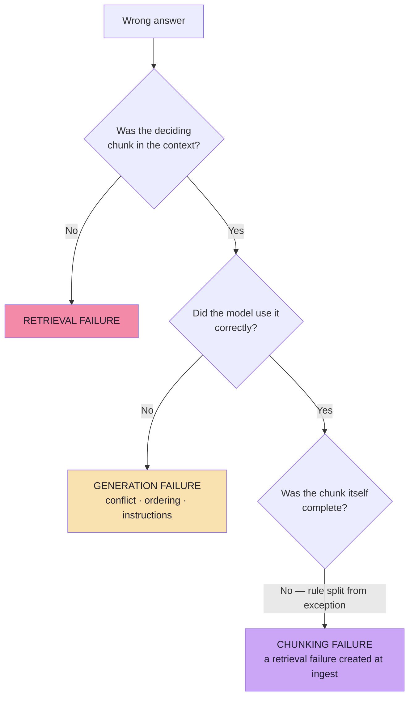
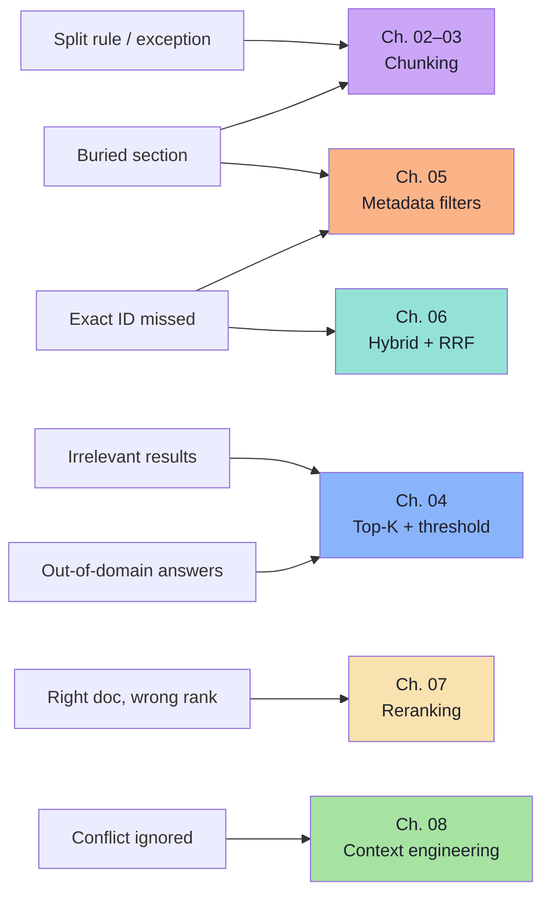
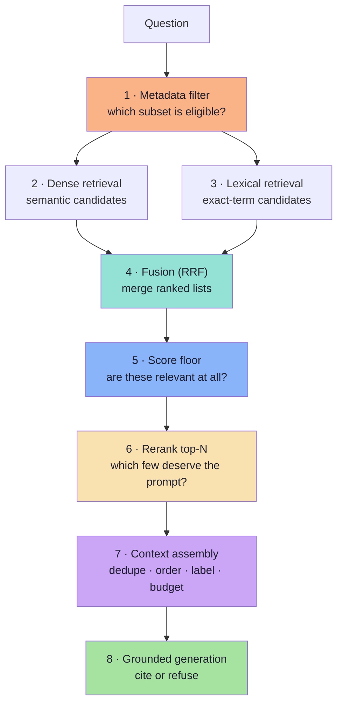
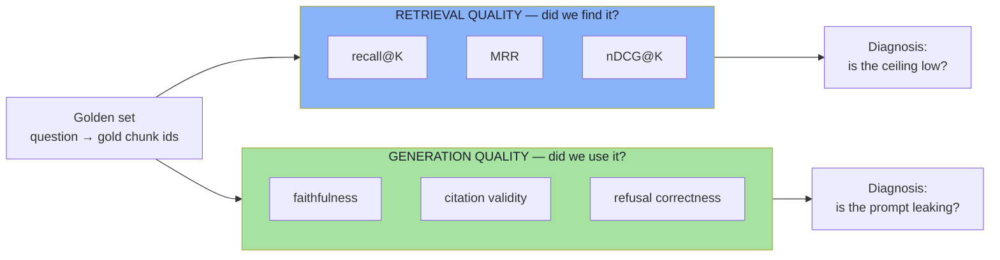

# Chapter 01: Why Basic RAG Breaks — The Two Failure Classes

> **Chapter Goal:** Establish the vocabulary the rest of the lecture depends on. Basic RAG is not *wrong*; it is **under-specified**. It makes one heroic assumption — *the retrieved chunks contain everything needed to answer correctly* — and every technique in this lecture exists to defend or repair that assumption in a specific, measurable place.
>
> At the end of this chapter you should be able to answer: *when this system gives a wrong answer, is the fault in retrieval or in generation — and how would I prove which?*

---

## 1.1 The Query That Breaks a Working Pipeline

A customer opens an e-commerce support chatbot and asks:

> "What is your return policy?"

A general-purpose LLM does not know the company's internal policy. It was trained on the public internet, frozen months ago, and has never seen this retailer's operations manual. In a **basic Retrieval-Augmented Generation (RAG)** application we do not fine-tune that knowledge into the weights. We look it up at answer time:



This works surprisingly well for simple questions. The whole design rests on a single assumption:

> **Assumption A:** *the chunks returned by the vector search contain every fact the correct answer requires.*

Assumption A has two halves, and they fail independently:

1. **Coverage** — the scoring facts must physically exist in the corpus and be reachable.
2. **Selection** — those facts must actually appear inside the K chunks the LLM sees.

Advanced RAG is, at its core, the engineering discipline of making Assumption A true — and then of verifying that the model used the result honestly.

---

## 1.2 The Three Policy Documents

Throughout this lecture we use one small, deliberately awkward knowledge base. It mirrors the board (`Excalidraw-Notes.svg`) and the source notes.

| Document | Policy text |
|---|---|
| **General Return Policy** | Eligible products may be returned within **30 days** of delivery. |
| **Electronics Return Policy** | Electronic products may be returned within **7 days** of delivery, subject to inspection. |
| **Damaged Product Policy** | Customers must report a damaged product within **48 hours** of delivery. |

Now the question:

> **"Can I return my damaged headphones after 10 days?"**

Three independent conditions are packed into one sentence:



The correct answer is **no**, and it requires *two* exceptions to be visible at once. If vector search returns only the General Policy, the model sees a 30-day window and answers:

> "Yes — you have 30 days."

That answer is **reasonable given the context it was handed**. It is not a hallucination in the classic sense: every sentence it used was retrieved, quoted and true. It is wrong because the evidence set was incomplete. This distinction matters enormously in practice, because the two cases have completely different fixes.

> **A good LLM cannot reliably use a policy that never reaches its context.** Retrieval quality is an upper bound on answer quality.

---

## 1.3 Two Failure Classes (and Why the Difference Is Load-Bearing)

| Failure | What went wrong | Example with our three documents | Where to fix it |
|---|---|---|---|
| **Retrieval failure** | The needed information was never retrieved — or was not in the candidate set at all. | The Electronics and Damaged policies exist, but only the General Policy is returned. | Chunking, filters, hybrid search, K, thresholds, reranking (Ch. 02–07) |
| **Generation failure** | The information **was** retrieved but the model used it incorrectly, incompletely, or ignored a constraint. | All three policies reach the prompt; the model still answers "yes, 30 days". | Context assembly and prompt contract (Ch. 08) |

These require **different fixes**, and applying the wrong one is the most common waste of engineering time in RAG projects:

- A stronger system prompt **cannot** recover a document that was never retrieved. Adding "Be accurate and follow the policies strictly" to the prompt changes nothing when the electronics policy is not in context.
- Retrieving more documents **does not** guarantee correct interpretation. In fact, adding the general policy next to the specific one *creates* the conflict that the model then mishandles.


Notice the third branch. A **chunking failure** is a retrieval failure that was *manufactured at ingestion time* — before any question arrived, before any embedding was computed. It is the cheapest failure to prevent and the most expensive to diagnose, because at query time everything looks healthy: search returned 4 chunks, all with high similarity, all genuinely about returns.

---

## 1.4 A Field Guide to the Seven Ways Basic RAG Fails

The lecture's chart of "problem → improvement" is really a taxonomy. Expanded with symptoms and diagnostics:

| # | Symptom the customer sees | Underlying mechanism | First diagnostic to run |
|---|---|---|---|
| 1 | Answer cites a rule but misses its exception | Rule and exception were split into different chunks; only one was retrieved | Print chunk boundaries for that document |
| 2 | Answer ignores a section that surely exists | Section was buried in a 5,000-token chunk and averaged away | Check chunk token distribution |
| 3 | Answer includes irrelevant material | Top-K returned near-misses because K is large and there is no score floor | Print similarity scores, not just text |
| 4 | Out-of-domain question still gets a confident policy answer | Nearest neighbour always exists; "closest" ≠ "relevant" | Ask an unrelated question (*"Who won the IPL in 2026?"*) |
| 5 | Exact product code returns the wrong product's manual | Dense embeddings blur arbitrary identifiers (`AX-204` vs `BX-900`) | Query by SKU only; inspect ranking |
| 6 | Correct policy retrieved but ranked 4th, cut by `topK(3)` | Ranking quality, not recall, is the bottleneck | Compare rank of the gold chunk |
| 7 | Both specific and general policies in context, model picks general | Conflicting, redundant context with no precedence rule | Read the assembled prompt verbatim |

Each row maps to exactly one chapter of this lecture:



---

## 1.5 What "Advanced RAG" Actually Means

Advanced RAG is **not** a replacement architecture, a new framework, or a different model. It is a set of **stage-local upgrades** to the pipeline you already have.

| Problem | Improvement | Cost you accept |
|---|---|---|
| Important information gets split apart or loses context | Better chunking (fixed + overlap, structural, semantic, contextual) | Ingest compute, more vectors, re-indexing |
| Irrelevant documents appear in search results | Retrieval tuning (Top-K, similarity threshold) and filtering | Threshold calibration, empty-result UX |
| Exact identifiers or keywords are missed | Hybrid search (dense + lexical/BM25, fused with RRF) | Second index, analyzer maintenance |
| Useful documents are present but ranked too low | Reranking (cross-encoder over top-N candidates) | 50–300 ms latency, per-document cost |
| Retrieved context is repetitive or contains competing information | Context engineering (dedupe, order, label, resolve conflicts) | Prompt discipline, eval cases |

The critical framing — and the one the lecture insists on:

> **Advanced RAG improves a stage, not the whole system.** Each control answers a different question, and adding controls without measuring which question is being answered is how pipelines become slow, expensive and no more accurate.
### The control stack, in the order a query meets it



Steps 1–3 run **before** any ranking decision, step 5 is a *gate*, step 6 is a *reordering*, and step 7 is *presentation*. A query that is filtered out at step 1 can never be rescued by steps 6–7: **the order of the stack is also the order of irreversibility.**

---

## 1.6 The Baseline Discipline: Inspect Retrieval Before Inspecting the Answer

The lecture's first practical instruction is the most valuable habit in this entire subject. Before you change any parameter, capture what retrieval returns.

The starting call in the reference Spring AI application is minimal:

| Parameter | Value | Meaning |
|---|---|---|
| `query` | the customer question | raw text, no rewriting |
| `topK` | `4` | at most four chunks |
| `similarityThreshold` | not set | no relevance floor |
| `filterExpression` | not set | whole corpus is searchable |

In TypeScript-shaped pseudo-code (the snippet style used throughout these notes), the same request is:

```ts
// pseudo-code — the baseline, deliberately naive
const res = await vectorStore.similaritySearch({
  query: question,
  topK: 4,
  // no threshold, no filter, no hybrid, no rerank
});

for (const [i, doc] of res.entries()) {
  console.log(`DOCUMENT ${i + 1}  score=${doc.score?.toFixed(4)}  id=${doc.id}`);
  console.log(doc.text);
  console.log("--------------------");
}
```

Three additions to the lecture's `println` loop are worth making from day one:

1. **Print the score.** Text alone hides the difference between 0.94 and 0.61.
2. **Print the id and metadata** (`source`, `page`, `section`). You need to know *which* chunk, not just what it said.
3. **Print the token count** of the retrieved set. This is the number that later becomes your LLM bill.

### What a baseline run actually looks like

Ask a handful of questions whose answers are known to exist in the knowledge base, and record retrieval **before** looking at the final answer:

| Query | Expected gold chunk | Rank of gold chunk | Top score | Verdict |
|---|---|---|---|---|
| "Return window for electronics?" | `return-policy → electronics` | 1 | 0.94 | retrieval OK |
| "Can I return damaged headphones after 10 days?" | electronics + damaged | 2 and 4 | 0.89 | **retrieved, then cut by K** |
| "Who won the IPL in 2026?" | *none exists* | — | 0.31 | **no relevance gate** |
| "Does AX-204 support fast charging?" | `AX-204 manual` | 3 | 0.71 | **dense prefers BX-900** |

Every later chapter's improvement is measured against this table. Without it, "the new chunking feels better" is an opinion.

> **Rule:** retrieval is a component; the answer is the product. Debug components, ship products. Never debug both at once.

---

## 1.7 The Measurement Frame You Need Before Chapter 02

You cannot improve what you cannot score. Two families of metrics, deliberately kept separate:



| Metric | Question | Formula / rule of thumb |
|---|---|---|
| **recall@K** | Is the gold chunk inside the K results? | `hits / total queries` (Ch. 09 for multi-chunk gold sets) |
| **MRR** | How high is the *first* correct result? | mean of `1 / rank_first_relevant` |
| **nDCG@K** | Are the good results near the top, graded? | `DCG@K / IDCG@K`, gain by relevance grade |
| **faithfulness** | Is every claim supported by the context? | judged claim-by-claim against context |
| **refusal correctness** | Does it refuse when evidence is absent? | confusion matrix over answerable / unanswerable |

A useful discipline for the remainder of this lecture:

> **recall@K is a property of ingestion + retrieval. Faithfulness is a property of the prompt. Neither can compensate for the other.**

If `recall@20` is 0.6, no reranker, no prompt and no model upgrade will get you above roughly 0.6 correctness on that slice. Chapter 02 explains why that ceiling is set before the first query is ever asked.
---

## 1.8 The Running Example, Tracked End to End

The same question is used in every chapter, so that each technique's contribution is visible. This table is the spine of the lecture.

| Stage | What happens to "damaged headphones after 10 days" | Chapter |
|---|---|---|
| Corpus design | Three separate policy documents; rule and exception live in different files | 01 |
| Chunking | Each policy fits one chunk → good. A longer policy would split the window from the exception | 02–03 |
| Metadata | `category=electronics`, `policyType=returns` attached at ingest | 05 |
| Dense search | Electronics and General policies rank high; damaged policy ranks 4th | 04 |
| Lexical search | `damaged` and `headphones` matched exactly; boosts the damaged policy | 06 |
| Fusion | RRF puts the damaged policy at rank 1–2 | 06 |
| Threshold | All surviving scores ≥ 0.70; nothing is discarded | 04 |
| Rerank | Cross-encoder scores the damaged policy 0.97 vs general 0.68 | 07 |
| Context | Specific policies labelled and ordered **before** the general one, with a precedence rule | 08 |
| Answer | "No — electronics returns close at 7 days and damage must be reported within 48 hours" + citations | 08 |
| Evaluation | recall@5 = 1.0, faithfulness = 1.0, refusal correct on out-of-domain | 09 |

---

## 1.9 Pseudo-code: One Trace Object for the Whole Pipeline

The single most useful engineering artifact in advanced RAG is a **per-stage trace**. Every chapter adds fields to it.

```ts
// pseudo-code — the shape of a traced retrieval request
type Trace = {
  query: string;
  filters: Record<string, unknown> | null;
  dense: { id: string; score: number }[];
  lexical: { id: string; score: number }[];
  fused: { id: string; rrf: number }[];
  thresholdDropped: string[];
  reranked: { id: string; relevance: number }[];
  contextTokens: number;
  answer: string;
  citations: string[];
};

async function answerWithTrace(question: string): Promise<Trace> {
  const filters = deriveFilters(question);                            // Ch. 05 — server-side, never from the LLM
  const dense = await denseSearch(question, { topK: 20, filters });   // Ch. 04
  const lexical = await bm25Search(question, { topK: 20, filters });  // Ch. 06
  const fused = rrfMerge([dense, lexical], { k: 60 });                // Ch. 06
  const gated = applyScoreFloor(fused, 0.70);                         // Ch. 04
  const reranked = await rerank(question, gated, { topN: 12 });       // Ch. 07
  const context = buildContext(reranked.slice(0, 4));                 // Ch. 08
  const answer = await generate({ question, context });               // Ch. 08
  return { /* ...all fields above... */ } as Trace;
}
```

The point is not the code — it is that **every decision leaves a trace**. When an answer is wrong, the trace tells you which stage to open.

---

## 1.10 Common Mistakes in This Stage of the Work

| Mistake | Why it hurts | Correct habit |
|---|---|---|
| Tuning the prompt to fix a retrieval bug | Prompt changes cannot add evidence; they add instruction-following pressure | Check retrieval first, always |
| Judging quality by reading one good answer | Single-case optimism; retrieval regressions stay invisible | Keep a 30–100 case golden set (Ch. 09) |
| Adding all five techniques at once | Cannot attribute the improvement; latency and cost balloon | Ablate one control at a time |
| Assuming similarity is confidence | 0.90 similarity is not 90% correctness | Calibrate thresholds on labelled data (Ch. 04) |
| Treating chunking as a formatting detail | It sets the retrieval ceiling permanently | Design chunks around policy units (Ch. 02–03) |
| Re-indexing without clearing old vectors | Old and new chunk versions compete in the same namespace | New namespace or delete-by-source (Ch. 09) |
| Believing "more context = better" | Context dilution and conflict; cost scales linearly | Budget context and order it deliberately (Ch. 08) |

---

## 1.11 Chapter Summary

| Idea | Statement |
|---|---|
| The assumption | Basic RAG assumes the retrieved chunks contain everything needed. |
| Two failure classes | Retrieval failure (evidence absent) vs generation failure (evidence misused) — different fixes. |
| Chunking failures are retrieval failures | Manufactured at ingest, invisible at query time. |
| Advanced RAG | Stage-local upgrades: chunking, K/threshold, filters, hybrid, rerank, context. |
| Order of irreversibility | Filter → retrieve → fuse → gate → rerank → assemble → generate. |
| First instrument | Print retrieved text **with score, id and metadata** before reading answers. |
| Measurement | recall@K and faithfulness are separate numbers; retrieval is the ceiling. |

> **Final mental model:** a RAG answer is only as good as the **evidence set** it was handed and the **instructions** it was handed with. Advanced RAG is the systematic engineering of those two things — and nothing else.

---

## Where This Goes Next

- **[Chapter 02](./02_Fixed_Size_Chunking_and_Overlap.md)** — the first irreversibility: where the text was cut.
- Skipping ahead? [Chapter 06](./06_Hybrid_Search_and_RRF.md) handles the identifier case (row 5 above), [Chapter 07](./07_Reranking_Two_Stage_Retrieval.md) the ranking case (row 6).
- Foundations: [Lecture 11 — RAG](../../Lecture%2011/notes/Lecture_11_Complete_Notes.md) for the base pipeline, [Lecture 10](../../Lecture%2010/notes/Lecture_10_Complete_Notes.md) for ANN search and score behaviour.

---

**Back to:** [Lecture 12 — Chapter Index](./README.md) · [Complete Consolidated Notes](./Lecture_12_Complete_Notes.md)
