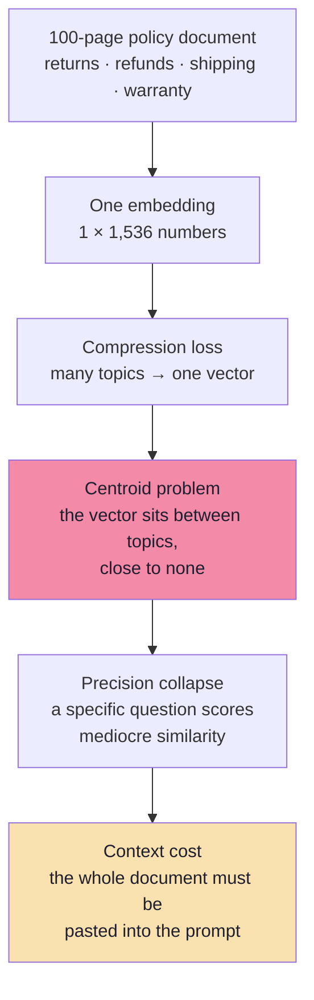
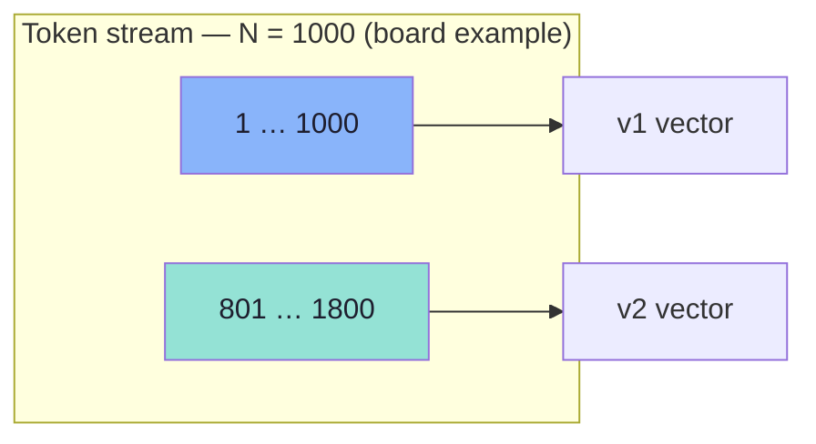
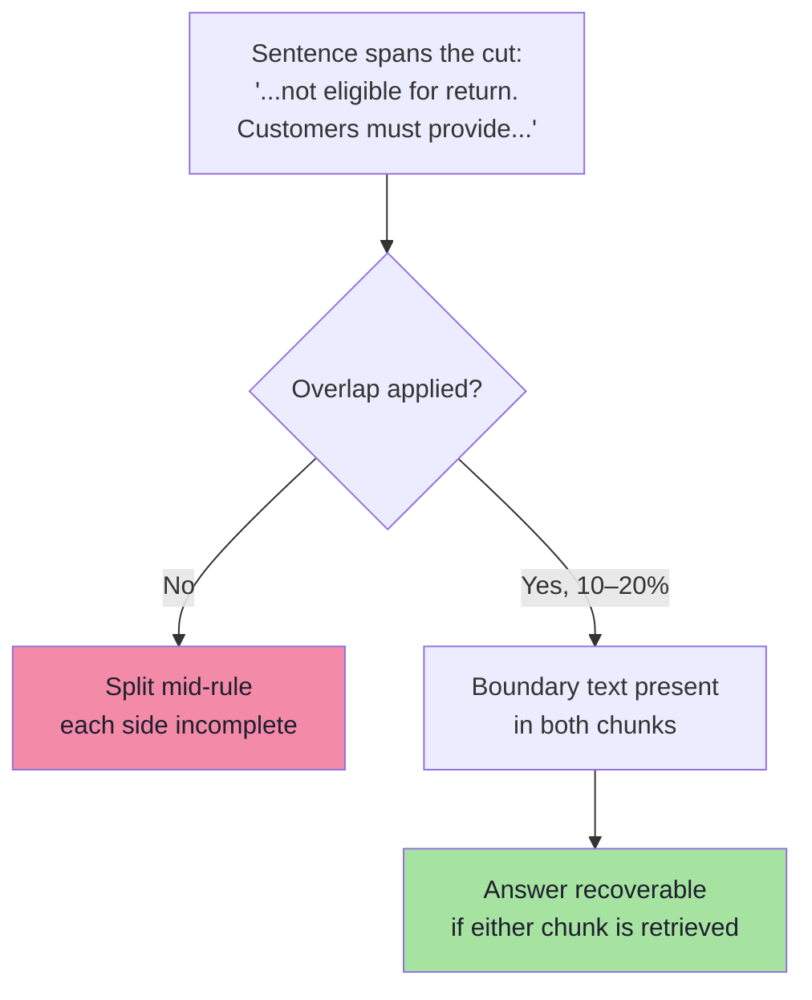
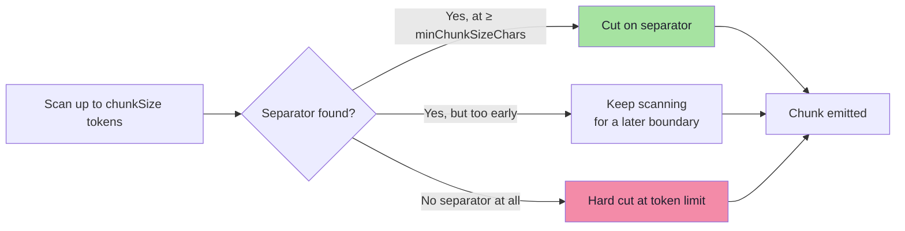
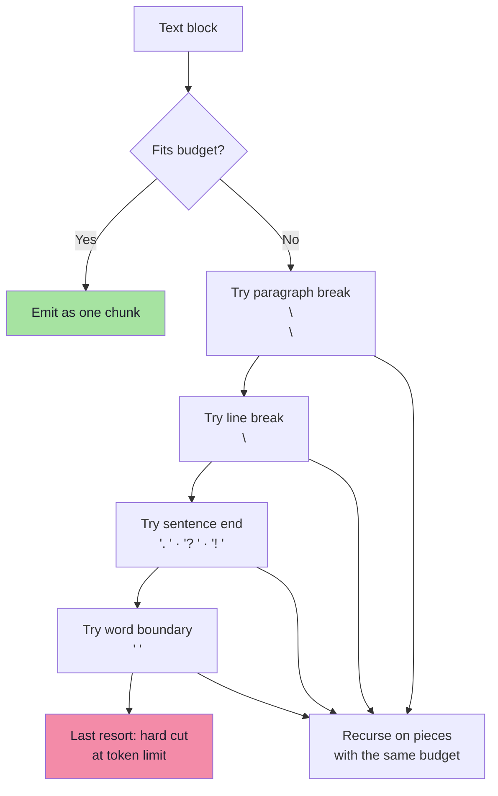
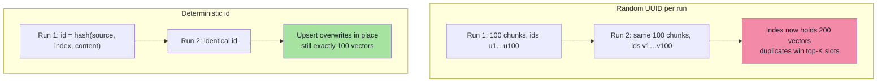

# Chapter 02: Fixed-Size Chunking and Overlap Arithmetic

> **Chapter Goal:** Learn the first and most irreversible decision in the pipeline. Before any embedding exists, before any index is built, someone chooses **where the text is cut**. That choice fixes the maximum achievable recall for the rest of the system's life.
>
> At the end of this chapter you should be able to answer: *given a document and a question style, what chunk size, what overlap, and what split boundaries — and how do I prove the choice is right?*

---

## 2.1 Why Chunk at All

Suppose the company has a single 100-page document covering returns, refunds, shipping, warranties, exchanges and cancellations. A tempting simplification is to embed the whole document once and search it.

That fails for three compounding reasons:



An embedding is a **fixed-width summary**. Averaging returns, shipping and warranty language produces a vector that is *about policy in general* and therefore weakly similar to *every* specific policy question. You lose the ability to say "this passage, not that one".

Chunking divides the document into smaller searchable units. Each chunk then plays **three roles simultaneously**:

| Role | Consequence of getting it wrong |
|---|---|
| **Retrieval unit** — what gets one vector | The fact is not findable, or is diluted by unrelated neighbours |
| **Context unit** — what gets pasted into the prompt | The model receives too little to answer, or too much to focus |
| **Citation unit** — what a source marker points at | You cannot show the customer *where* the rule came from |

> **The only real design question is where to split without losing meaning.** Size is a proxy; meaning is the objective.

### Units: tokens, not characters

Chunk sizes are usually specified in **tokens**, because that is what the embedding model and the LLM actually consume. For English prose, a widely used planning approximation is:

```text
1 token  ≈ 4 characters  ≈ 0.75 words
400 tokens ≈ 1,600 characters ≈ 300 words
```

| Unit | Why people use it | Why it misleads |
|---|---|---|
| **Characters** | Trivial to compute, no tokenizer needed | Character density varies wildly (tables, code, URLs) |
| **Words** | Human-intuitive | Tokenizers split words into subwords unpredictably |
| **Tokens** | Matches model billing and limits | Requires the model's tokenizer at ingest time |

> **Practical rule:** store chunk length in tokens in metadata at ingest. It lets you audit "which chunks are oversized?" without re-tokenizing the corpus later.

---

## 2.2 Fixed-Size Chunking: The Mechanism

A fixed-size strategy splits text after a chosen number of characters or tokens. It is simple and produces predictable chunk lengths — and its central weakness is that **a token boundary has no obligation to coincide with a sentence, let alone a policy rule**.

The lecture's original policy text:

```text
Electronics Return Policy

Electronic products can be returned within 7 days of delivery.
Products must be in their original packaging. Items showing signs
of physical damage caused by the customer are not eligible for
return. Customers must provide the original purchase invoice.
```

An illustrative fixed-size split:

| Chunk | Content |
|---|---|
| **Chunk 1** | Electronic products can be returned within 7 days of delivery. Products must be in their original packaging. |
| **Chunk 2** | Items showing signs of physical damage caused by the customer are not eligible for return. Customers must provide the original purchase invoice. |

Now ask the board's question: **"Can I return a physically damaged electronic product?"**

The answer requires **both** chunks: one states the window, the other states the exception. Retrieving only one produces a confidently incomplete answer. Note what has happened:

- Nothing is *wrong* in either chunk.
- Both embed cleanly.
- Both score highly for the question.
- And yet the *policy unit* was destroyed by an arbitrary cut.

This is the canonical chunking failure: **a rule and its exception were separated by a boundary that had no semantic justification.**
### The sliding window, precisely

Fixed-size chunking with overlap is a sliding window over the token sequence:

```text
step        = S − O                 (S = chunk size, O = overlap)
chunk i     covers tokens  [i·step,  i·step + S)
chunk count = ceil( (N − O) / (S − O) )     for N > S
```



The board draws exactly this: **1000 words → chunk → `v1`**, then **800–1800 → `v2`**. A 1,000-unit window advancing by 200 units is a **20% overlap** — the top of the range the lecture recommends.

### Overlap changes cost, not just quality

Because neighbouring chunks share `O` tokens, the corpus is stored `S / (S − O)` times over:

| Chunk size `S` | Overlap `O` | Overlap % | Step | ≈ Chunks for N = 4,000 | Storage multiplier |
|---|---|---|---|---|---|
| 400 | 0 | 0% | 400 | 10 | 1.00× |
| 400 | 40 | 10% | 360 | 11 | 1.11× |
| 400 | 80 | 20% | 320 | 13 | 1.25× |
| 400 | 200 | 50% | 200 | 19 | 2.00× |
| 1,000 | 200 | 20% | 800 | 5 | 1.25× |

Two things follow immediately:

1. **Overlap is a tax on every future query** — more vectors to store, embed, index, search and pay for.
2. **Overlap cannot repair a bad boundary.** It duplicates text across the cut; it does not restore the heading, the table header, or the logical unit. Chapter 03 addresses the actual cause.
---

## 2.3 What Overlap Buys — and What It Costs

Overlap repeats a small amount of text between neighbouring chunks so that a sentence, condition or cross-reference spanning a boundary is preserved on at least one side.



### The four costs

| Cost | Mechanism | Mitigation |
|---|---|---|
| **More vectors** | `1 / (1 − overlap%)` storage and embedding spend | Keep overlap ≤ 20% unless evidence demands more |
| **Duplicate top-K slots** | Both copies of the boundary text can be retrieved, wasting K | Dedupe by `(source, chunkIndex)` adjacency before prompt assembly |
| **Repetitive context** | The LLM sees the same paragraph twice and may over-weight it | Same dedupe step; strip repeated overlap spans when merging adjacent chunks |
| **Score inflation** | Duplicated text creates clusters of near-identical vectors | Diversity step (MMR) or dedupe by content hash |

> **Overlap is a bandage, not a fix.** It protects *boundary context*. It cannot protect *logical structure*. If a policy's exception belongs with its rule, the correct answer is to cut on the section boundary (Chapter 03), not to add 30% overlap and hope.

### The dedupe rule that saves your K budget

After retrieval, adjacent chunks from the same source that overlap should be **merged, not cited twice**:

```ts
// pseudo-code — collapse overlap duplicates before the prompt
function collapseAdjacent(hits: Hit[], maxGap = 1): Hit[] {
  const sorted = [...hits].sort((a, b) => a.chunkIndex - b.chunkIndex);
  const out: Hit[] = [];
  for (const hit of sorted) {
    const prev = out.at(-1);
    const adjacent =
      prev &&
      prev.source === hit.source &&
      hit.chunkIndex - prev.chunkIndex <= maxGap;
    if (adjacent) {
      prev.text = mergeOverlappingText(prev.text, hit.text); // longest-suffix/prefix join
      prev.score = Math.max(prev.score, hit.score);
    } else {
      out.push({ ...hit });
    }
  }
  return out;
}
```

This one function typically recovers one or two wasted K slots in a 400-token / 20%-overlap configuration.

---

## 2.4 Splitter Parameters: What Each Knob Really Means

The reference implementation uses Spring AI's `TokenTextSplitter`. Its three demo settings are widely misread, so we map them to concepts rather than syntax:

| Setting | Value | What it actually controls | What it does **not** control |
|---|---|---|---|
| Target chunk size | `withChunkSize(400)` | Approximate token budget per chunk | A hard guarantee; a chunk may end earlier at a boundary |
| Minimum chunk size in **characters** | `withMinChunkSizeChars(150)` | The **minimum character length considered while seeking a suitable split boundary** | ❌ It is **not** an overlap setting. ❌ It is **not** a strict minimum applied to every output chunk |
| Keep separator | `withKeepSeparator(true)` | Whether the separator (e.g. newline) is retained in the emitted chunk | Content fidelity beyond the separator itself |

The middle row is the trap. A reader sees `minChunkSize` and assumes "chunks are at least this long" or "this is the overlap". It is neither: it constrains the **search for a legal break point**, so that the splitter does not emit tiny fragments when a separator happens to appear very early.



> **Naming discipline:** when you build your own chunker, name fields for their behaviour (`targetTokens`, `overlapTokens`, `minCharsBeforeBreak`) rather than borrowing ambiguous names from a framework.

### The demo caution the lecture gives

> **Delete the previous vectors — or index the new chunks into a separate namespace — before comparing results.**

Otherwise old and new chunk versions coexist, and your "improvement" measurement is actually a mixture of two corpora. This is the single most common way teams fool themselves when tuning. Chapter 09 turns this into a formal blue/green re-index procedure.
---

## 2.5 Separator-Aware Splitting: The Pragmatic Middle Ground

Pure token cutting ignores the text's own punctuation. A better default keeps the fixed budget but prefers **natural boundaries inside it** — the recursive, priority-ordered split.



The priority list is a statement about **what humans consider a unit of meaning**, ordered from strongest to weakest:

| Priority | Separator | Preserves |
|---|---|---|
| 1 | `\n\n` (blank line) | Paragraph = one idea |
| 2 | `\n` | Line / list item / table row |
| 3 | `. ` `? ` `! ` | Sentence = one claim |
| 4 | `, ` `; ` `: ` | Clause (last resort before words) |
| 5 | ` ` | Word integrity |
| 6 | — | Nothing; characters only |

```ts
// pseudo-code — recursive boundary-aware splitting
const SEPARATORS = ["\n\n", "\n", ". ", "? ", "! ", "; ", ", ", " "];

function split(text: string, budget: number, overlap: number, level = 0): string[] {
  const tokens = countTokens(text);
  if (tokens <= budget) return [text];
  if (level >= SEPARATORS.length) return hardCut(text, budget, overlap);

  const sep = SEPARATORS[level];
  const pieces = text.split(sep).filter(Boolean);
  if (pieces.length === 1) return split(text, budget, overlap, level + 1);

  // greedy re-pack pieces into chunks of ≤ budget, then recurse on oversized pieces
  const packed = packGreedily(pieces, sep, budget);
  return packed.flatMap((p) =>
    countTokens(p) > budget ? split(p, budget, overlap, level + 1) : [p],
  );
}
```

Two implementation notes that save real bugs:

1. **Re-attach the separator.** `text.split(". ")` deletes the period. If you do not put it back, every sentence ends without punctuation and the chunker looks broken to the model and to the reranker.
2. **Overlap is applied to the emitted chunks, not the separators.** Apply a sliding window of `overlap` tokens across *finished* chunks; do not overlap raw pieces before packing, or the packing math stops matching the budget.

---

## 2.6 Deterministic Ids: The Unsexy Requirement That Makes Re-ingestion Safe

A chunk id is not a database detail. It determines whether re-running ingestion **updates** a chunk, **duplicates** it, or **orphans** the old copy.



```ts
// pseudo-code — stable, content-aware chunk identity
import { createHash } from "node:crypto";

function chunkId(source: string, index: number, text: string): string {
  const contentHash = createHash("sha256").update(text).digest("hex");
  // 24 hex chars is ample collision resistance for a per-source namespace
  return `${shortHash(source)}-${String(index).padStart(4, "0")}-${contentHash.slice(0, 16)}`;
}
```

| Id design | Re-ingest behaviour | When to use |
|---|---|---|
| `source + index` only | Overwrites, but an edited policy silently reuses the old id | Corpus where positions are stable and you always full-reindex |
| `source + index + contentHash` | Same text → same id; edited text → new id (old must be deleted by source) | **Default recommendation** |
| Random UUID | Duplicates on every run | Never, except ephemeral demos |

Deterministic ids also make **deletion** possible: "delete every vector where `source = 'return-policy.pdf'`" is only reliable if the id scheme makes provenance queryable.

> **Rule:** choose the id scheme before the first ingest. Migrating ids later means re-embedding and re-indexing the entire corpus.
---

## 2.7 Metadata Must Be Attached *Before* the Split

A chunk carries structured fields alongside its text. If they are attached after splitting, every chunk needs a second pass; if they are attached before, the splitter propagates them automatically.

| Field | Example | Used later for |
|---|---|---|
| `source` | `return-policy.pdf` | Citation display, delete-by-source |
| `docId` | `policy-returns-v3` | Grouping, versioning |
| `chunkIndex` | `7` | Adjacency merge, citation precision |
| `page` | `4` | User-facing reference |
| `section` | `Return Policy → Electronics` | Breadcrumb / disambiguation |
| `category` | `electronics` | Metadata filter (Ch. 05) |
| `policyType` | `returns` | Metadata filter (Ch. 05) |
| `effectiveFrom` / `effectiveTo` | `2026-01-01` / `null` | Temporal correctness |
| `tokenCount` | `382` | Budgeting, oversized-chunk audit |
| `contentHash` | `9f2c…` | Idempotency, duplicate detection |


The lecture's own demo derives `category` and `policyType` from **filename substrings** (`"electronics"` in the name → `category=electronics`). This is honest for a demo and fragile in production:

| Filename-rule weakness | Real failure |
|---|---|
| Naming inconsistency | `Electronics-Policy.pdf` vs `electronic_policy.pdf` |
| Missing domain in name | `returns_v2.pdf` covering twelve categories |
| Silent default | Everything unmatched becomes `general` — and `general` is then *included* in most filters |
| No temporal information | Superseded policy carries no `effectiveTo` |

Chapter 05 covers the production replacement: deterministic rules first, an **ingest-time classifier** second, and never an LLM call at query time just to guess a category the UI already knows.
---

## 2.8 Choosing the Numbers: A Defensible Protocol

The lecture recommends, as a starting experiment, **roughly 400–600 tokens with 10–20% overlap**, compared against a non-overlapping baseline. These are starting points, not universal settings.

| Content shape | Chunk size | Overlap | Why |
|---|---|---|---|
| FAQ / short policies | 200–400 | 0–10% | Each Q&A is already a unit; overlap only adds noise |
| Support policies with exceptions | 400–600 | 10–15% | Window and exception usually live within one section |
| Long legal / contractual prose | 600–800 | 15–20% | Clauses cross-reference each other; boundary risk is high |
| Tables, pricing grids | **Never split** | — | A split table is worse than a large chunk |
| Code / API docs | 300–500, AST-aligned | 0–5% | Function boundaries are semantic boundaries |
| Narrative / transcripts | 500–800 | 15–20% | Topic drift is gradual; larger windows keep coherence |

### The constraint everyone forgets: the reranker's limit

Cross-encoder rerankers (Chapter 07) typically accept **512 tokens** per pair. A chunk of 1,200 tokens is therefore **silently truncated** before it is scored — the exception clause at the end never influences the relevance score.

> **Rule of thumb:** `chunkSize ≤ reranker max length`. If you need long chunks for context, retrieve long and *score* short (parent-child retrieval, Chapter 03 §3.6).

### A five-step selection procedure

```text
1. Build a boundary probe set: 20 questions whose answers require TWO adjacent
   parts of one policy.
2. Ingest at 400 / 600 tokens with 0 / 10 / 20% overlap (six configurations).
3. For each, measure recall@1 and recall@4 on the probes (Ch. 09 harness).
4. Pick the cheapest configuration whose recall@4 is within 2 points of the best.
5. Freeze it. Re-run the harness only when the corpus or the embedder changes.
```

**Why recall@1 matters here:** if a policy unit was split, the two halves land at ranks 1 and 2 at best, so `recall@1` collapses while `recall@4` still looks fine. The gap between those two numbers *is* your boundary damage, expressed as a number.
---

## 2.9 Failure Modes You Can See in the Data

| Symptom in the index | Root cause | Repair |
|---|---|---|
| Many chunks < 80 tokens | Aggressive splitter, dense separators | Raise `minCharsBeforeBreak`, or pre-clean whitespace |
| Chunks beginning with "It…", "This…", "They…" | Pronoun orphaned from its antecedent | Prepend section heading; widen overlap |
| Repeated identical prefixes across chunks | Overlap applied to headings | Strip heading before overlap; re-prepend once |
| Token length histogram with a long tail | Hard cuts where separators are absent (URLs, tables) | Special-case tables/code; allow larger max for those types |
| Two vectors with cosine ≈ 1.0 for the same text | Random ids / duplicate ingest | Deterministic ids + delete-by-source |
| Gold chunk retrieved at rank 2 *and* 3 | Overlap duplicates | `collapseAdjacent` before the prompt |

### A quick orphan-chunk audit

```ts
// pseudo-code — corpus hygiene check, run after every ingest
function auditChunks(chunks: Chunk[]) {
  const low = chunks.filter((c) => c.tokenCount < 80);
  const noHeading = chunks.filter((c) => !c.metadata.section);
  const pronounStart = chunks.filter((c) => /^(it|this|they|these|such)\b/i.test(c.text));
  const dupes = findNearDuplicates(chunks, { threshold: 0.98 });

  return {
    underSized: low.length / chunks.length,
    missingSection: noHeading.length / chunks.length,
    orphanedPronouns: pronounStart.length / chunks.length,
    nearDuplicates: dupes.length,
  };
}
```

Any number above ~5% is a signal that the chunking, not the retrieval, is the problem.

---

## 2.10 Common Mistakes

| Mistake | Consequence | Fix |
|---|---|---|
| Using characters because it is easier | Chunk sizes drift with content density; token budgets blow up | Tokenize at ingest |
| 50% overlap "for safety" | 2× vectors, duplicate retrieval, inflated prompt | 10–20%, dedupe after retrieval |
| Reading `minChunkSizeChars` as overlap | Silent misconfiguration; chunks merge unexpectedly | Check the semantics (§2.4) |
| Splitting tables | Half a pricing grid is worse than none | Structural chunking (Ch. 03) |
| Ignoring the reranker's 512-token limit | Long chunks scored on their first half only | Keep chunks ≤ reranker limit |
| Tuning chunk size without probes | Improvement is anecdotal | Boundary probe set (§2.8) |
| Re-indexing into the same namespace | Old and new chunks compete | New namespace / delete-by-source |

---

## 2.11 Chapter Summary

| Decision | Default | Escalate when |
|---|---|---|
| Unit | Tokens | Content is code/tables (AST- or block-aware) |
| Size | 400–600 tokens | Legal prose → 600–800; FAQ → 200–400 |
| Overlap | 10–20% | Never above 25% without dedupe in place |
| Boundary policy | Separator priority, then hard cut | Use document structure instead (Ch. 03) |
| Ids | `source + index + contentHash` | — |
| Metadata | Attached before split | Add ingest-time classification (Ch. 05) |
| Validation | Boundary probes + orphan audit | Add end-to-end eval (Ch. 09) |

> **Final mental model:** a chunk is a *promise* that this piece of text can be found, cited and reasoned about on its own. Overlap is insurance against a boundary you could not avoid. Structure is the actual fix. Everything downstream — embeddings, indexes, rerankers, prompts — can only work with the meaning that survived the cut.

---

## Where This Goes Next

- **[Chapter 03](./03_Structural_Semantic_and_Contextual_Chunking.md)** — cut where the *document* says to cut, and give chunks their context back.
- The token budget you choose here becomes the context budget in [Chapter 08](./08_Context_Engineering.md).
- The storage multiplier becomes a line item in [Chapter 09](./09_Evaluation_and_Production_Playbook.md).
- Foundations: [Lecture 11, Chapter 03 — Ingestion](../../Lecture%2011/notes/03_Ingestion_Documents_to_Chunks.md).

---

**Back to:** [Lecture 12 — Chapter Index](./README.md) · [Complete Consolidated Notes](./Lecture_12_Complete_Notes.md)
