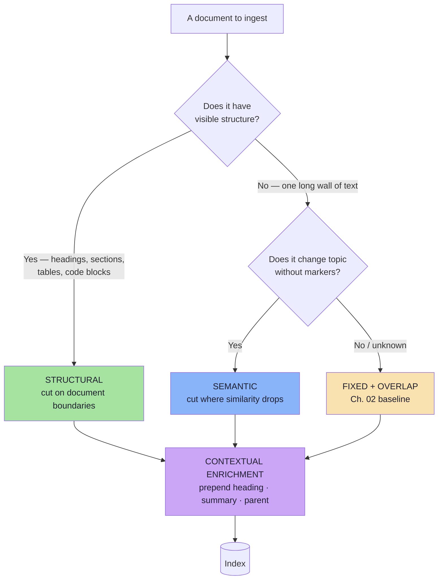
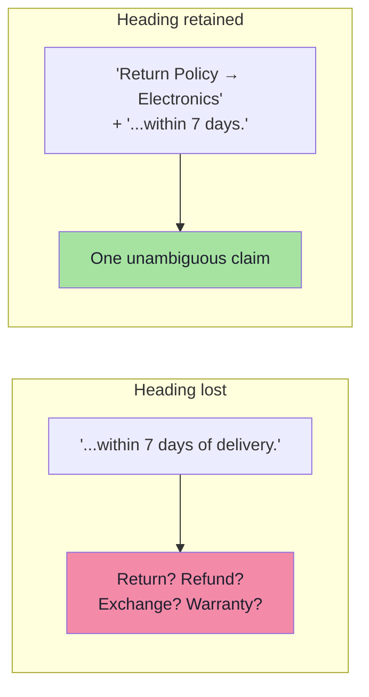
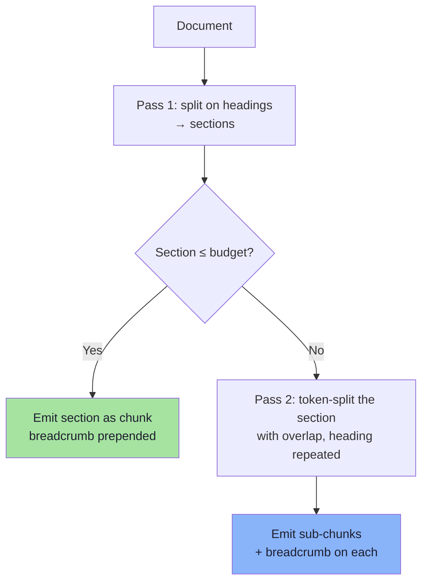
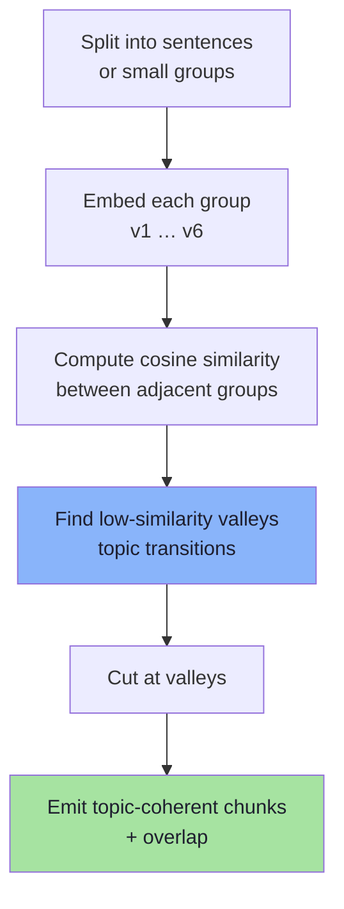
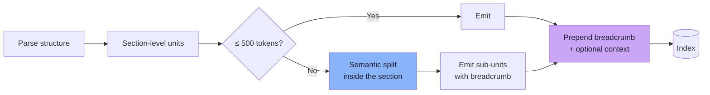
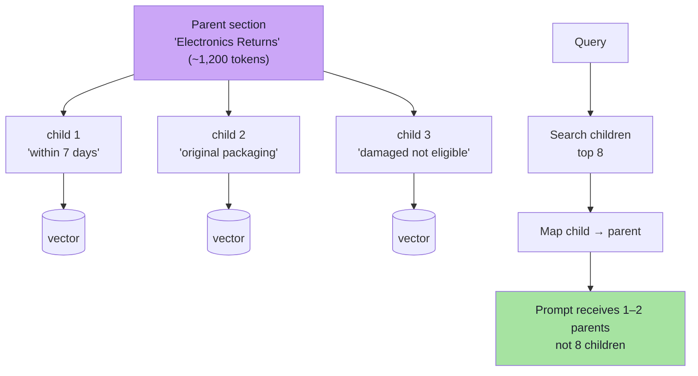
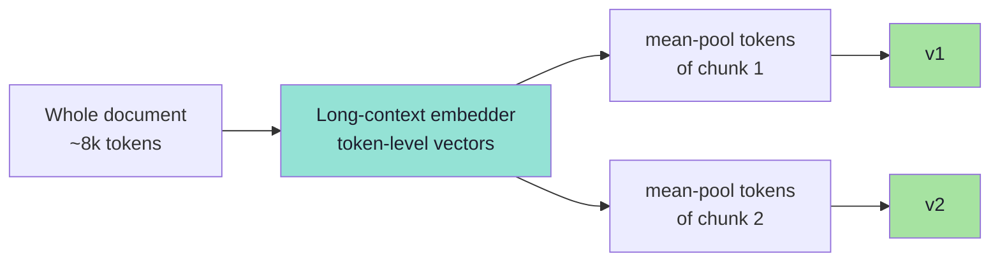

# Chapter 03: Structural, Semantic and Contextual Chunking

> **Chapter Goal:** Replace arbitrary cuts with *meaningful* ones — then give every chunk back the context the cut removed. This chapter covers the three chunking families in the lecture (fixed → structural → semantic), the practical rules for tables and long sections, and the post-lecture techniques that are now standard in production: **parent-child retrieval**, **contextual retrieval**, and **late chunking**.
>
> At the end of this chapter you should be able to answer: *what is the cheapest chunking strategy that keeps a rule and its exception in the same retrievable unit?*

---

## 3.1 Three Families of Chunking

Chapter 02 cut on **length**. This chapter cuts on **meaning**.



| Family | Cut on | Strength | Weakness | Cost |
|---|---|---|---|---|
| **Fixed + overlap** | Token count | Trivial, predictable, language-agnostic | Splits rules from exceptions | Lowest |
| **Structural (document-aware)** | Headings, sections, tables, code blocks | Keeps logical units intact; headings disambiguate | Requires a parser; uneven chunk sizes | Low–medium |
| **Semantic** | Similarity drop between adjacent sentences | Finds topic shifts with no markup | Extra embeddings; no structure guarantees | Medium |
| **Contextual enrichment** | *After* either of the above | Restores the context the cut removed | Extra tokens per chunk (or extra LLM calls) | Medium–high |

> **The hierarchy is a priority, not a menu.** Use structure when the document has it — which is most of the time. Fall back to semantic detection only for genuinely unstructured text. Never choose fixed-size because it is easiest; choose it because the content has no better boundary.

---

## 3.2 Structural (Document-Aware) Chunking

Many documents already contain useful boundaries: **titles, headings, subheadings, paragraphs, sections, tables**. Structural chunking respects them instead of splitting blindly.

### The heading is not decoration — it is disambiguating context

The board's example:

```text
Return Policy → Electronics

Electronic products can be returned within 7 days.
```

Without the heading, `"within seven days"` is ambiguous. It could refer to a **return**, a **cancellation**, a **warranty registration**, a **refund**, or an **exchange**. The sentence is identical in all five cases; only the heading tells you which policy is being stated.



**Rule:** every chunk carries its **breadcrumb** — the ordered path of headings from the document root to its own section:

```text
document:    Return Policy
section:     Electronics
subsection:  Damaged items

text: ...
```

Store the breadcrumb **both** in the embedded text (so it influences the vector) **and** in metadata (so it can be displayed, filtered and cited). These are different jobs: the vector needs it to be *retrievable*; the UI needs it to be *readable*.
### Per-section documents: the small-corpus pattern

For a modest collection of self-contained policy sections, each section can become one `Document` with its own metadata — no splitter at all:

```ts
// pseudo-code — one section = one document = one chunk
const documents = [
  {
    text: `Return Policy → Electronics

Electronic products can be returned within 7 days of delivery.`,
    metadata: { source: "return-policy", category: "electronics", policyType: "returns" },
  },
  {
    text: `Return Policy → Clothing

Clothing products can be returned within 30 days of delivery.`,
    metadata: { source: "return-policy", category: "clothing", policyType: "returns" },
  },
];
```

This is the highest-quality chunking that exists: **the author already did it for you.** Its limits are practical, not conceptual:

| Limit | Consequence | Threshold |
|---|---|---|
| Section too long | Must be split again (two-pass, §3.3) | > ~600 tokens |
| Section too short | Weak, context-poor vectors; may be merged with neighbours | < ~80 tokens |
| Section not self-contained | "See section 4.2" is meaningless alone | Cross-references must be resolved or inlined |

> **Overlap is unnecessary across structural boundaries.** The board states it plainly: *structural chunking → overlapping is not needed*. Two sections are already distinct units; duplicating their edges only creates near-duplicate vectors.

### What extraction actually gives you

Structural chunking is only as good as the structure your extractor recovers. This is where most "our chunking is bad" incidents originate.

| Source | What you get | What breaks | Mitigation |
|---|---|---|---|
| **PDF (text layer)** | Pages, sometimes font-size hints | Headings become plain lines; reading order breaks in multi-column layouts | PDF layout parser; page-level metadata |
| **PDF (scanned)** | Image only | Nothing is extractable | OCR first; verify text density |
| **HTML** | `h1`–`h6`, `p`, `table`, `li` | Nav/menu boilerplate pollutes chunks | Strip boilerplate with selectors |
| **Markdown** | Explicit heading tree | Tables and code fences split by naive splitters | Parse the AST, split on nodes |
| **DOCX** | Styles, headings, tables | Nested tables; tracked changes | Style-name-driven heading map |
| **Wiki / Notion export** | JSON blocks | Deep nesting, inline embeds | Block-type-aware traversal |

**Sanity check before ingesting:** print the extracted heading tree and confirm it matches what a human sees. If the extractor produced zero headings for a 40-page manual, no chunking strategy will save the pipeline.

---

## 3.3 Long Sections and Tables: The Two-Pass Rule

> **Preserve meaningful boundaries first; enforce size limits second.**

That single sentence from the lecture is the whole design of this section.


```ts
// pseudo-code — structure first, size second
function chunkDocument(doc: ParsedDoc, budget = 500, overlap = 60): Chunk[] {
  const out: Chunk[] = [];

  for (const section of doc.sections) {
    const breadcrumb = [...section.headingPath].join(" → ");
    const body = `${breadcrumb}\n\n${section.text}`;

    if (countTokens(body) <= budget) {
      out.push(makeChunk(body, section, 0));
      continue;
    }
    const parts = splitTokens(section.text, { budget, overlap });
    parts.forEach((part, i) => {
      // the heading is re-attached to EVERY sub-chunk, not just the first
      out.push(makeChunk(`${breadcrumb} (part ${i + 1})\n\n${part}`, section, i));
    });
  }
  return out;
}
```

The `(part 2)` marker matters more than it looks: it tells the reranker and the model that this is a fragment, which reduces over-confident answers that treat a partial clause as the whole rule.

### Tables must not be split

A pricing table cut in half produces two chunks that are each *wrong* rather than merely incomplete:

| Naive split | Result |
|---|---|
| Header row in chunk A, data rows in chunk B | Orphaned numbers with no column meaning |
| Data rows split mid-category | Partial price list that looks authoritative |

| Strategy | How | When |
|---|---|---|
| **Keep whole** | One chunk per table, even if over budget | Tables < ~800 tokens (most) |
| **Repeat the header** | Convert to Markdown and re-emit the header on every fragment | Long tables |
| **Summarise + link** | Embed an LLM-generated natural-language summary; keep the table in a payload field | Very large tables, numeric questions |
| **Row-as-record** | One chunk per row, with header names inlined (`"iPhone 15 — price: …"`) | Product catalogs, lookups |

For numeric or aggregate questions ("what is the price of X?"), row-as-record or a structured tool call beats vector search entirely. Do not force a table through a text pipeline if the question is really a database query.

### Code and configuration

Same principle, different parser: split on **AST node boundaries** (function, class, method), never on line count. A function cut between its signature and its body is a retrieval hazard *and* a security hazard — the model may confidently explain the wrong function's behaviour.
---

## 3.4 Semantic Chunking

Structural chunking needs headings. Semantic chunking is for the long, unstructured document that **changes topic without visible markers** — a transcript, a scraped FAQ, a vendor's rambling policy page.

The board's example, six sentences in two topics:

```text
Customers can return eligible products within 30 days.
Electronic products must be returned within 7 days.
All returned products must be inspected before approval.

We offer standard shipping across India.
Orders are generally dispatched within 24 hours.
Express delivery is available in selected cities.
```

A human sees two groups instantly. The machine sees six sentences and no headings.

### The algorithm



The board's illustrative adjacency scores:

| Pair | Similarity | Interpretation |
|---|---|---|
| `v1 ↔ v2` | 0.92 | same topic (returns) |
| `v2 ↔ v3` | 0.87 | same topic (returns) |
| **`v3 ↔ v4`** | **0.31** | **topic transition: returns → shipping** |
| `v4 ↔ v5` | 0.94 | same topic (shipping) |
| `v5 ↔ v6` | 0.88 | same topic (shipping) |

The drop at `v3 → v4` is the boundary. Everything else is noise.

```ts
// pseudo-code — similarity-valley segmentation
async function semanticChunks(
  text: string,
  { percentile = 95, minChunkTokens = 150, overlap = 40 } = {},
): Promise<string[]> {
  const sentences = splitSentences(text);
  const embeds = await embedBatch(sentences);              // 1 call, N inputs

  const dist = embeds.slice(1).map((e, i) => 1 - cosine(e, embeds[i]));

  // cut where the *distance* is unusually large for THIS document
  const cutoffs = [...dist].sort((a, b) => a - b);
  const threshold = cutoffs[Math.floor((percentile / 100) * cutoffs.length)];

  const groups: string[] = [];
  let current = [sentences[0]];
  dist.forEach((d, i) => {
    if (d >= threshold) {
      groups.push(current.join(" "));
      current = [sentences[i + 1]];
    } else {
      current.push(sentences[i + 1]);
    }
  });
  groups.push(current.join(" "));

  return enforceMinSizeAndOverlap(groups, { minChunkTokens, overlap });
}
```

### Why a *percentile*, not a fixed number

0.31 feels like an obvious boundary — but only because these six sentences were chosen to make it obvious. On real text:

| Fixed threshold | Failure |
|---|---|
| `cut if sim < 0.5` | For a tightly-written legal document, *everything* is above 0.7 → one giant chunk |
| `cut if sim < 0.8` | For a chat transcript, everything is below 0.8 → one chunk per sentence |

A percentile adapts to the document's own distribution: "cut at the 5% largest drops" always produces a bounded number of boundaries, whether the text is dense or diffuse. Typical defaults in tooling are the **90th–95th percentile**.

### What semantic chunking cannot do

| Limitation | Why | Consequence |
|---|---|---|
| Ignores tables and figures | No notion of structure | A table split mid-way is still split |
| Cross-references break | "as described in §2" carries no semantics | Answer references a section that is not in context |
| Cost scales with sentences | N embeddings per document | Ingest cost; slow for large corpora |
| Boundary stability | Tiny text edits move the percentile | Re-ingest produces different chunks; ids churn |
| Domain-tuned embeddings needed | A legal embedder is not a chat embedder | Boundaries land in odd places on jargon |

> **Stability is an underrated criterion.** If a one-word edit reshuffles every chunk boundary, your ids change, your evaluation set silently invalidates, and your "before/after" comparisons are meaningless. Structural boundaries are stable; statistical boundaries are not.

---

## 3.5 Choosing a Strategy: The Decision Table

| Document type | Strategy | Overlap | Reason |
|---|---|---|---|
| Policy manual with headings | Structural, per section | 0% | Author-defined units |
| Product catalogue | Structural + row-as-record | 0% | Lookup questions, not prose |
| FAQ page | Structural (one Q&A per chunk) | 0–10% | Each item is already atomic |
| Contract / ToS | Structural, then token split | 10–15% | Clause integrity, dense cross-refs |
| Support transcripts | Semantic + fixed cap | 15% | Topic drift, no markup |
| Wiki export | Heading AST | 0–10% | Deep hierarchy available |
| Scanned PDF | OCR → structural → audit | 10% | Extraction quality is the risk |
| Code / API docs | AST nodes (functions, classes) | 0% | Syntax gives exact boundaries |

### The hybrid most teams converge on



Structure first (stable, cheap, semantically correct), semantics second (only where the author left no boundaries), enrichment last (restores context).
---

## 3.6 Beyond the Lecture: Contextual Enrichment

Everything so far decides **where** to cut. This section answers a different question: *now that the text is cut, how does the chunk know what it was part of?*

A chunk that says *"within 7 days of delivery"* is not wrong. It is **underspecified**. Enrichment adds the missing frame at ingest time, once, instead of hoping retrieval reconstructs it at query time.

### 3.6.1 Parent-child retrieval (small-to-big)

**Problem:** small chunks retrieve precisely but answer poorly; large chunks answer richly but retrieve poorly.

**Solution:** decouple the two. Index small **child** chunks for search; return their larger **parent** section into the prompt.



| Property | Value |
|---|---|
| Retrieval granularity | 200–300 tokens (precise) |
| Generation granularity | 800–1,500 tokens (complete) |
| Storage | Children embedded; parents stored as payload |
| Failure mode | Parents are huge → context blow-up; cap parent size or auto-merge only adjacent siblings |
| Variant | **Auto-merging**: if ≥ N children of the same parent are retrieved, return the parent instead |

This is the single highest-value technique for the "rule and exception" problem, because the exception almost always lives in the same *section* as the rule even when it does not live in the same 400-token window.

### 3.6.2 Contextual retrieval (LLM-generated chunk context)

Anthropic's 2024 technique: before embedding a chunk, ask a fast model to write **one or two sentences situating this chunk in the document**, and prepend it.

```text
[context] This chunk is from ACME's Return Policy, section "Electronics",
effective 2026, and states the return window that applies to electronic
items specifically (as opposed to the 30-day general policy).

[chunk] Electronic products can be returned within 7 days of delivery.
```

```ts
// pseudo-code — contextualise once at ingest, never at query time
async function contextualize(chunk: Chunk, doc: ParsedDoc): Promise<string> {
  const prompt = `
Document: ${doc.title}
Chunk: ${chunk.text}

Write 1–2 sentences describing what this chunk is about and where it sits
in the document. Do not add facts that are not in the chunk or the title.
Answer with the sentences only.`;
  const context = await fastModel.complete(prompt, { maxTokens: 120 });
  return `${context.trim()}\n\n${chunk.text}`;
}
```

| Reported effect (Anthropic, 2024) | Retrieval failure reduction |
|---|---|
| Contextual embeddings alone | ~35% |
| Contextual embeddings + contextual BM25 | ~49% |
| …plus reranking | ~67% |

> These are **vendor-reported** figures on their own corpora. Treat them as *"this technique is worth testing"*, not as a guarantee. Your own golden set (Ch. 09) is the only number that matters.

**The economics:** one LLM call per chunk, once. With prompt caching of the shared document prefix, cost per chunk drops to near nothing. For a 5,000-chunk corpus, this is a one-off ingest cost, not a per-query cost — a very favourable trade if it removes a class of failures.

### 3.6.3 Late chunking

Instead of embedding each chunk in isolation, embed the **whole document once** with a long-context embedder, then *pool the token embeddings* belonging to each chunk.



| Property | Detail |
|---|---|
| Context | Every chunk vector already "knows" its document (attention saw the whole text) |
| Cost | One long forward pass per document instead of N short ones |
| Constraint | The document must fit the embedder's context window |
| Constraint | You must be able to map tokens → chunk boundaries |
| Availability | Requires a long-context, token-level embedding model (e.g. Jina v2/v3 late chunking) |

Late chunking solves the pronoun/reference problem structurally rather than by prompt engineering — "it" in chunk 4 is resolved using the antecedent in chunk 2, because the attention mechanism saw both.

### 3.6.4 The other enrichment patterns worth knowing

| Pattern | Idea | Best for | Cost |
|---|---|---|---|
| **Sentence-window** | Index single sentences, return ±2 neighbours | Precise FAQ matching | Cheap |
| **Proposition chunking** | Rewrite text as atomic factual propositions | Dense fact lookup, multi-hop | LLM call per chunk |
| **Document summary chunk** | Add one chunk summarising the whole doc | "What does this policy cover?" queries | One call per doc |
| **Hypothetical questions** | Generate questions each chunk answers; embed those | Matching user phrasing | LLM calls at ingest |
| **RAPTOR / hierarchical** | Build a tree of recursive summaries | Cross-section, thematic questions | Expensive, batch |
| **Metadata enrichment** | Add entities, dates, categories as metadata | Filtering (Ch. 05) | Cheap |

> **Selection rule:** pick enrichment that fixes **a failure you have observed**, and prove it on the golden set. Enrichment multiplies ingest cost and can silently degrade precision by making every chunk look similar to every question.
---

## 3.7 Evaluating a Chunking Strategy (Without Building a Whole Eval Suite)

Chunking quality is measurable before retrieval tuning begins. Four cheap tests:

### Test 1 — Boundary probes

Write 20 questions whose answers span a boundary you *suspect* is fragile. For each, the gold evidence is two adjacent units.

| Probe | Gold units | Pass condition |
|---|---|---|
| "Can I return a physically damaged electronic item?" | `electronics` + `damaged` | Both in top-4 |
| "Is the packaging condition relevant to the 7-day window?" | `electronics` + `packaging` | Both in top-4 |

If `recall@1` is low but `recall@4` is healthy, you have boundary damage — the answer exists, spread across neighbours.

### Test 2 — The self-containment test

Sample 30 chunks and ask, for each: *"could a competent human answer a question from this chunk alone, without the rest of the document?"*

| Verdict | Meaning | Action |
|---|---|---|
| Yes, fully | Chunk is self-contained | — |
| Only with the heading | Needs breadcrumb prefix | Prepend section path |
| Only with the previous chunk | Needs overlap or parent | Widen overlap / parent-child |
| No — needs the whole section | Chunk is too small or too fragmented | Merge siblings |

### Test 3 — The orphan audit

Run the audit from Chapter 02 §2.9 (`tokenCount < 80`, missing `section`, pronoun-initial, near-duplicates). These are objective, cheap and catch most structural regressions.

### Test 4 — The "does the query even land" check

Take your ten most common real customer questions. For each, inspect the **top-1 chunk** and ask whether a human would accept it as the right passage. No metrics needed; a single "no" is a bug report.

```ts
// pseudo-code — a four-test chunking report card
type ChunkingReport = {
  boundaryRecall1: number;
  boundaryRecall4: number;
  selfContainedRate: number;
  orphanRate: number;
  nearDuplicateRate: number;
  topOneAccepted: number; // out of 10 hand-checked questions
};
```

Ship a chunking change only if `boundaryRecall4` and `selfContainedRate` improve **without** raising `orphanRate` or `contextTokens`.

---

## 3.8 Common Mistakes

| Mistake | Consequence | Fix |
|---|---|---|
| Splitting on a fixed length when headings exist | Rule/exception separation; ambiguous pronoun references | Structural parsing (§3.2) |
| Forgetting the breadcrumb | "within 7 days" matches five different policies | Prepend heading path to every chunk |
| Adding overlap to structural chunks | Near-duplicate vectors, wasted K | Overlap = 0 at section boundaries |
| Splitting tables | Numbers lose their column meaning | Keep whole / repeat header / row-as-record |
| Using semantic chunking on well-structured docs | Expensive, unstable, worse | Use structure; semantics only for flat text |
| Re-embedding without re-indexing parents | Child vectors point at stale parent text | Version the whole corpus together |
| Enrichment without evaluation | Every chunk looks like every question → precision collapse | A/B on the golden set |
| Ignoring extraction quality | Garbage heading tree → garbage chunks | Inspect the parsed structure first |

---

## 3.9 Chapter Summary

| Situation | Strategy | Enrichment |
|---|---|---|
| Clear headings | Structural, one section per chunk, 0% overlap | Breadcrumb in text + metadata |
| Section too long | Two-pass: headings, then token split | Breadcrumb + `(part n)` marker |
| Long flat text | Semantic (percentile breakpoints) | Contextual summary sentence |
| Tables | Never split | Header repetition or row-as-record |
| Code | AST nodes | File path + symbol name |
| Rule + exception problem | Structural first, then **parent-child** | Return parent section to the prompt |
| A few dozen long docs | **Late chunking** if the embedder supports it | Free document context |
| Unclear what is wrong | Probe set + orphan audit | Measure before enriching |

> **Final mental model:** structure gives you *correct units*; enrichment gives those units their *missing frame*. A chunk should be understandable **on its own, out of context** — because at query time, that is exactly how the model will see it.

---

## Where This Goes Next

- **[Chapter 04](./04_Top_K_and_Similarity_Thresholds.md)** — once chunks are right, decide how many of them may reach the model.
- The breadcrumb becomes a **filter field** in [Chapter 05](./05_Metadata_Filtering.md).
- Parent-child changes the token budget in [Chapter 08](./08_Context_Engineering.md).
- Foundations: [Lecture 11, Chapter 03](../../Lecture%2011/notes/03_Ingestion_Documents_to_Chunks.md).
- Further reading: *Dense X Retrieval* (proposition chunking, 2023), *Lost in the Middle* (context ordering, 2023), Anthropic's contextual-retrieval report (2024), Jina's late-chunking paper (2024).

---

**Back to:** [Lecture 12 — Chapter Index](./README.md) · [Complete Consolidated Notes](./Lecture_12_Complete_Notes.md)
