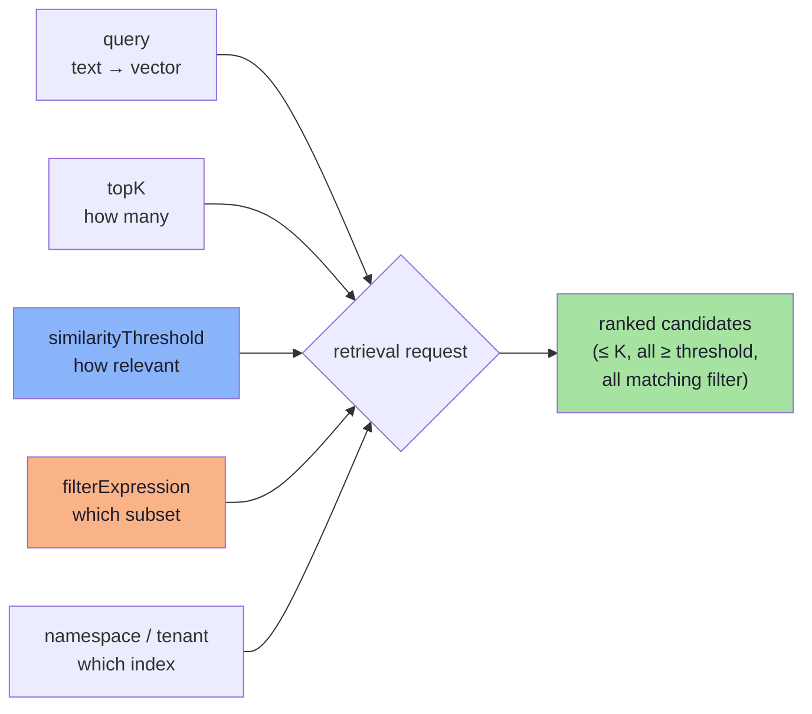
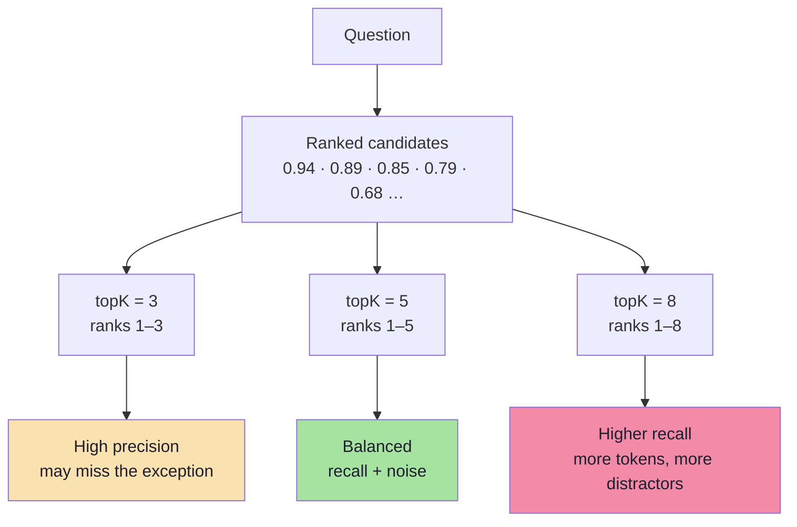
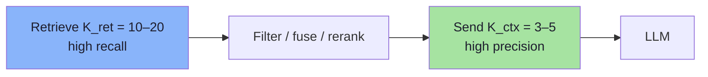
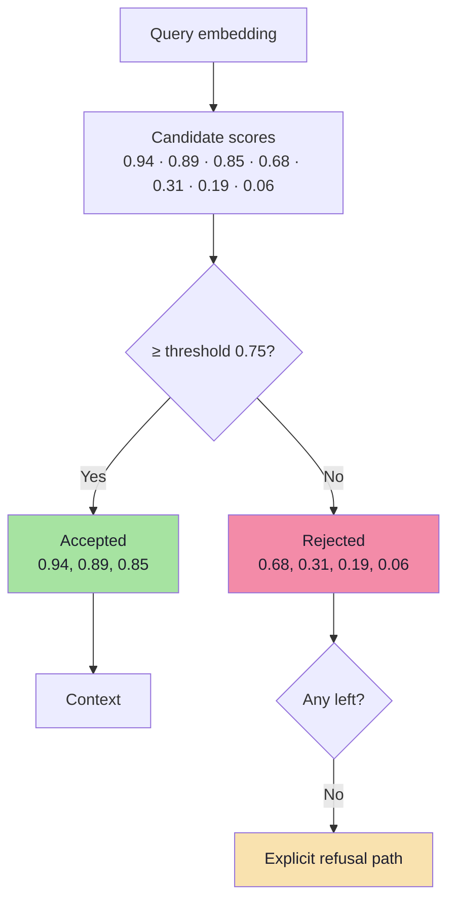
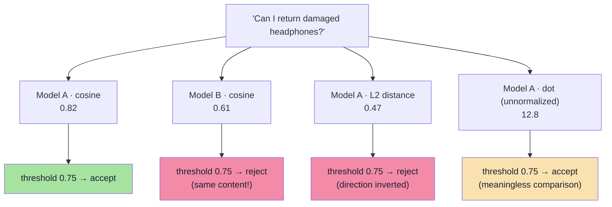
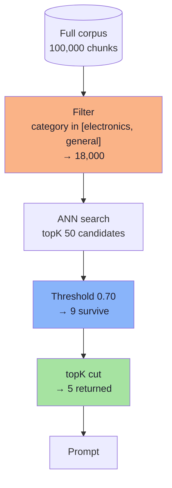

# Chapter 04: Top-K and Similarity Thresholds

> **Chapter Goal:** Turn retrieval from "give me some results" into a **bounded, calibrated decision**. Two numbers control everything downstream: how many candidates you accept (`K`) and how weak a candidate may be before it is rejected (the threshold). Both are budget decisions as much as they are quality decisions.
>
> At the end of this chapter you should be able to answer: *for this question, how many chunks should reach the prompt, and what score is "good enough" — with evidence, not folklore?*

---

## 4.1 The Anatomy of a Retrieval Request

Every vector search in this lecture is the same five-field request, however it is spelled in a given framework:



The baseline in the reference application sets only `query` and `topK(4)`. That is why its behaviour is so variable: two of the five decisions are being made implicitly (no threshold = accept anything; no filter = search everything).

| Field | Answers the question | Failure if omitted |
|---|---|---|
| `query` | *What are we looking for?* | — (obviously required) |
| `topK` | *How many matches may be returned?* | Default of 4–10 may cut the exception clause |
| `similarityThreshold` | *How relevant must a match be to qualify?* | Out-of-domain questions still return policies |
| `filterExpression` | *Which subset of documents may be searched?* | Wrong category/tenant/version can win |
| namespace | *Which corpus, which tenant?* | Cross-tenant data leakage |

---

## 4.2 Top-K: How Many Results Should We Request?

`topK(4)` asks the vector store for **at most the four highest-ranked matches**. The lecture's illustrative ranking for a return-policy question:

| Rank | Retrieved document | Illustrative similarity |
|---|---|---|
| 1 | Electronics Return Policy | 0.94 |
| 2 | General Return Policy | 0.89 |
| 3 | Damaged Product Policy | 0.85 |
| 4 | Exchange Policy | 0.79 |
| 5 | Warranty Policy | 0.68 |
| 6 | Shipping Policy | 0.42 |
| 7 | Payment Policy | 0.31 |

Read the table twice. The **correct evidence for "damaged headphones after 10 days" is ranks 1 and 3** — and `topK(3)` happens to include both, while `topK(2)` does not. Now change the embedding model, and the damaged policy might land at rank 4. The answer changes because a number nobody tuned changed.



### K is not free

| Cost dimension | Scales as | Consequence at K = 20 |
|---|---|---|
| Prompt tokens | `K × chunkTokens` | 20 × 400 = 8,000 tokens **before** the question |
| LLM cost | linear in prompt tokens | 5–10× the cost of K = 4 |
| LLM latency | roughly linear until compute-bound | + hundreds of ms |
| Distractor risk | rises with K | More chances to pick the wrong rule |
| Reranker cost | linear in K | 20 documents × query tokens, every request |

> **Token arithmetic you should do once per project:**
> `contextTokens ≈ K × chunkTokens`, and `costPerQuery ≈ contextTokens × pricePer1K`.
> A move from K=4 to K=12 at 400-token chunks is **3,200 extra tokens per query** — on 1M queries/month that is 3.2B extra tokens. Decide that consciously.

### The two-K architecture

The number of candidates you **retrieve** and the number you **send to the model** are different decisions:



| Stage | Typical value | Rationale |
|---|---|---|
| `K_ret` (candidates) | 10–20 | Recall is cheap to buy here; miss it and nothing downstream can recover |
| `K_ctx` (context) | 3–5 | Precision and token budget dominate answer quality |
| `K_ret` with reranking | 20–50 | Cross-encoders can recover a gem at rank 40 |

This is the single most important K insight: **retrieve generously, present sparingly.** Chapter 07 explains why the middle stage can rank far better than embeddings can.

### Choosing K empirically

| K | Best for | Watch out for |
|---|---|---|
| 3 | Narrow FAQ, high-precision domains | Missing the second half of a two-part rule |
| 4–5 | Default for support policies | Still cuts at a boundary if the gold chunk ranks 6 |
| 8–10 | Multi-condition questions, comparison questions | Noise and token cost |
| 10–20 | Candidate set *before* reranking | Never send this many to the model |

The lecture's advice is concrete: for this small chatbot, **compare K = 3, 5 and 8 and inspect the actual retrieved chunks** — and the board adds 10 and 20 for the reranking stage.

> **K is not a quality dial; it is a recall/precision/cost trade.** Turning it up buys recall with money and distractors. There is no universal "best K".
---

## 4.3 Similarity Threshold: Are the Closest Results Relevant Enough?

A customer asks: **"Who won the IPL in 2026?"** The company knowledge base contains no cricket content whatsoever. Yet nearest-neighbour search *always returns neighbours* — it cannot return "nothing", because every query vector has a nearest vector. The board shows the scores for exactly this case:

| Candidate | Similarity |
|---|---|
| Some policy chunk | 0.31 |
| Another policy chunk | 0.19 |
| Another policy chunk | 0.06 |

With no threshold, the pipeline happily pastes three irrelevant policies into the prompt and the model does what LLMs do: it answers from whatever is there. **Closest does not mean relevant.**

A similarity threshold adds a minimum acceptance rule:

```ts
// pseudo-code — request up to 4, reject anything below 0.75
const hits = await vectorStore.similaritySearch({
  query: question,
  topK: 4,
  similarityThreshold: 0.75,
});
```



### What the threshold actually buys

| Without threshold | With threshold |
|---|---|
| Out-of-domain questions get confident policy answers | Out-of-domain questions get an honest "I don't know" |
| Every prompt carries low-value chunks | Prompt tokens are spent only on plausible evidence |
| Refusal is impossible (something is always returned) | Refusal becomes a *reachable state* in the code |
| Evaluation cannot separate "no evidence" from "bad answer" | The two cases are distinguishable in logs |

**The threshold is what makes refusal possible.** Without it, your "grounded" assistant has no mechanism to ever say "that is not in our documents" — because retrieval never comes back empty.

### Do not treat similarity as a probability

> A similarity of **0.90 does not mean** there is a **90% chance** that the answer is correct.

Similarity measures *positional proximity in one embedding space*, not truth, not relevance, and not answerability:

| Misconception | Reality |
|---|---|
| "0.9 = 90% correct" | Similarity is uncalibrated; the mapping to correctness is corpus-specific |
| "0.75 works everywhere" | Depends on model, metric, chunk size and corpus |
| "Higher score = better chunk" | A verbose chunk about the same topic can outscore the precise clause |
| "Threshold is a safety net" | It is a *filter*; wrong-side errors still pass |

> **The lecture's warning, restated:** score behaviour varies with the embedding model, the vector store, the distance metric and the collection. A threshold such as 0.75 must be **evaluated against real test queries**, not assumed to be universally suitable.

### Empty results must be handled explicitly

If nothing survives the threshold, the application must decide — deliberately — what happens:

```ts
// pseudo-code — an explicit empty-set policy
if (hits.length === 0) {
  return {
    answer: "I couldn't find relevant information in our company documents.",
    refusal: true,
    reason: "no_candidates_above_threshold",
  };
}
```

A result that *passes* the threshold still may not contain the complete answer, so generation instructions must continue to discourage unsupported claims (Chapter 08). The threshold reduces the rate of nonsense; it does not license the model to relax.
---

## 4.4 Score Semantics, Metrics and Calibration

Every threshold is meaningless without knowing **which number you are thresholding**. This is where most cross-system confusion begins.

### The metric decides the direction

| Metric | Range (typical) | "Better" means | Threshold shape |
|---|---|---|---|
| **Cosine similarity** | −1 … 1 (text: often 0.2 … 0.95) | Larger | `score ≥ t` |
| **Dot product** | unbounded | Larger | `score ≥ t` (magnitude-sensitive) |
| **Euclidean (L2) distance** | 0 … ∞ | **Smaller** | `distance ≤ t` |
| **Inner product on normalized vectors** | = cosine | Larger | `score ≥ t` |
| **Negative distance / "similarity score"** | store-specific | Larger | `score ≥ t` |

Two consequences:

1. The same corpus with the same embedder can produce **different score ranges** on two vector databases because one normalizes and the other does not.
2. A threshold copied from a blog post — or from another collection — is a **guess**, not a configuration.

### The same query, five different score regimes



### Calibration: turning a guess into a decision

You need two labelled sets, and they are cheap to build:

- **Positives:** queries where you know the gold chunk is in the corpus.
- **Negatives:** queries that are *plausible but unanswerable* from the corpus ("Who won the IPL in 2026?", "Do you ship to Mars?").

```ts
// pseudo-code — pick a threshold from data, not from vibes
async function calibrateThreshold(cases: EvalCase[], grid = range(0.5, 0.95, 0.01)) {
  const scored = [];
  for (const c of cases) {
    const top = await denseSearch(c.query, { topK: 1 });   // best score only
    scored.push({ label: c.answerable ? 1 : 0, score: top[0]?.score ?? 0 });
  }

  let best = { t: 0, f1: -1 };
  for (const t of grid) {
    const tp = scored.filter((s) => s.label === 1 && s.score >= t).length;
    const fp = scored.filter((s) => s.label === 0 && s.score >= t).length;
    const fn = scored.filter((s) => s.label === 1 && s.score < t).length;
    const f1 = (2 * tp) / (2 * tp + fp + fn || 1);
    if (f1 > best.f1) best = { t, f1 };
  }
  return best;   // use as a FLOOR, then verify end-to-end (Ch. 09)
}
```

### Three refinements that matter in practice

| Refinement | Why | How |
|---|---|---|
| **Per-query-type thresholds** | Identifier queries score lower than natural-language ones | Calibrate separately for "policy question" vs "SKU lookup" |
| **Two-tier threshold** | Strict threshold protects precision; a relax step protects recall | Try `0.75`; if empty, retry `0.60` **and** widen the filter |
| **Relative floor as well as absolute** | Absolute scores drift across corpora; relative gaps are stable | Also require `score ≥ topScore − 0.15` |

> **Threshold tuning order:** calibrate the absolute floor **after** hybrid retrieval and **before** reranking. Rerank scores are on a completely different scale and cannot be thresholded with embedding thresholds.

### Re-calibrate when

- the embedding model changes (always);
- the chunking changes (score distributions shift);
- the corpus grows substantially (new distractors change the negative distribution);
- the vector store or metric changes;
- a new document language is added.

---

## 4.5 Adaptive Retrieval: Letting the Query Decide

Fixed K and a fixed threshold are a reasonable default. Three adaptive patterns add quality without retuning per customer:

### Score-gap ("elbow") cut

```ts
// pseudo-code — stop where relevance falls off a cliff
function kneeCut(hits: Hit[], maxK = 8, minDrop = 0.08): Hit[] {
  for (let i = 1; i < Math.min(hits.length, maxK); i++) {
    if (hits[i - 1].score - hits[i].score >= minDrop) return hits.slice(0, i);
  }
  return hits.slice(0, maxK);
}
```

A list like `0.94, 0.89, 0.85, 0.62, 0.60` should return **three** chunks, not five: the drop from 0.85 to 0.62 is the tell.

### MMR for diversity

Maximum Marginal Relevance trades relevance for non-redundancy — valuable when five chunks all say the same thing:

$$\text{MMR} = \arg\max_{d \in R \setminus S} \left[ \lambda \cdot \text{sim}(q,d) - (1-\lambda) \cdot \max_{s \in S} \text{sim}(d,s) \right]$$

| λ | Behaviour | Use when |
|---|---|---|
| 1.0 | Pure relevance (no diversity) | Narrow factual questions |
| 0.7 | Mostly relevance, light dedupe | **Default** |
| 0.5 | Balanced | Comparison questions, "list all policies" |
| < 0.5 | Diversity dominates | Brainstorming, coverage audits |

### Query-type routing

| Query shape | Detection | Retrieval adjustment |
|---|---|---|
| Contains an identifier (`AX-204`) | Regex `\b[A-Z]{2,}-\d{3,}\b` | Boost lexical, lower threshold |
| Multi-condition ("damaged … after 10 days") | Two+ constraints | Raise K to 10–12 |
| Out-of-domain | No domain terms | Raise threshold, expect refusal |
| Follow-up ("and for shoes?") | Short + anaphora | Condense query first (Lecture 11, Ch. 07) |
---

## 4.6 Combining the Three Controls

The lecture combines Top-K, threshold and metadata filter in a single request:

```ts
// pseudo-code — up to 5 matches, at least 0.70, only electronics or general
const hits = await vectorStore.similaritySearch({
  query: question,
  topK: 5,
  similarityThreshold: 0.70,
  filterExpression: "category in ['electronics', 'general']",
});
```

| Control | Question it answers | Effect on the result set |
|---|---|---|
| **Top-K** | How many matches can be returned? | Caps the **count** |
| **Similarity threshold** | How relevant must a match be? | Caps the **quality** |
| **Metadata filter** | Which subset may be searched? | Restricts the **domain** |

The order of operations matters: **filter → search → threshold → cut at K**. If a store applies the threshold *after* taking the top K, you can end up with fewer than K results even though qualifying documents exist below the cut. Verify this behaviour in your store's documentation — it is a real and common difference between implementations.



### A configuration object worth copying

```ts
// pseudo-code — one place where retrieval policy lives
export const retrievalPolicy = {
  dense: { candidates: 20, floor: 0.70 },
  lexical: { candidates: 20, floor: 0.0 },       // BM25 scores are unbounded → no floor
  fusion: { method: "rrf", k: 60 },
  rerank: { candidates: 12, keep: 4 },
  context: { maxTokens: 2_000 },
} as const;
```

Every number here traces to a chapter and should be traceable to a measurement. If someone asks "why 0.70?", the answer must be a calibration run, not a blog post.

---

## 4.7 Common Mistakes

| Mistake | Consequence | Fix |
|---|---|---|
| No threshold at all | Out-of-domain questions get confident answers | Calibrate a floor; implement refusal |
| Copying `0.75` from another project | Silently rejects valid evidence or accepts junk | Calibrate per model + metric + corpus |
| Treating similarity as confidence | False precision; bad UX ("92% sure") | Never surface raw similarity to users |
| Threshold set too high | Recall collapses; refusals everywhere | Check `recall@K` after the floor |
| `topK` = 20 sent to the LLM | Token cost, distraction, lower accuracy | Retrieve 20, rerank, present 4 |
| Post-filtering after top-K | Empty or biased result sets | Filter inside the search call |
| Same K for every query type | Simple questions over-fetch, complex ones under-fetch | Query routing (§4.5) |
| Tuning K and threshold together | Two variables, one measurement — unattributable | Change one at a time |

---

## 4.8 Chapter Summary

| Decision | Default | Evidence you need |
|---|---|---|
| `K_ret` (candidates) | 20 dense + 20 lexical | `recall@20` on the golden set |
| `K_ctx` (to prompt) | 4 | Faithfulness vs token cost |
| Threshold | Calibrated, ≈ 0.65–0.80 for cosine | Precision/recall curve on positives + negatives |
| Filter | Derived server-side | Coverage of the intended subset (Ch. 05) |
| Empty set | Explicit refusal + escalation | Refusal correctness on unanswerable set |
| Diversity | MMR λ ≈ 0.7 | Duplicate-rate in top-4 |
| Recalibration trigger | Model / chunking / metric / corpus change | Version-stamped eval run |

> **Final mental model:** Top-K decides **how much evidence** the model sees; the threshold decides **whether the evidence is worth showing at all**. One is a budget, the other is a promise. A pipeline with neither is a search engine that never says "no" — and a grounded assistant that cannot say "no" is not grounded.

---

## Where This Goes Next

- **[Chapter 05](./05_Metadata_Filtering.md)** — the third control: restrict *what may be searched*, not just how much.
- **[Chapter 06](./06_Hybrid_Search_and_RRF.md)** — the candidate lists that K operates on become two, and must be fused.
- **[Chapter 07](./07_Reranking_Two_Stage_Retrieval.md)** — why `K_ret` can be large and `K_ctx` small.
- **[Chapter 09](./09_Evaluation_and_Production_Playbook.md)** — the harness that produces the numbers in this chapter's tables.
- Foundations: [Lecture 11, Chapter 05](../../Lecture%2011/notes/05_The_Vector_Index.md) for top-K mechanics in an ANN index.

---

**Back to:** [Lecture 12 — Chapter Index](./README.md) · [Complete Consolidated Notes](./Lecture_12_Complete_Notes.md)
