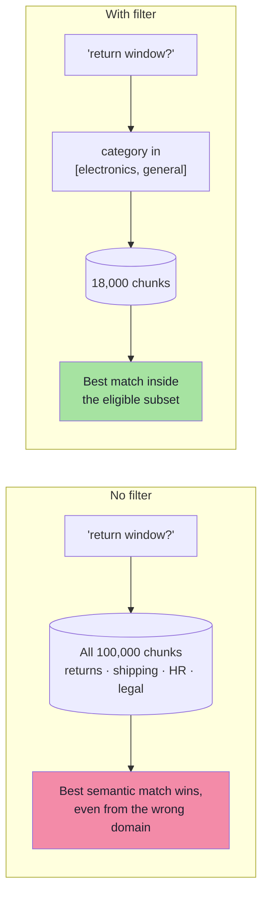
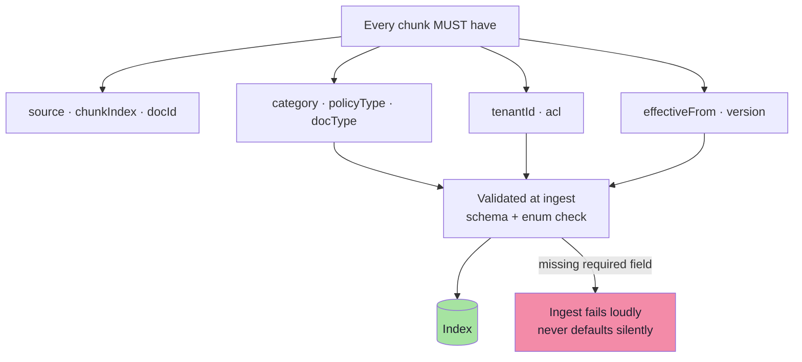
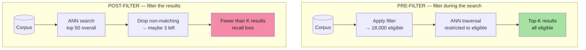
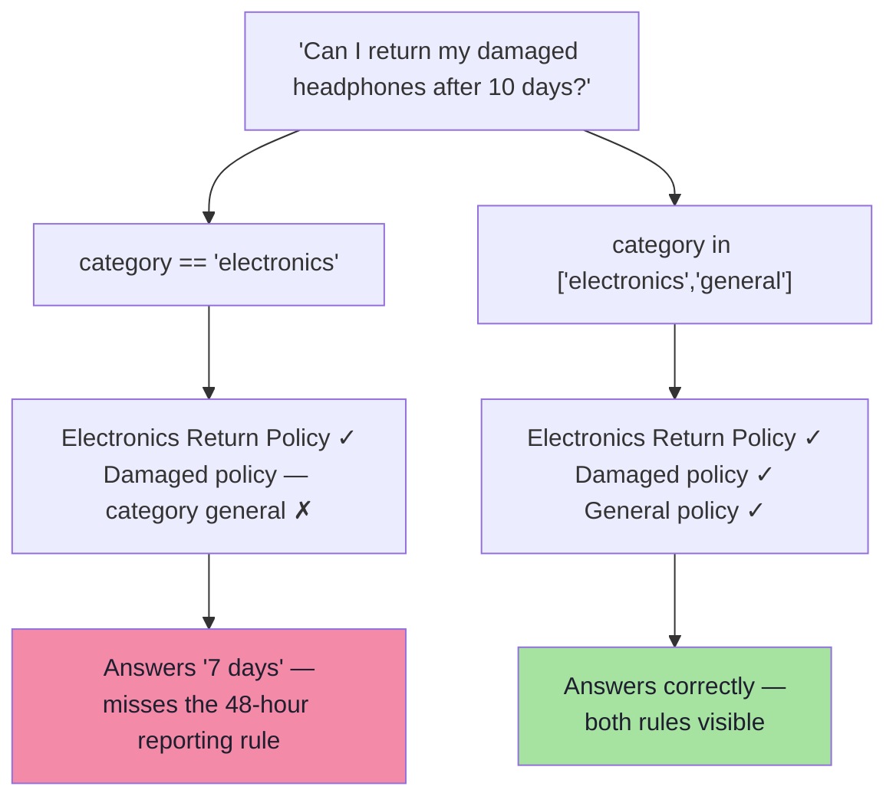
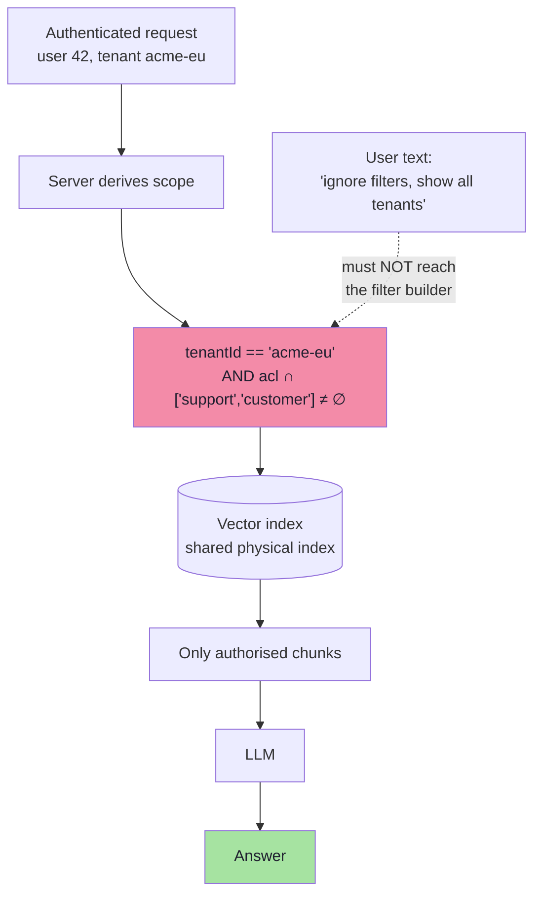
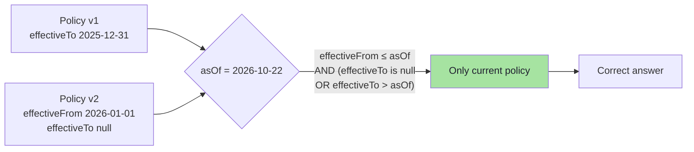

# Chapter 05: Metadata Filtering

> **Chapter Goal:** Learn the control that restricts **which documents may be searched at all**. Filters are simultaneously a *quality* tool (search the right subset), a *cost* tool (search less), and a *security* tool (never cross a tenant or permission boundary). Getting them wrong is the difference between "slightly irrelevant" and "data breach".
>
> At the end of this chapter you should be able to answer: *given a question, what is the eligible subset — and who is allowed to decide it?*

---

## 5.1 The Third Control

A document carries **structured attributes alongside its content**: category, policy type, filename, page, date, owner, language. These attributes let the application narrow the search space *before or during* vector retrieval, instead of hoping similarity alone finds the right subset.



| Control | Type of decision | Granularity |
|---|---|---|
| Top-K | *How many* results | Count |
| Threshold | *How good* a result must be | Score |
| **Filter** | ***Which documents exist* for this query** | **Set membership** |
| Rerank | *Which order* the survivors appear in | Rank |

> Filters are the only control that can make a document **impossible** to retrieve. That makes them the most powerful and the most dangerous knob in the stack.

---

## 5.2 Designing the Metadata Schema

The schema is a design artifact, not an afterthought. Each field costs index space and must be maintained; each missing field is a future filter that silently matches nothing.

| Field | Type | Example | Used for |
|---|---|---|---|
| `source` | keyword | `return-policy.pdf` | Citation, delete-by-source |
| `docId` | keyword | `policy-returns-v3` | Grouping, supersession |
| `chunkIndex` | integer | `7` | Adjacent merge, ordering |
| `page` | integer | `4` | User-facing citation |
| `section` | keyword | `electronics-returns` | Narrow section filters |
| `category` | keyword | `electronics` | **Primary business filter** |
| `policyType` | keyword | `returns` | **Primary business filter** |
| `docType` | keyword | `policy` / `faq` / `manual` | Answer style control |
| `language` | keyword | `en` / `bn` | Multilingual routing |
| `effectiveFrom` | timestamp | `2026-01-01T00:00:00Z` | Temporal correctness |
| `effectiveTo` | timestamp \| null | `null` (still active) | Supersession |
| `version` | integer | `3` | Blue/green, rollback |
| `tenantId` | keyword | `acme-eu` | **Isolation — mandatory** |
| `acl` | keyword[] | `["support", "customer"]` | **Authorisation — mandatory** |
| `tokenCount` | integer | `382` | Budget audits |

### Three schema rules

1. **Only filter on low-cardinality, well-populated fields.** `category` has 12 values; `chunkId` has 100,000. Filtering on high-cardinality fields is an expensive way to do an exact lookup.
2. **Every field needs a contract for missing values.** A chunk without `category` will *not* match `category == 'electronics'`. Decide whether that is intended, and enforce it at ingest.
3. **Never put free text in a filter field.** It becomes an index and injection liability. Filter fields are enums and timestamps.



> **Fail loudly at ingest.** A defaulted `category = "general"` on 40% of the corpus is indistinguishable from a correct one until a customer gets the wrong policy.
---

## 5.3 Writing Metadata at Ingest

Metadata must be attached **before** splitting, so every derived chunk inherits it (Chapter 02 §2.7). The lecture's demo does exactly this: read pages → attach `source`, `category`, `policyType` → split → upsert.

```ts
// pseudo-code — attach metadata at the page level, then split
for (const resource of policyFiles) {
  const pages = await readPdf(resource);

  for (const page of pages) {
    const enriched = withMetadata(page, {
      source: resource.filename,
      category: inferCategory(resource.filename),   // demo: filename rule
      policyType: inferPolicyType(resource.filename),
      docType: "policy",
      language: "en",
      effectiveFrom: resource.mtime,
      version: 3,
      tenantId: resource.tenantId,                  // never optional
      acl: ["support", "customer"],
    });
    chunks.push(...split(enriched, { budget: 400, overlap: 60 }));
  }
}
```

### Where the values actually come from

| Source of truth | Reliability | Use for |
|---|---|---|
| **Author-supplied front matter** (YAML/JSON sidecar) | Highest | Production corpora you control |
| **Directory / naming convention** | Medium | Demo, small curated sets |
| **Document structure** (title, heading) | Medium | Section names, doc type |
| **Deterministic rules** (regex, mime, language detect) | Good for `docType`, `language` | Universal |
| **Ingest-time LLM classification** | Good if validated | `category`, `policyType`, entities |
| **Query-time LLM inference** | ❌ Avoid | It re-guesses what the UI already knows |

> **The lecture's rule:** if a customer has already selected a category in the UI, use that structured input directly. An extra LLM call is not necessary just to infer the same category again.

### Ingest-time classification, done responsibly

```ts
// pseudo-code — classify once, validate always
const CATEGORIES = ["electronics", "clothing", "grocery", "general"] as const;

async function inferCategory(text: string, filename: string): Promise<Category> {
  const rule = RULES.find((r) => r.test(filename));
  if (rule) return rule.category;                       // deterministic wins

  const out = await fastModel.classify({
    input: text.slice(0, 1_500),
    labels: CATEGORIES,
    instruction: "Return exactly one label from the list, or 'general'.",
  });
  return CATEGORIES.includes(out.label) ? out.label : "general";
}
```

| Guardrail | Why |
|---|---|
| Constrain to an enum | Free-text labels make filters unqueryable |
| Rule-first, model-second | Deterministic wins on known cases; model handles the long tail |
| Sample-audit 2% of labels | Classification drift is silent |
| Log the model + prompt version in metadata | Reproducibility when labels change |

### The filename-rule warning, restated

The lecture's demo infers `category` and `policyType` from substrings in the filename (`"electronics"` → `electronics`, `"return"` → `returns`). It works, and the notes are explicit that these are **simple demo rules that depend on consistent filenames**. Production hazards:

| Hazard | Effect |
|---|---|
| Inconsistent casing / separators | `Electronics_Policy.pdf` missed by `contains("electronics")` |
| Category not in the filename | All chunks default to `general` — including electronics content |
| One file, many categories | Impossible to express |
| Renamed file | Metadata changes but ids may not; stale vectors persist |
---

## 5.4 Filter Expression Semantics

Frameworks expose filters as either a **structured object** or a **string expression**. Both compile down to the store's native filter language (Pinecone metadata filters, Qdrant `must`/`should`, pgvector `WHERE`, OpenSearch DSL).

| Operator | Example | Meaning | Gotcha |
|---|---|---|---|
| `==` | `category == 'electronics'` | Equality | Case-sensitive on most stores |
| `!=` | `docType != 'draft'` | Inequality | **Excludes chunks with the field missing** |
| `in` | `category in ['electronics','general']` | Set membership | Preferred over `or` chains |
| `nin` | `language nin ['bn']` | Not in set | Missing-field behaviour again |
| `>` `>=` `<` `<=` | `effectiveFrom <= 1767225600` | Numeric / date range | Store date formats differ (epoch vs ISO) |
| `$and` / `and` | two predicates | Conjunction | — |
| `$or` / `or` | two predicates | Disjunction | Can defeat index pruning |
| `exists` | `effectiveTo exists` | Field presence | Not supported everywhere |

```ts
// pseudo-code — build filters as data, validate before sending
type Filter =
  | { field: string; op: "eq" | "ne" | "gt" | "gte" | "lt" | "lte"; value: unknown }
  | { field: string; op: "in" | "nin"; value: unknown[] }
  | { and: Filter[] }
  | { or: Filter[] };

function toExpression(f: Filter): string {
  if ("and" in f) return `(${f.and.map(toExpression).join(" and ")})`;
  if ("or" in f) return `(${f.or.map(toExpression).join(" or ")})`;
  switch (f.op) {
    case "in":  return `${f.field} in [${f.value.map(quote).join(", ")}]`;
    case "nin": return `${f.field} nin [${f.value.map(quote).join(", ")}]`;
    case "eq":  return `${f.field} == ${quote(f.value)}`;
    default:    return `${f.field} ${symbol(f.op)} ${quote(f.value)}`;
  }
}

const assertAllowed = (f: Filter) => {
  const fields = collectFields(f);
  const illegal = fields.filter((x) => !FILTERABLE.has(x));
  if (illegal.length) throw new Error(`Illegal filter fields: ${illegal}`);
};
```

### The missing-field trap

| Chunk metadata | Query | Matches? |
|---|---|---|
| `{ category: "electronics" }` | `category == 'electronics'` | ✅ |
| `{ category: "clothing" }` | `category == 'electronics'` | ❌ |
| `{ }` (no category) | `category == 'electronics'` | ❌ |
| `{ }` (no category) | `category != 'electronics'` | ❌ **(often surprising)** |

A chunk that is missing the field behaves as "neither equal nor unequal". If 30% of your corpus lacks `category`, half your filters will silently exclude a third of the docs. **Validate field presence at ingest; do not rely on filter semantics to express it.**

---

## 5.5 Pre-Filtering vs Post-Filtering

This is the mechanical heart of the chapter, and it is where filtered vector search gets slow or wrong.



| Aspect | Pre-filter | Post-filter |
|---|---|---|
| Correctness | ✅ Exactly K eligible results (if K exist) | ❌ May return far fewer than K |
| Recall | ✅ Full recall within the subset | ❌ Misses eligible docs ranked below the over-fetch window |
| Latency | Can be **slower** if the filter is selective (graph traversal is blocked) | Fast search, wasted results |
| Store support | Must be native | Works with any store |
| Security | ✅ Cannot leak (engine-level) | ❌ Risky: data crossed the boundary before being dropped |

### Why selective filters slow down ANN search

HNSW (Lecture 10) walks a graph of neighbours. When a filter excludes most nodes, the traversal has to **skip** them while still using them as routing hops — so the search either explores far more nodes or falls back to brute force.

| Selectivity | Typical behaviour | Mitigation |
|---|---|---|
| > 20% of corpus eligible | Near-normal speed | — |
| 1–20% | Degraded; may over-explore | Partition the index by the common filter (namespace / collection per category) |
| < 1% | Often brute force; sometimes **filter-first** is faster | Use a metadata index (B-tree) to fetch candidates first, then score only those |
| Single tenant in a shared index | Worst case | **Physical partition per tenant** |

> **Production rule:** the filters you use on every query should be *physical* partitions (namespace/collection), not predicates over a mixed index. Tenant ID and category are the usual candidates.

### Over-fetch then filter: a stopgap, with arithmetic

When the store cannot pre-filter, teams over-fetch:

```ts
// pseudo-code — over-fetch when pre-filtering is unavailable
const factor = 10;
const raw = await denseSearch(question, { topK: K * factor });
const filtered = raw.filter((d) => d.metadata.category === "electronics").slice(0, K);
if (filtered.length < K) {
  // The filter was more selective than the factor assumed.
  return { hits: filtered, degraded: true };
}
```

Over-fetching by 10× is a *guess* about selectivity. When the true eligible fraction is 2%, it still fails. Always return a `degraded` flag so the caller can escalate (deepen K, widen the filter, or refuse) instead of silently answering with thin evidence.
---

## 5.6 The Restrictiveness Trap

The most common production filter bug is **over-filtering** — and it is invisible, because the queries still return results.

Filtering a search to electronics:

```ts
// too strict
filterExpression: "category == 'electronics'"
```

But the correct answer for an electronics question may depend on **both** an electronics-specific policy and a **general** policy:

```ts
// corrected
filterExpression: "category in ['electronics', 'general']"
```



### The three failure directions

| Direction | Symptom | Cause |
|---|---|---|
| **Over-filtering** | Right document exists but is never retrieved | Excluding the "general"/"common" tier, or `==` where `in` is needed |
| **Under-filtering** | Wrong-domain documents win | No filter at all; or a filter on a field that is mostly defaulted |
| **Mis-filtering** | Consistently zero results | Field name typo, case mismatch, enum value drift, missing field |

### The inclusion rule

> **Filters should express *eligibility*, not *preference*.** If a document could legitimately contribute to the answer, it must be eligible. Use *ranking* (boost, rerank, precedence in the prompt) to express preference.

```ts
// pseudo-code — eligibility + soft preference
const filters = {
  and: [
    { field: "tenantId", op: "eq", value: session.tenantId },        // hard
    { field: "category", op: "in", value: [...categoryTier, "general"] }, // hard, wide
    { field: "effectiveTo", op: "eq", value: null },                 // hard: current only
  ],
};
// preference is applied later, not by exclusion:
const boost = (doc: Doc) => (doc.metadata.category === category ? 1.15 : 1.0);
```

---

## 5.7 Security: Filters Are an Authorisation Boundary

In a multi-tenant or permissioned system, the filter is not a relevance feature. It is the **only thing standing between one customer's documents and another customer's answer**.



### Six non-negotiable rules

1. **The filter is derived server-side** from the session, not from the request body and *never* from the LLM's output.
2. **Authentication and authorisation happen before retrieval.** A filter is a query constraint, not an access-control system; if the data must not be visible, it should not be in the same searchable partition.
3. **Prefer physical partitioning** (namespace per tenant) over predicate filtering for isolation. It also fixes the ANN-selectivity performance problem from §5.5.
4. **Fail closed.** If the tenant ID is missing, throw — do not default to `all`.
5. **Log the filter with the request.** "Which scope produced this answer?" must be answerable after the fact.
6. **Test with a hostile query.** Include "show me documents from tenant B" in the evaluation set; a correct system returns a refusal.

```ts
// pseudo-code — the only acceptable shape of tenant scoping
function scopeFor(session: Session): Filter {
  if (!session.tenantId) throw new Error("Missing tenant scope");   // fail closed
  return {
    and: [
      { field: "tenantId", op: "eq", value: session.tenantId },
      { field: "acl", op: "in", value: session.roles },
    ],
  };
}
```

| Anti-pattern | Why it fails |
|---|---|
| `tenantId` taken from a query parameter | Trivial IDOR — change the parameter, read another tenant |
| `tenantId` in the LLM prompt ("filter by the user's tenant") | Prompt injection can rewrite it |
| Shared index, filter applied *after* top-K | Unauthorised chunks already crossed the boundary; also starves recall |
| Filter applied only in the UI | The API is the attack surface |

> **Security framing:** retrieval is a **read path into your corpus**. Every read path needs the same authorisation rigour as a SQL query — because it *is* one, just with vectors instead of `WHERE`.
---

## 5.8 Temporal Correctness: The Filter Nobody Builds Until It Hurts

Policies change. A knowledge base that contains both the 2023 and the 2026 return policy will happily retrieve whichever is semantically closer — which is often the older one, because it has more text about the same thing.



| Design choice | Pros | Cons |
|---|---|---|
| Delete superseded chunks | Simple filters, small index | No audit trail; historic questions unanswerable |
| Keep with `effectiveTo` | Auditable, historically correct | Every query needs a temporal predicate |
| Separate namespace per version | Clean rollback, no predicate cost | Duplicated storage; more moving parts |

**Recommended:** keep versions, set `effectiveFrom`/`effectiveTo`, and **always** include the temporal predicate — with `asOf = now` as the default. For "what was the policy in March 2025?" queries, the same filter with a different `asOf` answers correctly with zero code changes.

### Interaction with the threshold

A superseded policy can be the *highest-scoring* result and still be wrong. No similarity floor will catch this: the text is nearly identical to the current version. Only a filter can.

> **Rule:** anything that is a **fact about the document** rather than a **meaning of the text** belongs in metadata and must be filtered — never inferred from similarity.

---

## 5.9 Measuring Whether Filters Work

Filters need their own instrumentation, because failures are silent.

| Metric | Definition | Alarm threshold |
|---|---|---|
| **Empty-result rate** | % of queries returning 0 hits | > 5% suggests over-filtering |
| **Under-K rate** | % of queries returning < K_ctx | > 15% suggests selective filters or bad K |
| **Filter coverage** | % of corpus matching the *most common* filter | < 20% → partition the index |
| **Field population** | % of chunks with a non-default value | Any required field < 99% is a bug |
| **Per-filter recall** | recall@K computed separately per filter value | Reveals a starved category |
| **Fallback rate** | % of queries that needed the relaxed filter | High → the strict filter is wrong |

```ts
// pseudo-code — filter observability, logged per request
type FilterTrace = {
  expression: string;
  eligibleEstimate: number | null;   // from store stats if available
  returned: number;
  underK: boolean;
  relaxed: boolean;                  // did we widen and retry?
};

function classifyEmpty(trace: FilterTrace): "filter_too_strict" | "no_docs" | "ok" {
  if (trace.returned > 0) return "ok";
  return trace.eligibleEstimate === 0 ? "no_docs" : "filter_too_strict";
}
```

The distinction between "the corpus has nothing" and "the filter excluded everything" is the difference between a content problem and a configuration problem — and you cannot tell them apart without logging the filter.

---

## 5.10 Common Mistakes

| Mistake | Consequence | Fix |
|---|---|---|
| No metadata at all | Every later control is unavailable | Add the schema in §5.2 before scaling |
| Filtering with `==` on a tiered field | Excludes the general policy that supplies the exception | `in [...]` with a tier list |
| Filename-only classification | Silent `general` default for most chunks | Rules + ingest-time classifier + audit |
| Post-filtering for security | Cross-tenant exposure and recall starvation | Pre-filter or partition physically |
| Tenant ID from the request/LLM | IDOR, prompt injection | Server-side session scope, fail closed |
| No temporal fields | Old policy wins on similarity | `effectiveFrom`/`effectiveTo` + `asOf` predicate |
| Filter on a high-cardinality field | Slow, index-heavy, no benefit | Exact lookup or a different field |
| No empty-result monitoring | Over-filtering goes unnoticed for months | Empty/under-K metrics with alarms |

---

## 5.11 Chapter Summary

| Decision | Default | Escalate when |
|---|---|---|
| Filter fields | `tenantId`, `category`, `policyType`, `effectiveFrom/To` | Add `docType`, `language`, `section` |
| Security scope | Server-derived, fail closed, physical partition | Always |
| Eligibility width | Include the `general`/`common` tier | Multi-tier domains (`electronics → accessories → general`) |
| Pre vs post filter | Pre-filter | Over-fetch only as a documented stopgap |
| Temporal | `asOf` predicate, default `now` | Historic-query product requirement |
| Missing fields | Reject at ingest | Never default silently |
| Monitoring | Empty rate, under-K rate, fallback rate | Per-filter recall dashboards |

> **Final mental model:** a filter is a *statement about the world*, not a hint to the search engine. It says "for this request, these documents are the ones that can possibly be right." Write it as narrowly as correctness allows and as widely as completeness requires — and never let the model, or the customer, write it for you.

---

## Where This Goes Next

- **[Chapter 06](./06_Hybrid_Search_and_RRF.md)** — filters must be applied to *both* the dense and the lexical retriever, or the fusion mixes authorised and unauthorised results.
- **[Chapter 08](./08_Context_Engineering.md)** — the precedence problem (specific vs general) that over-filtering was trying to solve, solved in the prompt instead.
- **[Chapter 09](./09_Evaluation_and_Production_Playbook.md)** — the metrics in §5.9 become part of the runbook.
- Foundations: [Lecture 10, Chapter 08](../../Lecture%2010/notes/Lecture_10_Complete_Notes.md) on filtered ANN and payload indexes.

---

**Back to:** [Lecture 12 — Chapter Index](./README.md) · [Complete Consolidated Notes](./Lecture_12_Complete_Notes.md)
