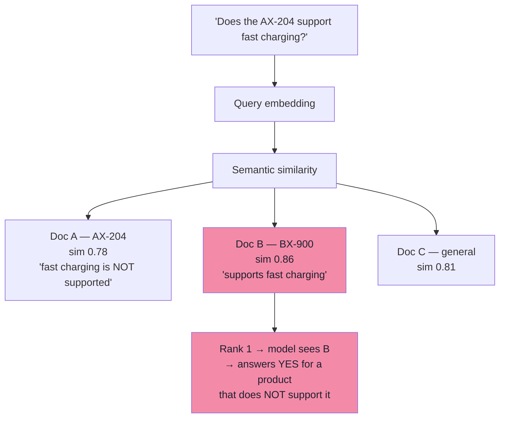
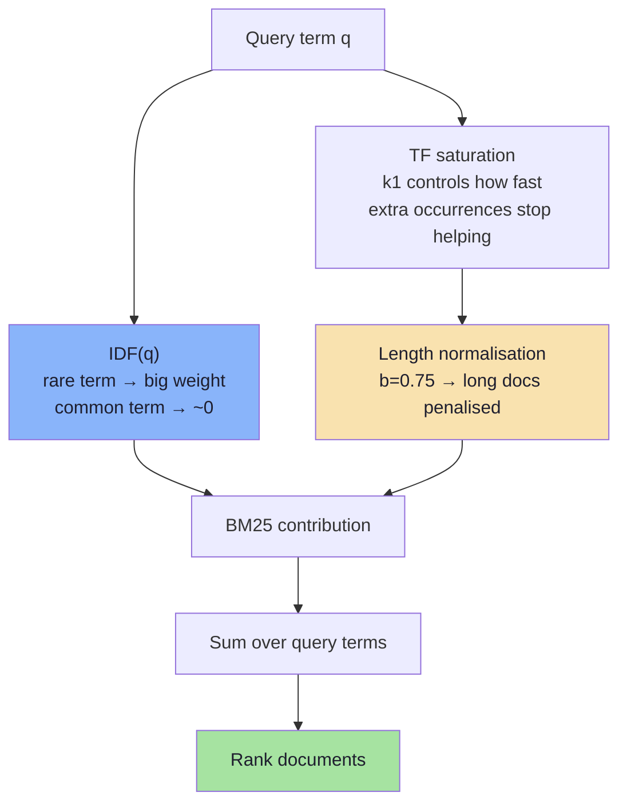
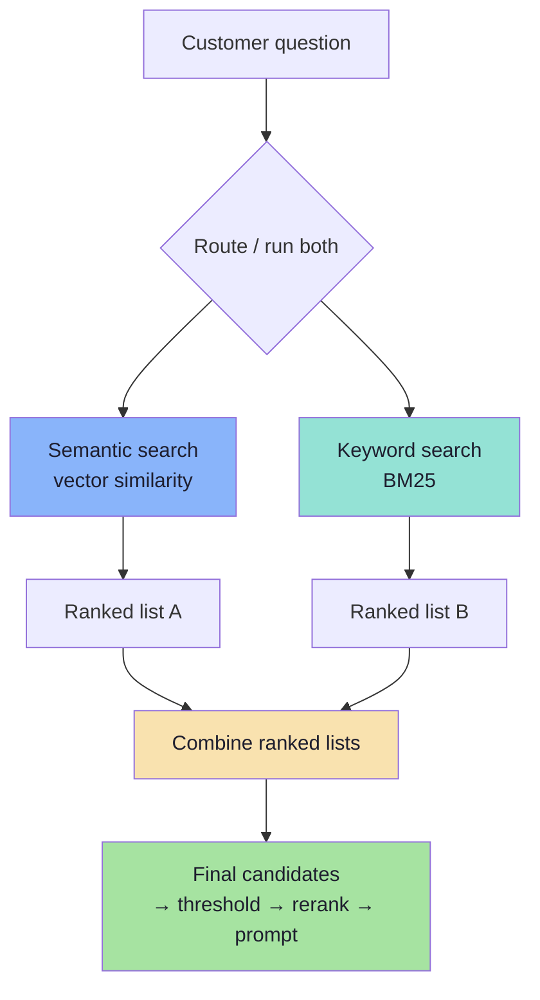
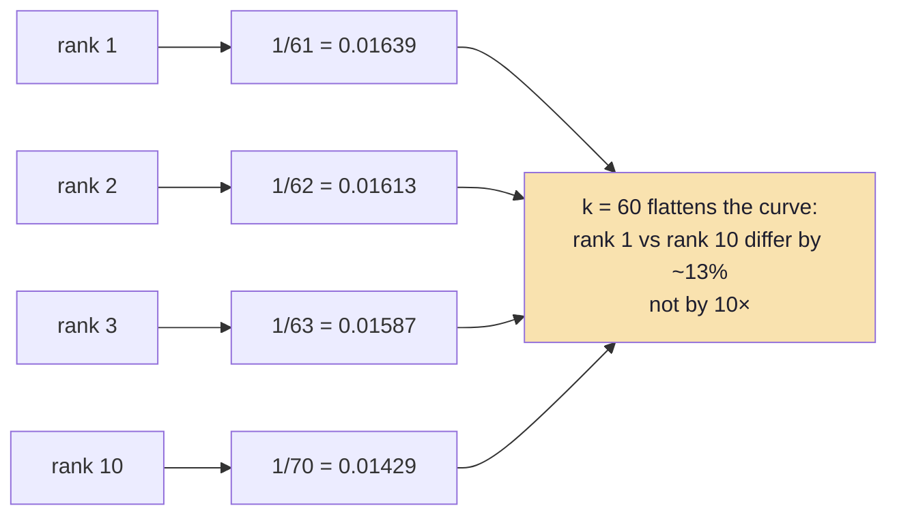
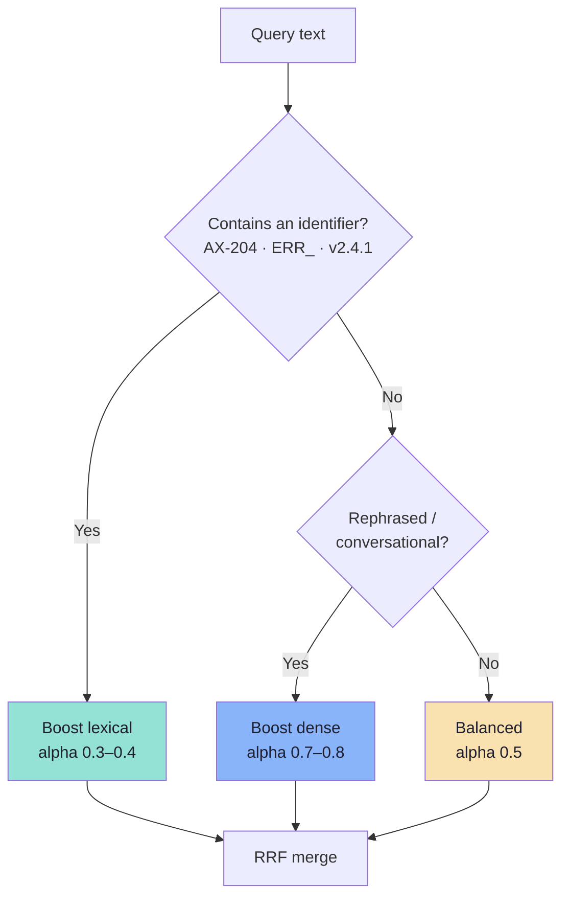

# Chapter 06: Hybrid Search — Dense, Lexical and RRF

> **Chapter Goal:** Fix the failure mode that embeddings structurally cannot fix: **exact terms**. A dense vector represents *meaning*, and meaning is precisely what blurs `AX-204` into `BX-900`. This chapter adds lexical retrieval (BM25), explains why raw scores cannot be added, and derives Reciprocal Rank Fusion — the equation on the board.
>
> At the end of this chapter you should be able to answer: *why did dense search return the wrong product manual, and how do I combine two ranked lists without pretending their scores are comparable?*

---

## 6.1 The Case That Breaks Dense Retrieval

A customer asks:

> **"Does the AX-204 wireless headphone support fast charging?"**

| Document | Excerpt |
|---|---|
| **A — AX-204 Product Manual** | Model **AX-204** supports standard USB-C charging. **Fast charging is not supported.** |
| **B — BX-900 Product Manual** | These wireless headphones support **fast charging** and provide five hours of playback after ten minutes of charging. |
| **C — General Charging Guide** | Wireless headphones supporting **fast charging** typically require a compatible adapter. |

An embedding search may rank **Document B first** — it is the densest cluster of `wireless headphones`, `fast charging`, `charging`. But the customer asked about **AX-204**, and the answer for AX-204 is *no*.



**Embeddings capture semantic relationships but are not guaranteed to preserve arbitrary identifiers reliably.** `AX-204` and `BX-900` are not "similar meanings"; they are arbitrary strings. To a model trained on natural language, they are both "a product code in a headphone manual".

---

## 6.2 Why Dense Retrieval Loses Exact Terms

Three mechanisms, all structural:

| Mechanism | What happens | Example |
|---|---|---|
| **Subword tokenization** | Rare identifiers are split into pieces; near-identical pieces collapse | `AX-204` → `AX`, `-`, `204`; `BX-204` shares two of three |
| **Pooling / compression** | One vector for 400 tokens; the identifier is a few dimensions among thousands | The SKU contributes almost nothing to the final direction |
| **Contrastive training objective** | The model is trained to place *topically similar* text together | "Headphone manual mentioning fast charging" clusters, regardless of model number |

Consequences you will observe in production:

| Query type | Dense behaviour | Example |
|---|---|---|
| Product codes / SKUs | ❌ Frequently wrong | `AX-204` vs `BX-900` |
| Error codes | ❌ Weak | `ERR_CONN_RESET` vs `ERR_CONN_REFUSED` |
| Version numbers | ❌ Weak | `v2.4.1` vs `v2.4.10` |
| Person / company names | ⚠️ Inconsistent | Uncommon surnames |
| Legal clause numbers | ❌ Weak | "Section 4.2(b)" |
| Paraphrase | ✅ Strong | "money back" ≈ "refund" |
| Conceptual questions | ✅ Strong | "what happens if my parcel is late?" |

> **The asymmetry is the point:** dense retrieval is excellent exactly where lexical retrieval is weak, and vice versa. That is why hybrid search is not a fad — it is the only way to cover both.
---

## 6.3 Lexical Retrieval and BM25

A lexical (keyword) retriever matches **terms that literally appear** in the query and the document. The standard ranking function is **BM25** (Best Matching 25), a probabilistic term-weighting model with two ideas that make it far better than raw term counting:

1. **Term frequency saturates.** The 10th occurrence of a word adds much less than the 2nd.
2. **Document length is normalised.** A long document should not win just because it contains more words.

### The formula

For a document $D$ and query $Q = \{q_1, \dots, q_n\}$:

$$\text{BM25}(D,Q) = \sum_{i=1}^{n} \text{IDF}(q_i) \cdot \frac{f(q_i, D)\,(k_1 + 1)}{f(q_i, D) + k_1\left(1 - b + b\,\frac{|D|}{\text{avgdl}}\right)}$$

with the standard smoothed inverse document frequency:

$$\text{IDF}(q_i) = \ln\left(1 + \frac{N - n(q_i) + 0.5}{n(q_i) + 0.5}\right)$$

| Symbol | Meaning | Typical value |
|---|---|---|
| $f(q_i,D)$ | Term frequency of $q_i$ in $D$ | — |
| $\lvert D \rvert$ | Length of $D$ in tokens | — |
| $\text{avgdl}$ | Average document length in the collection | — |
| $N$ | Number of documents | — |
| $n(q_i)$ | Number of documents containing $q_i$ | — |
| $k_1$ | Term-frequency saturation | **1.2 – 2.0** |
| $b$ | Length-normalisation strength | **0.75** |

### Reading the formula like an engineer



| Parameter | Effect of raising it | Effect of lowering it |
|---|---|---|
| $k_1$ | Longer documents keep gaining on repetition | Repetition saturates faster |
| $b \to 1$ | Strong length penalty | Length ignored ($b = 0$) |

### A worked example on our three documents

Query terms: `ax204`, `fast`, `charging`. Three documents (N = 3), so:

| Term | $n(q_i)$ | $\text{IDF}$ | Insight |
|---|---|---|---|
| `ax204` | 1 | $\ln(1 + 2.5/1.5) \approx 0.98$ | **Rare → dominant weight** |
| `fast` | 3 | $\ln(1 + 0.5/3.5) \approx 0.13$ | Common → almost ignored |
| `charging` | 3 | $\ln(1 + 0.5/3.5) \approx 0.13$ | Common → almost ignored |

With $k_1 = 1.2$, $b = 0.75$, and documents near average length (length factor $\approx 1$):

| Document | `ax204` | `fast` | `charging` | BM25 |
|---|---|---|---|---|
| **A — AX-204 manual** | 1 × ≈1.00 → **0.98** | 0 | 2 × ≈1.38 → 0.18 | **≈ 1.16** |
| B — BX-900 manual | 0 | 0.13 | 0.13 | ≈ 0.27 |
| C — general guide | 0 | 0.13 | 0.13 | ≈ 0.27 |

**The identifier carries roughly 7× the weight of the topical words.** That is exactly the behaviour dense retrieval lacks, and it is why lexical search is the correct tool for codes.

### The analyzer is the real configuration

BM25 is only as good as the tokenizer that feeds it:

| Decision | Effect | Recommendation |
|---|---|---|
| Lowercasing | `AX-204` = `ax-204` | Always |
| Hyphen handling | Index both `ax-204` **and** `ax204` | Emit both token variants |
| Stemming | `returns` → `return` | Good for prose; risky for codes |
| Stopwords | Drops `not`, `no`, `within` | **Never drop negation words in policy corpora** |
| N-grams | Helps partial SKUs | Character n-grams (3–5) for identifiers |
| Language | Bengali/English mixing | Per-language analyzers, or a multilingual tokenizer |

> **The stopword trap:** removing `not` from *"fast charging is **not** supported"* turns the document into its opposite. In policy and compliance corpora, keep negation terms in the index.
---

## 6.4 The Two Retrievers, Side by Side

| | **Semantic (dense)** | **Keyword (sparse / BM25)** |
|---|---|---|
| Representation | 1 vector per chunk, dense dimensions | Term → weight dictionary |
| Matches | Concepts and meaning | Terms that appear |
| "money back" ↔ "refund" | ✅ | ❌ (unless synonyms are configured) |
| `AX-204` | ❌ may return BX-900 | ✅ exact |
| Typos | ✅ tolerates | ❌ misses |
| Negations | ⚠️ often blurred | ✅ literal |
| New / rare vocabulary | ⚠️ needs training data | ✅ instant |
| Cost | Embedding per query + ANN search | Inverted-index lookup |
| Index size | Large (dimensions × 4 bytes × chunks) | Small (postings lists) |
| Update cost | Re-embed changed chunks | Re-index changed chunks |



> **Key idea (from the board):** *semantic search helps find related meaning; keyword search helps preserve exact terms; RRF brings their rankings together.*

---

## 6.5 Why You Cannot Just Add the Scores

Semantic search might return cosine similarity in $[0,1]$; BM25 returns an unbounded, corpus-dependent number (often 0–30). Adding them:

| Document | Cosine | BM25 | Naive sum | Problem |
|---|---|---|---|---|
| A | 0.62 | 12.4 | **13.02** | BM25's scale dominates entirely |
| B | 0.91 | 2.1 | 3.01 | The better *semantic* match loses |
| C | 0.55 | 0.3 | 0.85 | — |

The sum is not a fusion; it is **BM25 with a rounding error contributed by cosine**. And normalising is not free either:

| Normalisation | Formula | Weakness |
|---|---|---|
| Min–max (per list) | $(s - s_{min})/(s_{max} - s_{min})$ | Destroyed by one outlier; the top score always becomes 1.0, losing absolute information |
| Z-score (per list) | $(s - \mu)/\sigma$ | Assumes unimodal scores; still corpus-dependent |
| Rank-based | $1/\text{rank}$ | Ignores score gaps entirely — and is the basis of RRF |

Fusion methods that need comparable scores require **calibration across the whole corpus**, which drifts whenever either retriever, the embedder, or the corpus changes. Rank-based fusion sidesteps the problem entirely.

---

## 6.6 Reciprocal Rank Fusion (RRF)

RRF combines **positions in ranked lists** rather than raw scores:

$$\text{RRF}(d) = \sum_{i=1}^{m} \frac{1}{k + \text{rank}_i(d)}$$

| Symbol | Meaning |
|---|---|
| $m$ | Number of result lists (2 in our example: semantic and keyword) |
| $\text{rank}_i(d)$ | Document $d$'s position in the $i$-th list (1-based) |
| $k$ | A **smoothing constant**, conventionally **60** — *not* the Top-K setting |
| Missing document | Contributes nothing for that list (no penalty, no rank) |

### Why the formula has this shape



Two properties follow directly from $k = 60$:

1. **Damping.** Without $k$, rank 1 earns 1.0 and rank 10 earns 0.1 — a 10× gap. With $k = 60$, the gap is 0.0164 vs 0.0143 — about **13%**. A document that both retrievers agree on beats a document that one retriever loves and the other ignores. *Agreement is evidence.*
2. **Scale independence.** Only ranks are used, so cosine, BM25 and any future retriever can be fused with no normalisation at all.

### The board's worked calculation

The board computes, for a document appearing **1st in the keyword list** and **3rd in the semantic list**:

$$\text{RRF}(d_A) = \frac{1}{60+1} + \frac{1}{60+3} = 0.01639 + 0.01587 = 0.03226$$

### A full worked fusion

Five candidate documents, two retrievers:

| Document | Semantic rank | BM25 rank | RRF calculation | **RRF score** |
|---|---|---|---|---|
| **A** (AX-204) | 3 | 1 | $1/63 + 1/61$ | **0.03227** |
| B (BX-900) | 1 | 4 | $1/61 + 1/64$ | 0.03202 |
| E (accessory guide) | 2 | 3 | $1/62 + 1/63$ | 0.03200 |
| C (general guide) | 5 | 2 | $1/65 + 1/62$ | 0.03151 |
| D (unrelated) | 4 | 5 | $1/64 + 1/65$ | 0.03101 |

**Document A wins** — even though it was only *third* in the semantic list. Its exact-match status in BM25 plus respectable semantic relevance beats B's semantic win. This is precisely the behaviour the AX-204 question requires.

> **What RRF does not do:** it does not improve either retriever's recall. If a document appears in **neither** list, RRF cannot invent it. Fusion redistributes rank; it does not create candidates.
---

## 6.7 Fusion Alternatives Worth Knowing

RRF is the default because it is scale-free. Two other families exist, and each is right in a specific situation.

### Weighted score fusion

$$\text{score}(d) = \alpha \cdot \hat{s}_{\text{dense}}(d) + (1-\alpha) \cdot \hat{s}_{\text{lexical}}(d)$$

where $\hat{s}$ denotes a **per-query normalised** score.

| $\alpha$ | Behaviour | Use when |
|---|---|---|
| 1.0 | Dense only | Pure conceptual questions |
| 0.7 | Dense-leaning | Default conversational support |
| 0.5 | Balanced | Mixed corpus |
| 0.3 | Lexical-leaning | Catalogue, code, compliance |
| 0.0 | Lexical only | Exact lookup |

```ts
// pseudo-code — weighted fusion with per-query min–max normalisation
function minMax(xs: number[]): number[] {
  const lo = Math.min(...xs), hi = Math.max(...xs);
  return hi === lo ? xs.map(() => 1) : xs.map((x) => (x - lo) / (hi - lo));
}

function weightedFuse(dense: Hit[], lexical: Hit[], alpha = 0.7): Hit[] {
  const d = new Map(dense.map((h, i) => [h.id, minMax(dense.map((x) => x.score))[i]]));
  const l = new Map(lexical.map((h, i) => [h.id, minMax(lexical.map((x) => x.score))[i]]));
  const ids = new Set([...d.keys(), ...l.keys()]);
  return [...ids]
    .map((id) => ({ id, score: alpha * (d.get(id) ?? 0) + (1 - alpha) * (l.get(id) ?? 0) }))
    .sort((a, b) => b.score - a.score);
}
```

| Problem with weighted fusion | Detail |
|---|---|
| Normalisation leaks the top score | The best document always normalises to 1.0, even if it is bad |
| Outlier sensitivity | One 0.98 in a list of 0.4s compresses everything else |
| Absolute information lost | You can no longer apply an absolute relevance floor meaningfully |
| Requires tuning | $\alpha$ is corpus- and query-type-specific |

> **Rule:** use weighted fusion only when you have a labelled set to tune $\alpha$ against. Otherwise RRF is strictly safer.

### Learned sparse retrieval (SPLADE and friends)

Instead of BM25's literal terms, a model predicts a **sparse weight vector over vocabulary terms** (including expansions). This gives lexical-style exact matching *plus* semantic expansion, stored in the same vector database as a sparse vector.

| Approach | Exact terms | Semantic expansion | Infra |
|---|---|---|---|
| BM25 | ✅ | ❌ | Inverted index |
| Dense | ❌ | ✅ | Vector index |
| SPLADE | ✅ | ✅ (learned) | Sparse vector index |
| Hybrid (dense + BM25 + RRF) | ✅ | ✅ | Two indexes |

Hybrid with RRF remains the pragmatic choice: no training, no new model, works with any vector store that offers metadata + a separate lexical index (or store-native hybrid).

### Store-native vs application-side fusion

| Shape | How it works | Trade-off |
|---|---|---|
| **Store-native hybrid** | One query API, store runs both retrievers and fuses internally (Qdrant prefetch + fusion, Weaviate `alpha`, Pinecone sparse+dense, OpenSearch RRF) | Fewest round trips; less control over the fusion constants |
| **Application-side fusion** | Two calls in parallel, merge in your service | Full control, easy to trace, testable; two network hops |
| **Two-phase** | Lexical filter → dense rerank within the subset | Strong for identifier-heavy corpora; complex |

For a first production system, **application-side fusion with RRF** is the better choice: it is observable, unit-testable, and you can swap either retriever without touching the other.

---

## 6.8 Implementation: A Fusion Function You Can Trust

```ts
// pseudo-code — hybrid retrieval with RRF
type Hit = { id: string; score: number; text: string; metadata: Record<string, unknown> };

const RRF_K = 60;

function rrfMerge(lists: Hit[][], k = RRF_K, limit = 20): Hit[] {
  const byId = new Map<string, { hit: Hit; rrf: number; seen: number }>();

  lists.forEach((list) => {
    list.forEach((hit, i) => {
      const rank = i + 1;
      const entry = byId.get(hit.id) ?? { hit, rrf: 0, seen: 0 };
      entry.rrf += 1 / (k + rank);
      entry.seen += 1;
      byId.set(hit.id, entry);
    });
  });

  return [...byId.values()]
    .sort((a, b) => b.rrf - a.rrf || b.seen - a.seen)   // ties → agreement count
    .slice(0, limit)
    .map((e) => ({ ...e.hit, score: e.rrf }));          // score is now RRF, not similarity
}

async function hybridSearch(query: string, filters: Filter, kCandidates = 20) {
  const [dense, lexical] = await Promise.all([
    denseSearch(query, { topK: kCandidates, filters }),
    bm25Search(query, { topK: kCandidates, filters }),
  ]);
  return rrfMerge([dense, lexical], RRF_K, kCandidates);
}
```

Five implementation requirements that are easy to miss:

| Requirement | Why it matters |
|---|---|
| **Same id space** | Fusion joins on `id`; if dense ids are UUIDs and lexical ids are file paths, nothing merges |
| **Same filters on both retrievers** | Otherwise you fuse authorised with unauthorised results (Ch. 05 §5.7) |
| **Parallel calls** | Sequential calls double the retrieval latency for no benefit |
| **Deterministic tie-break** | RRF produces ties; break by agreement count, then by dense score, then by id |
| **Rename the score** | After fusion, `score` is an RRF value — do **not** compare it to `0.70` |

> **The score-reuse bug:** teams routinely keep the field name `score` through the pipeline, then apply the pre-hybrid similarity threshold to RRF values. RRF scores are around `0.016–0.033`; a `0.70` floor silently drops everything. Keep separate fields: `denseScore`, `lexicalScore`, `rrfScore`, `rerankScore`.
---

## 6.9 Query Routing and Weighting

Not every query deserves equal treatment. Cheap routing rules recover most of the benefit of tuning:



| Signal | Detection | Adjustment |
|---|---|---|
| Identifier present | Regex `[A-Z]{2,}-\d{2,}` or `ERR_[A-Z_]+` | Weight lexical higher; ensure analyzers index the exact form |
| Quoted phrase | `"..."` in the query | Lexical phrase match |
| Very short query | ≤ 3 tokens | Lexical helps; dense has little context |
| Long natural-language question | > 15 tokens | Dense helps; lexical's IDF noise grows |
| Non-English query | Language detect | Route to a matching analyzer or a multilingual embedder |

```ts
// pseudo-code — cheap, explainable routing
function alphaFor(query: string): number {
  if (/\b[A-Z]{2,}-\d{2,}\b|\bERR_[A-Z_]+\b/.test(query)) return 0.35;
  if (query.startsWith('"') && query.endsWith('"')) return 0.4;
  if (countTokens(query) <= 3) return 0.45;
  return 0.7;
}
```

> Routing is a *ranking* decision, not an eligibility decision. Never remove a retriever entirely — a 0.35/0.65 split still lets semantic evidence win when it is strong.
---

## 6.10 Evaluating Hybrid Retrieval

Hybrid search must be evaluated **by query class**, because its benefit is class-specific. Aggregate recall hides the whole story.

| Query class | Example | Dense recall@10 | Hybrid recall@10 | Improvement |
|---|---|---|---|---|
| Conceptual | "money back if I change my mind" | 0.92 | 0.93 | +1 |
| Policy with exception | "damaged headphones after 10 days" | 0.71 | 0.88 | **+17** |
| Exact identifier | "AX-204 fast charging" | 0.38 | 0.96 | **+58** |
| Numeric / version | "v2.4.1 release notes" | 0.44 | 0.91 | **+47** |
| Out-of-domain | "who won the IPL in 2026" | 0.00 | 0.00 | 0 (threshold handles it) |

These are illustrative, but the *shape* is real and reproducible: hybrid gains concentrate in identifier and multi-constraint queries, and are marginal for pure paraphrase.

### What to measure

| Metric | Why |
|---|---|
| `recall@20` per query class | Confirms the lexical retriever is contributing |
| Rank of gold chunk **before** vs **after** fusion | Shows whether fusion helps or hurts a class |
| Duplicate rate in the fused list | Dense and lexical often return the same chunk — dedupe must be correct |
| Latency p50/p95 | Two retrievers in parallel should cost ≈ max(t1, t2), not t1 + t2 |
| Empty-after-fusion rate | Reveals analyzer or id-mismatch bugs |

### Tuning order

```text
1. Fix the analyzer (IDs, hyphens, negation words). Re-measure.
2. Confirm both retrievers return the SAME id space. Join rate should be ~100%.
3. Compare dense-only / lexical-only / RRF on the golden set, per class.
4. Choose RRF; only try weighted fusion if RRF leaves a class behind.
5. Tune RRF k (60 default) only if you see pathological behaviour:
   - k too small  → the top rank of one list dominates → agreement ignored
   - k too large  → lists flatten → deep results get nearly equal weight
6. Add reranking (Ch. 07) on the fused top-N.
```

---

## 6.11 Common Mistakes

| Mistake | Consequence | Fix |
|---|---|---|
| Adding cosine to BM25 | BM25 dominates completely | Rank-based fusion (RRF) |
| Reusing `score` after fusion | Threshold silently drops everything | Distinct score fields |
| Different id spaces | Nothing merges; duplicate results | Shared chunk id (§2.6) |
| Filters only on dense | Unauthorised chunks enter via lexical | Apply the same filter to both |
| Dropping negation stopwords | "not supported" becomes "supported" | Custom stopword list |
| Sequential retrieval calls | 2× latency | `Promise.all` / parallel queries |
| Tuning RRF `k` before fixing the analyzer | Optimising the wrong stage | Analyzer first |
| Using RRF to "improve recall" | It cannot add candidates | Raise per-retriever K, then fuse |
| Evaluating only in aggregate | Identifier-class improvements invisible | Per-class metrics |

---

## 6.12 Chapter Summary

| Decision | Default | Evidence |
|---|---|---|
| Retrievers | Dense + BM25 | Per-class recall table |
| Fusion | RRF, $k = 60$ | Beats either alone on the identifier class |
| Candidates per retriever | 20 | `recall@20` per class |
| Max fused candidates | 20 → rerank | Ch. 07 latency budget |
| Filters | Identical on both | Cross-tenant test returns a refusal |
| Analyzer | Lowercase, hyphen variants, negation preserved | Identifier queries return the exact doc |
| Id space | Deterministic chunk ids shared by both | Join rate ≈ 100% |
| Routing | Alpha by query shape | Class-level metrics |

> **Final mental model:** dense retrieval answers *"what does this mean?"*; lexical retrieval answers *"what does this say?"*. RRF is the honest way to let both answer, because it compares **positions, not scores** — and positions are the only thing two different retrieval models can genuinely agree on.

---

## Where This Goes Next

- **[Chapter 07](./07_Reranking_Two_Stage_Retrieval.md)** — after fusion, a cross-encoder can re-order the top-N far more accurately than either retriever.
- **[Chapter 08](./08_Context_Engineering.md)** — the fused top-4 now needs ordering, labelling and conflict resolution.
- **[Chapter 09](./09_Evaluation_and_Production_Playbook.md)** — the per-class evaluation harness in §6.10.
- Foundations: [Lecture 10, Chapter 09](../../Lecture%2010/notes/Lecture_10_Complete_Notes.md) for BM25, RRF and hybrid retrieval in the vector-database context.

---

**Back to:** [Lecture 12 — Chapter Index](./README.md) · [Complete Consolidated Notes](./Lecture_12_Complete_Notes.md)
