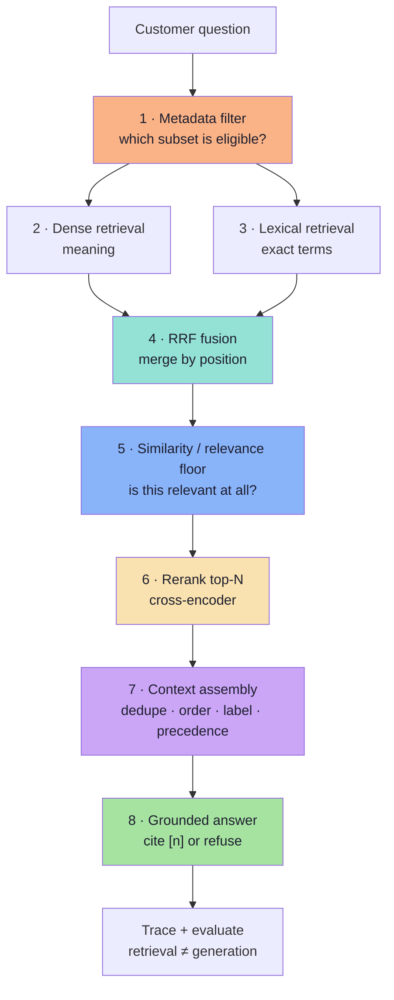
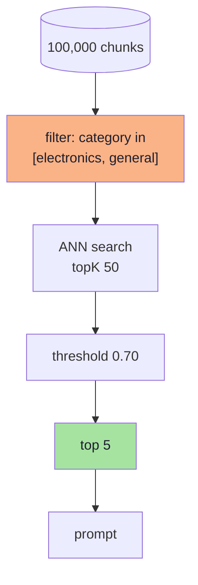
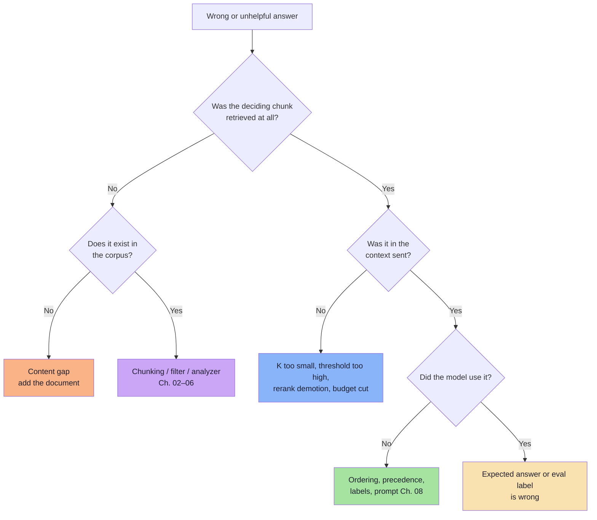
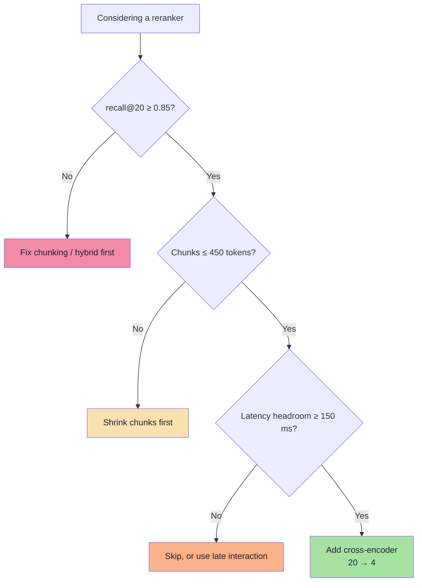

# Lecture 12: Advanced RAG — Complete Consolidated Notes

## The Whole Lecture on One Reference

> **Course:** Forward Deployed Engineer (FDE) & Generative AI Systems
> **Lecture:** 12 — Advanced RAG: Improving Retrieval Quality in Spring AI
> **Source material:** [`Notes.pdf`](./Notes.pdf) (20-page lecture script) and [`Excalidraw-Notes.svg`](./Excalidraw-Notes.svg) (the board)
> **Scope:** Chapters [01](./01_Why_Basic_RAG_Breaks.md) → [09](./09_Evaluation_and_Production_Playbook.md)
> **Diagram format:** Mermaid only
> **Snippet style:** TypeScript-style pseudo-code — illustrative, not production code
> **Prerequisite:** [Lecture 11 — Retrieval-Augmented Generation](../../Lecture%2011/notes/Lecture_11_Complete_Notes.md)

---

## How to Use This Document

This is the **map**, not the territory. Each part compresses one chapter to its load-bearing ideas and decisions, then links out. The chapters hold the full reasoning, pseudo-code, worked numbers and edge cases.

| If you want to… | Read | Time |
|---|---|---|
| Recall what the lecture was about | [Executive Summary](#executive-summary) → [Cheat Sheet](#cheat-sheet-the-eight-controls) | 10 min |
| Decide *where* your pipeline is broken | [The Two Failure Classes](#part-1--two-failure-classes) → [Diagnostic Tree](#diagnostic-tree) | 8 min |
| Fix chunking | Parts [2](#part-2--fixed-size-chunking-and-overlap) and [3](#part-3--structural-semantic-and-contextual-chunking) | 20 min |
| Fix "irrelevant results" | Parts [4](#part-4--top-k-and-similarity-thresholds) and [5](#part-5--metadata-filtering) | 15 min |
| Fix exact SKUs / codes | Part [6](#part-6--hybrid-search-and-rrf) | 15 min |
| Fix "right doc, wrong rank" | Part [7](#part-7--reranking-and-two-stage-retrieval) | 12 min |
| Fix "all the evidence is there but it answers wrong" | Part [8](#part-8--context-engineering) | 15 min |
| Prove it works and ship it | Part [9](#part-9--evaluation-and-operations) + [Go-Live Checklist](#go-live-checklist) | 20 min |
| Prep for an interview | [Eight Sentences](#the-lecture-in-eight-sentences), [Misconceptions](#common-misconceptions), [Self-Check](#self-check-questions) | 25 min |

> **Depth policy.** These notes say *what matters, what it costs, and when it breaks*. The chapters say *how*.

---

## Executive Summary

### The Thesis

> **An LLM cannot reliably use a policy that never reaches its context — and it will not reliably obey a policy that arrives without precedence. Advanced RAG is the engineering of both: first make the evidence findable, then make it authoritative.**

Lecture 11 built the pipeline: documents → chunks → embeddings → top-K → grounded answer. Lecture 12 assumes that pipeline exists and asks a harder question: **why is the answer still wrong, and which stage owns the fix?**



### The Running Example

Three documents, one question, one correct answer:

| Document | Policy |
|---|---|
| General Return Policy | Returns within **30 days** |
| Electronics Return Policy | Electronics returns within **7 days** |
| Damaged Product Policy | Damage must be reported within **48 hours** |

> **"Can I return my damaged headphones after 10 days?"** → **No.** Headphones are electronics (7 days), the item is damaged (48-hour reporting), and 10 days exceeds both.

Every chapter is a different way that answer can go wrong. This table is the spine of the lecture:

| Stage | Failure | Fix | Ch. |
|---|---|---|---|
| Chunking | Window and exception split apart | Structural chunks / parent-child | 02–03 |
| Eligibility | Damaged policy filtered out | `category in [electronics, general]` | 05 |
| Candidates | Damaged policy ranked 4th | Hybrid + RRF | 06 |
| Gate | No floor → junk passes; too high → nothing passes | Calibrated threshold | 04 |
| Ranking | Right doc, position 4, cut at 3 | Cross-encoder rerank | 07 |
| Context | General policy read first, no precedence | Order + explicit rules | 08 |
| Measurement | Nobody knows which change helped | Golden set + ablation | 09 |

### The Lecture in Eight Sentences

1. **Basic RAG assumes the retrieved chunks contain everything needed** — every advanced technique defends or repairs that assumption.
2. **Retrieval failure and generation failure need different fixes**, and a stronger prompt cannot recover a missing document.
3. **Chunking is the first irreversibility**: a rule separated from its exception at ingest cannot be reunited at query time.
4. **Structure beats statistics**: cut on headings, then on sentence boundaries, then on token counts — in that order.
5. **Top-K is a budget and the threshold is a promise** — without a floor, a grounded system can never say "I don't know".
6. **Embeddings blur exact strings**, so hybrid search fuses meaning and terms — and RRF fuses *ranks*, because scores from two retrievers are incomparable.
7. **A cross-encoder reorders a small candidate set far better than any embedding can**, at linear cost in N.
8. **When evidence competes, the prompt must referee** — ordering, labels and explicit precedence decide whether the model obeys the specific rule or the general one.
---

## Part 1 — Two Failure Classes

> Full chapter: **[01_Why_Basic_RAG_Breaks.md](./01_Why_Basic_RAG_Breaks.md)**

| Failure | Definition | Fix lives in |
|---|---|---|
| **Retrieval** | The deciding information was never retrieved | Ch. 02–07 |
| **Generation** | It was retrieved, and the model still used it wrongly | Ch. 08 |

A third case hides inside the first: a **chunking failure** is a retrieval failure *manufactured at ingest*, before any query existed. It is invisible at query time — search returns four high-similarity chunks, all about returns.

### The seven symptoms and their owners

| Symptom | Owner chapter |
|---|---|
| Rule separated from its exception | 02–03 |
| Section buried in a huge chunk | 02–03 |
| Irrelevant documents returned | 04 |
| Out-of-domain question still answered | 04 |
| Exact SKU returns the wrong product | 06 |
| Right document, wrong rank | 07 |
| Both policies present, general one wins | 08 |

### The habit that governs everything

> **Inspect retrieval before inspecting the answer.** Print the retrieved text **with its score, id and metadata**; look at what the database returned before reading what the model said.

That single table of "query → expected chunk → rank → score" is the baseline every later improvement is measured against.

---

## Part 2 — Fixed-Size Chunking and Overlap

> Full chapter: **[02_Fixed_Size_Chunking_and_Overlap.md](./02_Fixed_Size_Chunking_and_Overlap.md)**

An embedding is a fixed-width summary; one vector per 100-page document becomes a centroid of unrelated topics and matches nothing precisely. Chunking creates units that are simultaneously **retrievable, presentable and citable**.

### The arithmetic

```text
step        = S − O                      (S = chunk size, O = overlap)
chunk i     = tokens [i·step, i·step + S)
chunk count = ceil((N − O) / (S − O))
storage ×   = S / (S − O) = 1 / (1 − overlap%)
```

| S | O | Overlap | Storage multiplier |
|---|---|---|---|
| 400 | 0 | 0% | 1.00× |
| 400 | 40 | 10% | 1.11× |
| 400 | 80 | 20% | 1.25× |
| 400 | 200 | 50% | 2.00× |

The board's example — 1,000-word window advancing by 200 — is **20% overlap**: `1–1000 → v1`, `800–1800 → v2`.

### What overlap does and does not fix

| It fixes | It does not fix |
|---|---|
| A sentence straddling a cut | A rule separated from its exception by a section boundary |
| Boundary context loss | A missing heading (ambiguity) |
| — | The cost of more vectors and duplicate top-K slots |

### The parameter trap

`withMinChunkSizeChars(150)` is **not** an overlap setting and **not** a strict minimum chunk length. It is the minimum character length considered *while seeking a split boundary*. Misreading it silently produces chunks that merge differently than you expect.

### Ids: the unsexy requirement

| Id scheme | Re-ingest behaviour |
|---|---|
| `source + index` | Overwrites; an edited policy reuses the old id |
| **`source + index + contentHash`** | Same text → same id; edited text → new id |
| Random UUID | Duplicates on every run — never |

> **Rule:** choose the id scheme before the first ingest. Changing it later means re-embedding the corpus.

### Defaults worth starting from

| Content | Chunk | Overlap |
|---|---|---|
| FAQ / short policies | 200–400 | 0–10% |
| Policies with exceptions | 400–600 | 10–15% |
| Long legal prose | 600–800 | 15–20% |
| Tables | never split | — |
| Code | AST nodes | 0–5% |

And the constraint everyone forgets: **keep chunks ≤ ~450 tokens if a cross-encoder reranker is in the pipeline** (512-token cap, including the query).
---

## Part 3 — Structural, Semantic and Contextual Chunking

> Full chapter: **[03_Structural_Semantic_and_Contextual_Chunking.md](./03_Structural_Semantic_and_Contextual_Chunking.md)**

### Three families, in priority order

| Family | Cuts on | Use when |
|---|---|---|
| **Structural** | Headings, sections, tables, AST nodes | The document has structure (most do) |
| **Semantic** | Similarity drop between adjacent sentences | Long flat text with unmarked topic shifts |
| **Fixed + overlap** | Token count | Neither of the above applies |

Plus a fourth step that is not a chunker at all: **contextual enrichment**, applied after cutting.

### The heading is disambiguating context

*"Electronic products can be returned within 7 days"* could be about returns, refunds, exchanges, cancellations or warranty registration. Only the breadcrumb `Return Policy → Electronics` resolves it. Store it **in the embedded text** (retrievability) and **in metadata** (display, filters, citations).

### Semantic chunking, in one picture

| Pair | Similarity | Meaning |
|---|---|---|
| v1 ↔ v2 | 0.92 | same topic |
| v2 ↔ v3 | 0.87 | same topic |
| **v3 ↔ v4** | **0.31** | **boundary** |
| v4 ↔ v5 | 0.94 | same topic |
| v5 ↔ v6 | 0.88 | same topic |

Cut at the **percentile** of largest distance drops (typically 90th–95th), not at a hard-coded 0.5 — otherwise a dense legal document gives one huge chunk and a chat transcript gives one chunk per sentence.

| Cost | Detail |
|---|---|
| Extra embeddings | N per document |
| Instability | Small edits move boundaries → ids churn → evals invalidate |
| Structure blindness | Tables and cross-references still break |

### The enrichment patterns that matter

| Pattern | Idea | Fixes |
|---|---|---|
| **Parent-child (small-to-big)** | Index small children, return the parent section | Rule/exception split |
| **Contextual retrieval** | Prepend an LLM-written 1–2 sentence situating each chunk | Ambiguous fragments (vendor-reported: ~35–49% fewer retrieval failures, ~67% with reranking) |
| **Late chunking** | Embed the whole document, then pool per-chunk token vectors | Pronoun and cross-reference loss |
| **Sentence window** | Index sentences, return ±2 neighbours | Precision without context loss |
| **Proposition chunking** | Rewrite into atomic facts | Dense fact lookup |
| **Document summary chunk** | One summary chunk per document | "What does this cover?" questions |

> **Selection rule:** add enrichment only for a failure you have measured, and prove it on the golden set. Enrichment raises ingest cost and can flatten precision by making every chunk look similar to every question.

---

## Part 4 — Top-K and Similarity Thresholds

> Full chapter: **[04_Top_K_and_Similarity_Thresholds.md](./04_Top_K_and_Similarity_Thresholds.md)**

### K is a budget, not a quality dial

$$\text{contextTokens} \approx K \times \text{chunkTokens}$$

| K | Effect |
|---|---|
| 2–3 | High precision; cuts the second required rule |
| 4–5 | Default for support policies |
| 8–10 | Multi-condition questions; noise and cost |
| 20 | **Only** as a candidate set before reranking |

**The two-K architecture:** retrieve 10–20 (recall), rerank, present 3–5 (precision). *Retrieve generously, present sparingly.*

### The threshold makes refusal possible

Nearest-neighbour search always returns neighbours — "Who won the IPL in 2026?" still scores 0.31, 0.19, 0.06 against policy documents. A similarity floor is the only mechanism that lets the pipeline come back **empty**, and an empty result is what an honest refusal is built on.

| Misconception | Reality |
|---|---|
| 0.90 similarity = 90% correct | Uncalibrated; corpus-specific |
| 0.75 works everywhere | Depends on model, metric, chunking, store |
| Higher score = better chunk | A verbose on-topic chunk can outscore the precise clause |

### Calibrate, don't copy

```ts
// pseudo-code — threshold from data
for (const t of range(0.5, 0.95, 0.01)) {
  // positives: answerable queries whose top score ≥ t
  // negatives: unanswerable queries whose top score ≥ t
  // pick t maximising F1 (or fixing false-positive retrieval rate)
}
```

Recalibrate whenever the **embedder, chunking, corpus size or metric** changes. Also consider a **relative floor** (`score ≥ top − 0.15`) and a **two-tier** strategy (strict, then relax once).

### Combining the controls

| Control | Question it answers |
|---|---|
| Top-K | How many matches may be returned? |
| Similarity threshold | How relevant must a match be? |
| Metadata filter | Which subset may be searched? |

Order of operations: **filter → search → threshold → cut at K**.
---

## Part 5 — Metadata Filtering

> Full chapter: **[05_Metadata_Filtering.md](./05_Metadata_Filtering.md)**

### The third control — and the only one that can make a document unfindable



### The restrictiveness trap

`category == 'electronics'` **excludes the general policy** — and the general policy is often the document that supplies the exception. Use tiers:

```text
category in ['electronics', 'general']     ← eligibility, not preference
```

> **Rule:** filters express **eligibility**; ranking expresses **preference**. If a document could legitimately contribute, it must be eligible.

### Pre-filter vs post-filter

| | Pre-filter | Post-filter |
|---|---|---|
| Correctness | Exactly K eligible results | May return far fewer than K |
| Recall | Full within subset | Misses eligible docs below the over-fetch window |
| Speed | Slower when highly selective (ANN traversal blocked) | Fast search, wasted results |
| Security | Engine-level | **Unsafe** — data crosses the boundary first |

**Selectivity rule:** filters used on *every* query should be **physical partitions** (namespace/collection), not predicates over a mixed index. That solves both the latency cliff and the isolation requirement.

### The four production requirements

| Requirement | Failure if missing |
|---|---|
| **Server-derived scope** | IDOR: user changes `tenantId` in the request |
| **Fail closed** | Missing tenant defaults to "all" → breach |
| **Same filter on dense and lexical** | Unauthorised chunks enter through BM25 |
| **Temporal predicate (`asOf`)** | Superseded policy wins on similarity |

### The missing-field trap

A chunk without `category` matches neither `category == 'electronics'` nor `category != 'electronics'`. Validate field presence at ingest and **fail loudly**; never default silently to `general` across 40% of the corpus.

---

## Part 6 — Hybrid Search and RRF

> Full chapter: **[06_Hybrid_Search_and_RRF.md](./06_Hybrid_Search_and_RRF.md)**

### Why dense search fails on identifiers

> "Does the **AX-204** wireless headphone support fast charging?"

Document B (BX-900) can outrank Document A (AX-204) because it is the denser semantic cluster of *headphones + fast charging*. Subword tokenization, one-vector compression and contrastive training all push toward *topical* similarity, not *identity*.

| Dense is strong | Dense is weak |
|---|---|
| Paraphrase ("money back" ≈ "refund") | SKUs, error codes, versions, clause numbers |
| Conceptual questions | Negations and exact constraints |

### BM25 in one line

$$\text{BM25}(D,Q)=\sum_i \text{IDF}(q_i)\cdot\frac{f(q_i,D)(k_1+1)}{f(q_i,D)+k_1(1-b+b|D|/\text{avgdl})}$$

| Idea | Effect |
|---|---|
| IDF | Rare terms dominate — the SKU carries ~7× the weight of "fast" |
| TF saturation ($k_1$) | The 10th occurrence adds little |
| Length normalisation ($b = 0.75$) | Long documents do not win by volume |

**Analyzer warnings:** index hyphen variants (`ax-204` and `ax204`); **never** drop negation words (`not`, `no`, `except`) from a policy corpus.

### RRF: fuse ranks, not scores

$$\text{RRF}(d)=\sum_{i=1}^{m}\frac{1}{k+\text{rank}_i(d)},\qquad k=60$$

The board's calculation, for a document ranked 1st in keyword and 3rd in semantic:

$$\text{RRF}(d_A)=\frac{1}{60+1}+\frac{1}{60+3}=0.01639+0.01587=0.03226$$

| Why $k=60$ | Consequence |
|---|---|
| Damping | Rank 1 vs rank 10 differ ~13%, not 10× |
| Agreement rewarded | Appearing in both lists beats dominating one |
| Scale-free | Cosine and BM25 need no normalisation |

| Document | Semantic | BM25 | RRF |
|---|---|---|---|
| **A (AX-204)** | 3 | 1 | **0.03227** |
| B (BX-900) | 1 | 4 | 0.03202 |
| E (accessory) | 2 | 3 | 0.03200 |
| C (general) | 5 | 2 | 0.03151 |
| D (unrelated) | 4 | 5 | 0.03101 |

**A wins from third place** — exact match plus respectable semantics beats a pure semantic win. That is the whole point.

### The three implementation rules

1. **Same id space** — fusion joins on `id`; mismatched ids silently never merge.
2. **Same filters** on both retrievers.
3. **Rename the score** — after fusion `score` is RRF (~0.016–0.033). Applying a 0.70 similarity floor to it drops everything.

> RRF cannot create candidates. It redistributes rank among what the two retrievers already found.
---

## Part 7 — Reranking and Two-Stage Retrieval

> Full chapter: **[07_Reranking_Two_Stage_Retrieval.md](./07_Reranking_Two_Stage_Retrieval.md)**

### The problem in one table

| Initial rank | Document | Rerank score | Final rank |
|---|---|---|---|
| 1 | General Return Policy | 0.68 | 3 |
| 2 | Electronics Return Policy | 0.91 | 2 |
| 3 | Refund Processing Policy | 0.39 | 4 |
| **4** | **Damaged Product Reporting Policy** | **0.97** | **1** |
| 5 | Exchange Policy | 0.28 | 5 |

The deciding document was **retrieved and then cut by K**. Reranking changes the ordering; it does not create information.

### Why two encoders

| | Bi-encoder (embeddings) | Cross-encoder (rerank) |
|---|---|---|
| Query + document | Embedded **independently** | Read **jointly** |
| Documents | Precomputed offline | Scored per query |
| Scale | Millions | Tens |
| Cost | One query vector + ANN | One forward pass **per candidate** |
| Role | Recall | Precision |

> **Design principle:** cheap and approximate over everything, expensive and accurate over a little.

### The numbers that decide the design

| Decision | Default | Constraint |
|---|---|---|
| $N$ candidates | 10–20 (≤ 50) | Cost/latency scale linearly |
| $K$ presented | 3–5 | Token budget and dilution |
| Chunk size | ≤ ~450 tokens | **512-token model cap** — longer chunks are silently truncated |
| Latency added | 60–150 ms p50 | ~10% of an end-to-end 1–3 s request |
| Gate | `recall@20 ≥ 0.85` | Below this, fix candidate generation first |

### Families

| Family | Accuracy | Latency | Notes |
|---|---|---|---|
| Cross-encoder (self-hosted/hosted) | High | 30–300 ms | `bge-reranker-v2-m3` class; the default |
| Late interaction (ColBERT-style) | High | Fast at query time | One vector **per token** — storage heavy |
| LLM listwise | Very high | 1–5 s | Position bias + prompt injection risk |
| None | Baseline | 0 | Fine for tiny corpora |

### Operating it

| Requirement | Reason |
|---|---|
| Timeout + fallback to the fused order | An optional stage must not cause an outage |
| Cache by `(condensedQuery, docId, modelVersion)` | Consistency and cost |
| Condense follow-up queries first | Reranking "and for shoes?" is meaningless |
| Separate score fields | Rerank scores are not embedding scores |
| Report `recall@N` unchanged + `nDCG@5` improved | Proof that only ordering changed |

---

## Part 8 — Context Engineering

> Full chapter: **[08_Context_Engineering.md](./08_Context_Engineering.md)**

### The definition

> Context engineering concerns **what information we provide** to the model and **how we organize it**, so it can interpret the relevant facts and constraints. It matters when context is redundant, unrelated or competing.

All four documents were retrieved; the model still answered "yes, 30 days". That is a **generation failure**, and its fix costs no latency and no re-indexing.

### The assembly pipeline


### Ordering: the lost-in-the-middle effect

Models use information at the **beginning and end** of a long context more reliably than the middle (Liu et al., 2023).

> **Ordering rule:** most specific and most decisive **first**, most general **last**, the question at the very **end**.

### Precedence: the part that actually fixes the running example

| Rule | Statement |
|---|---|
| Specific over general | A category-specific policy overrides the general one |
| Exception over rule | Apply a stated exception even if a general rule permits |
| Newer over older | Prefer the later `effectiveFrom` |
| Explicit over inferred | Do not infer unstated policy |
| Multi-condition | Satisfy all applicable conditions; the strictest governs |

### Labels make chunks self-describing

```text
[1] Return Policy → Electronics (source: return-policy.pdf, p.4,
    effective 2026-01-01, category: electronics)
    Electronic products can be returned within 7 days of delivery.
```

Numbering enables citation; the section resolves ambiguity; the category links "headphones" to "electronics"; the date defeats superseded policy.

### Budget and truncation

| Rule | Reason |
|---|---|
| ~2–4k prompt tokens total, ≤ 5 chunks | Beyond this, quality per token falls |
| Drop **whole** low-ranked chunks when over budget | Truncating a chunk can delete the exception clause |
| Question **after** the sources | Final position, strong attention |
| Retrieved text only in the **data** region | Prevents injection from becoming instruction |

### Framing and injection

| Region | Trust | Rule |
|---|---|---|
| System | Trusted | Rules live here; never built from retrieved text |
| Context | Untrusted | Delimited as `<sources>` data |
| User | Untrusted | Never concatenated into the system message |

> The model must never be the security boundary. If a successful injection could *do* something, the defence is the absent capability, not the prompt.
---

## Part 9 — Evaluation and Operations

> Full chapter: **[09_Evaluation_and_Production_Playbook.md](./09_Evaluation_and_Production_Playbook.md)**

> **Closing principle of the lecture:** evaluate retrieval and generation separately. First inspect what the database returned; then inspect how the model used it.

### The two metric families

| Retrieval | Generation |
|---|---|
| `recall@K` (all gold chunks present) | `faithfulness` (claims supported) |
| `MRR`, `nDCG@5` | `answer correctness` |
| `precision@4` | `citation validity` (100%) |
| `context precision / recall` | `refusal correctness` |

> Never report a generation metric without a retrieval metric beside it. Faithfulness 0.99 at `recall@20` 0.6 means *"it faithfully answers the wrong questions"*.

### Diagnostic tree



### The ablation order

```text
0  baseline (fixed chunks, dense, K=4)
1  + structural chunking
2  + metadata filters
3  + hybrid (dense + BM25 + RRF)
4  + calibrated threshold
5  + retrieve 20 → rerank → present 4
6  + context engineering (order, labels, precedence)
```

One change at a time, same golden set, same corpus snapshot, same model versions.

### Pin seven versions

`corpus · chunking · embedding model · retrieval policy · reranker · prompt · LLM`

Without the fingerprint, "recall dropped 8 points" cannot be attributed. With it, it is a one-query answer.

### Latency and cost

| Component | p50 | p95 |
|---|---|---|
| Query embedding | 20–60 ms | 100–200 ms |
| Dense + BM25 (parallel) | 10–40 ms | 60 ms |
| RRF | < 1 ms | 2 ms |
| Rerank 20 → 4 | 60–150 ms | 250–400 ms |
| LLM generation | 600–2,500 ms | 5,000 ms |

> **The 80/20 of RAG cost is context tokens.** Halving `K_ctx` from 8 to 4 halves generation cost and usually *improves* accuracy.

### Re-indexing

| Rule | Reason |
|---|---|
| New namespace + alias flip | Old and new chunks must never compete |
| Shadow evaluation before the flip | The only way to know the rebuild is better |
| Keep the old namespace for days | Instant rollback |
| Delete-by-source for edits | Deterministic ids make it safe |
| Recalibrate thresholds | Score distributions shift with chunking |

### Runbook highlights

| Symptom | First check | Usual fix |
|---|---|---|
| "It used to work" | Version fingerprint | Roll back the changed version |
| Never refuses | `droppedByThreshold` | Calibrate a floor |
| Always refuses | Empty rate, filter selectivity | Widen filter, lower floor |
| Exact SKU wrong | `lexical` list empty | Fix analyzer |
| Right doc, wrong answer | `contextIds` order | Reorder + precedence |
| Slow p95 | Stage timings | Cap N, batch, cache |
| Cost spike | `contextTokens` | Budget K, cache, route |

---

## Cheat Sheet: The Eight Controls

| # | Technique | Main question | Typical setting | Failure it addresses | Ch. |
|---|---|---|---|---|---|
| 1 | **Chunking** | Where should documents be divided? | 400–600 tokens, 10–20% overlap, structural boundaries | A rule and its exception end up in separate, incomplete results | 02–03 |
| 2 | **Top-K** | How many candidate chunks should be retrieved? | 20 retrieve → 4 present | Too few miss rules; too many add noise | 04 |
| 3 | **Similarity threshold** | Are even the closest results relevant? | Calibrated, ≈ 0.65–0.80 for cosine | An out-of-domain question still retrieves policy documents | 04 |
| 4 | **Metadata filtering** | Which document subset is eligible? | `category in [x, general]` + tenant + `asOf` | Search ignores a known category, version or tenant | 05 |
| 5 | **Hybrid search** | How do we combine meaning and exact terms? | Dense + BM25, both top 20 | A similar product appears instead of the exact SKU | 06 |
| 6 | **RRF** | How do we merge different ranked lists? | $k = 60$ | Vector and lexical scores cannot be compared directly | 06 |
| 7 | **Reranking** | Which candidates deserve the highest positions? | 20 → cross-encoder → 4 | A useful policy is retrieved but ranked below less useful material | 07 |
| 8 | **Context engineering** | How should retrieved material be supplied? | Specific first, labelled, precedence stated | The model ignores a specific policy in favour of a general one | 08 |

> One row per control. Chunking is covered across two chapters because *where* you cut and *what context you restore* are separate decisions.

### Numbers to remember

| Number | Meaning |
|---|---|
| **400–600** | Token chunk size range to start from |
| **10–20%** | Overlap range; storage multiplier `1/(1−o)` |
| **3 / 5 / 8** | K values to compare for a small policy chatbot |
| **20 → 4** | Candidates retrieved vs chunks presented |
| **0.70–0.80** | Typical cosine floor *after* calibration (never copied) |
| **$k = 60$** | RRF smoothing constant |
| **0.03226** | RRF score of a 1st + 3rd place document |
| **48 h / 7 d / 30 d** | The three policy windows in the running example |
| **512** | Cross-encoder max tokens (query + document) |
| **2–4k** | Prompt token budget for a support assistant |
| **+60–150 ms** | Typical rerank latency at N = 20 |
---

## The Running Example, End to End

> **"Can I return my damaged headphones after 10 days?"** — correct answer: **No** (7-day electronics window; 48-hour damage report).

| # | Stage | What happens | Result |
|---|---|---|---|
| 1 | Ingest | Three policies, structural chunks, breadcrumbs | `category`, `policyType`, `effectiveFrom` attached |
| 2 | Query | Condensed (already standalone) | — |
| 3 | Filters | `category in [electronics, general]`, current policies only | Damaged policy stays **eligible** |
| 4 | Dense | 20 candidates | Electronics 1, General 2, Refund 3, Damaged 4 |
| 5 | Lexical | 20 candidates | `damaged` boosts Damaged policy to 1 |
| 6 | RRF | Fuse | Damaged **1**, Electronics 2, General 3 |
| 7 | Floor | 0.70 calibrated | All three survive |
| 8 | Rerank | 20 → cross-encoder | Damaged 0.97, Electronics 0.91, General 0.68 |
| 9 | Context | Dedupe, specific first, general last, labelled, question last | 3 sources, ~1,300 tokens |
| 10 | Prompt | Precedence + citation + refusal rules | — |
| 11 | Answer | "No — electronics returns close after 7 days [1], and damage must be reported within 48 hours [2]." | Citations valid |
| 12 | Eval | `recall@5` = 1.0, faithfulness = 1.0, `mustNotMention: "30 days"` passes | — |

Each row is a control from the cheat sheet. Remove any one and the table breaks in a *specific, predictable* way — which is exactly why the ablation matrix exists.

---

## Formula Card

**Sliding-window chunking**

```text
step = S − O;  count = ceil((N − O)/(S − O));  storage× = S/(S − O)
```

**BM25**

$$\text{BM25}(D,Q)=\sum_{i=1}^{n}\text{IDF}(q_i)\cdot\frac{f(q_i,D)(k_1+1)}{f(q_i,D)+k_1\left(1-b+b\frac{|D|}{\text{avgdl}}\right)},\quad \text{IDF}(q)=\ln\left(1+\frac{N-n(q)+0.5}{n(q)+0.5}\right)$$

**Reciprocal Rank Fusion**

$$\text{RRF}(d)=\sum_{i=1}^{m}\frac{1}{k+\text{rank}_i(d)},\qquad k=60$$

**Weighted fusion (needs normalisation)**

$$\text{score}(d)=\alpha\,\hat{s}_{\text{dense}}(d)+(1-\alpha)\,\hat{s}_{\text{lexical}}(d)$$

**MMR (diversity)**

$$\text{MMR}=\arg\max_{d\in R\setminus S}\left[\lambda\,\text{sim}(q,d)-(1-\lambda)\max_{s\in S}\text{sim}(d,s)\right]$$

**Context and cost**

$$\text{contextTokens}\approx K\times\text{chunkTokens};\qquad \text{cost/query}\approx c_eT_q+c_rN(T_q+T_c)+c_{llm}(T_{ctx}+T_{out})$$

**Retrieval metrics**

$$\text{recall@K}=\frac{|\text{gold}\cap\text{topK}|}{|\text{gold}|};\qquad \text{MRR}=\frac{1}{|Q|}\sum_{q}\frac{1}{\text{rank}_q^{\text{first}}};\qquad \text{nDCG@K}=\frac{\text{DCG@K}}{\text{IDCG@K}}$$

---

## Decision Tables

### Chunking

| Content | Strategy | Size | Overlap |
|---|---|---|---|
| Policy manual with headings | Structural per section | ≤ 500 | 0% |
| Section too long | Headings, then token split | 400–500 | 10% |
| FAQ | One Q&A per chunk | 200–400 | 0–10% |
| Flat transcript | Semantic, percentile breaks | 400–600 | 15% |
| Table | Never split | whole | — |
| Code | AST nodes | 300–500 | 0–5% |

### Retrieval request

| Parameter | Default | Raise when | Lower when |
|---|---|---|---|
| `K_ret` | 20 | `recall@20` < 0.95 | Latency/cost pressure |
| `K_ctx` | 4 | Answers need multiple sections | Context dilution observed |
| Threshold | calibrated | Junk passes; refusals too rare | Valid evidence is being rejected |
| Filter | tenant + category tier + `asOf` | Wrong-domain results | Empty rate > 5% |
| Rerank N | 12–20 | Hard multi-condition queries | p95 budget exceeded |

### Is a reranker worth it?



### Context order

| Situation | Order |
|---|---|
| Default | Rerank score descending |
| Long context | Best first, second-best last |
| Policy conflict | Specific → exception → general |
| Multi-document answer | Group by source, strongest group first |
| Temporal question | Chronological with dates labelled |
---

## Common Misconceptions

| Misconception | Correction |
|---|---|
| "A better prompt fixes bad retrieval" | A prompt cannot add evidence. Diagnose the class first (Ch. 01). |
| "More context is safer" | 4 precise chunks usually beat 12; redundancy and the middle-of-context effect hurt (Ch. 08). |
| "Similarity is confidence" | It is proximity in one embedding space, uncalibrated, corpus-specific (Ch. 04). |
| "Higher top-K always improves recall" | It improves the *candidate* set; the prompt needs precision, not volume (Ch. 04). |
| "Reranking fixes missing documents" | It only reorders what retrieval returned (Ch. 07). |
| "Hybrid search is only for SKUs" | It also fixes clause numbers, versions, names and negation-heavy policy text (Ch. 06). |
| "RRF improves the retrievers" | It fuses their outputs; recall is still bounded by each retriever (Ch. 06). |
| "Overlap prevents chunking problems" | Overlap protects boundaries, not logic. Structure is the fix (Ch. 02–03). |
| "Metadata filters are a relevance feature" | They are an eligibility and authorisation boundary first (Ch. 05). |
| "The LLM can decide which tenant to search" | Filters must be server-derived and fail closed (Ch. 05). |
| "Bigger chunks give the model more to work with" | Beyond ~450 tokens, rerankers truncate and precision falls (Ch. 02, 07). |
| "Faithfulness alone proves the system is good" | It proves the answer matches its context — which may be the wrong context (Ch. 09). |

---

## Glossary

| Term | Meaning |
|---|---|
| **Assumption A** | Basic RAG's premise that retrieved chunks contain everything needed |
| **Retrieval failure** | The deciding evidence was never retrieved |
| **Generation failure** | Evidence was retrieved but misused |
| **Chunking failure** | A retrieval failure created at ingest by a bad boundary |
| **Breadcrumb** | Ordered heading path attached to a chunk (`Return Policy → Electronics`) |
| **Parent-child retrieval** | Index small children, return the larger parent section |
| **Contextual retrieval** | Prepending an LLM-written situational sentence to each chunk before embedding |
| **Late chunking** | Embedding the whole document, then pooling token embeddings per chunk |
| **Bi-encoder** | Independent query/document embeddings (fast, approximate) |
| **Cross-encoder** | Joint query + document forward pass (slow, accurate) |
| **Top-K** | Maximum number of matches requested |
| **Similarity threshold** | Minimum score for a match to be accepted |
| **Metadata filter** | Predicate restricting the eligible document subset |
| **Pre-filter / post-filter** | Filtering during the search vs after it |
| **BM25** | Standard lexical ranking function with IDF, TF saturation and length normalisation |
| **RRF** | Reciprocal Rank Fusion — merges ranked lists by position |
| **$k$ (RRF)** | Smoothing constant, conventionally 60 |
| **Lost in the middle** | U-shaped attention over long contexts |
| **Precedence** | Explicit rule for which policy wins when several apply |
| **Context precision / recall** | Relevance and completeness of the assembled prompt |
| **Faithfulness** | Fraction of answer claims supported by the context |
| **Refusal correctness** | Answering when answerable, refusing when not |
| **Fingerprint** | The seven pinned versions that make a measurement reproducible |
| **Ablation** | Measuring the effect of removing or adding one control |
| **Blue/green re-index** | Building a new namespace, evaluating, then flipping an alias |
---

## Self-Check Questions

1. **A customer gets "yes, 30 days" for damaged electronics after 10 days. All four policies were retrieved. Which failure class is this, and what do you change?**
   → Generation failure. Add explicit precedence (specific over general, exception over rule) and order the specific policy first; keep retrieval unchanged.

2. **`recall@20` = 0.62, `recall@4` = 0.55. Will a reranker help?**
   → No. Candidate generation is the bottleneck; fix chunking, filters or hybrid first. Reranking cannot invent candidates.

3. **Your chunks average 1,100 tokens and reranking seems random. Why?**
   → Cross-encoders cap around 512 tokens; most of each chunk is never scored. Shrink chunks or rerank windows.

4. **Why can't you add cosine similarity to a BM25 score?**
   → Different, corpus-dependent scales; BM25 dominates numerically. Fuse by rank (RRF) or normalise per list with calibration.

5. **Why is `category == 'electronics'` a bug for a return-policy assistant?**
   → It excludes the general policy that often supplies the exception. Use `in ['electronics', 'general']`.

6. **Why does an empty result set matter?**
   → It is the only mechanism that makes an honest refusal reachable. Without a floor, the system always has "something" to answer from.

7. **What is the RRF score of a document ranked 2nd in both lists, with k = 60?**
   → `2 × 1/62 ≈ 0.03226`. Compare a document ranked 1st and 6th: `1/61 + 1/66 ≈ 0.03155` — agreement wins.

8. **A document without a `category` field: does `category != 'electronics'` match it?**
   → No, on most stores. Missing fields match neither equality nor inequality — validate presence at ingest.

9. **What are the three things a chunk must carry besides its text?**
   → Its breadcrumb (in the embedded text), its metadata (source, page, section, category, dates), and a deterministic id.

10. **Two policies are in context and the model follows the wrong one. Name three context-level fixes that do not touch retrieval.**
    → Reorder (specific first), label with scope and date, state precedence rules; also dedupe redundancy and put the question last.

11. **Which single metric proves a reranker changed only the ordering?**
    → `recall@N` unchanged while `nDCG@5` improves.

12. **Why must re-indexing go to a new namespace?**
    → Otherwise old and new chunk versions compete in top-K and your before/after measurements mix two corpora.
---

## Five-Minute Revision

1. **One assumption:** retrieved chunks contain everything needed. Everything else defends it.
2. **Two failure classes:** retrieval (evidence absent) vs generation (evidence misused). Different fixes — always diagnose first.
3. **Three chunking moves:** structural → semantic → fixed + overlap, in that priority; breadcrumb every chunk.
4. **Three retrieval knobs:** K (count), threshold (quality), filter (eligibility) — plus hybrid for exact terms, RRF for fusion.
5. **Two-stage ranking:** retrieve 20, rerank, present 4. Reranking needs chunks ≤ ~450 tokens.
6. **One context rule:** specific first, general last, question at the end, precedence stated, citations verified.
7. **One measurement rule:** retrieval metrics beside generation metrics, one ablation at a time, fingerprint everything.

> **The lecture in one sentence:** *make the right evidence findable, make it eligible, rank it correctly, hand it over in an order that makes the correct rule the obvious one — and measure each of those four things separately.*

---

## Go-Live Checklist

| Area | Check | ☐ |
|---|---|---|
| Ingest | Chunk config versioned; deterministic ids; orphan/dup audit < 5% | ☐ |
| Retrieval | `recall@20` ≥ 0.95; threshold calibrated; hybrid analyzer tested | ☐ |
| Filters | Server-side scope; fail closed; same filter on both retrievers | ☐ |
| Context | Specific-first ordering; precedence rules; labels; budget cap | ☐ |
| Generation | Refusal sentence exact; citation validation active | ☐ |
| Security | Cross-tenant probe refuses; sources are data, not instructions | ☐ |
| Quality | Per-class metrics recorded with fingerprint; ablations documented | ☐ |
| Operations | p95 within SLO; cost/query within budget; traces emitted | ☐ |
| Lifecycle | Blue/green re-index rehearsed; rollback tested | ☐ |
| Process | Golden set in CI; every incident becomes a test case | ☐ |

---

## Chapter Index

| # | Chapter | Core question |
|---|---|---|
| [01](./01_Why_Basic_RAG_Breaks.md) | Why Basic RAG Breaks | Retrieval failure or generation failure? |
| [02](./02_Fixed_Size_Chunking_and_Overlap.md) | Fixed-Size Chunking and Overlap | Where does the text get cut, and what does overlap really buy? |
| [03](./03_Structural_Semantic_and_Contextual_Chunking.md) | Structural, Semantic and Contextual Chunking | How do I keep a rule and its exception together? |
| [04](./04_Top_K_and_Similarity_Thresholds.md) | Top-K and Similarity Thresholds | How much evidence, and how good must it be? |
| [05](./05_Metadata_Filtering.md) | Metadata Filtering | Which documents are even eligible? |
| [06](./06_Hybrid_Search_and_RRF.md) | Hybrid Search and RRF | Why does the exact SKU lose, and how do I fuse ranks? |
| [07](./07_Reranking_Two_Stage_Retrieval.md) | Reranking and Two-Stage Retrieval | Right document, wrong position — what now? |
| [08](./08_Context_Engineering.md) | Context Engineering | All the evidence is there, so why the wrong answer? |
| [09](./09_Evaluation_and_Production_Playbook.md) | Evaluation and Production Playbook | How do I prove it works and keep it working? |

---

**Sources**

- 📄 [`Notes.pdf`](./Notes.pdf) — *Advanced RAG: Improving Retrieval Quality in Spring AI* (20 pages)
- 🖼️ [`Excalidraw-Notes.svg`](./Excalidraw-Notes.svg) — the board: simple vs advanced RAG, the three chunking families, the similarity tables, the RRF calculation with `k = 60`, and the reranking flow
- 📚 [Lecture 11 — RAG](../../Lecture%2011/notes/Lecture_11_Complete_Notes.md) · [Lecture 10 — Vector Databases](../../Lecture%2010/notes/Lecture_10_Complete_Notes.md)
